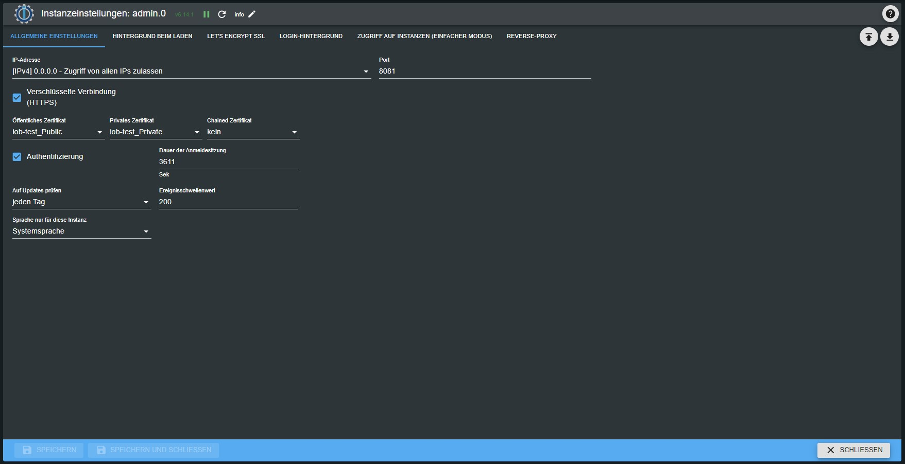
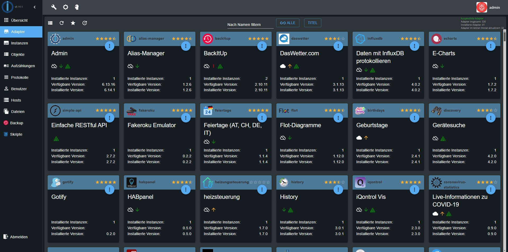
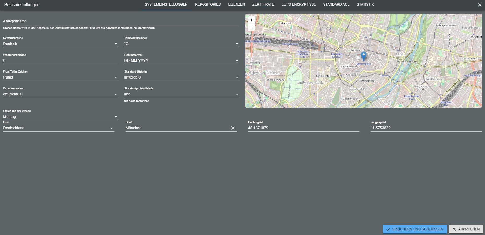

## ausführliche Beschreibung

Der Adapter admin dient der Bedienung der gesamten ioBroker-Installation. Er stellt ein Webinterface zur Verfügung. Dieses wird unter der `<IP-Adresse des Servers>:8081` aufgerufen. Dieser Adapter wird direkt bei der Installation von ioBroker angelegt.

Über das vom Adapter zur Verfügung gestellte GUI können u.a. folgenden Funktionen abgerufen werden:

*   Installation weiterer Adapter
*   Zugriff auf Objektübersicht
*   Zugriff auf die Zustandsübersicht der Objekte
*   Zugriff auf Benutzer und Gruppen Administration
*   Zugriff auf das Logfile
*   Verwaltung der Hosts

## Installation

Dieser Adapter wird direkt bei der Installation von ioBroker angelegt eine manuelle Installation ist nicht notwendig

## Konfiguration

#### IP

Hier wird die IP-Adresse unter der der Adapter erreichbar ist eingegeben. Verschiedene Ipv4 und Ipv6 Möglichkeiten stehen zur Auswahl. 
**Default ist 0.0.0.0\. Dies darf nicht verändert werden!**

#### Port

Hier wird der Port, unter der der Administrator aufgerufen werden kann eingestellt. Falls auf dem Server mehrere Webserver laufen muss dieser Port angepasst werden, damit es nicht zu Problemen wegen doppelter Portvergabe kommt.

#### Verschlüsselung

Soll das sichere Protokoll https verwendet werden ist hier ein Haken zu setzen.

#### Authentifikation

Soll eine Authentifizierung erfolgen ist hier ein Haken zu setzen.

## Bedienung

Über den Webbrowser die folgende Seite aufrufen: 

`<IP-Adresse des Servers>:8081`

## Reiter

Die Hauptseite des Administrators besteht aus mehreren Reitern. In der Grundinstallation werden die Reiter wie in der Abbildung angezeigt. Über das Bleistift-Icon rechts oben (1) können nach der Installation zusätzlicher Adapter weitere Reiter hinzugefügt werden. Dort können auch Reiter deaktiviert werden um eine besser Übersicht zu erhalten.

Ausführliche Informationen sind in den Seiten hinterlegt, die über die Überschriften verlinkt sind.

### [Adapter](/#/docs/adapterref/iobroker.admin/admin/tab-adapters.md)

Hier werden die verfügbaren und installierten Adapter angezeigt und verwaltet.

### [Instanzen](/#/docs/adapterref/iobroker.admin/admin/tab-instances.md)

Hier werden die bereits über den Reiter Adapter installierten Instanzen aufgelistet und können entsprechend konfiguriert werden.

### [Objekte](/#/docs/adapterref/iobroker.admin/admin/tab-objects.md)

Die verwalteten Objekte (z.B. die Geräte/Variablen/Programme der CCU). Hier können Objekte angelegt und gelöscht werden. 
Über die _Pfeil hoch_ und _Pfeil runter_ Knöpfe können ganze Objektstrukturen hoch- oder runtergeladen werden. 
Ein weiterer Knopf ermöglicht die Anzeige der Expertenansicht.

Werden Werte in roter Schrift angezeigt, sind sie noch nicht bestätigt (`ack = false`).

### [Zustände](/#/docs/adapterref/iobroker.admin/admin/tab-states.md)

Die aktuellen Zustände der Objekte.

### [Ereignisse](/#/docs/adapterref/iobroker.admin/admin/tab-events.md)

Eine Liste der laufenden Aktualisierung der Zustände.

### [Gruppen](/#/docs/adapterref/iobroker.admin/admin/tab-groups.md)

Hier werden die angelegten Usergruppen angelegt und die Rechte verwaltet

### [Benutzer](/#/docs/adapterref/iobroker.admin/admin/tab-users.md)

Hier können Benutzer angelegt und zu den bestehenden Gruppen hinzugefügt werden.

### [Aufzählungen](/#/docs/adapterref/iobroker.admin/admin/tab-enums.md)

Hier werden die Favoriten, Gewerke und Räume aus der Homematic-CCU aufgelistet.

### [hosts](/#/docs/adapterref/iobroker.admin/admin/tab-hosts.md)

Informationen über den Rechner, auf dem ioBroker installiert ist. 
Hier kann die aktuelle Version des js-Controllers upgedated werden. 
Liegt eine neue Version vor, erscheint die Beschriftung des Reiters in grüner Farbe.

### [Log](/#/docs/adapterref/iobroker.admin/admin/tab-log.md)

Hier wird das log angezeigt

Im Reiter Instanzen kann bei den einzelnen Instanzen der zu loggende Loglevel eingestellt werden. 
In dem Auswahlmenü wird der anzuzeigende Mindest-Loglevel ausgewählt. 
Sollte ein Error auftreten, erscheint die Beschriftung des Reiters in roter Farbe.

Nach der Installation zusätzlicher Adapter können noch weitere Reiter über das 
Bleistift-Icon oben rechts (1) aktiviert werden. Die Beschreibung dieser 
Reiter befindet sich bei dem entsprechenden Adapter.

### [Systemeinstellungen](/#/docs/adapterref/iobroker.admin/admin/tab-system.md)

In dem sich hier öffnenden Menü werden Einstellungen wie Sprache, Zeit- und Datumsformat sowie 
weitere systemweite Einstellungen getätigt. 

 

Auch die Repositorien und Sicherheitseinstellungen können hier eingestellt werden. 
Eine tiefergehende Beschreibung ist über den Link in dem Titel dieses Abschnitts zu erreichen.

## Changelog
<!--
    Placeholder for the next version (at the beginning of the line):
    ### **WORK IN PROGRESS**
-->
### **WORK IN PROGRESS**
- (@GermanBluefox) Fixed: after "Check adapters for updates" or `iobroker update`, the adapter list shows when the repository was read and not when it was generated (#3729)
- (@GermanBluefox) Updated @iobroker/json-config to 10.1.20: `cron` in the JSON config does not offer the wizard of schedules anymore, which wrote `{}` into the field
- (@GermanBluefox) Updated @iobroker/gui-components to 10.4.6: the CRON dialog has the new mode "Hourly" for a fixed minute of every hour, does not overwrite a schedule that the simple mode cannot show and does not accept invalid values
- (@GermanBluefox) Fixed: the adapter list does not scroll to the top when an adapter is installed
- (@GermanBluefox) Overview shows a hint when a js-controller update is available (#3722, #1914)
- (@GermanBluefox) Fixed: the repository time stamp is updated on the first click of "Check adapters for updates" (#3724)
- (@GermanBluefox) Updated @iobroker/gui-components to 10.4.5: in the JSON config, `customFilter` of `objectId` with `common.role` as a string shows the matching objects and not all others
- (@GermanBluefox) Updated @iobroker/json-config to 10.1.21: `translate` for `text`, also in tables (#3721)
- (@GermanBluefox) Fixed: about 70 texts were not translated, e.g. "Invalid version of ... Required ... Current"; missing spaces in the Windows update commands of js-controller

### 8.3.11 (2026-11-07)
- (@GermanBluefox) Fixed: in the file rights dialog, a "different" permission could not be set for all files
- (@GermanBluefox) Updated @iobroker/json-config to 10.1.19: added the control `diskSelector` to select a file or a folder on the disk of the host where the instance runs (needs js-controller with `CONTROLLER_READ_DISK_DIR`)
- (@krobipd) Fixed: saving the instance settings writes only the settings changed in the dialog, so a setting the adapter wrote into its native while the dialog was open (e.g. its device list) is no longer set back (json-config 10.1.19)
- (@GermanBluefox) Updated @iobroker/socket-classes to 2.10.3: the host commands `readDiskDir` and `deleteDiskFile` need the permission for `cmdExec`

### 8.3.10 (2026-11-06)
- (@GermanBluefox) Fixed: "REAUTHENTICATE!" log flood (#3110)
- (@GermanBluefox) Fixed: the "connection lost" overlay appears only after 2 seconds; loading a tab shows a spinner instead of it
- (@GermanBluefox) Updated `@iobroker/gui-components` to 10.4.3: the loader uses the background of the theme
- (@GermanBluefox) Updated `@iobroker/json-config` to 10.1.17: `coordinates` shows the position on an OpenStreetMap with `map: true`, a click on the map or dragging the marker sets it, `mapStyle` chooses the colors and `readOnly` only shows it; `custom` shows web components of `@iobroker/web-components` (`webComponent`); the text patterns know `_instance`. Admin provides the map, loaded only when a configuration shows one

### 8.3.9 (2026-11-05)
- (@GermanBluefox) Changed: the dialog "Update all adapters" shows the overall progress and the result of each adapter
- (@GermanBluefox) Added: tabs without permission show a lock instead of errors
- (@GermanBluefox) Added: without write rights, instances, enums, users, files, objects and system settings are read-only
- (@GermanBluefox) Updated `@iobroker/json-config` to 10.1.13: the configuration dialogs use the animated icons: upload with progress and result, trash cans, copy with a check mark instead of the alert "Copied", `sendTo` and `setState` confirm the result in the button, rows of tables light up and slide out; fixes for `fileSelector`, `image` with `base64` and the CSV import into an empty table
- (@GermanBluefox) Updated `@iobroker/gui-components` to 10.4.1: animated trash cans, upload, copy and reload symbols in the file and object browser, placeholder rows while the objects are loading, `UploadImage` shows the upload
- (@GermanBluefox) Added: the rights of each object itself (owner, group, everybody) are checked as well

### 8.3.8 (2026-11-04)
- (@GermanBluefox) Added: menu badges jump when their number grows; a ring turns around the adapter icon while it is installed or updated
- (@GermanBluefox) Changed: instance rows fade into the color of the new status; all elements of a row are centered vertically
- (@GermanBluefox) Updated `@iobroker/gui-components` to 10.3.16: arrow up/down at changed numbers in the object browser, check mark after saving
- (@GermanBluefox) Added: admin serves React 19 and 18 as ES modules under `lib/esm/` for web components (`@iobroker/web-components`)
- (@GermanBluefox) Updated packages (`node-forge` 1.4.3, `@module-federation/vite` 1.23.9)

### 8.3.7 (2026-11-03)
- (@GermanBluefox) The `checkDocker` control showed the Docker of the admin host for an instance on that host, also if the instance uses another Docker - e.g. one on a NAS that the adapter names in `iobDockerApi` of its plugin config, or that is chosen in the instance settings. Now admin asks the js-controller of its host as well, if it can check Docker (`CONTROLLER_CHECK_DOCKER`): it checks the Docker connection of the instance, with the `@iobroker/plugin-docker` of the adapter. If it cannot - an older js-controller, an adapter without the plugin - admin checks the Docker of its host itself, as before
- (@GermanBluefox) Updated `@iobroker/json-config` to 10.1.11: `validatorErrorText` is shown below the element instead of the help text, also in the cells of a table (#1911)
- (@GermanBluefox) History data: live values are marked and replaced with the stored ones every 10 seconds; added a reload button (ioBroker.sql#600)
- (@GermanBluefox) An update can be ignored also if its dependencies are not met (#3713)
- (@GermanBluefox) Added: animated icons for start/stop, status, notifications, menu, reload, delete, connection and the result of a command
- (@GermanBluefox) Added: the start/stop button of an instance shows a ring until the instance really runs or stopped
- (@GermanBluefox) Changed: new expert mode symbol (mortarboard)
- (@GermanBluefox) Added: animated folders in the object browser; the restart button of an instance turns until the instance is alive again
- (@GermanBluefox) Changed: the pause button of the log shows the number of new lines as a badge
- (@GermanBluefox) Fixed: the access control dialog crashed with "Error in GUI" and the owner or group could not be changed, if the children had different owners or groups (#3711)

## License

The MIT License (MIT)

Copyright (c) 2014-2026 bluefox <dogafox@gmail.com>

[Full license text](LICENSE)