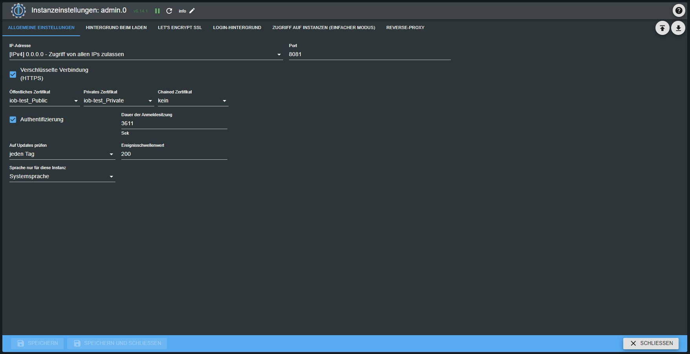
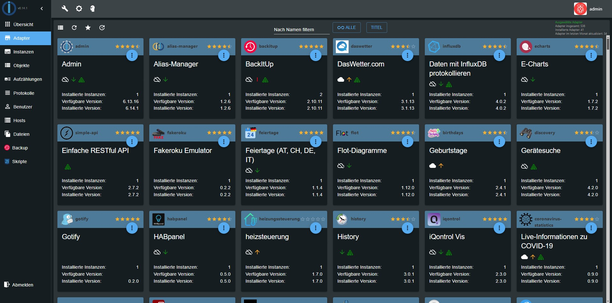
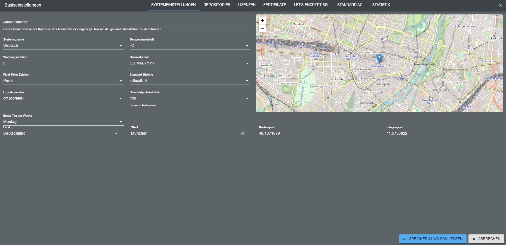

## ausführliche Beschreibung

Der Adapter admin dient der Bedienung der gesamten ioBroker-Installation. Er stellt ein Webinterface zur Verfügung. Dieses wird unter der `<IP-Adresse des Servers>:8081` aufgerufen. Dieser Adapter wird direkt bei der Installation von ioBroker angelegt.

Über das vom Adapter zur Verfügung gestellte GUI können u.a. folgenden Funktionen abgerufen werden:

*   Installation weiterer Adapter
*   Zugriff auf Objektübersicht
*   Zugriff auf die Zustandsübersicht der Objekte
*   Zugriff auf Benutzer und Gruppen Administration
*   Zugriff auf das Logfile
*   Verwaltung der Hosts

## Installation

Dieser Adapter wird direkt bei der Installation von ioBroker angelegt eine manuelle Installation ist nicht notwendig

## Konfiguration

#### IP

Hier wird die IP-Adresse unter der der Adapter erreichbar ist eingegeben. Verschiedene Ipv4 und Ipv6 Möglichkeiten stehen zur Auswahl. 
**Default ist 0.0.0.0\. Dies darf nicht verändert werden!**

#### Port

Hier wird der Port, unter der der Administrator aufgerufen werden kann eingestellt. Falls auf dem Server mehrere Webserver laufen muss dieser Port angepasst werden, damit es nicht zu Problemen wegen doppelter Portvergabe kommt.

#### Verschlüsselung

Soll das sichere Protokoll https verwendet werden ist hier ein Haken zu setzen.

#### Authentifikation

Soll eine Authentifizierung erfolgen ist hier ein Haken zu setzen.

## Bedienung

Über den Webbrowser die folgende Seite aufrufen: 

`<IP-Adresse des Servers>:8081`

## Reiter

Die Hauptseite des Administrators besteht aus mehreren Reitern. In der Grundinstallation werden die Reiter wie in der Abbildung angezeigt. Über das Bleistift-Icon rechts oben (1) können nach der Installation zusätzlicher Adapter weitere Reiter hinzugefügt werden. Dort können auch Reiter deaktiviert werden um eine besser Übersicht zu erhalten.

Ausführliche Informationen sind in den Seiten hinterlegt, die über die Überschriften verlinkt sind.

### [Adapter](/#/docs/adapterref/iobroker.admin/admin/tab-adapters.md)

Hier werden die verfügbaren und installierten Adapter angezeigt und verwaltet.

### [Instanzen](/#/docs/adapterref/iobroker.admin/admin/tab-instances.md)

Hier werden die bereits über den Reiter Adapter installierten Instanzen aufgelistet und können entsprechend konfiguriert werden.

### [Objekte](/#/docs/adapterref/iobroker.admin/admin/tab-objects.md)

Die verwalteten Objekte (z.B. die Geräte/Variablen/Programme der CCU). Hier können Objekte angelegt und gelöscht werden. 
Über die _Pfeil hoch_ und _Pfeil runter_ Knöpfe können ganze Objektstrukturen hoch- oder runtergeladen werden. 
Ein weiterer Knopf ermöglicht die Anzeige der Expertenansicht.

Werden Werte in roter Schrift angezeigt, sind sie noch nicht bestätigt (`ack = false`).

### [Zustände](/#/docs/adapterref/iobroker.admin/admin/tab-states.md)

Die aktuellen Zustände der Objekte.

### [Ereignisse](/#/docs/adapterref/iobroker.admin/admin/tab-events.md)

Eine Liste der laufenden Aktualisierung der Zustände.

### [Gruppen](/#/docs/adapterref/iobroker.admin/admin/tab-groups.md)

Hier werden die angelegten Usergruppen angelegt und die Rechte verwaltet

### [Benutzer](/#/docs/adapterref/iobroker.admin/admin/tab-users.md)

Hier können Benutzer angelegt und zu den bestehenden Gruppen hinzugefügt werden.

### [Aufzählungen](/#/docs/adapterref/iobroker.admin/admin/tab-enums.md)

Hier werden die Favoriten, Gewerke und Räume aus der Homematic-CCU aufgelistet.

### [hosts](/#/docs/adapterref/iobroker.admin/admin/tab-hosts.md)

Informationen über den Rechner, auf dem ioBroker installiert ist. 
Hier kann die aktuelle Version des js-Controllers upgedated werden. 
Liegt eine neue Version vor, erscheint die Beschriftung des Reiters in grüner Farbe.

### [Log](/#/docs/adapterref/iobroker.admin/admin/tab-log.md)

Hier wird das log angezeigt

Im Reiter Instanzen kann bei den einzelnen Instanzen der zu loggende Loglevel eingestellt werden. 
In dem Auswahlmenü wird der anzuzeigende Mindest-Loglevel ausgewählt. 
Sollte ein Error auftreten, erscheint die Beschriftung des Reiters in roter Farbe.

Nach der Installation zusätzlicher Adapter können noch weitere Reiter über das 
Bleistift-Icon oben rechts (1) aktiviert werden. Die Beschreibung dieser 
Reiter befindet sich bei dem entsprechenden Adapter.

### [Systemeinstellungen](/#/docs/adapterref/iobroker.admin/admin/tab-system.md)

In dem sich hier öffnenden Menü werden Einstellungen wie Sprache, Zeit- und Datumsformat sowie 
weitere systemweite Einstellungen getätigt. 

 

Auch die Repositorien und Sicherheitseinstellungen können hier eingestellt werden. 
Eine tiefergehende Beschreibung ist über den Link in dem Titel dieses Abschnitts zu erreichen.

## Changelog
<!--
    Placeholder for the next version (at the beginning of the line):
    ### **WORK IN PROGRESS**
-->
### 8.3.16 (2026-11-26)
- (@GermanBluefox) Quick access: filter field above the cards
- (@GermanBluefox) Log: "All hosts" shows the logs of all hosts together
- (@GermanBluefox) Fixed: the note that an adapter allows only one instance per host showed "%s" instead of the host
- (@GermanBluefox) Updated @iobroker/gui-components to 10.4.9 and @iobroker/json-config to 10.1.25: the folder buttons of the object browser do not open or close on hover anymore

### 8.3.15 (2026-11-20)
- (@GermanBluefox) Installed version: its changes as tooltip, the change log on click
- (@GermanBluefox) Adapter list: warning when the active repository does not exist
- (@GermanBluefox) Adapters and hosts tabs follow updates of the repository
- (@GermanBluefox) A repository update no longer sends the whole repository to every admin page
- (@GermanBluefox) Fixed: quick access shows newly installed adapters only after a reload
- (@GermanBluefox) Updated @iobroker/gui-components to 10.4.8: status icons no longer cover a narrow ID column (#3741)

### 8.3.14 (2026-11-17)
- (@GermanBluefox) Deleting an adapter in a multihost system deletes it also on the other running hosts that hold its package but no longer need it: each host is asked with `getAdapterUsage` (js-controller 8.0 and newer), which also knows the packages a host keeps for the web extension of an instance on another host. A host that does not run or does not answer keeps the package. `iobroker del` on the command line still deletes on its own host only
- (@GermanBluefox) The dialog "Write value" shows how big a string or JSON value is
- (@GermanBluefox) Fixed: in the dialog "Write value" the value type was empty for JSON values and the type "JSON/Object" did not open the JSON editor
- (@GermanBluefox) Instances can get the log level "off" (no log at all, not even errors), if js-controller 8 runs on their host
- (@GermanBluefox) Updated @iobroker/json-config to 10.1.23: `selectSendTo` shows a text field instead of an endless spinner when the instance gives no list, `autocompleteSendTo` shows its `options`; the dialog of `diskSelector` comes from @iobroker/gui-components
- (@GermanBluefox) Updated @iobroker/gui-components to 10.4.7: new dialog `DialogSelectDiskPath` (file or folder on the disk of a host); the description of a CRON schedule is shown in Portuguese, Dutch and Chinese instead of English
- (@GermanBluefox) Overview: the panels have the same color as the tiles of the quick access
- (@GermanBluefox) Fixed: a `sendTo` button in the configuration showed a success after 30 s and lost the answer of an adapter that needed longer (#3737)
- (@GermanBluefox) Updated @iobroker/socket-client to 5.7.0 (`callbackTimeout`) and @iobroker/json-config to 10.1.24 (`sendTo` timeout)
- (@GermanBluefox) The device manager in the settings or a tab of an instance can be pinned to the navigation, like in the device manager tab (#3738)

### 8.3.13 (2026-11-15)
- (@GermanBluefox) Two-factor authentication with an authenticator app: every user sets it up in the user menu (QR code, backup codes), the login page asks for the code, administrators can switch it off for other users in the user dialog
- (@GermanBluefox) Updated @iobroker/webserver to 3.5.0: two-factor authentication (TOTP) for the login
- (@GermanBluefox) Updated @iobroker/socket-classes to 2.11.0: a user with two-factor authentication cannot connect with the password alone (basic authentication or `?user=&pass=`)

### 8.3.12 (2026-11-13)
- (@GermanBluefox) Fixed: after "Check adapters for updates" or `iobroker update`, the adapter list shows when the repository was read and not when it was generated (#3729)
- (@GermanBluefox) Updated @iobroker/json-config to 10.1.20: `cron` in the JSON config does not offer the wizard of schedules anymore, which wrote `{}` into the field
- (@GermanBluefox) Updated @iobroker/gui-components to 10.4.6: the CRON dialog has the new mode "Hourly" for a fixed minute of every hour, does not overwrite a schedule that the simple mode cannot show and does not accept invalid values
- (@GermanBluefox) Fixed: the adapter list does not scroll to the top when an adapter is installed
- (@GermanBluefox) Overview shows a hint when a js-controller update is available (#3722, #1914)
- (@GermanBluefox) Fixed: the repository time stamp is updated on the first click of "Check adapters for updates" (#3724)
- (@GermanBluefox) Updated @iobroker/gui-components to 10.4.5: in the JSON config, `customFilter` of `objectId` with `common.role` as a string shows the matching objects and not all others
- (@GermanBluefox) Updated @iobroker/json-config to 10.1.21: `translate` for `text`, also in tables (#3721)
- (@GermanBluefox) Fixed: about 70 texts were not translated, e.g. "Invalid version of ... Required ... Current"; missing spaces in the Windows update commands of js-controller
- (@GermanBluefox) Fixed: a single sign-on ignored "Stay logged in" and always kept the login for 30 days in the browser. Tokens of an earlier login are removed before the new ones are stored, so they cannot hide them
- (@GermanBluefox) Updated @iobroker/webserver to 3.4.1: a disabled user cannot sign in with single sign-on anymore, like with a password (apart from `admin`)

## License

The MIT License (MIT)

Copyright (c) 2014-2026 bluefox <dogafox@gmail.com>

[Full license text](LICENSE)