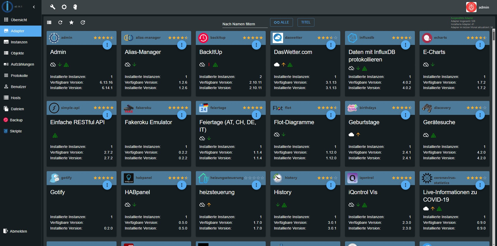

## ausführliche Beschreibung

Der Adapter admin dient der Bedienung der gesamten ioBroker-Installation. Er stellt ein Webinterface zur Verfügung. Dieses wird unter der `<IP-Adresse des Servers>:8081` aufgerufen. Dieser Adapter wird direkt bei der Installation von ioBroker angelegt.

Über das vom Adapter zur Verfügung gestellte GUI können u.a. folgenden Funktionen abgerufen werden:

*   Installation weiterer Adapter
*   Zugriff auf Objektübersicht
*   Zugriff auf die Zustandsübersicht der Objekte
*   Zugriff auf Benutzer und Gruppen Administration
*   Zugriff auf das Logfile
*   Verwaltung der Hosts

## Installation

Dieser Adapter wird direkt bei der Installation von ioBroker angelegt eine manuelle Installation ist nicht notwendig

## Konfiguration

#### IP

Hier wird die IP-Adresse unter der der Adapter erreichbar ist eingegeben. Verschiedene Ipv4 und Ipv6 Möglichkeiten stehen zur Auswahl. 
**Default ist 0.0.0.0\. Dies darf nicht verändert werden!**

#### Port

Hier wird der Port, unter der der Administrator aufgerufen werden kann eingestellt. Falls auf dem Server mehrere Webserver laufen muss dieser Port angepasst werden, damit es nicht zu Problemen wegen doppelter Portvergabe kommt.

#### Verschlüsselung

Soll das sichere Protokoll https verwendet werden ist hier ein Haken zu setzen.

#### Authentifikation

Soll eine Authentifizierung erfolgen ist hier ein Haken zu setzen.

## Bedienung

Über den Webbrowser die folgende Seite aufrufen: 

`<IP-Adresse des Servers>:8081`

## Reiter

Die Hauptseite des Administrators besteht aus mehreren Reitern. In der Grundinstallation werden die Reiter wie in der Abbildung angezeigt. Über das Bleistift-Icon rechts oben (1) können nach der Installation zusätzlicher Adapter weitere Reiter hinzugefügt werden. Dort können auch Reiter deaktiviert werden um eine besser Übersicht zu erhalten.

Ausführliche Informationen sind in den Seiten hinterlegt, die über die Überschriften verlinkt sind.

### [Adapter](/#/docs/adapterref/iobroker.admin/admin/tab-adapters.md)

Hier werden die verfügbaren und installierten Adapter angezeigt und verwaltet.

### [Instanzen](/#/docs/adapterref/iobroker.admin/admin/tab-instances.md)

Hier werden die bereits über den Reiter Adapter installierten Instanzen aufgelistet und können entsprechend konfiguriert werden.

### [Objekte](/#/docs/adapterref/iobroker.admin/admin/tab-objects.md)

Die verwalteten Objekte (z.B. die Geräte/Variablen/Programme der CCU). Hier können Objekte angelegt und gelöscht werden. 
Über die _Pfeil hoch_ und _Pfeil runter_ Knöpfe können ganze Objektstrukturen hoch- oder runtergeladen werden. 
Ein weiterer Knopf ermöglicht die Anzeige der Expertenansicht.

Werden Werte in roter Schrift angezeigt, sind sie noch nicht bestätigt (`ack = false`).

### [Zustände](/#/docs/adapterref/iobroker.admin/admin/tab-states.md)

Die aktuellen Zustände der Objekte.

### [Ereignisse](/#/docs/adapterref/iobroker.admin/admin/tab-events.md)

Eine Liste der laufenden Aktualisierung der Zustände.

### [Gruppen](/#/docs/adapterref/iobroker.admin/admin/tab-groups.md)

Hier werden die angelegten Usergruppen angelegt und die Rechte verwaltet

### [Benutzer](/#/docs/adapterref/iobroker.admin/admin/tab-users.md)

Hier können Benutzer angelegt und zu den bestehenden Gruppen hinzugefügt werden.

### [Aufzählungen](/#/docs/adapterref/iobroker.admin/admin/tab-enums.md)

Hier werden die Favoriten, Gewerke und Räume aus der Homematic-CCU aufgelistet.

### [hosts](/#/docs/adapterref/iobroker.admin/admin/tab-hosts.md)

Informationen über den Rechner, auf dem ioBroker installiert ist. 
Hier kann die aktuelle Version des js-Controllers upgedated werden. 
Liegt eine neue Version vor, erscheint die Beschriftung des Reiters in grüner Farbe.

### [Log](/#/docs/adapterref/iobroker.admin/admin/tab-log.md)

Hier wird das log angezeigt

Im Reiter Instanzen kann bei den einzelnen Instanzen der zu loggende Loglevel eingestellt werden. 
In dem Auswahlmenü wird der anzuzeigende Mindest-Loglevel ausgewählt. 
Sollte ein Error auftreten, erscheint die Beschriftung des Reiters in roter Farbe.

Nach der Installation zusätzlicher Adapter können noch weitere Reiter über das 
Bleistift-Icon oben rechts (1) aktiviert werden. Die Beschreibung dieser 
Reiter befindet sich bei dem entsprechenden Adapter.

### [Systemeinstellungen](/#/docs/adapterref/iobroker.admin/admin/tab-system.md)

In dem sich hier öffnenden Menü werden Einstellungen wie Sprache, Zeit- und Datumsformat sowie 
weitere systemweite Einstellungen getätigt. 

 

Auch die Repositorien und Sicherheitseinstellungen können hier eingestellt werden. 
Eine tiefergehende Beschreibung ist über den Link in dem Titel dieses Abschnitts zu erreichen.

## Changelog
<!--
    Placeholder for the next version (at the beginning of the line):
    ### **WORK IN PROGRESS**
-->
### **WORK IN PROGRESS**
- (@GermanBluefox) Fixed: the `checkDocker` control of a configuration dialog showed the Docker of the host admin runs on, also for an instance on another host. Admin asks the host of the instance now; that host needs a js-controller with `CONTROLLER_CHECK_DOCKER`. With an older js-controller there, the dialog says that Docker cannot be checked instead of showing the wrong host
- (@GermanBluefox) Updated `@iobroker/json-config` to 10.1.9: the `checkDocker` control names the host of the instance
- (@GermanBluefox) Added: OpenRouter as provider in the AI settings of the system settings (`@iobroker/ai-core` 0.0.6, `@iobroker/ai-gui` 0.0.5)

### 8.3.5 (2026-10-26)
- (@GermanBluefox) Fixed: after a single sign-on the access and refresh token were put into the address (`?ssoLoginResponse=`), so they ended up in the browser history and in the logs of a reverse proxy. Only a one-time code is there now, admin fetches the tokens with it. The ID token that came back after connecting an identity (`?id_token=`, with name and e-mail) is not kept any more, nothing used it
- (@GermanBluefox) Fixed: the session cookie of a single sign-on was readable by scripts and sent along cross-site requests, unlike the one of a password login
- (@GermanBluefox) Fixed: behind a reverse proxy with https the single sign-on sent `http://.../sso-callback` to the identity provider, which did not match the registered redirect URI. The protocol now comes from `X-Forwarded-Proto`, and the external address of admin can be set in the SSO settings
- (@GermanBluefox) Important for everybody who had the single sign-on switched on with an admin before 8.3.4: an identity that somebody else connected with a user stays connected after the update. Check on the "Users" page that every user with single sign-on is connected with the right account, and disconnect the others
- (@GermanBluefox) Fixed: the device manager crashed if a slider of a device got a value that is not a number (#3699)
- (@GermanBluefox) Added: the system settings have an "AI" tab to set up the AI provider, its API key and the model once for the whole system; only one provider can be active
- (@GermanBluefox) Changed: the tabs of the system settings stand on the left with icons, on a phone on top
- (@GermanBluefox) Changed: the AI assistant takes provider, key and model from the "AI" tab of the system settings

### 8.3.4 (2026-10-25)
- (@typhosj) Fixed: the license dialog of a paid adapter stayed empty and could not be accepted, so the adapter could not be installed. The dialog loaded `licenseInformation.link` as the license text, but that link names the page with prices and where to buy, which the browser may not read. The license text comes from the repository of the adapter again, and the link is shown next to it. A license text that cannot be loaded no longer blocks the dialog, and a short Markdown text that needs no scrolling can be accepted (#3311, ioBroker/ioBroker.vis-2#707)
- (@agross) Improved the English wording of the active repository warning.
- (@GermanBluefox) Fixed: "Add Single-Sign On" in the user dialog sent the display name of the user instead of the user ID, so connecting failed for every user whose name differs from the ID

### 8.3.3 (2026-10-23)
- (@GermanBluefox) Fixed: the object browser showed an object twice and copied its row while scrolling, if a sibling ID began with the same text followed by a space (#3693)

### 8.3.2 (2026-10-23)
- (@GermanBluefox) Fixed: the adapter list was empty after an adapter update and switching between the tabs (#3695)
- (@GermanBluefox) Fixed: an adapter updated while the adapter list was loading was still offered for update with the same version

### 8.3.1 (2026-10-22)
- (@GermanBluefox) Added: sort icon and tooltip on the sort button in the adapters tab (#3684)
- (@GermanBluefox) Added: disk and RAM usage of the host are shown as bars with tooltip in the instances tab
- (@GermanBluefox) Added: the repository version of an adapter can be installed with one click, if a newer or a self-installed version (e.g., from GitHub) is installed (#2973)

## License

The MIT License (MIT)

Copyright (c) 2014-2026 bluefox <dogafox@gmail.com>

[Full license text](LICENSE)