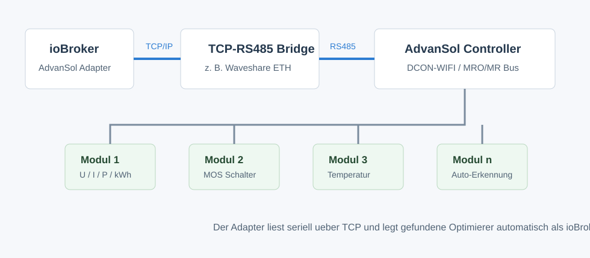
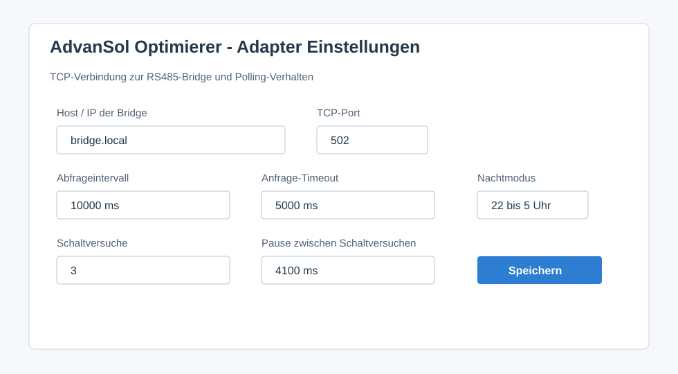
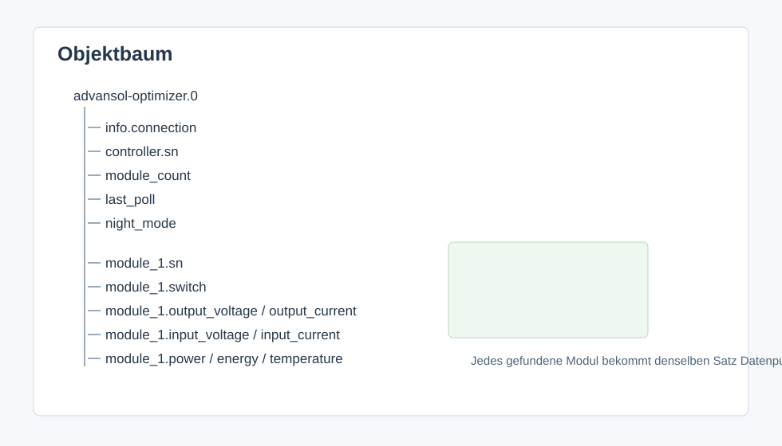

# ioBroker AdvanSol Optimizer Adapter

ioBroker-Adapter für AdvanSol DCON-WIFI / MRO/MR-Optimierer, die über eine TCP-zu-RS485-Brücke, beispielsweise einen Waveshare ETH-zu-RS485-Adapter, verbunden sind.

Produkt- und Herstellerinformationen sind auf der [offiziellen Website von AdvanSol Power](https://www.advansol-power.com/) verfügbar.

Der Adapter basiert auf dem ursprünglichen ioBroker JavaScript-Skript. `Advinsol Optimierer2` und verlagert die Logik in einen dedizierten ioBroker-Adapter-Namespace.

## Merkmale

- Verbindet sich mit einer TCP-RS485-Brücke.
- Liest die Seriennummer des Controllers.
- Erkennt verbundene Optimierungsmodule auf allen Controller-Gerätelistenseiten.
- Prüft während des Tagesbetriebs alle fünf Minuten auf hinzugefügte Optimierer; ein Neustart ist nicht erforderlich.
- Fragt die Modulwerte zyklisch ab.
- Schaltet jeden Optimierer-MOS durch `module_X.switch` Die
- Überspringt die Abfrage während eines konfigurierbaren Nachtfensters.
- Zeigt den Verbindungsstatus und den Nachtmodus an.

## Typischer Aufbau

1. ioBroker läuft im lokalen Netzwerk.
2. Eine TCP-RS485-Brücke ist über LAN oder Wi-Fi erreichbar.
3. Die RS485-Seite der Brücke ist mit dem AdvanSol-Controller verbunden.
4. Der Controller kommuniziert mit den Optimierungsmodulen.

Empfohlene Brückenkonfiguration:

- Modus: TCP-Server
- Anschluss: wie im Adapter konfiguriert, Standard `502`
- Serielle Einstellungen: Anpassung an den AdvanSol-Controller und den RS485-Bus
- RS485 A/B korrekt angeschlossen
- Nur ein aktiver Master am RS485-Bus

## Adaptereinstellungen

| Einstellung          | Bedeutung                                        | Standard |
| -------------------- | ------------------------------------------------ | -------- |
| `Host`               | IP-Adresse oder Hostname der TCP-RS485-Brücke    | leer     |
| `TCP port`           | TCP-Port der Brücke                              | `502`    |
| `Polling interval`   | Zeit zwischen den Abfragezyklen in Millisekunden | `10000`  |
| `Request timeout`    | Maximale Wartezeit für eine Antwort              | `5000`   |
| `Switch retries`     | Anzahl wiederholter MOS-Schaltbefehle            | `3`      |
| `Switch retry delay` | Verzögerung zwischen den Schaltversuchen         | `4100`   |
| `Night mode starts`  | Stunde, in der die Wahl ausfällt                 | `22`     |
| `Night mode ends`    | Stunde, in der die Wahl wieder aufgenommen wird  | `5`      |

Das Nachtfenster vermeidet unnötige Fehler, die auftreten, wenn Optimierer nachts oder bei fehlender PV-seitiger Spannung nicht reagieren.

## Staaten

Allgemeine Staaten:

| Zustand           | Bedeutung                                      |
| ----------------- | ---------------------------------------------- |
| `info.connection` | Verbindung zur TCP-RS485-Brücke                |
| `connection`      | Zusätzlicher Verbindungsstatus                 |
| `controller.sn`   | Seriennummer des Controllers                   |
| `module_count`    | Anzahl der gefundenen Optimierer               |
| `last_poll`       | Zeitpunkt des letzten erfolgreichen Wahlzyklus |
| `night_mode`      | Adapter erkannt Nachtmodus                     |

Jeder Optimierer erhält einen Kanal mit dem Namen `module_1`, `module_2`, `module_3` und so weiter.

| Zustand                   | Bedeutung                              | Einheit |
| ------------------------- | -------------------------------------- | ------- |
| `module_X.sn`             | Seriennummer des Optimierers           |         |
| `module_X.switch`         | MOS ein/aus, beschreibbar              |         |
| `module_X.mos`            | MOS-Status, `0` aus und `1` An           |         |
| `module_X.software`       | Softwareversion                        |         |
| `module_X.hardware`       | Hardwareversion                        |         |
| `module_X.output_voltage` | Ausgangsspannung                       | V       |
| `module_X.output_current` | Ausgangsstrom                          | A       |
| `module_X.input_voltage`  | Eingangsspannung                       | V       |
| `module_X.input_current`  | Eingangsstrom                          | A       |
| `module_X.power`          | Leistung                               | W       |
| `module_X.energy`         | Gesamtenergie                          | kWh     |
| `module_X.temperature`    | Temperatur                             | °C      |
| `module_X.raw`            | Rohantwort als Hexadezimalzeichenkette |         |
| `module_X.last_update`    | Letzte Modulaktualisierung             |         |

## Geräteerkennung

Der Controller sendet seine Geräteliste seitenweise zurück, die normalerweise jeweils bis zu zehn Optimierer enthält. Der Adapter liest jede vom Controller gemeldete Seite und erstellt daraus einen Optimierer. `module_X` Objekte, die die Controlleradresse jedes Geräts verwenden. Es gibt keine Beschränkung auf zehn Geräte oder zwei Seiten.

Die Erkennung wird beim Systemstart und außerhalb des konfigurierten Nachtfensters alle fünf Minuten ausgeführt. Neu registrierte Optimierer werden automatisch hinzugefügt. Ungültige oder unvollständige Listen werden verworfen; bei einer fehlgeschlagenen Aktualisierung bleibt die vorherige Geräteliste erhalten und die Abfrage wird fortgesetzt. Vorhandene Objekte bleiben erhalten, auch wenn ein Gerät nicht mehr aufgeführt ist.

## Schaltoptimierer

Der Staat `module_X.switch` ist beschreibbar. Setzen Sie es auf `true` Sendet den MOS-Ein-Befehl für die Modulseriennummer. Einstellen auf `false` sendet den MOS-Aus-Befehl.

Der Adapter wiederholt den Befehl gemäß `Switch retries` und wartet `Switch retry delay` zwischen den Versuchen. Dies ist beabsichtigt, da TCP-RS485-Konverter und Optimierungsmodule möglicherweise nicht jeden Befehl sofort bestätigen.

## Fehlerbehebung

- Keine Verbindung: Überprüfen Sie die IP-Adresse, den Port und den TCP-Servermodus der Bridge.
- `TCP connect timeout` Die Brücke ist nicht erreichbar oder der Port ist falsch.
- Es wurden keine Module gefunden: Überprüfen Sie RS485 A/B, die Stromversorgung des Controllers und die PV-seitige Versorgung.
- Keine Antwort tagsüber: Überprüfen Sie die RS485-Parameter und die Verkabelung.
- Keine nächtlichen Reaktionen: Normalerweise normal, wenn die Optimierer ohne PV-Spannung in den Ruhemodus wechseln. Das Nachtfenster anpassen.
- Umschalten funktioniert nicht: Seriennummer muss bekannt sein, Modul muss reagieren, erhöhen `Switch retries` falls erforderlich.
- Mehrere Systeme am Bus: Stellen Sie sicher, dass nicht mehr als ein aktiver Master Frames sendet.

## Changelog

### 0.1.13

- Read all controller device-list pages so optimizers beyond the first ten are discovered.
- Refresh the device list every five minutes to pick up newly added optimizers.
- Validate page headers, checksums and device addresses; retain the previous list on refresh errors.
- Recover the request queue after failed exchanges and reject measurements with a wrong serial number or checksum.
- (ioBroker-Bot) Adapter requires admin >= 7.8.23 now.

### 0.1.12

- Fixed all findings from the ioBroker latest-repository review.
- Added the official AdvanSol manufacturer link and removed direct-install instructions.
- Changed object names to English and improved state roles and units.
- Validated all configurable timing values and changed polling to sequential timeouts.
- Completed all required admin and adapter-description translations.

### 0.1.11

- Published the adapter with npm provenance.
- Completed repository checker cleanup.

### 0.1.8

- Configured npm token based release publishing for the automated deploy workflow.

### 0.1.7

- Kept the standard ioBroker test workflow focused on package and integration tests.

### 0.1.6

- Switched CI to the standard ioBroker testing actions.
- Added standard package and integration tests for the repository checker.
- Added ioBroker development tooling and release configuration.
- Enabled jsonConfig i18n files.

### 0.1.5

- Fixed remaining adapter checker findings for repository metadata, workflow configuration and admin configuration.

### 0.1.4

- Published through the automated GitHub Actions release workflow with npm provenance.

### 0.1.3

- Added GitHub Actions release workflow with npm provenance publishing.
- Added responsive admin configuration metadata.
- Added repository metadata required by the ioBroker adapter checker.
- Updated README content for English-only publication checks.

### 0.1.2

- Updated package metadata for ioBroker adapter checker compatibility.
- Added repository, testing, license information, tier and extended translations.

### 0.1.1

- Added adapter icon and localized admin configuration labels.

### 0.1.0

- Initial adapter version based on the existing ioBroker JavaScript optimizer script.

Older entries can be moved to CHANGELOG_OLD.md when the changelog grows.

## License

Copyright (c) 2026 TheBam

MIT License. See [LICENSE](https://github.com/TheBam1990/ioBroker.advansol-optimizer/blob/main/LICENSE) for details.