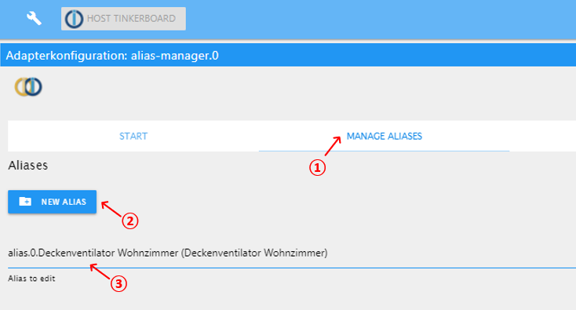
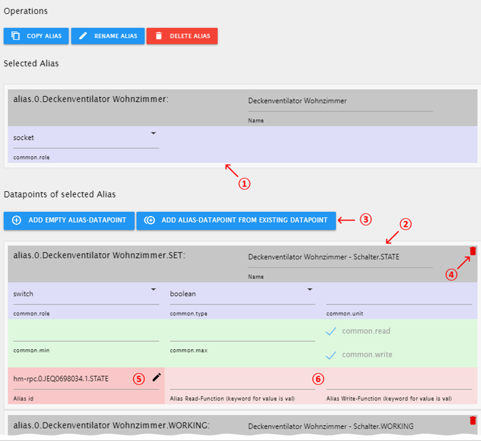
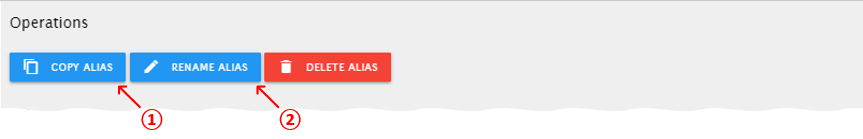
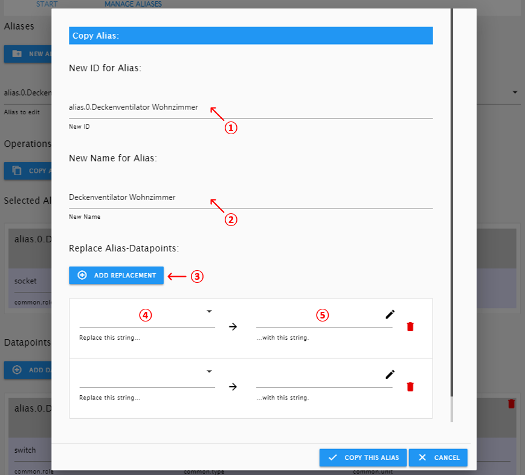
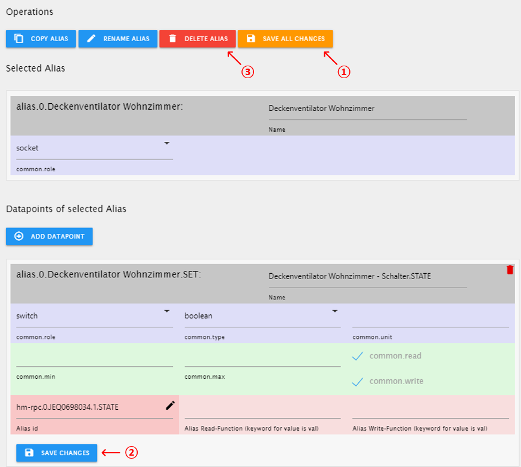
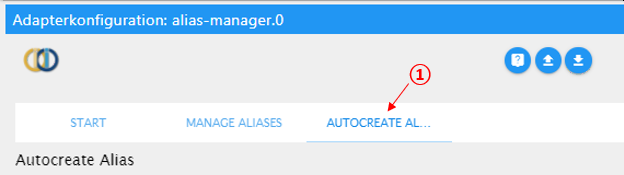
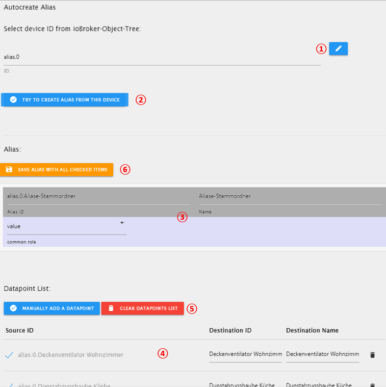

# ioBroker.alias-manager

## alias-manager-Adapter für ioBroker

Verwaltet und erstellt Aliase.

## Credits

Dieser Adapter wäre ohne die großartige Arbeit von @sbormann ( <https://github.com/sbormann> ) nicht möglich gewesen, der frühere Versionen dieses Adapters entwickelt hat.

## Wie man Probleme und Funktionswünsche meldet

Idealerweise verwenden Sie hierfür GitHub-Issues. Die beste Methode hierfür ist, den Adapter in den Debug-Log-Modus zu versetzen (Instanzen → Expertenmodus → Spaltenprotokollierungsstufe). Laden Sie anschließend die Logdatei von der Festplatte über das ioBroker-Unterverzeichnis „log“ herunter, **nicht** über die Administrationsoberfläche, da dort Zeilen abgeschnitten werden.

## Kurze Einführung

### Aliase verwalten

- (1) Klicken Sie auf „ALIAS VERWALTEN“
- (2) Um einen neuen Alias zu erstellen, klicken Sie auf „NEUER ALIAS“ oder
- (3) Wählen Sie einen vorhandenen Alias zum Bearbeiten aus.

- (1) Anschließend finden Sie einen Bereich mit allgemeinen Einstellungen für diesen Alias, wie z. B. den Namen oder die allgemeine Rolle.
- (2) Nachfolgend finden Sie eine Liste mit allen Datenpunkten des Alias.
- (3) Sie können dieser Liste Alias-Datenpunkte hinzufügen, indem Sie entweder einen leeren hinzufügen oder einen vorhandenen iobroker-Datenpunkt auswählen und dessen Einstellungen in einen neuen Alias-Datenpunkt kopieren.
- (4) Sie können Datenpunkte löschen, indem Sie auf das Papierkorbsymbol klicken.
- Jeder Datenpunkt verfügt über mehrere Felder zur Konfiguration:
  - Im grauen Bereich können Sie den Namen festlegen oder den Datenpunkt löschen.
  - Im blauen Bereich können Sie die Rolle, den Typ und – optional – die Einheit konfigurieren.
  - Im grünen Bereich können Sie optionale Minimal- und Maximalwerte festlegen und bestimmen, ob der Datenpunkt schreibgeschützt sein soll (common.write ist deaktiviert) und ob auf seinen Wert zugegriffen werden kann (common.read ist aktiviert – dies ist in den meisten Fällen die richtige Einstellung).
  - Im roten Bereich können Sie:
    - (5) Konfigurieren Sie den ursprünglichen ioBroker-Datenpunkt, mit dem dieser Alias-Datenpunkt verknüpft ist. Beide (der ursprüngliche Datenpunkt und der Alias-Datenpunkt) werden synchronisiert gehalten.
    - (6) Darüber hinaus können Sie Konvertierungsfunktionen für Lese- und Schreibvorgänge konfigurieren.
      - Beispiel: Wenn Sie einstellen `val / 10` Bei einer „Read-Function“ beträgt der Wert des Alias-Datenpunkts immer 10 Prozent des ursprünglichen Datenpunkts.
      - In den meisten Fällen möchten Sie dann konfigurieren `val * 10` als "Write-Function", um dieses Verhältnis auch beim Schreiben in den Alias-Datenpunkt beizubehalten.
    - Weitere Informationen dazu finden Sie in der ioBroker-Dokumentation zu Aliasen unter <https://www.iobroker.net/#en/documentation/dev/aliases.md>

- (1) Wenn Sie auf „ALIAS KOPIEREN“ klicken, um zu kopieren oder
- (2) Wenn Sie auf „ALIAS UMBENENNEN“ klicken, um den Alias umzubenennen, öffnet sich folgendes Dialogfeld:

\
&#x20;Hier können Sie:

- (1) Eine neue ID festlegen und
- (2) Einen neuen allgemeinen Namen für den Alias festlegen
- (3) Durch Klicken auf „ERSATZ HINZUFÜGEN“ können Sie Zeilen zur folgenden Liste hinzufügen, wobei Sie Folgendes tun können:
  - (4) Geben Sie eine Zeichenkette ein, die gesucht und durch (5) diese Zeichenkette ersetzt wird.
  - Mit dieser Funktion können Sie die ursprünglichen ioBroker-Datenpunkte schnell ändern; Ihre Alias-Datenpunkte sind damit verknüpft.
  - Beispiel:
    - Sie haben einen Lüfter mit mehreren Datenpunkten wie `SET`, `ERROR` Und `UNREACH`
    - Diese Alias-Datenpunkte sind mit ursprünglichen Datenpunkten verknüpft, wie zum Beispiel `hm-rpc.0.JEQ0698034.1.STATE`, `hm-rpc.0.JEQ0698034.0.ERROR` Und `hm-rpc.0.JEQ0698034.0.UNREACH`
    - Wenn Ihr Gerät defekt ist und durch ein neues ersetzt werden muss, ändert sich seine Seriennummer, beispielsweise in ASDF1234.
    - Um alle Links in all Ihren Alias-Datenpunkten auf einmal zu aktualisieren, können Sie suchen nach `hm-rpc.0.JEQ0698034` und ersetzen Sie es durch `hm-rpc.0.ASDF1234`
    - Dies ist auch nützlich, wenn neue Aliase erstellt werden, die einem alten ähneln. Kopieren Sie einfach den Alias, vergeben Sie eine neue ID und einen neuen Namen und verwenden Sie die Ersetzungsfunktion, um die verknüpften Datenpunkte anzupassen.

- Nach der Änderung der Einstellungen können Sie:
- (1) Speichern Sie alle geänderten Alias-Datenpunkte auf einmal, indem Sie auf „ALLE ÄNDERUNGEN SPEICHERN“ klicken oder
- (2) Speichern Sie nur einen Datenpunkt durch Klicken auf „ÄNDERUNGEN SPEICHERN“.
- (3) Schließlich können Sie den gesamten Alias löschen, indem Sie auf „ALIAS LÖSCHEN“ klicken.

### Alias automatisch erstellen

- (1) Klicken Sie auf „ALIASE AUTOMATISCH ERSTELLEN“

- (1) Wählen Sie zunächst eine Geräte-ID aus dem ioBroker-Objektbaum aus.
- (2) Klicken Sie anschließend auf „Versuchen Sie, einen Alias von diesem Gerät zu erstellen“.
- (3) Anschließend finden Sie die festgelegten Einstellungen für den Alias und
- (4) Eine Liste aller Datenpunkte des ausgewählten Geräts
  - Alle automatisch erkannten Datenpunkte werden überprüft (nur die überprüften Zeilen werden gespeichert).
  - Wird ein Datenpunkt automatisch erkannt, erhält er eine Ziel-ID. Diese entspricht dem Datenpunkt des Alias (der ursprüngliche Datenpunkt wird mit diesem neuen Alias-Datenpunkt verknüpft). Die automatische Erstellungsfunktion versucht, standardisierte Datenpunkt-IDs zuzuordnen, abhängig vom Gerätetyp. Sie können die Einstellungen jedoch nach Belieben anpassen, jede Ziel-ID muss aber eindeutig sein.
  - Und schließlich können Sie einen Namen für den Zielalias-Datenpunkt eingeben.
  - Alle nicht automatisch erkannten Datenpunkte werden in der Liste ohne Kontrollkästchen angezeigt. Sie können die Einstellungen manuell anpassen und das Kontrollkästchen aktivieren.
  - (5) Sie können dieser Liste auch manuell weitere Datenpunkte hinzufügen oder die gesamte Liste löschen.
- (6) Anschließend können Sie den neuen Alias mit allen markierten(!) Datenpunkten speichern (nicht markierte Datenpunkte werden verworfen).
- Anschließend werden Sie automatisch zum Tab „ALIASE VERWALTEN“ weitergeleitet, wo der neue Alias geöffnet wird, um dessen Einstellungen nach Bedarf anzupassen.

## Changelog
<!--
	Placeholder for the next version (at the beginning of the line):
	### **WORK IN PROGRESS**
-->
### **WORK IN PROGRESS**
- (copilot) Adapter requires admin >= 7.6.17 now
- (mcm1957) unused backend code has been removed
- (mcm1957) Dependencies have been updated.

### 3.0.0 (2026-10-13)
- (copilot) Adapter requires node.js >= 22 now
- (@GermanBluefox) Corrected loading via ioBroker.pro

### 2.1.0 (2026-02-12)
- (copilot) Adapter requires node.js >= 20 now
- (copilot) Adapter requires js-controller >= 6.0.11 now
- (copilot) Adapter requires admin >= 7.6.17 now
- (copilot) Added Node.js 24.x to testing matrix
- (mcm1957) Dependencies have been updated.

### 2.0.0 (2024-10-20)
- (mcm1957) Adapter has been moved to iobroker-community-adapter organisation.
- (mcm1957) Adapter requires js-controller 5, admin 6 and node.js 20 now.
- (mcm1957) Dependencies have been updated.

### 1.2.6 (2022-03-02)
* (sbormann) Updated dependencies.
* (sbormann) Fixed saving of common.custom.

### 1.2.5 (2022-03-02)
* (sbormann) Added All and None Buttons to select Datapoint while autocreating alias.
* (sbormann) Some GUI-Enhancements and fixes for dark mode.

## License
MIT License

Copyright (c) 2024-2026 iobroker-community-adapters <iobroker-community-adapters@gmx.de>  
Copyright (c) 2022 Sebastian Bormann <sebastian@bormann.net>

Permission is hereby granted, free of charge, to any person obtaining a copy
of this software and associated documentation files (the "Software"), to deal
in the Software without restriction, including without limitation the rights
to use, copy, modify, merge, publish, distribute, sublicense, and/or sell
copies of the Software, and to permit persons to whom the Software is
furnished to do so, subject to the following conditions:

The above copyright notice and this permission notice shall be included in all
copies or substantial portions of the Software.

THE SOFTWARE IS PROVIDED "AS IS", WITHOUT WARRANTY OF ANY KIND, EXPRESS OR
IMPLIED, INCLUDING BUT NOT LIMITED TO THE WARRANTIES OF MERCHANTABILITY,
FITNESS FOR A PARTICULAR PURPOSE AND NONINFRINGEMENT. IN NO EVENT SHALL THE
AUTHORS OR COPYRIGHT HOLDERS BE LIABLE FOR ANY CLAIM, DAMAGES OR OTHER
LIABILITY, WHETHER IN AN ACTION OF CONTRACT, TORT OR OTHERWISE, ARISING FROM,
OUT OF OR IN CONNECTION WITH THE SOFTWARE OR THE USE OR OTHER DEALINGS IN THE
SOFTWARE.