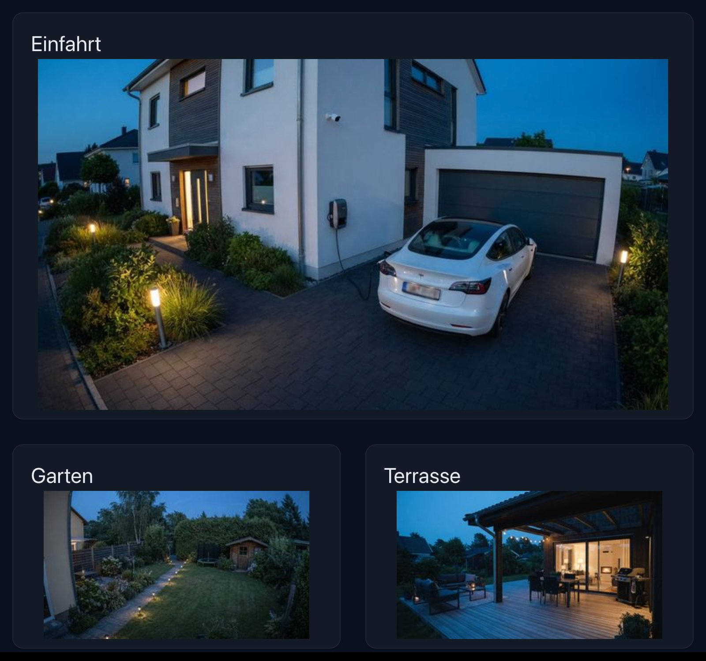
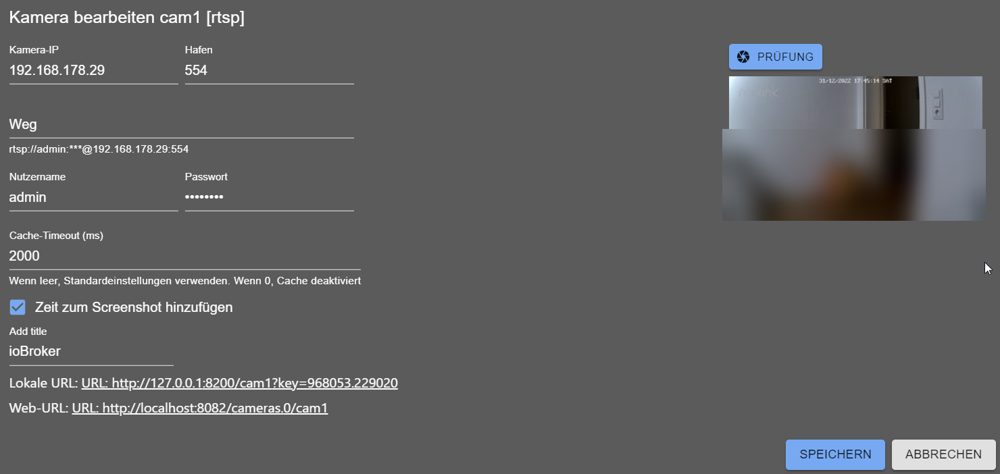

# IoBroker.cameras
**Dieser Adapter verwendet Sentry-Bibliotheken, um Ausnahmen und Codefehler automatisch an die Entwickler zu melden.** Weitere Details und Informationen zum Deaktivieren der Fehlerberichterstattung finden Sie in Abschnitt [Sentry-Plugin-Dokumentation](https://github.com/ioBroker/plugin-sentry#plugin-sentry)! Die Sentry-Berichterstattung wird ab js-controller 3.0 verwendet.

## IP-Kamera-Adapter für ioBroker
Sie können Ihre Web-/IP-Kameras in vis und andere Visualisierungen integrieren.
Wenn Sie eine Kamera mit dem Namen `cam1` konfigurieren, ist sie auf dem Webserver unter `http(s)://iobroker-IP:8082/cameras.0/cam1` verfügbar.

**Verwenden Sie genau diese URL - ohne Dateiendung.** Jede Anfrage an diese URL ruft ein neues Bild von der Kamera ab, sodass ein regelmäßiges Neuladen ein Livebild liefert.

Der Adapter speichert das letzte Bild zusätzlich als Datei unter `cameras.0/cam1.jpg`, die der Webserver zufällig auch unter `http(s)://iobroker-IP:8082/cameras.0/cam1.jpg` bereitstellt. Diese Datei wird nur beim Start des Adapters und bei der Verarbeitung einer `image`-Nachricht überschrieben - sie wird **nicht** durch eine Anfrage aktualisiert. Wenn ein Widget auf `.jpg` zeigt, wird daher ein Bild angezeigt, das sich unabhängig vom konfigurierten Aktualisierungsintervall nie aktualisiert.

Zusätzlich könnte das Bild auch per Nachricht angefordert werden:

```js
sendTo('cameras.0', 'image', {
    name: 'cam1',
    width: 100, // optional
    height: 50, // optional
    angle: 90,   // optional
    noCache: true // optional, if you want to get the image not from cache
}, result => {
    const img = 'data:' + result.contentType + ';base64,' + result.data;
    console.log('Show image: ' + img);
});
```

Das Ergebnis liegt immer im Format `jpg` vor.

### Nachrichten für Skripte und KI-Agenten
`sendTo('cameras.0', 'help', {}, result => ...)` Antworten `{ help, commands }`: eine Beschreibung aller Nachrichten für KI-Agenten (z. B. ioBroker.pi-agent) und Skriptautoren sowie die Liste aller Befehle, jeweils mit `write: true`, wenn er eine Wirkung hat, die über die Rückgabe von Informationen hinausgeht.

### Vis-2 Widgets
Der Adapter stellt zwei Widgets für vis-2 bereit: **Polling-Kamera** lädt in einem festgelegten Intervall ein neues Bild (Snapshot), **RTSP-Kamera** zeigt den Livestream an. Wählen Sie die Kamera im Widget anhand ihrer Instanz und ihres Namens aus, z. B. `0/cam1`. Ein Klick auf das Bild öffnet es in einem Dialog, optional mit einer zweiten Kamera höherer Auflösung.



### Webkomponenten
Für Aura, Admin und alle anderen Hosts von [ioBroker-Webkomponenten](https://github.com/ioBroker/web-components) stellt der Adapter beide Bilder ebenfalls als Webkomponenten bereit (`common.webComponents`, Dateien in `admin/webcomponents/`).
Diese tragen die Namen der Widgets aus ioBroker.devices, sodass vis-2 und devices ihr eigenes Widget anzeigen, sofern es denselben Namen hat.

| Tag | Name | Shows |
|------------------------|-----------------|---------------------------------------------------------------------------------------------------------------------------------------------------------------|
| `iob-cameras-rtsp` | RTSP-Kamera | Das Kamerabild wird erneut angefordert, sobald es eintrifft: das neueste Bild, solange der Adapter das Kamerabild streamt, ansonsten jedes Mal eine neue Momentaufnahme |
| `iob-cameras-snapshot` | Schnappschusskamera | ein neues Bild im angegebenen Intervall |

Einstellungen für beides: Kamera (ihr Status, z. B. `cameras.0.cam1.running`), ein Name, der über dem Bild angezeigt wird, die Breite, auf die der Adapter das Bild skaliert (standardmäßig 640, 0 für die Kameragröße; im Dialog wird mindestens 1280 benötigt) und die Drehung. Die Schnappschusskamera verfügt außerdem über das Abfrageintervall, die Option „Cache umgehen“, eine weitere Kamera für den Dialog (z. B. dieselbe in höherer Auflösung) und das Abfrageintervall im Dialog. Ein Klick auf das Bild öffnet es vergrößert in einem Dialog des Hosts.

Beide erhalten das Bild mit der `image` Nachricht über die Verbindung des Hosts, sodass sie sowohl auf Admin- als auch auf Webseiten funktionieren und Bilder nur dann anfordern, wenn sie sichtbar sind.

### Das Bild an einen Messenger senden
`result.data` ist das JPEG als Base64-String und kann daher nicht direkt an einen Messenger übergeben werden. Konvertieren Sie es zuerst in `Buffer` oder eine Datei. In einem Skript des JavaScript-Adapters (auch über den Block „JavaScript-Funktion“ von Blockly verwendbar):

```js
sendTo('cameras.0', 'image', { name: 'cam1' }, result => {
    if (result.error) {
        log(`Cannot get image: ${result.error}`, 'warn');
        return;
    }
    const image = Buffer.from(result.data, 'base64');

    // Telegram accepts the buffer directly
    sendTo('telegram.0', 'send', { text: image, type: 'photo', caption: 'cam1' });

    // Every other adapter gets a file path, e.g. pushover, signal or email attachments
    const fileName = createTempFile('cam1.jpg', image);
    sendTo('pushover.0', 'send', { message: 'cam1', file: fileName });
});
```

Unterstützte Kameras:

- Mehr als 50 Hersteller mit ihren Modelllisten, z. B. Hikvision, Dahua, Axis, Reolink (inkl. E1 Pro), Foscam, TP-Link/Tapo
- `Eufy` über den `eusec`-Adapter
- `UniFi Protect` - jede Kamera, die von einer UniFi-Konsole oder einem NVR verwaltet wird, siehe unten
- [HiKam](https://support.hikam.de/support/solutions/articles/16000070656-zugriff-auf-kameras-der-2-generation-via-onvif-f%C3%BCr-s6-q8-a7-2-generation-) der zweiten und dritten Generation über ONVIF (für S6, Q8, A7 2. Generation), A7 Pro, A9
- [WIWICam M1 über HiKam-Adapter](https://www.wiwacam.com/de/mw1-minikamera-kurzanleitung-und-faq/)
- RTSP-nativ - falls Ihre Kamera das RTSP-Protokoll unterstützt.
- Screenshots per HTTP-URL - falls Sie den Screenshot Ihrer Kamera per URL abrufen können

### Hinzufügen einer Kamera
Im Dialog wird zuerst nach dem **Hersteller** gefragt. Anschließend werden nur die passenden Produkte angezeigt:

- **Universell (benutzerdefinierte URL / RTSP)** für eine Snapshot-URL (mit oder ohne Basisauthentifizierung) oder einen RTSP-Stream.

Der RTSP-Stream nutzt die gesamte Verbindung, z. B. `rtsp://192.168.1.10:554/stream1` oder `rtsps://...`; ein Login in der Verbindung wird in die Felder für Benutzername und Passwort verschoben.

- Ein Hersteller mit eigener Implementierung (Eufy, HiKam, INSTAR, UniFi Protect) bietet es als *Verbindung* an.

neben der Modellliste, sofern der Hersteller eine hat.

Jeder andere Hersteller führt zu seiner Modellliste. Das Hauptfeld ist der **Streampfad**: Die Liste zeigt die Pfade von

Der Hersteller sortiert die Modelle nach der Anzahl der verwendeten Modelle, daher befindet sich das richtige Modell meist unter den ersten Einträgen. Die *Modellsuche* ist optional und dient lediglich der Verfeinerung der Liste. Sie können auch einen eigenen Pfad eingeben.

Die gespeicherte Konfiguration behält ihr Format, vorhandene Kameras werden mit ihrem Hersteller angezeigt. Der frühere Typ `Reolink E1` ist veraltet: Er funktioniert zwar noch, wird aber für neue Kameras nicht mehr angeboten und kann mit einem Klick in die Modellliste `Reolink` umgewandelt werden.

### UniFi Protect
Protect streamt alle Kameras von der Konsole, daher ist die Adresse die der Konsole (oder des NVR), nicht die der Kamera. Anstelle von Anmeldeinformationen enthält der Stream-Link ein Token: `rtsp://<console>:7447/<token>` oder `rtsps://<console>:7441/<token>?enableSrtp`. Protect selbst verwendet immer diese beiden Ports. Das Feld *RTSP-Port* wird nur benötigt, wenn die Konsole über Portweiterleitung oder einen Proxy erreichbar ist; bleibt es leer, gilt die RTSPS-Einstellung.

Zwei Möglichkeiten zur Konfiguration einer Kamera:

- **Mit einem API-Schlüssel** (Protect 5.3 oder neuer): Erstellen Sie einen Schlüssel unter *UniFi OS → Einstellungen → Steuerungsebene →

Integrationen*, geben Sie dies zusammen mit der Konsolen-IP ein und klicken Sie auf *Kameras laden*. Das Token wird dann bei jedem Start von Protect ausgelesen, und Protect erstellt automatisch Schnappschüsse (ca. 0,3 s, kein `ffmpeg` erforderlich).
Falls Protect noch keinen RTSP-Stream in der gewählten Qualität bereitstellt, aktiviert der Adapter diesen - dies entspricht der Aktivierung von „RTSP“ für die Kamera in der Protect-Benutzeroberfläche.

- **Nur mit dem Token:** Aktivieren Sie RTSP für die Kamera in Protect und fügen Sie den Link (oder nur dessen letzten Teil) ein in

*Stream-Token*. Anschließend werden Snapshots aus dem Stream mit `ffmpeg` dekodiert.

**Empfohlen: Geben Sie beides ein.** Der API-Schlüssel hält das Token aktuell. Protect generiert ein neues Token, wenn RTSP deaktiviert und wieder aktiviert oder die Kamera neu eingebunden wird. Ein manuell eingegebenes Token ist dann ungültig, bis es ersetzt wird.

Das Token dient als Fallback: Wenn die API nicht erreichbar ist oder der Schlüssel gelöscht wurde, wird der Stream mit dem konfigurierten Token verwendet und die Snapshots stammen aus `ffmpeg`.

Verwenden Sie das Token **nur**, wenn Sie ioBroker keinen API-Schlüssel übergeben möchten - der Schlüssel öffnet die gesamte Protect-API, alle Kameras und deren Einstellungen, während ein Token nur Lesezugriff auf einen Stream gewährt - oder wenn Ihre Protect-Version älter als 5.3 ist. Der Live-Stream verwendet in beiden Fällen RTSP/RTSPS mit dem Token; der Schlüssel beeinflusst lediglich Snapshots und die Token-Beschaffung.

Die Konsole verwendet ein selbstsigniertes Zertifikat, das für diese Anfragen nicht verifiziert wird. Viele Protect-Kameras senden H.265; Schnappschüsse werden nur aus Schlüsselbildern erstellt, ansonsten ist das erste Bild ein Graubereich. Die Snapshot-API von Protect kennt nur eine hohe und eine niedrige Auflösung, daher wird bei der Einstellung „mittel“ die hohe Auflösung verwendet.

### Eufy
Nach der Installation des [EU-Securities](https://github.com/bropat/ioBroker.eusec)-Adapters werden die Kameras und Türklingeln im Dialogfeld anhand der Namen aus der Eufy-App aufgelistet:

Eine Kamera **mit eigenem RTSP** nutzt den von `eusec` in `rtsp_stream_url` bereitgestellten Link. RTSP ist für sie aktiviert.

automatisch; falls keine Verbindung angezeigt wird, aktivieren Sie RTSP für die Kamera in der Eufy-App.

- Eine Kamera **ohne RTSP** (viele Akku-Kameras) ist mit *Live-Übertragung über Station* gekennzeichnet: Für ein Bild drückt der Adapter

`start_stream` von `eusec`, das das Kamerabild über die Station in seinen eigenen go2rtc streamt und von dort aus einen Schnappschuss erstellt. Das erste Bild benötigt einige Sekunden, und eine batteriebetriebene Kamera wird jedes Mal aktiviert. `eusec` beendet den Stream nach seiner *maximalen Livestream-Dauer*; Bilder innerhalb dieser Zeit aktivieren die Kamera nicht erneut. Eine solche Kamera wird nur auf Anfrage aktiviert - im Gegensatz zu allen anderen Typen empfängt sie beim Start des Adapters kein Bild, was ihren Akku bei jedem Neustart belasten würde. Der RTSP-Server des go2rtc in `eusec` darf keine Anmeldung erfordern - sein Passwort ist eine geschützte Einstellung von `eusec`, die andere Adapter nicht lesen können.

Ohne `eusec` kann eine Kamera mit RTSP über ihre IP-Adresse eingegeben werden.

### URL-Bild
Dies ist eine normale URL-Anfrage, bei der alle Parameter in der URL enthalten sind. Zum Beispiel `http://mycam/snapshot.jpg`

### URL-Bild mit Basisauthentifizierung
Dies ist eine URL-Anfrage für ein Bild, wobei alle Parameter in der URL enthalten sind. Sie können jedoch die Anmeldeinformationen für die Basisauthentifizierung angeben. Zum Beispiel: `http://mycam/snapshot.jpg`

Beide URL-Typen - und die HTTP-Pfade der Modelllisten - akzeptieren auch einen **MJPEG-Stream** (`multipart/x-mixed-replace`, oft `.../video.mjpg` oder `.../mjpg/video.cgi`): Das erste Bild wird erfasst und die Verbindung geschlossen; ein `ffmpeg` ist nicht erforderlich. Ein Videostream über HTTP (ASF, MP4 usw.) kann auf diese Weise nicht dekodiert werden; er schlägt sofort fehl mit dem Hinweis, die Snapshot- oder RTSP-URL der Kamera zu verwenden.

### FFmpeg
Um auf Schnappschüsse von RTSP-Kameras zuzugreifen, können Sie `ffmpeg` verwenden. Sie müssen `ffmpeg` auf Ihrem System installieren:

Windows enthält bereits vorkompiliertes `ffmpeg`, sodass kein Download erforderlich ist. (Die Windows-Version stammt von hier: https://www.gyan.dev/ffmpeg/builds/ffmpeg-git-full.7z)
- Linux: `sudo apt-get install ffmpeg -y`

Viele Kameras senden H.265. Zwischen zwei Keyframes eingefügt, dekodiert `ffmpeg` das erste Bild als einfarbig graue Fläche. Der Adapter erkennt ein solches Bild, erstellt erneut einen Snapshot aus einem Keyframe und speichert diesen für die Kamera während des Betriebs (ein entsprechender Eintrag erscheint im Protokoll). Die Einstellung *Nur Keyframes* in den Experteneinstellungen des RTSP-Typs bewirkt eine dauerhafte Speicherung.

So aktualisieren Sie die Windows-Version von `ffmpeg`:

- Datei herunterladen: https://www.gyan.dev/ffmpeg/builds/ffmpeg-git-full.7z
- Extrahieren Sie `bin/ffmpeg.exe`
- Benennen Sie `ffmpeg.exe` in `win-ffmpeg.exe` um.
- Komprimieren Sie `win-ffmpeg.exe` in eine `win-ffmpeg.zip`-Datei.
- Platzieren Sie `win-ffmpeg.zip` im Stammverzeichnis dieses Repositorys.
- Führen Sie `win-ffmpeg.exe --version` aus, um die Version zu erhalten, und speichern Sie sie in der Konstante `WIN_FFMPEG_VERSION` in `main.ts` (z. B. `2025-02-02-git-957eb2323a-full_build-www.gyan.dev`).

Hier ist ein Beispiel, wie man Reolink E1 hinzufügt:



### Ezviz - So aktivieren Sie RTSP für EZVIZ-Kameras wieder
Aus irgendeinem Grund hat EZVIZ beschlossen, RTSP für ihre Kameras zu deaktivieren:

- Öffnen Sie die EZVIZ-App und gehen Sie zu: Profil / Einstellungen / LAN-Live-Ansicht
- Starten Sie den Scanvorgang und wählen Sie dann die Kamera aus:
- Melden Sie sich mit Ihrem Kamerapasswort an (das Standardpasswort befindet sich auf dem Aufkleber der Kamera).
- Drücken Sie auf das Symbol „Einstellungen“ und wählen Sie „Lokale Diensteinstellungen“ aus.
- RTSP aktivieren

## So fügen Sie eine neue Kamera hinzu (Für Entwickler)
### Der einfache Weg: ein neuer Hersteller für den Universaltyp
Die meisten Kameras benötigen keinen Code. Der Typ `universal` wird durch die Datendateien in `src-admin/public/data/` gesteuert, die von ispyconnect.com generiert werden:

1. Fügen Sie den Hersteller der `MANUFACTURERS`-Zuordnung am Anfang von `tools/parser.js` hinzu.
2. Führen Sie `node tools/parser.js <Hersteller>` aus - dadurch wird die Datei `src-admin/public/data/<Hersteller>.json` erstellt.

und Aktualisierungen `manufacturers.json`

3. Führen Sie `node tools/logos.js` aus, um ein Logo hinzuzufügen. Dabei wird das Markenzeichen von `simple-icons` verwendet.

Die Kollektion enthält den Herstellernamen, andernfalls wird ein Monogramm generiert. Um stattdessen das eigentliche Logo zu verwenden, fügen Sie einfach `<manufacturer>.svg`, `.png` oder `.jpg` in `src-admin/public/data/` ein - bestehende Dateien werden niemals überschrieben (es sei denn, `--force` wird angegeben).

Der neue Hersteller erscheint dann in der Herstellerliste des Kameradialogs.

Der Port einer Zeile wird nur dann belegt, wenn die Kamera standardmäßig darauf lauscht (`PLAUSIBLE_PORTS` in `tools/parser.js`). `ispyconnect` speichert den Port, über den der Benutzer seine Kamera erreicht hat. Dies ist häufig eine Portweiterleitung seines Routers und sollte nicht für alle Besitzer dieses Modells als Standard festgelegt werden. Alle anderen Ports werden in `0` gespeichert, sodass im Dialog 80 bzw. 554 angeboten werden - das Portfeld kann dort in jedem Fall geändert werden.

### Ein spezieller Kameratyp
Nur erforderlich, wenn die Kamera eine eigene Logik benötigt. Erstellen Sie einen Pull Request mit:

- `src/types.d.ts` - Füge den Schlüssel zur `CameraType`-Union hinzu, füge eine `CameraConfigMyCam extends CameraConfig` hinzu

Schnittstelle und füge sie der Union `CameraConfigAny` hinzu

- `src/cameras/MyCamCamera.ts` - erweitert `GenericCamera` für einen einfachen HTTP-Snapshot oder `GenericRtspCamera`

für RTSP (füllen Sie `this.settings` und `this.decodedPassword` in `init()`, bevor Sie `super.init()` aufrufen)

- `src/cameras/Factory.ts` - Füge den `case` für den neuen Typ hinzu
- `src-admin/src/Types/MyCam.tsx` - der Konfigurationsdialog, der `ConfigGeneric` erweitert
- `src-admin/src/Tabs/Cameras.tsx` - Importiere den Dialog und füge ihn der `TYPES`-Struktur hinzu, z. B.

`mycam: { Config: MyCamConfig as unknown as IConfigGeneric, name: 'MyCam' },`. Der Schlüssel muss identisch sein mit dem im Backend verwendeten `type`.

- `src-admin/src/Components/TypeSelector.tsx` - Füge den Typ unter seinem Hersteller zu `DEDICATED` hinzu (der

(falls vorhanden, wird die ID der Modellliste angegeben; andernfalls wird sie im Dialog nicht angezeigt.) Ein Typ, der durch einen anderen ersetzt wird, erhält den Fehlercode `deprecated: true`: Vorhandene Kameras funktionieren weiterhin, neue können ihn nicht auswählen.

- Füge die neuen Labels allen Dateien in `src-admin/src/i18n/` hinzu.

### Go2rtc (optional)
Wenn `go2rtc` in den Einstellungen aktiviert ist, ersetzt ein lokaler [go2rtc](https://github.com/AlexxIT/go2rtc)-Prozess die `ffmpeg`-Prozesse: einer pro Snapshot im Adapter und einer pro Kamera in der Web-Erweiterung. go2rtc hält pro Kamera eine einzige Verbindung und bedient alle Clients darüber.

go2rtc bindet seine API an `127.0.0.1` und ist vom Browser niemals direkt erreichbar. Der gesamte Zugriff erfolgt über den `web`-Adapter, sodass dieselbe Authentifizierung und dasselbe HTTP/HTTPS-Schema wie der Rest von ioBroker verwendet werden - es muss kein zusätzlicher Port geöffnet werden. Neben dem vorhandenen WebSocket bietet jede Kamera auch `/<instance>/<camera>/stream.mjpeg` an, das in einem einfachen `` verwendet werden kann.

Falls die Binärdatei nicht gefunden werden kann oder nicht startet, greift der Adapter transparent auf `ffmpeg` zurück.

<!-- Platzhalter für die nächste Version (am Anfang der Zeile):

### **IN BEARBEITUNG**
* (@hdering) Hinzugefügt: Die README-Datei zeigt, wie man das Bild der `image`-Nachricht an Telegram oder einen anderen Messenger sendet (#78)
* (@GermanBluefox) Vom Repository-Prüfer gemeldete Probleme behoben (#332)

-->

## Changelog

### **WORK IN PROGRESS**
* (@GermanBluefox) Fixed: the message `image` answers the text of an error (e.g. a timeout of the camera) instead of an empty `error` object

### 3.5.0 (2026-11-19)
* (@GermanBluefox) Added the message "help": a description of all messages for AI agents (e.g. pi-agent), and `common.supportedMessages.help`
* (@GermanBluefox) Added the short form of the web component manifests (tag, name, icon, size) to `common.webComponents`, so that hosts like Aura can list the components before the adapter is installed; the build writes it with `iob-web-components sync-io-package`

### 3.4.0 (2026-11-08)
* (@GermanBluefox) Added web components `iob-cameras-rtsp` and `iob-cameras-snapshot` for Aura and other hosts (`common.webComponents`)

### 3.3.1 (2026-11-05)
* (@GermanBluefox) ioBroker.web can stop the web extension and start it again with new settings instead of restarting itself (`supportsHotReload`, with a version of web that supports it). When it is stopped, the web extension now also closes the live streams and WebRTC connections of the browsers and removes its web socket routes

### 3.3.0 (2026-10-16)
* (@GermanBluefox) Migrated widgets to React 19 - vis-2 >= 2.20.0 is required, if installed

### 3.2.2 (2026-10-03)
* (@hdering) Fixed: after a browser tab with a live stream was closed, "Cannot send to UI: ... is not registered" was logged for every frame and the stream kept running (#201)
* (@GermanBluefox) Fixed: the live picture of a camera in ioBroker.devices froze after a minute - the widget did not renew its subscription

## License
MIT License

Copyright (c) 2020-2026 bluefox <dogafox@gmail.com>

Permission is hereby granted, free of charge, to any person obtaining a copy
of this software and associated documentation files (the "Software"), to deal
in the Software without restriction, including without limitation the rights
to use, copy, modify, merge, publish, distribute, sublicense, and/or sell
copies of the Software, and to permit persons to whom the Software is
furnished to do so, subject to the following conditions:

The above copyright notice and this permission notice shall be included in all
copies or substantial portions of the Software.

THE SOFTWARE IS PROVIDED "AS IS", WITHOUT WARRANTY OF ANY KIND, EXPRESS OR
IMPLIED, INCLUDING BUT NOT LIMITED TO THE WARRANTIES OF MERCHANTABILITY,
FITNESS FOR A PARTICULAR PURPOSE AND NONINFRINGEMENT. IN NO EVENT SHALL THE
AUTHORS OR COPYRIGHT HOLDERS BE LIABLE FOR ANY CLAIM, DAMAGES OR OTHER
LIABILITY, WHETHER IN AN ACTION OF CONTRACT, TORT OR OTHERWISE, ARISING FROM,
OUT OF OR IN CONNECTION WITH THE SOFTWARE OR THE USE OR OTHER DEALINGS IN THE
SOFTWARE.