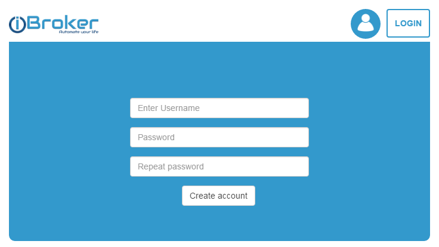

# ioBroker Cloud-Adapter

Dieser Adapter ermöglicht die Verbindung vom Internet über die ioBroker-Cloud zur lokalen Installation von ioBroker.

**Dieser Adapter nutzt die Sentry-Bibliotheken, um Ausnahmen und Codefehler automatisch an die Entwickler zu melden.** Weitere Details und Informationen zum Deaktivieren der Fehlerberichterstattung finden Sie in [der Sentry-Plugin-Dokumentation](https://github.com/ioBroker/plugin-sentry#plugin-sentry) . Die Sentry-Berichterstattung wird ab js-controller 3.0 verwendet.

## Einstellungen

### APP-SCHLÜSSEL

Um den Cloud-Adapter zu verwenden, müssen Sie zuerst den APP-Schlüssel auf <https://iobroker.net> abrufen.

Dies ist der Anwendungsschlüssel, den der Benutzer auf der Website <https://iobroker.net> erhält. Bitte kopieren Sie den Schlüssel dorthin und geben Sie ihn hier ein.



### Beispiel

Alle Anfragen vom Cloud-Adapter werden an die jeweilige Webinstanz weitergeleitet. Der Benutzer muss hier die Webinstanz angeben; diese wird ihm beim Einloggen auf <https://iobroker.net> angezeigt.

### Rechte

Das Konto bei iobroker.net oder iobroker.pro bestimmt nicht, worauf in ioBroker zugegriffen werden kann. Die Rechte ergeben sich aus dem Benutzer mit den Berechtigungen „Zugriff als“ (`defaultUser`) der Instanzen:

- Seiten und Dateien von web, admin und lovelace werden mit dem Benutzer der entsprechenden Instanz angefordert.
- Lovelace-Zustände werden mit dem Benutzer der Lovelace-Instanz gelesen und geschrieben.
- Objekte, Zustände und Dateien, die von den Seiten der Web- und Admin-Oberfläche angefordert werden, werden unter dem Benutzerkonto der Web-Instanz ausgeführt. Web- und Admin-Oberfläche teilen sich diese Verbindung, daher gibt es nur einen Benutzer für beide. Ohne eine Web-Instanz wird das Benutzerkonto der Admin-Instanz verwendet, andernfalls das der Lovelace-Instanz.

Wenn Sie Administratorzugriff erlauben und die Webinstanz einen anderen Benutzer als die Administratorinstanz besitzt, verfügt der Administrator nur über die Rechte des Webbenutzers. Der Adapter protokolliert in diesem Fall eine Warnung.

Bei eingeschränkten Benutzern wird nicht für jedes einzelne Änderungsereignis geprüft: Wenn ein solcher Benutzer Zustände oder Objekte abonnieren kann, erhält er die Änderungen von allem, was dem Muster entspricht, wie bei jedem anderen ioBroker-WebSocket.

### Selbstsignierte Zertifikate zulassen

Wenn Sie die Standard-Cloud von iobroker.net nutzen, können Sie diese Funktion deaktivieren. Diese Option ist nur relevant, wenn Sie Ihre eigene Cloud verwenden.

### Alexa-Einstellungen

_**Alexa wird nicht unterstützt in `cloud` Den Adapter nicht mehr verwenden. Nutzen Sie dafür den ioBroker.iot-Adapter.**_

## IFTTT

[Anweisungen](/#/docs/adapterref/iobroker.cloud/doc/ifttt.md)

## Dienstleistungen

Es besteht die Möglichkeit, Nachrichten an den Cloud-Adapter zu senden. Wenn Sie anrufen `[POST]https://iobroker.net/service/custom_<NAME>/<user-app-key>` und Wert als Nutzlast.

```bash
curl --data "myString" https://iobroker.net/service/custom_test/<user-app-key>
```

Wenn Sie in den Einstellungen das Feld „Whitelist für Dienste“ auf den Namen _„custom\_test_ “ setzen und den Dienst mit „custom\_test“ als Namen aufrufen, wird der Status `cloud.0.services.custom_test` wird eingestellt auf `myString` Die

Sie können ein "\*" in die Whitelist eintragen, dann sind alle Dienste zugelassen.

Ab Version 2.0.5 können Sie GET-Anfragen im folgenden Format verwenden: `[GET]https://iobroker.net/service/custom_<NAME>/<user-app-key>/<data>` um die `\<data\>` hinein `cloud.0.services.custom_\<NAME\>` Die

Hier finden Sie eine Anleitung zur Verwendung mit [Tasker](/#/docs/adapterref/iobroker.cloud/doc/tasker.md) .

Der IFTTT-Dienst ist nur zulässig, wenn ein IFTTT-Schlüssel festgelegt ist.

Reservierte Namen sind `ifttt`, `text2command`, `simpleApi`, `swagger` Diese müssen ohne die `"custom_"` Präfix.

### text2command

Sie können schreiben `text2command` In der Whitelist können Sie POST-Anfragen senden an `https://iobroker.net/service/text2command/<user-app-key>` um Daten zu schreiben in `text2command.X.text` Variable.

"X" kann in den Einstellungen über die Option "Text2Command-Instanz verwenden" definiert werden.

### simpleApi

Folgende Befehle können verwendet werden (nur Pro-Version):

- `[GET]https://iobroker.pro/service/simpleApi/<user-app-key>/get/stateID` - Zustandswert lesen =>`{"val":103.516,"ack":true,"ts":1604132484682,"q":0,"from":"system.adapter.admin.0","lc":1604132469672,"result":"OK"}`
- `[GET]https://iobroker.pro/service/simpleApi/<user-app-key>/getPlainValue/stateID` - Zustandswert lesen =>`103.641`
- `[GET]https://iobroker.pro/service/simpleApi/<user-app-key>/set/stateID?value=1` - um den Statuswert festzulegen =>`{"result":"OK"}`

**Vergessen Sie nicht, Folgendes hinzuzufügen `simpleApi` zu den in der Konfiguration zulässigen Diensten.**

### Einschränkungen

Wenn HTTPS (Sicherheit) oder Authentifizierung auf einer bestimmten Webinstanz aktiviert ist, funktioniert es nicht.

Sie können HTTPS und die Authentifizierung für diese Webinstanz deaktivieren, es ist jedoch besser, eine neue Webinstanz zu erstellen, die an … gebunden ist. `localhost` und wählen Sie diese Instanz in den Cloud-Einstellungen aus.

## Remote-Shell (SSH)

Auf **der Pro-Version** kann die Cloud als SSH-Jump-Host fungieren, sodass Sie von überall aus auf eine Shell (oder einen beliebigen TCP-Dienst) auf diesem Rechner zugreifen können, authentifiziert mit Ihrer Cloud-E-Mail-Adresse und Ihrem Passwort. Die interne SSH-Verbindung ist zwischen Ihrem Client und dem lokalen Server Ende-zu-Ende-verschlüsselt. `sshd` Die Cloud leitet also nur Bytes weiter.

Aktivieren Sie es unter **„Remote Shell“** in den Adaptereinstellungen:

- **Remote-Shell aktivieren** – standardmäßig deaktiviert.
- **Zulässige Ziele** – eine Regeltabelle; ein Ziel ist zulässig, wenn es in einer Zeile übereinstimmt. Dies ist die maßgebliche Zulassungsliste; die Cloud öffnet nichts, was der Adapter nicht erlaubt. Jede Zeile enthält:

  - **Host** – eine einzelne IP-Adresse oder ein Hostname (`127.0.0.1`, `localhost`), ein Joker (`192.168.*`), ein CIDR (`192.168.1.0/24`), oder ein Bereich (`192.168.1.10-192.168.1.50`).
  - **Ports** — eine Liste und/oder Bereiche (`22`, `22, 8081`, `8000-8100`), oder leer /`*` /`all` für jeden beliebigen Hafen.

  Standard: `127.0.0.1` Und `localhost`, ein beliebiger Port (nur auf diesem Rechner). So kann eine Zeile nur SSH auf dem ioBroker-Server freigeben, während eine andere ein ganzes Subnetz öffnet, z. B. `127.0.0.1 → 22` Plus `192.168.1.0/24 → *` Die

Stellen Sie dann eine Verbindung her (wobei Ihr eigener SSHD-Server von Port 22 verschoben wird, und `pi` (Benutzer dieses Rechners):

```bash
ssh -J <email>@iobroker.pro pi@localhost
```

`-L 8081:localhost:8081` tunnelt die Admin-Benutzeroberfläche, `scp` /`sftp` Dateien kopieren usw. UDP wird nicht übertragen (daher benötigt KNXnet/IP über UDP ein TCP-fähiges Gateway oder ein VPN).

Beim Start prüft der Adapter, ob ein SSH-Server erreichbar ist. `127.0.0.1:22` und veröffentlicht das Ergebnis im Staa&#x74;** `info.sshAvailable` ** Die Einstellungsseite zeigt diesen Status live an: Wenn kein SSH-Server gefunden wird (oder das Konto nicht pro ist), wird ein Hinweis angezeigt und **die Remote-Shell-Einstellungen werden vollständig ausgeblendet** , sodass sie erst dann angezeigt werden, wenn durch deren Aktivierung tatsächlich eine Shell erreicht werden kann.

## Android-Anwendung

Bei der neuen Android-Anwendung wurde der Speicherort der Variablen für Helligkeit und Standort geändert.

Nun waren sie zu finden in `cloud.X.devices.NAME`:

- `cloud.X.devices.NAME.brightness`
- `cloud.X.devices.NAME.currentLocation` Die
- `cloud.X.devices.NAME.batteryLevel`
- `cloud.X.devices.NAME.batteryState` Die

<!--
	Placeholder for the next version (at the beginning of the line):
	### **WORK IN PROGRESS**
-->

## Changelog
### 6.4.0 (2026-11-15)
* (@GermanBluefox) Prepared the switch to socket.io 4: a cloud address with `wss://` is connected with socket.io 4. If it cannot be reached, the adapter goes back to the current cloud
* (@GermanBluefox) A cloud address counts as one of ioBroker.pro if it contains "iobroker.pro", whatever protocol and port it names. Before, only `https://iobroker.pro:<port>` did, so a pro key with `wss://iobroker.pro:<port>` was sent to `https://iobroker.pro:10555`
* (@GermanBluefox) After a big answer (e.g. all objects for the editor of vis-2 via the cloud) the adapter waits longer for the pong of the cloud: as long as a slow upload needs for what was sent, at most 160 seconds. Before, it disconnected with "Ping timeout" while the answer was still on its way, and the editor never got its objects
* (@GermanBluefox) After a lost connection the adapter always comes back: if it cannot get its app-key at the start because the network or the server is away (timeout, no DNS, reset, 5xx), it tries again after 10 seconds, then twice as long each time, at most every 5 minutes. Before, only "connection refused" was retried; any other network error (e.g. `ETIMEDOUT`) ended the start, and the instance stayed alive without a connection to the cloud. The request for the app-key now gives up after 15 seconds instead of minutes. A wrong login still stops with an error

### 6.3.0 (2026-11-09)
* (@GermanBluefox) Commands from the cloud run as the "access as" user of the web instance and no longer always as admin. If this user is restricted, the pages of web and admin only have its rights via cloud

### 6.2.11 (2026-10-16)
* (@GermanBluefox) The adapter is stopped with `terminate()` only, `process.exit()` is no longer used (compact mode)
* (@GermanBluefox) Added the missing translations and the Ukrainian words for the blockly block
* (@GermanBluefox) Corrected the responsive sizes of the settings dialog
* (@GermanBluefox) Removed the unused dependency `cookie-parser`

### 6.2.10 (2026-10-14)
* (@GermanBluefox) Corrected the loading of materialized configurations on ioBroker.pro

### 6.2.8 (2026-10-12)
* (@GermanBluefox) The states `alive` and `onScreen` of an app device are corrected to type boolean if an earlier version created them as string, so values written to them are no longer refused

## License
The MIT License (MIT)

Copyright (c) 2016-2026 bluefox <dogafox@gmail.com>

Permission is hereby granted, free of charge, to any person obtaining a copy
of this software and associated documentation files (the "Software"), to deal
in the Software without restriction, including without limitation the rights
to use, copy, modify, merge, publish, distribute, sublicense, and/or sell
copies of the Software, and to permit persons to whom the Software is
furnished to do so, subject to the following conditions:

The above copyright notice and this permission notice shall be included in all
copies or substantial portions of the Software.

THE SOFTWARE IS PROVIDED "AS IS", WITHOUT WARRANTY OF ANY KIND, EXPRESS OR
IMPLIED, INCLUDING BUT NOT LIMITED TO THE WARRANTIES OF MERCHANTABILITY,
FITNESS FOR A PARTICULAR PURPOSE AND NONINFRINGEMENT. IN NO EVENT SHALL THE
AUTHORS OR COPYRIGHT HOLDERS BE LIABLE FOR ANY CLAIM, DAMAGES OR OTHER
LIABILITY, WHETHER IN AN ACTION OF CONTRACT, TORT OR OTHERWISE, ARISING FROM,
OUT OF OR IN CONNECTION WITH THE SOFTWARE OR THE USE OR OTHER DEALINGS IN THE
SOFTWARE.