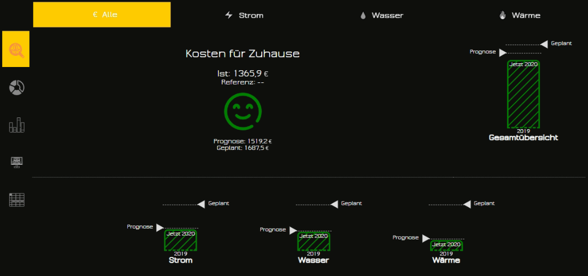
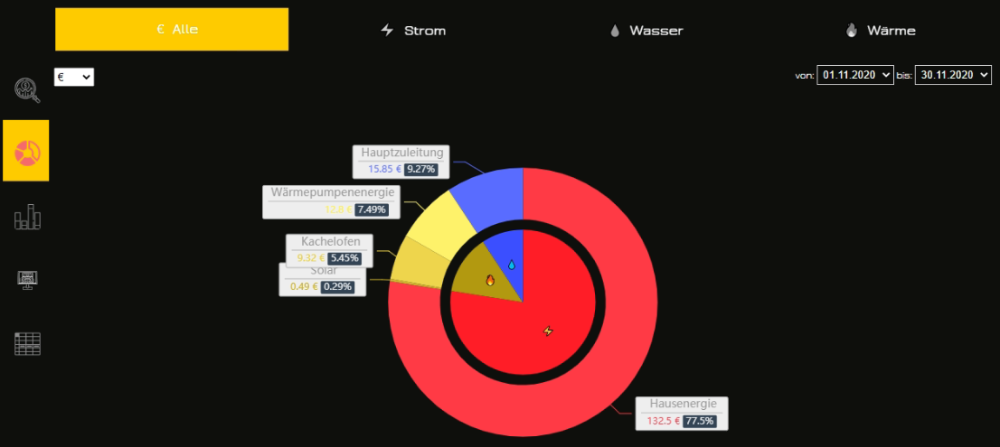
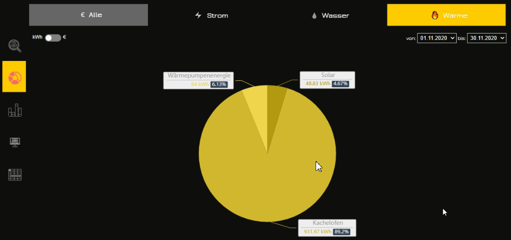
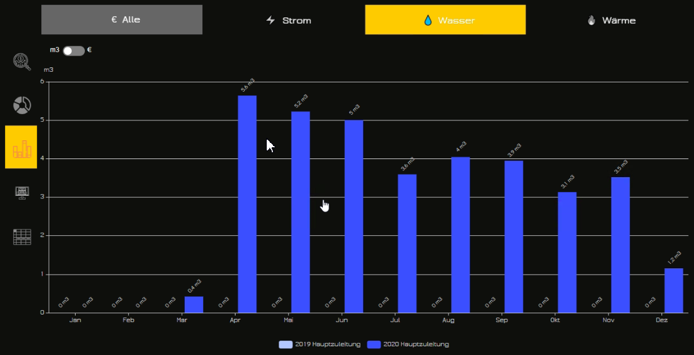
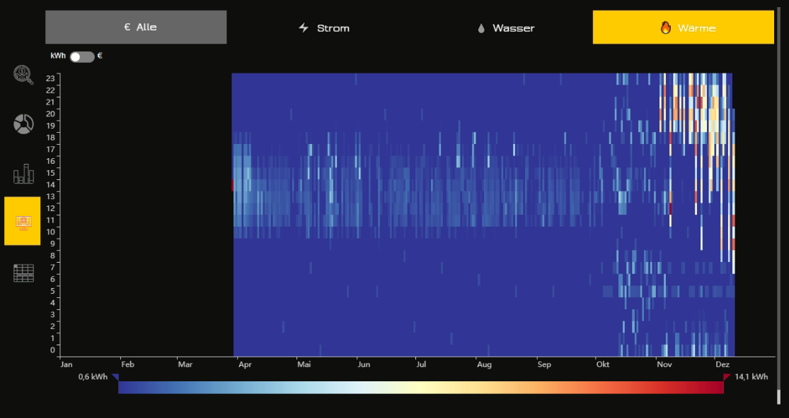
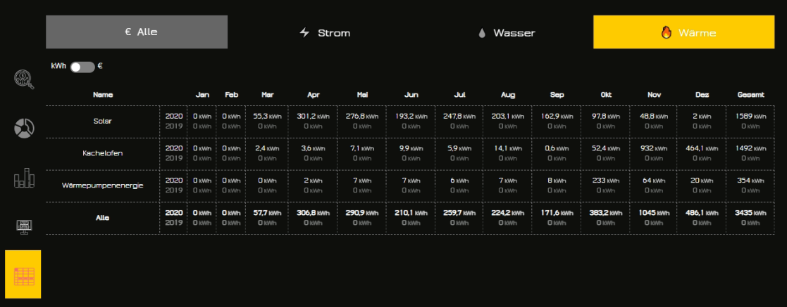

# ioBroker.consumption

## Konsumadapter für ioBroker

Berechnet den Verbrauch für definierte Sensoren und Ressourcen.

Sie können verschiedene Ressourcen wie Wasser, Heizung und Strom definieren und damit eine Analyse in vis durchführen.

Es werden vier verschiedene Analysetypen implementiert:

- Plan - Tatsächlicher Verbrauch in €/$ in diesem Jahr im Vergleich zu den Planwerten und im Vergleich zum Vorjahr.
- Donut-Diagramm – Vergleich von Sensoren oder Ressourcen in Form eines Torten-/Donut-Diagramms
- Stack – Monatlicher Verbrauch jedes Sensors und jeder Ressource im Vergleich zu den Daten des Vorjahres in Form eines Stack-Balkendiagramms.
- Wärmebild – Stündlicher Ressourcenverbrauch in diesem Jahr
- Tabelle – Monatlicher Verbrauch jedes Sensors und jeder Ressource im Vergleich zum Vorjahr (Tabelle)

## Anforderungen

Der Adapter benötigt die MySQL- oder PostgreSQL-Datenbank und den ioBroker.sql-Adapter (dieser wird automatisch installiert). Er sollte auch mit SQLite funktionieren, dies wird jedoch aufgrund der Leistung nicht empfohlen.

MS-SQL wird derzeit noch nicht unterstützt, könnte aber bei Bedarf problemlos implementiert werden.

**Der Adapter befindet sich noch in der Beta-Phase.**

**Die kostenlose Version unterstützt nur vier Sensoren und eine Station.** Um mehr Sensoren oder Stationen zu nutzen, benötigen Sie eine gültige Lizenz. Diese können Sie unter <info@iobroker.com> anfordern.

## Verwendung

Sie verfügen über Ressourcen (wie Wasser, Energie, Heizung, Gas usw.), Stationen (wie Haus, Datscha, Dorfvilla usw.) und Sensoren.

Der Sensor ist ein Zähler, dessen Wert ständig steigt, ähnlich wie bei einem Stromzähler, dessen Wert immer weiter ansteigt.

Sie müssen all diese Sensoren zuerst in definierten Ressourcen und dann in Stationen verteilen.

**Tatsächlich wird nur ein Sender unterstützt!**

Anschließend können Sie Ihren Zeit- und Ressourcenverbrauch über die Jahre analysieren.

Sie können das aktuelle Jahr mit dem Vorjahr vergleichen und daraus eine Prognose über den Verbrauch ableiten.

Planen Sie alle Kosten für das laufende Jahr.

Kostenverteilung nach Ressourcen.

Verteilung des Verbrauchs einer Ressource durch Sensoren.

Verteilung des Verbrauchs nach Sensoren und Monaten einer Ressource.

Heatmap des Verbrauchs einer Ressource für das laufende Jahr.

Verbrauchstabelle einer Ressource für das laufende Jahr für jeden Monat.

### Verdeckte Funktion

Die Sensordaten lassen sich umrechnen, die Formel muss jedoch linear sein. Sie können die Formel in JavaScript schreiben, achten Sie aber darauf, dass das Ergebnis eine Zahl (float) ist. Beispiele:

- Wh => kWh: `val / 1000`
- kWh => Wh: `val * 1000`
- °F => °C: `(val - 32) / 1.8`
- °C => °F: `val * 1.8 + 32`

## eCharts aktualisieren (nur für Entwickler)

Gehen Sie zu <https://echarts.apache.org/en/builder.html> und wählen Sie Folgendes aus:

- Diagramm: Balken-, Linien-, Kreis-, Heatmap-Diagramm
- Koordinatensysteme: Gitter
- Komponenten: Titel, Legende, QuickInfo, Markierungspunkt, Markierungsbereich, VisualMap, Toolbox
- Sonstige: SVG-Renderer, Hilfsprogramme, Codekomprimierung

## Aufgaben

- Preis für jeden möglichen Sensor

- Preisänderungen:
  - Alle Preise nach Ressourcen entfernen,
  - Kontrollkästchen neben jedem Sensor hinzufügen: Eigenpreis
  - Station ausblenden => Ressourcenpreis, wenn jeder Sensor einen eigenen Preis hat
  - Schreiben Sie direkt in die Zustände und speichern Sie den Preis nicht im Objekt.

- Heatmap
  - Nach Jahr anzeigen

- Diagramme

- Daten als PDF exportieren

- Mehr als ein Bahnhof.

- Stilauswahl gemäß Thema (Einheit, Start, Ende)

<!--
	Placeholder for the next version (at the beginning of the line):
	### **WORK IN PROGRESS**
-->

## Changelog
### 1.0.3 (2026-10-14)
* (@GermanBluefox) Updated packages and the metadata, the adapter requires node.js >= 22 and js-controller >= 6.0.11 now

### 1.0.2 (2024-03-19)
* (bluefox) Fixed plan display

### 1.0.1 (2023-09-14)
* (bluefox) Fixed pie chart

### 0.8.0 (2023-05-12)
* (bluefox) Do not take the price of sensor if it is empty or 0
* (bluefox) Refactoring (async/await)

### 0.7.0 (2023-02-08)
* (bluefox) Added offset and factor to sensors

## License

Commercial license.

Copyright (c) 2020-2026 Bluefox <dogafox@gmail.com>, all rights reserved.

This license is a legal agreement between you and ioBroker GmbH (“ioBroker”) for the use of `ioBroker.consumption` adapter (the “Software”).
By downloading of `ioBroker.consumption` adapter you agree to be bound by the terms and conditions of this license.
ioBroker GmbH reserves the right to alter this agreement at any time, for any reason, without notice.

### Permitted Use
One license grants the right to perform one installation of the Software.
Each additional installation of the Software requires an additional purchased license.

The complete license text can be found in the [LICENSE](https://github.com/ioBroker/ioBroker.consumption/blob/master/LICENSE) file.