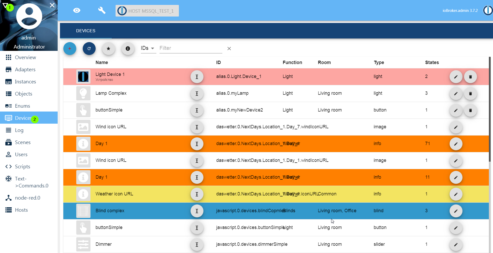

# ioBroker.devices

## Geräteadapter für ioBroker

Geräte verwalten und erstellen, um sie in anderen Adaptern wie Material, IoT, Matter usw. zu verwenden...

**Wichtig: Aktivieren Sie im Adminbereich Registerkarten wie „Protokoll“ und „Skripte“.**

**Dieser Adapter nutzt die Sentry-Bibliotheken, um Ausnahmen und Codefehler automatisch an die Entwickler zu melden.** Weitere Details und Informationen zum Deaktivieren der Fehlerberichterstattung finden Sie in [der Sentry-Plugin-Dokumentation](https://github.com/ioBroker/plugin-sentry#plugin-sentry) . Die Sentry-Berichterstattung wird ab js-controller 3.0 verwendet.

## ioBroker.devices Adapter – Benutzerhandbuch

### Überblick

Der `ioBroker.devices` Der Adapter ist eine Komponente der ioBroker Smart-Home-Plattform, die die Geräteverwaltung durch die Erstellung und Verwaltung virtueller Geräte vereinfachen soll.

Diese virtuellen Geräte bieten eine standardisierte Schnittstelle für physische Geräte und erleichtern so die Integration, Skripterstellung, Visualisierung und Steuerung von Geräten verschiedener Hersteller und Protokolle.

Der Adapter gewährleistet Konsistenz bei der Benennung und Strukturierung der Datenpunkte, wodurch der Bedarf an Änderungen an Skripten oder Visualisierungen bei Hardwareänderungen reduziert wird.

Es kapselt beliebige Sammlungen von Zuständen in ioBroker (physisch **oder** virtuell) in wohlgeformte **Geräte** mit umfangreichen Informationen:

- `type`, `role`, `smartName`, `color`, `room`, `function`, `icon`, `unit` und mehr

Das Ergebnis wird von Dashboards (Material UI, VIS‑2), Sprachassistenten (Alexa/Google), dem Matter-Adapter, dem **IoT/Cloud** -Adapter und Skripten genutzt und bietet Ihnen so eine übersichtliche, zukunftssichere Objektstruktur.

**Hinweis:** Der Adapter fragt die Hardware **nicht** ab. Er läuft als reine Tab-Webinstanz → keine CPU-/RAM-Belastung.

### Zweck

Der `ioBroker.devices` Der Adapter dient folgenden Zwecken:

- Standardisierung: Erzeugt virtuelle Geräte mit konsistenten Datenpunktstrukturen, unabhängig von der zugrunde liegenden Hardware oder dem Protokoll aus verschiedenen Datenpunkten.
- Vereinfachte Wartung: Ermöglicht Benutzern den Austausch physischer Geräte, ohne Skripte oder Visualisierungen aktualisieren zu müssen, indem Datenpunkte im Adapter neu zugeordnet werden.
- Verbesserte Kompatibilität: Lässt sich nahtlos in Visualisierungsadapter (z. B. Material UI, VIS) und IoT-Adapter (z. B. Alexa, Google Home) integrieren.
- Benutzerfreundlich: Vereinfacht die Geräteverwaltung für Einsteiger und bietet gleichzeitig Flexibilität für fortgeschrittene Benutzer.

#### Standardisierung

Viele Adapter wie MQTT, KNX oder ähnliche liefern Datenpunkte mit unterschiedlichen Namen und Strukturen. Dieser Adapter erstellt ein virtuelles Gerät mit einer einheitlichen Struktur, wodurch die Verwaltung und Visualisierung von Geräten vereinfacht wird. Er fügt den Zuständen automatisch Rollen, Einheiten und Namen hinzu.

#### Vereinfachte Wartung

Der `ioBroker.devices` Der Adapter ermöglicht es Benutzern, virtuelle Geräte zu erstellen, die sich problemlos verschiedenen physischen Geräten zuordnen lassen. Das bedeutet: Wenn Sie ein physisches Gerät ändern, müssen Sie weder Ihre Skripte, Visualisierungen noch die Verlaufseinstellungen aktualisieren; Sie müssen lediglich die Datenpunkte im Adapter neu zuordnen.

#### Verbesserte Kompatibilität

Der Adapter weiß, wie die Geräte aussehen und wie sie verwendet werden. Er erstellt ein virtuelles Gerät mit der gleichen Struktur wie das physische Gerät, wodurch die Integration mit anderen Adaptern vereinfacht wird.

#### Benutzerfreundlich

Der `ioBroker.devices` Der Adapter ist benutzerfreundlich gestaltet und somit sowohl für Einsteiger als auch für erfahrene Anwender mit erweiterten Funktionen geeignet. Dank der intuitiven Benutzeroberfläche können Benutzer virtuelle Geräte erstellen und verwalten, ohne über umfassende technische Kenntnisse verfügen zu müssen.

## Konfiguration

Nach der Installation konfigurieren Sie den Adapter über die Registerkarte „Geräte“ in der ioBroker-Administrationsoberfläche.

### Erstellen eines virtuellen Geräts

Öffnen Sie den Geräte-Tab im Adminbereich.

#### Gerät hinzufügen

- Klicken Sie auf die Schaltfläche "+", um ein neues virtuelles Gerät zu erstellen.
- Geben Sie einen Namen für das Gerät ein (z. B. „Wohnzimmerleuchte“).
- Wählen Sie einen Gerätetyp (z. B. Licht, Schalter, Thermostat) aus der vordefinierten Liste aus.
- Optional kann der Organisation eine Kategorie (z. B. Beleuchtung, Heizung) zugewiesen werden.

Kartendatenpunkte:

Ordnen Sie für jede Funktion (z. B. Ein/Aus, Helligkeit) den Datenpunkt des virtuellen Geräts dem entsprechenden Zustand des physischen Geräts zu (z. B. `hm-rpc.0.12345.1.STATE` (für einen Homematic-Schalter).

Über die Benutzeroberfläche können Sie Zustände anderer Adapter durchsuchen und auswählen.

Speichern: Klicken Sie auf „Speichern“, um das virtuelle Gerät zu erstellen. Es wird unter alias.0 angezeigt.<DeviceName> auf der Registerkarte „Objekte“.

#### Gerätetypen

Der `ioBroker.devices` Der Adapter unterstützt drei Hauptansätze zur Geräteerstellung:

1. Automatisch erkannte Geräte

Einige Adapter (z. B. ioBroker.zigbee, ioBroker.hm-rpc) stellen bereits eine gültige Struktur für die Geräte bereit. Diese werden automatisch erkannt **, sobald eine Kategorie (Funktion oder Raum) zugewiesen ist** . Ohne zugewiesene Kategorie wird das automatisch erkannte Gerät nicht verarbeitet.

2. Verbundene Geräte

Verknüpfte Geräte sind virtuelle Geräte, die manuell erstellt werden, um die Datenpunkte eines bestimmten physischen Geräts widerzuspiegeln. `ioBroker.linkeddevices` Die

Es wird empfohlen, `ioBroker.devices` Und `alias.0` Zweig statt `linkeddevices` Die

3. Aliase

Aliase sind leichtgewichtige virtuelle Geräte, die als Abkürzungen oder vereinfachte Verweise auf bestehende Zustände fungieren, ohne eine vollständige Gerätestruktur zu erzeugen.

Sie können ein neues virtuelles Gerät in einem erstellen `alias.0` Zweig. Wählen Sie den Gerätetyp aus und füllen Sie alle erforderlichen Zustände (mit \* gekennzeichnet) aus. Optional können Sie nicht erforderliche Zustände hinzufügen (z. B. Luftfeuchtigkeit über einen Temperatursensor). Für jeden erforderlichen und ausgefüllten optionalen Zustand erstellt der Adapter eine Aliasstruktur. Wenn Sie beispielsweise ein Temperaturgerät mit dem Namen „Temperaturgerät“ erstellt haben, …`Temperature` und wenn beide Zustände (Temperatur und Luftfeuchtigkeit) angegeben werden, finden Sie die folgenden Zustände und Kanäle in `alias.0` Zweig:

- `alias.0.Temperature` - Kanal
- `alias.0.Temperature.temperature` - Zustand mit der Einheit '°C'. Es sollte eine virtuelle Verknüpfung zu einem realen Zustand mit Temperaturangabe geben. Wenn Sie den Alias entfernen in `ioBroker.devices` Adapter, dieser Zustand bleibt ohne Verbindung bestehen.
- `alias.0.Temperature.humidity` - Zustand mit der Einheit '%'. Dieser hat eine virtuelle Verknüpfung zum realen Zustand (z. B. zu `hm-rpc.0.JHAGHGJJJ.1.HUMIDITY` Wenn Sie den Alias entfernen in `ioBroker.devices` Adapter, dieser Zustand wird gelöscht.

Nahezu jeder Gerätetyp könnte zusätzliche Statusanzeigen (Indikatoren) für Akku, Verbindung, Fehler und weitere Funktionen aufweisen. Diese sind optional, aber einige Adapter (z. B. …) `material` oder `matter`) könnte es interpretieren.

Für jeden Bundesstaat können Sie alle Einstellungen angeben, die von Aliasen unterstützt werden:

- Unterschiedliche Zustände für Lesen und Schreiben
- Umrechnungsformel zum Lesen und Schreiben

#### Geräteverwaltung

Gerät bearbeiten: Klicken Sie auf der Registerkarte „Geräte“ auf das Stiftsymbol neben einem Gerät, um dessen Namen, Typ, Kategorie, Farbe, Symbol oder Datenpunktzuordnungen zu ändern.

Gerät löschen: Klicken Sie auf das Papierkorbsymbol, um ein virtuelles Gerät zu entfernen. Dies hat keine Auswirkungen auf das physische Gerät oder dessen Adapter.

Geräte organisieren: Verwenden Sie Kategorien, um Geräte zu gruppieren (z. B. „Beleuchtung“, „Heizung“), um die Verwaltung in Visualisierungen zu vereinfachen.

### Webkomponenten anderer Adapter

Adapter können Webkomponenten einbinden (`common.webComponents`, sehen[`@iobroker/web-components`](https://github.com/ioBroker/web-components) Im Bearbeitungsmodus listet „Widget hinzufügen“ sie zusammen mit den Widgets ihres Adapters auf, und eine Komponente wird wie jedes andere Widget zu einer Kachel.

Der Einstellungsdialog einer solchen Kachel zeigt die Größe und Farbe der Kachel sowie die von JSON-Config gerenderten Komponenteneinstellungen an. Eine Einstellung vom Typ `selectSendTo` oder `autocompleteSendTo` bezieht seine Optionen vom Adapter über `sendTo`, wie in JSON-Config. Ohne `instance` In den Einstellungen fragt das Gerät nach der ersten Instanz des Adapters, der die Komponente bereitstellt (`<adapter>.0`), nicht `devices.0` Das Gleiche gilt für die Formulare, die eine Komponente als Dialog öffnet.

## Gerätetypen

Dieser Adapter wurde mithilfe von `type-detector` Alle möglichen Geräte finden Sie [hier](https://github.com/ioBroker/ioBroker.type-detector/blob/master/DEVICES.md) .

## Video

## Changelog
<!--
	Placeholder for the next version (at the beginning of the line):
	### **WORK IN PROGRESS**
-->
### 4.4.0 (2026-11-13)
* (@GermanBluefox) Web components: the settings types `selectSendTo` and `autocompleteSendTo` (`@iobroker/web-components` 0.8.0) ask the adapter that brings the component (`<adapter>.0`) when the setting names no `instance`, and not devices itself; also in the forms a component opens as a dialog
* (@GermanBluefox) Fixed: a setting of type `selectSendTo` no longer spins forever when the instance does not answer - it shows a text field, so the value stays editable (`@iobroker/json-config` 10.1.22)

### 4.3.2 (2026-11-10)
* (@GermanBluefox) Nested folders under alias.0 keep their place, name and color in the GUI; only folders on the top level are merged with a room of the same name (issue #739)
* (@GermanBluefox) New widget "Note (Markdown)" for free text like comments or instructions
* (@GermanBluefox) Updated packages
* (@GermanBluefox) Animated icons of `@iobroker/gui-components`: the folder buttons "expand/collapse all" show on hover what they will do, the button "clear filter" has the funnel with the cross, the rows of an opened folder slide out, the widget groups open and close animated, and the notices "not active", "no permission" and "could not be loaded" have their own symbol
* (@GermanBluefox) The switch to hide the config button in the runtime is back in the settings of the root category; users without the edit right still do not see the button
* (@GermanBluefox) If the devices cannot be loaded, for example because the user may not call `sendTo`, the page says so instead of loading forever
* (@GermanBluefox) The list of devices only holds what the logged-in user may read according to the ACLs of the objects (js-controller 7.2.5 or newer). A changed ACL counts at once

### 4.3.1 (2026-11-07)
* (@GermanBluefox) Color light 2×2: the saved colors are shown on the tile and applied with a tap
* (@GermanBluefox) Saving a device no longer resets the names of its states; only the states that were changed are written (issue #725)

### 4.3.0 (2026-11-05)
* (@GermanBluefox) Web components of other adapters (`common.webComponents`, see `@iobroker/web-components`) can be added as tiles: the palette lists them, the settings dialog shows their settings next to the size of the tile, and their dialogs open as dialogs of devices. The list and the settings come from the manifests of the components; the module of a component is loaded when its first tile is shown
* (@GermanBluefox) Plugins may bring background services (`common.deviceWidgets.services`): the app renders them once next to the category, with the widgets of the adapter in all categories the user may control, whichever category is shown - e.g. so that a phone stays registered and rings in every category
* (@GermanBluefox) The dimmer widget is easier to operate in every size: the 1×1 tile fills up like a glass, a tap switches and dragging up or down dims; the wide tiles and the new 2×2 size have a large slider with quick selection, or a bar to tap or drag with ± buttons instead of the small round knob. Only the power button switches these tiles, and a drag sends only the value it is released at
* (@GermanBluefox) Color lights with a dimmer are operated like the dimmer: the 1×1 tile fills with the light color, a tap switches, dragging up or down dims and a long press opens the color dialog; the larger tiles (now also 2×2) have the slider or the bar and a button for the color dialog. Their quick selection can show the saved states instead of brightness values, with "+" to save the current state
* (@GermanBluefox) Dimmer 2×0.5: the slider knob and the status icons no longer touch the power button
* (@GermanBluefox) A plugin or web component tile that cannot be loaded can be deleted directly in the edit mode
* (@GermanBluefox) Delete, reload, folder and play/pause buttons use the animated icons of `@iobroker/gui-components`
* (@GermanBluefox) The "Add widget" dialog is much larger and shows the widgets in sets - the built-in ones by theme, everything an adapter brings (plugin widgets and web components) together - with a search and a filter by set
* (@GermanBluefox) If an adapter brings a plugin and a web component of the same name, like the "Flow diagram" of flow, "Add widget" offers only the plugin; tiles of the web component keep working
* (@GermanBluefox) Web components get the colors, the font and the corners of the theme of devices (`@iobroker/web-components` 0.5.0), not only light or dark

### 4.2.7 (2026-10-25)
* (@GermanBluefox) Added widget for the device type `tv` with a remote control dialog

## License
MIT License

Copyright (c) 2019-2026 bluefox <dogafox@gmail.com>

Permission is hereby granted, free of charge, to any person obtaining a copy
of this software and associated documentation files (the "Software"), to deal
in the Software without restriction, including without limitation the rights
to use, copy, modify, merge, publish, distribute, sublicense, and/or sell
copies of the Software, and to permit persons to whom the Software is
furnished to do so, subject to the following conditions:

The above copyright notice and this permission notice shall be included in all
copies or substantial portions of the Software.

THE SOFTWARE IS PROVIDED "AS IS", WITHOUT WARRANTY OF ANY KIND, EXPRESS OR
IMPLIED, INCLUDING BUT NOT LIMITED TO THE WARRANTIES OF MERCHANTABILITY,
FITNESS FOR A PARTICULAR PURPOSE AND NONINFRINGEMENT. IN NO EVENT SHALL THE
AUTHORS OR COPYRIGHT HOLDERS BE LIABLE FOR ANY CLAIM, DAMAGES OR OTHER
LIABILITY, WHETHER IN AN ACTION OF CONTRACT, TORT OR OTHERWISE, ARISING FROM,
OUT OF OR IN CONNECTION WITH THE SOFTWARE OR THE USE OR OTHER DEALINGS IN THE
SOFTWARE.