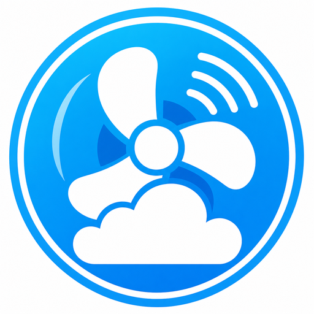

# IoBroker.droo-cloud
## DREO Cloud-Adapter für ioBroker
Inoffizieller ioBroker-Adapter für ausgewählte DREO-Cloud-fähige Geräte.

Website des Herstellers DREO: https://www.dreo.com/

Dieses Projekt steht in keiner Verbindung zu DREO, wird nicht von DREO unterstützt oder befürwortet und wird auch nicht von DREO unterstützt.

## Aktueller Status
Der Adapter befindet sich in aktiver Entwicklung.

Aktuelle Version: `0.1.5`.

Diese Version verwendet `@mehrwiedu/dreo-api` `0.1.5`.
Sie wurde mit acht realen Geräten aus sechs DREO-Modellen validiert.

Umgesetzt:

- Geräteerkennung basierend auf FamilyTree
- Laufzeiterkennung neu verfügbarer Geräte
- Laden des Anfangszustands
- Live-WebSocket-Updates
- automatische Erstellung von Roh- und benutzerdefinierten Objekten
- dynamische, schreibgeschützte Erstellung neu beobachteter Rohschlüssel
- bidirektionale Steuerung bestätigter Funktionen
- automatische Sitzungserneuerung und WebSocket-Wiederverbindung
- effektive, freundliche Staaten
- zentrale Schreibbestätigung und Fehlerabgleich

Der Adapter verwendet:

```text
@mehrwiedu/dreo-api 0.1.5
```

Die Details des DREO-Protokolls und die native Befehlslogik bleiben im SDK enthalten.

## Getestete Geräte
| Modell | Typ | Menge | Validierte Bereiche |
|---|---|---:|---|
| `DR-HCF007S` | Deckenventilator | 3 | Ventilator, Modi, Hauptlicht, Helligkeit, Farbtemperatur, Stimmungslicht, Timer, Kindersicherung, Leistungs-/Komponentenmaskensemantik und Live-Updates |
| `DR-HPF002S` | Standventilator | 1 | Ventilator, Modi, Display, Richtungsoszillation, unabhängige Achsenwinkel und Live-Updates |
| `DR-HHM001S` | Luftbefeuchter | 1 | Stromversorgung, Betriebsmodi, Nebelstufe, Zielfeuchtigkeit, Anzeigen, Filterstatus, Betriebsinformationen, Timer und Live-Updates |
| `DR-HHM003S` | Luftbefeuchter | 1 | Leistung, Modi, Nebelstufe, Zielfeuchtigkeit, Warmnebel, Anzeigestufen, Feuchtigkeitsschwellenwerte, Filterstatus und Live-Updates |
| `DR-HAP009S` | Luftreiniger | 1 | Leistung, Modi, Lüfterstufe, Stimmungslicht, Display, Stummschaltung, Kindersicherung, Stromwiederherstellung, Luftqualität, Filterlebensdauer und Live-Updates |
| `DR-HAP009S` | Luftreiniger | 1 | Leistung, Modi, Lüfterstufe, Stimmungslicht, Display, Stummschaltung, Kindersicherung, Stromwiederherstellung, Luftqualität, Filterlebensdauer und Live-Updates |

Andere Geräte können zwar in ihren Rohdaten angezeigt werden, gelten aber nicht automatisch als vollständig unterstützt.

## Kontoeinrichtung
Verwenden Sie ein DREO-Konto, das die Anmeldung per E-Mail/Passwort unterstützt.

Der Adapter kann entweder das primäre Eigentümerkonto oder ein separates sekundäres Konto mit Zugriff auf das DREO-Home-Konto verwenden.

Für den Betrieb des Adapters wird die Verwendung eines separaten Zweitkontos empfohlen, ist aber nicht zwingend erforderlich.

Anmeldungen über Apple und Google werden nicht unterstützt.

## Konfiguration
- DREO-E-Mail
- DREO-Passwort
- Region: EU oder USA

Das Passwort wird als verschlüsselte und geschützte native ioBroker-Einstellung gespeichert.

## Objektstruktur
```text
dreo-cloud.0.devices.<deviceId>
```

Mögliche Zweige:

```text
info
power
fan
humidifier
light.main
light.atmosphere
display
settings
timer
raw
```

Der Zweig `raw` spiegelt die DREO-Werte wider und ist schreibgeschützt.

## Unterstützte Steuerelemente
Die genaue Konfiguration hängt vom Gerät ab.

Zu den gängigen Kontrollmaßnahmen gehören:

```text
power.on
fan.on
fan.speed
fan.mode
settings.mute
settings.childLock
light.main.on
light.main.brightness
light.main.colorTemperature
light.atmosphere.on
light.atmosphere.brightness
display.on
timer.*
```

Modellspezifische Steuerungsmöglichkeiten umfassen:

```text
fan.oscillationMode
fan.oscillation.horizontalAngle
fan.oscillation.verticalAngle
humidifier.mode
humidifier.fogLevel
humidifier.autoTargetHumidity
humidifier.sleepTargetHumidity
humidifier.humidityIndicatorLowerThreshold
humidifier.humidityIndicatorUpperThreshold
humidifier.warmMist
light.mood.on
light.mood.level
display.level
airPurifier.mode
airPurifier.fanLevel
settings.powerRecovery
settings.filterInstalled
```

Die schreibgeschützten Betriebsinformationen umfassen die Filterlebensdauer, die Betriebsstunden, den PM2,5-Gehalt und, sofern angegeben, den Luftqualitätsgrad.

## Schreibverhalten
Schreibvorgänge werden an öffentliche SDK-Methoden weitergeleitet.

- Der Adapter erstellt keine nativen DREO-Nutzdaten.
- Identische erfolgreiche Schreibvorgänge werden umgehend bestätigt.
- Abgelehnte Schreibvorgänge werden auf den zuletzt bestätigten Wert zurückgesetzt.
Die tatsächlichen Änderungen bleiben bis zur Bestätigung durch den Gerätebericht, sofern erforderlich, ausstehend.
- Fehlgeschlagene DREO `control-reply`-Nachrichten werden als SDK-Fehler angezeigt.

## Absichtlich nicht unterstützt
Die auf den Rohwerten `predefine` basierenden Favoriten für Deckenventilatoren sind nicht beschreibbar.

Tests auf realen Geräten zeigten, dass das Schreiben des Slots die gespeicherte Szene nicht ausführte. Numerische Schreibvorgänge wurden von der Cloud abgelehnt. `raw.predefine` bleibt daher schreibgeschützt.

Nicht verifizierte Felder wie `fixedconf` und zusätzliche RGB-Effekte bleiben ebenfalls nur im Rohformat.

## Cloud-Abhängigkeit
Der Adapter ist von privaten DREO Cloud-APIs abhängig und bietet keine rein lokale Steuerung.

## Datenschutz und Sicherheit
- Veröffentlichen Sie keine Zugangsdaten, Token, Geräteseriennummern oder ungeschwärzte Protokolle.
- Bevorzugt wird ein separates zweites DREO-Konto.
- Überprüfen Sie die Protokolle, bevor Sie sie an Probleme anhängen.

## Bekannte Einschränkungen
- Anmeldungen über Apple und Google werden nicht unterstützt.
- Nur EU- und US-Regionen sind verfügbar.
- Nicht jeder Rohdatenzustand verfügt über eine benutzerfreundliche Zuordnung.
- Freundliche Strukturen werden noch nicht generiert, wenn ein bekannter Schlüssel zum ersten Mal auftaucht - dies geschieht erst nach der Initialisierung.
- Auch bei teilweise gemeinsam genutzten Haushalten/Geräten sind weiterhin separate Tests erforderlich.
- DREO kann die private API ohne Vorankündigung ändern.

## Entwicklung
```bash
npm install
npm test
npm run check
npm run lint
npm run build
```

## Changelog
### 0.1.5 (2026-10-30)

- Updated `@mehrwiedu/dreo-api` to `0.1.5`, adding a 30-second HTTP timeout for cloud requests.
- Removed an unused admin translation key from all 11 language files.

### 0.1.4 (2026-10-03)

- Fixed the ioBroker object hierarchy by exposing the device container as a folder
- Updated Friendly-State and RAW-state roles to comply with current ioBroker object-structure requirements
- Prevented numeric constraints from being applied to non-numeric Friendly States
- Added startup migration for previously stored runtime-discovered RAW states so corrected type and role metadata is applied after upgrades
- Updated `@mehrwiedu/dreo-api` to `0.1.4`, including the validated `DR-HCF007S` power/component-mask behavior

### 0.1.3 - 2026-10-01

- Promoted the validated 0.1.3 beta feature set to a regular release
- Added current ioBroker repository-checker compatibility and complete admin translations
- Clarified that either the primary owner account or an authorized secondary email/password account can be used

### 0.1.3-beta.1 - 2026-09-27

- Added validated `DR-HHM003S` humidifier support
- Added validated `DR-HAP009S` air-purifier support
- Validated runtime hot-add without an adapter restart
- Added model-aware write routing for overlapping Friendly-State paths
- Added control-reply error propagation through the SDK
- Removed unverified ceiling-fan favorite control

### 0.1.2-beta.1

- Added support for older DREO devices without a `poweron` state

### 0.1.1 - 2026-07-17

- Added the official DREO Cloud adapter logo
- Moved full device serial numbers from info logs to debug logs
- Enabled GitHub Actions trusted publishing for future npm releases

### 0.1.0 - 2026-07-17

- Added the Creator-based ioBroker adapter structure
- Added DREO account configuration for EU and US regions
- Added FamilyTree-based device discovery
- Added runtime discovery of newly available devices
- Added automatic creation of device, information, raw, and friendly states
- Added live raw and friendly state updates through the DREO WebSocket connection
- Added bidirectional control of supported power, fan, speed, and light functions
- Added dynamic read-only creation of previously unknown raw states
- Added automatic re-login and WebSocket reconnect after renewed DREO sessions
- Added effective friendly on/off states while preserving original raw device values

## License

MIT License

Copyright (c) 2026 mehrwiedu <david@vonderhoeh.net>

Permission is hereby granted, free of charge, to any person obtaining a copy
of this software and associated documentation files (the "Software"), to deal
in the Software without restriction, including without limitation the rights
to use, copy, modify, merge, publish, distribute, sublicense, and/or sell
copies of the Software, and to permit persons to whom the Software is
furnished to do so, subject to the following conditions:

The above copyright notice and this permission notice shall be included in all
copies or substantial portions of the Software.

THE SOFTWARE IS PROVIDED "AS IS", WITHOUT WARRANTY OF ANY KIND, EXPRESS OR
IMPLIED, INCLUDING BUT NOT LIMITED TO THE WARRANTIES OF MERCHANTABILITY,
FITNESS FOR A PARTICULAR PURPOSE AND NONINFRINGEMENT. IN NO EVENT SHALL THE
AUTHORS OR COPYRIGHT HOLDERS BE LIABLE FOR ANY CLAIM, DAMAGES OR OTHER
LIABILITY, WHETHER IN AN ACTION OF CONTRACT, TORT OR OTHERWISE, ARISING FROM,
OUT OF OR IN CONNECTION WITH THE SOFTWARE OR THE USE OR OTHER DEALINGS IN THE
SOFTWARE.