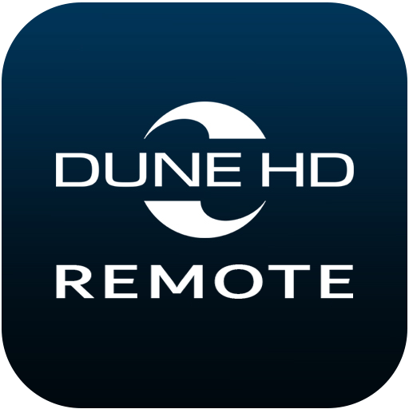

# ioBroker.dune-hd-remote

Steuern Sie [Dune HD](https://dune-hd.com/) Mediaplayer über das IP-Netzwerk mit ioBroker.

[Dune HD](https://dune-hd.com/) produziert hochwertige Netzwerk-Mediaplayer mit Unterstützung für 4K-HDR-Wiedergabe, Blu-ray und eine Vielzahl weiterer Medienformate. Alle Linux-basierten Dune-HD-Player unterstützen die IP-Steuerung über eine HTTP-API, die dieser Adapter nutzt, um die vollständige Fernsteuerung über ioBroker zu ermöglichen.

## Merkmale

- Volle Wiedergabesteuerung (Wiedergabe, Pause, Stopp, Suche, vorheriger/nächster Titel, Vor-/Zurückspulen)
- Navigation (Steuerkreuz, Eingabetaste, Return-Taste, Menüs)
- Lautstärke- und Stummschaltungsregelung
- Statusabfrage (Spielerstatus, Position, Dauer, Lautstärke, Bitrate, Audiosprache, Videoauflösung)
- Integrierte PWA-Webfernbedienung – nutzen Sie Ihr Smartphone als Fernbedienung
- Intelligente Offline-Abfrage – reduziert die Abfragehäufigkeit, wenn der Spieler nicht erreichbar ist
- PWA-Texteingabe – Text direkt an die Bildschirmtastatur des Spielers senden
- PWA-Wiedergabe-URL – Starten Sie die Medienwiedergabe von jeder beliebigen URL direkt von der Fernbedienung aus.

## Unterstützte Modelle

Alle Dune HD Mediaplayer mit IP-Steuerungsunterstützung (Linux-basierte Firmware).\
&#x20;Getestet auf: **Dune HD Pro 4K** (Firmware mit XML-Antwortformat).

| Modelltyp                            | Standardport |
| ------------------------------------ | ------------ |
| Linux-basiert (Pro 4K, Solo 4K usw.) | 80           |
| Android/ATV-basiert                  | 11080        |

### Hinweise für Android-Modelle

- **Android-Apps:** Solange eine Android-App im Vordergrund läuft, werden die Transporttasten (Wiedergabe, Pause, Stopp, vorheriger Titel, nächster Titel, Zurückspulen, Vorspulen) als Fernbedienungstasten und nicht als API-Befehle gesendet, da die API-Befehle nur den Dune-Player selbst erreichen. Im Dune-Player ändert sich nichts. Die „Langsam“-Taste hat keine Android-Taste und ist in Android-Apps funktionslos.
- **Ein-/Ausschalten auf Google-zertifizierten ATV-Boxen (bekannte Einschränkung):** Auf Google-zertifizierten ATV-Boxen von Drittanbietern, auf denen die Dune Media Center App läuft (z. B. Android 14-Boxen, Port 11080), ist die Ein-/Aus-Taste (`control.power` Die Dune-App (und die PWA) können die Box nicht in den Standby-Modus versetzen. Die Box akzeptiert den Befehl und der Adapter meldet keinen Fehler, aber Android verweigert den Ruhemodus, da die Dune-App nicht über die erforderliche Systemberechtigung verfügt. `android.permission.DEVICE_POWER` Nur System-Apps erhalten diese Berechtigung, daher gibt es keine Einstellung, Adapteroption oder sonstige Umgehungslösung. Schalten Sie ein solches Gerät mit der zugehörigen Fernbedienung aus. Alle anderen Tasten funktionieren normal. Bei Dune HD-Playern mit Linux-basierter Firmware funktioniert die Ein-/Aus-Taste.

## Konfiguration

### Spieler

| Feld               | Beschreibung                           |
| ------------------ | -------------------------------------- |
| Spielername        | Anzeigename (nur zur Information)      |
| Spieler-IP-Adresse | IP-Adresse des Dune HD-Players         |
| Spielerport        | HTTP-Port (Standard: 80)               |
| Verbindungstimeout | Anfrage-Timeout in ms (Standard: 5000) |

### Statusabfrage

| Feld                     | Beschreibung                                                                  |
| ------------------------ | ----------------------------------------------------------------------------- |
| Statusabfrage aktivieren | Aktivieren Sie regelmäßige Statusaktualisierungen                             |
| Abstimmungsintervall     | Intervall in Sekunden, in dem der Spieler online ist (Standard: 5)            |
| Offline-Abfrageintervall | Intervall in Sekunden, in dem der Spieler nicht erreichbar ist (Standard: 30) |

### PWA-Fernbedienung

Aktivieren Sie die integrierte Webfernbedienung, um den Player von jedem Browser oder Mobilgerät aus zu steuern.

| Feld                         | Beschreibung                                                                       |
| ---------------------------- | ---------------------------------------------------------------------------------- |
| PWA-Fernsteuerung aktivieren | Starten Sie den integrierten Webserver.                                            |
| IP-Adresse binden            | Netzwerkschnittstelle, an die gebunden werden soll (0.0.0.0 = alle Schnittstellen) |
| PWA-Server-Port              | Port für die Webfernbedienung (Standard: 8765)                                     |

Nach der Aktivierung öffnen `http://<iobroker-host>:8765/` in Ihrem Browser.\
&#x20;Die URL wird auch in der `info.pwaUrl` Der Administrator zeigt außerdem im Tab „ **Instanzen“** neben der Instanz einen Link zum Remote-Server an. Dieser Link wird immer angezeigt und funktioniert daher nur, wenn der PWA-Remote-Server aktiviert ist.

**PWA-Funktionen:**

- Hauptregisterkarte: Steuerkreuz, Wiedergabesteuerung, Lautstärke, Suchfunktion
- Hauptregisterkarte: Texteingabefeld — sendet Text an die Tastatur des aktiven Spielers (`set_text` API)
- Hauptregisterkarte: Feld „Wiedergabe-URL“ – startet die Medienwiedergabe von einer beliebigen URL (`launch_media_url` API)
- Registerkarte „Ziffern“: Zifferntasten, Farbtasten (A/B/C/D), Untertitel, Zoom, Auswurf, Aufnahme
- Registerkarte „Einstellungen“: Dunkles/Helles Design, Verbindungseinstellungen
- Funktioniert als installierbare PWA auf iOS und Android (Zum Startbildschirm hinzufügen)

### Dune Notify Plugin

Benachrichtigungen von ioBroker sollen während der Videowiedergabe **über dem Video** angezeigt werden.\
&#x20;Erfordert die Installation **des dune-notify** PHP-Plugins auf dem Player (siehe `dune-notify/` Ordner).

| Feld                                            | Beschreibung                                |
| ----------------------------------------------- | ------------------------------------------- |
| Benachrichtigungen aktivieren                   | Aktivieren Sie die Dune-Notify-Integration. |
| Zeitüberschreitung der Benachrichtigungsanfrage | HTTP-Anfrage-Timeout in ms (Standard: 3000) |

## Staaten

| Zustand                                 | Typ             | Beschreibung                                                                                                          |
| --------------------------------------- | --------------- | --------------------------------------------------------------------------------------------------------------------- |
| `info.connection`                       | boolescher Wert | Spieler erreichbar                                                                                                    |
| `info.pwaUrl`                           | Zeichenkette    | PWA-Remote-URL                                                                                                        |
| `info.playerModel`                      | Zeichenkette    | Spielermodellname                                                                                                     |
| `info.firmwareVersion`                  | Zeichenkette    | Firmware-Version                                                                                                      |
| `status.playerStatus`                   | Zeichenkette    | Wiedergabe / gestoppt / pausiert                                                                                      |
| `status.position`                       | Nummer          | Wiedergabeposition (Sekunden)                                                                                         |
| `status.duration`                       | Nummer          | Gesamtdauer (Sekunden)                                                                                                |
| `status.volume`                         | Nummer          | Lautstärkepegel                                                                                                       |
| `status.mute`                           | boolescher Wert | Stummzustand                                                                                                          |
| `status.caption`                        | Zeichenkette    | Aktueller Medientitel                                                                                                 |
| `status.audioLang`                      | Zeichenkette    | Audiosprache                                                                                                          |
| `status.videoWidth/Height`              | Nummer          | Videoauflösung                                                                                                        |
| `status.bitrate`                        | Nummer          | Aktuelle Bitrate (Bit/s)                                                                                              |
| `control.play/pause/stop`               | boolescher Wert | Wiedergabeaktionen auslösen                                                                                           |
| `control.power`                         | boolescher Wert | Strom-/Standby-Modus (wird auf Google-zertifizierten ATV-Boxen nicht unterstützt, siehe Hinweise für Android-Modelle) |
| `control.volume`                        | Nummer          | Lautstärke einstellen                                                                                                 |
| `navigation.up/down/left/right/ok/back` | boolescher Wert | Navigationsschaltflächen                                                                                              |
| `media.playUrl`                         | Zeichenkette    | Medien von URL abspielen                                                                                              |
| `media.seek`                            | Nummer          | Position anstreben (Sekunden)                                                                                         |
| `notify.send`                           | Zeichenkette    | Benachrichtigung senden (Text oder JSON)                                                                              |
| `notify.hide`                           | boolescher Wert | Aktuelle Benachrichtigung ausblenden                                                                                  |
| `notify.lastResult`                     | Zeichenkette    | Ergebnis der letzten Benachrichtigungsanfrage                                                                         |

## Changelog

### **WORK IN PROGRESS**
- `@iobroker/testing` 6.3.2 (repository checker W0037)

### 1.2.14
- The port of the PWA remote is declared in the used resources registry of js-controller (js-controller 8 and newer), and a warning is logged when another instance already uses it; nothing changes on older controllers

### 1.2.13
- README: notes for Android models; the Power button cannot switch Google-certified ATV boxes to standby (Android restriction), `control.power` added to the states table

### 1.2.12
- Fix Play, Pause, Stop, Previous, Next, Rewind and Fast-forward in Android apps: the PWA remote and the control states send the remote's transport keys (IR codes, delivered to Android as media keys) while an Android app is in the foreground; inside the Dune player the API commands are still used

### 1.2.11
- Fix a crash of the adapter when the player did not answer a PWA request in time (the timeout answered the request twice)
- Replace the deprecated `url.parse()` in the PWA server by the WHATWG `URL` API
- Create the object tree also when no player IP is configured yet
- README: badge block, changelog trimmed to the last five versions
- Update transitive dependencies in the lock file (`npm audit fix`)

### 1.2.10
- Fix the "Test Connection" button: enable messagebox, use the current form values (useNative) and the same status request as the polling

For older changelog entries see CHANGELOG_OLD.md.

## License

MIT License

Copyright (c) 2026 sadam6752-tech <sadam6752@gmail.com>

Permission is hereby granted, free of charge, to any person obtaining a copy
of this software and associated documentation files (the "Software"), to deal
in the Software without restriction, including without limitation the rights
to use, copy, modify, merge, publish, distribute, sublicense, and/or sell
copies of the Software, and to permit persons to whom the Software is
furnished to do so, subject to the following conditions:

The above copyright notice and this permission notice shall be included in all
copies or substantial portions of the Software.

THE SOFTWARE IS PROVIDED "AS IS", WITHOUT WARRANTY OF ANY KIND, EXPRESS OR
IMPLIED, INCLUDING BUT NOT LIMITED TO THE WARRANTIES OF MERCHANTABILITY,
FITNESS FOR A PARTICULAR PURPOSE AND NONINFRINGEMENT. IN NO EVENT SHALL THE
AUTHORS OR COPYRIGHT HOLDERS BE LIABLE FOR ANY CLAIM, DAMAGES OR OTHER
LIABILITY, WHETHER IN AN ACTION OF CONTRACT, TORT OR OTHERWISE, ARISING FROM,
OUT OF OR IN CONNECTION WITH THE SOFTWARE OR THE USE OR OTHER DEALINGS IN THE
SOFTWARE.