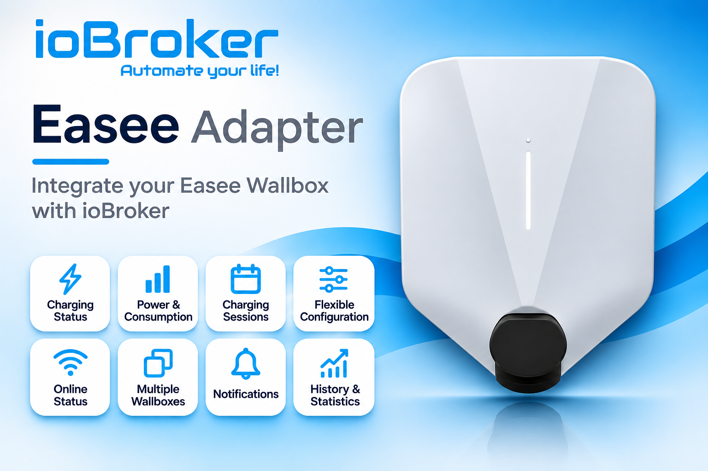

# ioBroker.easee

> \[!IMPORTANT] Dieser Adapter kann nicht von GitHub installiert werden.

## EASEE-Adapter für ioBroker

Adapter zum Anschluss [von Easee-Wanddosen](https://easee.com/) .

## Anforderungen

- Node.js 22.19.0 oder neuer
- ioBroker js-controller 7.2.2 oder neuer
- ioBroker Admin 7.7.22 oder neuer

## Helfen

### Verbindungsmodus

Cloud ist der Standardverbindungsmodus. Wählen Sie in den Adaptereinstellungen **„Easee Cloud“** oder **„Bluetooth (lokal)“** . Im Cloud-Modus wird Ihr Easee-Konto verwendet. Der Bluetooth-Modus verbindet sich direkt mit Ladegeräten, die im Geräte-Manager auf der Registerkarte „Verbindung“ konfiguriert sind. Verwenden Sie ihn, um lokale Ladegeräte hinzuzufügen, zu bearbeiten und zu entfernen. Im Bluetooth-Modus wird keine Cloud-Verbindung hergestellt und es wird auch nicht automatisch auf die Cloud umgeschaltet. Geben Sie die Seriennummer und die Bluetooth-PIN (nicht Ihr Easee-Kontopasswort) jedes Ladegeräts ein, speichern Sie die Einstellungen und starten Sie den Adapter neu. Ein optionaler Name ist lediglich eine ioBroker-Bezeichnung. Die PIN wird verschlüsselt in der Adapterkonfiguration gespeichert.

Das Ladegerät muss sich in Bluetooth-Reichweite befinden und für eine lokale Verbindung verfügbar sein. Die Registerkarte **„Erweiterte Bluetooth-Funktionen“** zeigt den Bluetooth-Status und die Verbindungsmethode an und bietet eine optionale manuelle Suche. Die Suchergebnisse konfigurieren keine Ladegeräte und ersetzen weder die erforderliche Seriennummer noch die PIN. Im Bluetooth-Modus werden keine Cloud-spezifischen Informationen wie Website-Preise, Sitzungsverlauf oder Autorisierungstoken-Details bereitgestellt. Es werden nur die vom gewählten Verbindungsmodus unterstützten Datenpunkte angezeigt; nicht unterstützte, vom Adapter erzeugte Datenpunkte werden nach dem Wechsel des Modus entfernt. Informationen zu Einrichtung, Kompatibilität und Fehlerbehebung finden Sie im [Bluetooth-Handbuch](/#/docs/adapterref/iobroker.easee/docs/bluetooth.md) .

### Ladestatus und Bedienelemente

`<chargerId>.status.chargerOpMode` zeigt den aktuellen Ladestatus an. Der Admin-Objektbrowser markiert Ladegeräte als online oder offline. `<chargerId>.status.isOnline` im Cloud-Modus oder `<chargerId>.info.bluetoothConnection` im Bluetooth-Modus.

| Wert | Zustand                       |
| ---: | ----------------------------- |
|    0 | Offline                       |
|    1 | Getrennt                      |
|    2 | Warten auf den Start          |
|    3 | Laden                         |
|    4 | Angehalten oder abgeschlossen |
|    5 | Fehler                        |
|    6 | Bereit zum Aufladen           |
|    7 | Warten auf Authentifizierung  |
|    8 | Authentifizierung beenden     |

Im Cloud-Modus kann Easee nach einer Ladesitzung ein Autorisierungstoken bereitstellen. `status.authToken` Wenn das Token mit einem Schlüssel in Ihrem Easee-Konto übereinstimmt, `status.authTokenName` zeigt den Namen des Schlüsselbesitzers an; andernfalls zeigt es `unknown` Beide Zustände bleiben so lange leer, bis ein Token verfügbar ist.

Im Cloud-Modus einen neuen Namen eingeben `<chargerId>.name` Um ein Ladegerät umzubenennen, benötigen Sie in Ihrem Easee-Konto die Berechtigung, Ladegeräte auf der Website zu ändern.

`config.dynamicCircuitCurrentP1` –`P3` Legen Sie für jede Phase den aktuellen Grenzwert fest. Im Cloud-Modus werden alle Phasenwerte gleichzeitig aktualisiert. Im Bluetooth-Modus werden die anderen Phasenwerte vor der Anwendung einer Änderung ausgelesen und diese verworfen, falls diese nicht verfügbar sind.

Die Abfrage der Cloud-Sitzung erfolgt standardmäßig automatisch. Sie können im Adminbereich für jedes Ladegerät ein separates Intervall festlegen; sehr kurze Intervalle werden angepasst, um übermäßige Anfragen zu vermeiden.

## Credits

Dieser Adapter wäre ohne die großartige Arbeit von @Newan ( <https://github.com/Newan> ) nicht möglich gewesen, der frühere Versionen dieses Adapters entwickelt hat.

## Spende

## Changelog
<!--
  Placeholder for the next version (at the beginning of the line):
  ### **WORK IN PROGRESS**
-->
### 4.1.0 (2026-11-19)
- (Voodoo2man) Added online/offline indicators for chargers in the Admin object browser.
- (Voodoo2man) Improved cleanup of Bluetooth connections that complete while the adapter shuts down.

### 4.0.1 (2026-11-15)
- (Voodoo2man) Fixed repository-checker findings and improved automatic Bluetooth binding selection, timer cleanup, and bounded shutdown handling (up to 10 seconds).
- (Voodoo2man) Limited the displayed charging power to two decimal places in the Device Manager card.

### 4.0.0 (2026-11-10)
- (Voodoo2man) Added optional local Bluetooth connectivity alongside Cloud, with charger discovery and setup through the Device Manager.
- (Voodoo2man) Improved Cloud status and session updates, charger controls, and Bluetooth charger configuration saving.

### 3.2.0 (2026-11-07)
- (Voodoo2man) Added the ability to change the charger name through the writable `<chargerId>.name` state.
- (Voodoo2man) Replaced the adapter icon.
- (Voodoo2man) Added an authorization token datapoint that is cleared when charging starts and set after the session, with a separate owner-name datapoint.

### 3.1.0 (2026-11-01)
- (Voodoo2man) Corrected cable-lock status reporting and improved the reliability of charger status updates.
- (Voodoo2man) Added a readable and adjustable permanent cable-lock setting, kept separate from the actual cable-lock status.
- (Voodoo2man) Improved recovery of live charger updates after connection interruptions while retaining regular status updates when live updates are disabled.

## License
MIT License

Copyright (c) 2026 iobroker-community-adapters <iobroker-community-adapters@gmx.de>  
Copyright (c) 2025 Newan <info@newan.de>

Permission is hereby granted, free of charge, to any person obtaining a copy
of this software and associated documentation files (the "Software"), to deal
in the Software without restriction, including without limitation the rights
to use, copy, modify, merge, publish, distribute, sublicense, and/or sell
copies of the Software, and to permit persons to whom the Software is
furnished to do so, subject to the following conditions:

The above copyright notice and this permission notice shall be included in all
copies or substantial portions of the Software.

THE SOFTWARE IS PROVIDED "AS IS", WITHOUT WARRANTY OF ANY KIND, EXPRESS OR
IMPLIED, INCLUDING BUT NOT LIMITED TO THE WARRANTIES OF MERCHANTABILITY,
FITNESS FOR A PARTICULAR PURPOSE AND NONINFRINGEMENT. IN NO EVENT SHALL THE
AUTHORS OR COPYRIGHT HOLDERS BE LIABLE FOR ANY CLAIM, DAMAGES OR OTHER
LIABILITY, WHETHER IN AN ACTION OF CONTRACT, TORT OR OTHERWISE, ARISING FROM,
OUT OF OR IN CONNECTION WITH THE SOFTWARE OR THE USE OR OTHER DEALINGS IN THE
SOFTWARE.