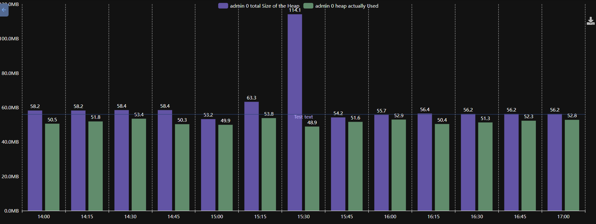
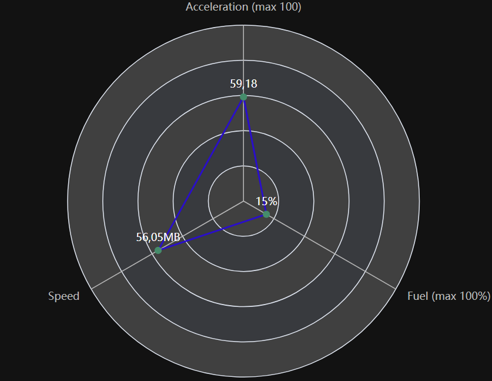
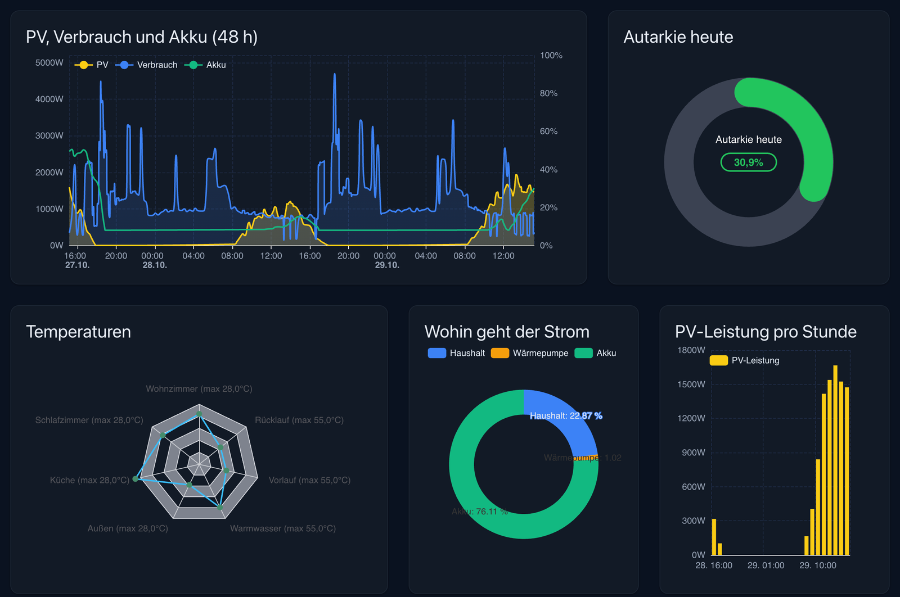

# ioBroker.echarts

**Dieser Adapter verwendet Sentry-Bibliotheken, um Ausnahmen und Codefehler automatisch an die Entwickler zu melden.** Weitere Details und Informationen zum Deaktivieren der Fehlerberichterstattung finden Sie in [der Sentry-Plugin-Dokumentation](https://github.com/ioBroker/plugin-sentry#plugin-sentry) !

## eCharts-Adapter für ioBroker

Erstellen Sie nützliche Diagramme in ioBroker:




 Verwenden Sie die Aggregation „Tatsächlicher Wert“ für das prognostizierte Ergebnis.

### Ein Balken pro Datenpunkt

Normalerweise stellt die X-Achse eines Balkendiagramms die Zeit dar, und jeder Balken repräsentiert ein Zeitintervall. Mit **der Balkeneinstellung „Ein Balken pro Linie“** wird die X-Achse stattdessen zur Liste der Linien: Jede Linie erhält genau einen Balken, der den letzten Wert dieser Linie anzeigt. Zusammen mit der Aggregation „Aktueller Wert“ wird der aktuelle Wert jedes Zustands angezeigt, z. B. der Verbrauch jedes Geräts.

**Horizontale Balken** drehen das Diagramm um 90°, sodass die Namen auf der Y-Achse stehen. Das ist die bessere Wahl für lange Namen oder viele Zeilen.

## Verwendung

Fügen Sie nach dem Neustart den Tab im Adminbereich hinzu:

Die erstellte Voreinstellung kann auch im Webadapter aufgerufen werden. URL: `http://IP:8082/echarts/index.html?preset=echarts.0.PRESETID` Die

Für `vis` Es gibt ein spezielles Widget mit einfacher Auswahl von Voreinstellungen.

### Zeitbereich-Widget

Neben dem Diagramm-Widget befindet sich das Widget „E-Charts-Zeitbereich“. Es zeigt dieselben drei Felder wie der Tab „Zeit“ des Preset-Editors – Typ (relativ oder statisch), Ende und Bereich – und überlässt die Auswahl dem Benutzer für die Diagramm-Widgets derselben Ansicht. Jedes der drei Felder kann in den Widget-Einstellungen deaktiviert werden; ein deaktiviertes Feld behält den Wert seines Attributs bei. Solange unter „Diagramme“ kein Diagramm ausgewählt ist, folgen alle E-Charts-Widgets der Ansicht dieser Auswahl.

Das Gleiche funktioniert auch ohne das Widget: Ein Diagramm, das mit einer Voreinstellung geöffnet wird, extrahiert den Bereich aus dem URL-Hash, z. B. `http://IP:8082/echarts/index.html?preset=echarts.0.PRESETID#range=60&relativeEnd=now` Die `range`, `relativeEnd`, `timeType`, `start`, `start_time`, `end` Und `end_time` werden dort gelesen und überschreiben die Ergebnisse der Voreinstellung, ohne die Voreinstellung selbst zu verändern.

### Diagrammmodi

Der Reiter „Optionen“ des Preset-Editors öffnet sich mit einem „Diagrammmodus“, der anzeigt, wie das gesamte Diagramm aussieht:

- **Gemischt** – das Diagramm, wie es immer war: eine Zeitachse, und jede Linie hat ihren eigenen Typ.
- **Donut** -Diagramm – ein Ring, jede Zeile enthält ein Segment mit dem aktuellen Zustand. Größe des Lochs, Beschriftungen der Segmente, Text im Loch und Reihenfolge der Segmente werden daneben festgelegt. Die Werte werden per Abonnement aktualisiert, sodass das Diagramm den Zuständen ohne Neuladen folgt.
- **Balken (aktueller Wert)** – ein Balken pro Zeile anstatt eines Balkens pro Zeitintervall. Dies ist die Funktion des Kontrollkästchens „Ein Balken pro Zeile“; eine alte Voreinstellung wird als dieser Modus interpretiert und bleibt aktiv.
- **Radar** – die Polarkarte. Früher gab es einen Typ, den eine einzelne Linie annehmen konnte, wodurch dann alle anderen Linien entsprechend angepasst wurden; eine alte Voreinstellung wird als dieser Modus gelesen.
- **Gauge** - bei der Form "Circles" ist die Skala zu einem vollständigen Kreis gebogen und pro Zeile wird ein Ring übereinander gestapelt, wobei sich die Namen und die Werte in der Mitte befinden; bei der Form "Gauge" bleibt die Skala offen und jede Zeile erhält einen Zeiger, wobei sich die Namen und die Werte in einer Zeile darunter befinden.

Donut und "Bar (aktueller Wert)" lesen die Zustände und niemals die Historie, daher benötigen sie keinen Zeitbereich und keine Aggregation.

Die Diagrammmodi in einer Vis-2-Ansicht, jedes Diagramm ist eine Voreinstellung, die mit dem Widget "Echarts Chart" angezeigt wird: gemischt (Linien mit einer zweiten Y-Achse), Gauge, Radar, Donut und Balken pro Stunde.



### Diagramm ohne iFrame (experimentell)

Das vis-2-Diagramm-Widget zeichnet das Diagramm in einem iFrame: Jedes Diagramm in einer Ansicht bringt seine eigene React-Anwendung, seine eigenen ECharts und vor allem seine eigene Socket-Verbindung mit. Das Attribut „Without iframe“ zeichnet es stattdessen im Widget – das Modell verwendet dann die bereits von der vis-Laufzeitumgebung bereitgestellte Verbindung, und das Diagramm wird im vis-2-Theme angezeigt.

Das Widget für ioBroker.devices verwendet dieselben Einstellungen. Beide betten ein `ChartEmbed` von `src-chart`, was die einzige Stelle ist, die das Diagrammmodell mit der Diagrammansicht verbindet.

Der Diagrammcode wird bei Bedarf geladen (ca. 1,5 MB, 480 kB gezippt), sobald ein Widget mit dieser Einstellung zum ersten Mal angezeigt wird, da weder vis-2 noch der Host des Geräts eCharts gemeinsam nutzen. Eine Seite ohne ein solches Widget lädt keine zusätzlichen Daten. Der iFrame bleibt die Standardeinstellung und die einzige Möglichkeit für die eigenständige URL und die Vorschau im Editor.

### Webkomponenten

Der Adapter bringt die Webkomponente `<iob-echarts-chart>` (`common.webComponents` Aura und alle anderen Hosts von ioBroker-Webkomponenten zeigen es als eigenes Widget an; vis-2 und Geräte bieten weiterhin ihr E-Charts-Widget an, das denselben Namen trägt.

Es zeichnet eine Voreinstellung (`echarts.0.<name>`) oder – ohne Voreinstellung – die Historie eines einzelnen Zustands, wie es das vis-2-Widget tut: Diagrammtyp, Aggregation, Live-Aktualisierung, Teilstriche, Bereich und Ende werden in der Komponente festgelegt. Die Verlaufsinstanz ist diejenige, die den Zustand aufzeichnet, standardmäßig zuerst. Das Diagramm wird direkt mit der Verbindung des Hosts gezeichnet – kein iFrame, kein eigener Socket – im hellen oder dunklen Design und mit der Schriftart des Hosts.

Die Schaltflächen der Voreinstellung funktionieren wie auf der Diagrammseite: Speichern als Bild, Datenexport als CSV, Linienauswahl; Maus und Finger ermöglichen das Verschieben und Zoomen. Die Einstellung „Zeitbereichsauswahl“ fügt die Schaltfläche für den Zeitbereich auch dann hinzu, wenn die Voreinstellung keine enthält. Sie bietet einen relativen Bereich mit Endpunkt oder einen festen Bereich – genau wie das vis-2-Widget „E-Charts-Zeitbereich“ für die Diagramme einer Ansicht. Dieses Widget hat keine eigene Komponente: Es steuert andere Widgets derselben Ansicht, und viele Webkomponenten haben keine solche Verknüpfung.

Das Modul bündelt ECharts (nur die Diagramme, Komponenten und Renderer, die ein Preset verwenden kann), Moment und den Diagrammcode von `src-chart` ca. 925 kB, 300 kB gezippt, wird nur geladen, wenn ein Host die Komponente anzeigt. Erstellt von `npm run build:wc` aus `src-webcomponents/` hinein `admin/webcomponents/` Die

### Tooltip

Kleinbuchstaben `i` Dies bedeutet, dass der Wert aus den Werten der beiden Nachbarwerte interpoliert wurde und zum aktuellen Zeitpunkt nicht existiert.


### Daten aus JSON

Sie können die Datenquelle aus JSON definieren. In diesem Fall können Sie einen benutzerdefinierten Zustand vom Typ erstellen. `json` und speichern Sie den Wert folgendermaßen:

```json
[
    { "ts": 1675887847000, "val": 45 },
    { "ts": 1675887848000, "val": 77 },
    { "ts": 1675887849000, "val": 180 }
]
```

Folgende alternative Attributnamen werden unterstützt: `val`: `value`, `v`, `data`, `y` Und im Anschluss daran für `ts`: `time`, `t`, `date` Die

Start- und Endzeitpunkt können in den ECharts-Einstellungen nicht definiert werden. Sie werden automatisch aus den Daten berechnet. Eine Aggregation ist ebenfalls nicht möglich. Alle Änderungen müssen durch Schreiben der JSON-Daten erfolgen. Das Diagramm wird bei jeder Wertänderung automatisch aktualisiert.

### Serverseitiges Rendering

Sie können die Voreinstellungen auf dem Server rendern und als Base64-URL abrufen oder auf der Festplatte in der ioBroker-Datenbank speichern:

```js
sendTo(
    'echarts.0',
    {
        preset: 'echarts.0.myPreset', // the only mandatory attribute

        renderer: 'svg', // svg | png | jpg | pdf, default: svg

        width: 1024, // default 1024
        height: 300, // default 300
        background: '#000000', // Background color
        theme: 'light', // Theme type: 'light', 'dark'

        title: 'ioBroker Chart', // Title of PDF document
        quality: 0.8, // quality of JPG
        compressionLevel: 3, // Compression level of PNG
        filters: 8, // Filters of PNG (Bit combination https://github.com/Automattic/node-canvas/blob/master/types/index.d.ts#L10)

        fileOnDisk: '', // Path on disk to save the file.
        fileName: '', // Path in ioBroker DB to save the files on 'echarts.0'. E.g. if your set "chart.svg", so you can access your picture via http(s)://ip:8082/echarts.0/chart.png

        cache: 600, // Cache time for this preset in seconds, default: 0 - no cache
    },
    result => {
        if (result.error) {
            console.error(result.error);
        } else {
            console.log(result.data);
        }
    },
);
```

Die Voreinstellung kann auch ein eigenes Diagramm sein, ohne ein voreingestelltes Objekt, z. B. die Außentemperatur der letzten 24 Stunden:

```js
sendTo('echarts.0', 'send', {
    preset: {
        l: [{ id: 'alias.0.Outside.Temperature' }], // the lines: id, and optional name, unit, color, instance (history adapter)
        range: 1440, // minutes back from now
        title: 'Outside',
    },
    renderer: 'png',
    background: '#ffffff',
    fileName: 'agent/outside.png', // then e.g. telegram: sendTo('telegram.0', 'send', { text: 'iobfile://echarts.0/agent/outside.png' })
});
```

`sendTo('echarts.0', 'help', {})` Antworten mit einer Beschreibung der Nachrichten für KI-Agenten (z. B. pi-agent) und Skriptautoren; die Antwort listet alle Befehle auf mit `write` (ob ein Befehl etwas verändert).

**Achtung: Auf Touch-Geräten mit aktiviertem Zoom können die Linien in der Legende nicht aktiviert/deaktiviert werden.**

## Entwicklerhandbuch

**Für Nicht-Entwickler funktioniert dieser Link nicht!**

Sie können Ansichtsdiagramme lokal debuggen mit:

- cd iobroker.echarts/src-chart
- npm run start
- Browser: <http://localhost:8081/adapter/echarts/tab.html?dev=true>

## Todo

- Widget für vis (Schaltfläche)
- Enum-Symbole auf Ordnern oder in deren Nähe anzeigen
  <!--
  	Placeholder for the next version (at the beginning of the line):
  	### **WORK IN PROGRESS**
  -->

## Changelog
### **WORK IN PROGRESS**
* (GermanBluefox) The preset editor has a switch "Auto preview" and a button "Update preview": with the switch off, the preview is updated only by the button; with the switch on, the preview waits briefly after a change so fast changes cause only one reload (#1323)

### 6.5.1 (2026-11-20)
- (@GermanBluefox) The help for AI agents describes charts without a preset (states and time range in the message), e.g. "the outside temperature of today", and how to send a chart with a messenger
- (@GermanBluefox) Fixed: the message "send" with renderer "pdf" now answers with the PDF instead of never answering; a failure while rendering or writing `fileOnDisk` is answered as an error as well
- (@GermanBluefox) Fixed: the message "send" now answers errors with their text instead of an empty object
- (@GermanBluefox) Fixed: the message "send" with an unknown preset now answers with an error instead of no answer at all

### 6.5.0 (2026-11-19)
- (@GermanBluefox) Added the message "help": a description of all messages for AI agents (e.g. pi-agent), and common.supportedMessages.help

### 6.4.1 (2026-11-17)
- (@GermanBluefox) Fixed the build with echarts-for-react 3.1.0: version 6.4.0 failed to build and was not published, this version contains its changes

### 6.4.0 (2026-11-17)
- (@GermanBluefox) A chart can show an arrow at each side that moves the time range by its own length: a week back for "7 days", the month before for "this month". After a click into the chart the arrow keys ← and → do the same. The option "Show arrows for the previous and next period" is in the time settings of the preset; it works for lines and for bars, which stay on their raster of days, weeks or months. Stepping forward back to the present brings the live update back
- (@GermanBluefox) Added the short form of the web component manifests (tag, name, icon, size) to `common.webComponents`, so that hosts like Aura can list the components before the adapter is installed; the build writes it with `iob-web-components sync-io-package`
- (@GermanBluefox) Updated packages
- (@GermanBluefox) The editor lists the states of a running history instance from its answer to `getEnabledDPs` and no longer only from `common.custom`, so the states that the recorder selects by itself appear as well

### 6.3.0 (2026-11-09)
- (@GermanBluefox) Added web component `<iob-echarts-chart>` for Aura and other hosts (`common.webComponents`)
- (@GermanBluefox) Fixed: a chart drawn without iframe kept the first fixed time range and ignored every later one

## License

ioBroker.echarts is available under the Apache License V2.

Copyright (c) 2019-2026 @GermanBluefox <dogafox@gmail.com>

Apache ECharts
Copyright (c) 2017-2026 The Apache Software Foundation

This product includes software developed at
The Apache Software Foundation (https://www.apache.org/).