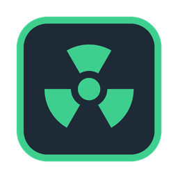

# ioBroker.ecosense

## EcoSense-Adapter für ioBroker

Liest die Radonkonzentration von **EcoSense EcoQube** Radonmessgeräten aus der EcoSense-Cloud aus.

Hersteller / Gerät: [EcoSense EcoQube](https://ecosense.io/products/ecoqube)

Radon ist ein radioaktives, geruchloses Gas und die zweithäufigste Ursache für Lungenkrebs. Mit diesem Adapter können Sie die EcoQube-Messwerte in ioBroker nutzen – für Diagramme, Benachrichtigungen oder zum Schalten eines Lüfters.

> **Hinweis:** EcoSense bietet keine offizielle, dokumentierte API an. Der Adapter verwendet dieselbe Cloud-Schnittstelle wie die EcoQube-App. Sollte EcoSense diese ändern, funktioniert der Adapter möglicherweise nicht mehr, bis er aktualisiert wurde.

### Anforderungen

- Ein EcoQube, der mit WLAN verbunden ist und Werte in der EcoQube-App anzeigt.
- Die E-Mail-Adresse und das Passwort Ihres EcoSense-Kontos (wie in der App verwendet)
- Konten mit Zwei-Faktor-Authentifizierung werden nicht unterstützt.

### Konfiguration

| Einstellung           | Beschreibung                                                                | Standard |
| --------------------- | --------------------------------------------------------------------------- | -------- |
| E-Mail / Passwort     | Anmeldung bei der EcoQube-App. Das Passwort wird verschlüsselt gespeichert. | –        |
| Abstimmungsintervall  | Minuten zwischen zwei Cloud-Anfragen (mindestens 5)                         | 10       |
| Warnschwelle (orange) | Aus diesem Wert `alertLevel` wird zu 1 (WHO-Empfehlung)                      | 100      |
| Alarmschwelle (rot)   | Aus diesem Wert `alertLevel` wird zu 2 (deutscher Referenzwert)              | 300      |

Der EcoQube selbst lädt nur etwa alle 10 Minuten einen neuen Wert hoch, daher liefert ein kürzeres Intervall keine aktuelleren Daten.

### Staaten

Für jedes EcoQube wird ein Gerät erstellt, das nach seiner Seriennummer benannt wird (Anzeigename = Name aus der App):

| Zustand                    | Typ             | Beschreibung                                                                    |
| -------------------------- | --------------- | ------------------------------------------------------------------------------- |
| `<serial>.radon`           | Nummer          | Radonkonzentration in Bq/m³ (`null` während sich das Gerät aufwärmt)            |
| `<serial>.radonPci`        | Nummer          | Radonkonzentration in pCi/L                                                     |
| `<serial>.alertLevel`      | Nummer          | 0 = grün, 1 = orange, 2 = rot (basierend auf Ihren Schwellenwerten)             |
| `<serial>.alertText`       | Zeichenkette    | `green`, `orange` oder `red`                                                    |
| `<serial>.lastMeasurement` | Nummer          | Zeitpunkt der letzten vom Gerät hochgeladenen Messung                           |
| `<serial>.online`          | boolescher Wert | Das Gerät wurde innerhalb der letzten 3 Upload-Perioden (\~30 min) hochgeladen. |
| `<serial>.firmware`        | Zeichenkette    | Firmware-Version                                                                |
| `<serial>.json`            | Zeichenkette    | Gerätedaten im JSON-Format (ohne personenbezogene Daten)                        |
| `<serial>.raw.*`           | gemischt        | Alle anderen einfachen Bereiche, die die Cloud abdeckt, unverändert             |
| `info.connection`          | boolescher Wert | Die letzte Cloud-Anfrage war erfolgreich.                                       |
| `info.lastPoll`            | Nummer          | Zeitstempel der letzten erfolgreichen Anfrage                                   |

**Datenschutz:** Die Cloud übermittelt außerdem die E-Mail-Adresse des Kontos, Ihre öffentliche IP-Adresse, den WLAN-Namen und den in der App eingegebenen Standort. Der Adapter verwirft diese Felder – sie werden niemals in Statusdateien oder Protokollen gespeichert.

### Testen des Cloud-Zugriffs ohne ioBroker

```bash
npm install
ECOSENSE_EMAIL="you@example.com" ECOSENSE_PASSWORD="secret" npm run check-api
```

Das Skript meldet sich an, listet alle von der API zurückgegebenen Felder auf und gibt das unformatierte JSON ohne personenbezogene Daten aus. Bitte fügen Sie diese Ausgabe Ihrer Meldung zu fehlenden Werten bei.

### Spenden

Wenn Ihnen dieser Adapter gefällt und Sie seine Weiterentwicklung unterstützen möchten, können Sie mir einen Kaffee spendieren:

### Credits

Vielen Dank an [rwestergren/hass-ecosense-radon](https://github.com/rwestergren/hass-ecosense-radon) (Home Assistant), dessen Arbeit die Funktionsweise des EcoSense-Cloud-Logins und des Geräteendpunkts aufgezeigt hat. Dieser Adapter ist eine unabhängige Implementierung.

Dieser Adapter steht in keiner Verbindung zu EcoSense / FTLab und wird von diesen auch nicht unterstützt.

## Changelog

<!--
    Placeholder for the next version (at the beginning of the line):
    ### **WORK IN PROGRESS**
-->

### 0.1.2 (2026-10-22)

- (mrdimixx) object IDs from serial numbers and cloud field names now only contain letters, digits, `_` and `-` (dots and slashes are replaced as well)
- (mrdimixx) dependencies updated

### 0.1.1 (2026-09-30)

- (mrdimixx) maintenance: author e-mail, request timeout via AbortSignal instead of setTimeout, CI actions updated
- (mrdimixx) releases are now published via npm trusted publishing (with provenance)

### 0.1.0 (2026-09-30)

- (mrdimixx) initial release
- (mrdimixx) radon concentration in Bq/m³ and pCi/L, alert level with configurable thresholds (WHO 100 / German reference value 300 Bq/m³)
- (mrdimixx) states for last measurement, online status and firmware of each EcoQube
- (mrdimixx) personal data delivered by the cloud (e-mail, public IP, Wi-Fi name, location) is never stored

Older changes can be found in CHANGELOG_OLD.md.

## License

MIT License

Copyright (c) 2026 mrdimixx <stoppeld@gmx.de>

Permission is hereby granted, free of charge, to any person obtaining a copy
of this software and associated documentation files (the "Software"), to deal
in the Software without restriction, including without limitation the rights
to use, copy, modify, merge, publish, distribute, sublicense, and/or sell
copies of the Software, and to permit persons to whom the Software is
furnished to do so, subject to the following conditions:

The above copyright notice and this permission notice shall be included in all
copies or substantial portions of the Software.

THE SOFTWARE IS PROVIDED "AS IS", WITHOUT WARRANTY OF ANY KIND, EXPRESS OR
IMPLIED, INCLUDING BUT NOT LIMITED TO THE WARRANTIES OF MERCHANTABILITY,
FITNESS FOR A PARTICULAR PURPOSE AND NONINFRINGEMENT. IN NO EVENT SHALL THE
AUTHORS OR COPYRIGHT HOLDERS BE LIABLE FOR ANY CLAIM, DAMAGES OR OTHER
LIABILITY, WHETHER IN AN ACTION OF CONTRACT, TORT OR OTHERWISE, ARISING FROM,
OUT OF OR IN CONNECTION WITH THE SOFTWARE OR THE USE OR OTHER DEALINGS IN THE
SOFTWARE.