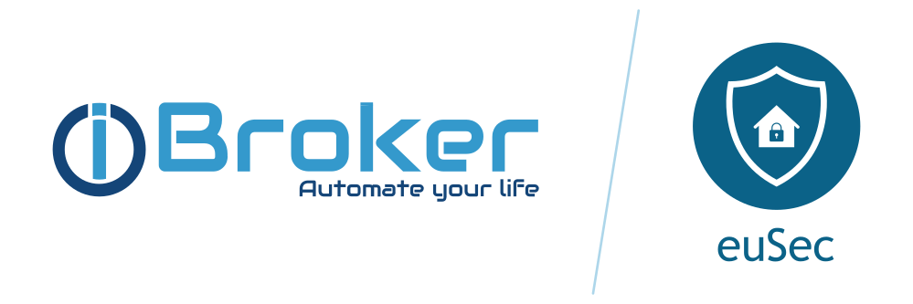

# ioBroker.euSec

> \[!IMPORTANT] Dieser Adapter kann nicht von GitHub installiert werden.

Dies ist ein [ioBroker-](https://www.iobroker.net) Adapter, der die [eufy-security-client-](https://github.com/bropat/eufy-security-client) Bibliothek zur Kommunikation mit Eufy-Geräten verwendet.

**Dieses Projekt steht in keiner Verbindung zu Anker und Eufy (Eufy Security). Es handelt sich um ein privates Projekt, das in der Freizeit betreut wird.**

## Beschreibung

Mit diesem Adapter können Sie [Eufy-Sicherheitsgeräte](https://us.eufylife.com/collections/security) steuern, indem Sie eine Verbindung zu den Eufy-Cloud-Servern und lokalen/Remote-Stationen herstellen.

Sie müssen Ihre Cloud-Anmeldedaten angeben. Der Adapter verbindet sich mit Ihrem Cloud-Konto und ruft alle Gerätedaten per HTTPS ab. Nun wird auch eine lokale oder Remote-P2P-Verbindung zu den Eufy-Stationen/Geräten unterstützt. Eine Verbindung zur Eufy Cloud ist jedoch immer Voraussetzung.

Eine Adapterinstanz zeigt alle Geräte eines Eufy Cloud-Kontos an und ermöglicht deren Steuerung.

> \[!TIP] Widgets für vis-2 (Live-Kamera, Ereignis-Popup, Schnappschuss) sind als separater Adapter verfügbar: [vis-2-widgets-eusec](https://github.com/typhosj/ioBroker.vis-2-widgets-eusec) .

## Dokumentation

Die Dokumentation finden Sie [hier](https://github.com/iobroker-community-adapters/ioBroker.eusec/tree/master/docs) .

## Bekannte funktionierende Geräte

Informationen zu unterstützten Geräten finden Sie [hier](/#/docs/adapterref/iobroker.eusec/docs/devices.md) .

## Credits

Dieser Adapter wäre ohne die großartige Arbeit von Patrick Broetto (brobat) <https://github.com/bropat> , der frühere Versionen dieses Adapters erstellt hat, nicht möglich gewesen.

## Upgrade von Adapter 2.x oder älter

Adapter 2.x und älter hinzugefügt `--security-revert=CVE-2023-46809` zu den Node-Prozessparametern jeder Instanz, die unter Node.js 18 oder 20 ausgeführt wird. Node.js 22 und neuer weigern sich, eine Instanz mit diesem Flag zu starten, und dieser Adapter benötigt Node.js 24.

Durch die Aktualisierung dieses Adapters werden die Knotenprozessparameter aller EUSEC-Instanzen gelöscht, wodurch das Flag entfernt wird. Andere Parameter (z. B. `--max-old-space-size`) werden ebenfalls gelöscht und müssen nach jedem Update erneut eingegeben werden. Wenn eine Instanz immer noch nicht startet und ihr Protokoll Folgendes anzeigt `--security-revert=CVE-2023-46809` Entfernen Sie die Parameter manuell und starten Sie die Instanz neu:

```
iobroker object set system.adapter.eusec.0 common.nodeProcessParams=[]
```

Eine detaillierte Beschreibung (in deutscher Sprache) finden Sie in unserem Forum ( <https://forum.iobroker.net/topic/82651/test-adapter-eusec-v2-0-x> ).

## Changelog

<!--
	Placeholder for the next version (at the beginning of the line):
	### **WORK IN PROGRESS**
-->
### 3.6.5 (2026-11-19)
- (typhosj) A device or station setting written in ioBroker that is not confirmed within 60 seconds now leaves a warning in the log. Until now, a command that got lost on the way, for example because the P2P connection to the station was set up again at that moment, left no trace at all, and the state simply stayed unconfirmed. A setting that the device already had is now confirmed instead of staying unconfirmed (reported in the forum)
- (typhosj) Stopping or restarting the adapter no longer ends with "terminated due to SIGKILL" when ioBroker is busy, for example during a restart of the whole system. ioBroker now waits up to 3 seconds for the adapter to shut down instead of 1 second
- (typhosj) A camera or station that was unreachable for a few minutes now takes commands again after it reconnects. Commands that piled up during the outage were dropped one per new command instead of all at once, so every new command, a livestream start included, queued up behind the old ones and was never sent until the adapter restarted. A livestream then only showed "Livestream starting"
- (typhosj) A livestream no longer freezes after a few seconds with a flickering stripe at the top, or shows green stripes, when the camera starts it in another resolution. A camera can send the first 1.5 seconds of a livestream in another resolution than the one it then streams at, for example 2048x1536 instead of 1600x1200, and the player kept decoding with the first one. The adapter now remembers the resolution of the last livestream of each camera and holds back a livestream that starts in another resolution, or with unreadable data, until its second keyframe. That delays the first picture of such a livestream by about 2 seconds, and of the first livestream of each camera after the adapter started. Every other livestream starts as quickly as before

### 3.6.4 (2026-11-08)
- (typhosj) Event pictures that a HomeBase sends directly, for example of a Video Doorbell on a HomeBase 3, are now shown correctly. eufy-security-client rebuilt them at a fixed size of 288x176, so a larger picture turned into a grey area with diagonal streaks. The adapter now detects their real size and restores their contrast, which had come out pale and grey as well (reported in the forum)

### 3.6.3 (2026-10-29)
- (typhosj) Switching quickly between on-demand cameras of the same station now also works between cameras with different video codecs, e.g. from a SoloCam S340 (H.265) to an Indoor Cam (H.264). The new camera was started right after the old one was stopped, and its livestream began with the last data of the old camera and kept its codec - nothing could be played, and the station stayed blocked for up to five minutes. The next livestream of a station now starts two seconds after a stop at the earliest (reported in the forum)
- (typhosj) The start no longer logs the error "Check push token - Response code not ok" for an account that has been migrated to the new eufy backend. That rejection is expected and push works over the new backend, so it is now logged once as info. A warning is logged instead when push could not be established on either backend

### 3.6.2 (2026-10-26)
- (typhosj) Switching quickly between on-demand cameras of the same station works now. A camera opened within ten seconds after another camera of the station was closed did not start, and the station stayed blocked for up to five minutes. The livestream of the closed camera, or one started through start_stream that nobody watches, is now stopped right away before the next livestream of the station starts, also one for start_stream or a talkback (reported in the forum)
- (typhosj) A talkback now keeps the other cameras of its station from starting, like a watched livestream does. Opening another camera of the station ended the talkback before.

### 3.6.1 (2026-10-26)
- (typhosj) On-demand streams no longer hang for five minutes when a player opens the stream again shortly after the last one left. A request that came while the idle livestream was being stopped waited for a livestream nobody started; a compatibility stream then failed in VLC with "404 Not Found" or "[exec] timeout" (reported in the forum)
- (typhosj) Compatibility streams of on-demand cameras now also start when the camera takes more than 5 seconds to deliver the first picture. ffmpeg gave up after 5 seconds, so the first attempt failed for most battery cameras and only a second one shortly after worked. go2rtc still gives up after 30 seconds, so a camera that needs more than about 20 seconds to start fails the first attempt as before (reported in the forum)

## License

MIT License

Copyright (c) 2025-2026 iobroker-community-adapters <iobroker-community-adapters@gmx.de>  
Copyright (c) 2020-2024 bropat <patrick.broetto@gmail.com>

The web pages in `www/` that go2rtc serves are taken from [go2rtc](https://github.com/AlexxIT/go2rtc),
MIT licensed by Alexey Khit (2022). Their license text is in `www/LICENSE.go2rtc`, the list
of files and what was changed is in `www/VENDOR.md`.

Permission is hereby granted, free of charge, to any person obtaining a copy
of this software and associated documentation files (the "Software"), to deal
in the Software without restriction, including without limitation the rights
to use, copy, modify, merge, publish, distribute, sublicense, and/or sell
copies of the Software, and to permit persons to whom the Software is
furnished to do so, subject to the following conditions:

The above copyright notice and this permission notice shall be included in all
copies or substantial portions of the Software.

THE SOFTWARE IS PROVIDED "AS IS", WITHOUT WARRANTY OF ANY KIND, EXPRESS OR
IMPLIED, INCLUDING BUT NOT LIMITED TO THE WARRANTIES OF MERCHANTABILITY,
FITNESS FOR A PARTICULAR PURPOSE AND NONINFRINGEMENT. IN NO EVENT SHALL THE
AUTHORS OR COPYRIGHT HOLDERS BE LIABLE FOR ANY CLAIM, DAMAGES OR OTHER
LIABILITY, WHETHER IN AN ACTION OF CONTRACT, TORT OR OTHERWISE, ARISING FROM,
OUT OF OR IN CONNECTION WITH THE SOFTWARE OR THE USE OR OTHER DEALINGS IN THE
SOFTWARE.