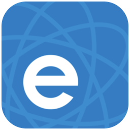

# ioBroker.ewelink

## ewelink-Adapter für ioBroker

Steuern Sie [Sonoff-](https://sonoff.tech/) /eWeLink-Switches im lokalen Netzwerk. Der Adapter kommuniziert direkt über TCP-Port 8081 mit jedem Gerät und empfängt dessen Statusänderungen als mDNS-Ankündigungen. Dadurch funktioniert das Schalten auch ohne Internetzugang und ohne die eWeLink-Cloud.

Diese Version unterstützt **Einkanal-Schalter** – Geräte mit einem Relais, die einen Kanal melden. `switch` Wert, z.B. Sonoff MICRO, BASIC R2/R3/R4, MINI R2/R3/R4, RF R3 und S26 Stecker.

Es werden zwei Gerätetypen unterstützt:

- **eWeLink LAN-Steuerung** (der normale Modus für Geräte, die in der eWeLink-App eingerichtet sind). Anfragen an diese Geräte werden mit einem gerätespezifischen Schlüssel verschlüsselt, der nur der eWeLink-Cloud bekannt ist. Der Adapter ruft die Schlüssel **einmalig** ab, wenn Sie sich über die Instanzeinstellungen in Ihrem eWeLink-Konto anmelden, und speichert sie verschlüsselt. Danach erfolgt keine Kommunikation mehr mit der Cloud.
- **[DIY-Modus](https://sonoff.tech/diy-developer/)** (eine offene, unverschlüsselte LAN-API, die einige Modelle bieten). Hierfür ist kein eWeLink-Konto erforderlich.

## Anforderungen

- Node.js 22 oder neuer, js-controller 6.0.11 oder neuer, admin 7.6.20 oder neuer
- Der ioBroker-Host befindet sich im **selben Netzwerk (Subnetz)** wie die Switches: Geräte geben sich und ihren Status per mDNS bekannt, das keine Router durchquert. (DIY-Modus-Geräte mit konfigurierter IP-Adresse können auch subnetzübergreifend abgefragt werden.)
- Für die eWeLink LAN-Steuerung: _Die LAN-Steuerung_ muss für das Gerät in der eWeLink-App aktiviert sein. Außerdem benötigen Sie entweder ein kostenloses Entwicklerkonto im [eWeLink Developer Center](https://dev.ewelink.cc/) oder die Geräteschlüssel von einer anderen Quelle (siehe unten).

## Abrufen Ihrer Geräte von eWeLink

Im eWeLink Developer Center erstellte Apps können sich nur mit OAuth 2.0 anmelden, daher kann der Adapter Ihr eWeLink-Passwort nicht verwenden. Stattdessen:

1. Registrieren Sie sich im [eWeLink-Entwicklerzentrum](https://dev.ewelink.cc/) (die Genehmigung kann einige Tage dauern) und erstellen Sie eine App. Geben Sie ihr die in den Adaptereinstellungen angezeigte Umleitungs-URL (`http://127.0.0.1:8000/callback` Standardmäßig muss dort nichts ausgeführt werden.
2. Geben Sie in den Instanzeinstellungen auf der Registerkarte **„eWeLink-Konto“** die **App-ID** und **das App-Geheimnis** der App ein.
3. Klicken Sie auf **„Mit eWeLink anmelden“** und melden Sie sich auf der eWeLink-Seite an. Ihr Browser öffnet dann die Weiterleitungs-URL, die eine Fehlerseite anzeigt – das ist zu erwarten.
4. Kopieren Sie die vollständige Adresse aus der Adressleiste Ihres Browsers in **das Feld „Adresse nach der Anmeldung“** und klicken Sie innerhalb weniger Minuten **auf „Geräte abrufen“** .

Die Einzelkanal-Schalter des Kontos werden der Gerätetabelle hinzugefügt und die Schlüssel der bereits vorhandenen Geräte aktualisiert. Wiederholen Sie diesen Vorgang, wenn Sie Ihrem Konto ein Gerät hinzufügen.

## Eingabe eines Geräteschlüssels per Hand

Auch ohne Entwicklerkonto können Sie bereits vorhandene Schlüssel verwenden, beispielsweise von der Sonoff LAN-Integration in Home Assistant: Geben Sie im Tab **„eWeLink-Konto“** die **Geräte-ID** und **den Geräteschlüssel** ein und klicken Sie auf **„Geräteschlüssel speichern“** . Der Schlüssel wird wie ein abgerufener Schlüssel verschlüsselt gespeichert, und ein Gerät, das noch nicht in der Gerätetabelle vorhanden ist, wird hinzugefügt. Ein falscher Schlüssel wird im Protokoll als „Gerätedaten können nicht entschlüsselt werden“ angezeigt. Der Geräteschlüssel ändert sich, wenn das Gerät in der eWeLink-App erneut gekoppelt wird.

## Konfiguration

| Einstellung                                 | Bedeutung                                                                                                                                                                                                                                                                                                                                                                                                                                                                                                                                                      |
| ------------------------------------------- | -------------------------------------------------------------------------------------------------------------------------------------------------------------------------------------------------------------------------------------------------------------------------------------------------------------------------------------------------------------------------------------------------------------------------------------------------------------------------------------------------------------------------------------------------------------- |
| **Geräte**                                  | Eine Zeile pro Switch: aktiv, Name, IP-Adresse, Port (8081) und Geräte-ID. Der Name wird zum Objektbaumordner (`ewelink.0.<name>` Geräte, die über eWeLink abgerufen werden, benötigen lediglich die Geräte-ID – die IP-Adresse wird aus ihren mDNS-Ankündigungen ermittelt und bei Änderungen aktualisiert. Geräte im DIY-Modus benötigen ihre IP-Adresse; die Geräte-ID ist optional.                                                                                                                                                                        |
| **Umfrageintervall**                        | 5–3600 s (Standard: 10 s). Geräte im DIY-Modus werden in diesem Intervall per HTTP abgefragt. eWeLink-LAN-Steuergeräte senden ihren Status; der Adapter fordert sie in diesem Intervall zur Statusmeldung auf. Gerät, das keine Statusmeldung empfängt, wird stattdessen per HTTP abgefragt, da WLAN gelegentlich Multicast-Pakete verwirft. Es wird als nicht erreichbar markiert, wenn dies zweimal fehlschlägt oder wenn über fünf Intervalle hinweg keine Statusmeldung eingeht (Statusänderungen in der App oder am Gerät bleiben dann unberücksichtigt). |
| **App-ID / App-Geheimnis / Umleitungs-URL** | Die Entwickler-Center-App, die zum Abrufen der Geräteschlüssel verwendet wurde.                                                                                                                                                                                                                                                                                                                                                                                                                                                                                |
| **Geräte-ID / Geräteschlüssel**             | Ein manuell eingegebener Geräteschlüssel anstatt eines abgerufenen Schlüssels; wird nach dem Speichern gelöscht.                                                                                                                                                                                                                                                                                                                                                                                                                                               |

Durch das Deaktivieren einer Zeile bleiben die Objekte des Geräts (und deren Verlaufs-/Alias-Einstellungen) erhalten; durch das Löschen der Zeile werden sie beim nächsten Start entfernt.

## Staaten

| Zustand                        | Typ                           | Bedeutung                                                                                                            |
| ------------------------------ | ----------------------------- | -------------------------------------------------------------------------------------------------------------------- |
| `info.connection`              | boolescher Wert               | Mindestens ein Gerät ist erreichbar.                                                                                 |
| `<device>.control.power`       | boolescher Wert, beschreibbar | Relais ein/aus. Schreiben `true` /`false` zum Umschalten; wird bestätigt, sobald das Gerät den Befehl angenommen hat. |
| `<device>.info.reachable`      | boolescher Wert               | Das Gerät antwortet oder meldet sich an                                                                              |
| `<device>.info.firmware`       | Zeichenkette                  | Firmware-Version, die vom Gerät gemeldet wird                                                                        |
| `<device>.info.deviceId`       | Zeichenkette                  | eWeLink-Geräte-ID                                                                                                    |
| `<device>.info.signalStrength` | Nummer (dBm)                  | WLAN-Signalstärke, wo das Gerät sie meldet                                                                           |

## Haftungsausschluss

Sonoff und eWeLink sind Marken ihrer jeweiligen Inhaber (ITEAD Intelligent Systems Co., Ltd. und CoolKit Technologies). Dieser Adapter steht in keiner Verbindung zu diesen Unternehmen und wird von ihnen auch nicht unterstützt.

## Changelog
<!--
    Placeholder for the next version (at the beginning of the line):
    ### **WORK IN PROGRESS**
-->
### 0.1.0 (2026-10-20)
* (Alan Paris) Initial release: single-channel switches in eWeLink LAN control mode (device keys fetched once via eWeLink sign-in, or entered by hand) and DIY mode

## License
MIT License

Copyright (c) 2026 Alan Paris <alan.paris@scottish.rugby>

Permission is hereby granted, free of charge, to any person obtaining a copy
of this software and associated documentation files (the "Software"), to deal
in the Software without restriction, including without limitation the rights
to use, copy, modify, merge, publish, distribute, sublicense, and/or sell
copies of the Software, and to permit persons to whom the Software is
furnished to do so, subject to the following conditions:

The above copyright notice and this permission notice shall be included in all
copies or substantial portions of the Software.

THE SOFTWARE IS PROVIDED "AS IS", WITHOUT WARRANTY OF ANY KIND, EXPRESS OR
IMPLIED, INCLUDING BUT NOT LIMITED TO THE WARRANTIES OF MERCHANTABILITY,
FITNESS FOR A PARTICULAR PURPOSE AND NONINFRINGEMENT. IN NO EVENT SHALL THE
AUTHORS OR COPYRIGHT HOLDERS BE LIABLE FOR ANY CLAIM, DAMAGES OR OTHER
LIABILITY, WHETHER IN AN ACTION OF CONTRACT, TORT OR OTHERWISE, ARISING FROM,
OUT OF OR IN CONNECTION WITH THE SOFTWARE OR THE USE OR OTHER DEALINGS IN THE
SOFTWARE.