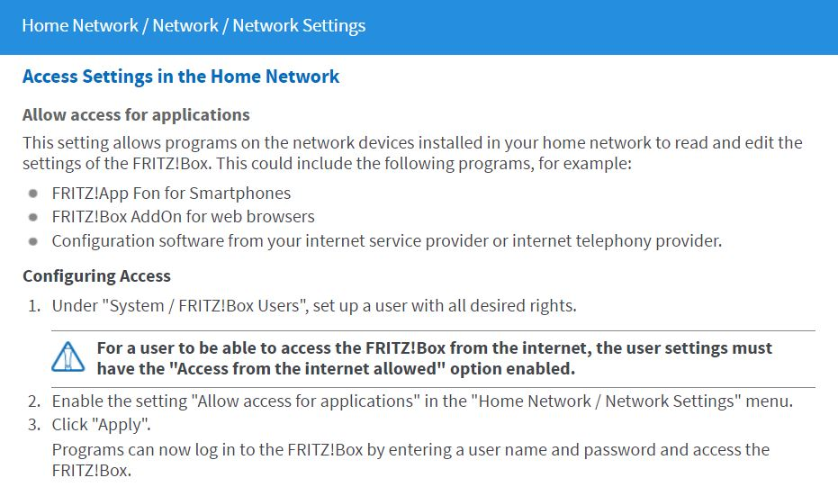
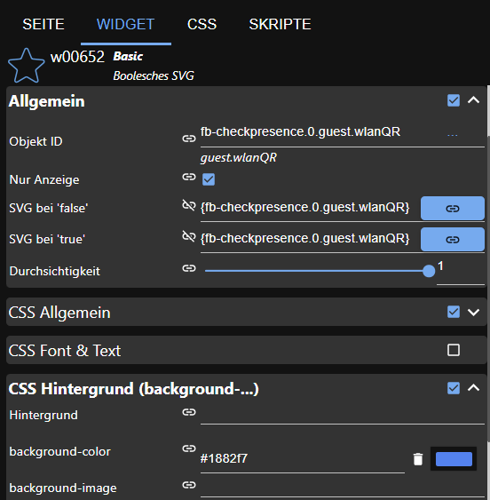

# ioBroker.fb-checkpresence

## fb-checkpresence-Adapter für ioBroker

Der Adapter prüft anhand der von der FRITZ!Box gemeldeten Geräte, ob Familienmitglieder anwesend sind. Für jedes aktivierte Familienmitglied müssen Sie einen Mitgliedsnamen, eine MAC-Adresse, eine IP-Adresse und einen Hostnamen angeben. Wählen Sie aus, ob das Gerät über seine MAC-Adresse, IP-Adresse oder seinen Hostnamen identifiziert werden soll. Gruppe und Kommentar sind optional. Der Adapter erstellt Anwesenheitsdatenpunkte basierend auf dem Mitgliedsnamen.

### Verwendeter Open-Source-Code

#### npm dateformat v4.5.3

© 2007–2009 Steven Levithan \<stevenlevithan.com> npm: <https://www.npmjs.com/package/dateformat> github: <https://github.com/felixge/node-dateformat> Lizenz: MIT

### Adapter-Vorbedingungen

Ein History-Adapter ist optional. Wählen Sie einen unterstützten History-, SQL- oder InfluxDB-Adapter, um historische Familienmitgliederdaten zu speichern und auszuwerten. Die Anwesenheitserkennung funktioniert auch ohne History-Adapter, jedoch stehen dann keine historienbasierten Informationen zur Verfügung.

Sie können einen der folgenden Adapter auswählen:

- Geschichte
- SQL
- InfluxDB

## FRITZ!Box

Dieser Adapter nutzt eine AVM FRITZ!Box und kommuniziert mit ihr über das TR-064-Protokoll. Weitere Informationen zu FRITZ!Box-Produkten finden Sie auf [der Website von AVM](https://fritz.com/collections/fritz-box) .

### TR-064 Anforderungen

Die verwendete TR-064-Schnittstelle der Fritzbox wird hier beschrieben: <https://avm.de/service/schnittstellen/> .

Der Adapter nutzt die folgenden TR-064-Dienste und -Aktionen:

- Hosts:1 — X\_AVM-DE\_GetHostListPath (unterstützt seit 2017-01-09)
- Hosts:1 — X\_AVM-DE\_GetMeshListPath
- Hosts:1 — GetSpecificHostEntry
- Hosts:1 — X\_AVM-DE\_GetSpecificHostEntryByIP (unterstützt seit 18.05.2016)
- Geräteinformationen:1 — GetSecurityPort
- Geräteinformationen:1 — GetInfo
- WANPPPConnection:1 — GetInfo
- WANIPConnection:1 — GetInfo
- WLANConfiguration3 — SetEnable
- WLANConfiguration3 — GetInfo
- WLANConfiguration3 — GetSecurityKeys
- X\_AVM-DE\_HostFilter — DisallowWANAccessByIP
- X\_AVM-DE\_HostFilter — GetWANAccessByIP
- Gerätekonfiguration:1 — Neustart
- LANConfigSecurity1 – X\_AVM-DE\_GetCurrentUser

Der Zugriff auf TR-064 ist auf der FRITZ!Box standardmäßig deaktiviert. Um ihn zu aktivieren, melden Sie sich an der FRITZ!Box-Weboberfläche an und wechseln Sie zur erweiterten Ansicht. Öffnen Sie **„Heimnetz“ » „Netzwerk“ » „Netzwerkeinstellungen“** und aktivieren Sie **„Zugriff für Anwendungen erlauben“** . Starten Sie die FRITZ!Box nach dieser Änderung neu.

> **Hinweis:** Die Menünamen können je nach Ihrer FRITZ!OS-Version leicht abweichen.



## Konfiguration

### Allgemein

Das Konfigurationsformular prüft die erforderlichen Werte und verhindert das Speichern, solange ein Validierungsfehler vorliegt.

### FRITZ!Box-Adresse, Benutzername und Passwort

Geben Sie die IP-Adresse oder den Hostnamen Ihrer FRITZ!Box sowie den Benutzernamen und das Passwort eines FRITZ!Box-Benutzers ein. Neuere FRITZ!OS-Versionen (7.25 und höher) erfordern für diese Zugriffsart ein Benutzerkonto. Legen Sie den Benutzer in den FRITZ!Box-Einstellungen an und weisen Sie ihm die benötigten Zugriffsrechte zu.

Das Passwort wird von ioBroker verschlüsselt gespeichert und nicht im Klartext abgelegt. FRITZ!Box-Benutzernamen und -Passwörter dürfen bis zu 32 Zeichen lang sein. Beachten Sie die [AVM-Empfehlungen für die Anmeldung an einer FRITZ!Box](https://avm.de/fileadmin/user_upload/Global/Service/Schnittstellen/Empfehlungen%20zur%20Benutzerfu%CC%88hrung%20bei%20der%20Anmeldung%20an%20einer%20FRITZ%21Box_v1.1.pdf) sowie die AVM- [Informationen zu zulässigen Zeichen](https://service.avm.de/help/de/FRITZ-Box-Fon-WLAN-7490/014/hilfe_zeichen_fuer_kennwoerter) .

Meldet der Adapter Verbindungsabbrüche, überprüfen Sie Benutzername, Passwort und Zugriffsrechte. Die FRITZ!Box kann einen Benutzer nach wiederholten erfolglosen Anmeldeversuchen vorübergehend sperren. Überprüfen Sie in diesem Fall die FRITZ!Box und deren Protokolle; möglicherweise ist ein Neustart erforderlich, um die Sperre aufzuheben.

### SSL

Aktivieren Sie **SSL** , um eine HTTPS-Verbindung zur FRITZ!Box herzustellen. Wenn **die Zertifikatsprüfung** aktiviert ist, prüft der Adapter, ob das FRITZ!Box-Zertifikat gültig und vertrauenswürdig ist. Diese Option ist standardmäßig deaktiviert, um die Kompatibilität mit FRITZ!Box-Installationen zu gewährleisten, die selbstsignierte oder anderweitig nicht vertrauenswürdige Zertifikate verwenden.

Wenn Ihre FRITZ!Box ein gültiges Zertifikat einer vertrauenswürdigen Zertifizierungsstelle verwendet, aktivieren Sie **die Zertifikatsprüfung** für erhöhte Sicherheit. Kann der Adapter keine HTTPS-Verbindung herstellen, überprüfen Sie zunächst das Zertifikat und die FRITZ!Box-Konfiguration. Deaktivieren Sie gegebenenfalls **die Zertifikatsprüfung** oder schalten Sie **SSL** vollständig ab, um auf eine unverschlüsselte HTTP-Verbindung zurückzugreifen.

### Abstimmungsintervalle

Der Adapter verfügt über separate Abfrageintervalle für Familienmitglieder und FRITZ!Box-Geräte. Beide können zwischen 10 und 3600 Sekunden eingestellt werden. Jeder Abfragezyklus beginnt, nachdem der vorherige abgeschlossen ist.

### Filterzeit

Wenn sich der Status eines Familienmitglieds auf „abwesend“ ändert, wartet der Adapter die konfigurierte Filterverzögerung ab und prüft den Status erneut. Der Status „abwesend“ wird nur gesetzt, wenn das Mitglied weiterhin abwesend ist. Eine Änderung auf „anwesend“ wird sofort wirksam.

### Verlaufsadapter

Ein History-Adapter ist optional. Wählen Sie einen unterstützten History-, SQL- oder InfluxDB-Adapter, um historische Familienmitgliederdaten zu speichern und auszuwerten. Die Anwesenheitserkennung funktioniert auch ohne History-Adapter, jedoch stehen dann keine historienbasierten Informationen und Statistiken zur Verfügung.

### Datumsformat

Das Datumsformat wird in der formatierten HTML- und JSON-Ausgabe des Adapters verwendet. Informationen zu den verfügbaren Formatmasken finden Sie in der [Dokumentation zum Datumsformat](https://www.npmjs.com/package/dateformat#mask-options) .

### FRITZ!Box Gerätedatenpunkte

Aktivieren Sie **„Datenpunkte für FRITZ!Box-Geräte erstellen“** , um individuelle Datenpunkte für Geräte im FRITZ!Box-Netzwerk zu erstellen.

Um die Anzahl der Geräte, die einzelne Datenpunkte erhalten, einzuschränken, aktivieren Sie **„Nur ausgewählte Geräte verwenden“** und wählen Sie die gewünschten Geräte aus der Liste aus. Die Geräte werden anhand ihrer MAC-Adresse zugeordnet. Wenn diese Option deaktiviert ist, werden für alle Geräte einzelne Datenpunkte erstellt.

Die Gerätelisten und Gerätezähler zeigen weiterhin die vollständigen, von der FRITZ!Box gemeldeten Geräteinformationen an, unabhängig von der Auswahl. Die Auswahl steuert lediglich das Anlegen und Aktualisieren einzelner Einträge. `fb-devices.<device>.*` Datenpunkte.

Durch das Ändern der Auswahl werden zuvor erstellte Datenpunkte nicht gelöscht. Wenn Sie Datenpunkte für nicht mehr ausgewählte Geräte nicht mehr benötigen, löschen Sie diese manuell in der ioBroker-Objektansicht.

> **Hinweis:** Die Geräteauswahl ist nur verfügbar, wenn **die Option „Datenpunkte für FRITZ!Box-Geräte erstellen“** aktiviert ist.

### Synchronisierung der FRITZ!Box-Gerätedatenpunkte

Sie können die Datenpunkte Ihrer FRITZ!Box-Geräte einmalig synchronisieren oder eine regelmäßige Synchronisierung einrichten. Die regelmäßige Synchronisierung läuft im festgelegten Intervall und entfernt Datenpunkte von Geräten, die von der FRITZ!Box nicht mehr gemeldet werden. Das Intervall bestimmt, wie oft die Synchronisierung durchgeführt wird; es gibt nicht an, wie lange ein Gerät inaktiv sein muss, bevor es entfernt wird.

Die Einstellung „Ausgewähltes Gerät“ löscht keine vorhandenen Datenpunkte für Geräte, die nicht mehr ausgewählt sind. Löschen Sie diese Datenpunkte manuell, wenn sie nicht mehr benötigt werden.

### Netzinformationen

Wenn die Mesh-Informationen aktiviert sind, erstellt der Adapter zusätzliche Datenpunkte für Geräte und Schnittstellen im FRITZ!Box Mesh-Netzwerk. Diese Option erfordert, dass die Option **„Datenpunkte für FRITZ!Box-Geräte erstellen“** aktiviert ist.

### Gastnetzwerkinformationen

Aktivieren Sie die Gastnetzwerkinformationen, um Details zu den mit dem Gastnetzwerk verbundenen Geräten abzurufen und die zugehörigen Gaststatus zu aktualisieren.

### QR-Code für Gast-WLAN

Aktivieren Sie die QR-Code-Generierung, um einen QR-Code für das Gast-WLAN zu erstellen. Der Code wird im folgenden Verzeichnis gespeichert: `guest.wlanQR` Der Status kann in VIS mithilfe des **SVG-Widgets „Basic Boolesche Felder“** angezeigt werden. Verwenden Sie die folgenden Beispieleinstellungen:



### Kompatibilität innerhalb der Familie

Die Kompatibilitätsoption steuert die Objektstruktur, die für Familienmitgliedszustände verwendet wird:

- **Kompatibilität aktiviert, Gruppe leer:** Verwendet die Legacy-Objektstruktur.
- **Kompatibilität aktiviert, Gruppensatz:** Verwendet die neue Struktur mit Zuständen unter der `familyMembers` Ordner.
- **Kompatibilität deaktiviert:** Verwendet die neue Struktur mit Zuständen unter dem `familyMembers` Ordner.

Die bisherige Struktur wird möglicherweise in einer zukünftigen Version entfernt. Befolgen Sie beim Wechsel von der alten Struktur die Anweisungen im Adapterprotokoll. Gegebenenfalls müssen Sie Skripte oder VIS-Widgets aktualisieren, die auf die alten Status-IDs verweisen.

### Anwesenheit und Filterung von Familienmitgliedern

Der Adapter erstellt für jedes aktivierte Familienmitglied einen Anwesenheitsstatus und prüft, ob das konfigurierte Gerät vorhanden oder abwesend ist. Der Anwesenheitsstatus ändert sich, sobald sich der erkannte Status ändert.

Sie können die Filterung für einzelne Familienmitglieder aktivieren. Beim alten Filter (der neue verlaufsbasierte Filter ist deaktiviert) wirkt sich die Filterung direkt auf das Mitglied aus. `presence` Status: wenn das Gerät als vorhanden erkannt wird, `presence` Änderungen an `true` sofort; wenn festgestellt wird, dass es nicht vorhanden ist, wartet der Adapter die konfigurierte Verzögerung ab und prüft erneut. `presence` Änderungen an `false` nur wenn das Gerät auch nach der Verzögerung noch nicht gefunden wurde.

Mit dem neuen, auf dem Verlauf basierenden Filter wird die `presence` Der Status wird direkt gemeldet. Das gefilterte Ergebnis wird separat veröffentlicht als `presenceFiltered` Es sorgt dafür, dass ein Mitglied so lange anwesend bleibt, bis eine Abwesenheit die konfigurierte Filterzeit erreicht hat.

Einige Geräteinformationen, wie z. B. die Verbindungsgeschwindigkeit, werden aus den Datenpunkten der einzelnen FRITZ!Box-Geräte ausgelesen. Aktivieren Sie die Option **„Datenpunkte für FRITZ!Box-Geräte erstellen“** , um diese Informationen verfügbar zu machen.

### Gefilterte Familien- und Gruppenzustände

Die bestehenden aggregierten Zustände behalten ihr ursprüngliches Verhalten bei. Die folgenden zusätzlichen schreibgeschützten Zustände verwenden die gefilterten Ergebnisse aktivierter Familienmitglieder ohne eine zweite Filterverzögerung:

| Zustand                                           | Bedeutung                                   |
| ------------------------------------------------- | ------------------------------------------- |
| `presenceFiltered`                                | Mindestens ein Mitglied ist anwesend        |
| `presenceAllFiltered`                             | Alle Mitglieder sind anwesend               |
| `absenceFiltered`                                 | Mindestens ein Mitglied fehlt.              |
| `absenceAllFiltered`                              | Alle Mitglieder sind abwesend               |
| `presentMembersFiltered` /`absentMembersFiltered` | Durch Komma getrennte Mitgliedsnamen        |
| `presentCountFiltered` /`absentCountFiltered`     | Anzahl der anwesenden/abwesenden Mitglieder |

In der aktuellen Struktur befinden sich die familienweiten Zustände unter `familyMembers` und Gruppenstaaten unten `familyMembers.<group>` Die gefilterten familienweiten Zustände umfassen **alle aktivierten Mitglieder** , einschließlich der Mitglieder, die benannten Gruppen zugewiesen sind. Im Kompatibilitätsmodus befinden sich die familienweiten Zustände im Stammverzeichnis des Adapters; Gruppenpfade bleiben unverändert. Deaktivierte Mitglieder werden ausgeschlossen.

Mit dem neuen historienbasierten Filter verwendet die Gesamtberechnung genau das Ergebnis, das für jede Person veröffentlicht wurde. `presenceFiltered` Wert. Mitglieder, bei denen die Filterung deaktiviert ist, verwenden ihren erkannten Status sofort. Beim Legacy-Filter werden die bereits gefilterten Anwesenheitsergebnisse verwendet. Kann ein erforderliches Filterergebnis nicht berechnet werden (z. B. bei fehlender Geräteantwort oder nicht verfügbarem Verlauf), wird der aggregierte Wert veröffentlicht als `null` mit Qualität `0x40` Anstatt eine unsichere Abwesenheit zu melden, wird keine weitere Meldung angezeigt. Eine leere Liste aktivierter Mitglieder ist ebenfalls unbekannt. Die bestehende Ausweichlösung für einen leeren Verlauf bleibt unverändert.

### Anwesenheitserkennung manuell auslösen

Sie können eine Anwesenheitsprüfung manuell auslösen, indem Sie die folgende Nachricht senden: `triggerPresence` Eine Nachricht wird an den Adapter gesendet. Weitere Triggeranforderungen werden während der 10-sekündigen Abklingzeit abgelehnt. Der Callback gibt Folgendes zurück: `false` wenn die Anfrage blockiert wird und `true` sofern der Adapter dies akzeptiert.

```javascript
sendTo('fb-checkpresence.0', 'triggerPresence', {}, result => {
    log(result, 'info');
});
```

### Whitelist-Einstellungen

Wählen Sie die FRITZ!Box-Geräte aus, die als bekannt gelten sollen. Geräte, die nicht auf der Positivliste stehen, werden als unbekannt behandelt und können auf der Negativliste erscheinen.

Sie können ein Gerät auch per JavaScript zur Whitelist hinzufügen. Der Adapter prüft den angegebenen Hostnamen und die MAC-Adresse anhand der Geräteliste der FRITZ!Box. Wird das Gerät gefunden und ist es noch nicht in der Whitelist enthalten, wird es der Whitelist-Konfiguration hinzugefügt.

```javascript
sendTo(
    'fb-checkpresence.0',
    'addDeviceToWhitelist',
    {
        hostname: 'devicename',
        mac: '00:00:00:00:00:00',
    },
    result => {
        log(result, 'info');
    },
);
```

## Merkmale

### FRITZ!Box-Funktionsprüfung

Der Adapter prüft, welche FRITZ!Box-Dienste und -Funktionen verfügbar sind, und protokolliert die Ergebnisse. Er prüft außerdem, ob der konfigurierte FRITZ!Box-Benutzer über die erforderlichen Zugriffsrechte verfügt. Ist ein Dienst nicht verfügbar oder fehlen dem Benutzer die erforderlichen Berechtigungen, wird die entsprechende Funktion deaktiviert. Funktioniert eine Funktion nicht, überprüfen Sie das Adapterprotokoll und die Berechtigungen des FRITZ!Box-Benutzers.

### Gast-WLAN ein- oder ausschalten

Stellen Sie die `guest.wlan` Staat zu `true` oder `false` um das Gast-WLAN der FRITZ!Box ein- oder auszuschalten.

### QR-Code für Gast-WLAN

Wenn die QR-Code-Generierung aktiviert ist, wird der Gast-WLAN-QR-Code gespeichert in `guest.wlanQR` Es kann in VIS mithilfe des **Basic Boolesches SVG-** Widgets angezeigt werden.

### Internetzugriff eines Geräts blockieren oder zulassen

Für unterstützte FRITZ!Box-Geräte stellen Sie die `disabled` Staat unter `fb-devices` Zu `true` um den Internetzugang dieses Geräts zu blockieren oder um `false` um den Zugriff wieder zu ermöglichen.

### Gastgeräte und Sperrliste

Der Adapter meldet Geräte, die mit dem Gastnetzwerk verbunden sind. Er vergleicht die erkannten Geräte außerdem mit der Positivliste; Geräte, die nicht auf der Positivliste stehen, können auf der Negativliste aufgeführt werden.

### Anwesenheit und Geschichte von Familienmitgliedern

Der Adapter erfasst die Anwesenheit jedes konfigurierten Familienmitglieds. Wenn ein Verlaufsadapter ausgewählt und verfügbar ist, kann er außerdem Ankunfts- und Abfahrtszeiten sowie weitere verlaufsbasierte Informationen berechnen und speichern.

### Geräteanzahl

Der Adapter meldet die Gesamtzahl der Geräte und die Anzahl der aktiven Geräte, wie sie von der FRITZ!Box gemeldet werden. Diese Zählungen spiegeln die Geräteliste der FRITZ!Box wider, nicht nur die für einzelne Geräte ausgewählten. `fb-devices` Datenpunkte.

## Objekte

### `presenceAll`

`true` wenn alle konfigurierten Familienmitglieder anwesend sind.

### `presence`

`true` wenn mindestens ein konfiguriertes Familienmitglied anwesend ist.

### `devices`

Die Gesamtzahl der von der FRITZ!Box gemeldeten Geräte.

### `activeDevices`

Die von der FRITZ!Box gemeldete Anzahl aktiver Geräte.

### HTML- und JSON-Tabellen

Die HTML- und JSON-Ausgabe enthält Informationen zur Ankunft und Abreise von Familienmitgliedern.

### `info`

Enthält Adapterinformationen, einschließlich des letzten Updates und des Verbindungsstatus.

### `guest`

Enthält Informationen zum Gastnetzwerk, einschließlich der Anzahl der aktiven Gäste und Tische mit Details zu den Gastgeräten.

### `blacklist`

Enthält die Anzahl unbekannter Geräte und Tabellen mit Informationen über diese Geräte.

### `member.present`

Enthält Informationen über die Anwesenheit des Mitglieds am aktuellen Tag, einschließlich der Dauer der Anwesenheit seit der letzten Statusänderung.

### `member.absent`

Enthält Informationen über die Abwesenheit des Mitglieds am aktuellen Tag, einschließlich der Dauer der Abwesenheit seit der letzten Statusänderung.

### `member.comming` Und `member.going`

Enthält die Ankunfts- und Abreiseinformationen des Mitglieds. Die staatliche ID `comming` wird aus Kompatibilitätsgründen beibehalten.

### `member.history` Und `member.historyHtml`

Enthält die Historie des Mitglieds für den aktuellen Tag.

## Changelog
### **WORK IN PROGRESS**
* (afuerhoff) Fixed legacy `presenceFiltered` states that did not update
* (afuerhoff) Fixed false-positive presence detection for devices with duplicate hostnames or MAC addresses and added warnings for conflicting active MAC addresses (issue #151)
* (afuerhoff) Fixed the legacy filter to restore presence immediately when the device is detected again after a short absence
* (softwarecrash) Added filtered family-wide and group presence/absence states, member lists and counts
* (afuerhoff) Improved JavaScript type checking and fixed type-safety issues in error handling and timer usage
* (afuerhoff) Guarded device names before applying string operations
* (afuerhoff) Added TypeScript definitions for adapter configuration options
* (afuerhoff) Added explicit checks for missing adapter configuration objects
* (afuerhoff) Initialized history tables and guarded optional callback and state results
* (afuerhoff) Added Fritzbox connection and host-list guards for nullable state
* (afuerhoff) Corrected assignability issues in adapter state, timer, request, and test types
* (afuerhoff) Added Mocha type definitions for editor and TypeScript support in tests
* (afuerhoff) Corrected invalid boolean comparisons and adapter status typing
* (afuerhoff) Fixed group checks to use the family member configuration
* (afuerhoff) Kept required JSDoc types enabled without redundant-type warnings in JavaScript files
* (afuerhoff) Used numeric timestamps explicitly for presence and history duration calculations
* (afuerhoff) Corrected missing-property typing in device caching, QR output, date formatting, and package tests
* (afuerhoff) Added null-safe history adapter state checks and date-format timezone handling
* (afuerhoff) Corrected adapter constructor and logger calls to match their argument signatures
* (afuerhoff) Typed optional AMD loader detection in the date-format library
* (afuerhoff) Replaced implicit boolean/date arithmetic in date formatting with explicit numeric operations
* (afuerhoff) Resolved remaining TypeScript errors in adapter calls, request config, and test types
* (afuerhoff) Replaced broad date-format utility types with explicit input, return, and unknown-value types
* (afuerhoff) Initialized guest WLAN data before QR creation and handled missing SSID or passphrase explicitly

### 1.5.0 (2026-10-26)
* (afuerhoff) Adapter requires node.js >= 22 now
* (afuerhoff) configuration changed to jsonConfig
* (afuerhoff) dependencies updated
* (afuerhoff) dependabot.yml fixed [#358](https://github.com/afuerhoff/ioBroker.fb-checkpresence/issues/358)
* (afuerhoff) new fb-devices cyclic sync option integrated
* (afuerhoff) SSL certificate validation added; certificate checks can be enabled explicitly, while self-signed certificates remain compatible when disabled
* (afuerhoff) readme updated
* (softwarecrash) PR398 fixes a crash in newfilter mode
* (afuerhoff) issues [#413]

### 1.4.2 (2025-10-30)
* (afuerhoff) dependencies updated
* (afuerhoff) package.json issues fixed [#350](https://github.com/afuerhoff/ioBroker.fb-checkpresence/issues/350)
* (afuerhoff) npm security changes
* (afuerhoff) filter time extended to 300s
* (afuerhoff) guest wlan bug fixed [#353](https://github.com/afuerhoff/ioBroker.fb-checkpresence/issues/353)
* (afuerhoff) deprecated functions changed

### 1.4.1 (2025-09-19)
* (afuerhoff) dependencies updated
* (afuerhoff) repository checker & code scanning issues fixed

### 1.4.0 (2025-05-28)
* (afuerhoff) dependencies updated
* (afuerhoff) error handling optimized
* (afuerhoff) enhancement  [#336](https://github.com/afuerhoff/ioBroker.fb-checkpresence/issues/336)
* (afuerhoff) issue [#337](https://github.com/afuerhoff/ioBroker.fb-checkpresence/issues/337)
* (afuerhoff) issue [#335](https://github.com/afuerhoff/ioBroker.fb-checkpresence/issues/335)

### 1.3.1 (2025-03-02)
* (afuerhoff) dependencies updated
* (afuerhoff) bug fixed [#333](https://github.com/afuerhoff/ioBroker.fb-checkpresence/issues/333)
* (afuerhoff) bug fixed [#305](https://github.com/afuerhoff/ioBroker.fb-checkpresence/issues/305)

## License
MIT License

Copyright (c) 2019-2026 Achim Fürhoff <achim.fuerhoff@outlook.de>

Permission is hereby granted, free of charge, to any person obtaining a copy
of this software and associated documentation files (the "Software"), to deal
in the Software without restriction, including without limitation the rights
to use, copy, modify, merge, publish, distribute, sublicense, and/or sell
copies of the Software, and to permit persons to whom the Software is
furnished to do so, subject to the following conditions:

The above copyright notice and this permission notice shall be included in all
copies or substantial portions of the Software.

THE SOFTWARE IS PROVIDED "AS IS", WITHOUT WARRANTY OF ANY KIND, EXPRESS OR
IMPLIED, INCLUDING BUT NOT LIMITED TO THE WARRANTIES OF MERCHANTABILITY,
FITNESS FOR A PARTICULAR PURPOSE AND NONINFRINGEMENT. IN NO EVENT SHALL THE
AUTHORS OR COPYRIGHT HOLDERS BE LIABLE FOR ANY CLAIM, DAMAGES OR OTHER
LIABILITY, WHETHER IN AN ACTION OF CONTRACT, TORT OR OTHERWISE, ARISING FROM,
OUT OF OR IN CONNECTION WITH THE SOFTWARE OR THE USE OR OTHER DEALINGS IN THE
SOFTWARE.