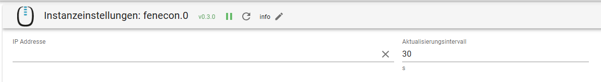

# ioBroker.fenecon

## Fenecon

[Fenecon](https://fenecon.de) ist ein deutscher Hersteller von Photovoltaik-Wechselrichtern, Batteriespeichersystemen und Energiemanagementsystemen für Privathaushalte und Unternehmen. Die meisten Systeme nutzen das **FEMS** (Fenecon Energy Management System), das auf der Open-Source-Energiemanagementplattform [OpenEMS](https://github.com/OpenEMS/openems) basiert. Fenecon gehört zu den Hauptentwicklern von OpenEMS.

Da FEMS seine Daten über die OpenEMS **REST/JSON API** bereitstellt, funktioniert dieser Adapter mit jedem FEMS-System, das diese Schnittstelle bietet, unabhängig vom konkreten Gerätemodell (Home, Commercial, ...).

## Adapter

Dieser Adapter verbindet sich über das lokale Netzwerk mit der FEMS-Zentraleinheit und liest alle verfügbaren Kanalwerte über die OpenEMS REST/JSON-Schnittstelle aus (`http://<ip>/rest/channel/...` Es spiegelt die zurückgegebenen Werte in ioBroker-Zustände wider, weist ihnen aussagekräftige Rollen und Einheiten zu und kann optional kompatible Werte zurück in FEMS schreiben.

Der Adapter ist ein Polling-Adapter (`dataSource: poll`), läuft als Daemon und unterstützt den Kompaktmodus.

Merkmale:

- Liest alle Kanäle der FEMS-Box oder nur eine konfigurierbare Teilmenge
- Erstellt beim ersten Start automatisch den ioBroker-Objektbaum (Kanäle und Zustände).
- weist jedem bekannten FEMS-Kanal eine spezifische ioBroker-Rolle zu und behält die FEMS-Einheit bei
- Konvertiert in Grad Celsius angegebene Temperaturen (`dC`) in Grad Celsius
- Berechnet die **Autarkie-** und **Selbstverbrauchsraten** aus den zusammenfassenden Werten.
- Geringe Auslastung von FEMS und ioBroker: Unveränderte Werte werden nicht überschrieben (nur ein periodischer Heartbeat), und Aktualisierungen werden in parallelen Batches geschrieben.
- optionales Rückschreiben: beschreibbar (`RW` /`WO` Kanäle können über die Admin-Oberfläche, Skripte oder Blockly konfiguriert werden.
- Robust gegenüber fehlerhaften Antworten und Firmware-Änderungen: Ungültige Einträge werden verworfen und neue/unbekannte Kanäle im Protokoll gemeldet.

## So funktioniert es

1. Beim Start überprüft der Adapter die Konfiguration (IPv4-Adresse und Aktualisierungsintervall).
2. Es ruft die Kanalliste von der FEMS-Box ab. Ohne benutzerdefinierte Endpunkte fordert es den allgemeinen Auffangendpunkt an. `.*/.*` Diese Funktion gibt alle verfügbaren Kanäle zurück. Bei benutzerdefinierten Endpunkten werden nur die konfigurierten Komponenten/Kanäle angefordert.
3. Für jeden gültigen Kanal `component/channel` Es werden ein ioBroker **-Kanalobjekt** und ein **Statusobjekt** erstellt. Unzulässige Zeichen werden ersetzt, damit die FEMS-Adresse als Objekt-ID verwendet werden kann. Objekte werden nur dann erweitert/aktualisiert, wenn sich die verwaltete Definition (Name, Beschreibung, Rolle, Typ, Einheit, Lese-, Schreibzugriff) ändert.
4. Werte werden geschrieben mit `ack: true` Ein Wert wird nur dann geschrieben, wenn er sich tatsächlich geändert hat; unveränderte Werte werden dennoch mindestens alle 10 Minuten (Heartbeat) aktualisiert, damit die Zeitstempel nicht veralten.
5. Der nächste Durchlauf wird unter Verwendung des konfigurierten Aktualisierungsintervalls geplant.

## Konfiguration

Zum Herstellen einer Verbindung wird die IP-Adresse der FEMS-Zentraleinheit benötigt. Das Aktualisierungsintervall kann ebenfalls angepasst werden.

| Einstellung                                | Beschreibung                                                                                                                                                                      |
| ------------------------------------------ | --------------------------------------------------------------------------------------------------------------------------------------------------------------------------------- |
| **IP-Adresse**                             | IPv4-Adresse der FEMS-Zentraleinheit im lokalen Netzwerk (z. B. `192.168.1.50` Das Feld wird als IPv4 validiert, und das Speichern wird aufgrund eines falschen Formats blockiert. |
| **Aktualisierungsintervall**               | Abfrageintervall in Sekunden. Zulässiger Bereich: `5` -`3600` s (Standardwert) `30` S).                                                                                             |
| **Benutzerdefinierte Endpunkte verwenden** | Wenn deaktiviert (Standardeinstellung), werden alle Kanäle über die Catch-All-Anfrage gelesen. Wenn aktiviert, werden nur die Endpunkte in der Tabelle angefordert.               |
| **Endpunkte**                              | Tabelle `Component ID` /`Channel ID` Paare, die verwendet werden, wenn benutzerdefinierte Endpunkte aktiviert sind.                                                                |

### Benutzerdefinierte Endpunkte

Sie können benutzerdefinierte Endpunkte verwenden, sodass nicht alle Daten abgerufen werden. Aktivieren Sie dazu das Kontrollkästchen und konfigurieren Sie die Zeilen in der Tabelle. Jede Zeile führt zu einer Anfrage an `<Component ID>/<Channel ID>` und reduziert die Last, wenn nur wenige Werte benötigt werden.

Der `Channel ID` kann einen einzelnen Kanal oder mehrere Kanäle enthalten, die durch getrennt sind `;` oder ein regulärer Ausdruck / Platzhalter:

- Komponente `_sum` Kanal `.*` -> alle Kanäle der Zusammenfassung
- Komponente `ess0` Kanal `.*` -> alle Kanäle des Batteriespeichers
- Komponente `_sum` Kanal `GridActivePower;EssSoc` -> nur diese beiden Kanäle

## Staaten

Zustände werden beim Start des Adapters automatisch generiert. Falls ein Kanal oder Zustand versehentlich gelöscht wurde, erscheinen Warnungen in der Protokolldatei: Starten Sie den Adapter neu, um die fehlenden Objekte wiederherzustellen.

Der Objektbaum spiegelt die FEMS-Komponentenstruktur wider. `<component>.<channel>`, Zum Beispiel `fenecon.0._sum.GridActivePower` (Die Instanznummer kann abweichen).

Gemeinsame Komponenten:

| Komponente                             | Bedeutung                                                                      |
| -------------------------------------- | ------------------------------------------------------------------------------ |
| `_sum`                                 | Aggregierte Werte des gesamten Systems (Netz, Produktion, Verbrauch, Batterie) |
| `ess0`                                 | Energiespeichersystem (Batterie, Wechselrichter/Ladegerät)                     |
| `battery0`                             | Akku (Zellen, Temperaturen, BMS-Daten)                                         |
| `batteryInverter0`                     | Batterie-Wechselrichter (z. B. GoodWe)                                         |
| `meter0`                               | Netz-/Energiezähler                                                            |
| `charger10`, `charger11`               | Ladestationen für Elektrofahrzeuge (EVCS)                                      |
| `ctrl*`                                | OpenEMS-Controller (Ladeoptimierung, Lastausgleich, ...)                       |
| `io0`, `io1`                           | Digitale/analoge Ein-/Ausgänge                                                 |
| `modbus0`, `modbus1`, `modbus2`         | Modbus-Schnittstellen                                                          |
| `_host`, `_power`, `_energy`, `_cycle` | OpenEMS-Systeminformationen und Leistungs-/Energierechner                      |
| `scheduler0`, `predictor0`, `rrd4j0`   | OpenEMS-Planer, Prognose- und Historienfunktion                                |

Die wichtigsten Kennzahlen sind unten aufgeführt. `_sum`:

- `_sum.GridActivePower` - Netzleistung in Watt (positiv = Bezug aus dem Netz, negativ = Einspeisung ins Netz)
- `_sum.ProductionActivePower` - PV-Produktionsleistung in W
- `_sum.ConsumptionActivePower` - Stromverbrauch des Hauses in Watt
- `_sum.EssActivePower` - Batterieleistung in W (Vorzeichen abhängig vom Lade-/Entladezustand)
- `_sum.EssSoc` - Ladezustand der Batterie in %
- `_sum.GridBuyActiveEnergy` /`_sum.GridSellActiveEnergy` - Energie in Wh gekauft/verkauft
- `_sum.ProductionActiveEnergy` /`_sum.ConsumptionActiveEnergy` - erzeugte/verbrauchte Energie in Wh

Jeder Staat hat eine Beschreibung (`desc`) aus dem FEMS-Kanaltext entnommen und eine Rolle entsprechend seiner Bedeutung zugewiesen. Bekannte Kanäle erhalten eine spezifische Rolle (z. B. `value.power`, `value.energy`, `value.voltage`, `value.current`, `value.temperature`, `value.frequency`, `indicator`, `text` Kanäle, die noch nicht in der Zuordnungstabelle enthalten sind, greifen auf eine von der Einheit abgeleitete Rolle zurück und werden einmal im Protokoll gemeldet, damit sie hinzugefügt werden können.

### Berechnete Werte

Neben den Rohwerten der FEMS berechnet der Adapter zwei weitere Zustände:

- `_sum.Autarchy` - Autarkiegrad in % (Anteil des durch Eigenproduktion gedeckten Verbrauchs)
- `_sum.SelfConsumption` - Eigenverbrauchsquote in % (Anteil der Produktion, der verbraucht statt ins Netz eingespeist wird)

### Write-Back (Befehle)

Kanäle, die FEMS als beschreibbar kennzeichnet (Zugriffsmodus) `RW` oder `WO`) werden erstellt mit `write: true` und der Adapter abonniert sie. Wenn ein Wert geschrieben wird, ohne `ack` (z. B. von der Admin-Oberfläche, einem Skript oder Blockly) sendet der Adapter es mit einem `POST` Anfrage und setzt den Status auf `ack: true` nach einem erfolgreichen Schreibvorgang. Schreibgeschützt (`RO`) Kanäle lehnen Schreibvorgänge ab und protokollieren eine Warnung.

Die in Dezgrad Celsius angegebenen Werte werden vor dem Schreiben wieder in die FEMS-Skala umgerechnet.

## Fehlerbehebung

- **Keine Daten/Fehler im Protokoll** : Überprüfen Sie die IP-Adresse (gültige IPv4-Adresse und vom ioBroker-Host aus erreichbar) und ob die FEMS-Box antwortet. `http://<ip>/rest/channel/` Die
- **Konfiguration abgelehnt** : Die IP-Adresse muss eine gültige IPv4-Adresse sein und das Aktualisierungsintervall muss zwischen 5 und 3600 Sekunden liegen.
- **Fehlende oder leere Zustände** : Der Adapter verwirft ungültige FEMS-Einträge und meldet unbekannte Kanäle im Protokoll. Starten Sie den Adapter neu, damit die Objektstruktur neu aufgebaut wird; unbekannte Kanäle können der Zustandszuordnungstabelle hinzugefügt werden (siehe Entwicklerhinweise).
- **Zustände wurden gelöscht** : Starten Sie den Adapter neu, um sie neu zu erstellen. Manuell geänderte Objekte werden nur dann überschrieben, wenn sich ihre verwaltete Definition unterscheidet.

## Entwicklerhinweise

Der Adapter ist in TypeScript geschrieben. Die Quelltexte befinden sich in `src/` und die kompilierte Ausgabe wird generiert in `build/`, das ist das Verzeichnis, das mit dem npm-Paket ausgeliefert wird.

Quelltextlayout:

- `src/main.ts` - Adapterlebenszyklus, Abfrageschleife und Statusaktualisierungen
- `src/fems-client.ts` - REST-Client für die OpenEMS/FEMS-Kanal-API
- `src/state-factory.ts` - Objekt-/Rollen-/Einheiten-Hilfsfunktionen und Wertkonvertierung
- `src/calculations.ts` - Autarkie- und Selbstverbrauchsberechnung
- `src/states.ts` - generierte Zuordnungstabelle aller bekannten FEMS-Kanäle zu ioBroker-Rollen
- `src/types.ts` - gemeinsame Typen und Laufzeitvalidierungshilfsfunktionen

Nützliche npm-Skripte:

- `npm run build` stellt die Quellen zusammen
- `npm run watch` wird bei jeder Änderung neu kompiliert
- `npm run check` führt die strikte Typüberprüfung durch (`tsc --noEmit`)
- `npm run lint` führt ESLint aus
- `npm run test` führt die Unit-Tests aus (`test:ts`) und die ioBroker-Pakettests (`test:package`)
- `npm run test:integration` führt die Integrationstests aus
- `npm run generate:states` regeneriert die Rollenzuordnung in `src/states.ts` (laufen `node tools/generate-states.js src/states.ts --check` um zu überprüfen, ob es auf dem neuesten Stand ist)
- `npm run benchmark` führt den Benchmark für die Statusaktualisierung aus (`tools/benchmark.js`)

Verwenden Sie zur Live-Validierung den [@iobroker/dev-server](https://github.com/ioBroker/dev-server) anstelle einer Produktivinstanz: Führen Sie Folgendes aus `setup` einmal, dann `watch` oder `debug` um das Laufzeitverhalten, Wiederverbindungen, Objektaktualisierungen und die Admin-Benutzeroberfläche zu überprüfen.

## Changelog

<!--
	Placeholder for the next version (at the beginning of the line):
-->
### 1.0.1 (2026-11-07)

- (SG-App) update mapping table after FEMS update to 2026.10.2

### 1.0.0 (2026-11-07)

- (SG-App) migrate the adapter sources to TypeScript, compiled output is generated into `build/`
- (SG-App) validate the configured IP address strictly as IPv4
- (SG-App) use the sanitized channel and state names consistently for the object ids
- (SG-App) validate the FEMS response and drop invalid entries instead of creating nonsense states
- (SG-App) only write states when the value changed, with a heartbeat to refresh the timestamps
- (SG-App) write state updates in parallel batches to lower the CPU load
- (SG-App) cache the existing objects at startup and only extend objects when the definition changed
- (SG-App) assign a specific role to every known state and log unknown channels for later additions
- (SG-App) add the channels reported as unknown to the state mapping table
- (SG-App) support writing values back to FEMS through onStateChange for writable channels
- (SG-App) convert the temperature values delivered in deci degrees Celsius (dC) to degrees Celsius
- (SG-App) extend the README with a detailed adapter description, configuration, state overview and troubleshooting

### 0.7.0 (2025-09-28)

- (SG-App) dependency updates
- (SG-App) allow multi channel configuration
- (SG-App) optimize Rest request and log channel not exists

### 0.6.2 (2025-02-11)

- (SG-App) fix loading single channel

### 0.6.1 (2025-02-10)

- (SG-App) fix missing size attributes

## License

MIT License

Copyright (c) 2025-2026 Georg Schreiner <info@sg-app.de>

Permission is hereby granted, free of charge, to any person obtaining a copy
of this software and associated documentation files (the "Software"), to deal
in the Software without restriction, including without limitation the rights
to use, copy, modify, merge, publish, distribute, sublicense, and/or sell
copies of the Software, and to permit persons to whom the Software is
furnished to do so, subject to the following conditions:

The above copyright notice and this permission notice shall be included in all
copies or substantial portions of the Software.

THE SOFTWARE IS PROVIDED "AS IS", WITHOUT WARRANTY OF ANY KIND, EXPRESS OR
IMPLIED, INCLUDING BUT NOT LIMITED TO THE WARRANTIES OF MERCHANTABILITY,
FITNESS FOR A PARTICULAR PURPOSE AND NONINFRINGEMENT. IN NO EVENT SHALL THE
AUTHORS OR COPYRIGHT HOLDERS BE LIABLE FOR ANY CLAIM, DAMAGES OR OTHER
LIABILITY, WHETHER IN AN ACTION OF CONTRACT, TORT OR OTHERWISE, ARISING FROM,
OUT OF OR IN CONNECTION WITH THE SOFTWARE OR THE USE OR OTHER DEALINGS IN THE
SOFTWARE.