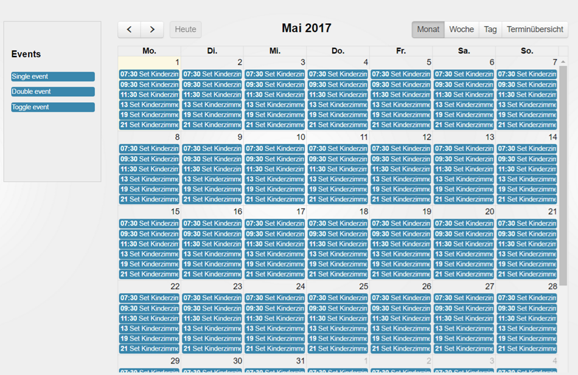
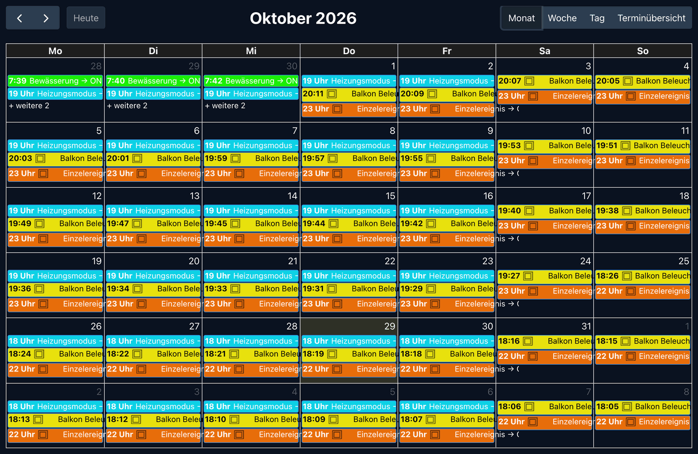

# ioBroker.fullcalendar

**Dieser Adapter nutzt die Sentry-Bibliotheken, um Ausnahmen und Codefehler automatisch an die Entwickler zu melden.** Weitere Details und Informationen zum Deaktivieren der Fehlerberichterstattung finden Sie in [der Sentry-Plugin-Dokumentation](https://github.com/ioBroker/plugin-sentry#plugin-sentry) ! Die Sentry-Berichterstattung wird ab js-controller 3.0 verwendet.

Termine mit [FullCalendar](https://fullcalendar.io) planen.

## Planen Sie die Ereignisse (steuern Sie Ihre Geräte)

Sie dürfen keine externen Ressourcen verwenden, die Terminplanung wird ausschließlich in ioBroker verarbeitet und nicht mit externen Diensten wie „Google Kalender“ oder „iTunes“ kombiniert.



Das vis-2-Widget in der Monatsansicht mit dunklem Design: Bewässerung, Heizmodus und Balkonbeleuchtung als Ereignisse.



Sie können Ihre Ereignisse mit einem Kalender verwalten und planen, diese regelmäßig zu steuern.

- **Die Dauer** von „Ein/Aus“- und „Umschalt“-Ereignissen kann in Sekunden, Minuten oder Stunden angegeben werden. Bei einer Dauer von 1 Sekunde verhält sich ein Ereignis wie ein Druckknopf.
- **Bedingung** („Nur wenn“): Ein Ereignis schreibt seinen Wert nur dann, wenn ein anderer Zustand zu diesem Zeitpunkt den angegebenen Wert hat (`==`, `!=`, `>`, `>=`, `<`, `<=` Beispielsweise fährt der Rollladen nur herunter, wenn die Terrassentür geschlossen ist. Ist die Bedingung nicht erfüllt, wird das gesamte Ereignis übersprungen (auch ein „Ein/Aus“-Ereignis schreibt den Endwert nicht), und eine Zeile wird ins Protokoll geschrieben.
- **Kalender** können deaktiviert werden (Schaltfläche in der Kalenderliste oder „Aktiv“ im Kalenderdialog): Ihre Ereignisse bleiben erhalten, werden aber erst ausgeführt, wenn der Kalender wieder aktiviert wird. Auf diese Weise können Sie Szenarien wie „Urlaub“ vorbereiten und diese per Skript umschalten (`enableCalendar` (siehe unten).

## Ereignissimulation

Sie können Ihr Verhalten aufzeichnen und später wiedergeben. Beispielsweise können Sie zwei Aufnahmen für Werktage und Wochenenden erstellen und diese an den entsprechenden Tagen abspielen.

Oder Sie können die ganze Woche aufzeichnen und sie in den nächsten Wochen während Ihrer Abwesenheit abspielen.

Anwendung:

- Wechseln Sie zum Simulations-Tab
- Erstellen Sie die neue Simulation, indem Sie auf die Schaltfläche „+“ klicken und den Simulationstyp auswählen: Tag oder Woche.
- Klicken Sie auf die Aufnahmetaste und warten Sie 24 Stunden oder 7 Tage, bis die Simulation beendet ist, um Ereignisse aufzuzeichnen.
- Sie können die Simulation nun durch Klicken auf die Wiedergabetaste erneut abspielen. Zusätzlich können Sie den Startzeitpunkt der Simulation festlegen.

## Webkomponenten

Neben dem vis-2-Widget stellt der Adapter den Kalender als Webkomponente für jeden Host von [ioBroker-Webkomponenten](https://github.com/ioBroker/web-components) bereit, z. B. Aura oder Geräte: `<iob-fullcalendar>` (`admin/webcomponents/fullcalendar.js`, beschrieben von `fullcalendar.json` In `common.webComponents`).

Es zeigt die Ereignisse einer Instanz – oder eines ihrer Kalender – als Monat, Woche, Tag oder Liste an und kann, sofern es nicht schreibgeschützt ist, diese wie das Widget im Dialogfeld des Hosts erstellen, verschieben, in der Größe ändern, bearbeiten und löschen. Es liest und schreibt die Ereignisse über die Instanz (`sendTo` mit `getEventObjects`, `setEventObject`, `deleteEventObject` Die Instanz muss also laufen.

Bau es mit `npm run build-wc` (Teil von `npm run build`).

## Die Agenda besagt:

Der Adapter schreibt die geplanten Aktionen in Zustände, z. B. um einen Chat- oder Sprachassistenten danach zu fragen oder um sie in einer Visualisierung anzuzeigen:

| Zustand                             | Inhalt                                                                                       |
| ----------------------------------- | -------------------------------------------------------------------------------------------- |
| `fullcalendar.0.events.list`        | Alle Ereignisse (JSON): Name, Kalender, Status, Wert, Zeit oder Cron-Job, nächste Ausführung |
| `fullcalendar.0.events.today`       | Ausführungen heute (JSON), auch die bereits erledigten                                       |
| `fullcalendar.0.events.tomorrow`    | Ausführungen morgen (JSON)                                                                   |
| `fullcalendar.0.events.next`        | die nächste Ausführung (JSON, `null` = keine)                                                 |
| `fullcalendar.0.events.count`       | Anzahl der Ereignisse                                                                        |
| `fullcalendar.0.events.lastChanged` | Zeitpunkt der letzten Änderung eines Ereignisses                                             |

Eine Ausführung sieht folgendermaßen aus (die Zeiten sind die lokalen Zeiten des ioBroker-Hosts):

```json
{"id": "fullcalendar.0.event-…", "name": "Light living room", "calendar": "", "time": "2026-10-28T22:30:00", "ts": 1793223000000,
 "oid": "hm-rpc.0.ABC.1.STATE", "value": false, "recurring": false}
```

Ein "Doppelereignis" hat `endTime` Und `endValue` zu, `calendar` Ist `""` für den Standardkalender. Ereignisse von Simulationen sind nicht Teil der Agenda.

## Skript- und Adapter-API (sendTo)

Andere Adapter und Skripte können Ereignisse planen, z. B. ein Sprachassistent für „Licht in 2 Stunden ausschalten“:

```js
// in 2 hours (`in`: seconds, or "90s", "30m", "2h", "1h30m", "1d")
sendTo('fullcalendar.0', 'addEvent', { oid: 'hm-rpc.0.ABC.1.STATE', value: false, in: '2h' }, res => log(JSON.stringify(res)));
// at a time (local time, or a timestamp in ms), for 10 minutes, in the calendar "Garden"
sendTo('fullcalendar.0', 'addEvent', {
    oid: 'hm-rpc.0.PUMP.1.STATE', value: true, start: '2026-10-29T07:30', duration: '10m', calendar: 'Garden', name: 'Pump',
}, res => log(JSON.stringify(res))); // {id, name, type, start, ts} or {error}
// every year on June 15 at 08:00 (a birthday), the start may be in the past
sendTo('fullcalendar.0', 'addEvent', {
    oid: '0_userdata.0.birthday', value: 'Anna', start: '2020-06-15T08:00', recurring: 'yearly', name: 'Birthday Anna',
}, res => log(JSON.stringify(res))); // {id, name, type, start: next execution, ts, cron: "0 0 8 15 6 *"}
// move an event to 09:30 (a series keeps its days) and let it switch for 2 minutes
sendTo('fullcalendar.0', 'updateEvent', { id: 'fullcalendar.0.event-…', start: '09:30', duration: '2m' }, res => log(JSON.stringify(res)));
// delete all events with this name
sendTo('fullcalendar.0', 'deleteEvent', { name: 'Birthday Anna' }, res => log(JSON.stringify(res)));
// a new calendar; addEvent finds it by its name
sendTo('fullcalendar.0', 'addCalendar', { name: 'Garden' }, res => log(JSON.stringify(res))); // {id, name, enabled}
```

| Befehl              | Nachricht                                                                                                   | Antwort                                                                                                                    |
| ------------------- | ----------------------------------------------------------------------------------------------------------- | -------------------------------------------------------------------------------------------------------------------------- |
| `addEvent`          | siehe unten                                                                                                 | `{id, name, type, start, ts, cron?}` (`start` /`ts` = erste Ausführung)                                                    |
| `updateEvent`       | `id` und die Parameter von `addEvent` Um etwas zu ändern, siehe unten.                                       | `{id, name, type, enabled, start, ts, cron?}` (`start` /`ts` = nächste Ausführung, `null` falls keine vorhanden)            |
| `deleteEvent`       | `id`, `ids` (eine Liste) und/oder `name` (alle Veranstaltungen mit genau diesem Namen; optional) `calendar`) | `{result: "ok", deleted: [id, …], notFound?: [id, …]}`                                                                     |
| `getEvent`          | `id`                                                                                                        | `{event: definition}`                                                                                                      |
| `getEvents`         | optional `calendar`                                                                                         | `{events: [definition, …]}`                                                                                                |
| `listEvents`        | optional `from`, `to` (Standardeinstellung jetzt … 7 Tage, oder `days`), `calendar`, `max`                   | `{events: [execution, …]}`                                                                                                 |
| `getCalendars`      | –                                                                                                           | `{calendars: [{id, name, enabled}, …]}`                                                                                    |
| `addCalendar`       | `name` (neu); optional `color`, `icon`, `enabled` (Standard `true`)                                          | `{id, name, enabled}`                                                                                                      |
| `enableCalendar`    | `calendar` (Name oder ID), `enabled` (`true` /`false`)                                                      | `{id, enabled}`                                                                                                            |
| `getEventObjects`   | optional `calendar` (`<namespace>.Calendars.<id>`)                                                          | `{events: [object, …]}`: die Zeitplanobjekte für die Webkomponente                                                        |
| `setEventObject`    | `event` (ein Zeitplanobjekt dieser Instanz)                                                                 | `{result: "ok"}`                                                                                                           |
| `deleteEventObject` | `id`                                                                                                        | `{result: "ok"}`                                                                                                           |
| `getCommands`       | –                                                                                                           | `{commands: [{command, description, params, answer, write}, …]}` (`write` (Der Befehl ändert etwas.)                       |
| `help`              | –                                                                                                           | `{help, commands: [{command, write}, …]}`: `help` ist eine Beschreibung aller Nachrichten für KI-Agenten (z. B. pi-agent). |

Parameter von `addEvent`:

| Parameter                 | Bedeutung                                                                                                                                                                                                                                                                                              |
| ------------------------- | ------------------------------------------------------------------------------------------------------------------------------------------------------------------------------------------------------------------------------------------------------------------------------------------------------ |
| `oid`                     | Zustand zum Schreiben (muss existieren und beschreibbar sein)                                                                                                                                                                                                                                          |
| `value`                   | Wert zu schreiben                                                                                                                                                                                                                                                                                      |
| `start` oder `in`          | `start`: Ortszeit (`"2026-10-29T07:30"`, `"07:30"` = heute) oder ein Zeitstempel in Millisekunden; `in`: Verzögerung (Sekunden oder `"90s"`, `"30m"`, `"2h"`, `"1h30m"`, `"1d"`)                                                                                                                      |
| `duration` /`durationSec` | nach dieser Zeit (gleiche Formate wie `in`) wird der zweite Wert geschrieben; dann `type` Ist `"double"` standardmäßig                                                                                                                                                                                   |
| `type`                    | `"single"` (Standard), `"double"` (schreibt `endValue` nach `duration`), `"toggle"` (schaltet danach wieder zurück) `duration`)                                                                                                                                                                           |
| `endValue`                | Wert von `"double"`; für einen booleschen Wert `value` Standardmäßig ist das Gegenteil der Fall.                                                                                                                                                                                                        |
| `recurring`               | `"daily"`, `"weekly"`, `"monthly"` oder `"yearly"`: wiederholt sich zur Tageszeit von `start` (auch von einem `start` (in der Vergangenheit). Der Tag kommt von `start` oder von `weekdays` (Liste, `0` = Sonntag oder `"MO"`, `"TU"` …), `monthDays` (Liste, 1…31), `months` (Liste, 1…12)                    |
| `rrule`                   | anstatt `recurring` iCal-Regel, z. B. `"FREQ=YEARLY"`, `"FREQ=WEEKLY;BYDAY=MO,FR"`, `"FREQ=MONTHLY;BYMONTHDAY=1,15"` Unterstützt: `FREQ` (TÄGLICH, WÖCHENTLICH, MONATLICH, JÄHRLICH), `BYDAY` (normale Wochentage), `BYMONTHDAY`, `BYMONTH` Nicht unterstützt: `INTERVAL` > 1, `COUNT`, `UNTIL`, `BYDAY=2MO` |
| `name`                    | Name des Ereignisses, Standardwert: Name des Zustands                                                                                                                                                                                                                                                  |
| `calendar`                | Name oder ID des Kalenders, Standard: der Standardkalender                                                                                                                                                                                                                                             |
| `color`                   | Farbe im Kalender                                                                                                                                                                                                                                                                                      |

`updateEvent` Wenn ein Ereignis an Ort und Stelle geändert wird, bleiben die nicht angegebenen Parameter unverändert:

- `start` oder `in` Bei einem einmaligen Ereignis ändert sich die Tageszeit; bei einer Reihe ändert sich die Tageszeit, die Tage bleiben bestehen.
- `recurring` oder `rrule` Machen Sie daraus eine Serie (zum Zeitpunkt von `start` (oder zur aktuellen Tageszeit), `recurring: false` zusammen mit `start` oder `in` macht es wieder zu einem einmaligen Ereignis.
- `value`, `oid`, `type`, `duration` /`durationSec`, `endValue`, `name`, `color` wie in `addEvent` Wenn ein boolesches Ereignis in die andere Richtung schaltet (`value`), daraus ergibt sich der Endwert.
- `enabled: false`/`true` schaltet es ein oder aus.
- `calendar` verschiebt es in einen anderen Kalender. Das Ereignis erhält dann eine neue ID, die in der Antwort enthalten ist.

Fehler werden zurückgegeben als `{error}` Bei einem unbekannten Befehl wird die Liste der verfügbaren Befehle angezeigt. Ein neues Ereignis erscheint im Kalender, als wäre es manuell erstellt worden, und kann dort bearbeitet werden. Wiederkehrende Ereignisse werden minutengenau ausgeführt.

## Todo

- Woche und Tag müssen auf die aktuelle Uhrzeit gescrollt werden.

<!--
	Placeholder for the next version (at the beginning of the line):
	### **WORK IN PROGRESS**
-->

## Changelog
### 3.6.0 (2026-11-19)
* (@GermanBluefox) Added the message `help`: a description of all messages for AI agents (e.g. pi-agent), built from the table of `getCommands`, which has `description` and `write` now; and `common.supportedMessages.help`

### 3.5.1 (2026-11-13)
* (@GermanBluefox) Calendar (admin, vis-2 widget and web component): "Today" works also when today is in the view; the list scrolls to today (or to the next day with events), and the day lights up briefly - in the month view its tile, in the week and day view its column

### 3.5.0 (2026-11-13)
* (@GermanBluefox) Added the short form of the web component manifests (tag, name, icon, size) to `common.webComponents`, so that hosts like Aura can list the components before the adapter is installed; the build writes it with `iob-web-components sync-io-package`
* (@GermanBluefox) vis-2 widget: in a narrow widget the list and the toolbar fit (no scrolling sideways, the buttons wrap), the day of the list is one line, and styles of the page can no longer put frames around its entries
* (@GermanBluefox) vis-2 widget and web component: in a narrow month view the events are dots, so a daily event no longer looks like a bar over the whole week
* (@GermanBluefox) vis-2 widget and web component: new option "Only the names of the events" hides the values and the duration ("Watering" instead of "Watering → ON → 20 min. → OFF"); the widget translates ON/OFF, and a repeated double event shows its end
* (@GermanBluefox) Added the message `addCalendar` to create a calendar

### 3.4.1 (2026-11-09)
* (bluefox) Web component: the time of an event always has minutes, so a full hour no longer looks different from "19:45", and a long title ends with "..." instead of being cut off

### 3.4.0 (2026-11-09)
* (bluefox) Added the web component `<iob-fullcalendar>` for Aura, devices and other hosts of web components (`common.webComponents`)
* (bluefox) Added the messages `getEventObjects`, `setEventObject` and `deleteEventObject` for the web component

## License
The MIT License (MIT)

Copyright (c) 2017-2026 Bluefox <dogafox@gmail.com>

Permission is hereby granted, free of charge, to any person obtaining a copy
of this software and associated documentation files (the "Software"), to deal
in the Software without restriction, including without limitation the rights
to use, copy, modify, merge, publish, distribute, sublicense, and/or sell
copies of the Software, and to permit persons to whom the Software is
furnished to do so, subject to the following conditions:

The above copyright notice and this permission notice shall be included in
all copies or substantial portions of the Software.

THE SOFTWARE IS PROVIDED "AS IS", WITHOUT WARRANTY OF ANY KIND, EXPRESS OR
IMPLIED, INCLUDING BUT NOT LIMITED TO THE WARRANTIES OF MERCHANTABILITY,
FITNESS FOR A PARTICULAR PURPOSE AND NONINFRINGEMENT. IN NO EVENT SHALL THE
AUTHORS OR COPYRIGHT HOLDERS BE LIABLE FOR ANY CLAIM, DAMAGES OR OTHER
LIABILITY, WHETHER IN AN ACTION OF CONTRACT, TORT OR OTHERWISE, ARISING FROM,
OUT OF OR IN CONNECTION WITH THE SOFTWARE OR THE USE OR OTHER DEALINGS IN
THE SOFTWARE.