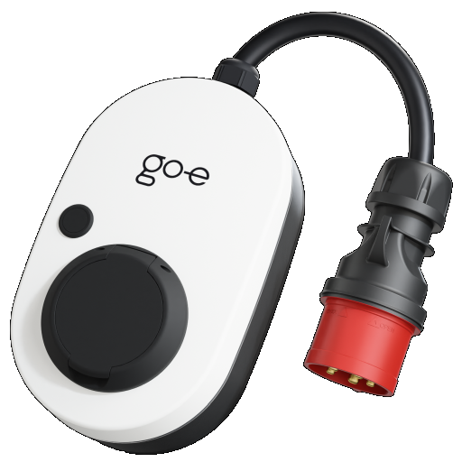

# ioBroker.go-eCharger

## Versionen

## Sentry

Dieser Adapter verwendet Sentry-Bibliotheken, um Ausnahmen und Codefehler automatisch an die Entwickler zu melden. Weitere Informationen und Hinweise zum Deaktivieren der Fehlerberichterstattung finden Sie in der [Dokumentation des Sentry-Plugins](https://github.com/ioBroker/plugin-sentry#plugin-sentry) !

## ioBroker-Adapter für go-e Charger EV-Wallboxen

Dieser Adapter integriert eine oder mehrere go-e Charger Wallboxen in Ihre ioBroker-Hausautomation. Er fragt jede Wallbox zyklisch über ihre lokale HTTP-API ab, stellt alle relevanten Daten gemäß den ioBroker-Statusmeldungen bereit und ermöglicht Ihnen die direkte Steuerung des Ladevorgangs von Ihrem Smart Home aus.

Weitere Informationen zur go-e Charger Hardware finden Sie auf der Website des Herstellers: [go-e GmbH](https://go-e.com) .

### Merkmale

- unterstützt mehrere go-e Ladegeräte innerhalb einer einzigen Adapterinstanz

- Überwachung des Fahrzeugzustands, der Ladeleistung, des Ladestroms, der Netzphasen und der Energiestatistik

- **ChargeNOW** – Sofortiger Ladevorgang mit einstellbarem Strom

- **ChargeManager** – automatisches Laden von PV-Überschussstrom: Der Ladestrom wird kontinuierlich an die verfügbare Solarenergie angepasst und berücksichtigt dabei den Hausverbrauch sowie den Ladezustand Ihrer Heimbatterie. Das Laden Ihres Elektrofahrzeugs kann verzögert werden, bis die Heimbatterie einen konfigurierbaren Mindestladezustand erreicht hat.

  > **Hinweis:** Wenn ChargeManager auf mehreren Ladegeräten gleichzeitig aktiviert ist, wird der verfügbare Überschuss in der Reihenfolge der Wallbox-Liste auf diese aufgeteilt – siehe [Mehrere Wallboxen mit einem PV-Überschuss](#several-wallboxes-on-one-pv-surplus) .

- Umschaltung zwischen einphasigem und dreiphasigem Laden (Hardwaregeneration 3 und neuer)

- Energiestatistik pro RFID-Karte (Kartenname, ID und geladene Energie)

- Nur-Lese-Modus pro Wallbox – Überwachung des Ladegeräts ohne Senden **von** Steuerbefehlen (keine Ladungsabgabe, kein Ladestrom, keine Phasenumschaltung), z. B. wenn der Ladevorgang extern gesteuert oder der Zugriff über RFID-Tags verwaltet wird.

Getestet mit Firmware V033, V040.0, V041.0, V054.7, V054.11, V055.5, V055.7, V055.8, V56.1, V56.2, V56.8, V56.9, V56.11, V57.0, V57.1, V59.4, V60.0, V60.1, V60.2, V60.5, V60.6 und mit bis zu 3 parallel betriebenen Ladegeräten.

### Anforderungen

- Bei Hardware der Generationen 3 und 4 müssen Sie "HTTP API v1" in Ihrer go-e-App aktivieren.
- Für die Phasenumschaltung müssen Sie zusätzlich "HTTP API v2" in Ihrer go-e-App aktivieren (Hardwaregeneration 3 und neuer).

## Konfiguration

Fügen Sie für jedes go-e Ladegerät einen Eintrag in die Wallbox-Liste ein und geben Sie dessen IP-Adresse ein. Optional können Sie jedem Ladegerät einen Namen zuweisen.

Aktivieren Sie **den Nur-Lese-Modus** für ein Ladegerät, wenn der Adapter dessen Daten nur lesen, aber niemals beschreiben soll. Im Nur-Lese-Modus sendet der Adapter keinerlei Steuerbefehle – weder die Ladefreigabe noch den Ladestrom noch die Phasenumschaltung. Die Zustände „ChargeNOW“ und „ChargeManager“ können weiterhin umgeschaltet werden, haben aber keine Auswirkung auf ein Ladegerät im Nur-Lese-Modus. Verwenden Sie diesen Modus, wenn der Ladevorgang der Wallbox von einem anderen System gesteuert oder lokal über RFID-Tags verwaltet wird.

Die Abfragezykluszeit legt fest, wie oft der Adapter Daten von den Ladegeräten abruft und den Ladestrom anpasst (Minimum 3 Sekunden, Standard 10 Sekunden).

#### Strombegrenzungen pro Wanddose

Jeder Wallbox kann optional ein eigener **minimaler** und **maximaler Ladestrom** \[A] zugewiesen werden. Diese Werte gelten **sowohl** für ChargeManager (PV-Überschuss) als auch für ChargeNOW, beispielsweise um ein einzelnes Ladegerät zu drosseln oder die Last zwischen mehreren Boxen an einer gemeinsamen Stromversorgung auszugleichen.

- Ein Wert von `0` bedeutet „nicht eingestellt“: Der Minimalwert fällt auf den technischen Minimalwert von 6 A zurück, und der Maximalwert fällt aus den Standardeinstellungen auf den installationsweiten maximalen Ladestrom zurück.
- Ein Maximalwert pro Box kann die Anzahl der Ladegeräte nur unter das Installationslimit senken, niemals darüber hinaus anheben.
- Wenn der konfigurierte Minimalwert höher als der Maximalwert ist, wird der Minimalwert auf den Maximalwert begrenzt und eine Warnung protokolliert.

Der Adapter liest außerdem die von jedem Ladegerät gemeldeten Stromgrenzen – den absoluten Maximalstrom, die Kabelstrombegrenzung und (über API v2) den minimalen Ladestrom – und integriert diese in die effektiven Grenzwerte, sodass ein Ladegerät nie über die Grenzen seiner Hardware oder des angeschlossenen Kabels hinaus belastet wird. Die erfassten Grenzwerte werden veröffentlicht als `Wallbox_X.info.hardwareMaxChargeCurrent` Und `Wallbox_X.info.hardwareMinChargeCurrent` um Ihnen bei der Auswahl sinnvoller Preise pro Box zu helfen.

### PV-Überschussladung mit ChargeManager

ChargeManager berechnet den Ladestrom anhand numerischer ioBroker-Zustände, die von einem Energiemanagementsystem, Wechselrichter, Zähler oder einer benutzerdefinierten Datenquelle bereitgestellt werden. Er ist herstellerunabhängig, die ausgewählten Zustände müssen jedoch die unten beschriebenen Größen repräsentieren.

Konfigurieren Sie die Objekt-IDs der folgenden Zustände:

- aktuell verfügbare Solarleistung \[W]
- Aktueller Stromverbrauch des Haushalts \[W]
- Aktueller Ladezustand Ihrer Heimbatterie \[%] (nur in den batteriegesteuerten Modi erforderlich, siehe _Heimbatteriemodus_ unten)

#### Eingabeanforderungen

| Eingang                      | Erwartungswert                | Einheit | Zeichen             |
| ---------------------------- | ----------------------------- | ------- | ------------------- |
| Solarenergie                 | Aktuelle PV-Gesamterzeugung   | W       | Positive Generation |
| Stromverbrauch im Haushalt   | Gesamtnachfrage der Haushalte | W       | Positiver Konsum    |
| Ladezustand der Heimbatterie | Aktueller Batterieladestand   | %       | 0 bis 100           |

Alle konfigurierten Zustände müssen numerische Werte enthalten. Leistungswerte in kW müssen vor der Auswahl in W umgerechnet werden. Ein Netzimport-/Netzexportzustand kann nicht direkt verwendet werden, da ChargeManager derzeit separate Erzeugungs- und Verbrauchswerte erwartet.

Ist kein Heimspeicher installiert, stellen Sie den **Heimspeichermodus** auf _„Deaktiviert“_ (siehe unten). Es muss kein Ladezustand des Speichers konfiguriert werden, und ChargeManager lädt ausschließlich mit dem verfügbaren PV-Überschuss. Die frühere Problemumgehung mit dem Hilfszustand (ein konstanter Zustand, der auf … gesetzt ist) wird dadurch nicht mehr unterstützt. `Settings.Setpoint_HomeBatSoC`) wird nicht mehr benötigt.

#### Wallbox-Verbrauch im Haushaltsverbrauchswert

**Der Stromverbrauch des Ladegeräts wird in den Haushaltsstromverbrauch einbezogen,** wenn der ausgewählte Haushaltsstromverbrauch nach dem Ladebeginn um etwa die Ladeleistung ansteigt. ChargeManager addiert dann die gemessene Leistung der Wallbox wieder hinzu, bevor der verfügbare Überschuss berechnet wird. Dadurch wird verhindert, dass der Controller seine eigene Ladelast als zusätzlichen Haushaltsstromverbrauch behandelt.

Lassen Sie die Option deaktiviert, wenn der ausgewählte Zustand den Verbrauch der Wallbox bereits ausschließt.

#### Berechnung

ChargeManager verwendet die folgende Berechnung einmal pro Abfragezyklus:

```text
available power =
    solar power
  - home power consumption
  + wallbox power, if it is included in home power consumption
  - grid reserve
  + battery bonus (Battery priority mode only)

target current = floor(available power / 230 V / active phases)
```

Sechs Einstellungen auf der Konfigurationsseite von ChargeManager beeinflussen diese Berechnung:

- **Heimbatteriemodus** (Standardeinstellung: _Batteriepriorität_ ) – wie die Heimbatterie berücksichtigt wird:
  - _Deaktiviert_ – es wird keine Heimbatterie verwendet. Es muss kein SoC-Status konfiguriert werden, und dem Fahrzeug wird keine Batterieleistung zugewiesen.
  - _Mindest-SOC_ – Das Laden von Elektrofahrzeugen ist unterhalb dieses Wertes blockiert. `Settings.Setpoint_HomeBatSoC` Die Batterie trägt jedoch niemals zur Stromversorgung des Autos bei.
  - _Batteriepriorität_ – wie oben, zuzüglich des unten beschriebenen Batteriebonus.
- **SoC-Hysterese** \[%] (Standard 0) – wie weit der SoC unter den Mindestwert fallen darf, bevor ein _laufender_ Controller stoppt. Dadurch wird verhindert, dass ein Akku, der sich nahe seinem Mindestwert befindet, die Ladefreigabe in jedem Zyklus umschaltet; zum Starten ist weiterhin der volle Mindest-SoC erforderlich.
- **Maximales Batterie-SoC-Alter** \[s] (Standard 0 = aus) – Die Überschusssteuerung stoppt, wenn der SoC-Zustand innerhalb dieser Zeit nicht aktualisiert wurde, sodass ein toter Hilfszustand das Auto nicht stillschweigend weiter aufladen kann.
- **Netzreserveleistung** \[W] (Standard 100) – Leistung, die im Stromnetz freigehalten wird, anstatt dem Fahrzeug zugewiesen zu werden. Erhöhen Sie diesen Wert, um mehr Sicherheitsreserve zu gewährleisten; stellen Sie ihn auf ein. `0` den gesamten Überschuss dem Auto übergeben.
- **Maximaler Batteriebonus** \[W] (Standardwert 2000) – wie viel zusätzliche Leistung über den reinen Solarstromüberschuss hinaus entnommen werden kann, solange sich der Hausspeicher über seinem Mindestladezustand befindet. Der Bonus beträgt `0` Wenn der Akku genau den minimalen Ladezustand (SoC) erreicht hat und dieser linear bis zum Maximum ansteigt, je näher der Akku 100 % kommt, ermöglicht ein vollerer Akku ein schnelleres Laden des Autos. Stellen Sie es so ein: `0` Das Fahrzeug wird ausschließlich mit dem gemessenen Solarstromüberschuss geladen, ohne dass die Heimbatterie jemals in das Auto entladen wird.
- **Minimaler Ladestrom des ChargeManagers** \[A] (Standardwert 6) – der Überschussladestrom, unterhalb dessen das Ladegerät nach kurzer Verzögerung abgeschaltet wird. Dies gilt nur für das Laden von PV-Überschussstrom.

Der **maximale Ladestrom** \[A] (Standard 16, bis zu 32) wird auf der **Seite mit den Standardeinstellungen** konfiguriert, nicht hier: Es handelt sich um eine installationsweite Begrenzung der gemeinsamen Stromversorgung (Hauptsicherung/Schutzschalter) und nicht um einen im ChargeManager einstellbaren Wert. Er begrenzt den Strom, den der Adapter jemals an **eine** Wallbox abgibt, **sowohl** im ChargeManager (PV-Überschuss) **als auch** in ChargeNOW.

> **⚠️ Stellen Sie den maximalen Ladestrom nicht höher ein, als es Ihr go-e Charger und Ihre Elektroinstallation zulassen.** go-e Charger-Modelle sind für unterschiedliche Maximalströme ausgelegt (z. B. 16 A oder 32 A), und die tatsächliche Grenze hängt auch von Ihrem Kabel, Stecker und der Verkabelung ab. Ein Wert über der zulässigen Belastbarkeit der Hardware/Installation kann Schutzvorrichtungen auslösen oder Geräte beschädigen. Im Zweifelsfall verwenden Sie den Standardwert von 16 A.

In den batterieschonenden Modi ist das Laden von Elektrofahrzeugen unten deaktiviert. `Settings.Setpoint_HomeBatSoC` Die Heimbatterie hat somit Priorität. Der Ladevorgang beginnt, sobald der interne Zielwert 10 A erreicht (oder der Mindeststrom, falls dieser höher eingestellt ist); anschließend wird der Ladestrom bis zum Erreichen des Mindeststroms kontinuierlich angepasst. Der berechnete Strom ist auf den konfigurierten Maximalwert begrenzt, und der interne Zielwert ändert sich um maximal 1 A pro Abfragezyklus, um plötzliche Änderungen zu vermeiden.

#### Mehrere Wandkästen an einem PV-Überschuss

Der Überschuss ist eine gemeinsam genutzte Ressource und wird daher auf die Wallboxen aufgeteilt, anstatt jeder einzelnen vollständig zur Verfügung zu stehen. Die Wallboxen werden in der **Reihenfolge ihrer Liste** bedient, was gleichzeitig ihre Priorität bestimmt: Die erste Wallbox erhält so viel Überschuss wie möglich, die nachfolgenden Wallboxen erhalten nur den verbleibenden Betrag. Durch Ändern der Reihenfolge in der Liste kann die Ladereihenfolge der Fahrzeuge angepasst werden.

Eine Wallbox reserviert nur dann überschüssige Energie, solange ein Fahrzeug daran angeschlossen ist. Eine leere Wallbox wird übersprungen und kann daher keinen Überschuss zurückhalten, den eine andere Wallbox gerade nutzen könnte.

Die oben beschriebenen Strombegrenzungen pro Wanddose gelten weiterhin für jede einzelne Dose, sodass Sie ein einzelnes Ladegerät begrenzen können, selbst wenn es an erster Stelle in der Liste steht.

#### ChargeManager aktivieren

Nach dem Start des Adapters verwenden Sie die unten aufgeführten beschreibbaren Zustände. Instanz ersetzen `0` und Wandkastennummer `0` wo dies erforderlich ist.

| Zustand                                           | Zweck                                                                             |
| ------------------------------------------------- | --------------------------------------------------------------------------------- |
| `go-e-charger.0.Settings.Setpoint_HomeBatSoC`     | Mindestladezustand der Heimbatterie, bevor zusätzliches Laden zulässig ist        |
| `go-e-charger.0.Wallbox_0.Settings.ChargeManager` | Aktiviert oder deaktiviert die PV-Überschusssteuerung                             |
| `go-e-charger.0.Wallbox_0.Settings.ChargeNOW`     | Erzwingt den Ladevorgang; schaltet ChargeManager aus                              |
| `go-e-charger.0.Wallbox_0.Settings.ChargeCurrent` | Stromverbrauch von ChargeNOW                                                      |
| `go-e-charger.0.Wallbox_0.Settings.Charge3Phase`  | Wählt bei unterstützter Hardware zwischen einphasigem und dreiphasigem Laden aus. |
| `go-e-charger.0.Wallbox_0.Settings.PhaseMode`     | `1` /`3` korrigiert die Phasenanzahl, `0` Schaltet automatisch                     |

Für Überschussladung einstellen `ChargeManager` Zu `true` ChargeNOW lädt zu dem konfigurierten Preis. `ChargeCurrent` ohne Berücksichtigung des verfügbaren Überschusses. Die beiden Modi schließen sich gegenseitig aus: Das Einschalten des einen schaltet den anderen aus.

ChargeNOW schaltet sich automatisch ab, sobald das Fahrzeug vom Stromnetz getrennt wird. **Ist die Funktion „Ladevorgang beenden“** für die Wallbox aktiviert, schaltet sich ChargeNOW automatisch ab, sobald das Fahrzeug 5 Minuten lang keinen Strom mehr verbraucht. Das Einschalten von ChargeNOW vor dem Anschließen des Fahrzeugs ist unbedenklich: Das Ladegerät wartet auf das Fahrzeug, ohne den Ladevorgang zu unterbrechen.

#### Einphasen- und Dreiphasenladung

Auf Hardware der 3. Generation und neuer, `Charge3Phase` wählt den Phasenmodus aus:

- `false`: einphasige Ladung
- `true`: dreiphasige Ladung

Da die aktuelle Implementierung den Ladevorgang startet, sobald der interne Zielwert 9 A überschreitet, liegt der effektive Startpunkt bei 10 A. Dies erfordert nach Berücksichtigung der Reserve und der Batterieeinstellungen ca. 2,3 kW im Einphasenbetrieb bzw. 6,9 kW im Dreiphasenbetrieb. Der Einphasenbetrieb bietet daher einen größeren Betriebsbereich für kleinere PV-Anlagen oder bei wechselnden Wetterbedingungen.

##### Automatische Phasenumschaltung

**Automatische 1-/3-Phasen-Umschaltung** pro Wanddose aktivieren (nur Gen 3+, standardmäßig deaktiviert), damit ChargeManager den Phasenmodus aus dem verfügbaren Überschuss auswählt:

- Sobald die einphasige Ladung gesättigt ist (der Überschuss das einphasige Maximum übersteigt), schaltet das System **auf drei Phasen um** und ermöglicht so den Zugriff auf die höhere dreiphasige Kapazität.
- Sobald der Überschuss nicht mehr ausreicht, um das dreiphasige Minimum (\~4,1 kW bei 6 A) aufrechtzuerhalten, schaltet das System **auf einphasig um.** Dadurch wird der Ladevorgang bei schrumpfendem Überschuss einphasig fortgesetzt, anstatt zu stoppen.
- Die Differenz zwischen diesen Schwellenwerten zuzüglich einer Verweilzeit verhindert ein schnelles Hin- und Herschalten, das den Ladevorgang jedes Mal unterbrechen würde.

Diese Option ermöglicht das automatische Umschalten; `Settings.PhaseMode` Wählt es zur Laufzeit aus, ohne den Adapter neu zu starten:

- `0` Automatische Umschaltung (nur akzeptiert, wenn die Option aktiviert ist und Hardware der 3. Generation oder höher verwendet wird; dann Standardeinstellung), beginnt mit der Phasenanzahl, die das Ladegerät verwendet
- `1`: feste einphasige Ladung, Sätze `Charge3Phase` Zu `false`
- `3`: feste dreiphasige Ladung, Sätze `Charge3Phase` Zu `true`

Im Automatikmodus wählt der ChargeManager die Phasenanzahl aus, ohne sie zu ändern. `Charge3Phase`, das sich immer wieder bei ChargeNOW bewirbt. Schreiben `Charge3Phase` Das direkte Beenden des Automatikmodus wird dadurch nicht beendet. Da ein Schalter den Ladevorgang kurzzeitig unterbricht und nicht jedes Fahrzeug dies problemlos verkraftet, ist diese Option standardmäßig deaktiviert.

#### Betriebsarten

| ChargeNOW | ChargeManager | Ergebnis                                                       |
| --------- | ------------- | -------------------------------------------------------------- |
| `false`   | `false`       | Der Adapter lädt nicht.                                        |
| `false`   | `true`        | Die Ladung erfolgt entsprechend dem berechneten PV-Überschuss. |
| `true`    | `false`       | Zwangsladung bei `ChargeCurrent`                                |

Sind beide Modi deaktiviert, entnimmt der Adapter nur die von ihm selbst freigegebene Ladung. Ein Ladevorgang, der über die go-e App, die Taste am Ladegerät oder die Standardeinstellung des Ladegeräts gestartet wurde, bleibt unberührt.

Im Nur-Lese-Modus können diese Zustände zwar noch geändert werden, es wird jedoch kein resultierender Steuerbefehl an das Ladegerät gesendet.

#### Überprüfung und Fehlerbehebung

Bevor Sie sich auf die automatische Abrechnung verlassen, überprüfen Sie die ausgewählten Eingangszustände in der ioBroker-Objektansicht:

1. Nachts ist die Solarstromerzeugung nahezu null und orientiert sich tagsüber an der aktuellen Stromerzeugung.
2. Der Stromverbrauch der Haushalte bleibt positiv und reagiert plausibel, wenn Verbraucher eingeschaltet werden.
3. Der Ladezustand der Batterie bleibt zwischen 0 und 100.
4. Alle Leistungswerte werden in Watt (W) anstatt in Kilowatt (kW) angegeben.
5. Die Option „Wallbox-Verbrauch“ hängt davon ab, ob die Ladeleistung im gewählten Haushaltsverbrauchswert enthalten ist.
6. `Wallbox_0.info.connection` Ist `true` Die
7. `Wallbox_0.Power.Charge`, `Wallbox_0.Power.GridPhases` und, auf unterstützter Hardware, `Wallbox_0.Power.EnabledPhases` enthalten plausible Werte.

Der Ladevorgang kann mehrere Abfragezyklen benötigen, da der interne Zielwert pro Zyklus nur um 1 A ansteigt. Bei einem standardmäßigen Zyklus von 10 Sekunden und einem anfänglichen Zielwert von 0 A kann es etwa 100 Sekunden dauern, bis der standardmäßige Startwert von 10 A erreicht ist.

Wenn ChargeManager mehrere Wallboxen gleichzeitig betreibt, wird der PV-Überschuss in der Reihenfolge der Wallbox-Liste zwischen ihnen aufgeteilt, wobei der erste Eintrag Priorität hat und die nachfolgenden nur den verbleibenden Überschuss erhalten (siehe [PV-Überschuss-Aufladung mit ChargeManager](#pv-surplus-charging-with-chargemanager) oben).

#### Gesamtstrombudget (Sicherungsschutz)

Um eine gemeinsame Sicherung oder Zuleitung für mehrere Wallboxen zu schützen, legen Sie den **maximalen Gesamtladestrom** \[A] auf der Seite mit den Standardeinstellungen fest. Dieser Wert gilt für die gesamte Anlage: Der summierte Ladestrom **aller** Wallboxen überschreitet ihn weder in ChargeManager **noch** in ChargeNOW. Im Gegensatz zum PV-Überschuss (der in Watt gemessen wird) ist die Sicherung in **Ampere** abgesichert, da eine Zuleitung mit einer Nennleistung von z. B. 20 A unabhängig davon, ob eine Wallbox ein- oder dreiphasig lädt, 20 A führt.

Das Budget wird priorisiert zugeteilt: Zuerst die ChargeNOW-Wallboxen, dann die ChargeManager-Wallboxen in der Reihenfolge der Wallbox-Liste. Eine Wallbox, die nicht mehr ins Ladevolumen passt, drosselt ihren Ladestrom auf die verbleibende Leistung oder schaltet sich ab, wenn selbst die Mindestleistung nicht ausreicht. Solange das Budget aktiv ist, bleibt eine Wallbox ohne angeschlossenes Fahrzeug ausgeschaltet und reserviert keinen Strom. So wird sichergestellt, dass mehrere gleichzeitig angeschlossene, ungenutzte Wallboxen die Sicherung nicht überschreiten, bevor der nächste Ladezyklus neu geplant wird, und dass eine ungenutzte Wallbox niemals eine bereits ladende Wallbox unterbricht.

Ein Wert von `0` (Standardeinstellung) deaktiviert das Budget; der Adapter erzwingt dann kein kombiniertes Limit, stellen Sie also sicher, dass die Summe der maximalen Ströme pro Wanddose innerhalb der Kapazität Ihrer Installation bleibt.

Solange das Budget aktiv ist, **passt sich der Adapter dem tatsächlich gemessenen Ladestrom an** : Zieht eine Wallbox deutlich weniger Strom als zulässig (z. B. bei einem Fahrzeug mit geringerer Ladekapazität des Bordladegeräts, einem fast voll geladenen Auto oder bei temperaturabhängiger Leistungsreduzierung), wird der nicht verbrauchte Strom nach einigen Ladezyklen zurückgewonnen und der nächsten Wallbox in der Reihenfolge ihrer Priorität zur Verfügung gestellt. Die Wallbox hält eine kleine Reserve über ihrem tatsächlichen Stromverbrauch und erhält pro Ladezyklus ein Ampere mehr, solange sie den verfügbaren Strom nutzt, um ihre Kapazität wieder aufzufüllen. Aus Sicherheitsgründen wird die Leistung einer Wallbox nur dann _gedrosselt_ , wenn Kapazität zurückgewonnen wird – die Ladespannung bleibt nie hoch, während die freigegebenen Ampere abgegeben werden –, sodass der Gesamtstrom die Sicherung niemals überschreiten kann, selbst wenn ein Fahrzeug plötzlich wieder stark lädt.

> Es handelt sich um ein konservatives, phasenunabhängiges Modell: Jeder Ampere zählt zu einem Gesamtbudget, unabhängig davon, auf welcher Phase er anliegt. Die Nennleistung der Sicherung wird nie überschritten, aber bei Lasten, die auf mehrere Phasen verteilt sind, kann ein Teil der Kapazität ungenutzt bleiben.

## Migration vom go-e Adapter

Kommen Sie vom Adapter [ioBroker.go-e](https://github.com/MK-2001/ioBroker.go-e) ? Der Migrationsleitfaden ordnet Datenpunkte und Einstellungen zu, beantwortet häufig gestellte Fragen (go-e-App-Modus, HTTP-API v1/v2, Vorzeichen der Eingabewerte, paralleler Betrieb beider Adapter im Nur-Lese-Modus) und listet auf, was noch nicht unterstützt wird:

- [Migrationsleitfaden (Englisch)](/#/docs/adapterref/iobroker.go-e-charger/docu/migration-from-go-e.md)
- [Umstiegsanleitung (Deutsch)](/#/docs/adapterref/iobroker.go-e-charger/docu/migration-from-go-e_de.md)

## Spenden

<a href="https://www.paypal.com/donate/?hosted_button_id=76GBRV9BX5US8"></a> Wenn dir dieses Projekt gefallen hat – oder du einfach nur in spendabler Stimmung bist – spendier mir doch ein Bier. Prost! 😉

## Changelog

<!--
  Placeholder for the next version (at the beginning of the line):
  ### **WORK IN PROGRESS**
-->

### **WORK IN PROGRESS**

- (HombachC) moved the Sentry notice near the top of README.md to satisfy the repository checker (#938)
- (hombach) updated iobroker/testing
- (hombach) updated dependencies

### 1.10.2 (2026-11-01)

- (HombachC) added a migration guide from the go-e adapter (ioBroker.go-e) in English and German
- (HombachC) fixed the RFID card energy (statistics.RFID<n>.chargedEnergy) on gen 3+ chargers freezing at the value read at adapter start: it is now read from the API V2 card keys in Wh precision, with an API V1 fallback refreshed every cycle (#889)

### 1.10.1 (2026-10-31)

- (HombachC) an unreachable charger (e.g. without power) is now shown offline: its info.connection turns false, live readings are cleared and it is left out of ChargeManager and current budget until it answers again; the error is logged once instead of every cycle
- (HombachC) added read-only state info.ipAddress with the configured IP address of each charger
- (HombachC) log messages now name a charger by its configured name (e.g. charger "WEST - Tesla" (192.168.11.181)) instead of its number; the number is only used when no name is configured
- (typhosj) ChargeManager: new state `Settings.PhaseMode` switches between fixed one-phase, fixed three-phase and automatic phase switching at runtime; the instance option now only makes the automatic mode available

### 1.10.0 (2026-10-29)

- (HombachC) improved log message for invalid wallbox responses (no longer suggests checking the IP)
- (HombachC) fixed maxAmpTotal config: default 16 A, max 64 A consistent between admin and code
- (HombachC) fixed outdated native defaults in io-package.json (e.g. subtractSelfConsumption undefined on new installs)
- (typhosj) with ChargeNOW and ChargeManager both off, the adapter no longer aborts a charge it did not start - a charge started from the go-e app, the button or after a charger restart used to be cut off in the next cycle, until the vehicle gave up
- (typhosj) ChargeNOW now switches itself off when the vehicle is unplugged, and with the option above when the vehicle stops drawing power; it used to hold the charge release until switched off by hand, so the next vehicle plugged in started charging at the full ChargeNOW current. While ChargeNOW waits for a vehicle, nothing is sent to the charger
- (typhosj) ChargeNOW and ChargeManager are now exclusive: switching one on switches the other off, instead of ChargeNOW silently taking precedence
- (typhosj) a ChargeManager that takes over a charger - at adapter start or after ChargeNOW - continues a running charge at its current, with a fresh shutdown delay; it used to start from its previous state and could withdraw the release in its first cycle
- (typhosj) ChargeManager: a charger in force state neutral, where it decides by itself and charges any vehicle, is now held off unless the adapter released it - firmware 60.6 comes back from every restart in that state, the go-e app sets it when a setting is saved, and firmware 59.4 and 60.6 set it when a vehicle is unplugged; the next vehicle used to charge at full power from the grid until the shutdown delay ran out. The release the charger reports in that state is no longer taken for one the adapter gave
- (HombachC) fixed TypeError in log when a state change arrives for an unconfigured wallbox number

### 1.9.0 (2026-10-28)

- (solar0x) new states `Wallbox_X.Power.VoltageL1`, `VoltageL2` and `VoltageL3` show the voltage the charger measures on each grid phase, in V; all hardware generations. As in the go-e app, a single-phase supply with L and N swapped shows its N voltage as L1
- (typhosj) new state `Wallbox_X.Power.GridFrequency` shows the grid frequency the charger measures, in Hz; hardware gen 3 and newer with HTTP API v2 enabled only, and it stays empty while the charger reports the frequency as unknown [#898]
- (typhosj) new state `Wallbox_X.info.chargeState` explains why the charger is charging or not - waiting for a vehicle, charging the home battery first, not enough PV surplus, ramping up to the start current, charging, current budget exhausted, both modes off; every change of the reason is also logged once. A charger that never started used to leave no trace in the log, because most of these reasons were only logged together with a write to the charger
- (typhosj) ChargeManager: new per-wallbox option to withdraw the charge release when the vehicle draws no power for 5 minutes - vehicles such as the Renault Zoe otherwise stay in charging mode, e.g. in the evening when the battery bonus keeps the release active (reported by a user)
- (hombach) phase voltages and grid frequency are rounded to 2 decimal places
- (hombach) updated dependencies

### 1.8.1 (2026-10-11)

- (typhosj) after an automatic switch from one to three phases the ChargeManager now continues at the power the car was charging with instead of the one-phase current; 16 A on one phase used to become 16 A on three phases (about 11 kW) and came down only one ampere per cycle, drawing the difference from the battery or the grid
- (typhosj) after an automatic switch from three to one phase the ChargeManager now also continues at the power reached so far, capped at what the surplus carries on one phase; it used to keep the three-phase current, so a car plugged in while the charger still held three phases from the last charge took about a minute longer to start

## License

MIT License

Copyright (c) 2020-2026 C.Hombach <go-e-charger@homba.ch>

Permission is hereby granted, free of charge, to any person obtaining a copy
of this software and associated documentation files (the "Software"), to deal
in the Software without restriction, including without limitation the rights
to use, copy, modify, merge, publish, distribute, sublicense, and/or sell
copies of the Software, and to permit persons to whom the Software is
furnished to do so, subject to the following conditions:

The above copyright notice and this permission notice shall be included in all
copies or substantial portions of the Software.

THE SOFTWARE IS PROVIDED "AS IS", WITHOUT WARRANTY OF ANY KIND, EXPRESS OR
IMPLIED, INCLUDING BUT NOT LIMITED TO THE WARRANTIES OF MERCHANTABILITY,
FITNESS FOR A PARTICULAR PURPOSE AND NONINFRINGEMENT. IN NO EVENT SHALL THE
AUTHORS OR COPYRIGHT HOLDERS BE LIABLE FOR ANY CLAIM, DAMAGES OR OTHER
LIABILITY, WHETHER IN AN ACTION OF CONTRACT, TORT OR OTHERWISE, ARISING FROM,
OUT OF OR IN CONNECTION WITH THE SOFTWARE OR THE USE OR OTHER DEALINGS IN THE
SOFTWARE.