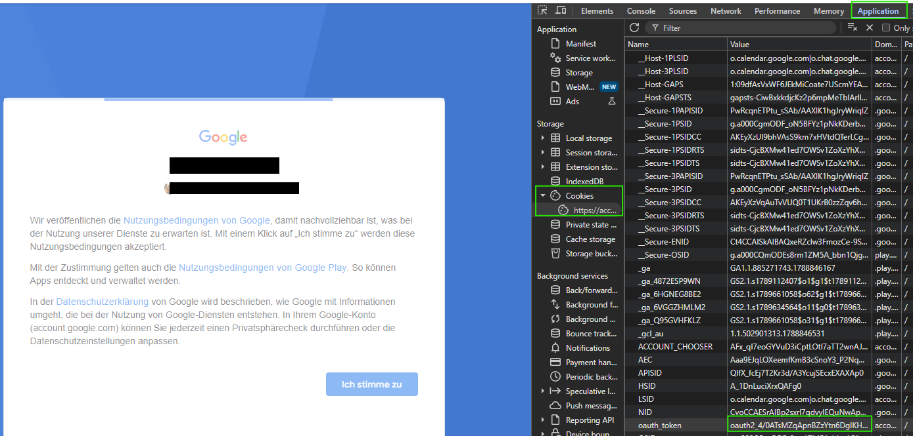
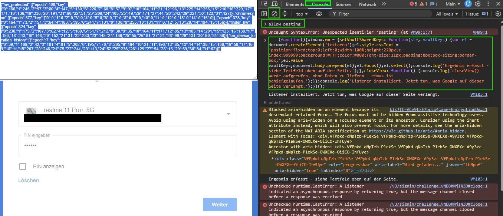

# ioBroker.googlefindmydevice

ioBroker-Adapter zum Auslesen von Tracker-Standorten (z. B. Bluetooth-Item-Trackern) aus [Google Find Hub / Find My Device](https://www.google.com/android/find) , dem Geräte- und Item-Tracking-Dienst von Google, und zum Bereitstellen dieser Standorte als ioBroker-Zustände.

> **Unterstützte Geräte:** Ausschließlich Bluetooth-Tracker (z. B. Chipolo, Pebblebee – alle Geräte im „Mein Gerät finden“-Netzwerk von Google). Smartphones, Tablets und andere Geräte, die mit demselben Google-Konto verknüpft sind, werden **nicht** unterstützt und nicht als ioBroker-Objekte angezeigt. Die Gründe dafür finden Sie weiter unten unter [„Warum werden die Standorte von Smartphones/Tablets nicht auch angezeigt?“](#why-not-phonetablet-locations-too) . Verwenden Sie für diese Geräte weiterhin die Google-App oder [google.com/android/find](https://www.google.com/android/find) .

## Status: frühe Entwicklungsphase

Google bietet keine offizielle API für Find Hub an. Dieser Adapter basiert auf dem durch Reverse Engineering gewonnenen Verständnis des Protokolls und wurde mit [leonboe1/GoogleFindMyTools](https://github.com/leonboe1/GoogleFindMyTools) (GPL-3.0) abgeglichen. Da die Standorte der Find Hub-Tracker Ende-zu-Ende-verschlüsselt sind und Google neue Standorte nur asynchron über seine Push-Infrastruktur übermittelt, ist dieser Adapter deutlich komplexer als ein typischer REST-API-Adapter und kann bei Änderungen des internen Protokolls von Google fehlerhaft werden.

Aktuell implementiert und nachweislich funktionsfähig mit echten Google-Konten:

- Die Bluetooth-Tracker eines Google-Kontos (Name, Hersteller, Modell, Fast Pair ID, Kopplungsdatum, Gerätetyp) werden ausgelesen und in regelmäßigen Abständen aktualisiert. Smartphones, Tablets und andere mit dem Konto verknüpfte Geräte, die keine Tracker sind, werden bewusst ausgenommen – die Google-API liefert hierfür keine verwertbaren Daten, und für die Standortbestimmung von Smartphones wäre eine völlig andere, browserbasierte API erforderlich, die dieser Adapter nicht verwendet (siehe unten).
- Entschlüsselung von Echtzeit-Standortberichten, sobald diese verfügbar sind (Breitengrad, Längengrad, Höhe, Zeitpunkt des letzten Aufenthalts oder ein semantischer Standort wie "Zuhause").
- Aktives Anfordern eines neuen Standorts pro Tracker ("jetzt lokalisieren"), mit einer Aktivierungs-/Intervall-Einstellung pro Gerät in der Adapterkonfiguration - siehe unten **„Standorte anfordern“** .
- Die gesamte Einrichtung erfolgt innerhalb der Konfigurationsseite des Adapters in ioBroker Admin – siehe **Konfiguration** unten. Es ist kein separates Programm oder Browserautomatisierung erforderlich oder wird verwendet.

## Installation

Voraussetzungen: Node.js >= 22, js-controller >= 6.0.11, Admin >= 7.8.23.

1. Öffnen Sie in ioBroker Admin **den Menüpunkt „Adapter** “, suchen Sie nach „Google Find My Device“ und installieren Sie es.
2. Erstellen Sie eine Instanz und starten Sie sie (Startschaltfläche). Neue Instanzen sind standardmäßig deaktiviert, und die Schaltflächen der Konfigurationsseite funktionieren nur, solange die Instanz läuft. Bis zum Abschluss der Einrichtung protokolliert die Instanz lediglich, dass sie noch nicht eingerichtet ist – das ist so vorgesehen. Folgen Sie anschließend der unten stehenden [Konfiguration](#configuration) .

## Konfiguration

Der Adapter muss einmalig eingerichtet werden. Die Einrichtung erfolgt vollständig über eine eigene Konfigurationsseite in ioBroker Admin. Er besteht aus zwei Teilen, und die Seite zeigt immer nur den noch ausstehenden Teil an. Es wird kein Passwort im Adapter eingegeben – Sie kopieren lediglich die Werte aus Ihrem Browser, genau wie Sie einen API-Schlüssel von einem anderen Web-Dashboard kopieren würden.

### Teil 1 von 2: Verbinden Sie Ihr Google-Konto

Das dauert etwa zwei Minuten. Der Adapter benötigt Zugriff auf das Google-Konto, mit dem Ihre Tracker verknüpft sind.

1. Klicken Sie auf der Konfigurationsseite **auf „Google-Anmeldeseite öffnen“** (oder öffnen Sie `https://accounts.google.com/EmbeddedSetup` Sie selbst). Es öffnet sich in einem neuen Browser-Tab. Melden Sie sich dort noch **nicht** an.

2. Öffnen Sie in diesem Tab die Entwicklertools Ihres Browsers (`F12`) → Registerkarte „Anwendung“ → „Cookies“ →`https://accounts.google.com` Die Liste ist zunächst leer – das ist normal, sie füllt sich nach dem Anmelden. Lassen Sie die Entwicklertools geöffnet.

   **Ab jetzt läuft die Uhr:** Der Wert aus Schritt 4 ist nur für kurze Zeit gültig, daher müssen die Schritte 3, 4 und 5 direkt nacheinander ausgeführt werden.

3. Melden Sie sich auf dieser Seite mit dem Google-Konto an, mit dem Ihre Tracker verknüpft sind (einschließlich Zwei-Faktor-Authentifizierung, falls aktiviert). Die Seite kann anschließend leer erscheinen oder bei einer Meldung wie „Ich stimme zu“ hängen bleiben und nicht sichtbar fortfahren – das ist normal (die Seite ist nicht für Menschen gedacht), das Token ist zu diesem Zeitpunkt bereits gültig.

4. Wechseln Sie zurück zu den geöffneten Entwicklertools und aktualisieren Sie die Cookie-Liste, bis eine Zeile mit dem Namen `oauth_token` erscheint:

   

5. Kopieren Sie den gesamten Wert dieser Zeile, fügen Sie ihn in das Feld „Google Login Token (oauth\_token)“ der Konfigurationsseite ein und klicken Sie auf **Verbinden** .

Der Adapter tauscht den Wert sofort gegen ein langlebiges Token aus. Wird dieses von Google abgelehnt (meist aufgrund eines abgelaufenen Tokens), erhalten Sie umgehend eine entsprechende Benachrichtigung und können einen neuen Wert einfügen. Bei Erfolg wechselt die Seite automatisch zu Teil 2 und fordert Sie auf, die Konfiguration zu speichern. **Speichern Sie jetzt:** Durch das Speichern wird die Instanz neu gestartet. Dieser Neustart mit dem verbundenen Konto ist erforderlich, bevor Teil 2 abgeschlossen werden kann. Anschließend aktualisiert der Adapter die benötigten Daten selbstständig.

Sobald ein Konto verbunden ist, verschwinden die Anweisungen aus Teil 1 und das Token-Feld. Falls Google die Sitzung später für ungültig erklärt oder Sie **ein anderes Konto verwenden möchten, klicken Sie auf „Anderes Konto verbinden“** . Dadurch werden die gespeicherten Anmeldedaten, der Entschlüsselungsschlüssel und die Tracker-Tabelle von der Seite gelöscht, und Sie werden aufgefordert, die Änderungen zu speichern. Anschließend wiederholen Sie Teil 1.

**Warum diesen Anmeldevorgang nicht automatisieren?** Eine frühere Version dieses Projekts versuchte, einen echten Browser (Puppeteer) durch den Anmeldevorgang zu leiten. Google erkennt dies zuverlässig und blockiert den Zugriff mit der Meldung „Dieser Browser oder diese App ist möglicherweise nicht sicher“ – was durch Tests bestätigt wurde. Die zuverlässige Lösung hierfür sind spezielle Tools zur Umgehung der Bot-Erkennung, auf die dieses Projekt bewusst verzichtet. Wenn Sie sich selbst in Ihrem gewohnten Browser anmelden, umgeht das Problem vollständig, da nichts erkannt werden kann.

### Teil 2 von 2: Schalte die Orte frei

Google verschlüsselt die Standorte der Tracker durchgängig. Ohne diesen Schritt listet der Adapter Ihre Tracker zwar weiterhin namentlich auf, kann aber keine tatsächlichen Koordinaten anzeigen. Schritt 2 entsperrt diese Verschlüsselung einmalig, ebenfalls vollständig in Ihrem Browser. Sie haben hier keinen Zeitdruck – Sie können Schritt 2 in Ihrem eigenen Tempo durchführen. Die Konfigurationsseite zeigt das Ergebnis an, sobald Schritt 1 abgeschlossen ist.

**Bevor Sie beginnen, stellen Sie sicher, dass Sie die Konfiguration nach Teil 1 gespeichert haben und die Instanz neu gestartet wurde (grüner Status).** Teil 2 funktioniert erst nach diesem Neustart; die Konfigurationsseite weist Sie ebenfalls darauf hin.

Die Schritte:

1. Klicken Sie auf **„Googles Entsperrseite öffnen“** . Sie wird in einem neuen Browser-Tab geöffnet. (Derselbe Link wird auch im Instanzprotokoll mit der Stufe „Warnung“ protokolliert.)

2. Öffnen Sie in diesem Tab die Entwicklertools (`F12` Wechseln Sie zum Tab **„Konsole“** . Chrome blockiert standardmäßig das Einfügen in die Konsole: Geben Sie Folgendes ein: `allow pasting` manuell und dann die Eingabetaste drücken.

3. Zurück auf der Konfigurationsseite klicken Sie auf **„Skript für die Konsole anzeigen“** , kopieren Sie das Skript mit der Schaltfläche „Kopieren“ (es befindet sich auch im Instanzprotokoll), fügen Sie es in die Konsole ein und drücken Sie die Eingabetaste.

4. Folgen Sie den Anweisungen von Google auf dieser Seite (z. B. geben Sie die PIN Ihres Telefons ein, um Ihre Identität zu bestätigen) und klicken Sie auf „Weiter“. Anschließend erscheint oben auf der Seite ein Textfeld:

   

5. Kopieren Sie den gesamten Inhalt dieses Textfelds, fügen Sie ihn in das Feld „Ergebnis der Browserkonsole (JSON)“ der Konfigurationsseite ein und klicken Sie auf **„Überprüfen und entsperren“** . Fehlerhafte oder unvollständige Eingaben werden sofort gemeldet. Bei erfolgreicher Eingabe werden Sie aufgefordert, die Konfiguration zu speichern, und Teil 2 verschwindet. Durch das Speichern wird die Instanz neu gestartet; die ersten Standorte werden nach der nächsten Abfrage angezeigt.

Auf der Konfigurationsseite werden auch Screenshots beider Teile angezeigt; klicken Sie auf einen, um ihn zu vergrößern.

### Umfrageintervall

Wie oft Tracker-Namen und Metadaten aktualisiert werden, in Minuten (1 bis 1440, Standardwert 15). Dabei werden die Tracker selbst nicht kontaktiert – siehe unten.

### Standorte anfordern

Das bloße Auflisten der Geräte liefert keine Standortberichte; Google antwortet nur auf eine Standortanfrage. Der Adapter sendet daher für jeden aktivierten Tracker in dem von Ihnen festgelegten Intervall eine solche Anfrage. In den Tests dieses Adapters antwortete Google innerhalb von etwa einer Sekunde mit den neuesten bereits vorhandenen Berichten. Die Anfrage veranlasst den Tracker nicht, selbstständig Daten zu senden, und es gab keine Anzeichen dafür, dass ein Smartphone in der Nähe nach dem Tracker sucht. Daher findet eine Anfrage keinen Standort, den das Find Hub-Netzwerk noch nicht gemeldet hat. Neue Berichte treffen ein, sobald ein Smartphone in der Nähe des Trackers sie hochlädt; dies liegt außerhalb des Einflussbereichs des Adapters. Ob die Anfragen den Akku des Trackers belasten, ist nicht bekannt; es wurde kein Effekt beobachtet, Google dokumentiert dies jedoch nicht. Da der Effekt unklar ist, **fragt** der Adapter erst dann automatisch Standorte für Tracker ab, wenn Sie ihn aktivieren.

Sobald Teil 2 (Standortentschlüsselung) eingerichtet ist, erscheint in der Adapterkonfiguration eine Tabelle, die alle gefundenen Tracker mit jeweils zwei Einstellungen auflistet:

- **Standortanfrage** – standardmäßig für jeden neu entdeckten Tracker deaktiviert. Aktivieren Sie diese Funktion für die Tracker, für die Sie tatsächlich Live-Koordinaten benötigen.
- **Intervall (Minuten)** - wie oft ein neuer Standort für diesen Tracker angefordert werden soll, solange er aktiviert ist (mindestens 5 Minuten, damit es noch möglich ist, relativ häufig einen neuen Standort für etwas wie ein sich aktiv bewegendes Fahrrad anzufordern, ohne ihn ständig zu überlasten).

Unterhalb jedes Trackers befindet sich auch der Schalter. `tracking` (Standardmäßig aktiviert). Wenn diese Funktion deaktiviert ist, werden die geplanten Anfragen des Trackers übersprungen, beispielsweise wenn Sie zu Hause sind und den Standort Ihres Koffers nicht benötigen. Sie können dies über ein Skript oder eine Automatisierung festlegen, zum Beispiel `false` wenn Sie zu Hause sind und `true` Wenn Sie gehen. Der Tischschalter bleibt in der Grundeinstellung: Ein Tracker, dessen Tischschalter deaktiviert ist, wird niemals automatisch angefordert, egal was passiert `tracking` sagt er. Die Schaltflächen unten funktionieren weiterhin, während `tracking` ist aus.

Gerätenamen, Hersteller-/Modellinformationen und Kopplungsdatum werden unabhängig von diesen Einstellungen immer im regelmäßigen Abfrageintervall aktualisiert, da zum Auslesen dieser Daten kein Standort angefordert wird.

### Benannte Orte

Google zeigt manchmal nur einen Ortsnamen wie „Zuhause“ anstelle von Koordinaten an. Der Name wird so geschrieben: `semanticLocation`, Und `latitude`, `longitude`, `altitude`, `accuracy`, `isOwnReport` Und `mapsLink` werden gelöscht, da dieser Bericht keine Positionsangaben enthält. Der nächste GPS-Bericht löscht. `semanticLocation` Also beschreiben die Bundesstaaten immer denselben Bericht.

Was Google als benannten Ort angibt, soweit Benutzer anderer Projekte dies beobachtet haben (Google dokumentiert dies nicht): die Zonen von Google Home („Zuhause“ oder der Name, den Sie Ihrem Zuhause gegeben haben, „Arbeit“, „Schule“ und Ihr eigener Name) und die Namen von Google Home-Geräten oder Räumen in der Nähe des Trackers („Küchenlautsprecher“, „Wohnzimmer“, „Wohnzimmer“), was der genaueste Ort ist, den Google benennen kann.

Wenn Sie eine Kartenposition für einen solchen Ort wünschen, weisen Sie seinem Namen in der Tabelle **„Benannte Orte“** der Konfiguration (wird angezeigt, sobald Teil 2 abgeschlossen ist) Koordinaten zu:

- **Ortsname** – der Name wird exakt so angezeigt, wie Google ihn meldet (Groß- und Kleinschreibung spielt keine Rolle). Neue Namen werden automatisch zur Tabelle hinzugefügt; die Instanz wird dabei einmal neu gestartet. Für Ihren Heimatort („Home“ und seine Übersetzungen) trägt der Adapter die Position (Breiten- und Längengrad) aus den ioBroker-Systemeinstellungen ein; bitte überprüfen Sie dies. Andere Namen werden ohne Koordinaten hinzugefügt.
- **Breitengrad** / **Längengrad** – die Position des Ortes. Zeilen ohne Koordinaten werden ignoriert.
- **Verwenden Sie die Position von „Startseite“** – für einen Ort in Ihrem Zuhause, z. B. ein Zimmer oder ein Google Home-Gerät. Die Zeile übernimmt dann die Position und den Radius der Zeile „Startseite“, sodass Sie diese nur einmal eingeben müssen. Die Option wird automatisch für neue Namen aktiviert, die wie ein Zimmer oder ein Google Home-Gerät aussehen („Wohnzimmer“, „Schlafzimmer“, „Küchenlautsprecher“), jedoch niemals für Namen, die Wörter aus dem Arbeits- oder Schulbereich enthalten („Arbeit“, „Schule“, „Büro“, „Büro“) oder für andere Orte. Bitte überprüfen Sie die Option, wenn Sie einen Ort hinzufügen: Ein Name wie „Küche“ kann beispielsweise auch die Küche im Büro bezeichnen.
- **Radius (m)** – wie weit der Tracker von diesem Punkt entfernt sein kann; es wird geschrieben als `accuracy` Die

Während der Tracker diesen Ort meldet, `latitude` Und `longitude` Diese Koordinaten speichern, `accuracy` der Radius und `mapsLink` den Link zu ihnen. `semanticLocation` Der Name bleibt erhalten, sodass man eine solche Position von einer echten GPS-Position unterscheiden kann.

## Verwendung

### Objekte

Jeder Tracker ist ein `device` Objekt direkt unterhalb der Instanz, `googlefindmydevice.0.<id>`, benannt nach dem Tracker in Find Hub. `<id>` ist Googles Kennung des Trackers, wobei unsichere Zeichen durch ersetzt werden `_` Die

| Zustand                           | Typ                 | Beschreibung                                                                                                                                                                                                                              |
| --------------------------------- | ------------------- | ----------------------------------------------------------------------------------------------------------------------------------------------------------------------------------------------------------------------------------------- |
| `<id>.name`                       | Zeichenkette        | Name des Trackers                                                                                                                                                                                                                         |
| `<id>.manufacturer`               | Zeichenkette        | Hersteller                                                                                                                                                                                                                                |
| `<id>.model`                      | Zeichenkette        | Modell                                                                                                                                                                                                                                    |
| `<id>.fastPairModelId`            | Zeichenkette        | Fast Pair Modell-ID                                                                                                                                                                                                                       |
| `<id>.deviceType`                 | Zeichenkette        | Gerätetyp                                                                                                                                                                                                                                 |
| `<id>.pairDate`                   | Nummer              | Kopplungsdatum (Zeitstempel in ms)                                                                                                                                                                                                        |
| `<id>.sharedWithCount`            | Nummer              | Anzahl der Personen, mit denen der Tracker geteilt wird                                                                                                                                                                                   |
| `<id>.latitude` /`<id>.longitude` | Nummer              | Koordinaten des neuesten Berichts (leer, solange es sich um einen benannten Ort ohne zugewiesene Koordinaten handelt, siehe „Benannte Orte“)                                                                                              |
| `<id>.altitude`                   | Nummer              | Höhe in Metern                                                                                                                                                                                                                            |
| `<id>.accuracy`                   | Nummer              | Genauigkeit in Metern (Radius des Ortes für einen zugewiesenen benannten Ort)                                                                                                                                                             |
| `<id>.lastSeen`                   | Nummer              | Zeitpunkt des neuesten Berichts (Zeitstempel in ms)                                                                                                                                                                                       |
| `<id>.semanticLocation`           | Zeichenkette        | Benannter Ort wie „Zuhause“, falls der neueste Bericht ein solcher ist, anstelle einer GPS-Position; andernfalls leer.                                                                                                                    |
| `<id>.isOwnReport`                | boolescher Wert     | `true` wenn eines Ihrer eigenen Geräte (ein Telefon, das mit Ihrem Google-Konto verbunden ist) den Bericht hochgeladen hat, auch wenn es mehrere empfangene Berichte zusammenfasst; `false` wenn ein anderes Gerät es weitergeleitet hätte |
| `<id>.mapsLink`                   | Zeichenkette        | Google Maps-Link zur Position                                                                                                                                                                                                             |
| `<id>.tracking`                   | boolescher Wert     | Schalter für die geplanten Standortanfragen dieses Trackers, standardmäßig aktiviert (siehe „Standortanfragen“)                                                                                                                           |
| `<id>.locateNow`                  | Taste               | Jetzt einen neuen Standort anfordern (siehe „Schaltflächen“)                                                                                                                                                                              |
| `<id>.playSound`                  | Taste               | Lässt den Tracker seinen Ton abspielen (siehe „Tasten“)                                                                                                                                                                                   |
| `<id>.stopSound`                  | Taste               | Stoppt diesen Ton erneut (siehe „Tasten“)                                                                                                                                                                                                 |
| `info.connection`                 | boolescher Wert     | `true` während die letzte Umfrage erfolgreich war                                                                                                                                                                                         |
| `info.diagnostics`                | Zeichenkette (JSON) | Diagnosebericht für Fehlerberichte, siehe „Probleme melden“                                                                                                                                                                               |

### Tasten

Jeder Tracker verfügt über drei Tasten. Drücken Sie eine, indem Sie sie auf „“ einstellen. `true` (z. B. in der Objektansicht, in einem Skript oder einer Visualisierung); der Adapter setzt den Wert nach Abschluss der Aktion wieder auf „bestätigt“. Für einen bestätigten Wert oder für `false` Die

- ** `locateNow` ** Diese Funktion fordert sofort einen neuen Standort an, ähnlich wie die geplante Anfrage, jedoch ohne Wartezeit. Sie funktioniert für jeden Tracker, auch wenn die Option „Standort anfordern“ in der Tabelle deaktiviert ist. Google antwortet mit den bereits bekannten Standortdaten, wie bei der geplanten Anfrage. Daher wird der Standort durch die Schaltfläche nicht aktualisiert und ist nicht neuer als der im Find Hub-Netzwerk gespeicherte. Pro Tracker wird jeweils nur eine Anfrage ausgeführt; ein Klick während einer laufenden Anfrage wird übersprungen.
- ** `playSound` ** - fordert Google auf, den Tracker klingeln zu lassen. Die Anfrage wird nur gesendet, wenn Google eine Tonaktion für das Gerät auflistet (angezeigt als 31 und 32 unter `capabilities` In `info.diagnostics` Kopfhörer und Lautsprecher geben in der Regel keinen Ton von sich, was im Protokoll entsprechend vermerkt wird. **Experimentell:** Google akzeptiert die Anfrage, der Adapter kann jedoch nicht feststellen, ob der Tracker tatsächlich klingelt. Dies wurde bisher bei keinem Tracker bestätigt. In den Tests mit diesem Adapter klingelten weder ein Chipolo-Tracker noch ein JBL-Lautsprecher, und auch die offizielle Find Hub-App konnte sie zu diesem Zeitpunkt nicht zum Klingeln bringen. Nur Tracker mit Lautsprecher können klingeln. Das Klingeln wird von einem Android-Gerät ausgelöst, das mit Ihrem Google-Konto angemeldet ist und sich in der Nähe des Trackers befindet (dies kann einige Sekunden dauern). Ohne ein solches Gerät passiert nichts. Google kann die Anfrage auch zurückhalten, bis der Tracker erreichbar ist, sodass das Klingeln später erfolgen kann. Kopfhörer und Lautsprecher antworten mit einem Fehler (HTTP 500); dies wird im Protokoll vermerkt. Berichte über ein funktionierendes (oder nicht funktionierendes) Klingeln für ein Tracker-Modell sind als Issue auf GitHub willkommen.
- ** `stopSound` **- stoppt den Ton wieder (experimentell, wie `playSound` Beim UGREEN FineTrack G funktioniert das Stoppen nicht: Google antwortet mit einer Antwort, die sich von den Antworten auf Starts unterscheidet (ein Tester protokollierte zwei Stopps mit derselben Antwort, der Tracker klingelte jedoch weiter). Die Home-Assistant-Integration meldet dasselbe Problem für dieses Modell. Drückt man die Taste am Tracker, um das Klingeln zu stoppen, dauert ein Klingeln bis zu 10 Minuten (die Antworten auf einen Start dauern 600 Sekunden). Andere Modelle wurden nicht getestet. Google ordnet jedem Stopp den zugehörigen Start zu, sodass der Adapter die gesendeten Starts speichert (bis zum Neustart der Instanz) und für jeden Start einen Stopp sendet. Auch ein Stopp ohne zugehörigen Start wird gesendet, der Tracker klingelt dann möglicherweise so lange, bis er von selbst aufhört. Dies wird im Protokoll vermerkt.

Das Drücken einer Taste für einen Tracker, der nicht mehr zum Google-Konto gehört, schreibt lediglich eine Warnung in das Protokoll.

Es werden nur Geräte angezeigt, die Google mit einer Tracker-Kennung listet. Smartphones und Tablets haben keine und werden daher absichtlich nicht angezeigt. Auch einige Kopfhörer und Ohrhörer werden ohne Kennung gelistet (beispielsweise, wenn sie nur den letzten Standort ihrer Telefonverbindung melden, anstatt Teil des Find Hub-Netzwerks zu sein) und werden daher ebenfalls nicht angezeigt. Falls ein erwartetes Gerät fehlt, stellen Sie den Protokollierungsgrad der Instanz auf _„Debug“_ ein: Jedes übersprungene Gerät wird mit Hersteller, Modell und Typ (ohne Namen) protokolliert, was Aufschluss darüber gibt, warum es nicht angezeigt wird.

Ein Bericht ist entweder eine GPS-Position oder ein benannter Ort. Alle Positionsangaben beziehen sich ausschließlich auf den neuesten Bericht: Ein älterer Bericht überschreibt niemals einen neueren, und GPS-Berichte und benannte Orte werden niemals gleichzeitig angezeigt. Berichte ohne Zeitangabe oder mit einer weit in der Zukunft liegenden Zeitangabe werden ignoriert. Kann ein Bericht nicht entschlüsselt werden, wird der neueste lesbare Bericht verwendet. Ist keiner lesbar, wird dies einmal pro Start im Protokoll vermerkt. Auf _Debug-_ Ebene wird jeder übersprungene Bericht mit der Größe seines Schlüsselteils aufgelistet. Weitergeleitete Berichte mit einem 32-Byte-Schlüsselteil (die zweite von der Find Hub-Spezifikation zugelassene Kurve, P-256) werden durch Ausprobieren verschiedener Varianten entschlüsselt. Dies ist neu und wurde noch nicht mit einem realen Tracker verifiziert.

### Aktualisierung von Version 0.0.7 oder älter

Frühere Versionen platzierten Tracker in einem `devices` Ordner (`googlefindmydevice.0.devices.<id>.*` Die IDs enthalten nicht mehr `devices` Der alte Ordner wird beim ersten Start automatisch entfernt; aktualisieren Sie Skripte, Visualisierungen, Aliase und Verlaufeinstellungen, die noch die alten IDs verwenden.

## Probleme beim Melden

Falls etwas mit Ihrem Tracker nicht funktioniert, erstellen Sie bitte ein Issue auf GitHub (oder schreiben Sie im Forum) und fügen Sie den Inhalt des Status ein. `info.diagnostics` Es listet für jeden Tracker, nummeriert in der Reihenfolge ihres Auffindens, Folgendes auf: Hersteller, Modell und Typ, welche Aktionen Google dafür anbietet (30 Ortung, 31 und 32 Ton), welche Arten von Berichten eingegangen sind (`LAST_KNOWN`, `CROWDSOURCED`, `AGGREGATED`, `SEMANTIC` Diese Meldung enthält Informationen darüber, ob sie von einem Ihrer eigenen Geräte oder einem anderen Gerät stammt, die Größe des zugehörigen Schlüsselteils, wie viele Meldungen nicht gelesen werden konnten und warum, wie alt die neueste Meldung war, als Google antwortete, und wie Standort- und Tonanfragen beendet wurden (eine Schlüsselteilgröße von 0 bedeutet, dass die Meldung von einem Ihrer eigenen Geräte stammt, die keinen Schlüsselteil besitzen). Da diese Meldung **keine** Namen, IDs, Positionen oder Zeitangaben enthält, kann sie bedenkenlos veröffentlicht werden. Für detailliertere Informationen setzen Sie den Protokollierungsgrad der Instanz auf _„Debug“_ und veröffentlichen Sie die entsprechenden Zeilen zum Tracker. Diese zeigen lediglich Feldnummern und -größen, niemals den Inhalt.

Die Zählung beginnt mit jedem Start der Instanz.

## Warum nicht auch Standorte für Telefone/Tablets?

Untersucht und bewusst nicht implementiert. Mit dem Konto verknüpfte Smartphones und Tablets nutzen ein völlig anderes Google-System zur Standortbestimmung als Bluetooth-Tracker: dieselbe Web-App wie [google.com/android/find](https://www.google.com/android/find) , authentifiziert mit einer vollständigen Google **-Browsersitzung** (Cookies) anstelle des eingeschränkten Android Device Manager-Tokens, das dieser Adapter für alle anderen Vorgänge verwendet. Die Kommunikation erfolgt über einen undokumentierten internen RPC-Kanal („batchexecute“) und Push-Kanal („Punctual“), die auch im Referenzprojekt, auf dem dieser Adapter basiert, nicht beschrieben sind. Das Speichern einer vollständigen Browsersitzung in der Adapterkonfiguration würde ein deutlich größeres Sicherheitsrisiko darstellen als die aktuelle Lösung (sie könnte alles tun, was Ihr Google-Konto kann, nicht nur Gerätestandorte ermitteln), und das für eine Funktion, deren Funktionsfähigkeit selbst mit Live-Netzwerkaufzeichnung nicht vollständig bestätigt werden konnte. Die Standortbestimmung von Bluetooth-Trackern (der eigentliche Zweck dieses Adapters) ist davon nicht betroffen.

## Unterstützung

- Projektwebsite: [iobrokergoogle.ne-xt.de](https://iobrokergoogle.ne-xt.de/)
- Fehler und Funktionswünsche: [GitHub-Probleme](https://github.com/beabel/ioBroker.googlefindmydevice/issues)
- Fragen und Feedback: [ioBroker-Forumsthread](https://forum.iobroker.net/topic/85388/test-adapter-googlefindmydevice-v0.0.x-github)

## Haftungsausschluss

Dieses Projekt steht in keiner Verbindung zu Google, wird nicht von Google unterstützt oder empfohlen. „Find Hub“ und „Mein Gerät suchen“ sind Marken von Google LLC. Die Nutzung erfolgt auf eigene Gefahr; die internen APIs von Google sind nicht dokumentiert und können sich jederzeit ändern.

## Quellenangabe

Die Ende-zu-Ende-Verschlüsselungsroutinen dieses Adapters sind eine Node.js-Portierung des in [leonboe1/GoogleFindMyTools](https://github.com/leonboe1/GoogleFindMyTools) implementierten Algorithmus. Dieses Projekt ist ein unabhängig entwickelter Client für Googles Find Hub/Find My Device-Protokoll und wurde von Leon Böttger unter der GPL-3.0-Lizenz erstellt. Der GCM-Check-in und der Konto-Login-Austausch implementieren die relevanten Teile der etablierten Python-Bibliothek [gpsoauth](https://github.com/simon-weber/gpsoauth) (MIT, Simon Weber). Der FCM/MCS-Push-Benachrichtigungsclient (zum Empfangen der asynchronen Antwort auf eine „Location Now“-Anfrage) implementiert die relevanten Teile der Python-Bibliothek [firebase-messaging](https://github.com/sdb9696/firebase-messaging) (MIT, © 2017 Matthieu Lemoine, © 2023 Steven Beth) und das Web-Push-Entschlüsselungsschema „aesgcm“ von [encrypted-content-encoding](https://github.com/martinthomson/encrypted-content-encoding) (MIT, Martin Thomson).

## Changelog

### 0.1.11 (2026-11-15)

* (beabel) **NEW**: the table "Named places" has a column "Use position of Home": a room or a Google Home device then takes the position of the Home row. It is ticked automatically for new names that look like a room of the home or a Google Home device, never for work or school names.

### 0.1.10 (2026-11-15)

* (beabel) **CHANGED**: a location request now asks Google for every report it has (the time of the last high-traffic switch is 0) instead of telling it that the mode was only just switched on. The GoogleFindMy-HA project found that the latter makes Google drop reports between two requests. Whether this brings more reports, also relayed ones, is not confirmed yet; the diagnostic report shows the largest number of reports per answer.
* (beabel) **ENHANCED**: the diagnostic report names the largest number of reports that one answer held (`maxReportsPerAnswer`).
* (beabel) **CHANGED**: the README says that stopping a sound does not work on the UGREEN FineTrack G, so the button on the tracker has to be used.

### 0.1.9 (2026-11-14)

* (beabel) **NEW**: the switch `tracking` below each tracker pauses its scheduled location requests, for example from a script while you are at home.
* (beabel) **NEW**: for your home place the adapter fills in the position from the ioBroker system settings when it adds it to the table "Named places".
* (beabel) **NEW**: the state `info.diagnostics` holds a diagnostic report for bug reports (model data, offered actions, report types and origins, key part sizes, skipped reports, request results), without names, ids or positions.
* (beabel) **NEW**: relayed reports of trackers that use the P-256 curve (key part of 32 bytes) are decrypted. There is no public test vector, so several variants are tried until the authentication of the report verifies; a wrong variant can never produce a wrong position. Please report whether it works for your tracker (the diagnostic report shows the variant that matched).
* (beabel) **CHANGED**: the documentation and the configuration no longer claim that location requests cost the tracker's battery; this is not established.
* (beabel) **CHANGED**: the buttons `playSound` and `stopSound` send nothing for a device for which Google lists no sound action (headphones, speakers), and the log says so, instead of ending in HTTP 500.
* (beabel) **FIXED**: a location request that gets no answer from Google (typically the first one right after the instance started) is repeated once after a short pause, so "locate now" and the scheduled request no longer fail for that reason.
* (beabel) **FIXED**: a stop for a sound waits until 12 seconds after the start (a stop right at the start can silence the tracker), and the adapter keeps the request ids of the starts, so a second stop still works.
* (beabel) **FIXED**: the description of `isOwnReport` was wrong: it does not mean that the tracker reported itself but that one of your own devices uploaded the report (also one that combined several reports). The state name, the README and the debug log now say so.
* (beabel) **FIXED**: the debug log no longer says that a location was updated when an equal or newer report was already stored.
* (beabel) **ENHANCED**: if Google rejects a sound request with HTTP 500, which is what headphones and speakers do, the log says that the device probably cannot play a sound this way.
* (beabel) **ENHANCED**: the debug log shows the field layout of Google's answers to sound requests, to find out why a stop sometimes has no effect.
* (beabel) **ENHANCED**: the wait for further answers after a location request is 3 seconds instead of 25, because Google has never sent a second answer.

### 0.1.8 (2026-11-06)

* (beabel) **NEW**: the button `locateNow` below each tracker requests a fresh location right away.
* (beabel) **NEW** (experimental): the buttons `playSound` and `stopSound` ask Google to make a tracker ring and to stop it; Google accepts the request, but a ring has not been confirmed on any tracker yet.
* (beabel) **ENHANCED**: the debug log names the type and origin of the newest report of each answer and how many reports it held.
* (beabel) **FIXED**: a location report that cannot be decrypted no longer discards the other reports of the same answer; the newest report that can be read is used.
* (beabel) **FIXED**: `isOwnReport` now follows how a report was really decrypted instead of a flag set by Google.
* (beabel) **FIXED**: reports without a time or with a time far in the future are ignored, and such a time can no longer block later reports.
* (beabel) **CHANGED**: a named place such as "Home" now clears latitude, longitude, altitude, accuracy and the maps link, and a GPS report clears the named place, so the states always describe one and the same report.
* (beabel) **NEW**: the table "Named places" in the configuration assigns coordinates to a place name such as "Home"; new names are added to it automatically, and a change applies right after saving.
* (beabel) **ENHANCED**: the log says once per tracker when none of its reports can be decrypted, and the debug log shows the size of the key part of every skipped report.

### 0.1.7 (2026-11-05)

* (beabel) **FIXED**: an older location report no longer overwrites a newer one; the "last seen" time could jump back to an older report when Google answered with only part of its data.
* (beabel) **ENHANCED**: after a location request the adapter now also waits for further answers from Google (up to 25 seconds after the first one) and uses the newest report of all.
* (beabel) **ENHANCED**: the setup now says in the configuration page and in this README that the configuration has to be saved and the instance restarted before Part 2.

Older changelog entries: CHANGELOG_OLD.md

## License

Because this adapter is a derivative of the GPL-3.0 GoogleFindMyTools work
credited above, it is licensed under the **GNU General Public License v3.0**
— see the full text in [LICENSE](LICENSE).

Copyright (c) 2026 Maik Ries <iobroker@ne-xt.de>