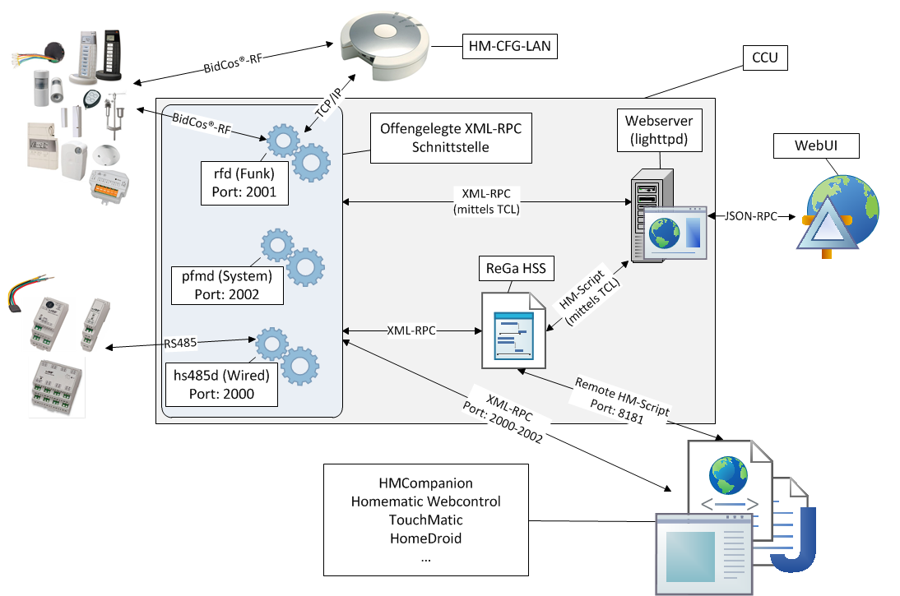
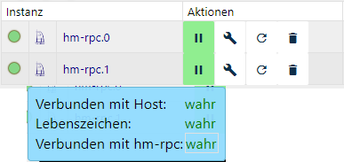

# ioBroker HomeMatic RPC-Adapter

Dieser Adapter verbindet HomeMatic-Schnittstellenprozesse (BidCos-Dienste, Homegear und CUxD) mit ioBroker. Die Kommunikation erfolgt über XML-RPC oder BIN-RPC.

**Dieser Adapter nutzt die Sentry-Bibliotheken, um Ausnahmen und Codefehler automatisch an die Entwickler zu melden.** Er meldet außerdem neue Geräteschemata. Weitere Details und Informationen zum Deaktivieren der Fehlerberichterstattung finden Sie in [der Sentry-Plugin-Dokumentation](https://github.com/ioBroker/plugin-sentry#plugin-sentry) , insbesondere im Kapitel [„Was ist Sentry.io?“](#what-is-sentryio) .

## Was ist Homematic?

> Homematic ist das Smart-Home-System von eQ-3. Es ermöglicht die umfassende Steuerung zahlreicher Funktionen in einem Haus oder einer Wohnung. Diese Funktionen lassen sich sowohl in einfachen als auch in komplexen Szenarien kombinieren.

> Das Produktsortiment umfasst Geräte zur Licht-, Rollladen- und Heizungssteuerung, Gefahrenmelder, Sicherheitssensoren und Wettermessgeräte. Dank Funkkommunikation lassen sich die Geräte problemlos in bestehende Gebäude integrieren. In Neubauten können kabelgebundene Buskomponenten zum Einsatz kommen.

Quelle: [Homepage des Herstellers eQ-3](https://www.eq-3.de/produkte/homematic.html)

## Homematic-Komponenten in ioBroker

Zur Verwaltung und Steuerung von Homematic-Komponenten mit ioBroker werden zwei Adapter benötigt:

### 1. Homematic ReGaHss

Dieser Adapter verbindet sich mit der Homematic-Logikschicht „ReGaHSS“ ( **Residential** **Gateway** ). Er synchronisiert die Gerätenamen, die Systemvariablen, die Räume, die Funktionen und die Programme zwischen Homematic und ioBroker.

### 2. Homematic RPC

RPC steht für **Remote** **Procedure** **Call** . Es handelt sich um eine Technik zur Kommunikation zwischen Prozessen. Dieser Adapter verbindet sich mit den Kommunikationsmodulen einer Homematic-Zentrale (CCU, CCU2, CCU3 und neuer). Folgende Module werden unterstützt:

- `rfd` für Funkgeräte
- `HMIP-rfd` für Homematic IP-Geräte
- `hs485d` für kabelgebundene Geräte
- `CUxD` für externe Komponenten wie EnOcean oder FS20 (CUxD ist eine zusätzliche Software für die CCU),
- `CCU-Jack` für die virtuellen Geräte von [CCU-Jack](https://github.com/mdzio/ccu-jack) (einem Add-on für die CCU),
- `Homegear` als Ersatz für eine CCU.

Dieses Diagramm zeigt die Struktur und die Kommunikationsschnittstellen:



Quelle: [wikimatic.de](http://www.wikimatic.de/wiki/Datei:Homematic_Aufbau.png)

## Funktionsweise des Adapters

Eine Instanz des Adapters ist für genau ein Kommunikationsmodul zuständig (`rfd`, `hs485d` usw.). Wenn Sie mehrere Module gleichzeitig verwenden möchten, müssen Sie für jedes Modul eine separate Instanz erstellen.

Der Adapter kommuniziert mit dem Modul entweder über BIN-RPC oder über XML-RPC. Die Kommunikation erfolgt über eine Ereignisschnittstelle, daher sind die korrekten Adressen wichtig. Die CCU sendet die Ereignisse automatisch an den Adapter; ein zyklisches Polling ist nicht erforderlich.

Darüber hinaus überprüft der Adapter in einem festgelegten Intervall die Verbindung zur CCU.

Wenn Sie neue Geräte an die CCU anlernen, müssen Sie die Option „Objekte (einmalig) synchronisieren“ aktivieren und den Adapter neu starten. Nur dann werden die Informationen über die neuen Homematic-Geräte an den Adapter übertragen.

## Konfiguration

### Haupteinstellungen

#### HomeMatic-Adresse

Die IP-Adresse der CCU oder des Hosts, auf dem der BidCos-Dienst ausgeführt wird.

#### HomeMatic-Port

Der Port hängt vom ausgewählten Kommunikationsmodul ab. Der Adapter wählt den Port automatisch aus, sobald Sie den Daemon auswählen. Ändern Sie den Port nur, wenn Ihre Ports von den Standardports abweichen.

Folgende Ports werden standardmäßig verwendet:

| Dämon            | Kommunikationsmodul            | Standardanschluss                         | HTTPS-Port             |
| ---------------- | ------------------------------ | ----------------------------------------- | ---------------------- |
| HomeMatic IP     | HMIP-rfd                       | 2010                                      | 42010                  |
| rfd              | rfd (Funkgeräte)               | 2001                                      | 42001                  |
| Virtuelle Geräte | virtuelle Geräte               | 9292                                      | 49292                  |
| hs485d           | hs485d (kabelgebundene Geräte) | 2000                                      | 42000                  |
| CUxD             | CUxD                           | 8701                                      | wird nicht unterstützt |
| Heimausrüstung   | Heimausrüstung                 | wie in Homegear konfiguriert              | wird nicht unterstützt |
| CCU-Jack         | CCU-Jack                       | 2121                                      | 2122                   |
| openccu-lite     | Lite-RPC des Systems           | 80 (siehe [openccu-lite](#openccu-lite) ) | 443                    |

Die HTTPS-Ports funktionieren nur mit dem XML-RPC-Protokoll.

#### Adapteradresse

Die IP-Adresse des Hosts, auf dem der Adapter läuft. Die CCU verwendet diese Adresse, um sich mit dem Adapter zu verbinden; daher muss die CCU diese Adresse erreichen können. Die Einträge „0.0.0.0 Lauscht auf allen IPs“ und „127.0.0.1“ sind nur für Sonderfälle vorgesehen, da die CCU ioBroker unter diesen Adressen nicht erreichen kann.

#### Adapteranschluss

Der Port, an dem der Adapter auf die Verbindung der CCU wartet. Belassen Sie den Wert bei „0“, damit ioBroker automatisch einen freien Port auswählt. Ändern Sie diesen Wert nur in Ausnahmefällen.

#### Dämon

Eine CCU unterstützt verschiedene Gerätetypen (Funk, Kabel, Homematic IP, CUxD, CCU-Jack). Sie müssen für jeden Typ eine separate Instanz des Adapters erstellen. Der Daemon `openccu-lite` Verbindet eine Schnittstelle eines openccu-lite Systems, siehe [openccu-lite](#openccu-lite) .

#### Protokoll

Für die Kommunikation stehen zwei Protokolle zur Verfügung: XML-RPC und BIN-RPC. BIN-RPC ist schneller, wird aber von einigen Geräten nicht oder nur fehlerhaft unterstützt. Wählen Sie in diesem Fall das XML-RPC-Protokoll.

**Hinweis:** CUxD funktioniert nur mit BIN-RPC. Homematic IP, virtuelle Geräte und CCU-Jack funktionieren nur mit XML-RPC. Für diese Dienste verwendet der Adapter automatisch das passende Protokoll.

#### Objekte (einmalig) synchronisieren

Beim ersten Start liest die Instanz _alle_ Geräte von der CCU. Wenn Sie die Konfiguration später ändern (Geräte umbenennen, hinzufügen oder entfernen), aktivieren Sie diese Option, um die Konfiguration in ioBroker erneut zu synchronisieren.

Die Instanz startet sofort neu, liest alle Geräte erneut aus und deaktiviert diese Option anschließend selbst.

### Zusätzliche Einstellungen

#### Adapter-Rückrufadresse

ioBroker läuft manchmal hinter einem Router. In diesem Fall unterscheiden sich die eingehende und die ausgehende Adresse. Geben Sie hier die IP-Adresse des Routers ein. Der Router leitet den Datenverkehr über die Portnummer an ioBroker weiter.

Wenn ioBroker in einem Docker-Container ausgeführt wird, geben Sie hier die IP-Adresse des Docker-Hosts ein. Sie müssen außerdem den Adapterport (siehe „Adapterport“) an den Container weiterleiten. Sie können hierfür einen beliebigen freien Port wählen, beispielsweise 12001 oder 12010.

#### Kommunikationsintervall prüfen (in Sekunden)

Der Adapter sendet in diesem Intervall einen Ping an die CCU.

#### Wiederverbindungsintervall (in Sekunden)

Der Adapter wartet diese Zeit ab, bevor er den nächsten Verbindungsversuch startet.

#### Geräte nicht löschen

Standardmäßig entfernt der Adapter ein Gerät aus der Objektstruktur, wenn er es beim Start des Adapters nicht auf der CCU findet oder wenn die CCU das Gerät während des Betriebs des Adapters als gelöscht meldet. Aktivieren Sie diese Option, um solche Geräte beizubehalten, beispielsweise wenn Sie ein Gerät nur vorübergehend von der CCU entfernt haben.

Diese Option behebt auch ein Problem auf der CCU-Seite: Homematic IP-Geräte werden manchmal nicht korrekt an ioBroker übertragen, und die CCU meldet sie beispielsweise während eines Firmware-Updates als gelöscht, obwohl sie noch vorhanden sind. Ohne diese Option werden ihre Objekte gelöscht und erst nach einem Neustart des Adapters neu erstellt. Daher ist die Option automatisch aktiviert, sobald Sie Homematic IP als Daemon auswählen.

Wenn diese Option aktiviert ist, werden die Objekte eines Geräts, das Sie manuell aus der CCU entfernt haben, im Objektbaum gelöscht.

#### Zwischenstände der sich bewegenden Kanäle unterdrücken

Ein Dimmer oder eine Jalousie reagiert sofort auf einen Befehl, noch bevor die Bewegung abgeschlossen ist. Die CCU leitet diese Bestätigung zusammen mit dem Pegelstand in diesem Moment als Ereignis weiter. `WORKING = true` (Homöomatisch) oder `PROCESS = NOT_STABLE` (Homematic IP). Die letzte Stufe folgt einige Sekunden später mit der nächsten Statusmeldung (für BidCos-Dimmer nach `STATUSINFO_MINDELAY` +`STATUSINFO_RANDOM` (standardmäßig 2-3 s). Daher springt der Zustand, z. B. `0 → 100` (Befehl, `ack: false`) `→ 0.5` (Anerkennung) `→ 100` (Endwert).

Wenn diese Option aktiviert ist, `LEVEL` /`LEVEL_2` eines Kanals, der einen `WORKING` oder `PROCESS` Der Datenpunkt wird zurückgehalten, bis das Flag der entsprechenden Statusmeldung eintrifft (die CCU sendet es wenige Millisekunden nach dem Pegel, maximal werden 300 ms gewartet). Der Pegel wird verworfen, solange sich der Kanal noch bewegt; andernfalls wird er geschrieben. Der Zustand behält daher den vorgegebenen Wert bei, bis der endgültige Pegel eintrifft. `WORKING`, `PROCESS` Und `DIRECTION` Sie werden immer geschrieben, sodass die Bewegung selbst weiterhin erkannt werden kann. Kanäle ohne ein solches Flag sind davon nicht betroffen.

#### Verwenden Sie https

Wenn diese Option aktiviert ist, verwendet der Adapter HTTPS anstelle von HTTP. Dies funktioniert nur mit dem XML-RPC-Protokoll.

#### Benutzername und Passwort

Wenn die Option „https verwenden“ aktiviert ist, geben Sie hier den Benutzernamen und das Passwort eines CCU-Benutzers ein. Geben Sie diese Anmeldeinformationen auch ein, wenn die API der CCU eine Authentifizierung erfordert; der Adapter sendet sie per XML-RPC mit und ohne HTTPS. BIN-RPC unterstützt keine Authentifizierung.

### openccu-lite

[openccu-lite](https://github.com/openccu-lite/openccu-lite) ist eine CCU-Firmware ohne ReGaHSS. Ihre Schnittstellenprozesse werden über _Lite-RPC_ erreicht: Die Anfragen werden mit einem Token über den Webport des Systems gesendet, und die Ereignisse kommen als vom Adapter geöffneter Datenstrom an – ohne Callback-Server, Callback-Adresse oder Ähnliches. `init` Der Adapter kann also hinter einem Router oder in einem Docker-Container ohne Portweiterleitung betrieben werden.

Wählen Sie den Daemon **openccu-lite** aus und geben Sie die Systemadresse unter „HomeMatic-Adresse“ ein (der Port richtet sich nach der Option „https verwenden“: 443 oder 80). Anschließend:

- **Schnittstelle** : die Schnittstelle des Systems, mit dem diese Instanz verbunden ist (`HmIP-RF`, `BidCos-RF`, `BidCos-Wired`, `VirtualDevices` Wie bei einer CCU verbindet eine Instanz eine Schnittstelle; sobald die Instanz gekoppelt ist, zeigt die Liste die Schnittstellen an, auf denen das System läuft.
- **Koppeln** : Die Instanz muss ausgeführt werden. Klicken Sie auf die Schaltfläche: Darunter erscheint ein sechsstelliger Code zusammen mit einem Link zur Statusseite des Systems. Bestätigen Sie die Anfrage dort (als Systemadministrator mit Passwort oder Passkey) – der Code auf der Statusseite muss übereinstimmen. Token und Fingerabdruck des Systemzertifikats werden anschließend in der Instanzkonfiguration gespeichert. Speichern Sie die Konfiguration, und die Instanz wird mit diesen Daten neu gestartet. Abgelehnte oder abgelaufene Anfragen, falsche Adressen und Systeme ohne Koppelung werden im Dialogfeld gemeldet. Jede Instanz koppelt ein eigenes Token (ein System erlaubt mehrere Ereignisströme pro Token).
- **Token** und **Zertifikat-Fingerabdruck** werden durch die Kopplung ausgefüllt. Ein auf dem System erstelltes API-Token kann auch manuell eingegeben werden; der Fingerabdruck ordnet das Zertifikat des Systems zu (lassen Sie das Feld leer, wenn das Zertifikat von Node.js als vertrauenswürdig eingestuft wird oder das System über HTTP erreicht wird).
- **Namen, Räume und Funktionen aus dem System übernehmen** (standardmäßig aktiviert): Geräte, Kanäle und Zustände werden wie im System benannt (`<channel name>.<DATAPOINT>` für die Staaten (wie HM-REGA sie nennt), und die Räume und Funktionen des Systems füllen `enum.rooms` Und `enum.functions` - wird live aktualisiert, sobald sich ein Name oder ein Raum im System ändert. Die Raumstruktur wird vereinfacht: Jeder Knoten wird zu einer eigenen Aufzählung, benannt nach seinem Pfad (`eg/wohnzimmer` →`enum.rooms.eg_wohnzimmer` Ein Kanal ist nur Mitglied seines innersten Raums. Der Adapter verwaltet ausschließlich die Mitglieder seiner eigenen Instanz in einem Enum, sodass Geräte anderer Adapter erhalten bleiben. Ohne diese Option behalten die Objekte die Adresse als Namen, wie bei einer CCU.

Die Geräte werden bei jedem Start der Instanz synchronisiert (das System sendet seine Geräteliste mit dem Datenstrom), daher ist die Option „Objekte (einmalig) synchronisieren“ bei openccu-lite nicht erforderlich. „Geräte nicht löschen“ funktioniert wie bei einer CCU. Die vom System gespeicherten Werte werden beim Verbindungsaufbau der Instanz in die Zustände geschrieben, sodass diese vor dem ersten Ereignis aktuell sind. Die Einstellungen „Adapteradresse“, „Adapterport“, „Protokoll“, „Adapter-Callback-Adresse“, „Kommunikationsintervall prüfen“, „Wiederverbindungsintervall“, „Benutzername“ und „Passwort“ sind nicht relevant und ausgeblendet.

### Gerätemanager

Im Tab „Geräte-Manager“ werden alle Geräte dieser Instanz angezeigt. Sie können ein Gerät umbenennen, es direkt steuern sowie die installierte und die verfügbare Firmware-Version anzeigen.

## Instanzen



Die installierten Instanzen des Adapters werden im Bereich „ioBroker _-Instanzen_ “ aufgelistet. Der farbige Kreis auf der linken Seite zeigt an, ob die Instanz aktiviert und mit der CCU verbunden ist.

Wenn Sie den Mauszeiger über ein Symbol bewegen, erhalten Sie detaillierte Informationen.

## Objekte des Adapters

Der Bereich _„Objekte“_ zeigt alle Werte und Informationen an, die die CCU an den Adapter sendet. Die Werte werden in einer Baumstruktur dargestellt.

Welche Objekte und welche Werte angezeigt werden, hängt von den Geräten (Funktion und Kanälen) und der Struktur innerhalb der CCU ab.

Die zentrale Einheit verwendet die ID `BidCoS-RF` Alle virtuellen Schaltflächen werden unter dieser ID aufgelistet. Geräte werden anhand ihrer Seriennummer erstellt, und Gruppen erhalten den Namen. `INT000000x` Die

### Kanal 0 (alle Geräte)

Dieser Kanal wird für jedes Gerät erstellt. Er enthält folgende Funktionsdaten:

| Datenpunkt                                                  | Bedeutung                                                             |
| ----------------------------------------------------------- | --------------------------------------------------------------------- |
| AES-Schlüssel                                               | Verschlüsselung aktiviert oder deaktiviert                            |
| Konfiguration (Ausstehend / Alarm ausstehend)               | Konfiguration ausstehend                                              |
| Tastverhältnis / Tastverhältnisalarm                        | Übertragungszeit der Homematic-Geräte                                 |
| RSSI (Gerät / Gegenstelle)                                  | Signalstärke zwischen dem Gerät und der Zentraleinheit                |
| Niedriger Batteriestand / Alarm bei niedrigem Batteriestand | Niedriger Akkustand                                                   |
| Unerreichbarkeitsalarm                                      | Systemmeldung über einen Kommunikationsfehler (Fehler trat zuvor auf) |
| Unerreichbarkeitsalarm                                      | Systemmeldung über einen Kommunikationsfehler (aktueller Status)      |

### Kanäle 1 bis 6

Diese Kanäle enthalten Messwerte, Steuerdaten und Statusdaten. Die angezeigten Daten hängen von der Funktion des Geräts ab. Die folgende Tabelle zeigt einige Beispiele:

| Funktion                | Kanal | Mögliche Werte                                                                      |
| ----------------------- | ----- | ----------------------------------------------------------------------------------- |
| Sensoren                | 1     | Temperatur, Luftfeuchtigkeit, Füllstand, geöffneter oder geschlossener Zustand usw. |
| Heizungsthermostate     | 4     | Betriebsart, Solltemperatur, Isttemperatur, Ventilstellung usw.                     |
| Aktuatoren              | 1     | Pegel (Rollladen, Dimmer), Bewegungsrichtung (Rollladen) usw.                       |
| Geräte mit Messfunktion | 3     | Status                                                                              |
|                         | 6     | Verbrauchszähler, Spannung, Leistung und so weiter                                  |

## Benutzerdefinierte Befehle

Sie können benutzerdefinierte Befehle an den Adapter senden, beispielsweise um den MASTER-Bereich eines Geräts auszulesen und zu steuern. Im MASTER-Bereich können Sie unter anderem die wöchentlichen Heizprogramme konfigurieren.

Senden Sie zu diesem Zweck eine Nachricht an den Adapter. Die Nachricht enthält die Methode als ersten Parameter, gefolgt von einem Objekt. Dieses Objekt muss Folgendes enthalten: `ID` des Zielgeräts. Optional enthält es die `paramType`, wodurch beispielsweise der MASTER-Bereich ausgewählt wird. Senden Sie zusätzliche Parameter in der `params` Objekt.

**Beispiele:**

Schreibe alle Werte des MASTER-Bereichs eines Geräts in das Protokoll:

```javascript
sendTo('hm-rpc.0', 'getParamset', {ID: 'OEQ1861203', paramType: 'MASTER'}, res => {
    log(JSON.stringify(res));
});
```

Einem Attribut des MASTER-Bereichs einen bestimmten Wert zuweisen:

```javascript
sendTo('hm-rpc.0', 'putParamset', {ID: 'OEQ1861203', paramType: 'MASTER', params: {'ENDTIME_FRIDAY_1': 700}}, res => {
    log(JSON.stringify(res));
});
```

Alle Geräte auflisten:

```javascript
sendTo('hm-rpc.0', 'listDevices', {}, res => {
    log(JSON.stringify(res));
});
```

Legen Sie einen Wert fest, so wie es der Adapter tut. `stateChange`:

```javascript
sendTo('hm-rpc.1', 'setValue', {ID: '000453D77B9EDF:1', paramType: 'SET_POINT_TEMPERATURE', params: 15}, res => {
    log(JSON.stringify(res));
});
```

Lesen Sie den aktuellen Wert eines Datenpunkts aus dem Schnittstellenprozess der CCU (dasselbe wie `.State()` (in einem HomeMatic-Skript):

```javascript
sendTo('hm-rpc.1', 'getValue', {ID: '000453D77B9EDF:1', paramType: 'ACTUAL_TEMPERATURE'}, res => {
    if (!res.error) {
        log(`Temperature: ${res.result}`);
    } else {
        log(res.error);
    }
});
```

Der Schnittstellenprozess gibt seinen zwischengespeicherten Wert zurück und fordert keinen neuen Wert vom Gerät an. Der Adapter empfängt bereits jede Änderung dieses Werts als Ereignis, sodass der Status in ioBroker normalerweise unverändert bleibt. Wie oft ein Gerät einen Wert meldet (z. B. die Leistung eines Schaltaktuators mit Leistungsmessung), wird im MASTER-Bereich seines Kanals festgelegt.

Lesen Sie die `paramsetDescription` eines Kanals eines Geräts:

```javascript
sendTo('hm-rpc.1', 'getParamsetDescription', {ID: '000453D77B9EDF:1', paramType: 'VALUES'}, res => {
    log(JSON.stringify(res));
});
```

Lesen Sie die Firmware-Informationen eines Geräts. In diesem Beispiel wird der Firmware-Status in das Protokoll geschrieben:

```javascript
sendTo('hm-rpc.1', 'getDeviceDescription', {ID: '0000S8179E3DBE', paramType: 'FIRMWARE'}, res => {
    if (!res.error) {
        log(`FW status: ${res.result.FIRMWARE_UPDATE_STATE}`)
    } else {
        log(res.error)
    }
});
```

## Weitere Informationen

### Firmware-Aktualisierungsstatus

Bei Geräten, deren Beschreibung den Firmware-Update-Status (Homematic IP) enthält, erstellt der Adapter den Zustand `<device>.0.FIRMWARE_UPDATE_STATE` Die Aktualisierung erfolgt immer dann, wenn die CCU eine Änderung des Firmware-Update-Status meldet, und bei jedem Start des Adapters. Mögliche Werte sind beispielsweise: `UP_TO_DATE`, `NEW_FIRMWARE_AVAILABLE`, `DELIVER_FIRMWARE_IMAGE` (Die Firmware wird übertragen), `READY_FOR_UPDATE` (Die Übertragung ist abgeschlossen, das Update kann gestartet werden), `DO_UPDATE_PENDING` (Das Update muss auf dem Gerät gestartet werden) und `PERFORMING_UPDATE` Die

```javascript
on({id: /^hm-rpc\.1\..*\.0\.FIRMWARE_UPDATE_STATE$/, val: 'READY_FOR_UPDATE'}, obj => {
    log(`Firmware of ${obj.id.split('.')[2]} is transferred`);
});
```

### Dummy-Programm für die Schaltflächenzustände

Bei Verwendung von HomeMatic-Schaltern oder HomeMatic-Fernbedienungen bestätigt die CCU die Tastenzustände nur, wenn ein Dummy-Programm auf der CCU ausgeführt wird. Dieses Programm muss den Zustand des jeweiligen Schalters oder der zugehörigen Fernbedienung verwenden. Ohne ein solches Programm erhält ioBroker keine Tastenzustände.

Sie können ein einziges Dummy-Programm für mehrere Schaltflächen verwenden. Fügen Sie alle Schaltflächenzustände in die if-Anweisung ein und verknüpfen Sie diese mit dem Operator „oder“ oder „und“. Die then-Anweisung des Programms kann leer bleiben. Anschließend wird der Zustand in ioBroker bei jedem Tastendruck aktualisiert.

## Was ist Sentry.io?

Sentry.io ist ein Dienst für Entwickler. Er bietet einen Überblick über die Fehler ihrer Anwendungen. Genau dies wird in diesem Adapter implementiert.

Wenn der Adapter abstürzt oder ein anderer Codefehler auftritt, wird die Fehlermeldung an Sentry gesendet. Dieselbe Meldung erscheint auch im ioBroker-Protokoll. Wenn Sie der ioBroker GmbH die Erlaubnis erteilt haben, Diagnosedaten zu erfassen, wird auch Ihre Installations-ID übermittelt. Diese Installations-ID ist lediglich eine eindeutige Kennung **ohne** weitere Informationen über Sie, wie Ihre E-Mail-Adresse oder Ihren Namen. Sie ermöglicht es Sentry, die Fehler zu gruppieren und anzuzeigen, wie viele Benutzer von einem Fehler betroffen sind. All dies hilft dem Entwickler, fehlerfreie und im Grunde absturzsichere Adapter bereitzustellen.

## Entwicklung

Um alle Geräteabbilder zu aktualisieren, führen Sie folgenden Befehl aus:

```bash
npm run update-images
```

## Changelog
### 4.3.1 (2026-11-21)
- (@hobbyquaker) openccu-lite: a device paired later no longer deletes the objects of the other devices of the instance; objects of devices removed on the system are cleaned up when the instance connects, without leaving broken objects behind ("obj.type has to exist")

### 4.3.0 (2026-11-18)
- (copilot) Adapter requires node.js >= 22.19.0 now
- (@hobbyquaker) New daemon `openccu-lite`: connects an interface of an [openccu-lite](https://github.com/openccu-lite/openccu-lite) system through its lite-rpc (requests with a token, events as a stream - no callback server). The pairing runs from the instance settings: press "Pair", approve the six-digit code on the Status page of the system, the token and the certificate fingerprint are stored by themselves. The names of the devices, channels and states, the rooms and functions come from the system's metadata and follow its changes live
- (@gcaruso73) New option "Suppress interim levels of moving channels": the LEVEL of the acknowledgement of a dimmer or blind (`WORKING = true` / `PROCESS = NOT_STABLE`) is not written, so the state no longer jumps to the start value of the ramp before the final value arrives
<!--
	Placeholder for the next version (at the beginning of the line):
	### **WORK IN PROGRESS**
-->

### 4.2.4 (2026-10-22)
* (@GermanBluefox) Do not re-register every 5 minutes if events with an outdated interface id keep arriving (#1542)

### 4.2.3 (2026-10-19)
* (@GermanBluefox) After an unclean stop, the CCU kept sending the events with the old interface ID and they were discarded silently. The adapter now removes an old registration before it registers, and registers again with a warning if events with an old ID of this instance arrive (#1542)

### 4.2.2 (2026-10-13)
* (@GermanBluefox) The virtual devices of CCU-Jack can be connected with the new daemon `CCU-Jack` (port 2121, HTTPS 2122, XML-RPC only) (#1003)
* (@GermanBluefox) The state `updated` (new devices for hm-rega) is no longer marked as writable, as expected for the role `indicator`
* (@GermanBluefox) Homebrew devices (AskSin++) of the add-ons from jp112sdl (JP-HB-Devices-addon) and TomMajor (HB-TM-Devices-AddOn) get the same icon as in the CCU WebUI (#903)

### Older changelog
[here](/#/docs/adapterref/iobroker.hm-rpc/OLD_CHANGELOG.md)

## License

The MIT License (MIT)

Copyright (c) 2014-2026 bluefox <dogafox@gmail.com>  
Copyright (c) 2014 hobbyquaker <hq@ccu.io>

Permission is hereby granted, free of charge, to any person obtaining a copy
of this software and associated documentation files (the "Software"), to deal
in the Software without restriction, including without limitation the rights
to use, copy, modify, merge, publish, distribute, sublicense, and/or sell
copies of the Software, and to permit persons to whom the Software is
furnished to do so, subject to the following conditions:

The above copyright notice and this permission notice shall be included in
all copies or substantial portions of the Software.

THE SOFTWARE IS PROVIDED "AS IS", WITHOUT WARRANTY OF ANY KIND, EXPRESS OR
IMPLIED, INCLUDING BUT NOT LIMITED TO THE WARRANTIES OF MERCHANTABILITY,
FITNESS FOR A PARTICULAR PURPOSE AND NONINFRINGEMENT. IN NO EVENT SHALL THE
AUTHORS OR COPYRIGHT HOLDERS BE LIABLE FOR ANY CLAIM, DAMAGES OR OTHER
LIABILITY, WHETHER IN AN ACTION OF CONTRACT, TORT OR OTHERWISE, ARISING FROM,
OUT OF OR IN CONNECTION WITH THE SOFTWARE OR THE USE OR OTHER DEALINGS IN
THE SOFTWARE.