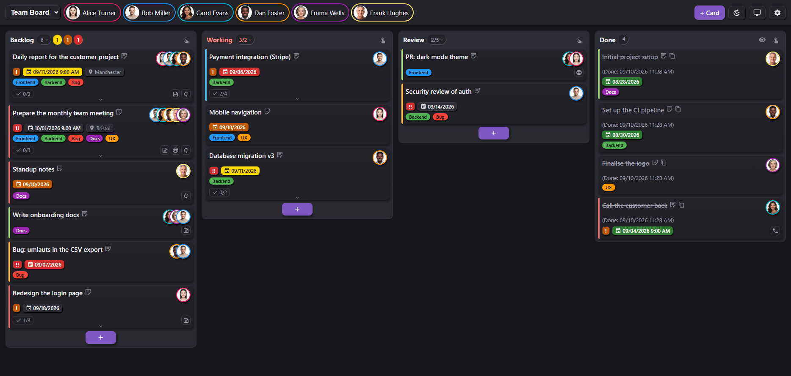

# IoBroker Kanban: Dokumentation (Englisch)
Ein **Kanban-Board als dedizierter ioBroker-Adapter**. Es verfügt über einen eigenen Webserver, stellt eine Single-Page-Anwendung ohne Framework (reines JavaScript) bereit und synchronisiert alle geöffneten Ansichten über einen WebSocket. Karten lassen sich per Drag & Drop verschieben, Boards und Spalten sind frei konfigurierbar, Aufgaben können wiederkehrend sein und Benachrichtigungen werden per E-Mail versendet, auf Wunsch auch mit Kalendereinladung. Alles ist von extern über REST, Webhooks und `sendTo` erreichbar.

**Für wen ist es geeignet?** Haushalte, die gemeinsam Aufgaben verwalten - sei es eine Familie, eine Wohngemeinschaft oder die Instandhaltung eines Hauses - und diese Aufgaben dort abwickeln möchten, wo ioBroker bereits läuft. Jedes Ereignis wird in einem Zustand gespeichert, der von Skripten und Node-RED gelesen werden kann, und das Board wird als Webseitenkarte in Lovelace eingebettet.



---

## Inhalt
- **[Installation & erste Schritte](#installation--first-steps)**
- **[Teil A: Instanzeinstellungen (ioBroker-Admin)](#part-a-instance-settings-iobroker-admin)**
- [Registerkarte "Allgemein"](#tab-general)
- [Registerkarte "Benutzer"](#tab-users)
- [Registerkarte "Benachrichtigungen"](#tab-notifications)
- [Registerkarte "Webhooks (Eingang)"](#tab-webhooks-in)
- [Tab "Webhooks (out)"](#tab-webhooks-out)
- **[Teil B: Das Board (Web-UI)](#part-b-the-board-web-ui)**
- [Header bar](#header-bar)
- [Boards, Spalten & Beschriftungen](#boards-columns--labels)
- [Anzahl in der Spaltenüberschrift](#counts-in-the-column-header)
- [Müll](#Müll)
- [Erledigte Karten in den Papierkorb verschieben](#cleanup)
- [Karten: alle Felder](#cards-all-fields)
- [Kartenvorlagen](#card-templates)
- [Sortierung & Reihenfolge](#sorting--order)
- [Wiederholung](#Wiederholung)
- [Feiertage](#public-holidays)
- [Benutzer im Board](#users-in-the-board)
- [Mobile Ansicht](#mobile-view)
- [Sharing Views / URL-Parameter](#sharing-views--url-parameters)
- **[Teil C: Integration & Automatisierung](#part-c-integration--automation)**
- [REST-API](#rest-api)
- [Webhooks: inbound](#webhooks-inbound)
- [Webhooks: ausgehend](#webhooks-outbound)
- [sendTo & Aktionsstatus](#sendto--action-state)
- [Live-Synchronisierung & Deep Links](#live-sync--deep-links)
- [ioBroker-Zustände & Objekte](#iobroker-states--objects)
- **[Teil D: Referenz](#part-d-reference)**
- [Sicherheit & Zugriffskontrolle](#security--access-control)
- [Sprache / Internationalisierung](#language--internationalization)
- [FAQ & Fallstricke](#faq--pitfalls)

---

## Installation & erste Schritte
1. **Installieren Sie den Adapter.** Filtern Sie in der ioBroker-Administration unter *Adapters* nach `kanban` und installieren Sie ihn (für eine GitHub-Installation siehe [Installation in der Haupt-README](/#/adapters/kanban#installation)).
2. **Erstellen Sie eine Instanz.** Öffnen Sie das **⋮**-Menü auf der Adapterkachel und wählen Sie **"+"**. ioBroker erstellt die Instanz (`kanban.0`) und zeigt ein Konsolenfenster an, das nach dem Beenden des Prozesses mit Code 0 geschlossen werden kann. Wiederholen Sie dies für jede weitere Instanz (`kanban.1`, `kanban.2`, ...).
3. **Port festlegen.** Öffnen Sie unter *Instanzen* das Zahnradsymbol der Instanz, Registerkarte **Allgemein**: Passen Sie **Port** (Standard: 8095), **IP-Bindung** (Standard: 0.0.0.0) und **Basis-URL** an.

**Bei mehreren Instanzen:** Jede Instanz benötigt einen eigenen Port. Ist der konfigurierte Port belegt, startet der Adapter trotzdem und verwendet den nächsten freien Port. Die Instanzliste zeigt jedoch weiterhin den *konfigurierten* Port an, und der dortige Link führt zur falschen Instanz. Der tatsächlich verwendete Port befindet sich im Protokoll: `Port 8095 is in use - falling back to free port 8096. The instance list still shows the configured port; enter the free port there to keep both in sync.`. Tragen Sie diesen Port anschließend in den Einstellungen ein.

4. **Benutzer hinzufügen.** Registerkarte **Benutzer**: Eine neue Instanz enthält **keine** Benutzer. Geben Sie mindestens eine Person ein, da jede Karte einen Bearbeiter benötigt. Beachten Sie die ID: Sie kann nach der ersten Einrichtung nicht mehr geändert werden, der Anzeigename hingegen jederzeit. Die Registerkarte „Benutzer“ erklärt den Grund dafür.
5. **Öffnen Sie die Web-Oberfläche:** ** `http://<Host>:<Port>/` **
6. Beim ersten Start ist noch kein Board vorhanden. Verwenden Sie das **Zahnradsymbol**  oben rechts, um eines zu erstellen. Jedes neue Board enthält standardmäßig drei Spalten:
   - **Zu erledigen** („todo“)
- **In Bearbeitung** (`doing`)
- **Erledigt** (`done`, als Spalte "Erledigt" gekennzeichnet)
7. Erstellen Sie die erste Aufgabe mit **"+ Karte"**.

**Mehrere Instanzen:** Jede Instanz (`kanban.0`, `kanban.1`, ...) ist ein vollständig unabhängiges System mit eigenem Port, eigener Sprache, eigenen Benutzern und eigenen Boards. **Es werden keine Daten geteilt.** Nützlich z. B. für getrennte Bereiche (Familie vs. Verein) oder ein Testsystem neben dem Produktivsystem.

**Wie diese Dokumentation aufgebaut ist:** [Teil A](#part-a-instance-settings-iobroker-admin) umfasst alle Konfigurationen in der **ioBroker-Administration** unter *Instanzen → `kanban.0` → Zahnrad* (Port, Sprache, Benutzerliste, E-Mail, Webhook-Token). Teil B](#part-b-the-board-web-ui) beschreibt die **Web-UI** des Boards selbst (Boards, Spalten, Karten, Ansichten). Teil C](#part-c-integration--automation) richtet sich an Skripte und Drittsysteme.](#part-d-reference) enthält die Abschnitte Sicherheit, Sprachen und die FAQ.

---

## Teil A: Instanzeinstellungen (ioBroker-Admin)
Diese Einstellungen befinden sich in der **ioBroker-Administration** unter *Instanzen → `kanban.0` → Zahnrad*. Sie gelten für die **gesamte Instanz** und werden erst nach dem **Speichern** wirksam; der Adapter wird dabei neu gestartet. Die folgenden Abschnitte entsprechen den fünf Registerkarten der Konfigurationsseite.

In diesem Dokument steht `kanban.0` für die **lokale** Instanz. Bei einer zweiten Instanz lauten alle Pfade und Zustände entsprechend `kanban.1`, `kanban.2` usw.

### Registerkarte "Allgemein"


| Schauplatz | Bedeutung |
|---|---|
| **Port** | Webserver-Port (Standard: `8095`). Ist dieser bereits belegt, verwendet der Adapter einen freien Port, die Instanzliste zeigt jedoch weiterhin den konfigurierten Port an. Wie Sie dies erkennen und beheben, erfahren Sie in [Installation, Schritt 3](#installation--first-steps). |
| **IP-Adresse** | Bindungsadresse (Standard `0.0.0.0` = alle Schnittstellen). |
| **Standarddesign** | `auto` (System), `light` oder `dark`. |
| **Akzentfarbe** | Farbe der Bedienelemente (Standard `#7E57C2`). |
| **Sprache** | Benutzeroberflächensprache. Elf Sprachen stehen zur Verfügung, aufgelistet unter [Sprache / Internationalisierung](#language--internationalization). Leer/automatisch = ioBroker-Systemsprache. Kann pro URL mit `?lang=xx` überschrieben werden. |
| **Datumsformat** | Anzeigeformat des Fälligkeitsdatums. Das Feld ist **standardmäßig leer** und verwendet dann das **ioBroker-Systemformat**. Tokens siehe Tabelle unten; `DD.MM.` ist ein mögliches Muster. Beim Start prüft der Adapter, ob das Format überhaupt einen Tag, Monat oder ein Jahr enthält. Ungültige Eingaben werden verworfen (mit dem Grund im Protokoll) und die Anzeige verwendet das Systemformat. |
| **Zeitformat** | `24 hours (14:00)` oder `12 hours (2:00 PM)`. Gilt für die optionale Tageszeit auf Karten. |
| **Benutzerdefiniertes CSS** | Wird als `/api/custom.css` für individuelle Anpassungen verwendet. |
| **Benutzerdefiniertes CSS** | Wird als `/api/custom.css` bereitgestellt, um individuelle Anpassungen zu ermöglichen. |

#### Datumsformat-Tokens
Es gilt die übliche Notation moment/Day.js (Groß-/Kleinschreibung beachten):

| Token | Bedeutung | Beispiel (20. Juli 2026) |
|---|---|---|
| `D` / `DD` | Tag ohne / mit führender Null | `5` / `05` |
| `MMM` / `MMMM` | Monatsname kurz / lang | `Jul` / `July` |
| `YY` / `YYYY` | Jahr zwei- / vierstellig | `26` / `2026` |
| `ddd` / `dddd` | Wochentags kurz / ganz | `Mon` / `Monday` |
| `ddd` / `dddd` | Wochentags kurz / lang | `Mo` / `Montag` |

Monats- und Wochentagsnamen werden in der Sprache des Boards dargestellt. Beispiele: `DD.MM.` → `20.07.` · `DD MMMM YYYY` → `20 July 2026` · `dddd, DD MMM` → `Monday, 20 Jul` · `MM/DD/YYYY` → `07/20/2026`.

Hinweis: ioBroker selbst verwendet `OO`/`O` für Monatsnamen. Diese werden hier **nicht** unterstützt. Eine aus dem Systemformat kopierte Zeichenkette, die `OO` enthält, muss in `MMMM` umgeschrieben werden.

### Registerkarte "Benutzer"
Hier werden die Benutzer angelegt. Die Liste gilt für die gesamte Instanz. Im Board werden sie als Chips in der Kopfzeile angezeigt und können Karten zugewiesen werden.


| Feld | Bedeutung |
|---|---|
| **ID** (`name`) | Interne ID, Kleinbuchstaben, keine Sonderzeichen (z. B. `bjoern`). Wird in URL-Parametern und Zuweisungen verwendet. |
| **E-Mail** (`email`) | Optional. Zieladresse für E-Mail-Benachrichtigungen. |
| **Benachrichtigen...** | Neun benutzerspezifische Kontrollkästchen zur Steuerung von Benachrichtigungen, siehe [Registerkarte „Benachrichtigungen“](#tab-notifications). |
| **Benachrichtigen...** | Neun benutzerspezifische Kontrollkästchen zur Steuerung von Benachrichtigungen, siehe [Registerkarte „Benachrichtigungen“](#tab-notifications). |

Fügen Sie eine Zeile mit dem **"+"** in der Tabellenüberschrift hinzu. Das Papierkorbsymbol am Ende einer Zeile entfernt diese wieder (ohne Rückfrage). Mit den beiden Pfeilen daneben verschieben Sie eine Zeile nach oben oder unten. Die Reihenfolge in der Tabelle entspricht der Reihenfolge, in der die Personen im Board angezeigt werden. Zeilen ohne ID werden beim Speichern gelöscht. Eine neue Instanz enthält **keine** Benutzer. Bis der erste Benutzer hinzugefügt wurde, ist die Schaltfläche "+ Karte" im Board deaktiviert und wird entsprechend angezeigt.

**Die ID kann nach ihrer Erstellung nicht mehr geändert werden.** Boards und Karten werden über sie ihren Nutzern zugeordnet, und auch die Avatarbilder und Adressen geteilter Ansichten sind daran gebunden. Eine spätere Änderung würde all diese Zuordnungen zunichtemachen, und der Adapter könnte die Daten anschließend nicht einmal bereinigen: Eine Umbenennung lässt sich nicht von einer Löschung und Neuanlage unterscheiden. Daher legt der Adapter die ID fest, sobald der Benutzer einmal gespeichert wurde. Dazu schreibt er beim nächsten Start einen Marker in die Instanzkonfiguration und startet währenddessen einmalig neu - einmal pro neuem Benutzer, danach nie wieder.

**Wenn das Feld gesperrt wird:** Dies geschieht erst, wenn etwas an die ID gebunden ist, d. h. eine Karte ihr zugewiesen ist oder sie ein Avatarbild enthält. Bis dahin kann sie frei geändert werden; eine ID, auf die nichts verweist, kann bedenkenlos umbenannt werden. Eine neu eingerichtete Instanz mit Benutzern, aber ohne Karten, schreibt ihre Konfiguration daher nie zurück und startet sich nie neu.

> > **Wenn das Feld weiterhin bearbeitbar bleibt:** Das Speichern der Instanzeinstellungen genau in dem Moment, in dem der Adapter die Markierung zurückschreibt, überschreibt diese erneut mit dem Inhalt des Formulars. Der Adapter versucht es bis zu dreimal erneut. Danach protokolliert er „Benutzer-ID(s) konnten nicht gesperrt werden“ und die Felder bleiben bearbeitbar. Dieser Zustand wird jedoch erst **nach einem vollständigen Neuladen der Admin-Seite** angezeigt: Auf der geöffneten Seite bleibt das Feld bearbeitbar, selbst wenn der Adapter es bereits vor langer Zeit gesperrt hat. Das Protokoll ist die zuverlässigere Quelle; es zeigt entweder „Benutzer-ID(s) ... sind jetzt fixiert“ oder die Warnung an. Im Fehlerfall starten Sie die Instanz einmal neu und überprüfen Sie, ob die Felder gesperrt sind, **bevor** Sie Karten erstellen.

> > Der **Anzeigename** bleibt frei bearbeitbar. „Tom Reich“ wird zu „Tommy Reich“, ohne dass dies von einer einzigen Karte bemerkt wird.

> > *Empfehlung:* Überlegen Sie sich die Benutzer-ID von Anfang an gut. Kleinbuchstaben, keine Umlaute und ausreichend lesbar für eine gemeinsame Adresse (`?users=bjoern`).

> <a id="renaming-a-user"></a> > **Wenn Karten auf nichts verweisen**, meldet der Adapter dies beim Start im Protokoll und im Status `info.orphanedAssignees`. Das Zahnradsymbol  in der Board-Kopfzeile erhält einen kleinen Punkt. Dies geschieht, wenn ein Benutzer gelöscht und neu erstellt wurde oder wenn eine Karte mit einer fremden ID über die API eingegangen ist.

> Die Reparatur befindet sich unter **Einstellungen → Benutzer → Verwaiste Zuweisungen**. Dieser Abschnitt ist nur vorhanden, solange etwas repariert werden muss. Ist alles in Ordnung, werden auf der Registerkarte nur die Benutzeravatare angezeigt. Jede verwaiste ID erhält eine Zeile mit ihrem Bereich und den betroffenen Boards. Die Kartenanzahl wird in die Kartenliste erweitert, sodass nichts unbemerkt verschoben wird. Daneben befindet sich ein Dropdown-Menü mit den vorhandenen Personen und einer Schaltfläche, die eine Bestätigung erfordert. Der Papierkorb bleibt unberührt: Was gelöscht werden soll, muss niemandem gehören.

> > Dasselbe funktioniert über die Benutzeroberfläche: > > ```bash > curl -X POST "http://<host>:8095/webhook/<TOKEN>/action" -H 'Content-Type: application/json' -d '{"cmd":"reassignUser","from":"bjoern_old","to":"bjoern"}' > ``` > > Dadurch werden die Bearbeiter jeder Karte, die Mitgliederlisten der Boards **und** das Avatarbild übernommen. Das Bild wird nur übernommen, wenn die Zielperson noch keins hat. Wenn die neue ID bereits auf einer Karte vorhanden war, wird kein doppelter Eintrag erstellt. Die Ziel-ID muss in den Instanzeinstellungen vorhanden sein, andernfalls schlägt der Aufruf mit `400` fehl.

### Registerkarte „Benachrichtigungen“
Benachrichtigungen werden bei Kartenereignissen ausgelöst und per **E-Mail** (über den ioBroker-Adapter `email`) und/oder **ausgehenden Webhooks** zugestellt. Zusätzlich wird jedes Ereignis im Status `kanban.0.lastEvent` (als Skript-Trigger) gespeichert.


| Schauplatz | Bedeutung |
|---|---|
| **E-Mail-Adapterinstanz** | Welche `email.x`-Instanz wird zum Senden verwendet? |
| **Erinnerungszeit** | `HH:MM`, wenn fällige Karten überprüft werden (Standard `08:00`). |
| **Erinnerung X Tage vor Fälligkeit** | Vorlaufzeit für `cardDue`-Erinnerungen (`0` bis `30`, Standard `1`). |
| **„Fälligkeitserinnerung“ zum festgelegten Zeitpunkt auslösen** | **Standardmäßig deaktiviert**. Zusätzlich zur täglichen Erinnerung wird bei Karten mit einem **Zeitpunkt** die Erinnerung `cardDue` genau zu diesem Zeitpunkt (`detail.exact = true`) ausgelöst, sodass Automatisierungen minutengenau erfolgen können, ohne die API abzufragen. **Hinweis:** Das Ereignis durchläuft den normalen Benachrichtigungspfad, sodass zusätzlich eine zweite „Fälligkeitserinnerung“-E-Mail an alle Empfänger gesendet wird, die diese Benachrichtigung aktiviert haben. Um ausschließlich Skripte und Webhooks auszuführen, sollte die „Fälligkeitserinnerung“-E-Mail-Benachrichtigung für den jeweiligen Benutzer deaktiviert werden. |
| **„Kartenfälligkeit“ zum festgelegten Zeitpunkt auslösen** | **Standardmäßig deaktiviert**. Zusätzlich zur täglichen Erinnerung lösen Karten mit einer **Uhrzeit** die Benachrichtigung `cardDue` genau zu diesem Zeitpunkt aus (`detail.exact = true`), sodass Automatisierungen minutengenau ausgelöst werden können, ohne die API abzufragen. **Hinweis:** Das Ereignis durchläuft den normalen Benachrichtigungspfad, sodass zusätzlich eine zweite E-Mail mit dem Betreff „Fällig“ an alle Benutzer gesendet wird, die diese Benachrichtigung aktiviert haben. Um ausschließlich Skripte und Webhooks auszuführen, sollte die E-Mail-Benachrichtigung „Fällig“ für den jeweiligen Benutzer deaktiviert werden. |
| **Standard** | Globale Fallback-Schalter pro Ereignis. Diese gelten, wenn ein Benutzer keine eigenen Benachrichtigungseinstellungen auf der Registerkarte „Benutzer“ hat (siehe unten). |

Ganz unten im Tab befindet sich der Block **„Andere Dienste (Telegram, Pushover, ...)“**. Er enthält keine Einstellungen, sondern lediglich den Hinweis, dass E-Mail der einzige integrierte Benachrichtigungsweg ist, sowie einen Link zu Beispielen für die Verbindung anderer Adapter, beispielsweise Telegram: [Benachrichtigungen an jeden Dienst](#other-services).

#### Wer wird benachrichtigt und wann?
Im Reiter **Benutzer"** verfügt jeder Benutzer über neun Kontrollkästchen. Diese legen fest, welche Ereignisse eine E-Mail für die jeweilige Person auslösen:

| Kontrollkästchen | Wann genau wird es ausgelöst? | Empfänger |
|---|---|---|
| **Zugewiesen** (`notifyAssigned`) | Sobald jemand als Bearbeiter festgelegt wird, bei der Kartenerstellung für jeden ersten Eintrag und bei späteren Hinzufügungen. Wird **einmal pro Person** ausgelöst. | **Nur die betreffende Person** |
| **geändert** (`notifyUpdated`) | Bei jeder Bearbeitung einer Karte (Titel, Datum, Etiketten, Checkliste ...). | Alle Karteninhaber |
| **verschoben** (`notifyMoved`) | Wenn in eine andere Spalte verschoben. | Alle Karteninhaber |
| **Erledigt** (`notifyDone`) | **Zusätzlich** zu „Verschoben“, wenn die Zielspalte als *Erledigt* gekennzeichnet ist. | Alle Bearbeiter der Karte |
| **Erstellt** (`notifyCreated`) | **Einmal**, wenn eine Karte erstellt wird; ebenso, wenn sie von einem anderen Spielbrett kopiert wird und wenn eine Wiederholung die nächste Karte erzeugt. | **Alle Mitglieder des Spielbretts**, unabhängig davon, wem sie zugewiesen ist. |
| **Papierkorb** (`notifyDeleted`) | Wenn eine Karte in den **Papierkorb** verschoben wird, egal ob manuell oder automatisch gelöscht. Standard: Aus. | Alle Bearbeiter der Karte |
| **Wiederhergestellt** (`notifyRestored`) | Wenn eine Karte aus dem Papierkorb **wiederhergestellt** wird. Standard: Aus. | Alle Karteninhaber |
| **gelöscht** (`notifyPurged`) | Wenn eine Karte **endgültig** entfernt wird, entweder nach 30 Tagen im Papierkorb oder manuell. Standard: Aus. | Alle Karteninhaber |
| **gelöscht** (`notifyPurged`) | Wenn eine Karte **endgültig** entfernt wird, entweder nach 30 Tagen im Papierkorb oder manuell. Standard: deaktiviert. | Alle Karteninhaber |

Der wesentliche Unterschied zwischen **zugewiesen** und **erstellt**: „Zugewiesen“ ist die **persönliche** Nachricht an den/die Bearbeiter/in und wird nur an diese Person gesendet. „Erstellt“ ist die **Statusmeldung** an das gesamte Team, an jedes Mitglied des Boards, auch wenn die Karte jemand anderem gehört.

**Achtung, Ereignisse überschneiden sich.** Manche Aktionen lösen mehrere Ereignisse gleichzeitig aus. Jeder, der beide Kontrollkästchen aktiviert hat, erhält **mehrere E-Mails**, es findet keine Bündelung statt.

| Aktion | Ereignisse ausgelöst |
|---|---|
| Karte **mit** Bearbeitern erstellen | **erstellt** + **zugewiesen** |
| Karte bearbeiten und jemanden hinzufügen | **geändert** + **zugewiesen** |
| Ziehen Sie eine Karte in die Spalte "Erledigt" | **verschoben** + **erledigt** |
| Die Spalte im Karteneditor in eine „Erledigt“-Spalte umwandeln | **geändert** + **verschoben** + **erledigt** |
| Spalte im Karteneditor in eine offene Spalte umwandeln | **geändert** + **verschoben** |

Für die meisten Setups reicht daher **„zugewiesen“** allein aus. **„erstellt“** ist dann sinnvoll, wenn auch von *anderen* erstellten Karten eine Rolle spielen, und zwar mit einer gemeinsamen Zuweisung.

**Fallback:** Wenn ein Benutzer für ein Ereignis keine Einstellungen vorgenommen hat, gilt der **globale Standardwert** (Registerkarte „Benachrichtigungen“, Abschnitt „Standard“). Dadurch erhalten bestehende Benutzer weiterhin Benachrichtigungen, ohne alles individuell konfigurieren zu müssen.

**Kein Selbst-Spam:** Wer eine Änderung auslöst, wird über diese Änderung selbst nicht benachrichtigt.

**Voraussetzung:** Nur Benutzer, **die eine E-Mail-Adresse hinterlegt haben**, erhalten E-Mails; alle anderen werden übersprungen.

**Auch der Weg zählt.** Das Verschieben einer Karte per Drag & Drop löst ein Verschiebungsereignis aus. Auch das Wechseln derselben Spalte im **Karteneditor** zählt als Änderung der Karte, daher steht **geändert** an erster Stelle. Bei allen aktivierten Kontrollkästchen erzeugt eine Geste drei Meldungen.

**Papierkorb-Ereignisse:** „In den Papierkorb verschoben“, „Wiederhergestellt“ und „Endgültig gelöscht“ haben jeweils eigene Kontrollkästchen, die standardmäßig deaktiviert sind. Ein **automatischer Bereinigungslauf** versendet nicht für jede Karte eine separate E-Mail, sondern **eine zusammenfassende E-Mail pro Benutzer**, in der alle betroffenen Karten aufgelistet sind. Das manuelle Löschen einer einzelnen Karte führt weiterhin zum Versand einer separaten E-Mail. Die Schaltfläche mit dem **Besensymbol**  leert den gesamten Papierkorb auf einmal und versendet daher ebenfalls eine zusammenfassende E-Mail anstelle einer separaten Nachricht pro Karte.

#### Kalendereinladung (.ics)
Wenn die Option „Kalendereinladung“ auf einer Karte aktiviert und ein Datum festgelegt ist, fügt der Adapter der Benachrichtigungs-E-Mail ein `termin.ics` hinzu:

- **Ohne Zeitvorgabe** → ganztägige Veranstaltung am Fälligkeitstag.
- **Mit Zeit** → Zeitgesteuertes Ereignis mit der auf der Karte festgelegten **Dauer** (`calendarDuration`, Standardwert eine Stunde).
**Bei Wiederholungen** wird eine **Serie** anstelle eines einzelnen Ereignisses erstellt: Die Einladung enthält eine `RRULE`, sodass der Kalender die gesamte Serie erstellt. Täglich, alle X Tage, wöchentlich (mit Wochentagen), monatlich (Tag des Monats), monatlich (n-ter/letzter Wochentag) und jährlich werden zugeordnet. **Ausnahme:** „Werktag des Monats“ hängt von Feiertagen ab, die der Kalenderstandard nicht kennt. Daher bleiben diese Karten einzelne Ereignisse.
Die Einladung wird nur einmal versendet. Sie wird automatisch angehängt, wenn die Karte erstellt oder jemandem neu zugewiesen wird. Folgekarten einer Wiederholung versenden keine weitere Einladung (die Serie ist bereits im Kalender vorhanden), und auch Erinnerungs- oder Verschiebungs-E-Mails enthalten keine Einladung. Eine aktualisierte Einladung wird nur versendet, wenn sich Fälligkeitsdatum, Uhrzeit, Dauer oder Wiederholungsregel ändern. Diese Einladung hat dieselbe UID, aber eine höhere SEQUENCE, sodass der Kalender den bestehenden Eintrag ersetzt, anstatt einen zweiten hinzuzufügen. Andere Änderungen (z. B. der Titel) lösen absichtlich keine neue Einladung aus.
**Löschen sendet eine Stornierung.** Wenn eine Karte mit einer Einladung in den Papierkorb verschoben oder endgültig entfernt wird, wird eine `.ics`-Datei mit `METHOD:CANCEL`, derselben `UID` und der nächsten `SEQUENCE` versendet. Der Kalender löscht den Eintrag, anstatt ihn zu belassen.
- Titel (`SUMMARY`), Beschreibung, **Ort** (`LOCATION`) und Link (`URL`) werden übernommen.
**Zeitzone:** Zeitgesteuerte Ereignisse werden eindeutig in UTC ausgegeben; die zugrunde liegende Zeitzone wird vom System (oder der `system.config`) unter Berücksichtigung der Sommerzeit bestimmt. Ganztägige Ereignisse werden bewusst ohne Zeitzonenangabe ausgegeben.

Der Anhang wird **jeder** Benachrichtigung für die Karte beigefügt, sodass eine Einladung, die nur aktiviert ist, später mit der nächsten E-Mail "Karte geändert" eintrifft.

### Registerkarte "Webhooks (in)"
Andere Systeme (oder ioBroker selbst) können Karten und Boards über HTTP modifizieren. Diese Anfragen sind mit **Tokens** gesichert, die hier verwaltet werden. Die zugehörigen Endpunkte und Befehle sind in Abschnitt LLLLL_0 dokumentiert.

| Feld | Bedeutung |
|---|---|
| **Name** | Bezeichnung (wird in den Protokollen als Quelle angezeigt). |
| **Token** | Geheimes Token, Teil der URL. |
| **Zulässige Boards** | `*` = alle Boards oder eine Liste zulässiger Board-IDs (getrennt durch Leerzeichen, Komma oder Semikolon). **Leer = kein Board**: Ein solches Token kann nichts schreiben. Geben Sie `*` explizit ein, um alle Boards anzugeben. |
| **aktiviert** | Token aktiv/inaktiv. |

Die Schaltfläche **„Neues Token generieren“** (über der Tabelle) fügt automatisch eine neue Zeile mit einem sicheren, zufällig generierten Token (32 Hexadezimalzeichen) und dem Namen `agent`/`agent1`/... hinzu. Passen Sie anschließend den Namen an, schränken Sie optional `allowedBoards` ein und **speichern** Sie die Änderungen. Alternativ können Sie das Token-Feld manuell ausfüllen (z. B. `openssl rand -hex 16`). **Empfehlung:** Verwenden Sie für jede Integration (jeden Agenten, jedes Skript) ein separates Token. So kann jedes Token einzeln über das Kontrollkästchen `enabled` widerrufen oder ersetzt werden.

Ungültiges Token → HTTP `401`. Board nicht erlaubt → HTTP `403`.

**Schnelltest:** Ein einzelner Aufruf zeigt, ob ein neu erstelltes Token funktioniert. Im Normalfall ist kein Sprung zu [Teil C](#webhooks-inbound) erforderlich.

```bash
curl -X POST "http://<host>:8095/webhook/<YOUR_TOKEN>/action" \
  -H 'Content-Type: application/json' -d '{"cmd":"listBoards"}'
```

Wird eine **Boardliste** zurückgegeben, ist das Token gültig. Alle weiteren Befehle sowie die vollständige Liste der Antworten und Fehlercodes befinden sich in [Teil C](#webhooks-inbound).

Unterhalb der Tabelle befinden sich zwei weitere Schalter: **"Befehle über den Aktionsstatus annehmen"** (siehe [sendTo & Aktionsstatus](#sendto--action-state)) und **"Zulässige Browserursprünge (CORS)"**. Letzteres bleibt normalerweise leer und wird nur benötigt, wenn eine Website unter einer anderen Adresse die API vom Browser aus aufruft. Details finden Sie unter [Sicherheit & Zugriffskontrolle].](#security--access-control)).

### Registerkarte "Webhooks (out)"
Der Adapter kann bei jedem Ereignis einen **HTTP POST** an beliebige URLs senden, z. B. an Node-RED, IFTTT, einen Chat-Dienst oder ein eigens dafür geschriebenes Skript.

| Feld | Bedeutung |
|---|---|
| **Name** | Etikett. |
| **URL** | Ziel-URL (empfängt `POST` mit einem JSON-Body). |
| **Ereignisse** | `*` = alle Ereignisse oder eine Liste von Ereignistypen (getrennt durch Komma/Semikolon/Leerzeichen). |
| **aktiviert** | Aktiv/inaktiv. |

**Ereignistypen:** `cardCreated`, `cardUpdated`, `cardMoved`, `cardAssigned`, `cardDone`, `cardDeleted`, `cardRestored`, `cardPurged`, `cardDue`.

Die Struktur der JSON-Nutzdaten und die Zustellungsdetails befinden sich in [Teil C](#webhooks-outbound).

---

## Teil B: Das Board (Web-UI)
Die Web-Oberfläche unter ** `http://<host>:8095/` ** ist der eigentliche Arbeitsbereich. Alle Einstellungen in diesem Bereich werden direkt im Browser konfiguriert und sind sofort wirksam - ein Neustart des Adapters ist nicht erforderlich. Dank Live-Synchronisierung werden Änderungen umgehend auf allen geöffneten Geräten angezeigt.

### Kopfzeile
Die **Kopfzeile** enthält von links nach rechts: die **Boardauswahl**, die **Benutzerchips** (die gleichzeitig als Personenfilter dienen, siehe [Benutzer im Board](#users-in-the-board)), die Schaltfläche „+ Karte“, der Designschalter (Sonne/Mond ), der Dialog „Ansichten“ (Monitor-Symbol ), siehe [Ansichten teilen].](#sharing-views--url-parameters)) und die **Einstellungen** (Zahnradsymbol ).

*Hinweis: Im Einbettungsmodus (`embed=1`) wird die Kopfzeile vollständig ausgeblendet.*


### Tafeln, Spalten und Etiketten
Die Schaltfläche mit dem **Zahnradsymbol**  öffnet den Board-Manager. Er enthält drei Registerkarten: **Board**, **Vorlagen** (siehe [Kartenvorlagen](#card-templates)) und **Benutzer** (Farben und Avatare, siehe [Benutzer im Board]).](#users-in-the-board)). Änderungen werden erst beim **Speichern** übernommen.

Ganz oben im Tab „Board“ befindet sich eine Zeile mit drei Elementen. Der vierte Eintrag der Tabelle, „Board löschen“, befindet sich am Ende des Tabs:

| Element | Effekt |
|---|---|
| **Board-Auswahl** | Wählt das zu bearbeitende Board aus. Das im Hintergrund angezeigte Board ändert sich nicht. Bei ungespeicherten Änderungen fragt das Dialogfeld zuerst (Speichern, Verwerfen, Abbrechen). |
| **Pfeiltaste** | Wechselt das angezeigte Board zum aktuell bearbeiteten Board, während der Dialog geöffnet bleibt. Die Taste ist ausgegraut, wenn das aktive Board bereits ausgewählt ist. |
| **Namensfeld + "Erstellen"** | Erstellt ein neues Board. Es wird sofort zum bearbeiteten Board und enthält alle bekannten Benutzer als Mitglieder sowie eine eigene Papierkorbspalte. |
| **„Board löschen“** (unten) | Löscht das bearbeitete Board nach Bestätigung. Das letzte verbleibende Board kann nicht über die Web-Oberfläche gelöscht werden. Über API und Webhook (`deleteBoard`) gilt diese Sperre **nicht**: Auch dort kann das letzte Board entfernt werden, woraufhin die Instanz wieder „Noch kein Board“ anzeigt. |

Darunter folgt der Titel des Gremiums, die Mitgliederauswahl (siehe Abschnitt [Benutzer im Board](#users-in-the-board)), Spalten, Beschriftungen, das Benachrichtigungslink-Ziel und die Option „Erledigte Karten in den Papierkorb verschieben“.](#cleanup)).

#### Spalten
Spalten können erstellt, per Drag & Drop neu angeordnet, umbenannt und gelöscht werden. **Beim Löschen einer Spalte gehen keine Karten verloren**, sie werden automatisch in die erste Spalte des Spielbretts verschoben. Die Spalte [Müll](#trash) ist eine Systemspalte und wird in dieser Liste nicht angezeigt.

Jede Aktion, die nicht rückgängig gemacht werden kann (Löschen einer Karte oder eines Boards, Leeren des Papierkorbs, endgültiges Löschen), erfordert eine Bestätigung in einem Dialog **innerhalb der Benutzeroberfläche**, der im Stil des restlichen Boards und in der konfigurierten Sprache dargestellt wird.


Über der Spaltenliste befindet sich eine Kopfzeile mit den Feldnamen (**Titel · Max · In Arbeit · Neu · Fertig**).

**Spalten-ID:** Jede Spalte besitzt neben ihrem sichtbaren Titel eine **unveränderliche ID**. Die drei Standardspalten heißen `todo`, `doing` und `done`. Neu erstellte Spalten erhalten eine generierte, eindeutige ID. **Beim Umbenennen bleibt die ID erhalten**, sodass gemeinsam genutzte `columns=`-Links und `moveCard`-Aufrufe weiterhin unverändert funktionieren. Die IDs können über `GET /api/boards/<id>` abgerufen werden (siehe [REST-API](#rest-api)).
**Spaltenbreite:** Spalten teilen sich immer die **volle Fensterbreite**, sodass zwei Spalten jeweils die Hälfte einnehmen. Erst wenn weniger als 280 Pixel pro Spalte übrig bleiben, ist das Board horizontal scrollbar.
**Anzeigelimit (Max.):** Eine Zahl > 0 zeigt nur die ersten N Karten in dieser Spalte an; `+X mehr` erscheint direkt unter der letzten Karte, darunter befindet sich die Schaltfläche "Hinzufügen". `0` = alle anzeigen. Der Zähler in der Spaltenüberschrift zählt weiterhin **alle** Karten der Spalte. `+X mehr` ist eine **Schaltfläche**: Ein Klick zeigt die restlichen Karten an, die Zeile lautet dann `- X wieder ausblenden`, und ein zweiter Klick blendet sie wieder aus. Das Limit auf dem Spielbrett bleibt unverändert; nur der lokale Browser merkt sich die Abweichung, wie den Sortiermodus und das Augensymbol .
**WIP-Limit** (in Bearbeitung): Eine Zahl > 0 begrenzt die empfohlene Kartenanzahl. Wird dieses Limit überschritten, warnt die Spalte visuell (Zähler und Überschrift werden hervorgehoben). `0` = kein Limit. Das Limit ist eine **Warnung**, keine strikte Sperre. Es bezieht sich immer auf die **Gesamtzahl** der Karten in der Spalte, auch wenn ein Personen-/Labelfilter weniger Karten anzeigt. Sobald das Limit überschritten ist, steht die **Spaltenanzahl** vor dem Schrägstrich, selbst wenn ein Filter aktiv ist, also „7/5“ - genau die Zahl, die die Warnfarbe ausmacht. Der Tooltip zeigt beides an: die tatsächliche Anzahl der Karten in der Spalte und die Anzahl, die der Filter anzeigt. Solange das Limit eingehalten wird, zeigt ein aktiver Filter die Treffer ohne Schrägstrich an; ein Verhältnis von gefilterten Karten zum Limit würde zwei verschiedene Datensätze vermischen.
- **„Neu“** (`allowAdd`): Steuert, welche Spalten neue Karten aufnehmen können. Jede solche Spalte enthält am unteren Rand die Schaltfläche „Hinzufügen“ - ein „+“ auf einem farbigen Feld.
Die Spalte „Erledigt“ (`isDone`) zeigt Karten an, die hierher verschoben werden und als abgeschlossen gelten (`doneAt` ist gesetzt, Wiederholungen werden ausgelöst). Ihr Titel wird durchgestrichen dargestellt, darunter erscheint die Abschlusszeit in Klammern, z. B. `(Erledigt: 26.07.2026 20:09)`, im Datums- und Zeitformat der Instanz. Für diese Zeile muss `doneAt` gesetzt sein; Karten, die nie eine „Erledigt“-Spalte durchlaufen haben, zeigen diese nicht an.
- **Erledigt anzeigen/ausblenden (Augensymbol ):** Jede Spalte „Erledigt“ verfügt oben rechts über einen Schalter in Form eines Auges, mit dem die abgeschlossenen Karten ein- oder ausgeblendet werden können (diese Einstellung wird pro Gerät gespeichert).
- **Beschränkung der sichtbaren Erledigt-Karten:** Der URL-Parameter `doneLimit=N` (siehe [Sharing Views / URL parameters](#sharing-views--url-parameters)) zeigt nur die N zuletzt erledigten Karten an; praktisch für kompakte, gemeinsam genutzte Ansichten.
**Abgeschlossene Karte kopieren:** Neben dem Titel einer abgeschlossenen Karte befindet sich ein kleines Kopiersymbol . Dadurch wird der Editor mit demselben Inhalt wie eine **neue** Karte geöffnet. Nach dem Speichern landet die Karte in der ersten Spalte mit dem Hinweis „Neu“, die Checklistenpunkte sind zunächst nicht markiert, und das Fälligkeitsdatum wird automatisch auf **heute** gesetzt, sofern die Originalkarte ein solches Datum hatte (die Uhrzeit wird beibehalten).

<a id="counts-in-the-column-header"></a>

#### Anzahl in der Spaltenüberschrift
Neben der Spaltenüberschrift steht nicht nur die Anzahl der Karten, sondern auf Anfrage auch die Anzahl der Karten in dieser Spalte, die morgen, heute oder bereits überfällig sind.

Durch Anklicken einer der Zahlen öffnet sich ein kleines Menü mit vier Optionen. Jeder markierte Eintrag wird als eigenes Symbol neben den anderen angezeigt.

| Eintrag | Shows |
|---|---|
| **Gesamt** | die bekannte Zahl: alle Karten der Spalte `7/5` mit einem WIP-Limit. Bei aktiviertem Filter werden die Übereinstimmungen angezeigt, aber sobald das Limit überschritten ist, wird die Spaltenanzahl erneut angezeigt. |
| **Morgen** | Karten innerhalb des Vorlaufzeitfensters, gelb |
| **Heute** | Karten heute fällig, orange |
| **Überfällig** | Karten, deren Datum oder Frist abgelaufen ist, rot |

Die drei Fälligkeitstermine haben **die gleichen Farben wie die Symbole auf den Karten** und werden nach derselben Formel berechnet, inklusive der Tageszeit. „Morgen“ bedeutet genau den nächsten Kalendertag, unabhängig von der Vorlaufzeit, die in den Instanzeinstellungen für die Erinnerungsmail festgelegt ist. Bei einem Fälligkeitstermin von `0` bleibt das Symbol an Ort und Stelle und verliert lediglich seine Warnfarbe, sodass die Kopfzeile nicht bei jeder Änderung springt und das Menü weiterhin erreichbar bleibt.

Mindestens eine Zahl bleibt bestehen: Das letzte verbleibende Häkchen kann nicht entfernt werden, denn sonst gäbe es nichts mehr, womit man das Menü wieder öffnen könnte.

Die Auswahl gilt **pro Spalte** und wird **pro Gerät** gespeichert, wie der Sortiermodus und das Augensymbol . Ein Personen- oder Labelfilter wirkt sich auf alle vier Zahlen gleichermaßen aus. Die Spalte „Erledigt“ und der Papierkorb haben kein Menü: Jede Karte dort gilt als erledigt, es gäbe also nichts zum Einfärben.

Alle Funktionen sind über die Tastatur erreichbar. Mit der Tabulatortaste gelangt man zu den Zahlen, mit der Eingabetaste öffnet man das Menü, mit den Pfeiltasten kann man darin navigieren, mit der Eingabetaste werden Häkchen gesetzt oder entfernt, und mit Escape wird das Menü geschlossen und der Fokus zurückgegeben. Dasselbe gilt für das Sortiermenü.


<a id="trash"></a>

#### Müll
Jedes Board verfügt über eine **Systemspalte „Papierkorb“**. Gelöschte Karten verschwinden nicht sofort: Sie bleiben **30 Tage** im Papierkorb und können jederzeit wiederhergestellt werden. Erst danach werden sie endgültig gelöscht.

**Sichtbarkeit:** Der Papierkorb ist **standardmäßig ausgeblendet**. Sie können ihn über die Option **Papierkorb anzeigen** unten in den Board-Einstellungen einblenden. Diese Einstellung gilt **nur für das lokale Gerät**, sodass andere Benutzer weiterhin ihr gewohntes Board sehen.
- **Was landet dort:** alles, was mit der Schaltfläche **Löschen** im Karteneditor entfernt wurde, Karten, die in den Papierkorb **gezogen** wurden, und die Karten aus der [automatischen Bereinigung](#cleanup).
- **Eine Karte wiederherstellen:** Ziehen Sie sie aus dem Papierkorb oder tippen Sie auf das **Wiederherstellen**-Symbol auf der Karte. Sie kehrt in die erste geöffnete Spalte zurück.
**Sofortiges endgültiges Löschen:** Das zweite Symbol auf der Karte entfernt sie unwiderruflich. Die Schaltfläche mit dem Besensymbol  in der Spaltenüberschrift leert den **gesamten** Papierkorb. Beide fragen vorher nach. Per API und Webhook gilt `purgeCard` ebenfalls **nur für Karten im Papierkorb**: Bei einer aktiven Karte gibt es den Fehlercode `400` mit der Meldung "Karte '...' liegt nicht im Papierkorb" zurück. Das Überschreiten der Aufbewahrungsfrist führt daher immer zuerst über den Papierkorb.
**Bestätigungen richtig lesen:** Die Bestätigung beim Löschen einer Karte erklärt den tatsächlichen Vorgang: „Diese Karte in den Papierkorb verschieben? Sie können sie von dort innerhalb von 30 Tagen wiederherstellen.“ Wirklich unwiderruflich sind nur das zweite Symbol auf einer Karte **im** Papierkorb und die Schaltfläche mit dem Besen in der Spaltenüberschrift; die entsprechenden Dialogfelder weisen ausdrücklich darauf hin.
- **Verbleibende Zeit:** Auf jeder Karte ist angegeben, wie lange sie noch aufbewahrt wird, zum Beispiel „Noch 30 Tage“.
- **Eigenständiges Erscheinungsbild:** Die Spalte ist bewusst in einem neutralen Grau gehalten, unabhängig von Thema und Akzentfarbe, sodass sie sich von den übrigen Spalten abhebt.
**Sonderstatus:** Der Papierkorb befindet sich immer ganz rechts, kann weder umbenannt, verschoben noch gelöscht werden und wird in der Spaltenkonfiguration nicht angezeigt. Er hat kein Limit für unfertige Artikel und keinen Link „+ Karte hinzufügen“ und wird nicht in die Zähler anderer Spalten einbezogen. Wie alle anderen Spalten verfügt er über eine **Sortierfunktion**. Standardmäßig wird nach Löschzeitpunkt sortiert, wobei die ältesten Einträge zuerst angezeigt werden - Einträge, die am ehesten endgültig gelöscht werden, befinden sich also oben.

<a id="cleanup"></a>

#### Erledigte Karten in den Papierkorb verschieben
Um zu verhindern, dass die Spalte „Erledigt“ unendlich anwächst, kann jedes Spielbrett alte, erledigte Karten selbstständig in den Papierkorb verschieben. Diese Einstellung befindet sich unten im Tab „Spielbrett“ und ist **standardmäßig deaktiviert**.

| Modus | Effekt |
|---|---|
| **Aus** | Es werden keine automatischen Verschiebungen vorgenommen (Standardeinstellung). |
| **Nach Alter** | Karten, die vor mehr als *X* Tagen abgeschlossen wurden, werden in den Papierkorb verschoben. Standard: 90 Tage. |
| **Nach Anzahl** | Nur die *X* zuletzt abgeschlossenen Karten bleiben in jeder Spalte „Erledigt“, die restlichen werden in den Papierkorb verschoben. Standard: 100 Karten. |

Der Lauf erfolgt **einmal täglich** und **beim Start des Adapters**. Er verwendet den Abschlusszeitstempel (`doneAt`); Karten ohne diesen werden nicht berücksichtigt. Die Karte bleibt auch nach dem Löschen erhalten: Eine gelöschte und wiederhergestellte Karte behält ihre ursprüngliche Abschlusszeit. Da die Karten nur in den Papierkorb verschoben werden, bleiben weitere 30 Tage, um eine Karte wiederherzustellen.


*Jede Karte zeigt an, wie lange sie aufbewahrt wird, mit den Optionen „Wiederherstellen“ und „Endgültig löschen“ darunter. Das Besensymbol  in der Spaltenüberschrift leert den gesamten Papierkorb.*

#### Etiketten
Labels sind farbige Tags und werden **pro Board** im Tab *Board* verwaltet (erstellen, umbenennen, umfärben, löschen). Auf einer Karte erscheinen sie als farbiges Badge mit automatisch kontrastierendem Text; in [Ansichten-Dialog](#sharing-views--url-parameters) können sie als Blacklist verwendet werden, um Karten auszublenden.

Die Beschriftungen verfügen wie die Spalten darüber über einen Ziehpunkt (), sodass ihre **Reihenfolge** frei festgelegt werden kann. Diese Reihenfolge gilt überall: auf den Karten, im Auswahlfeld des Karteneditors und in der Zusammenfassung der Abschnittsüberschrift. Zwei Karten mit denselben Beschriftungen sehen daher gleich aus.


*Beide Karten enthalten Frontend, Backend und Bug - in der gleichen Reihenfolge, unabhängig davon, welche zuerst angeklickt wurde.*

#### Link in Benachrichtigungen


Für jedes Board wird festgelegt, wohin der Link „Karte öffnen“ in Benachrichtigungs-E-Mails verweist: **Board-Ansicht** (Standard, öffnet das Board und hebt die Karte kurz hervor), **Karteneditor** (öffnet direkt den Bearbeitungsdialog) oder **benutzerdefinierte URL** (eine feste Adresse, z. B. ein Lovelace-Dashboard, in das das Board eingebettet ist).

### Karten: alle Felder
**Kartenaufbau:** Der **Bearbeiter** oder, bei mehreren Bearbeitern, die Avatare befinden sich oben rechts, der Titeltext fließt darum herum. Bei mehreren Bearbeitern fächern sich die Avatare beim Überfahren mit der Maus oder beim Antippen nach links auf, ohne dass sich die Zeilenumbrüche ändern. Lange Titel werden nach **zwei Zeilen** mit Auslassungspunkten abgeschnitten; der vollständige Titel bleibt als Tooltip verfügbar. Enthält die Karte eine **Checkliste**, erhält sie eine Fußzeile: Fortschritt links, das Chevron-Symbol zum Erweitern in der Mitte und die Symbole für **Beschreibung, Link und Wiederholung** rechts, in dieser Reihenfolge. Ohne Checkliste gibt es keine Fußzeile, und die gleichen Symbole befinden sich am rechten Ende der Beschriftungs- oder Badge-Zeile. Ein Klick auf das Beschreibungssymbol öffnet die Beschreibung in einem **schreibgeschützten Fenster** mit gerendertem Markdown; Links darin öffnen sich immer in einem neuen Tab. Ob eine Checkliste erweitert oder reduziert ist, wird **pro Gerät und Board gespeichert**, genau wie die Spaltensortiermodi, und bleibt auch nach einem Neuladen erhalten.


**Die Symbole auf einer Karte**, in der Reihenfolge ihres Erscheinens:

| Symbol | Wo | Bedeutung |
|---|---|---|
|  Blatt mit Bleistift | rechts vom Titel | Karteneditor öffnen. Der einzige Zugang. |
|  Zwei versetzte Blätter | rechts vom Titel, nur fertige Karten | Inhalt in eine **neue** Karte übernehmen, siehe [Kopie einer ausgefüllten Karte](#boards-columns--labels) |
|  Pfeil im Kreis | im Papierkorb, in einer eigenen Zeile am unteren Rand der Karte | Karte wiederherstellen. Die verbleibende Aufbewahrungsdauer wird darüber angezeigt. |
| `!` orange, `!!` rot | unter dem Titel | Hohe Priorität oder dringend. Bei normaler Priorität wird nichts angezeigt. |
|  Kalenderblatt mit Datum | unter dem Titel | Fälligkeitsdatum, farbig dargestellt durch [Farben zum Fälligkeitsdatum](#due-date-colours) |
|  Kalenderblatt mit Datum | unter dem Titel | Fälligkeitsdatum, farblich dargestellt durch [Fälligkeitsdatumfarben](#due-date-colours) |
|  Kartenmarkierung | unter dem Titel | Standort, gekürzt. Der vollständige Text befindet sich im Tooltip. |
|  Unterschiedliches Link-Symbol | daneben | Die Karte enthält einen Link. Welches Symbol angezeigt wird, hängt von der Adresse ab, siehe [Linktypen](#link-types). |
|  Unterschiedliches Link-Symbol | daneben | Die Karte enthält einen Link. Welches Symbol angezeigt wird, hängt von der Adresse ab, siehe [Linktypen](#link-types). |
|  Häkchen mit `3/12` | unten links auf der Karte | Status der Checkliste. Das Dreieck daneben erweitert sie. |
|  Häkchen mit `3/12` | unten links auf der Karte | Status der Checkliste. Das Dreieck daneben erweitert sie. |

Der Editor öffnet sich über das Stiftsymbol  direkt neben dem Titel. Ein Klick auf die Karte öffnet sie nicht. Dadurch wird ein versehentliches Öffnen beim Scrollen oder Tippen verhindert. Karten können weiterhin per Drag & Drop verschoben werden.

Zuerst kommen die beiden Pflichtfelder: **Titel** und direkt darunter die **Verantwortlichen**. Dann folgt die Zeile mit Fälligkeitsdatum, Uhrzeit, Priorität und Spalte, und darunter die Kalendereinladung. Alle weiteren Elemente befinden sich in **ausklappbaren Abschnitten**: Beschreibung, Beschriftungen und Kartenfarbe, Link, Ort, Wiederholung, Checkliste.

Die rechte Seite jeder Abschnittsüberschrift gibt Auskunft über den Inhalt: einen Auszug der Beschreibung, die gewählten Labels mit Farbmarkierung, den Speicherort, das Wiederholungsmuster und den Status der Checkliste. Welche Abschnitte geöffnet sind, wird **pro Gerät gespeichert** und gilt auch für die nächste neue Karte; bei einer Neuinstallation ist nur die Beschreibung geöffnet.

Die Fußzeile enthält die Optionen **Löschen**, **Verwalten** (Übertragen, Klonen, Als Vorlage speichern), **Abbrechen** und **Speichern**. Ein **×** oben rechts schließt den Dialog, wie bei allen Dialogen des Boards.

**Nicht gespeicherte Änderungen** gehen nicht verloren. Sobald eine Änderung in der Karte vorgenommen wurde, erscheint eine Bestätigungsabfrage (z. B. durch Drücken der Escape-Taste, durch Klicken auf das X oder über die Zurück-Taste des Browsers). Auf einem Tablet ist die Zurück-Taste besonders wichtig, da dies dort die übliche Methode ist, ein Dialogfeld zu schließen. Die Abfrage enthält drei Schaltflächen: **Speichern**, **Verwerfen** und **Abbrechen**.

**Die Tastatur ist überall erreichbar.** Mit der Tabulatortaste navigieren Sie von Feld zu Feld und auch zu den Abschnittsüberschriften; mit der Eingabetaste oder der Leertaste öffnen Sie einen Abschnitt. Die Chipgruppen (Zuständige, Labels, Kartenfarbe, Linktypen) entsprechen jeweils einem Tabstopp: Innerhalb dieser Gruppen navigieren Sie mit den Pfeiltasten, mit Pos1 und Ende springen Sie zum Ende, mit der Leertaste oder der Eingabetaste wählen Sie aus. Innerhalb der Checkliste erstellen Sie mit der Eingabetaste den nächsten Eintrag; anschließend speichern Sie mit Strg + Eingabetaste.

**Wenn eine Karte einer nicht mehr existierenden Person gehörte**, erscheint die alte ID als eigener Chip im Feld *Zuständige*, gestrichelt und mit „(gelöscht)“ gekennzeichnet. Sie kann hier abgewählt werden; die Übertragung erfolgt unter [Einstellungen → Benutzer](#renaming-a-user).

Eine Karte verfügt über die folgenden Inhaltsfelder (die über die API unter denselben Namen festgelegt werden können):


| Feld | Typ | Beschreibung |
|---|---|---|
| **Titel** | Text | Aufgabentitel (erforderlich). |
| **Beschreibung** | Markdown | Beschreibung, gerendert als Markdown (Links, Bilder, Listen usw.). Sobald das Feld etwas enthält, zeigt der Editor eine **Live-Vorschau** des gerenderten Markdowns **unterhalb des Eingabefelds** an, sodass das Ergebnis während der Eingabe sichtbar ist. Eingebettetes HTML wird vor der Anzeige bereinigt (XSS-Schutz). |
| **fällig** | `YYYY-MM-DD` | Fälligkeitsdatum. Die Farbe des Abzeichens richtet sich nach dem jeweiligen Bundesland, siehe [Farben zum Fälligkeitsdatum](#due-date-colours). |
| **Priorität** | `0`/`1`/`2` | Normal / Hoch / Dringend. Auf der Karte wird dies als Symbol unter dem Titel (vor Fälligkeitsdatum und Ort) angezeigt: **Normal** zeigt nichts an, **Hoch** ein orangefarbenes `!`, **Dringend** ein rotes `!!`. Andere Werte werden über die API mit einem Fehler abgelehnt (siehe [Antworten und Fehler](#responses--errors)). |
| **Zugewiesene Personen** | Liste der Benutzer-IDs | Zugewiesene Personen. Legt fest, wer Benachrichtigungen erhält. **Erforderlich, auch über die API:** Es muss mindestens eine Person angegeben werden, und jede ID muss in den Instanzeinstellungen vorhanden sein. Andernfalls antwortet die Schnittstelle mit `400` und nennt die bekannten IDs. **Ausnahme:** Wenn genau ein Benutzer konfiguriert ist, wird das Feld automatisch ausgefüllt, anstatt abgelehnt zu werden. Eine ID, die **bereits auf der Karte** vorhanden ist, bleibt beim Bearbeiten zulässig, selbst wenn der Benutzer nicht mehr existiert - andernfalls wäre die verwaiste Karte die einzige, die niemand bearbeiten könnte. Standardmäßig sind **alle** Benutzer einer Instanz zuweisbar; die Mitgliederliste eines Boards schränkt dies ein. |
| **Zugewiesene Personen** | Liste der Benutzer-IDs | Zugewiesene Personen. Legt fest, wer Benachrichtigungen erhält. **Erforderlich, auch über die API:** Es muss mindestens eine Person angegeben werden, und jede ID muss in den Instanzeinstellungen vorhanden sein. Andernfalls antwortet die Schnittstelle mit `400` und nennt die bekannten IDs. **Ausnahme:** Wenn genau ein Benutzer konfiguriert ist, wird das Feld automatisch ausgefüllt, anstatt abgelehnt zu werden. Eine ID, die **bereits auf der Karte** vorhanden ist, bleibt beim Bearbeiten zulässig, selbst wenn der Benutzer nicht mehr existiert - andernfalls wäre die verwaiste Karte die einzige, die niemand bearbeiten könnte. Standardmäßig sind **alle** Benutzer einer Instanz zuweisbar; die Mitgliederliste eines Boards schränkt dies ein. |
| **Labels** | Liste der Label-IDs | Farbige Tags. Labels werden pro Board verwaltet (erstellen, umbenennen, umfärben, löschen). Wenn ein Label über die API eintrifft, das dem Board unbekannt ist, wird es **erstellt** anstatt abgelehnt (Titel = ID, Farbe aus derselben Palette wie in der Benutzeroberfläche; beides anschließend bearbeitbar). |
| **Link** | URL | Ein Link. Die Karte zeigt ein **typabhängiges Symbol** (siehe [Linktypen](#link-types)). |
| **Ort** | Text | Ort. Wird auf der Karte als Ortsabzeichen (Anstecknadel-Symbol) angezeigt und in die Kalendereinladung als `LOCATION` kopiert. |
| **Checkliste** | Liste | Unterpunkte mit Kontrollkästchen; sobald mindestens zwei vorhanden sind, ziehen Sie den kleinen **Griff**  links im Editor, um sie neu anzuordnen. Wird als Fortschritt `✓ 2/5` unten links auf der Karte angezeigt. Der **Pfeil**  in der Mitte der Kartenfußzeile erweitert/reduziert die Elemente direkt auf der Karte, wo sie auch **abgehakt** werden können (und sofort gespeichert werden). |
| **Kalendereinladung** | Ja/Nein | Wenn diese Option aktiviert **und** ein Fälligkeitsdatum festgelegt ist, wird jeder Benachrichtigungs-E-Mail für diese Karte eine ** `.ics` Kalendereinladung** angehängt. |
| **Kalenderdauer** | `HH:MM` | Dauer der Kalendereinladung, Standardwert ** `01:00` ** (eine Stunde). Das Feld erscheint im Editor direkt neben dem Kontrollkästchen **Kalendereinladung**, sobald dieses aktiviert ist. Nur wirksam für Ereignisse **mit Uhrzeit**; ohne Uhrzeit bleibt es ein ganztägiges Ereignis. |
| **Wiederholung** | Objekt | Wiederholungsregel (siehe [Wiederauftreten](#recurrence)). |
| **Wiederholung** | Objekt | Wiederholungsregel (siehe [Wiederholung](#Wiederholung)). |

Der Adapter verwaltet außerdem automatisch: `id`, `columnId`, `order`, `createdAt`, `createdBy`, `movedAt`, `doneAt`, `trashedAt` sowie die internen Marker `lastReminderAt`, `lastExactAt` (damit dieselbe Erinnerung oder dasselbe Tageszeitereignis nicht zweimal am selben Tag ausgelöst wird) und `icsUid`/`icsFingerprint`/`icsSeq` (Kalenderserien: dieselbe UID über die gesamte Wiederholung). Kette und Erkennung geänderter Termindaten).

Jedes Kartenobjekt der **REST-API** enthält zusätzlich das berechnete Feld ** `dueAt` **, das Fälligkeitsdatum inklusive Uhrzeit als ISO-Zeitstempel mit lokalem Offset (z. B. `2026-08-01T13:30:00+02:00`; `00:00` ohne Uhrzeit, `null` ohne Datum). Es ist identisch mit dem Feld `dueAt` der Ereignisse, wird **nicht gespeichert** und beim Schreiben ignoriert, sodass Automatisierungen `due` + `dueTime` + Zeitzone nicht selbst kombinieren müssen.

`movedAt` speichert, **seit wann sich eine Karte in ihrer aktuellen Spalte befindet** und dient als Grundlage für den Sortiermodus „Alter in Spalte“. Die Daten werden nur bei einem tatsächlichen Spaltenwechsel aktualisiert; eine Neusortierung innerhalb derselben Spalte im manuellen Sortiermodus hat keine Auswirkungen. `trashedAt` markiert, wann eine Karte in den Papierkorb verschoben wurde und bestimmt die 30-Tage-Frist.

#### Karte übertragen oder klonen
Im Footer des Karteneditors, direkt neben **Löschen**, befindet sich die Schaltfläche **Verwalten**. Sie öffnet den gleichnamigen Dialog mit vier Optionen untereinander, jeweils mit einer kurzen Erläuterung: **Klonen**, **Kopieren**, **Verschieben** und **Als Vorlage speichern**. Die Felder darunter und die Beschriftung der Schaltfläche unten rechts richten sich nach der gewählten Option. Die Funktion von „Als Vorlage speichern“ wird unter [Kartenvorlagen](#card-templates) beschrieben.

Die **Klonfunktion** dupliziert die Karte **innerhalb desselben Boards**. Es wird nur die **Zielspalte** angezeigt, die standardmäßig die Spalte enthält, in der sich die Karte aktuell befindet. Erledigte Spalten werden nicht angezeigt, da es sich beim Klon um eine neue Karte handelt. Befindet sich das Original in einer solchen Spalte, ist die erste Spalte mit dem Flag „Neu“ standardmäßig ausgewählt. Der Klon übernimmt alle Daten: Checkliste, Etiketten, Verantwortliche und Wiederholungen. Befindet er sich in der standardmäßig ausgewählten Spalte, wird er direkt **unterhalb** des Originals eingefügt; befindet er sich in einer anderen Spalte, wird er stattdessen am **Ende** dieser Spalte angehängt.
Die Aktionen „Kopieren“ und „Verschieben“ zeigen zusätzlich das Zielbrett an; dessen erste Spalte mit der Bezeichnung „Neu“ ist vorausgewählt. Beim Verschieben wird die Karte mitgenommen (das aktuelle Brett wird verlassen), beim Kopieren wird eine neue Karte auf dem Zielbrett erstellt, die Originalkarte bleibt unverändert. Ist kein anderes Brett vorhanden, sind beide Optionen deaktiviert und der Dialog öffnet sich mit der Auswahl „Als Vorlage speichern“.
**Beschriftungen** werden anhand ihres **Namens** abgeglichen. Befindet sich auf der Zielplatine bereits eine Beschriftung mit demselben Namen, wird diese beibehalten; nicht übereinstimmende Beschriftungen werden verworfen. Die Zielplatine wird niemals im Hintergrund um neue Beschriftungen erweitert.
**Zugewiesene Personen** werden nur dann beibehalten, wenn sie **Mitglieder** des Zielgremiums sind. Im Dialogfeld wird vorher angezeigt, welche Elemente gelöscht werden.
Wenn **niemand** mehr übrig wäre, zeigt der Dialog eine Auswahl der Mitglieder des Zielgremiums an und erlaubt die Übertragung erst, wenn mindestens eine Person ausgewählt ist. So kann keine Karte ohne Bearbeiter bleiben.
- Beim Verschieben wird `cardMoved` ausgelöst (als Änderung auf dem Spielbrett gekennzeichnet), beim Kopieren und Klonen wird `cardCreated` mit einer neuen Karten-ID ausgelöst (ein Klon trägt zusätzlich `detail.clone = true`).

#### Linktypen
Das Board ermittelt anhand der eingegebenen Adresse ein passendes Symbol (Material Design Icons). Die Regeln werden von oben nach unten ausgewertet; die **erste Übereinstimmung gewinnt**.

| Symbol | Erkannt von | Beispiel |
|:--:|---|---|
|  | `mailto:` | `mailto:hausmeister@example.com` |
|  | `youtube.com` / `youtu.be` | `https://youtu.be/xxxxxxxxxxx` |
|  | Adresse endet mit `.pdf` | `https://example.com/anleitung.pdf` |
|  | `.jpg` `.jpeg` `.png` `.gif` `.webp` `.svg` | `https://example.com/grundriss.png` |
|  | route: `waze.com`, `/maps/dir/`, `daddr=` | `https://www.waze.com/ul?ll=52.52,13.405` |
|  | place: Google/Apple Maps, OpenStreetMap, `geo:` | `geo:52.52,13.405` |
|  | Interne Adresse: Private Bereiche (`10.`, `172.16.` bis `172.31.`, `192.168.`), `127.`, `169.254.`, `localhost` plus Hostnamen, die mit `.local` `.lan` `.home` `.internal` `.fritz.box` | `http://192.168.1.10:8123/` enden |
|  | externe Weblinks | `https://example.com` |
|  | Externe Weblinks | `https://example.com` |

Über dem Linkfeld befindet sich eine **Leiste mit diesen neun Symbolen** in der Reihenfolge Weblink, interne Adresse, E-Mail, Telefon, YouTube, PDF, Bild, Route, Standort. Durch Klicken auf ein Symbol wird ein passendes Beispiel als Platzhalter in das Feld eingefügt, z. B. `tel:+49123456789` anstelle von `https://...`. Bereits eingegebener Text bleibt unverändert. Umgekehrt hebt die Leiste den Typ hervor, der der aktuell eingegebenen Adresse entspricht, und passt sich während der Eingabe an.

Nur die sicheren Schemata `http(s)`, `mailto:`, `tel:` und `geo:` sind anklickbar (siehe [Sicherheit und Zugangskontrolle](#security--access-control)). **Das Feld akzeptiert genau das, was das Board später darstellt:** Zusätzlich zu diesen Schemata bedeutet das relative Pfade und Adressen ohne Schema, wie z. B. `example.com`, denen `https://` vorangestellt wird. Alles andere, beispielsweise `javascript:` oder `data:`, wird beim Speichern abgelehnt.

### Kartenvorlagen
Eine Vorlage ist ein benannter Satz von Kartenfeldern. Sie gehört zu einem Spielbrett, befindet sich neben den Karten und fungiert eher als Stempel denn als Verknüpfung: Was auch immer daraus entsteht, ist anschließend eine gewöhnliche Karte und weiß nichts von ihrem Ursprung.

**So erstellen Sie eine Vorlage:** Wählen Sie bei einer bestehenden Karte „Verwalten“ und anschließend „Als Vorlage speichern“. Das Namensfeld ist bereits mit dem Kartentitel ausgefüllt; dieser Name wird auch späteren Karten zugewiesen. Existiert der Name bereits, fragt der Adapter vor dem Ersetzen des Inhalts der Vorlage nach. Auf diese Weise können Sie den Inhalt einer Vorlage auch ändern, ohne sie im entsprechenden Tab zu öffnen.


**Zwei Dinge bleiben zurück.** Das Fälligkeitsdatum entfällt, da ein festes Datum mit der Zeit an Wert verliert: Eine im Januar gespeicherte Vorlage würde im März Karten mit dem Datum vorgestern erzeugen. Und die Häkchen in der Checkliste werden zurückgesetzt, da eine Vorlage die Elemente, nicht aber deren Status speichert. Die Uhrzeit bleibt jedoch erhalten, da 17:00 Uhr eine Eigenschaft der Aufgabe ist.

**Verwendung eines solchen Menüs.** Beim Erstellen einer Karte befindet sich unten links im Editor, an der Stelle, wo sich im Bearbeitungsmodus die Schaltflächen „Löschen“ und „Verwalten“ befinden, ein Auswahlfeld. Solange keine Vorlagen vorhanden sind, ist das Auswahlfeld nicht sichtbar. Eine Auswahl setzt **alle** Felder neu, auch die in der Vorlage leeren. Sind bereits Felder vorhanden, wird zunächst eine Frage gestellt. Nicht mehr vorhandene Beschriftungen und Bearbeiter, die nicht Mitglieder des Boards sind, werden entfernt. Anschließend kehrt das Auswahlfeld in seine Ausgangsposition zurück.


Wenn die Vorlage eine Wiederholung enthält und das Fälligkeitsfeld leer bleibt, berechnet der Adapter das nächste Datum selbst und verankert das Muster auf dem heutigen Tag. Eine Vorlage mit der Einstellung „alle 30 Tage“ erzeugt daher eine Karte, die heute fällig ist und deren Fälligkeit von diesem Zeitpunkt an berechnet wird, nicht von einem Muster, das vor einem halben Jahr festgelegt wurde.

**Verwaltung.** Einstellungen → Registerkarte „Vorlagen“. Jede Vorlage erhält eine Zeile mit einem Kontrollkästchen, einem Ziehpunkt , einem Namensfeld und drei Schaltflächen:

| Schaltfläche | Effekt |
|---|---|
| ✎ | öffnet die Vorlage im Karteneditor; der Name bleibt wie im Tab festgelegt |
| ↗ | exportiert diese eine Vorlage |
| × | löscht die Vorlage |

Die Reihenfolge der Zeilen entspricht der Reihenfolge im Kartenauswahlfeld des Editors. Beim Umbenennen wird der Titel übernommen, den spätere Karten erhalten. Es gibt hier keine Schaltfläche zum Erstellen einer Vorlage, da eine Vorlage immer von einer Karte stammt. Alle Änderungen in diesem Tab werden mit dem Speichern-Button im Dialogfeld wirksam.


**Exportieren und Importieren.** Unterhalb der Liste befinden sich zwei Schaltflächen. Die linke Schaltfläche zeigt „Alle exportieren“ an, wenn alle Kästchen ausgewählt sind, und „Auswahl exportieren“ mit der Anzahl der ausgewählten Elemente, wenn keine Kästchen ausgewählt sind. Sie ist deaktiviert. Beide Schaltflächen öffnen ein Dialogfeld mit dem Text, einer Download-Schaltfläche und einer Kopier-Schaltfläche. Der Text ist nicht nur Dekoration: Auf einem Tablet im Kioskmodus gibt es weder eine Dateiauswahl noch einen Download-Ordner, und das Kopieren ist der einzige Weg dorthin.

„Importieren“ öffnet einen eigenen Dialog mit zwei Schritten.

Im ersten Schritt wird der Exporttext in das Feld eingegeben, entweder über die Schaltfläche „Datei auswählen“ oder durch Einfügen. Die ausgewählte Datei wird ebenfalls im Feld angezeigt, sodass der Inhalt sichtbar ist. Vom Auswählen der Datei bis zum Einlesen wird neben der Schaltfläche „Datei wird gelesen…“ angezeigt. Die Option „Lesen“ bleibt deaktiviert, solange das Feld leer ist. Falls der Text kein gültiges JSON ist oder keine Kanban-Vorlagen enthält, erscheint eine Fehlermeldung im Dialogfeld unterhalb des Felds.

Im zweiten Schritt erscheint die Liste der gefundenen Vorlagen mit Häkchen, sodass einzelne Vorlagen ausgelassen werden können. Wenn keine Vorlage markiert ist, ist „Hinzufügen“ deaktiviert. Die Regeln lauten:

**Angehängt, niemals ersetzt.** Beim Import ist nicht ersichtlich, was sich hinter einem Dateinamen verbirgt, und ein fälschlicherweise bestätigtes Überschreiben kann nicht rückgängig gemacht werden. Ein bereits vorhandener Name erhält einen Zähler, wie z. B. „Filteränderung (2)“.
Die Bezeichnungen werden anhand ihres Namens (in Kleinbuchstaben) abgeglichen. Eine Bezeichnungs-ID von einer anderen Platine ist für diese Platine irrelevant. Nicht übereinstimmende Bezeichnungen werden verworfen; beim Import werden der Zielplatine keine Bezeichnungen ohne Aufforderung hinzugefügt.
- **Bearbeiter, die nicht Mitglieder des Zielgremiums sind, werden beim Erstellen einer Karte entfernt.** Falls keine mehr übrig sind, fordert der Editor eine Auswahl an.
- Maximal 50 Vorlagen pro Board. Alles darüber hinaus wird ausgelassen; ist die Liste bereits voll, wird eine Fehlermeldung angezeigt.

Nach dem Klick auf „Hinzufügen“ schließt sich das Dialogfeld, und die neuen Vorlagen erscheinen am Ende der Liste. Unterhalb der beiden Schaltflächen des Tabs wird der Status angezeigt: hinzugefügt, umbenannt, Beschriftungen entfernt, passte nicht. Die Zeile endet mit „Noch nicht gespeichert“, da auch ein Import erst mit dem Speichern im Dialogfeld wirksam wird.

**Aus einem Skript.** Der Befehl `addCard` benötigt ein `template`-Feld, das zuerst mit der ID und dann mit dem Namen abgeglichen wird:

```json
{ "cmd": "addCard", "board": "house", "template": "Filter change", "due": "2026-10-01" }
```

Explizit angegebene Felder haben Vorrang vor der Vorlage, alle anderen Felder werden daraus erstellt. Ein unbekannter Name führt zu einem Fehler und erzeugt keine Karte, sodass ein Tippfehler im Skript nicht monatelang unbemerkt halb ausgefüllte Karten zur Folge hat.

### Sortieren und Ordnen
Standardmäßig wird die Reihenfolge der Karten innerhalb einer Spalte manuell festgelegt: Klicken Sie auf eine Karte, halten Sie sie gedrückt und ziehen Sie sie nach oben oder unten (dies funktioniert auch per Touchscreen auf einem Smartphone). Ebenso wird eine Karte in eine andere Spalte verschoben, um ihren Status zu ändern. Die gewählte Reihenfolge wird gespeichert und in Echtzeit mit allen geöffneten Ansichten synchronisiert.

Dies gilt auch dann, wenn **nicht alle Karten sichtbar sind**, ein Personen- oder Labelfilter aktiv ist oder ein Anzeigelimit festgelegt wurde. Die Karte landet dann genau an der Stelle, an der sie zwischen den sichtbaren Nachbarkarten abgelegt wurde, und die verdeckten Karten behalten ihre Reihenfolge um sie herum bei.

Stattdessen kann **jede Spalte einzeln** automatisch sortiert werden. Ein Klick auf das Sortiersymbol in der Spaltenüberschrift öffnet ein kleines Menü mit fünf Modi:

| Modus | Verhalten |
|---|---|
| **Drag & Drop** | Die manuelle Reihenfolge. Karten werden direkt gegriffen und per Drag & Drop verschoben (Standardeinstellung). |
| **Ziehgriffe**  | Die manuelle Anordnung funktioniert genauso, aber jede Karte hat einen Griff auf der linken Seite. Das Ziehen ist nur über diesen Griff möglich, was das Neuanordnen auf einem Touchscreen erleichtert. |
| **Fälligkeitsdatum** | Frühestmögliches Datum zuerst, unter Berücksichtigung einer bestimmten Tageszeit. Karten ohne Datum stehen unten. |
| **Priorität** | Höchste Priorität zuerst; innerhalb derselben Priorität entscheidet der Fälligkeitstermin. |
| **Alter in der Spalte** | Die Karte, die zuletzt in diese Spalte eingetragen wurde, befindet sich oben. In einer Spalte „Erledigt“ ist dies die zuletzt abgehakte Aufgabe. |

Bei den drei automatischen Modi erscheint neben dem Sortiersymbol ein **Richtungsschalter**. Ein Klick kehrt die Reihenfolge um, und der Pfeil zeigt die aktuelle Richtung auf einen Blick an. Im Modus „Alter in Spalte“ bedeutet dies, dass entweder die zuletzt bearbeiteten Karten oben liegen oder die Karten, die am längsten in der Spalte liegen.

Einige Details bleiben vorhersehbar: Nur das Hauptkriterium ändert sich. Karten ohne Datum oder Zeitstempel bleiben unten, bei Gleichstand entscheidet weiterhin der Titel, und innerhalb derselben Priorität wird nach wie vor nach Fälligkeitsdatum sortiert.

Das Menü kann auch über die Tastatur bedient werden: Mit der Tabulatortaste gelangt man zum Menüpunkt, mit der Eingabetaste öffnet man ihn, mit den Pfeiltasten kann man innerhalb des Menüs navigieren, mit der Escape-Taste schließt man es und gibt den Fokus zurück.

Auch der Papierkorb verfügt über dieses Menü. Dort beziehen sich „Drag & Drop“ und „Ziehgriffe“ nicht auf eine manuell festgelegte Reihenfolge - im Papierkorb kann ohnehin nichts verschoben werden -, sondern auf die Sortierung nach Löschzeitpunkt, wobei das älteste Element zuerst angezeigt wird. Dies ist die Standardeinstellung und platziert das Element, das als Nächstes endgültig gelöscht werden soll, ganz oben. Die Richtungsumschaltung kehrt dies um. Die anderen drei Modi verhalten sich genau wie in jeder anderen Spalte.

**Modus und Richtung werden gerätespezifisch gespeichert** (wie das Augensymbol ), sodass sie sich nur auf die Ansicht auswirken, in der sie festgelegt wurden. In den automatischen Modi ist das Neuanordnen innerhalb der Spalte deaktiviert, da dies keine Auswirkung hätte; das Verschieben von Karten in eine andere Spalte funktioniert weiterhin. Durch Zurückschalten auf „Drag & Drop“ oder „Ziehgriffe“ wird die gespeicherte manuelle Reihenfolge unverändert wiederhergestellt.

Unabhängig davon ist das Fälligkeitsabzeichen farbig, sodass alles Dringende unabhängig von seiner Position auffällt.


<a id="due-date-colours"></a>

#### Farben für den Fälligkeitstermin
| Farbe | Zustand |
|---|---|
| **rot** | Der Fälligkeitstermin liegt in der Vergangenheit |
| **orange** | Die Karte ist heute fällig, aber die Fälligkeitsfrist ist noch nicht abgelaufen. |
| **gelb** | Die Karte ist morgen fällig, also am nächsten Kalendertag. |
| neutral | Die Karte ist erst übermorgen oder später fällig. |
| **grün** | Die Aufgabe auf der Karte wurde erledigt |

Dahinter stecken zwei unterschiedlich berechnete Fragestellungen. Das **Frühwarnfenster** (gelb) dient der Planung und zählt in **Kalendertagen**: Gelb entspricht exakt dem nächsten Kalendertag. Es handelt sich nicht um ein gleitendes 24-Stunden-Fenster, sodass morgen den ganzen Tag über morgen bleibt.

Die Einstellung [**Erinnerung X Tage vor dem Fälligkeitstermin**](#tab-notifications) regelt lediglich, wann die **Erinnerungsmail** versendet wird, sonst nichts. Die Farben auf dem Board hängen davon nicht ab.

Überfällige Karte: Wenn die Karte eine **Uhrzeit** enthält, z. B. 17:00 Uhr, ist sie um 17:01 Uhr überfällig. Genau zu diesem Zeitpunkt wird das Ereignis `cardDue` zusammen mit `detail.exact` ausgelöst. Ohne Uhrzeitangabe ändert sich die Farbe um Mitternacht. Die Zustände [`overdueCount` und `overdueList`](#iobroker-states--objects) folgen derselben Regel, sodass sich Farbe und Zähler in derselben Minute ändern.

Der Tooltip auf dem Badge erklärt die Bedeutung der einzelnen Farben: überfällig, heute fällig, morgen fällig, später fällig, erledigt.

Die Farben können über [benutzerdefiniertes CSS](#faq--pitfalls): `--danger` für Rot, `--warn` für Orange und `--due-upcoming` mit `--due-upcoming-text` für Gelb. Dieselbe Gruppierung befindet sich hinter den [Anzahlen in der Spaltenüberschrift.](#counts-in-the-column-header) geändert werden.

### Wiederauftreten
Wiederkehrende Aufgaben funktionieren **nach Abschluss** (nach Kanban): Sobald eine wiederkehrende Karte in die Spalte „Erledigt“ verschoben wird, wird automatisch eine **neue Karte** mit dem nächsten passenden Fälligkeitsdatum in der ersten Spalte „Nicht erledigt“ erstellt (Checklistenpunkte werden zurückgesetzt). Alle Inhaltsfelder der Vorlage werden übernommen: Titel, Beschreibung, Verantwortliche, Labels, Kartenfarbe, Priorität, Link, **Uhrzeit**, **Ort** und die **Kalendereinladung**-Kennzeichnung. Karten mit Wiederholungen sind mit einem Wiederholungssymbol (Symbol mit kreisförmigen Pfeilen) gekennzeichnet. Die **abgeschlossene** Karte folgt dieser Regel nicht: Sie wird vollständig in die Folgekarte verschoben, sodass das Symbol dort verschwindet.

Wird eine wiederkehrende Karte **ohne** manuelles Datum erstellt, legt der Adapter automatisch das nächste passende Datum fest.

| Typ (`recurrence.type`) | Bedeutung | Zusätzliche Felder |
| `daily` | Täglich | keine |
| `weekly` | An bestimmten Wochentagen | `dayOfWeek`: Liste `[1..7]` (1 = Montag ... 7 = Sonntag) |
| `monthly` | Fester Tag des Monats | `dayOfMonth`: `1..31` (in kurzen Monaten ist der 31. auf den letzten Tag festgelegt) |
| `monthly_weekday` | N-ter/letzter Werktag des Monats, z. B. **2. Dienstag** | `ordinal`: `1..4` oder `-1` (letzter), `dayOfWeek`: `[iso]` |
| `workday` | Erster/letzter/n-ter **Werktag** des Monats | `workdayPos`: `first` / `last` / `nth` / `nth_last`, `n`: für `nth`/`nth_last` |
| `yearly` | Jährlich | `month`: `1..12`, `dayOfMonth`: `1..31` |
| `every_n_days` | Alle X Tage ab einem Startdatum | `interval`: N, `startDate`: `YYYY-MM-DD` |
| `every_n_days_done` | Alle X Tage **nach Fertigstellung** | `interval`: N |
| `cron` | Cron-Ausdruck als Muster verwendet | `cron`: `"0 8 * * 1-5"` |
| `cron` | Cron-Ausdruck als Muster verwendet | `cron`: `"0 8 * * 1-5"` |

Die beiden **X-Tage**-Varianten sehen ähnlich aus, zählen aber unterschiedlich. „Alle X Tage“ verwendet ein festes Raster ab dem Startdatum: Eine Karte, die alle 30 Tage fällig ist und zehn Tage zu spät fertiggestellt wurde, hat ihren nächsten Fälligkeitstermin im nächsten Rasterfeld, also in 20 Tagen. „Alle X Tage (nachdem die vorherige Karte fertiggestellt ist)“ zählt ab dem Abschluss der vorhergehenden Karte, was volle 30 Tage entspricht.

Bei allen kalendergebundenen Aufgaben liegt das nächste Datum immer **in der Zukunft**. Eine Tageskarte, die zwei Wochen lang unbeachtet bleibt und dann abgehakt wird, ergibt eine Folgekarte, die morgen fällig ist, nicht etwa an einem Tag der letzten Woche. Wird die Aufgabe **vorzeitig** erledigt, bleibt der Kalender als Referenzpunkt erhalten, da sich das Datum sonst mit jedem frühen Abhaken verschieben würde.

**Für diesen Kartentyp lassen sich keine Kalenderreihen erstellen: Der Zeitpunkt des nächsten Datums wird erst durch das Ausfüllen der Karte bestimmt. Ein [Kalendereinladung](#cards-all-fields) enthält daher nur das einzelne Datum, genau wie bei „Werktag des Monats“.

Ein **Werktag** ist kein Wochenende **und** kein gesetzlicher Feiertag (siehe unten). Beispiel: Der „erste Werktag im Mai“ fällt auf den 4., wenn der 1. Mai ein Feiertag/Wochenende ist.

#### Cron-Ausdruck
Für Muster, die die festen Datentypen nicht ausdrücken können, gibt es den Datentyp **Cron-Ausdruck**. Er benötigt die üblichen fünf Felder:

```
minute  hour  day  month  weekday
   0      8    *     *      1-5    -> Monday to Friday at 08:00
```

Jedes Feld versteht `*`, einzelne Zahlen, Listen (`1,15`), Bereiche (`1-5`), Schritte (`*/3`, `1-7/2`) sowie die englischen Kurzbezeichnungen für Monat (`jan`…`dec`) und Wochentag (`mon`…`sun`). Sonntag wird sowohl als `0` als auch als `7` dargestellt. Ein Ausdruck darf maximal 120 Zeichen lang sein, und selbst das längste sinnvolle Muster bleibt deutlich darunter.

Drei Dinge unterscheiden einen echten Cron-Daemon:

Der Ausdruck ist ein Muster, kein Zeitplan. Der Adapter führt in diesen Momenten keine Aktionen aus. Er verwendet das Muster, um den nächsten Fälligkeitstermin zu ermitteln, sobald eine Karte abgeschlossen ist. Wie bei jeder Wiederholung erscheint die Folgekarte, sobald die vorherige Karte abgehakt wurde, nicht automatisch.
**Minute und Stunde legen die Uhrzeit der Karte fest.** `0 8 ** 1-5` erzeugt Karten mit der Uhrzeit `08:00`; das Feld* ime* im Editor wird mit dem Muster befüllt und gesperrt. Kommt das Muster mehrmals vor (`15,45 8-10 *** ), gewinnt der erste Eintrag.
- ** `L`, `W`, `#` und `?` existieren nicht.** Verwenden Sie für "letzter Werktag des Monats" oder "zweiter Dienstag" die Typen *Werktag des Monats* und *monatlich (Wochentag)*, die auch die Feiertagslogik kennen, die kein Cronjob ausdrücken kann.

Wenn sowohl **Tag** als auch **Wochentag** eingeschränkt sind, werden sie mit **oder** kombiniert, wie im Original: `0 8 1 * mon` entspricht jedem ersten Tag des Monats *und* jedem Montag.

Unterhalb der Eingabe zeigt der Editor die Regel in Klartext und die nächsten drei Datumsangaben an. Ist der Ausdruck fehlerhaft, wird dort anstelle einer Vorschau die Begründung angezeigt, und die Karte kann nicht gespeichert werden.

**Kalendereinladung:** Einfache Muster werden in eine Wiederholungsregel umgewandelt (täglich, feste Wochentage, feste Tage im Monat, jährlich). Verschachtelte Muster (Tag und Wochentag gleichzeitig oder Schritte über mehrere Felder hinweg) haben im Kalenderstandard kein Äquivalent; diese Karten senden pro Wiederholung ein einzelnes Ereignis.

### Feiertage
Bei den **Werktagswiederholungen** berechnet der Adapter die gesetzlichen Feiertage selbst (Osterformel + feste Daten + der deutsche "Buß- und Bettag"), sodass auch weit in der Zukunft liegende Daten korrekt berechnet werden.

Ist der ioBroker-Adapter ** `feiertage` ** installiert, übernimmt der Kanban-Adapter dessen **Bundesland-/Regionskonfiguration** (welche Feiertage gelten). Nur tatsächlich arbeitsfreie Feiertage werden berücksichtigt; arbeitspflichtige Tage (z. B. Valentinstag) werden ignoriert.
Ohne den Adapter `feiertage` wird ein **Fallback** auf die bundesweiten gesetzlichen Feiertage verwendet.

Änderungen am `feiertage`-Adapter werden beim nächsten Start von `kanban.0` übernommen.

### Benutzer im Board
Welche Personen überhaupt existieren, ergibt sich aus den Instanzeinstellungen ([Registerkarte „Benutzer“](#tab-users)). Ihr Erscheinungsbild und ihre Boardzuordnung werden jedoch direkt in der Web-UI verwaltet, ohne dass der Adapter neu gestartet werden muss.

**Bei nur einer Person** verschwindet die Zuordnung vollständig aus der Benutzeroberfläche: keine Chips im Header, keine Avatare auf den Karten, kein Feld für *Bearbeiter* im Karteneditor und keine Benutzerauswahl im Ansichtsdialog. Es gäbe nichts auszuwählen und nichts zu filtern. Neue Karten erhalten diese Person automatisch, auch über die API: Eine `POST`-Karte ohne `assignees` wird nicht mehr mit `400` abgelehnt, sondern stillschweigend abgeschlossen. Eine angegebene ID wird weiterhin geprüft.

**Ohne jeglichen Benutzer** kann keine Karte erstellt werden: Der Bearbeiter ist ein Pflichtfeld, und niemand ist gleichbedeutend mit irgendjemand. Daher ist die Schaltfläche „+ Karte“ gesperrt und meldet beim Anklicken, dass in den Instanzeinstellungen ein Benutzer fehlt. Auch das „+“ am Ende der Spalten fehlt. Dieser Zustand kann ohne Warnung erreicht werden, indem alle Zeilen gelöscht werden.

Gleiches gilt für ein **Board ohne Spalten**: Ohne Spalte gibt es keinen Platz für die Karte, das sagt auch der Button, und der Editor öffnet sich gar nicht erst.

**In der Spalte „Erledigt“ werden keine Karten erstellt.** Karten werden dorthin verschoben, aber nicht erstellt: Der Karteneditor blendet „Erledigt“-Spalten beim Erstellen und Kopieren aus, es gibt kein „+“ am Ende einer solchen Spalte, und die API lehnt den Versuch ab. Der Grund dafür ist der Zeitstempel der Fertigstellung. Eine dort erstellte Karte hätte keinen solchen Stempel und würde daher aus dem Bereich [Alter in Spalte](#sorting--order) sortieren, außerhalb des [display limit](#columns) für erledigte Karten und außerhalb der [automatischen Bereinigung](#cleanup) entfernt und dort dauerhaft verbleiben. Beim **Verschieben** einer Karte und beim Bearbeiten einer bestehenden Karte bleibt die „Erledigt“-Spalte auswählbar, was der üblichen Vorgehensweise zum Abschließen einer Karte entspricht.

Sobald ein zweiter Benutzer in den Instanzeinstellungen erscheint, ist alles wiederhergestellt. In der Zwischenzeit erstellte Karten enthalten die Daten dieser einen Person und zeigen sie ab diesem Zeitpunkt an. Falls eine Karte eine ID enthält, die nicht mehr existiert, bleibt sie unverändert und wird nicht stillschweigend verschoben; genau dafür ist [Reparatur für verwaiste Zessionare](#renaming-a-user) vorgesehen.

**Header-Chips als Filter:** Die Benutzer-Chips im Header dienen gleichzeitig als **Mehrfachauswahlfilter**. Durch Antippen wird eine Person ein- oder ausgeblendet. Bei einer Teilauswahl werden nur die Karten der ausgewählten Personen angezeigt; bei der Option **Alle oder Keine** werden alle Karten angezeigt. Die Auswahl wird **pro Board im Browser gespeichert** und beim nächsten Besuch wiederhergestellt.

**Benutzerfarbe:** Die Farbe des Avatar-Rings und -Chips wird **in der Board-Benutzeroberfläche** beibehalten ( → Benutzer) und sofort angewendet, ohne dass die Instanz neu gestartet werden muss.

**Avatarbild (optional):** Standardmäßig werden die Initialen (in der Benutzerfarbe) als Avatar angezeigt. In der Benutzeroberfläche des Boards kann unter ** → "Benutzeravatare"** pro Benutzer eine **PNG/JPG**-Datei hochgeladen werden, die dann als runder Avatar angezeigt wird (mit Vorschau; das Bild wird automatisch quadratisch zugeschnitten, auf 128 px skaliert und im ioBroker-Dateispeicher abgelegt - keine unnötige Konfiguration). Mit „Avatar entfernen“ werden wieder die Initialen angezeigt.


**Mitglieder pro Board:** Im Reiter „Board“ der Einstellungen (** → Board**) befindet sich direkt unter dem Board-Titel die Auswahl der Benutzer, die diesem Board zugewiesen werden können (Kartendialog, Header-Chips und der Ansichtsdialog zeigen nur Mitglieder an). Jedes Board benötigt **mindestens ein Mitglied**; neue Boards beginnen mit allen Benutzern. Wenn ein Benutzer entfernt wird, dessen Karten dann keinen zugewiesenen Benutzer mehr hätten, fragt der Dialog zunächst nach der Anzahl der zugewiesenen Benutzer: Diese Karten behalten ihre Zuweisung, werden aber nicht mehr im Personenfilter des Boards angezeigt. Über die Board-Auswahl oben können Sie auch auf die Mitglieder anderer Boards zugreifen, ohne zu diesen wechseln zu müssen.


### Mobile Ansicht
Auf schmalen Bildschirmen werden die Spalten des Boards vertikal angeordnet; jede Spalte lässt sich wie eine Ziehharmonika zusammenklappen (der Zustand wird gerätespezifisch gespeichert). Die Dialoge für Karten, Board und Ansichten öffnen sich im Vollbildmodus mit einer festen Aktionsleiste am unteren Rand. Um eine Karte zu verschieben, halten Sie die Maustaste kurz gedrückt und ziehen Sie die Karte. Daraufhin erscheint ein Schnellzugriffsmenü mit den Zielspalten. Dasselbe Menü erscheint, sobald die Spalten nicht mehr vollständig auf dem Bildschirm angezeigt werden, unabhängig davon, ob Sie die Karte mit dem Finger oder der Maus verschieben. Im Dialog „Ansichten“ können Sie die Funktion dauerhaft aktivieren, indem Sie „Ablagebereiche beim Ziehen immer anzeigen“ auswählen. Diese Einstellung ist als Parameter im generierten Link enthalten. Der Papierkorb wird nur dann angezeigt, wenn die Papierkorbspalte selbst sichtbar ist.

 

*Links das Team-Board: Spalten wie eine Ziehharmonika übereinander gestapelt, die erste ist zusammengeklappt. Rechts ein anderes Board, das Haushalts-Board, das das Schnellzugriffsmenü zeigt, das beim Ziehen einer Karte über den Zielspalten erscheint.*

### Ansichten teilen / URL-Parameter
Das **Monitor-Symbol**  in der Kopfzeile öffnet den Dialog „Ansichten“. Er erstellt eine gefilterte Ansicht und bietet darunter eine **zum Kopieren bereite URL**. Ideal zum Einbetten in Vis 2.0, Lovelace (Webseitenkarte) oder zum Teilen.

Der Dialog enthält die **häufigsten** Filter: Board, Benutzer (mehrere), Labels (mehrere) inklusive der Option, zwischen **„Diese Labels ausblenden“** (Blacklist) und **„Nur diese Labels anzeigen“** (Whitelist) zu wechseln, sichtbare Spalten, das Limit für erledigte Karten (`doneLimit`) und die auszublendenden Steuerelemente (`hideSettings`, `embed`). **Nicht** im Dialog, sondern **nur als URL-Parameter** verfügbar, sind `theme`, `accent`, `lang`, `card` und `focus`. Diese werden bei Bedarf manuell in die generierte Adresse eingefügt.


Alle Parameter können auch direkt an die URL angehängt werden:

| Parameter | Effekt |
|---|---|
| `board=<id>` | Öffnet dieses Board. Die Adressleiste speichert das aktuelle Board: Durch Umschalten über die Boardauswahl wird `?board=<id>` gesetzt (kein zusätzlicher Verlaufseintrag, alle anderen Parameter bleiben erhalten), sodass die Adresse unverändert kopiert und weitergegeben werden kann. |
| `label=<id,id>` | **Label-Sperrliste** (mehrere möglich): Blendet Karten aus, die eines dieser Labels haben; neue Labels bleiben automatisch sichtbar. |
| `onlyLabel=<id,id>` | **Label-Whitelist**: Zeigt **nur** Karten an, die mindestens eines dieser Labels tragen; Karten ohne Label werden ausgeblendet. Kann mit `label=` kombiniert werden (zuerst Whitelist, dann Blacklist). |
| `columns=<id,id>` | Zeigt nur diese Spalten an. Andere sind ausgeblendet. |
| `doneLimit=N` | In den Spalten „Erledigt“ werden nur die N zuletzt abgeschlossenen Karten angezeigt (`0` = keine, Auslassen = alle). |
| `hideSettings=1` | Blendet das Zahnradsymbol für die Einstellungen aus . |
| `embed=1` | **Einbettungsmodus**: Blendet die gesamte Kopfzeile aus (für iframe/Lovelace). |
| `theme=auto\|light\|dark` | Erzwingt ein Thema. |
| `accent=%23RRGGBB` | Akzentfarbe (hex, kodieren Sie `#` als `%23`). |
| `card=<id>` | Öffnet eine Karte direkt (Deep Link, z. B. aus E-Mails). |
| `focus=<id>` | Öffnet **nicht** den Editor, sondern hebt die Karte auf dem Board nur kurz hervor (pulsierender Rahmen). Wird von Benachrichtigungen generiert, deren Linkziel die **Board-Ansicht** ist. |
| `lang=<code>` | Überschreibt die UI-Sprache der Instanz für diese Ansicht (de, en, fr, nl, it, es, pl, pt, ru, uk, zh-cn). |
| `lang=<code>` | Überschreibt die UI-Sprache der Instanz für diese Ansicht (de, en, fr, nl, it, es, pl, pt, ru, uk, zh-cn). |

**Beispiele**

```
# Compact embed: only board "familie", no header
http://192.168.1.10:8095/?board=familie&embed=1&theme=auto

# Only "In progress" + last 3 done cards, filtered to two people
http://192.168.1.10:8095/?board=familie&columns=doing,done&doneLimit=3&users=bjoern,heike

# Everything except cards with label "private", settings hidden
http://192.168.1.10:8095/?board=familie&label=private&hideSettings=1

# The other way round: only cards carrying the label "care-heike"
http://192.168.1.10:8095/?board=familie&onlyLabel=care-heike&hideSettings=1&embed=1
```

**Lovelace/iframe:** Der Adapter setzt **keine** Frame-Header (`X-Frame-Options`/`frame-ancestors`). Der CSP ist ein `<meta>`-Tag und schränkt das Einbetten **nicht** ein, sodass die Benutzeroberfläche weiterhin direkt in eine Lovelace-Webseitenkarte oder ein `<iframe>` eingebettet werden kann.

---

## Teil C: Integration und Automatisierung
Boards und Karten können vollständig von außen gesteuert werden, beispielsweise über ioBroker-Skripte, Node-RED, Shell-Skripte oder LLM-Agenten.

### REST-API
Für Integrationen im selben Netzwerk steht eine REST-API zur Verfügung (dieselbe, die auch die Web-Oberfläche verwendet). **Lesen** (`GET`) ist möglich, **Schreiben** (`POST`/`PATCH`/`DELETE`) erfordert ein Token (siehe [Sicherheit und Zugangskontrolle](#security--access-control)).

| Methode & Weg | Zweck |
|---|---|
| `GET /api/config` | UI-Konfiguration (Benutzer, Design, Akzentfarbe). |
| `GET /api/custom.css` | Das in den Einstellungen konfigurierte benutzerdefinierte CSS. |
| `GET /avatars/<name>` | Avatarbild eines Benutzers (PNG). |
| `POST /api/users/<name>/avatar` | Avatar festlegen (`{ image: "data:image/png;base64,..." }`, max. 512 KB; Token erforderlich). |
| `DELETE /api/users/<name>/avatar` | Avatar entfernen (Token erforderlich). |
| `GET /api/boards` | Alle Boards (Kurzform). |
| `POST /api/boards` | Erstelle ein Board (`{ id?, title }`). |
| `GET /api/boards/<id>` | Spielbrett mit allen Karten. Bei `?rev=<n>` wird `{unchanged:true}` zurückgegeben, falls die Karten unverändert sind (Abfrage). |
| `PATCH /api/boards/<id>` | Ändern eines Boards (Titel, Spalten, Beschriftungen, Mitglieder, Bereinigungseinstellungen `cleanup: { mode, days, count }`). |
| `PATCH /api/users/<name>` | Legt die Farbe eines Benutzers fest (`{ color: "#RRGGBB" }`). Wird von der Benutzerverwaltung des Boards verwendet. |
| `DELETE /api/boards/<id>` | Ein Board löschen. |
| `POST /api/boards/<id>/cards` | Karte erstellen. |
| `PATCH /api/boards/<id>/cards/<cardId>` | Karte wechseln. |
| `POST /api/boards/<id>/cards/<cardId>/move` | Bewege eine Karte (`{ columnId, order }`). |
| `DELETE /api/boards/<id>/cards/<cardId>` | Eine Karte **in den Papierkorb** verschieben, nicht endgültig löschen. |
| `POST /api/boards/<id>/cards/<cardId>/restore` | Eine Karte aus dem Papierkorb zurückholen (`{ columnId? }`, ansonsten die erste offene Spalte). |
| `POST /api/boards/<id>/cards/<cardId>/purge` | Eine Karte **dauerhaft** entfernen. |
| `POST /api/boards/<id>/trash/empty` | Leeren Sie den Papierkorb des Boards vollständig. |
| `GET /api/users/orphaned/<name>` | Die Karten hinter einer verwaisten ID: Titel, Board, Spalte, Fälligkeitsdatum, erledigt oder nicht. `?limit=<n>` verkürzt die Liste, die vollständige Anzahl bleibt in `total` erhalten. Der Papierkorb wird ausgelassen. |
| `POST /api/boards/<id>/cards/<cardId>/transfer` | Übertrage eine Karte auf ein anderes Spielbrett (`{ toBoard, toColumn?, mode: "move"\|"copy", assignees? }`). Bei `toBoard` = gleiches Spielbrett und `mode: "copy"` wird die Karte an Ort und Stelle kopiert. |
| `POST /api/boards/<id>/cards/<cardId>/transfer` | Überträgt eine Karte auf ein anderes Board (`{ toBoard, toColumn?, mode: "move"\|"copy", assignees? }`). Mit `toBoard` = dem gleichen Board und `mode: "copy"` wird die Karte an Ort und Stelle kopiert. |

Für **Schreibzugriffe** auf `/api` ist ein Token erforderlich (`X-Kanban-Token`; die Web-Oberfläche sendet es automatisch), **Lesezugriffe** bleiben im LAN bestehen. Details und Einschränkungen: [Sicherheit und Zugriffskontrolle](#security--access-control). Für externen Zugriff verwenden Sie tokenbasierte [Webhooks].](#webhooks-inbound).

#### Struktur eines Spaltenobjekts
So gibt `GET /api/boards/<id>` jede Spalte zurück, und genau so erwartet `PATCH /api/boards/<id>` die Rückgabe:

```json
{ "id": "todo", "title": "To do", "maxVisible": 0, "wipLimit": 0, "isDone": false, "allowAdd": true }
```

| Feld | Bedeutung |
|---|---|
| `id` | Unveränderliches [Spalten-ID](#columns) (`todo`, `doing`, `done` oder ein generiertes wie `col_msd0mu8tkck68`). Es bleibt auch nach einer Umbenennung erhalten. |
| `maxVisible` | Anzeigelimit ("Max"): Eine Zahl > 0 zeigt nur die ersten N Karten an, `0` = alle. |
| `wipLimit` | WIP-Warnschwelle, `0` = keine Begrenzung. |
| `isDone` | `true` = Spalte "Fertig" (setzt `doneAt` und löst Wiederholungen aus). |
| `allowAdd` | `true` = Die Spalte zeigt unten die Schaltfläche "Hinzufügen" an. |
| `allowAdd` | `true` = Die Spalte zeigt unten die Schaltfläche "Hinzufügen" an. |

Der **Papierkorb** wird als zusätzliche Spalte mit `isTrash: true` angezeigt. Er wird vom Adapter selbst verwaltet und darf beim Schreiben **nicht** mitgesendet werden.

** `PATCH` ersetzt die Spaltenliste vollständig.** Es ist nicht möglich, einzelne Spalten zu ändern: Lesen Sie die aktuelle Liste über `GET /api/boards/<id>`, bearbeiten oder erweitern Sie sie dort und senden Sie die **vollständige** Liste zurück. Fehlende Einträge werden als gelöscht betrachtet, und die Karten dieser Spalte werden dann in die erste Spalte des Spielbretts verschoben.

### Webhooks: eingehend
Die hier verwendeten **Tokens** werden in den Instanzeinstellungen ([Registerkarte „Webhooks (in)“](#tab-webhooks-in)) verwaltet.

#### Generischer Endpunkt (empfohlen)
```
POST /webhook/<token>/action
Content-Type: application/json
```

Der Rumpf enthält `cmd` sowie die entsprechenden Felder. Es gilt dasselbe **Befehlsvokabular** wie für den Zustand `sendTo` und den Zustand `action`:

| `cmd` | Pflichtfelder | Zusätzliche Felder |
| `addBoard` | `title` | `id` (optional, ansonsten vom Titel abgeleitet) |
| `deleteBoard` | `board` | keine |
| `addCard` | `board`, `title` | alle Kartenfelder (`due`, `assignees`, `labels`, `priority`, `location`, `recurrence`, ...), `columnId` |
| `updateCard` (Alias `editCard`) | `board`, `cardId`\|`id` | zu ändernde Kartenfelder |
| `moveCard` | `board`, `cardId`\|`id`, `column`\|`columnId` | `order` |
| `doneCard` | `board`, `cardId`\|`id` |, (verschiebt sich in die Spalte "Fertig") |
| `deleteCard` | `board`, `cardId`\|`id` |, (wird in den Papierkorb verschoben) |
| `restoreCard` | `board`, `cardId`\|`id` | `column`\|`columnId` (Zielspalte; ansonsten die erste offene Spalte) |
| `purgeCard` | `board`, `cardId`\|`id` |, (entfernt dauerhaft) |
| `emptyTrash` | `board` |, (leert den Papierkorb) |
| `transferCard` | `board`, `cardId`\|`id`, `toBoard` | `toColumn`, `mode` (`move` oder `copy`, Standard `move`), `assignees`. Bei `mode: "copy"` und `toBoard` kann es sich um die eigene Platine (Klon) der Karte handeln. |
| `listOrphanedAssignees` | keine | keine |
| `reassignUser` | `from`, `to` | verschiebt jede Zuweisung von `from` nach `to`, siehe [Umbenennen eines Benutzers](#renaming-a-user) |
| `listBoards` / `getBoards` | keine | keine |
| `getBoard` | `board` | keine |
| `getBoard` | `board` | keine |

> **Fallstricke bei Feldnamen (wichtig!)** > - Die Karten-ID ist ** `cardId` ODER `id` **, **nicht** `card`.

> - Die Zielspalte von `moveCard` ist ** `column` ODER `columnId` **.

> - Das Spielbrett wird über ** `board` ODER `boardId` ** angegeben.

**Beispiele**

```bash
TOKEN=your_token
BASE=http://192.168.1.10:8095

# Create a card
curl -X POST "$BASE/webhook/$TOKEN/action" -H 'Content-Type: application/json' -d '{
  "cmd": "addCard",
  "board": "familie",
  "columnId": "todo",
  "title": "Take out the bins",
  "due": "2026-07-20",
  "assignees": ["bjoern"],
  "labels": ["household"],
  "priority": 1
}'

# Move a card to another column
curl -X POST "$BASE/webhook/$TOKEN/action" -H 'Content-Type: application/json' -d '{
  "cmd": "moveCard", "board": "familie", "cardId": "c_abc123", "column": "doing"
}'

# Mark a card as done
curl -X POST "$BASE/webhook/$TOKEN/action" -H 'Content-Type: application/json' -d '{
  "cmd": "doneCard", "board": "familie", "id": "c_abc123"
}'

# Update a card (e.g. enable the calendar invite afterwards)
curl -X POST "$BASE/webhook/$TOKEN/action" -H 'Content-Type: application/json' -d '{
  "cmd": "updateCard", "board": "familie", "id": "c_abc123",
  "calendarInvite": true, "location": "Town hall"
}'

# Move a card to the trash (restorable for 30 days)
curl -X POST "$BASE/webhook/$TOKEN/action" -H 'Content-Type: application/json' -d '{
  "cmd": "deleteCard", "board": "familie", "id": "c_abc123"
}'

# Bring a card back from the trash
curl -X POST "$BASE/webhook/$TOKEN/action" -H 'Content-Type: application/json' -d '{
  "cmd": "restoreCard", "board": "familie", "id": "c_abc123"
}'

# Copy a card to another board
curl -X POST "$BASE/webhook/$TOKEN/action" -H 'Content-Type: application/json' -d '{
  "cmd": "transferCard", "board": "familie", "id": "c_abc123",
  "toBoard": "wohnung", "mode": "copy"
}'
```

#### Ressourcenendpunkte (alternativ)
Die gleichen Aktionen sind auch als REST-ähnliche Webhook-Routen verfügbar (Token in der URL):

```
POST   /webhook/<token>/boards/<id>/cards
PATCH  /webhook/<token>/boards/<id>/cards/<cardId>
POST   /webhook/<token>/boards/<id>/cards/<cardId>
POST   /webhook/<token>/boards/<id>/cards/<cardId>/move
```

#### Antworten und Fehler
Jeder Aufruf, ob Webhook oder REST, antwortet mit JSON. Im Erfolgsfall lautet die Antwort HTTP `200` mit dem betroffenen Objekt (Karte oder Board); Befehle ohne eigenes Ergebnis, wie z. B. `emptyTrash`, melden `{"ok":true}`. Im Fehlerfall befindet sich die Ursache im Feld `error` (der Adapter gibt diese Meldungen wortgetreu auf Deutsch aus):

| Situation | Code | Reaktion |
|---|---|---|
| Erfolg | `200` | das betroffene Objekt oder `{"ok":true}` |
| Board für dieses Token gesperrt | `403` | `{"error":"Token darf Board '...' nicht ändern"}` |
| Schreibbefehl ohne Spielbrett, während der Token auf Spielbretter beschränkt ist | `403` | `{"error":"token is limited to specific boards"}` |
| Board existiert nicht | `404` | `{"error":"Board '...' existiert nicht"}` |
| Karte existiert nicht | `404` | `{"error":"Karte '...' existiert nicht"}` |
| Spalte existiert nicht | `404` | `{"error":"Spalte '...' existiert nicht in Board '...'"}` |
| Pflichtfeld fehlt | `400` | `{"error":"title fehlt"}` |
| Ungültiges Datum | `400` | `{"error":"due muss im Format YYYY-MM-DD vorliegen, nicht '...'"}` |
| Ungültige Priorität | `400` | `{"error":"priority kennt nur 0, 1 oder 2, nicht '...'"}` |
| Ungültige Priorität | `400` | `{"error":"priority kennt nur 0, 1 oder 2, nicht '...'"}` |

> **Fehlerhafte Eingaben werden zurückgewiesen, nicht korrigiert.** Ein unbekanntes `columnId`, ein ungültiges `due` und `getBoard` auf einem unbekannten Board führen jeweils zu einem **Fehler**, sodass nichts unbemerkt am falschen Ort landet.

### Webhooks: ausgehend
Ziel-URLs und Ereignisfilter werden in den Instanzeinstellungen konfiguriert ([Registerkarte „Webhooks (ausgehend)“](#tab-webhooks-out)).

**Übermittlung:** HTTP POST mit `Content-Type: application/json`, 5-Sekunden-Timeout, **ein** automatischer Wiederholungsversuch nach 2 Sekunden.

**Beispielnutzlast** (Textkörper der ausgehenden POST-Anfrage):

```json
{
  "event": "cardMoved",
  "ts": "2026-07-12T14:05:46.415Z",
  "board": { "id": "familie", "title": "Family" },
  "card": {
    "id": "c_abc123",
    "title": "Take out the bins",
    "columnId": "doing",
    "due": "2026-07-20",
    "assignees": ["bjoern"],
    "labels": ["household"],
    "priority": 1
  },
  "detail": { "fromColumn": "todo", "toColumn": "doing", "by": "bjoern" }
}
```

Jedes Ereignis hat die Form `{ event, ts, board:{id,title}, card:{...}, detail:{...}, link, dueAt }`. Das Feld `detail` variiert je nach Ereignistyp (z. B. `assignee` für `cardAssigned`, `fromColumn`/`toColumn` für `cardMoved`, `auto`/`reason` für Massenaktionen, `clone`/`crossBoardCopy` beim Klonen oder Kopieren auf ein anderes Board, `crossBoard` beim Verschieben auf ein Board, `exact` für das kartengenaue `cardDue`). `dueAt` enthält das Fälligkeitsdatum einschließlich Uhrzeit als ISO-Zeitstempel mit lokalem Offset.

<a id="other-services"></a>

### Benachrichtigungen an beliebige Dienste (Telegram, Pushover, ...)
Neben der integrierten E-Mail-Benachrichtigung kann **jeder** Dienst angebunden werden, ohne dass er fest mit dem Adapter verbunden sein muss. Bei jedem Ereignis schreibt der Adapter den Status `kanban.0.lastEvent` und sendet - falls konfiguriert - eine [ausgehender Webhook](#webhooks-outbound)-Nachricht. Ein kurzes Skript (JavaScript-Adapter) oder ein Node-RED-Flow empfängt diese Nachricht und leitet sie an Telegram, Pushover, Signal, Pushbullet usw. weiter.

**Struktur eines Ereignisses** (Inhalt von `lastEvent` / dem Webhook-Body):

```json
{
  "event": "cardAssigned",
  "ts": "2026-07-25T09:00:00.000Z",
  "board": { "id": "familie", "title": "Familie" },
  "card": { "id": "c_abc", "title": "Muelltonne rausstellen", "due": "2026-07-27", "dueTime": "18:00", "assignees": ["user1"], "priority": 1, "labels": ["haushalt"] },
  "detail": { "assignee": "user1", "by": "user2" },
  "link": "http://<host>:8095/?board=familie&card=c_abc",
  "dueAt": "2026-07-27T18:00:00+02:00"
}
```

- `event` - Ereignistyp: `cardCreated`, `cardAssigned`, `cardUpdated`, `cardMoved`, `cardDone`, `cardDeleted`, `cardRestored`, `cardPurged`, `cardDue`.
- `card.assignees` - die Bearbeiter (Benutzer-IDs, nicht Anzeigenamen); die Benachrichtigung richtet sich an sie.
- `link` - sofort einsatzbereiter Deep Link zur Karte, der die Basis-URL aus den Instanzeinstellungen verwendet.
- `dueAt` - ab Version 0.3.0: Das Fälligkeitsdatum als ISO-Zeitstempel mit lokalem Offset, z. B. `2026-08-01T09:00:00+02:00`. Ohne Angabe einer Uhrzeit wird `00:00` gesendet; ohne Fälligkeitsdatum ist der Wert `null`. Jedes Kartenobjekt der REST-API enthält dieses Feld.
** `cardDue` gibt es in zwei Varianten:** Die **tägliche** Erinnerung zum konfigurierten Zeitpunkt (tagesbasiert, inklusive Bearbeitungszeit und überfälliger Karten; `detail.overdue` kann `true` sein). Die zweite Variante benötigt die Instanzoption „Feuer 'card due' zum Zeitpunkt der Karte auslösen“ und ist ein **kartengenaues** Ereignis zum Zeitpunkt der Karte mit `detail.exact: true` und `detail.dueTime`. Letzteres wird einmal pro Karte und Tag ausgelöst; fällt der Zeitpunkt in eine Ausfallzeit, wird die Erinnerung beim nächsten Start am selben Tag nachgeholt. Skripte, die nur auf exakte Zeiten achten, filtern nach `ev.detail && ev.detail.exact`.

**Papierkorb-Ereignisse:** `cardDeleted` bedeutet nun „in den Papierkorb verschoben“ - die Karte kann 30 Tage lang wiederhergestellt werden. `cardRestored` wird ausgelöst, wenn die Karte wiederhergestellt wird, `cardPurged`, wenn sie endgültig gelöscht wird. Bei Massenaktionen enthält `detail` zusätzlich `auto: true` und `reason`: `cleanup` (vom Status „Erledigt“ in den Papierkorb verschoben), `retention` (die 30-Tage-Frist ist abgelaufen) oder `emptyTrash` (Papierkorb manuell geleert). In allen drei Fällen werden E-Mails als **eine Zusammenfassung pro Benutzer** anstatt pro Karte versendet; die ausgehenden Webhooks werden weiterhin pro Karte ausgelöst.

**Wiederkehrende Aufgaben:** Das Abschließen einer wiederkehrenden Aufgabe erzeugt sofort die nächste Instanz. Dadurch werden `cardCreated` und je ein `cardAssigned` pro Bearbeiter ausgelöst, die jeweils `detail.recurrence: true` enthalten. Ohne Filter meldet ein Skript daher die Folgeaufgabe direkt nach dem Abhaken der vorherigen als neu zugewiesen. Eine Zeile blendet diese Ereignisse aus:

```javascript
if (ev.detail && ev.detail.recurrence) return;   // follow-up card of a recurrence
```

- `detail.by` - **Wer hat die Änderung ausgelöst?** Wichtig: Das Board funktioniert **ohne Login** - die Web-UI kennt den Auslöser nicht und lässt `by` leer oder gibt `api` an. Es wird nur für Änderungen ausgefüllt, die über API, Webhook oder Skript mit einem `by`-Wert (z. B. von einem eigens dafür geschriebenen Agenten) vorgenommen wurden. Ein Filter „Auslöser nicht benachrichtigen“ funktioniert daher nur für solche Quellen.

**Voraussetzung pro Dienst:** Der Empfänger muss dem Dienst bekannt sein. Bei **Telegram** muss die Person dem Bot einmalig `/start` (plus Passwort, falls konfiguriert) senden; danach erscheint sie mit ihrer numerischen **Chat-ID** im Status `telegram.0.communicate.users`. Tragen Sie diese Chat-ID als Wert in `USERS` ein - der **Schlüssel** ist die Kanban-Benutzer-ID (z. B. `user1`), nicht der Anzeigename.

**Beispiel: Telegram** (als Skript im JavaScript-Adapter erstellen). Passen Sie oben `USERS` (Kanban-ID -> Telegram-Chat-ID) und `BASE_URL` an. Für einen anderen Dienst tauschen Sie einfach die Zeile `sendTo` aus (siehe unten):

```javascript
// ============================================================
//  Kanban  ->  messenger notifications (Telegram example)
//  Runs in the ioBroker JavaScript adapter.
//  Reacts to kanban.0.lastEvent and sends the assigned users a
//  message. The same pattern works with Pushover, Signal,
//  Pushbullet, WhatsApp ... - just swap the sendTo line.
// ============================================================

// ---- Configuration -----------------------------------------
const KANBAN    = 'kanban.0';                 // Kanban instance
const MESSENGER = 'telegram.0';               // messenger instance (Telegram here)
const BASE_URL  = 'http://192.168.1.10:8095'; // board base URL (fallback if the event has no link)

// Mapping: Kanban user id  ->  messenger chat id
// Key   = the Kanban user id (lowercase "name" as in card.assignees, e.g. "user1"), NOT the display name.
// Value = the recipient id (Telegram: the numeric "ID" column of telegram.0.communicate.users).
const USERS = {
    user1: '123456789',
    // user2: '234567890',
};

// Which events should trigger a message?
// Available: cardCreated, cardAssigned, cardUpdated, cardMoved, cardDone,
//            cardDeleted (= moved to trash), cardRestored, cardPurged, cardDue
// Tip: 'cardAssigned' + 'cardDue' is enough for most setups. Adding 'cardCreated'
//      sends an extra message when a card is created.
const EVENTS = ['cardAssigned', 'cardDue'];

// Skip the person who triggered the change? Uses ev.detail.by (the actor).
// Note: the board has NO login, so the web UI does not identify the actor -
// "by" is only filled for changes made via API / webhooks / scripts that pass
// a "by" field (e.g. your own agents). For plain clicks in the board UI this
// option therefore has no effect.
const SKIP_SELF = true;

// If a person has no messenger mapping: send to everyone? (false = skip)
const BROADCAST_IF_UNMAPPED = false;
// ------------------------------------------------------------

const HEADER = {
    cardAssigned: 'Assigned to you',
    cardDue:      'Due',
    cardCreated:  'New card',
    cardMoved:    'Moved',
    cardDone:     'Done',
    cardUpdated:  'Updated',
};
const PRIO = ['', 'Priority: High', 'Priority: Urgent'];

function buildText(ev) {
    const c = ev.card || {};
    const b = ev.board || {};
    const lines = ['[Kanban] ' + (HEADER[ev.event] || ev.event), ''];
    lines.push(c.title || '(no title)');
    lines.push('Board: ' + (b.title || b.id || '?'));
    if (c.due)      lines.push('Due: ' + c.due + (c.dueTime ? ' ' + c.dueTime : ''));
    if (c.priority) lines.push(PRIO[c.priority]);
    // The adapter adds a ready-to-use deep link as ev.link; fall back to building one
    const link = ev.link || (c.id && b.id
        ? BASE_URL + '/?board=' + encodeURIComponent(b.id) + '&card=' + encodeURIComponent(c.id)
        : '');
    if (link) { lines.push(''); lines.push(link); }
    return lines.join('\n');
}

on({ id: KANBAN + '.lastEvent', change: 'any' }, (obj) => {
    let ev;
    try { ev = JSON.parse(obj.state.val); } catch (e) { return; }
    if (!ev || !EVENTS.includes(ev.event)) return;

    // Determine recipients
    let recipients;
    if (ev.event === 'cardAssigned' && ev.detail && ev.detail.assignee) {
        recipients = [ev.detail.assignee];                 // only the newly assigned person
    } else {
        recipients = (ev.card && ev.card.assignees) || []; // all assignees
    }

    // Optionally drop the person who triggered the change (no self-notification)
    const by = ev.detail && ev.detail.by;
    if (SKIP_SELF && by) recipients = recipients.filter(u => u !== by);
    if (!recipients.length) return;

    const text = buildText(ev);

    const already = new Set();
    for (const uid of recipients) {
        const chatId = USERS[uid];
        if (chatId) {
            if (already.has(chatId)) continue;
            already.add(chatId);
            sendTo(MESSENGER, { chatId: chatId, text: text }); // adjust to your messenger's sendTo parameters if needed
        } else if (BROADCAST_IF_UNMAPPED) {
            sendTo(MESSENGER, { text: text }); // adjust to your messenger's broadcast parameters if needed
        }
        // otherwise: no mapping -> skipped
    }
});
```

**Andere Dienste** - einfach die Sendeleitung austauschen:

```javascript
// Pushover  (message is mandatory; title/sound/priority/device optional)
sendTo('pushover.0', { title: 'Kanban', message: text });

// Pushbullet
sendTo('pushbullet.0', { type: 'note', title: 'Kanban', message: text });

// WhatsApp (whatsapp-cmb) - phone optional = default number
sendTo('whatsapp-cmb.0', 'send', { text: text, phone: '+49170...' });
```

### SendTo & Aktionsstatus
Derselbe Befehlswortschatz (`addCard`, `moveCard`, ...) ist auf verschiedene Weisen erreichbar:

** `sendTo` (aus ioBroker-Skripten):**

```javascript
sendTo('kanban.0', 'addCard', {
    board: 'familie',
    title: 'Created from a script',
    due: '2026-07-20',
    assignees: ['bjoern']
}, (res) => log(JSON.stringify(res)));
```

** `action` state:** Schreibe einen JSON-Befehl in den Zustand `kanban.0.action` (ohne `ack`):

```javascript
setState('kanban.0.action', JSON.stringify({
    cmd: 'moveCard', board: 'familie', cardId: 'c_abc123', column: 'done'
}));
```

Der Adapter führt den Befehl aus und löscht den Zustand erneut.

**Zugriff:** Beide Routen verwenden kein Token: Jeder, der Skripte ausführen oder Zustände in ioBroker schreiben darf, kann hier alles tun, einschließlich `deleteBoard` und `emptyTrash`. Dies ist beabsichtigt, da es sich in beiden Fällen um lokale ioBroker-Schnittstellen handelt. Der Zustand `action` kann unter „Webhooks (in)“ deaktiviert werden, wenn kein Skript darauf zugreift. Unwiderrufliche Befehle werden mit ihrer Quelle protokolliert. Für den Zugriff von außerhalb verwenden Sie die Webhook-Route mit eigenem Token und eigener Board-Beschränkung.

### Live-Synchronisierung & Deep Links
- **WebSocket `/ws`:** Bei jeder Änderung sendet der Server eine `dirty`-Nachricht an alle geöffneten Ansichten, die das betroffene Board neu laden. Alle Geräte sehen die Änderungen nahezu sofort.
- **Polling-Fallback:** Falls die WebSocket-Verbindung nicht verfügbar ist, prüft die Benutzeroberfläche regelmäßig mit `?rev=` auf Änderungen.
- **Deep Link:** `.../?board=<id>&card=<id>` öffnet die angegebene Karte direkt; so funktioniert der Link in Benachrichtigungs-E-Mails („Karte im Board öffnen“).
**Gleichzeitige Bearbeitung:** Der Karteneditor funktioniert **ohne Sperre**, gibt aber eine Meldung aus. Wenn jemand die Karte geändert hat, während sie hier geöffnet war, erscheint beim Speichern die Meldung „Karte wurde zwischenzeitlich geändert“ mit den Schaltflächen *Trotzdem speichern* und *Abbrechen*. Das Speichern trotz Änderung hat in diesem Fall Vorrang. Verglichen wird der **Inhalt** der Karte; wenn die Karte zwischenzeitlich in eine andere Spalte verschoben oder abgehakt wurde, wird die Meldung nicht angezeigt.
Nach einem Neustart des Adapters verbindet sich eine geöffnete Seite automatisch wieder. Dies betrifft auch jedes Speichern der Instanzeinstellungen, da dadurch der Adapter neu gestartet wird. Zusätzlich wird die Ansicht synchronisiert, sobald der Tab wieder im Vordergrund ist, und einmal pro Minute. Sollte eine Ansicht weiterhin veraltet aussehen, behebt ein Neuladen das Problem.

### IoBroker-Zustände und -Objekte
Neben der Benutzeroberfläche erzeugt der Adapter Zustände zur Verwendung in Skripten, VIS/Lovelace oder Node-RED:

| Zustand | Typ | Bedeutung |
|---|---|---|
| `kanban.0.info.connection` | bool | Webserver läuft. |
| `kanban.0.action` | JSON (beschreibbar) | Befehlseingabe, siehe [Sendeadresse & Aktionsstatus](#sendto--action-state). |
| `kanban.0.info.orphanedAssignees` | json | Zuständige Personen, die nicht mehr als Benutzer existieren, jeweils mit der Anzahl der Karten und Boards. Leer, solange alles übereinstimmt. Siehe [Umbenennen eines Benutzers](#renaming-a-user). |
| `kanban.0.info.apiSecret` | Zeichenkette | Das interne Schreibtoken befindet sich im Dateispeicher des Adapters, nicht in diesem Zustand. Bei neu erstellten Instanzen wird der Zustand gar nicht erst erstellt; bei aktualisierten Instanzen bleibt er **leer**. Verwenden Sie für Skripte die Token aus „Webhooks (in)“. |
| `kanban.0.info.freezeRetries` | Zahl | Wie oft der Adapter versucht hat, die Markierung für die gesperrten Benutzer-IDs zurückzuschreiben. `0` bedeutet, dass es beim ersten Versuch geklappt hat. Siehe [Benutzer](#tab-users). |
| `kanban.0.boards.<id>.data` | json | Vollständiges Spielbrett (Karten, Spalten, Beschriftungen). |
| `kanban.0.boards.<id>.rev` | Nummer | Revision (wird bei jeder Änderung erhöht, für Abfragen). |
| `kanban.0.boards.<id>.cardCount` | Zahl | Anzahl der Karten auf dem Spielbrett. |
| `kanban.0.boards.<id>.overdueCount` | Nummer | Überfällige Karten auf dem Spielbrett werden nach derselben Regel wie die rot markierten Karten behandelt: Die Tageszeit zählt, ohne diese ändert sich der Wert um Mitternacht. Erledigte Spalten und der Papierkorb bleiben außen vor. |
| `kanban.0.users.<id>.assignedCount` | Nummer | Offene Karten, die dieser Person zugewiesen sind. |
| `kanban.0.users.<id>.overdueCount` | Nummer | Davon sind die überfälligen. |
| `kanban.0.users.<id>.overdueList` | json | Liste der überfälligen Karten (Titel + Board/Spalte). |
| `kanban.0.users.<id>.overdueList` | json | Liste der überfälligen Karten (Titel + Board/Spalte). |

Die Einträge `<id>` unter `users.*` enthalten den Anzeigenamen in Kleinbuchstaben, wobei Umlaute ausgeschrieben und alle anderen Zeichen durch Bindestriche ersetzt werden: „Björn Müller“ wird zu `users.bjoern-mueller`. Zweige unter `users.*`, die keinem konfigurierten Benutzer zugeordnet sind, werden beim Start entfernt; dies wird im Protokoll vermerkt.

Die Spiegelzustände `boards.*` und `users.*` sind praktisch für Dashboards („Björn: 3 offen, 1 überfällig“) oder Automatisierungen, ohne die REST-API abzufragen. Wird ein Benutzer in den Instanzeinstellungen gelöscht, wird auch sein Branch unter `users.*` entfernt, sodass ein Dashboard nicht fälschlicherweise eine Person zu viel zählt.

---

## Teil D: Referenz
### Sicherheit und Zugangskontrolle
**Schreibschutz für die REST-API (Token).** Lesezugriffe (`GET`) auf `/api` bleiben im LAN offen (Web-UI und einfache Dashboards benötigen kein Token). **Schreibzugriffe** (`POST`/`PATCH`/`DELETE`) erfordern ein Token im Header `X-Kanban-Token` oder als Feld `_token` im Body. Gültige Token sind:

- das automatisch generierte **SPA-Geheimnis**, das der Server seiner eigenen Benutzeroberfläche als `<meta name="kanban-token">` übergibt, wird von der Web-Benutzeroberfläche transparent gesendet, es muss nichts konfiguriert werden;
- ein aktives **inboundToken** (Registerkarte "Webhooks (in)"), sodass Skripte/Agenten auch über `/api` schreiben können.

Ohne gültiges Token → HTTP `401`. Die native Einstellung `apiWriteProtection: false` deaktiviert den Schutz (dann akzeptiert `/api` auch Schreibvorgänge ohne Token).

> **Außerdem:** > - Die **Board-Beschränkung** eines Tokens („zulässige Boards“) gilt für **beide** Routen: REST (`/api/boards/<id>/...`) und Webhook-Befehle (`addCard`, `moveCard`, `deleteBoard`, `transferCard`, ...). Entscheidend ist das Board, das der Aufruf **tatsächlich berührt**: bei REST das Board im Pfad plus das Zielboard einer Übertragung, und bei Befehlen das Feld, das dieser Befehl auswertet. Ein anderes Board ergibt `403`. Ein **Schreibbefehl**, der kein Board angibt, wie z. B. `addBoard` oder das Bearbeiten von Benutzern und Avataren, ist ebenfalls für beschränkte Tokens gesperrt, unabhängig vom Inhalt des Befehlstextes. Reine Lesebefehle (`listBoards`, `getBoard`) bleiben offen, da zum Lesen ohnehin kein Token benötigt wird.

> - Tokens werden **nicht als URL-Parameter akzeptiert** (`?token=...`), da URLs in Protokollen, Browserverlauf und Referrern landen. Verwenden Sie stattdessen den Header oder das Body-Feld.

> - Das **SPA-Geheimnis** befindet sich nun im Dateispeicher des Adapters** anstatt im lesbaren Zustand (`kanban.0.info.apiSecret`). Der Zustand bleibt erhalten, ist aber leer. Ein vorhandener Wert wird beim ersten Start migriert und anschließend gelöscht.

> - **Unwiderrufliche Befehle** (`deleteBoard`, `emptyTrash`, `purgeCard`) werden zusammen mit ihrer Quelle protokolliert.

**Drittanbieter-Websites können die API nicht erreichen (CORS).** Der Adapter sendet CORS-Berechtigungen nur für `/api` und `/webhook` und nur für die unter *Webhooks (in)* → **Zulässige Browser-Ursprünge** aufgeführten Ursprünge. Standardmäßig ist das Feld leer, d. h. nur der Zugriff über den eigenen Ursprung ist möglich. Die Prüfung betrifft ausschließlich den Zugriff **aus einem Browser**: Skripte, Node-RED und `curl` kennen keine Ursprungsprüfung und funktionieren mit oder ohne Eintrag.

Ein Eintrag ist nur erforderlich, wenn eine Website unter einer **anderen** Adresse die API **vom Browser** aus aufruft, beispielsweise ein separates Dashboard unter `https://dashboard.local:8123`. Trennen Sie mehrere Ursprünge durch Kommas. Ein Eintrag `*` ist zwar auch möglich, gewährt aber jeder Website Lesezugriff auf alle Boards. Geben Sie daher lieber die tatsächlichen Adressen an.

**Ehrliche Grenze dieses Schutzes:** Da die Benutzeroberfläche **ohne Anmeldung** funktioniert, kann jedes Gerät im selben Netzwerk, das die Seite lädt, das SPA-Geheimnis lesen. Das Token blockiert somit zuverlässig **Websites von Drittanbietern/CSRF** und einfache Scanner, ist aber **kein** Ersatz für eine vollständige Netzwerkisolation. Für eine vollständige Isolation binden Sie den Port ausschließlich an LAN/`127.0.0.1` und schalten Sie einen authentifizierenden Reverse-Proxy davor.

**Vorschau der bereinigten Beschreibung.** Die Markdown-Beschreibung wird vor der Anzeige mit einem HTML-Sanitizer (DOMPurify) bereinigt, eingebettete Zeichen wie `<script>`, `onerror` usw. werden entfernt (Schutz vor gespeicherten XSS-Schwachstellen).

**Nur sichere Link-Schemata.** Das Link-Badge einer Karte ist nur für `http(s)`, `mailto:`, `tel:` und `geo:` anklickbar; andere Schemata (z. B. `javascript:`) werden nicht als Link ausgeführt.

**Inhaltssicherheitsrichtlinie (CSP).** Die Benutzeroberfläche legt eine CSP (als `<meta>`) fest, die Skripte von Drittanbietern/Inline-Skripte blockiert. Sie lässt `frame-ancestors` **absichtlich aus**, damit die Einbettung von iFrames/Lovelace weiterhin möglich ist.

### Sprache / Internationalisierung
Die Benutzeroberfläche ist **mehrsprachig**. Die Standardsprache entspricht der **in ioBroker konfigurierten Systemsprache**; die Sprache kann optional in den Instanzeinstellungen festgelegt werden.

Übersetzungen befinden sich als **eine Datei pro Sprache** unter `www/i18n/` (z. B. `de.json`, `en.json`). Aktuell sind **elf Sprachen** enthalten: **Deutsch, Englisch, Französisch, Niederländisch, Italienisch, Spanisch, Polnisch, Portugiesisch, Russisch, Ukrainisch und Chinesisch (vereinfacht)**. Alle Sprachen können im Dropdown-Menü „Sprache“ der Instanz neben „Automatisch“ ausgewählt werden. Weitere Sprachen lassen sich einfach durch Hinzufügen einer weiteren JSON-Datei mit denselben Schlüsseln hinzufügen. Existiert keine Datei für die gewünschte Sprache, wird Englisch als Fallback verwendet.

### Häufig gestellte Fragen und Fallstricke
Es kommen keine E-Mails an. Die Zustellung hängt vollständig vom konfigurierten E-Mail-Adapter ab. Überprüfen Sie dort die Zugangsdaten (moderne E-Mail-Programme benötigen oft OAuth2 anstelle eines Passworts). Der Kanban-Adapter leitet lediglich die Nachricht weiter.
- **Die `.ics`-Datei ist nicht angehängt.** Der Anhang wird nur erstellt, wenn **"Kalendereinladung"** auf der Karte aktiviert ist **und** ein **Fälligkeitsdatum** festgelegt ist.
- **Zeitangaben ohne Datum verschwinden.** Eine Zeitangabe ist immer an ein Fälligkeitsdatum gebunden; ohne Datumsangabe wird sie verworfen.
- **Farbauswahl.** Der Adapter verwendet bewusst eine **eingebettete** Farbauswahl (nicht den systemeigenen Dialog), sodass der gesamte Farbraum einschließlich Hex-Eingabe auf jedem Gerät, auch auf Mobilgeräten, verfügbar ist.
- **Benutzerdefiniertes Design (Theming).** Die Benutzeroberfläche kann über **Instanzeinstellungen → Allgemein → "Benutzerdefiniertes CSS"** neu gestaltet werden. Sie basiert auf CSS-Variablen, die überschrieben werden können, z. B. für einen schwarz-orangenen Look (inspiriert von Lovelace):

```css
:root, html[data-theme="dark"] {
  --bg: #000000;                  /* page background */
  --surface: #161616;             /* cards & dialogs */
  --surface2: rgba(10,10,10,.55); /* column background */
  --text: #f5f5f5;
  --border: rgba(255,152,0,.3);   /* borders (everywhere) */
  --accent: #ff9800 !important;   /* accent color */
}
.column { border: 1px solid var(--border); }
```

Wichtige Variablen: `--bg`, `--surface`, `--surface2`, `--text`, `--muted`, `--border`, `--accent`, `--danger`, `--warn`, `--radius`. Die Variable `!important` auf `--accent` ist erforderlich, da die Akzentfarbe ebenfalls über das Konfigurationsfeld festgelegt wird.

- **Durch Klicken auf „Schließen“ im Einstellungsdialog werden Änderungen verworfen.** Der Board-Manager wendet Änderungen erst beim **Speichern** an; durch Klicken auf „Schließen“ werden sie ohne Nachfrage verworfen.
**Das Datum im Bearbeitungsdialog wird anders angezeigt als auf der Karte.** Die Eingabe erfolgt über das native Datumsfeld des Browsers und richtet sich nach dessen Sprache; die Anzeige auf den Karten folgt dem konfigurierten Datumsformat der Instanz. Beide Darstellungen beziehen sich jedoch auf dasselbe Datum.
- **"Karte 'undefined' existiert nicht" aus einem Webhook-Befehl.** Fast immer das falsche ID-Feld: Es ist `cardId` oder `id`, **nicht** `card`.
Beim Erstellen einer Karte erscheint die Fehlermeldung „Spalte '...' existiert nicht im Board '...'“. Eine unbekannte `columnId` führt zu einem `404`-Fehler. Die gültigen [Spalten-IDs](#columns) werden mit `GET /api/boards/<id>` aufgelistet. Achtung: Der Spaltentitel ist **nicht** seine ID.
- **"Fälligkeitsdatum muss im Format JJJJ-MM-TT".** Das Fälligkeitsdatum wird nur im Format `JJJJ-MM-TT` (z. B. `2026-07-20`) akzeptiert, nicht als `20/07/2026` oder als Zeitstempel. Ein ungültiges Datum führt zu einem Fehler mit dem Statuscode `400`.
- **"Priorität kennt nur 0, 1 oder 2".** Die Priorität kennt genau drei Werte: 0 = normal, 1 = hoch, 2 = dringend. Texte wie "hoch" oder größere Zahlen werden mit dem Fehlercode 400 zurückgewiesen.
**Neue Spalten fehlen in einer freigegebenen URL.** Der Filter `columns=` ist statisch. Wird später eine Spalte hinzugefügt, muss die Ansicht erneut freigegeben werden. Im Dialogfeld „Ansichten“ werden Spalten hingegen live erkannt.