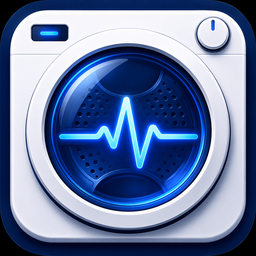

# ioBroker.laundrylens

Selbstlernender ioBroker-Adapter zur automatischen Erkennung von Wasch-, Trockner- und Geschirrspülerprogrammen über die Leistungsmessung einer intelligenten Steckdose. Er erkennt laufende Programme, schätzt die verbleibende Laufzeit und sendet Telegram-Benachrichtigungen – vollständig lokal, ohne Cloud.

---

## So funktioniert es

LaundryLens erfasst den Stromverbrauch jedes Waschgangs und vergleicht ihn mithilfe segmentgewichteter Korrelation und eines DTW-Lite-Algorithmus mit gespeicherten Programmprofilen. Die Zuverlässigkeit wird über mehrere Abgleichrunden hinweg erhöht, bevor ein Programm akzeptiert wird. Dadurch wird verhindert, dass einzelne Ausreißer zu einer falschen Zuordnung führen. Die Restlaufzeit wird dynamisch anhand der verstrichenen Zeit und des aktuellen Energieverbrauchs geschätzt – nicht nur anhand eines festen Durchschnittswerts.

Der Adapter ist selbstlernend: Es gibt keine vordefinierten Profile. Jedes Programm wird auf Ihr spezifisches Gerät trainiert. Die Erkennung verbessert sich mit jedem abgeschlossenen Zyklus.

---

## Merkmale

- Zykluserkennung über Zustandsautomat (AUS → STARTEN → LÄUFT ↔ PAUSIERT → BEENDEN)
- Selbstlernprogramm-Matching (segmentgewichtete Korrelation + DTW-Tiebreak)
- Punkteakkumulation über mehrere Runden mit gerätespezifischen Konfidenzschwellenwerten
- Sperre außer Kraft setzen: Manuell ausgewählte Programme werden nicht durch Hintergrundabgleich überschrieben.
- Adaptive Restzeitschätzung durch Kombination von zeitbasierten und energieabhängigen Signalen
- Admin-Benutzeroberfläche mit erweiterbarer Zyklusliste, integriertem Leistungsdiagramm (Canvas), Phasenlegende, Trimmen und Teilen per Berührung/Ziehen
- Telegram-Benachrichtigungen mit konfigurierbaren Aktualisierungsschwellenwerten, Platzhaltern (`{progress}`, `{prevTime}`, `{state:objectId}` für jeden ioBroker-Datenpunkt) und bedingte Textblöcke
- Unterstützt außerdem Pushover, Signal, WhatsApp, Matrix, notify-my-android, Prowl und E-Mail (über [ioBroker.email](https://github.com/iobroker-community-adapters/ioBroker.email) ) als Benachrichtigungsziele
- Mehrere Geräte: eine Instanz pro Gerät (Waschmaschine, Trockner, …).
- Eine Steckdose für eine Waschmaschine und einen Geschirrspüler, die nie gleichzeitig laufen: Das erkannte Programm zeigt an, welches Gerät gerade in Betrieb ist.
- Widget für ioBroker.vis-2 und Kachel für ioBroker.devices mit Status, Programm, Phase und verbleibender Zeit
- Lokalisierte, zur Anzeige bereite Textdatenpunkte (`phaseText`, `stateText`, `programText`) neben den sprachneutralen internen, für die direkte Integration in ein VIS-Dashboard

---

## Anforderungen

- ioBroker mit js-controller ≥ 6.0.11
- Node.js ≥ 22
- ioBroker.admin ≥ 8.0.0
- Ein intelligenter Stecker oder Stromzähleradapter, der pro Gerät einen Watt-Datenpunkt liefert (z. B. [Shelly EM](https://www.shelly.com/en/products/shop/shelly-em) ).

---

## Installation

Installieren Sie **LaundryLens** über die ioBroker Admin-Adapterliste (Registerkarte „Adapter“), erstellen Sie dann für jedes Gerät eine separate Adapterinstanz und wählen Sie den Watt-Datenpunkt in der Instanzkonfiguration aus.

---

## Konfiguration

Jede Instanz hat die folgenden Einstellungen:

| Einstellung                                           | Beschreibung                                                                                                                                                                                                                                                    |
| ----------------------------------------------------- | --------------------------------------------------------------------------------------------------------------------------------------------------------------------------------------------------------------------------------------------------------------- |
| Gerätename                                            | Anzeigename für dieses Gerät                                                                                                                                                                                                                                    |
| Gerätetyp                                             | `washing_machine`, `dishwasher`, `dryer`, `washer_dryer` oder `washer_dishwasher` (betrifft die Phasenerkennungslogik, siehe [Ein Stecker für zwei Maschinen](#one-plug-for-a-washing-machine-and-a-dishwasher) )                                                |
| Leistungssensor (W)                                   | ioBroker-Datenpunkt mit Wattwerten                                                                                                                                                                                                                              |
| Leistungsschwelle (W)                                 | Mindestleistung, ab der das Gerät als in Betrieb gilt                                                                                                                                                                                                           |
| Leistungsschwelle (W)                                 | Optional. Ein Zyklus endet erst, wenn die Leistungsaufnahme während der Ausschaltverzögerung auf oder unter diesem Wert bleibt, z. B. 0 W bei einem Geschirrspüler, der in ruhigen Phasen einige Watt verbraucht. Leer = entspricht dem Leistungsschwellenwert. |
| Ausschaltverzögerung (min)                            | Nach dem Stromausfall muss gewartet werden, bevor der Zyklus beendet wird.                                                                                                                                                                                      |
| Startenergietor (Wh)                                  | Minimaler Energieverbrauch vor Beginn des Matchings (filtert kurze Spitzen)                                                                                                                                                                                     |
| Dauertoleranz                                         | Zulässige Abweichung von der gelernten durchschnittlichen Dauer (0,05–0,5)                                                                                                                                                                                      |
| Übereinstimmungsintervall (min)                       | Wie häufig passende Läufe während eines Zyklus                                                                                                                                                                                                                  |
| Spielbestätigungen                                    | Anzahl der aufeinanderfolgenden Runden, die ein Match absolvieren muss, bevor es angenommen wird                                                                                                                                                                |
| Schwellenwert für die automatische Bestätigung (%)    | Sicherheit, mit der eine Übereinstimmung automatisch bestätigt wird                                                                                                                                                                                             |
| Schwellenwert für die Sofortbestätigung (%)           | Vertrauen, bei dem ein Kampf sofort angenommen wird (2 Runden hintereinander)                                                                                                                                                                                   |
| Programmerkennungsschwelle (%)                        | Mindestvoraussetzung an Selbstvertrauen, damit ein Kandidat überhaupt in Betracht gezogen wird                                                                                                                                                                  |
| Benachrichtigung bei wahrscheinlicher Übereinstimmung | Sende eine Benachrichtigung, noch bevor ein Spiel offiziell bestätigt ist.                                                                                                                                                                                      |
| Anti-Falten-Wirkung ignorieren                        | Die Antiknitterphasen am Ende der Trocknerzyklen ignorieren.                                                                                                                                                                                                    |

Die Erkennungsschwelle ist ein Kompromiss: Ein niedrigerer Wert bedeutet schnellere Benachrichtigungen, aber ein höheres Risiko falscher Übereinstimmungen.

---

## Eine Steckdose für Waschmaschine und Geschirrspüler

Mit dem Gerätetyp `washer_dishwasher` Ein Stecker kann beide Geräte mit Strom versorgen, solange sie nie gleichzeitig laufen. Zwei laufende Geräte ergeben zusammen eine einzige Leistungskurve, die nicht unterscheidbar ist.

1. Wählen Sie den Gerätetyp aus und geben Sie dem Gerät einen Namen, der zu beiden passt.
2. Wählen Sie im Reiter „Programme“ für jedes Programm die entsprechende Maschine aus. Bereits gespeicherte Programme werden standardmäßig der Waschmaschine zugeordnet; verschieben Sie daher die Geschirrspülerprogramme einmalig. Die zugehörigen gespeicherten Zyklen erhalten die entsprechenden Phasen.

Das erkannte Programm entscheidet dann, welche Maschine läuft: die Phasen, die `appliance` Datenpunkt und der `{device}` Platzhalter für Benachrichtigungen folgt. Solange das Programm nicht bekannt ist, gibt es noch keine Phase. `{device}` ist der Name des Geräts, der auch für die Startbenachrichtigung gilt. Die Abschaltverzögerung wird von beiden Geräten gemeinsam genutzt und muss daher der längeren Verzögerung (standardmäßig 8 Minuten) entsprechen.

---

## Datenpunkte pro Gerät

| Datenpunkt          | Typ                 | Beschreibung                                                                                                                                                                       |
| ------------------- | ------------------- | ---------------------------------------------------------------------------------------------------------------------------------------------------------------------------------- |
| `state`             | Zeichenkette        | aus / startend / laufend / pausiert / beendet (sprachneutrale interne Taste, für Automatisierungen gedacht)                                                                        |
| `stateText`         | Zeichenkette        | Dasselbe wie `state` sondern als anzeigefertiger, lokalisierter Text (z. B. „Running ⚙️“ / „Läuft ⚙️“) – siehe[`displayLanguage`](#configuration)                                   |
| `running`           | boolescher Wert     | Einfache Ein-/Ausschaltanzeige                                                                                                                                                     |
| `appliance`         | Zeichenkette        | Maschine als sprachneutralen Schlüssel ausführen: Gerätetyp oder an einem gemeinsam genutzten Stecker `washing_machine` /`dishwasher` sobald das Programm bekannt ist (vorher leer) |
| `program`           | Zeichenkette        | Programmname erkannt                                                                                                                                                               |
| `programText`       | Zeichenkette        | Dasselbe wie `program` aber mit dem `detecting...` Platzhalter lokalisiert (ein bestätigtes Programm ist Ihr eigener gespeicherter Name, unverändert weitergegeben)                  |
| `confidence`        | Nummer              | Spielvertrauen in %                                                                                                                                                                |
| `timeRemaining`     | Nummer              | Geschätzte Restzeit in Sekunden                                                                                                                                                    |
| `totalDuration`     | Nummer              | Geschätzte Gesamtzyklusdauer in Sekunden                                                                                                                                           |
| `cycleProgress`     | Nummer              | Zyklusfortschritt 0–100 %                                                                                                                                                          |
| `phase`             | Zeichenkette        | Aktuelle Zyklusphase (sprachneutraler interner Schlüssel, z. B. `washing`, `dryer_drying`)                                                                                         |
| `phaseText`         | Zeichenkette        | Dasselbe wie `phase`, sondern als anzeigefertiger, lokalisierter Text mit einem Emoji (z. B. "🫧 Washing" / "🫧 Wäscht")                                                           |
| `lastCycleProgram`  | Zeichenkette        | Programm des letzten abgeschlossenen Zyklus                                                                                                                                        |
| `lastCycleDuration` | Nummer              | Dauer des letzten Zyklus in Minuten                                                                                                                                                |
| `lastCycleEnergy`   | Nummer              | Energieverbrauch im letzten Zyklus in Wh                                                                                                                                           |
| `availablePrograms` | Zeichenkette (JSON) | Array aller gespeicherten Programmnamen, z. B. für externe Dropdown-Menüs                                                                                                          |

`phase` /`state` /`program` Sie sind für Automatisierungen/Skripte gedacht und verwenden feste, sprachneutrale Werte, die sich unabhängig von Ihrer ioBroker-Sprache nie ändern – verwenden Sie die entsprechenden Werte. `*Text` Verwenden Sie stattdessen einen Datenpunkt, wenn Sie den Status direkt in einem VIS-Dashboard anzeigen möchten, ohne eine eigene Übersetzungstabelle zu erstellen. Die Sprache für `phaseText` /`stateText` /`programText` Standardmäßig wird die Systemsprache von ioBroker verwendet, die jedoch für jedes Gerät einzeln überschrieben werden kann (Einstellung „Anzeigesprache“).

---

## Widgets

Der Adapter stellt ein Widget für ioBroker.vis-2 und eine Kachel für ioBroker.devices bereit. Diese zeigen Status, Programm, Phase und verbleibende Zeit eines Geräts mit einem Fortschrittsring an. Ein Klick öffnet alle Details, einschließlich des letzten Zyklus und der Anzahl der zu überprüfenden Zyklen. Die Widgets zeigen lediglich an: „Bestätigung eines Zyklus im Admin-Tab“.

| Gastgeber        | Widget                   | Layouts                                            |
| ---------------- | ------------------------ | -------------------------------------------------- |
| ioBroker.vis-2   | Widget-Set „LaundryLens“ | Automatisch nach Größe, kompakt, Bar, breit, alles |
| ioBroker.devices | Fliese „LaundryLens“     | 1x1, 2x1, 2x½                                      |

Fügen Sie in vis-2 das Widget aus dem Set „LaundryLens“ hinzu. Verwenden Sie in ioBroker.devices die Option „Widget hinzufügen“ im Bearbeitungsmodus. Wählen Sie in beiden Fällen das Gerät aus der Liste in den Widget-Einstellungen aus. Status-, Phasen- und Programmtexte werden so angezeigt, wie sie vom Adapter geschrieben werden. `stateText`, `phaseText` Und `programText` Sie richten sich also nach der Systemsprache und der Option „Keine Emojis“.

Die Webkomponente `<iob-laundrylens-device>` von[`@iobroker/web-components`](https://github.com/ioBroker/web-components) Zeigt dieselben Ansichten auch auf anderen Hosts. Es verwendet die Objekt-ID des Geräts, zum Beispiel `laundrylens.0.device_0_97io` Es wurde noch nicht auf anderen Hosts getestet.

## Verwendung von Datenpunkten in Benachrichtigungsnachrichten

Neben den integrierten Platzhaltern (`{device}`, `{program}`, `{duration}`, `{energy}`, `{startTime}`, `{endTime}`, `{progress}`, `{prevTime}` Eine Benachrichtigungsvorlage kann den aktuellen Wert eines **beliebigen** ioBroker-Datenpunkts enthalten mit:

```
{state:objectId}
```

Zum Beispiel, um die aktuelle Außentemperatur und den Strompreis in eine „Fertig“-Meldung einzufügen:

```
🧺 {device} done!
⏱️ Total runtime: {duration} min
🌡️ Outside: {state:0_userdata.0.outsideTemp}°C
💶 Price: {state:0_userdata.0.electricityPrice} ct/kWh
```

Dies funktioniert auch innerhalb der Bedingung. `[...]` Blöcke: `[🌡️ Outside: {state:0_userdata.0.outsideTemp}°C]` Wenn der entsprechende Datenpunkt leer ist oder nicht existiert, verschwindet er vollständig aus der Nachricht, genau wie bei einem leeren, integrierten Platzhalter. Eine fehlende oder unlesbare Objekt-ID führt niemals zu einem Fehler im restlichen Teil der Nachricht – sie wird einfach nicht aufgelöst.

---

## Tipps für den Einstieg

- Lassen Sie das Gerät mindestens 3–5 Zyklen pro Programm durchlaufen, bevor Sie eine zuverlässige Erkennung erwarten können.
- Beginnen Sie mit weniger Programmen. Je weniger Profile Sie haben, desto höher ist die Treffergenauigkeit.
- Über die **Registerkarte „Zyklen“** in der Admin-Benutzeroberfläche können Sie vergangene Zyklen überprüfen, Rauschen am Anfang/Ende einer aufgezeichneten Aufzeichnung entfernen oder eine Aufzeichnung aufteilen, die zwei Programme erfasst hat.
- Nutzen Sie die **Exportfunktion** vor jedem Update, um Ihre erlernten Profile und den Zyklusverlauf zu sichern.

---

## Credits

Der neue Admin-Tab in Version 0.6.0 ist das Werk von [GermanBluefox](https://github.com/GermanBluefox) . Er hat ihn mit React 19 als JSON-Tab neu erstellt ( [#65](https://github.com/backfisch88/ioBroker.laundrylens/pull/65) ) und den Fehler im Geschirrspüler behoben sowie das Gerät umbenannt. `lastCycle` Probleme ( [#66](https://github.com/backfisch88/ioBroker.laundrylens/pull/66) ). Da die Pull-Requests nach anderen Änderungen nicht mehr zusammengeführt werden konnten. `main` Ich habe seine Commits übernommen, in denen er als Autor eingetragen war, und meine Icons sowie das Telefon-Layout hinzugefügt. Vielen Dank für die tolle Arbeit!

In Version 0.7.0 hat [GermanBluefox](https://github.com/GermanBluefox) die gemeinsame Steckdose für Waschmaschine und Geschirrspüler sowie das Widget für ioBroker.vis-2, die Kachel für ioBroker.devices und die Webkomponente ( [#66](https://github.com/backfisch88/ioBroker.laundrylens/pull/66) ) hinzugefügt. Er hat diese auch auf seinem eigenen System getestet und die leere Spalte für die Geräte in der Programmtabelle gefunden und behoben. Vielen Dank nochmal!

---

## Mitwirken

Probleme und Pull-Anfragen sind willkommen: [Probleme](https://github.com/backfisch88/ioBroker.laundrylens/issues)

---

## Changelog

### **WORK IN PROGRESS**

### 0.7.1 (2026-11-20)
- New: optional end power threshold per device, for appliances with quiet phases of a few watts ([#76](https://github.com/backfisch88/ioBroker.laundrylens/issues/76))
- Fix: recipient "All (broadcast)" showed an empty field ([#77](https://github.com/backfisch88/ioBroker.laundrylens/issues/77))

### 0.7.0 (2026-11-17)
- New: one plug for a washing machine and a dishwasher (device type `washer_dishwasher`, data point `appliance`) by [GermanBluefox](https://github.com/GermanBluefox) ([#66](https://github.com/backfisch88/ioBroker.laundrylens/pull/66))
- New: widget for ioBroker.vis-2, tile for ioBroker.devices and the web component `<iob-laundrylens-device>` by [GermanBluefox](https://github.com/GermanBluefox) ([#66](https://github.com/backfisch88/ioBroker.laundrylens/pull/66))
- Fix: checker findings (`common.adminUI.tab`, Dependabot for the widget folders)

### 0.6.0 (2026-11-13)
- BREAKING: requires ioBroker.admin 8 or newer
- Changed: admin tab rebuilt with React 19 by [GermanBluefox](https://github.com/GermanBluefox) ([#65](https://github.com/backfisch88/ioBroker.laundrylens/pull/65)); follows the Admin theme, duotone icons, phone layout
- Fix: dishwasher heating detected from 800 W (by GermanBluefox, [#66](https://github.com/backfisch88/ioBroker.laundrylens/pull/66))
- Fix: renamed device kept the old name in its channel object (by GermanBluefox, [#66](https://github.com/backfisch88/ioBroker.laundrylens/pull/66))
- Fix: `lastCycle` and `lastCycleProgram` after a correction (by GermanBluefox, [#66](https://github.com/backfisch88/ioBroker.laundrylens/pull/66))
- Fix: some admin tab messages were always German

### 0.5.0 (2026-11-12)
- New: light/dark theme in the admin tab
- Changed: SVG icons instead of emoji, new adapter icon
- Fix: programs table on small screens

### 0.4.44 (2026-11-08)
- Fix: kWh when splitting, trimming and merging cycles
- Fix: admin error messages translated

### 0.4.43 (2026-11-08)
- Changed: merge with the previous cycle via one button

### 0.4.42 (2026-11-08)
- New: merge 2-3 cycles into one (Cycles tab)

Older changelog entries can be found in CHANGELOG_OLD.md.

---

## License

MIT License

Copyright (c) 2026 backfisch88 <henrik.schoenhofen@icloud.com>

Permission is hereby granted, free of charge, to any person obtaining a copy
of this software and associated documentation files (the "Software"), to deal
in the Software without restriction, including without limitation the rights
to use, copy, modify, merge, publish, distribute, sublicense, and/or sell
copies of the Software, and to permit persons to whom the Software is
furnished to do so, subject to the following conditions:

The above copyright notice and this permission notice shall be included in all
copies or substantial portions of the Software.

THE SOFTWARE IS PROVIDED "AS IS", WITHOUT WARRANTY OF ANY KIND, EXPRESS OR
IMPLIED, INCLUDING BUT NOT LIMITED TO THE WARRANTIES OF MERCHANTABILITY,
FITNESS FOR A PARTICULAR PURPOSE AND NONINFRINGEMENT. IN NO EVENT SHALL THE
AUTHORS OR COPYRIGHT HOLDERS BE LIABLE FOR ANY CLAIM, DAMAGES OR OTHER
LIABILITY, WHETHER IN AN ACTION OF CONTRACT, TORT OR OTHERWISE, ARISING FROM,
OUT OF OR IN CONNECTION WITH THE SOFTWARE OR THE USE OR OTHER DEALINGS IN THE
SOFTWARE.