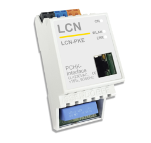
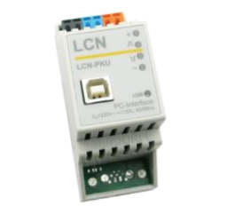

# ioBroker.lcn

**Dieser Adapter nutzt die Sentry-Bibliotheken, um Ausnahmen und Codefehler automatisch an die Entwickler zu melden.** Weitere Details und Informationen zum Deaktivieren der Fehlerberichterstattung finden Sie in [der Sentry-Plugin-Dokumentation](https://github.com/ioBroker/plugin-sentry#plugin-sentry) ! Die Sentry-Berichterstattung wird ab js-controller 3.0 verwendet.

Dieser Adapter ermöglicht die Verbindung eines lokalen Steuerungsnetzwerks [(LCN)](https://www.lcn.eu/) mit ioBroker.

## Unterstützte Gateways

- LCN-PKE



- LCN-PKU mit LCN-PCHK



**Vergiss das nicht `ioBroker.lcn` wird eine LCN-Verbindungslizenz blockieren.**

Die Konfiguration und die Module werden automatisch per Scan erkannt. Dieser Scan muss manuell über die Registerkarte „Module“ im Konfigurationsdialog ausgelöst werden und kann jederzeit wiederholt werden.

Erfordert Administratorrechte ab Version 7.8.23 (die Registerkarte „Module“ verwendet den Geräte-Manager).

## Typen

Folgende Lese- und Schreibgruppen werden unterstützt:

- Analogwerte (Ausgang/Eingang)
- Relais (Ausgang)
- Sensoren (Eingang)
- LEDs (Ausgang / Eingang)
- Variablen (Eingabe)

## Variablen

Um gültige Konvertierungsfunktionen auf Variablen anwenden zu können, müssen die Variablen die entsprechenden Rollen besitzen. Folgende Rollen werden unterstützt:

- **Wert.Temperatur** - Temperatur in Grad Celsius
- **Wert.Helligkeit** - Lux (I- Eingabe) in Lux
- **Wert.Geschwindigkeit.Wind** - Windgeschwindigkeit in m/s
- **Wert.Spannung** – Spannung in Volt
- **Wert.Stromstärke** - Stromstärke in Ampere
- **Wert.Sonne.Azimut** - Sonnenazimut
- **Wert.Sonnenhöhe** - Sonnenhöhe

Fehlt eine dieser Rollen, wird der Rohwert angezeigt. Ausnahme: `VAR02` Und `VAR03` Die Werte (üblicherweise R1Var und R2Var der Regler) werden wie in den vorherigen Versionen in °C angezeigt. Wenn die Funktion einer Variablen geändert wird, liest der Adapter ihren Wert erneut vom Modul aus.

Module mit einer Firmware vor Version 170206 verfügen nur über 3 Variablen (TVar, R1Var, R2Var). Sie werden wie folgt erstellt: `VARS.VAR01` -`VARS.VAR03` Module, die mit einer älteren Version des Adapters gescannt wurden, müssen erneut gescannt werden („Erneut scannen“ im Geräte-Manager), damit der Adapter die Firmware erkennt.

Die Module senden die Werte der Variablen nicht immer selbstständig. Die Option „Variablen alle (Minuten) lesen“ in den erweiterten Einstellungen liest die Variablen aller Module zyklisch aus (`0` = aus). Die Variablen werden nacheinander gelesen, daher kann ein Durchlauf bei vielen Modulen einige Zeit in Anspruch nehmen.

## Anzeige

Sie können für jedes Gerät aktivieren, ob es über ein Display verfügt oder nicht (Geräte-Manager: „Moduleinstellungen“).

## Regler (Regler)

Für jedes Gerät können Sie aktivieren, ob es Regler hat oder nicht (Gerätemanager: „Moduleinstellungen“).

## Ausgangsrelais

Für jedes Gerät können Sie festlegen, wie viele Ausgangsrelais (0-8) erstellt werden sollen (Gerätemanager: „Moduleinstellungen“).

## Einstellungen

- Wiederverbindungsintervall (Sek.) – Wie oft der Adapter versucht, eine Verbindung herzustellen. Standardwert: alle 30 Sekunden.
- Verbindungstimeout (ms) – Wie lange der Adapter auf eine Verbindungsantwort inklusive Authentifizierung wartet. Standardwert: 6 Sekunden.
- Antwort-Timeout beim Scan (ms) – wie lange der Adapter auf Antworten beim Scannen der Module wartet.
- Antwort-Timeout (ms) – Zeitüberschreitung für Steuerbefehle
- Ping-Intervall (Sek.) – wie oft der Adapter Ping-Anfragen sendet
- Ping-Antwort-Timeout (ms) – Timeout für Ping-Anfragen
- Variablen alle (min) lesen - die Variablen aller Module werden zyklisch gelesen. `0` = aus (Standardeinstellung)
- IN/OUT-Relais sind gleich – wenn es sich bei den "out"- und "in"-Relais um dasselbe handelt oder wenn es sich um unterschiedliche Relais handelt.

```
// =====================  Same relays =============================
//                                    +-------+
// ----------------- OUT -----------> |       |
//                                    | Relay |
// <----------------- IN ------------ |       |
//                                    +-------+
// 
// 
// ======================  Different relays =======================
//                                    +-------+
//                                    |       |
// ----------------- OUT -----------> | Relay |
//                                    |       |
//                                    +-------+
// 
//                                    +--------+
//                                    | Sensor |
// <----------------- IN ------------ |   or   |
//                                    | Relay  |
//                                    +--------+
```

## Anleitung zur Verwendung

Nach dem ersten Start müssen die Geräte gescannt werden. Öffnen Sie im Konfigurationsdialog den Tab „Module“ und klicken Sie im Geräte-Manager auf die Scan-Schaltfläche (Lupensymbol). Geben Sie die höchste zu scannende Moduladresse ein (z. B. 1234). `250` oder eine Spanne wie `5-30` Die

Wenn der Bus Segmentkoppler besitzt, geben Sie die zu scannenden Segmente durch Kommas getrennt ein (z. B. `0, 5, 7`). `0` Das Gateway ist mit seinem eigenen Segment verbunden (dem Segment, mit dem es verbunden ist). Alle anderen Segmente werden über ihre Segment-ID adressiert. Die Segmente werden nacheinander gescannt. Die Module erhalten die IDs. `S<segment>.M<module>` z.B. `lcn.0.S005.M010` Die

Jedes gefundene Modul hat die folgenden Aktionen:

- **Moduleinstellungen** – Anzahl der Ausgangsrelais, Anzeige und Regler
- **Scannen Sie erneut** – lesen Sie Name, Kommentar, Seriennummer und Status dieses Moduls erneut (im Segment des Moduls).

## Message-API

- `sendTo('lcn.0', 'scan', { max: '250', segment: 0 }, result => ...)` - einen Abschnitt des Busses scannen (`max` kann sein `"max"` oder `"min-max"`, `segment` ist optional: `0` = eigenes Segment, andernfalls die Segment-ID). Ergebnis: `{ total, _new }` oder `{ error }`
- `sendTo('lcn.0', 'getAll', null, devices => ...)` - Liste aller Module `[{ id, common, native }]`
- `lcn.0.scan.manual` - schreiben `*` um die Zustände aller Module zu lesen oder `S0:6` den Status von Segment 0, Modul 6 lesen

## Aufgaben

- Konfigurationsdialog zur Definition des Variablentyps.

<!--
	Placeholder for the next version (at the beginning of the line):
	### **WORK IN PROGRESS**
-->

## Changelog
### 4.0.0 (2026-11-13)
* (GermanBluefox) Added concurrency configuration to the test-and-release workflow to cancel outdated runs (#118)
* (GermanBluefox) Fixed repochecker warnings: size attributes in the configuration, Sentry notice, dependabot cooldown (#132)

### 4.0.0-beta.3 (2026-11-03)
- (bluefox) Fixed: `VAR02` and `VAR03` were converted twice, if a role like `value.temperature` was set. Without such a role they are still shown in °C
- (bluefox) Fixed: the scan wrote the values of the variables without the conversion of their role
- (bluefox) The value of a variable is read again from the module, when its role is changed

### 4.0.0-beta.2 (2026-11-03)
- (bluefox) Fixed: commands could get stuck in the queue, if several commands waited behind a command, that waits for an answer
- (bluefox) Fixed: variables of modules with a firmware before 170206 (only 3 variables) were not created. These modules must be scanned again (#22)
- (bluefox) Added option to read the variables of all modules cyclically (#22)
- (bluefox) Values without the number of the variable are ignored now. Before, the adapter logged an error for `MEASURES.MEASURE`

### 4.0.0-beta.1 (2026-11-03)
- (bluefox) Modules in other segments can be scanned: the scan dialog accepts a list of segments (#53)

### 4.0.0-beta.0 (2026-11-03)
- (bluefox) Breaking change: Adapter requires admin >= 7.8.23 now
- (bluefox) The adapter was refactored to TypeScript
- (bluefox) The configuration dialog was migrated to JsonConfig. The modules are scanned and configured in the device manager
- (bluefox) Fixed: the adapter reconnected to LCN after it was stopped and did not finish the stop correctly
- (bluefox) Fixed: `ir.lowbat` was never set
- (bluefox) Fixed: finger sensor codes were written into `ir.serial` instead of `finger.code`
- (bluefox) Fixed: a failed authentication on LCN-PCHK was not recognized
- (bluefox) Fixed: regulator states of scanned modules were recreated on every change of the device object
- (bluefox) Fixed: writing a state, whose object cannot be read, could crash the adapter

## License
The MIT License (MIT)

Copyright (c) 2018-2024 Denis Haev <dogafox@gmail.com> Private License  
Copyright (c) 2025-2026 Denis Haev <dogafox@gmail.com> MIT License

Permission is hereby granted, free of charge, to any person obtaining a copy
of this software and associated documentation files (the "Software"), to deal
in the Software without restriction, including without limitation the rights
to use, copy, modify, merge, publish, distribute, sublicense, and/or sell
copies of the Software, and to permit persons to whom the Software is
furnished to do so, subject to the following conditions:

The above copyright notice and this permission notice shall be included in all
copies or substantial portions of the Software.

THE SOFTWARE IS PROVIDED "AS IS", WITHOUT WARRANTY OF ANY KIND, EXPRESS OR
IMPLIED, INCLUDING BUT NOT LIMITED TO THE WARRANTIES OF MERCHANTABILITY,
FITNESS FOR A PARTICULAR PURPOSE AND NONINFRINGEMENT. IN NO EVENT SHALL THE
AUTHORS OR COPYRIGHT HOLDERS BE LIABLE FOR ANY CLAIM, DAMAGES OR OTHER
LIABILITY, WHETHER IN AN ACTION OF CONTRACT, TORT OR OTHERWISE, ARISING FROM,
OUT OF OR IN CONNECTION WITH THE SOFTWARE OR THE USE OR OTHER DEALINGS IN THE
SOFTWARE.