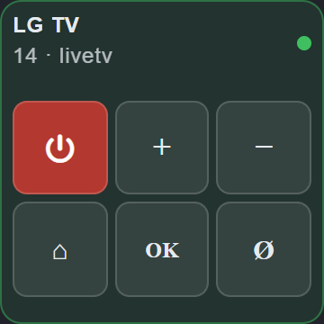
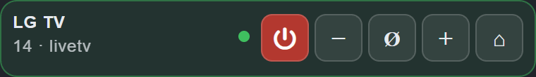

# IoBroker.lgtv
[!WICHTIG] Dieser Adapter kann nicht von GitHub installiert werden.

LG WebOS SmartTV-Adapter für ioBroker

Fernsteuerung eines LG WebOS SmartTV (Modelle ab 2013) von [ioBroker](https://www.iobroker.net) aus.

---

## Verwendung:
Installieren Sie den Adapter über die ioBroker-Administrationsoberfläche.
Geben Sie in der Adapterkonfiguration die IP-Adresse Ihres LG WebOS-Fernsehers ein. Während die Instanz läuft, werden im IP-Feld die im Netzwerk gefundenen Fernseher zur Auswahl angezeigt.
Beim ersten Verbindungsaufbau erhalten Sie auf Ihrem Fernsehbildschirm eine Aufforderung zur Kopplung. Erlauben Sie die Verbindung.

### Umfrage
Manche Fernseher trennen die Verbindung zum WebSocket, wenn sie ausgeschaltet werden, und melden dies nicht korrekt an den Adapter. In diesem Fall ist eine zusätzliche Abfrage erforderlich. Das Abfrageintervall kann in den Einstellungen festgelegt werden. Ist kein Wert angegeben, versucht der Adapter, dies automatisch zu erkennen: Nach einem Neustart des Adapters ist die Abfrage (alle 60 Sekunden) aktiv, bis das erste korrekte Ausschalten des Fernsehers erkannt wird.

## Einige Beispiele:
`setState('lgtv.0.states.popup', 'Some text!');`

Auf dem Fernseher wird ein Popup mit dem Text „Etwas Text!“ angezeigt.
Sie können im Text HTML-Zeilenumbrüche (br) verwenden.

`setState('lgtv.0.states.turnOff', true);`

Den Fernseher ausschalten.

`setState('lgtv.0.states.mute', true);`

Schalten Sie den Fernseher stumm.

`setState('lgtv.0.states.mute', false);`

Schalten Sie den Fernseher stumm.

`setState('lgtv.0.states.volumeUp', true);`

Dadurch wird die Lautstärke des Fernsehers erhöht.

`setState('lgtv.0.states.volumeDown', true);`

Die Lautstärke des Fernsehers verringern.

`setState('lgtv.0.states.channelUp', true);`

Erweiterung des aktuellen Fernsehkanals.

`setState('lgtv.0.states.channelDown', true);`

Reduzierung der Anzahl der aktuellen Fernsehkanäle.

`setState('lgtv.0.states.3Dmode', true);`

Aktiviert den 3D-Modus am Fernseher

`setState('lgtv.0.states.3Dmode', false);`

Deaktiviert den 3D-Modus am Fernseher.

`setState('lgtv.0.states.channel', 7);`

Umschalten des Live-Fernsehers auf Kanal Nummer 7.

`setState('lgtv.0.states.launch', 'livetv');`

Wechsel in den Live-TV-Modus.

`setState('lgtv.0.states.launch', 'smartshare');`

Öffnen der SmartShare-App auf dem Fernseher.

`setState('lgtv.0.states.launch', 'tvuserguide');`

Startet die TV-Benutzerhandbuch-App auf dem Fernseher.

`setState('lgtv.0.states.launch', 'netflix');`

Öffnen der Netflix-App auf dem Fernseher.

`setState('lgtv.0.states.launch', 'youtube');`

Öffnet die YouTube-App auf dem Fernseher.

`setState('lgtv.0.states.launch', 'prime');`

Öffnet die Amazon Prime App auf dem Fernseher.

`setState('lgtv.0.states.launch', 'amazon');`

Bei einigen Fernsehern öffnet dieser Befehl die Amazon Prime App.

`setState('lgtv.0.states.openURL', 'http://www.iobroker.net');`

Öffnet den Webbrowser auf dem Fernseher und navigiert zu www.iobroker.net.
Kann auch zum Öffnen von Bildern oder Videos (im Browser) verwendet werden.

`setState('lgtv.0.states.input', 'av1');`

Schaltet den Eingang am Fernseher auf AV1.

`setState('lgtv.0.states.input', 'scart');`

Schaltet den Eingang am Fernseher auf Scart um.

`setState('lgtv.0.states.input', 'component');`

Schaltet den Eingang des Fernsehers auf Komponenteneingang um.

`setState('lgtv.0.states.input', 'hdmi1');`

Schaltet den Eingang des Fernsehers auf HDMI 1 um.

`setState('lgtv.0.states.input', 'hdmi2');`

Schaltet den Eingang des Fernsehers auf HDMI 2 um.

`setState('lgtv.0.states.input', 'hdmi3');`

Schaltet den Eingang des Fernsehers auf HDMI 3 um.

`setState('lgtv.0.states.youtube', 'https://www.youtube.com/watch?v=AjSpMQfRmEo'); OR setState('lgtv.0.states.youtube', 'AjSpMQfRmEo');`

Spiele ein YouTube-Video ab.

`setState('lgtv.0.states.raw', '{"url": "ssap://system.launcher/launch", "cmd": "{id: 'netflix'}" }');` `setState('lgtv.0.states.raw', '{"url": "ssap://api/getServiceList", "cmd": ""}');`

API zum Senden und Empfangen von RAW-Befehlen.

`setState('lgtv.0.remote.*KEY*', true);`

Senden Sie die Fernbedienungstaste an den Fernseher.

`setState('lgtv.0.states.power', true/false);`

Fernseher ausschalten und Fernseher einschalten (Einschalten funktioniert nur im LAN, mit WOL).

`setState('lgtv.0.states.soundOutput', 'external_arc');`

Audioausgabe über ARC (HDMI) umschalten.

---

## Staaten
`channel`

hält den aktuellen Kanal

`volume`

Diese Einstellung speichert die aktuelle Lautstärke und ermöglicht deren Änderung. Standardmäßig erfolgt eine Erhöhung um 5 oder mehr in 2er-Schritten alle 500 ms, um die Lautsprecher zu schonen. Deaktivieren Sie die Option „Rampenförmige Lautstärkeerhöhung“ in den Instanzeinstellungen, um alle Stufen gleichzeitig festzulegen.

`on`

Der Wert ist wahr, wenn der Fernseher eingeschaltet ist, und falsch, wenn er ausgeschaltet ist. Er richtet sich nach dem vom Fernseher gemeldeten Energiestatus (`states.powerState`): `on`, `screen_off` und `screen_saver` gelten als eingeschaltet, `standby` (der Schnellstart-Standby-Modus, in dem die Netzwerkverbindung des Fernsehers für eine gewisse Zeit aufrechterhalten wird) und `off` als ausgeschaltet. Fernseher ohne diesen Endpunkt (webOS 3 und älter) gelten als eingeschaltet, solange eine App im Vordergrund ausgeführt wird.

`powerState`

der vom Fernseher gemeldete Leistungszustand, zugeordnet zu `on`, `screen_off`, `screen_saver`, `standby` oder `off` (der Fernseher selbst meldet `Active`, `Screen Off`, `Screen Saver`, `Active Standby` und `Suspend`/`Power Off`)

---

## Fernbedienungs-Widget für `ioBroker.devices`
Der Adapter enthält ein **TV-Steuerungs-Widget** für den `devices`-Adapter. Fügen Sie es über *Widget hinzufügen → TV-Steuerung* hinzu, wählen Sie die LGTV-Instanz aus, und das Widget steuert direkt die `remote.*`-Zustände dieser Instanz. Die Statuszeile zeigt die aktuelle Lautstärke, den Stummschaltungsstatus und die laufende App an; der Punkt in der Ecke repräsentiert `states.on`.

Der Netzschalter folgt `remote.power`: Er sendet das POWER-Tastensignal, wenn der Fernseher eingeschaltet ist, und ein Wake-on-LAN-Paket, wenn er ausgeschaltet ist.

| Kompakt (1x1) | Breit (2x0,5) | Vollfernbedienung (2x1 / 2x2) |
|--------------------------------------------|--------------------------------------|---------------------------------------------|
|  |  | ](../../../en/adapterref/iobroker.lgtv/docs/widget-full.png) |

Die Kanaltasten, Medientasten, Farbtasten und der Ziffernblock lassen sich in den Widget-Einstellungen deaktivieren. Unterhalb der Tasten verfügt die Fernbedienung über Tasten für die Apps des Kanals `tv` (siehe unten) und, falls in den Widget-Einstellungen aktiviert, für dessen Eingänge.

## Fernsteuerung im Adminbereich
Die Instanzeinstellungen haben zwei Registerkarten. **Einstellungen** enthält die Konfiguration; **Fernbedienung** ist eine vollständige Fernbedienung für den Fernseher, sodass dieser direkt vom Administrator aus ohne Skript oder eine `devices`-Ansicht bedient werden kann.

Es schreibt dieselben `remote.*`-Zustände wie das obige Widget und zeigt den Betriebszustand des Fernsehers, die laufende App, den aktuellen Eingang und die Lautstärke an, die sich auch verschieben lassen. Die Tasten reagieren sofort - es handelt sich um Zustandsänderungen, nicht um Einstellungen, daher hat die Schaltfläche „Speichern“ im Dialogfeld nichts damit zu tun.

Daneben lassen sich die Apps und Eingänge des Kanals `tv` (siehe unten) mit einem Klick starten. Nach dem Klicken auf die Fernbedienung kann diese auch über die Tastatur bedient werden: Pfeiltasten, Eingabetaste, Rücktaste (zurück), Esc (Beenden), Pos1, `+` / `-` (Lautstärke), `M` (Stummschaltung), Leertaste (Wiedergabe) und `0`-`9`.

Die Instanz muss ausgeführt werden: Solange sie gestoppt ist, sind die Tasten deaktiviert und die Registerkarte zeigt dies an.

## Webkomponente für Aura und andere Hosts
Die Fernbedienung ist auch als Webkomponente `<iob-lgtv-remote>` (`common.webComponents`) verfügbar, sodass sie auf jedem Host, der ioBroker-Webkomponenten - Aura, vis-2, `devices` und die zugehörige Administrationsoberfläche - anzeigt, platziert werden kann. Sie trägt denselben Namen wie das oben genannte Widget („TV steuern“), sodass `devices` weiterhin ein eigenes Widget anbietet.

Es schreibt die gleichen `remote.*`-Zustände und zeigt die gleiche Kopfzeile an: den Namen, die Lautstärke, den Stumm-Status, die laufende Anwendung und den Punkt von `states.on`. Wie viel von der Fernbedienung angezeigt wird, hängt von der Größe ihrer Verpackung ab:

| Box | Schlüssel |
|-------------------------------------------|-----------------------------------------------------------------|
| ab 340 px Höhe und 180 px Breite | die gesamte Fernbedienung, mit den Zeilen, in denen die Einstellungen eingeschaltet sind |
| eine flache Leiste (bis zu 110 Pixel hoch) | Ein/Aus, Lautstärke leiser, Stummschaltung, Lautstärke lauter, Pos1 |
| Sonstiges | Ein/Aus, Lautstärke lauter/leiser, Home, OK, Stumm |

In den beiden kleinen Layouts öffnet die Taste `⋯` neben dem Namen die gesamte Fernbedienung in einem Dialog.

Die gesamte Fernbedienung, sowohl in einem großen Feld als auch im Dialogfeld, enthält außerdem das Statusfeld des Fernbedienungs-Tabs in der Administration: Anzeige des TV-Betriebs, Energiestatus, aktuell ausgeführte App, Eingangsquelle, Lautstärke (mit Schieberegler) und Stummschaltungsstatus. In einem breiten Feld neben den Tasten, in einem hohen Feld darüber; wo keines von beiden Platz findet, bleibt die Statuszeile unter dem Namen sichtbar.

Einstellungen, wie im obigen Widget: die LGTV-Instanz, der Status (Zeile oder Panel), die Kanaltasten, die Medientasten, die Farbtasten, der Ziffernblock und ein eigener Name.

## Kanal `tv` (Typendetektor)
Zusätzlich zu den vorhandenen Objekten erstellt der Adapter den Kanal `lgtv.0.tv`, der vom ioBroker-Typdetektor (>= 6.2.0) als Gerätetyp `tv` erkannt wird. Visualisierungen und der Geräteadapter können damit den Fernseher steuern.

| Bundesland | Rolle | Beschreibung |
|------------------|---------------------------------|----------------------------------------------------------------------|
| `tv.power` | `switch.power` | ein (Wake-on-LAN) / aus |
| `tv.volume` | `level.volume` | Lautstärke 0-100, wie `states.volume` |
| `tv.muted` | `media.mute` | stumm |
| `tv.volumeUp` | `button.volume.up` | Lautstärke erhöhen |
| `tv.volumeDown` | `button.volume.down` | Lautstärke verringern |
| `tv.input` | `media.input` | `TV`, `HDMI1`... `HDMI4`, `AV`, `COMPONENT`, `SCART` |
| `tv.app` | `media.app` | Starte eine App: `YOUTUBE`, `NETFLIX`, `PRIME_VIDEO`, `DISNEY_PLUS`, ... |
| `tv.unreach` | `indicator.maintenance.unreach` | Der Adapter hat keine Verbindung zum Fernseher |
| `tv.unreach` | `indicator.maintenance.unreach` | Der Adapter hat keine Verbindung zum Fernseher |

`tv.input` und `tv.app` beginnen mit TV, HDMI 1-4 und YouTube, Netflix, Prime Video und Browser. Sobald der Fernseher angeschlossen ist, bietet der Adapter die Eingänge und installierten Apps des Fernsehers an, die der Typ-Erkenner kennt.
Beide Anzeigen passen sich dem Fernseher an: Sie zeigen den aktuell aktiven Eingang oder die aktive App an und sind ansonsten leer.

## Changelog

<!--
    Placeholder for the next version (at the beginning of the line):
    ### **WORK IN PROGRESS**
-->

### **WORK IN PROGRESS**
- (@GermanBluefox) Added the short form of the web component manifests (tag, name, icon, size) to `common.webComponents`, so that hosts like Aura can list the components before the adapter is installed; the build writes it with `iob-web-components sync-io-package`

### 3.2.1 (2026-11-09)
- (GermanBluefox) The keys of the web component `<iob-lgtv-remote>` no longer turn into blue emoji on Windows

### 3.2.0 (2026-11-09)
- (GermanBluefox) The TV remote is also available as a web component for Aura and other visualizations, in large boxes with power state, input and a volume slider; the name of the devices widget is translated

### 3.1.0 (2026-10-29)
- (GermanBluefox) The IP field of the settings offers the TVs found in the network
- (GermanBluefox) Added the channel `tv`, so visualizations and the devices adapter can control the TV
- (GermanBluefox) The remote control in the settings has buttons for apps and inputs and can be operated with the keyboard
- (GermanBluefox) The remote control widget of the devices adapter has buttons for apps and inputs
- (AlanSRU) Added an option to set the volume immediately instead of raising it step by step
- (mcm57) Fixed invalid state roles and read/write flags in object definitions

### 3.0.5 (2026-09-10)
- (GermanBluefox) The instance settings have a second tab with a remote control, so the TV can be operated directly from the admin
- (krobipd) `states.scroll` and `states.drag` no longer ignore a movement whose horizontal or vertical part is zero, so plain vertical scrolling (`0,5`) works
- (krobipd) The configuration dialog is fully translated in all eleven languages; the minimum-value hints no longer show up as untranslated raw text
- (krobipd) The adapter no longer creates files in the home directory of the ioBroker user; the client key, the MAC cache and the certificate file all stay in the adapter's data directory
- (krobipd) Two volume changes in quick succession no longer fight over the TV, and an unreadable volume from the TV no longer disables the stepped volume ramp
- (krobipd) Stopping the adapter while the TV was connected no longer logs "setTimeout called, but adapter is shutting down"
- (krobipd) A stopped or crashed instance no longer keeps reporting `info.connection` as connected
- (krobipd) The TV is no longer reported as switched off while it is actually running
- (krobipd) The new state `states.powerState` shows the power state the TV reports itself
- (krobipd) Switching the TV off and on repeatedly no longer piles up connection checks

### 3.0.3 (2026-09-05)
- (GermanBluefox) The WebOS 26 pairing fallback now also asks for the pointer permissions, so the remote buttons, pointer moves, scrolling and clicks work after a fresh pairing
- (GermanBluefox) Older TVs get the signed pairing manifest again; the unsigned manifest is only used after the TV rejected the signed one (ported from lgtv2 2.0.1)
- (GermanBluefox) Adopted the upstream `lgtv2` test suite for the vendored transport

## License

MIT License

Copyright (c) 2024-2026 iobroker-community-adapters <iobroker-community-adapters@gmx.de>  
Copyright (c) 2023 Sebastian Schultz.

Permission is hereby granted, free of charge, to any person obtaining a copy
of this software and associated documentation files (the "Software"), to deal
in the Software without restriction, including without limitation the rights
to use, copy, modify, merge, publish, distribute, sublicense, and/or sell
copies of the Software, and to permit persons to whom the Software is
furnished to do so, subject to the following conditions:

The above copyright notice and this permission notice shall be included in
all copies or substantial portions of the Software.

THE SOFTWARE IS PROVIDED "AS IS", WITHOUT WARRANTY OF ANY KIND, EXPRESS OR
IMPLIED, INCLUDING BUT NOT LIMITED TO THE WARRANTIES OF MERCHANTABILITY,
FITNESS FOR A PARTICULAR PURPOSE AND NONINFRINGEMENT. IN NO EVENT SHALL THE
AUTHORS OR COPYRIGHT HOLDERS BE LIABLE FOR ANY CLAIM, DAMAGES OR OTHER
LIABILITY, WHETHER IN AN ACTION OF CONTRACT, TORT OR OTHERWISE, ARISING FROM,
OUT OF OR IN CONNECTION WITH THE SOFTWARE OR THE USE OR OTHER DEALINGS IN
THE SOFTWARE.