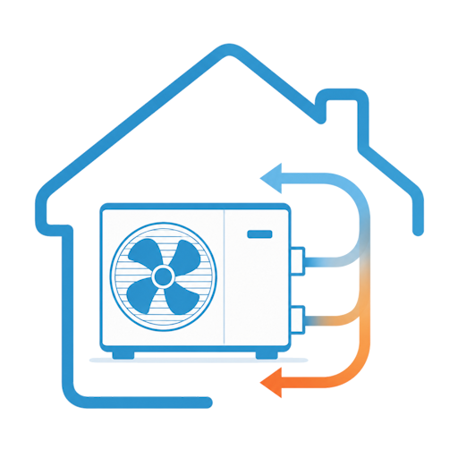

# ioBroker.luxtronik2-Controller

## luxtronik2-Controller-Adapter für ioBroker

**100% lokale Überwachung, Steuerung und Optimierung** für Wärmepumpen mit [Luxtronik 2.x / 3.x Reglern](https://www.alpha-innotec.com/en/products/accessories/control/luxtronik) (Alpha Innotec, Novelan, Buderus, Siemens usw.) - komplett **cloudfrei** .

Die Kommunikation erfolgt direkt über **natives TCP (Port 8889)** und optional in Kombination mit **Modbus TCP (Hybridmodus),** um Parameter direkt in den flüchtigen RAM zu schreiben, ohne den EEPROM-Flash-Speicher zu belasten. Das System umfasst eine integrierte **PV-Überschussautomatisierung** , **die Berechnung von COP/JAZ** in Echtzeit, eine intelligente Zyklusoptimierung und eine intelligente Pumpensteuerung (HUP & ZIP).

**Handbuch:** [Englisch](/#/docs/adapterref/iobroker.luxtronik2-controller/documentation/readme_en.md) · [Deutsch](/#/docs/adapterref/iobroker.luxtronik2-controller/documentation/readme_de.md)

> **💡 Kein LAN-Kabel in der Nähe Ihrer Wärmepumpe? Kein Problem!** Wenn Ihr Luxtronik 2.0-Regler nur einen freien USB-Anschluss anstelle einer Netzwerkdose besitzt, können Sie ihn ganz einfach per WLAN verbinden. Nutzen Sie dafür das clevere Projekt **„USB 2.0 powered WiFi/Ethernet Bridge“** von _obermolch_ . Die Bridge wird direkt über den USB-Anschluss des Reglers mit Strom versorgt und stellt die Verbindung drahtlos her – ganz ohne zusätzliche Netzteile. Die vollständige Anleitung und die Diskussion in der Community finden Sie hier: [ioBroker Forum: USB 2.0 powered WiFi/Ethernet Bridge für Luxtronik 2.0](https://forum.iobroker.net/topic/85773/usb-2-0-powered-wifi-ethernet-bridge-f%C3%BCr-luxtronik-2-0) .

**Wenn Ihnen dieses Projekt gefällt und Sie seine Entwicklung unterstützen möchten, können Sie hier gerne eine Spende hinterlassen: <https://paypal.me/TJahnke>**

### Merkmale

#### 🔌 Kommunikations- und Betriebsmodi

- **3 flexible Betriebsmodi:** Nahtloses Umschalten zwischen sicherem **Nur-Lese-Modus** (nur Überwachung, alle Hardware-Schreibvorgänge blockiert), **nativem Schreibmodus** (Port) `8889`) und **Modbus-Hybridmodus** .
- **Native TCP- und WebSocket-Kommunikation:** Direkte lokale Verbindung über klassisches TCP (`8888` /`8889`) oder WebSockets (`8214`) mit umfassender Kompatibilität über die Firmware-Versionen V1.x, V2.x und V3.x hinweg (dynamische Skalierungsfaktoren und adaptive Schreibwarteschlangen-Timing).
- **Hybrid-Modbus-TCP-Unterstützung (0 % Flash-Speicherverschleiß):** Schreibt flüchtige Parameter (Zieltemperaturen, Heizkurven, Betriebsarten) und Spulen direkt über Modbus TCP (Port) in den Controller-RAM. `502`) ohne den EEPROM-Flashspeicher zu verschleißen, während weiterhin vollständige Telemetriedaten über den nativen Port ausgelesen werden. Aktive Modbus-Zustände werden automatisch mit einem Tag versehen. `(Modbus)` im Objektbaum.

#### ☀️ PV-Automatisierung & Effizienz

- **PV-Überschussmanagement (PV-fähig):** Vollständig integrierte Automatisierung des Solarüberschusses, die Ihre laufende Netzeinspeisung nutzt, um die Sollwerte für Heizung und/oder Warmwasser zu erhöhen (verschleißfrei über Modbus TCP):
  - **Dynamische Sequenzpriorität:** Überwacht kontinuierlich die aktuellen Temperaturen und leitet überschüssiges Wasser zwischen Warmwasser und Heizung um, sobald das priorisierte Ziel die Sättigung erreicht.
  - **Hysterese & Intelligente Timer:** Anpassbare Start-/Stoppverzögerungen und eine dedizierte Stoppschwelle (Schmitt-Trigger-Logik) verhindern selbstaufhebende Rückkopplungsschleifen beim Hochfahren der Wärmepumpe.
  - **Batteriepriorisierung:** Optional wird die Ladeleistung der Heimbatterie in die Überschussberechnung einbezogen, um die Wärmepumpe als Wärmespeicher zu priorisieren.
  - **Hardware-Zyklusschutz:** Wartet, bis aktive Heiz- oder Warmwasserzyklen auf natürliche Weise beendet sind, bevor die Sollwerte bei sinkendem Solarertrag zurückgesetzt werden, um den Kompressor zu schützen.
- **COP & JAZ (Effizienzrechner):** Live-Effizienzverfolgung ( _Heute_ , _Letzte 7 Tage_ , _Aktueller Monat_ , _Aktuelles Jahr_ ), automatische Aufteilung in _Heizung_ , _Warmwasser_ und _Gesamt_ . Unterstützt interne Luxtronik-Zähler oder hochpräzise externe Zähler (z. B. Shelly 3EM, M-Bus-Wärmemengenzähler) mit persistenter Speicherung (`hidden.cop_buckets`) und Schutz vor Flattern und Herunterfallen.

#### 🛡️ Hardwareschutz & Intelligente Optimierung

- **Hardware- und EEPROM-Flash-Schutz:**
  - **Read-Before-Write-Cache:** Fängt redundante Schreibbefehle ab und blockiert sie, wenn der Controller den Zielwert bereits enthält.
  - **Flash-Schreibzähler:** Verfolgt transparent täglich (`write_cycles_today`) und kumulativ (`write_cycles_total`) EEPROM-Schreibvorgänge.
  - **Standardeinstellungen im Leerlauf & Interaktive Wärmekurve:** Stellt im Standby-Modus automatisch sichere Basiseinstellungen wieder her und bietet eine interaktive SVG-Wärmekurven-Vorschau in der Admin-Benutzeroberfläche.
  - **Firmware `.90` Crash Shield:** Erkennt automatisch fehlerhafte Hersteller-Firmwares (`V1.90` /`V2.90`) und blockiert Netzwerkschreibvorgänge, um Hardwareabstürze zu verhindern.
- **Kompressorschutz (Zyklusoptimierung):** Kopplung von Heizungs- und Warmwasserzyklen, um unnötige Kompressorstopps und -starts zu vermeiden.
- **Dynamische HUP-Regelung (Auto-PWM-Erkennung):** Die 0–10-V-Steuerspannung der Heizungsumwälzpumpe (HUP) wird automatisch anhand der Vor- und Rücklauftemperaturdifferenz angepasst. PWM-gesteuerte Pumpen werden automatisch erkannt und umgangen.
- **Intelligente 3-Wege-Umwälzpumpensteuerung (ZIP):**
  - Wählen Sie zwischen **internem Luxtronik-Controller** , **externem Aktor** (z. B. Shelly mit 0 % Flash-Verschleiß) oder **Modbus TCP (Spule 7)** .
  - Die Zirkulation kann bedarfsgesteuert über ioBroker-Bewegungssensoren/Tasten (mit Anti-Zyklus-Abkühlung) oder synchron während der Warmwassererzeugung ausgelöst werden.
  - Beinhaltet Live-Virtual-Status (`Virtual_ZIP_Status` und ein Echtzeit-Countdown der verbleibenden Laufzeit in Sekunden (`Virtual_ZIP_Remaining_Time`).

#### 📊 Überwachung, Diagnose & Anpassung

- **Integrierte Aktionen (Makros):** Vordefinierte Auslöser für Zwangsheizung (`Zwangsheizen`), Warmwasserzirkulation (`Zwangswarmwasser`), Zirkulation (`Activate_Zip`), manuelle Leerlauf-Resets (`Setze_Vorgabewerte`), und vollständige Rohdaten-Dumps (`Dump_Raw_To_Log`).
- **Intelligenter Objektverwaltungs- und Sichtbarkeitsfilter:** Fragt Hardware-Sichtbarkeitsflags ab (Befehl `3005`) beim Start, um nicht unterstützte Komponenten (Kühlung, Solar, Belüftung, nicht installierte Mischkreisläufe) auszublenden und entfernt beim Neustart abgewählte Datenpunkte und leere Ordner sauber.
- **Benutzerdefinierte Datenpunkte:** Fügen Sie flexibel benutzerdefinierte Telemetriewerte hinzu (Index). `3004`) und beschreibbare Parameter (Index `3003` über die Admin-Benutzeroberfläche, einschließlich benutzerdefinierter Skalierungsfaktoren, Einheiten und automatischer Unix-Zeitstempelformatierung.
- **Erweiterte Statusmeldungen & Berechnungen:** Live-Berechnung der Temperaturverteilung, der thermischen/elektrischen Energiesummen und der übersetzten Systemzustände im Klartext (Deutsch & Englisch).
- **Intelligente Benachrichtigungen und Firmware-Prüfungen:** Sendet Fehlerprotokolle, Verbindungswarnungen und kritische Abschaltungen (z. B. Probleme mit der Datenflussrate) an **Telegram** und das **ioBroker Notification Center** (mit 60-minütiger Anti-Spam-Sperre und Live-Test-Schaltfläche). Unterstützt außerdem geplante (Cron) und manuelle Firmware-Update-Prüfungen inklusive Abruf des Änderungsprotokolls.
- **Automatisierte DTA-Sicherung:** Ein-Klick-Links und Cron-geplante Downloads interner Daten `.dta` Diagnoseprotokolle direkt von der Wärmepumpe an `0_userdata.0/luxtronik_backups` zur Analyse in Tools wie _OpenDTA_ .

## Danksagungen & Geschichte

Dieses Projekt baut auf den Vorarbeiten bestehender Open-Source-Projekte auf. Besonderer Dank gilt:

- **[Bouni](https://github.com/bouni/luxtronik-2) :** Dessen Pionierarbeit und Codeentwicklungen die wesentliche Grundlage für die Kommunikation mit Luxtronik-Steuerungen bilden.
- **[BenPru](https://github.com/BenPru/luxtronik) & rhammen:** Ein besonderer Dank gilt BenPru und rhammen für ihre kontinuierliche Weiterentwicklung der Zugriffs- und Steuerungsmöglichkeiten des Luxtronik-Controllers. Ohne ihren Einsatz, ihre Bemühungen und ihre Ideen hätte dieser Adapter nicht den heutigen Entwicklungsstand erreicht. _(Wenn Ihnen ihre Arbeit gefällt, spendieren Sie ihnen doch einen Kaffee! ☕) [BenPru](https://github.com/sponsors/BenPru) [rhammen](https://github.com/sponsors/rhammen)_

## ⚠️ Warnung

Einige Einstellungen dieser Integration können die Leistung Ihrer Wärmepumpe beeinträchtigen. Fehlkonfigurationen können dazu führen, dass der Regler in einen Fehlerzustand wechselt, der einen manuellen Reset vor Ort erfordert.

Dieses Projekt dient dem Schutz Ihrer Wärmepumpe, indem die Konfigurationsoptionen auf sichere Werte beschränkt werden. Dennoch kann keine Garantie gegeben werden. Bitte seien Sie vorsichtig, konsultieren Sie Ihr Luxtronik-Handbuch und ändern Sie keine Einstellungen, die Sie nicht vollständig verstehen.

## 🔧 Kompatibilität

Die Integration ermöglicht die Überwachung und Steuerung von Wärmepumpen mit einem Luxtronik2-Regler. Sie funktioniert lokal ohne Internetverbindung. Sie wurde und wird mit einem LWD50A (LD5) von Alpha Innotec getestet. Sie wird unter anderem von folgenden Herstellern eingesetzt:

- Alpha Innotec,
- Siemens,
- Novelan,
- Roth,
- Elco,
- Buderus,
- Nibe,
- Wolf Heiztechnik.

## ⚠️ Haftungsausschluss ⚠️

_Dieses Projekt steht in keiner Verbindung zu Alpha Innotec, Novelan, ait-deutschland GmbH oder anderen Unternehmen. Es handelt sich um ein privates Projekt, das in der Freizeit gepflegt wird. Die Nutzung erfolgt auf eigene Gefahr._

## Installation

> **Hinweis für Raspberry Pi / ARM-Benutzer:** Möglicherweise werden im Installationsprotokoll rote Fehlermeldungen im Zusammenhang mit … angezeigt. `node-gyp`, `serialport`, oder `usocket` Dies sind optionale Abhängigkeiten und können vollständig ignoriert werden. Die netzwerkbasierte Steuerung (TCP) des Luxtronik funktioniert weiterhin problemlos.

//### **IN BEARBEITUNG**

## Changelog
### 1.0.3 (2026-11-18)

- Fixed daily COP reset in `copManager.ts` so Heating and Hot Water values reset to `0` after midnight until an active cycle starts

### 1.0.2 (2026-11-17)

- Fixed `node:` protocol imports (`node:fs`, `node:path`) and repository checker lint issues
- Completed and synchronized i18n translations across all supported languages
- Fixed `jsonConfig` label keys in `generateConfig.ts` to prevent inline language object overrides during build

### 1.0.1 (2026-11-16)

- **Update of i10n files**

### 1.0.0 (2026-11-16)

**STABLE**

### 0.25.2 (2026-11-16)

- **Fix i18n**

## License

MIT License

Copyright (c) 2026 TbsJah <github.tbsjah@googlemail.com>

Permission is hereby granted, free of charge, to any person obtaining a copy
of this software and associated documentation files (the "Software"), to deal
in the Software without restriction, including without limitation the rights
to use, copy, modify, merge, publish, distribute, sublicense, and/or sell
copies of the Software, and to permit persons to whom the Software is
furnished to do so, subject to the following conditions:

The above copyright notice and this permission notice shall be included in all
copies or substantial portions of the Software.

THE SOFTWARE IS PROVIDED "AS IS", WITHOUT WARRANTY OF ANY KIND, EXPRESS OR
IMPLIED, INCLUDING BUT NOT LIMITED TO THE WARRANTIES OF MERCHANTABILITY,
FITNESS FOR A PARTICULAR PURPOSE AND NONINFRINGEMENT. IN NO EVENT SHALL THE
AUTHORS OR COPYRIGHT HOLDERS BE LIABLE FOR ANY CLAIM, DAMAGES OR OTHER
LIABILITY, WHETHER IN AN ACTION OF CONTRACT, TORT OR OTHERWISE, ARISING FROM,
OUT OF OR IN CONNECTION WITH THE SOFTWARE OR THE USE OR OTHER DEALINGS IN THE
SOFTWARE.