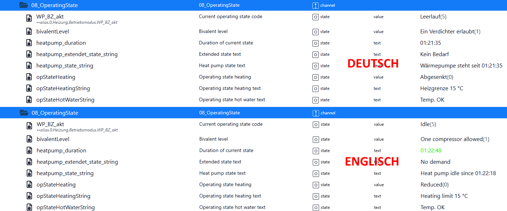

## Adapterinstanzkonfiguration

Nach der Installation des Adapters öffnet sich die Konfigurationsoberfläche. Diese ist in übersichtliche Registerkarten unterteilt, um die Einrichtung und Optimierung Ihrer Wärmepumpe so intuitiv und übersichtlich wie möglich zu gestalten.

---

### 1. Registerkarte: Verbindung

Konfigurieren Sie die grundlegenden Netzwerkparameter für die Kommunikation mit dem Luxtronik-Controller und wählen Sie die Anzeigesprache des Adapters aus.

#### Verbindungseinstellungen

- **IP-Adresse (Host):** Geben Sie die lokale IP-Adresse Ihrer Wärmepumpe in Ihrem Netzwerk ein (z. B. `192.168.178.81`).
- **Wärmepumpenanschluss:** Der Kommunikationsanschluss des Controllers.
  - `8889` = Standardport für klassische TCP-Kommunikation (typischerweise Firmware V1.x / V2.x / V3.x).
  - `8214` = WebSocket-Port (in der Regel erforderlich für neuere Systeme mit Firmware > V3.81).
- **Abfrageintervall (Sekunden):** Gibt an, wie häufig der Adapter Live-Telemetriedaten und Parameter von der Wärmepumpe abfragt (Minimum: 10 Sekunden, Standard: 30 Sekunden).

> ⚠️ **WICHTIGER HINWEIS ZUM ABGESTIMMUNGSINTERVALL:** Stellen Sie diesen Wert **nicht** zu niedrig ein! Zu häufiges Abfragen überlastet die interne CPU der Wärmepumpe mit Netzwerkanfragen. Dies führt zu einer hohen CPU-Last und macht den Controller extrem träge (sowohl auf dem Display als auch im Netzwerk). Ein Wert zwischen **30 und 60 Sekunden** wird dringend empfohlen.

#### Optionen

- **Sprache für Texte und Werte:** Wähle die Sprache (`English` oder `Deutsch`) werden für Betriebszustände, Statusmeldungen, Fehlerprotokolle und Auswahlwerte verwendet, die im ioBroker-Objektbaum erstellt wurden.

_Beispiel: Beim Erhitzen von Brauchwasser übersetzt der Adapter die Ländercodes in `Hot water` (Englisch) oder `Warmwasser` (Deutsch)._

---

### 2. Registerkarte: Modbus (Hybrid)

Standardmäßige Parametereinstellungen werden über den Port vorgenommen. `8889` oder `8214` Schreiben Sie in den internen EEPROM/Flash-Speicher des Luxtronik, der nur eine begrenzte Anzahl von Schreibzyklen aufweist.

Der **Hybridmodus (Modbus TCP)** bietet das Beste aus beiden Welten:

- **Auslesen:** Alle detaillierten Telemetriedaten, Temperatursensoren und Betriebsstunden werden weiterhin über die native Schnittstelle ausgelesen (`8889` /`8214`).
- **Schreiben (0% Flash-Verschleiß):** Ausgewählte flüchtige Variablen (wie z. B. Sollwerte, Heizkurven und Pumpenauslöser) werden über **Modbus TCP** direkt in den Controller-RAM geschrieben, ohne dass es zu einer Verschlechterung des EEPROM kommt.

#### Einstellungen

- **Modbus TCP aktivieren:** Aktiviert die hybride Routing-Pipeline. Beim Start führt der Adapter eine Vorabprüfung durch, um sicherzustellen, dass die Modbus-Schnittstelle erreichbar ist.
- **Modbus-Port:** Standardwert ist `502` (muss auch in Ihren Luxtronik-Netzwerkeinstellungen aktiviert sein).
- **Auswahl der Halteregister (Parameter):** Prüfen Sie, welche Sollwerte flüchtig über Modbus geroutet werden sollen (z. B. _Soll-Rücklauftemperatur_ , _Außentemperatur_ , _Betriebsart Heizung/Warmwasser_ , _Heizkurvenendpunkt/Parallelversatz_ , _Sollwert für die feste Rücklauftemperatur_ , _Sollwert für das Warmwasser_ ).
- **Spulen (Schalter) auswählen:** Wählen Sie aus, welche Ausgänge direkt über Modbus-Spulen ausgelöst werden können (z. B. _BUP_ , _HUP_ , _Lüfter VEN_ , _Umwälzpumpe ZIP (Spule 7)_ , _ZUP_ , _SLP_ , _Watchdog Modbus_ , _Reset Error_ ).

> 💡 **Transparenz des Objektbaums:** Datenpunkte, die über Modbus flüchtig geschrieben werden, erhalten automatisch di&#x65;** `(Modbus)` ** Namenssuffix im ioBroker-Baum.

---

### 3. Registerkarte: Standardeinstellungen im Leerlauf (Flash-Speicherschutz)

Um den Luxtronik-Controller vor Flash-Verschleiß zu schützen, werden Schreiboptimierungen nur während eines aktiven Zyklus (Heizen oder Heißwasser) ausgeführt.

Sobald die Wärmepumpe in **den Leerlauf (Standby)** zurückkehrt, setzt diese Funktion alle vorübergehend geänderten Werte auf Ihre definierten sicheren Standardwerte zurück.

> 💡 **Dringende Empfehlung:** Die Aktivierung der Leerlaufstandardeinstellungen wird dringend empfohlen, wenn Sie die **intelligente Zyklusoptimierung (Warmwasser + Heizung)** und/oder **die dynamische HUP-Steuerung** verwenden!

- **Standardwerte im Leerlauf erzwingen:** Aktiviert die automatische Fallback-Routine, sobald der Standby-Modus erkannt wird.
- **Standardwerte: Heizung:** Geben Sie die Basiswerte Ihres Systems ein ( _Basispunkt (°C)_ , _Endpunkt (°C)_ , _Heizhysterese (K)_ und Basis- _HUP-Min-/Nom-_ Spannungen für die Heizung).
- **Standardwerte: Warmwasser:** Basiswerte für Brauchwasser ( _HW-Zielwert (°C)_ , _HW-Hysterese (K)_ und Basis _-HUP-Min-/Nom_ -Spannungen für Warmwasser).
- **Interaktive Wärmekurvenvorschau:** Durch Eingabe von Basis- und Endpunkten wird eine SVG-Kurvenvorschau mit Tooltips für jedes Grad Außentemperatur zwischen -20 °C und +20 °C generiert. _(Vielen Dank an [mnemotron.de](https://www.mnemotron.de/lux/heatcurve.html) für die Inspiration!)_

---

### 4. Registerkarte: Effizienz / COP

Berechnet den Leistungskoeffizienten ( **COP** ) und den saisonalen Leistungsfaktor ( **JAZ** ) über mehrere Zeiträume ( **Heute** , **Letzte 7 Tage** , **Aktueller Monat** , **Aktuelles Jahr** ) – kategorisiert nach **Gesamt** , **Heizung** und **Warmwasser** .

- **COP-/Effizienzberechnung aktivieren:** Aktiviert die Nachverfolgung. Snapshots und Berechnungs-Buckets bleiben auch nach Neustarts sicher erhalten. `hidden.cop_buckets` Die
- **1. Elektrische Energie (Leistungsaufnahme):**
  - _Intern (Luxtronik-Schätzungen):_ Verwendet die internen Stromzähler-Schätzungen des Reglers.
  - _Externe Objekt-ID (z. B. Shelly):_ Verknüpfung eines externen, kalibrierten Energiezählerdatenpunkts (Gesamt-kWh, z. B. Shelly 3EM).
- **2. Thermische Energie (Wärmeerzeugung):**
  - _Intern (Luxtronik-Zähler):_ Nutzt interne thermische Erzeugungsberechnungen.
  - _Externe Objekt-ID (z. B. M-Bus-Zähler):_ Verknüpfung eines externen Wärmezähler-Datenpunkts (WMZ Gesamt-kWh).

---

### 5. Registerkarte: Zyklusoptimierung

Standardmäßig behandeln Luxtronik-Regler Heizungs- und Warmwasserzyklen als getrennte Vorgänge. Dies führt häufig dazu, dass der Kompressor nach dem Erhitzen des Wassers sofort abschaltet und erst einige Minuten später für die Raumheizung wieder anspringt. Dieser Adapter verbindet die Zyklen und sorgt so für einen kontinuierlichen Kompressorlauf.

- **Intelligente Zyklusoptimierung aktivieren:** Aktiviert die zyklusübergreifende Koordination (kann auch über … umgeschaltet werden). `Actions.Regelung_Aktiv`).
  - **Auslöseregel (Vorzündung):** Wenn `(DHW Target - DHW Actual) ≥ (DHW Hysteresis - 1.5 K)` **UND** `Heating Return ≤ Return Target` und die Außenheizungsschwelle inaktiv ist, beginnt die Heizung sofort mit einer Rücklauftemperatur von **35°C,** um den Kompressor einzuschalten.
  - **Übergang zu Warmwasser:** Sobald die Heizrücklauftemperatur den Zielwert erreicht hat und das Warmwasser um mehr als 2 K abgekühlt ist, wird die Warmwasser-Zieltemperatur vorübergehend erhöht, um den Kompressor ohne Unterbrechung auf Warmwasser umzuschalten.
- **Heizung nach Warmwasser:** Hält die Rücklauftemperatur während der Warmwasserbereitung auf 35°C, sodass der Kompressor ohne Abschaltung sofort in den Heizbetrieb übergeht.

> ⚠️ **Wichtiger Hinweis:** Aktivieren Sie bei der Zyklusoptimierung immer **die Option „Standardwerte im Leerlauf erzwingen“** auf der Registerkarte _„Leerlaufstandards_ “!

---

### 6. Registerkarte: HUP (Heizungsumwälzpumpe)

Dynamische Spannungsregelung für steuerbare **0–10-V-Heizumwälzpumpen (HUP)** basierend auf der Temperaturdifferenz (ΔT zwischen Vor- und Rücklauf). Die Pumpenspannung wird während aktiver Heizzyklen (nachdem der Kompressor mindestens 10 Minuten gelaufen ist) schrittweise erhöht, um die Differenz innerhalb der Zielgrenzen zu halten.

> ⚠️ **Voraussetzungen:**
>
> 1. **Hardware- und PWM-Erkennung:** Nur verwenden, wenn Ihre Pumpe über ein analoges **0–10-V-Signal** von der Luxtronik-Platine angeschlossen ist. Wenn für **PWM** konfiguriert (`heating_max_circ_pump_speed > 0` Der Adapter erkennt dies automatisch und umgeht die 0–10V-Regelung.
> 2. **Systemtypen:** Die ideale Wärmeverteilung hängt von den Heizkörpern ab. **Fußbodenheizungen** streben typischerweise eine Temperaturverteilung **von 3 bis 5 K** an, während **Standardheizkörper** im Allgemeinen eine Temperaturverteilung **von 7 bis 10 K** anstreben.
> 3. **Hardware-Spannungsskala:** Wählen Sie den Multiplikator, der zu Ihrer Firmware passt:
>    - `100` für Standard / Firmware V2.x (`1000 = 10.0 V`)
>    - `10` für Firmware V3.x, z. B. LWCV 82 (`100 = 10.0 V`)

#### Parameter

- **Dynamische HUP-Spread-Control aktivieren:** Aktiviert die dynamische Regelung.
- **Zieltemperaturstreuung & Intervalle:** _Minimale Streuung (K)_ , _Maximale Streuung (K)_ und das Auswertungs- _Anpassungsintervall (Minuten)_ definieren (Standard: 10 min).
- **Spannungsgrenzen:** _Untere Grenze (V)_ , _obere Grenze (V)_ und _Schrittweite (V)_ definieren (z. B. `0.25 V`).

---

### 7. Registerkarte: Umwälzpumpe (ZIP)

Die Warmwasserzirkulationspumpe (ZIP) liefert sofort warmes Wasser an den Zapfstellen, ihr Dauerbetrieb führt jedoch zu erheblichen Wärmeverlusten im Speicher. Diese Registerkarte trennt **die Auslöselogik** sauber von **der Hardwaresteuerung** .

#### 1. Wie wird Ihre Umwälzpumpe (ZIP) gesteuert? `zip_control_mode`)

Wählen Sie Ihren physischen Steuerungspfad aus dem Dropdown-Menü aus – nicht zutreffende Einstellungen werden automatisch ausgeblendet:

- **Über den Luxtronik-Controller (intern):** Der Adapter löst die Pumpe über den internen manuellen/Entlüftungsbefehl (im Standby-Modus) oder über Timertabellen aus.
  - ⚠️ _Hinweis:_ Verursacht Flash-Speicher-Schreibzyklen auf dem Controller (4 bis 14 Schreibvorgänge pro Durchlauf). Wenn ein externes Relais seine Betriebsspannung direkt vom Luxtronik ZIP-Ausgang bezieht, deaktivieren Sie die _Option „Basis-ZIP-Werte deaktivieren“_ .
- **Über einen externen Akteur (z. B. Shelly) – _Empfohlen_ :** Der physische Luxtronik-Ausgang ist dauerhaft deaktiviert (`00:00` /`0 min ON`) und der Adapter steuert Ihr intelligentes Relais (Shelly, Zigbee-Schalter usw.) direkt über ioBroker ➔ **0 % Flash-Verschleiß!**
- **Über Modbus TCP (Hybrid):** Die Pumpe wird mit 0 % Flash-Verschleiß direkt über **Modbus Spule 7** gesteuert (erfordert aktives Modbus im _Modbus-_ Tab) ➔ **0 % Flash-Verschleiß!**

#### 2. Optionen & Standardeinstellungen

- **Deaktiviert die Basis-ZIP-Werte (setzt die Luxtronik-Timer auf 0):** Überschreibt die internen Luxtronik-Timer beim Start mit `00:00` (`OFF: 60 min / ON: 0 min`) den internen Zeitplan dauerhaft stummzuschalten.
- **ZIP-Optimierung zulassen:** Ermöglicht zeit- und bedarfsgesteuerte Ausführung.
- **ZIP-Dauer EIN (s):** Pumpenlaufzeit bei Auslösung (Standard: `120 s`).
- **ZIP-Dauer AUS (s):** Anti-Zyklus-Abklingzeit, bevor ein weiterer Durchlauf erlaubt ist (Standard: `1200 s` = 20 min).
- **ZIP-Dauer EIN Warmwasserbetrieb (s):** In verschleißfreien Modi (Actor oder Modbus) kann die Pumpe synchron mit der Warmwassererzeugung für den Haushalt laufen (Standard: `600 s`).

#### 3. Bewegungssensoren und externe Relais

- **Bewegungssensoren aktiv nutzen:** Eine Tabelle wird erweitert, um Bewegungssensoren oder Wandtaster zu verknüpfen (boolesche Datenpunkte, z. B. Badezimmer/Küche). Bewegung löst sofort einen Durchlauf aus (mit Abklingzeit).
- **Externe Relais/Aktoren:** (Nur im Modus _„Externer Aktor“_ sichtbar) Tabelle zur Verknüpfung externer Schaltdatenpunkte (z. B. `shelly.0...Switch`).

> 💡 **Virtuelle Datenpunkte für Visualisierungen (VIS / Lovelace):** Unter `Information.03_Outputs` Unabhängig vom Steuerungsmodus werden immer zwei Live-Datenpunkte aktualisiert:
>
> - `Virtual_ZIP_Status`: Boolescher Zustand, der angibt, ob ein Zirkulationszyklus läuft (`true` /`false`).
> - `Virtual_ZIP_Remaining_Time` Ein **Live-Countdown in Sekunden,** der die verbleibende Laufzeit des aktiven ZIP-Zyklus anzeigt!

---

### 8. Registerkarte: Datenpunkte / Objekte

Konfigurieren Sie, welche Datenpunkte und Kategorien der Adapter im ioBroker-Baum erstellen und verwalten soll. Deaktivierte Datenpunkte und leere Ordner werden beim Start entfernt.

- **Nicht unterstützte Hardwareparameter automatisch ausblenden (`filter_visibility` Wenn** aktiviert (Standardeinstellung), liest der Adapter beim Start die Hardware-Flags (Befehl). `3005`) und blendet nicht unterstützte Komponenten aus (z. B. Kühlung, Solar, Belüftung oder nicht installierte Mischkreisläufe).
- **Kategorien & Einzelne Datenpunkte:** Ganze Ordner umschalten (z. B. `Information.01 Temperatures` Zu `Information.16 Efficiency` Und `Settings.01` Zu `Settings.12` oder einzelne Datenpunkte.
- **Systemkritische Datenpunkte:** Essenzielle Ein- und Ausgaben, die von internen Algorithmen benötigt werden (z. B. Rücklauftemperatur, Betriebszustand, Flash-Schreibzähler) `write_cycles_today` /`write_cycles_total`) sind ausgegraut und immer aktiv.

---

### 9. Registerkarte: Benachrichtigungen

Überwacht das **Fehlerprotokoll** , **das Ausfallprotokoll** (Erkennung von Wärmepumpenalarmen und **Wasserdurchflussproblemen** mit einer 60-minütigen Anti-Spam-Abkühlphase) und **die Controller-Konnektivität** .

- **Fehlermeldungen über Telegram senden:** Versendet strukturierte Alarmbenachrichtigungen (einschließlich Fehlercode, Beschreibung und Zeitstempel) über eine ausgewählte **Telegram-Instanz** .
- **Empfänger (Name / Chat-ID - Optional):** Benutzername oder numerische Chat-ID des Zielempfängers (leer lassen, um alle bekannten Benutzer zu benachrichtigen).
- **Fehler auch als Benachrichtigung (Glocke) anzeigen:** Fehler werden direkt im nativen **ioBroker Notification Center** protokolliert (Glockensymbol in der Admin-Benutzeroberfläche).
- **Schaltfläche „TEST: NEUESTEN FEHLER SENDEN“:** Liest den neuesten Fehlerprotokolleintrag (oder erstellt eine simulierte Überprüfungsmeldung) und sendet ihn sofort ab.

---

### 10. Registerkarte: Updates (Firmware)

Der Adapter kann automatisch im offiziellen Alpha Innotec Downloadportal nach neuen Firmware-Versionen für Ihre Wärmepumpe suchen.

- **Automatische Suche nach Firmware-Updates:** Aktiviert die Hintergrundprüfung.
- **Aktualisierungsprüfzeitplan:** Ein frei definierbarer Cronjob (Standard: `0 12 * * *` = Täglich um 12:00 Uhr).
- **Sende eine Telegram-Benachrichtigung bei neuem Update:** Informiert dich direkt über Telegram, sobald eine neue Version inklusive Änderungsprotokoll verfügbar ist.
- **Manuelle Prüfung:** Sie können die Aktualisierungsprüfung jederzeit manuell über die neue Funktion auslösen. `Information.12_SystemInfo.check_firmware` Schaltfläche in der Objektstruktur.

> 💡 **Hinweis:** Die gesammelten Ergebnisse (verfügbare Version, Aktualisierungsanzeige für Visualisierungen und die offiziellen Versionshinweise) werden vom Adapter unter folgendem Pfad gespeichert: `Information.12_SystemInfo` Die

---

### 11. Tab: PV / Überschuss

Integrierte „PV-Ready“-Steuerung: Nutzt Ihren überschüssigen Solarstrom, um die Wärmepumpe in einen Wärmespeicher zu verwandeln. Sobald Ihre Solaranlage genügend Strom ins Netz einspeist, erhöht der Adapter automatisch und verschleißfrei (über Modbus RAM) die Sollwerte für Warmwasser und/oder Heizung.

- **PV-Überschussmanagement aktivieren:** Aktiviert die Logik.
- **Datenpunkt für die aktuelle Netzleistung:** Verbinden Sie den Live-Datenpunkt Ihres Smart Meters oder Wechselrichters (z. B. SMA, Shelly 3EM, Kostal).
- **Batterieladeleistung einbeziehen (Wärmepumpe priorisieren):** Optionaler Datenpunkt für Ihre Hausbatterie. Wird die Batterie aktuell mit Solarenergie geladen, wird diese Energie als „nutzbarer Überschuss“ behandelt. Die Wärmepumpe fungiert als primäre thermische Batterie und fängt die Energie ab, bevor sie in die chemische Batterie fließt.
- **Aktivierung (Boost):**
  - Definieren Sie den _Überschussschwellenwert_ (z. B. 2000 Watt) und eine _Mindestdauer_ (z. B. 5 Minuten), um Kurzzyklusbetrieb bei wechselnder Bewölkung zu verhindern.
  - Geben Sie an, um wie viele Kelvin der Versatz der Warmwasser- und Heizungskurve erhöht werden soll.
  - **Boost-Priorität (Sequenz):** Wählen Sie, ob die Leistung _gleichzeitig_ , _zuerst Warmwasser_ oder _zuerst Heizung_ verteilt werden soll. Die intelligente Sättigungsprüfung leitet die verbleibende Leistung während des Boosts automatisch um, sobald das priorisierte Ziel seine maximale Temperatur erreicht hat.
- **Deaktivierung (Zurücksetzen):**
  - **Abschaltschwelle (Schmitt-Trigger-Logik):** Verhindert die klassische Rückkopplungsschleife. Sinkt der Überschuss aufgrund des Stromverbrauchs der anlaufenden Wärmepumpe, wird die Boost-Funktion nicht abgebrochen, solange diese separate Schwelle (z. B. 0 Watt = Netzanschlussleistung) nicht unterschritten wird.
  - **Verzögerung vor dem Neustart:** Verhindert ein sofortiges Abschalten, wenn die Sonne kurzzeitig von einer Wolke verdeckt wird.
  - **Aktiven Zyklus nach Rücksetzung auf Basiszielwert abschließen (Hardwareschutz):** Bei einem Solarstromüberschuss wird der Sollwert nicht abrupt zurückgesetzt. Der Adapter wartet intelligent, bis der aktuelle Heiz- oder Warmwasserzyklus seinen regulären (niedrigeren) Sollwert erreicht hat, um ein abruptes Anhalten des Kompressors zu vermeiden.

---

### 12. Registerkarte: Benutzerdefinierte Werte (Benutzerdefiniert)

Falls Ihre Wärmepumpe spezielle Sensorindizes bereitstellt, die nicht in den Standardzuordnungen enthalten sind, definieren Sie benutzerdefinierte Objekte, die unter dem Pfad gespeichert werden.** `Custom` ** Baum:

- **Aktiv:** Schaltet den benutzerdefinierten Datenpunkt um.
- **Luxtronik-ID (Index):** Roharray-Indexnummer (Tipp: Klicken Sie hier) `Actions.Dump_Raw_To_Log` (alle verfügbaren Indizes im ioBroker-Protokoll ausgeben).
- **Datenquelle:**
  - _Telemetrie (`rawValues`):_ Schreibgeschützte Telemetriedaten vom Befehl `3004` Die
  - _Parameter (`rawParams`):_ Konfigurationsparameter aus dem Befehl `3003` – als **beschreibbar erstellt (`write: true`)** !
- **Name, Datentyp, Faktor und Einheit:** Anzeigenamen zuweisen, Typ auswählen (`Number`, `Text`, `True/False`, `Date/Time (Unix)`), Multiplikatorfaktor (z. B. `0.1` und Maßeinheit (z. B. `°C`).

---

### 13. Registerkarte: Datensicherung & Diagnose

Systemprotokollarchive herunterladen (`.dta` Dateien) direkt vom Webserver der Wärmepumpe und analysieren Sie sie grafisch auf Ihrem PC mit Tools wie **[OpenDTA](https://sourceforge.net/projects/opendta/)** .

#### Handbuch herunterladen

- **Live DTA (`/NewProc`):** Zwingt die Wärmepumpe, sofort einen neuen Speicherauszug zu erstellen und diesen in Ihrem Browser herunterzuladen.
- **Vorhandene DTA (`/proclog` Lädt** das zuletzt automatisch gespeicherte Systemprotokoll vom Controller herunter (oft 2–3 Stunden alt).

#### Automatisierte DTA-Sicherung

- **Automatischen DTA-Download aktivieren:** Ruft automatisch Live-DTA-Protokolle im Hintergrund ab (mit Fallback auf …). `/procdta`).
- **Zeitplan (Cron):** Ausführungszeitplan (Standard: `0 2 * * *` — jede Nacht um 02:00 Uhr).
- **Speicherort:** Dateien werden mit Zeitstempeln gespeichert (`dta_live_YYYY-MM-DDTHH-mm-ss.dta`) im ioBroker-Speichersystem unte&#x72;** `0_userdata.0/luxtronik_backups` ** Die

---

## 🛡️ Integrierter Hardwareschutz

1. **Leseschutz vor dem Schreiben (`safeRawWrite` /`writePumpSafe`):** Bevor ein Schreibbefehl über Port 2 gesendet wird `8889` /`8214` Der Adapter überprüft die Werte anhand seines Parametercaches. Befindet sich der Controller bereits im Zielwert, wird der Schreibvorgang unterdrückt.
2. **Flash-Schreibzähler:** Transparente Nachverfolgung unter `Information.12_SystemInfo` über `write_cycles_today` (wird um Mitternacht zurückgesetzt) und `write_cycles_total` Die
3. **Firmware `.90` Crash Shield:** Hersteller-Firmwares `V1.90` Und `V2.90` leidet unter einem bekannten Herstellerfehler, der Hardwareabstürze beim Schreiben von Netzwerkparametern verursacht. Wenn ein `.90` Firmware wird erkannt, Netzwerkschreibvorgänge werden mit einer Protokollwarnung blockiert.

---

## 🛠 Fehlerbehebung

### 1. Hinweis für Raspberry Pi / ARM-Benutzer (Installationsprotokoll)

Rote Kompilierungsfehler im Installationsprotokoll bezüglic&#x68;** `node-gyp` ** ,** `serialport` ** , ode&#x72;** `usocket` ** Diese können **getrost ignoriert** werden. Sie gehören zu optionalen seriellen Kommunikationsabhängigkeiten (Modbus RTU). Da dieser Adapter ausschließlich über das Netzwerk (TCP/WebSockets) kommuniziert, bleibt die Netzwerkfunktionalität vollständig unberührt.

### 2. Rohes TCP-Testskript (`Test_Script.ts`)

Wenn bei älteren Controller-Versionen (z. B. `Timeout writing TCP parameter 105`), verwenden Sie das Diagnoseskript `Test_Script.ts` befindet sich in der `Scripte` Repository-Verzeichnis. Es kommuniziert unabhängig vom Adapter über unverschlüsselte TCP-Sockets, um die Schreibakzeptanz des Controllers zu überprüfen.

#### Ausführung in ioBroker:

1. 🛑 **WICHTIG:** Stoppen Sie **alle** laufenden Luxtronik-Adapterinstanzen in ioBroker! Ältere Controller erlauben nur einen aktiven Netzwerk-Socket gleichzeitig.
2. Fügen Sie den Inhalt von `Test_Script.ts` in ein neues ioBroker **JavaScript Adapter** -Skript ( _TypeScript_ auswählen).
3. Aktualisieren Sie die `HOST` Fügen Sie oben im Skript eine Konstante mit der IP-Adresse Ihrer Wärmepumpe ein.
4. Starten Sie das Skript und überwachen Sie die Log-Ausgabe von ioBroker.

#### Diagnoseergebnisse:

- **✅ ERFOLG:** Das Skript wird schnell abgeschlossen und der Controller bestätigt den Schreibbefehl. Ihre Hardware und Firmware akzeptieren Remote-TCP-Schreibvorgänge ordnungsgemäß.
- **❌ TIMEOUT / FEHLER:** Das Skript wurde aufgrund eines Timeouts oder einer Ablehnung nicht ausgeführt. Die Hardware-Schnittstelle des Controllers blockiert Schreibvorgänge über den Netzwerk-Socket. Typische Ursachen sind Portüberlastung (durch konkurrierende Verbindungen von Loxone, FHEM oder anderen Smart-Home-Zentralen), Firmware-Sperren des Herstellers oder ein nicht reagierendes Netzwerkmodul des Controllers (oft durch einen Neustart der Wärmepumpe behoben).