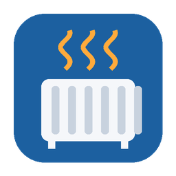

# ioBroker.mill-local

_Lesen Sie dies in einer anderen Sprache: [Deutsche Kurzbeschreibung](/#/docs/adapterref/iobroker.mill-local/README_de.md) ._

Verbinden Sie **Mill-Geräte der 3. Generation** ( [Mill International AS](https://millnorway.com/) ) über deren **lokale REST-API** mit ioBroker – ohne Cloud, ohne Mill-Konto, ohne App. Funktioniert für jedes Gerät der 3. Generation mit der lokalen API:

| Gerätetyp                | Erkannt von                                                     | Zusätzliche Werte                          |
| ------------------------ | --------------------------------------------------------------- | ------------------------------------------ |
| Wi-Fi-Steckdose Gen 3    | Modellname (`Mill HeaterGen3Socket`) /`additional-socket-mode` | Feuchtigkeit, zusätzlicher Steckdosenmodus |
| Paneelheizung Gen 3      | Modellname /`limited-heating-power`, `pid-parameters`           | Leistungsbegrenzung                        |
| Konvektionsheizung Gen 3 | Modellname                                                      | –                                          |
| Ölheizung Generation 3   | Modellname /`oil-heater-power`                                  | Leistungsstufe 40/60/100 %                 |

Der Adapter erkennt den Typ anhand des vom Programm gemeldeten Modellnamens. `GET /status` Zusätzlich werden optionale Endpunkte geprüft, sodass auch unbekannte Modellnamen verarbeitet werden können. Mehrere Geräte pro Instanz werden unterstützt. Geräte der Generationen 1 und 2 verfügen über keine lokale API und werden daher nicht unterstützt (verwenden Sie hierfür Cloud-basierte Lösungen).

## Merkmale

- **Jeder Wert existiert genau einmal.** Schreibbare Werte enthalten den Gerätewert (ack=true) und dienen gleichzeitig als Anzeige und Aktor – es gibt keine separate, schreibgeschützte Kopie.
- `control.*`: Zieltemperatur (Normalbetrieb), Betriebsmodus (die vier Mühlenmodi plu&#x73;** `Switch` ** ), Ein-/Ausschalten des Thermostats, Neustart
- **Ein-/Ausschalten wie bei einem Thermostat** (siehe unten): EIN kehrt zum letzten Thermostatmodus zurück, AUS schaltet immer aus; Dauerheizung ohne Thermostat nur im Betriebsmodus `Switch`
- `settings.*` (beschreibbar): Kalibrierungs-Offset, Kindersicherung, Gewerbesperre, Anzeigeeinheit, vorausschauende Heizung, Cloud-Kommunikation (nach einem Neustart des Geräts), Hysterese über/unter dem Zielwert, Komfort-/Schlaf-/Abwesenheitstemperaturen, Erkennung offener Fenster und ihre fünf Parameter, Ölheizungsleistungsstufe, Leistungsgrenze des Heizpaneels, zusätzlicher Steckdosenmodus, Zeitzonen-Offset, Reglertyp (PID nur für Heizpaneele), Grenzen der Gewerbesperre, PID-Parameter (Heizpaneele), **Wochenprogramm, einmalige Timer und Urlaub** (lesbares JSON, siehe unten); `info.customName` benennt das Gerät um
- Nur lesbar: Raumtemperatur (kalibriert und Rohdaten), Luftfeuchtigkeit (Steckdosen), **aktive Zieltemperatur** (der aktuell vom Gerät geregelte Wert, z. B. des laufenden Wochenprogramms), Heizleistung, Steuersignal, Heizbetrieb (Relais), **aktive Verriegelung** , offenes Fenster erkannt, Cloud-Verbindung
- Geschätzter Energiewert (`energy.total/today/yesterday`, kWh) aus den Leistungsmesswerten
- **Die Steuerung ist standardmäßig aktiviert** ; ausgeschaltet, `control.*` Und `settings.*` werden schreibgeschützt (mit schreibgeschützten Rollen) und `control.restart` wird nicht erstellt
- Jeder Wert wird validiert (Bereich, Schrittweite, Werteliste), bevor etwas gesendet wird.
- Netzwerksuche (die Geräte melden sich nicht über mDNS an), automatische Wiedererkennung anhand der MAC-Adresse, wenn ein Gerät seine IP-Adresse ändert
- Optionaler API-Schlüssel (Geräte, die auf HTTPS umgestellt wurden)

## Konfiguration

1. **Geräte** – Geben Sie die IP-Adresse jedes Geräts oder ein Netzwerk ein (z. B. `192.168.1.0/24` Drücken Sie anschließend auf **„Geräte suchen“** und speichern Sie die Einstellungen. Die MAC-Adresse wird automatisch ausgefüllt; damit kann der Adapter ein Gerät nach einer Adressänderung wiederfinden.
2. **Abfrage** – Status alle 30 Sekunden (Temperatur, Leistung, Modus), Einstellungen alle 600 Sekunden, Anfrage-Timeout 5 Sekunden. Werte außerhalb der Grenzwerte (10–3600 s, 60–86400 s, 1–30 s) werden korrigiert und mit einer **Warnung im Protokoll** versehen, die den verwendeten Wert angibt. Das Timeout darf nicht kürzer als das Abfrageintervall sein. Siehe _„Verbindung und Abfrage“_ weiter unten.
3. **Steuerung** – standardmäßig aktiviert. Durch Deaktivieren _der Steuerung wird die Steuerung_ aktiviert. `control.*` Und `settings.*` Schreibgeschützt. Der optionale API-Schlüssel wird verschlüsselt gespeichert und für jede Gerätezeile verwendet, in der _der API-Schlüssel_ aktiviert ist.

## Objekte

Jedes Gerät wird erstellt als `mill-local.0.<mac>` (12 Hexadezimalstellen) mit den Kanälen `info`, `sensor`, `status`, `control`, `settings` Und `energy` Die `<device>.refresh` Liest ein Gerät sofort aus. Zustände älterer Versionen, die nicht mehr Teil des Modells sind (z. B. `status.operationMode` neben `control.operationMode`) werden beim Start entfernt. `info.connection` Ist `true` solange **mindestens ein** konfiguriertes Gerät erreichbar ist (siehe unten).

### Verbindung und Abfrage

- **Erreichbar** bedeutet: Das Gerät hat die letzte Umfrage mit gültigen Daten beantwortet. Eine Umfrage ist `GET /control-status` Und `GET /set-temperature` (Normalbetrieb); die Einstellungen werden in jedem _Einstellungsintervall_ ebenfalls ausgelesen. Anfragen an ein Gerät werden **nacheinander** gesendet (das Gerät bearbeitet jeweils nur eine Anfrage); mehrere Geräte werden unabhängig voneinander und zeitversetzt abgefragt.
- Eine Anfrage schlägt fehl bei: keiner Verbindung, keiner Antwort innerhalb des Zeitlimits (auch wenn ein Gerät die Verbindung annimmt, aber nie antwortet oder nur sporadisch Daten sendet), HTTP-Fehler, einer Antwort, die nicht im JSON-Format vorliegt oder leer ist, einer Antwort mit einem `status` außer `ok` oder ein `control-status` Betriebsmodus und Temperatur werden nicht berücksichtigt. Eine fehlgeschlagene Abfrage **ändert keinen Wert** – alle Zustände behalten ihren letzten gültigen Wert (mit Bestätigung) und Zeitstempel.
- Nach **drei fehlgeschlagenen Abfragen in Folge** wird das Gerät als offline gezählt: `<mac>.info.online = false` Es wird eine Warnung im Protokoll protokolliert (einmalig mit Angabe des Grundes) und, falls aktiviert, wird die MAC-Adresse des Geräts im Netzwerk gesucht (maximal alle 30 Minuten). Die erste gültige Antwort stellt die Verbindung wieder her (Informationen dazu werden im Protokoll protokolliert).
- ** `info.connection` ** Ist `true` solange mindestens ein konfiguriertes Gerät erreichbar ist, `false` Wenn keines verfügbar ist (oder kein Gerät konfiguriert ist), wird angezeigt, welches Gerät offline ist. `<mac>.info.online` (auch auf der Gerätekarte).
- **Befehle** werden hinter einer laufenden Abfrage in eine Warteschlange gestellt und direkt im Anschluss gesendet. Messwerte, die vor einem Befehl begonnen haben, überschreiben dessen Ergebnis nicht; das Gerät wird unmittelbar danach erneut ausgelesen. Wenn die Instanz stoppt, wird die laufende Anfrage abgebrochen und die in der Warteschlange befindlichen Befehle werden **nicht** gesendet.
- Die Geräte können keine Änderungen übertragen: Eine Änderung auf dem Gerät (Tasten, App) wird erst bei der nächsten Abfrage sichtbar.

## Gerätemanager

Die Instanz unterstützt den ioBroker **-Gerätemanager** (Registerkarte „ _Geräte“_ in der Administration). Jedes konfigurierte Gerät erhält eine Karte, die nur für den **laufenden Betrieb** gilt: Name und Modell, Erreichbarkeit, Fehlerbericht des Geräts als Warnung, Anzeige für ein _erkanntes offenes Fenster_ , Raumtemperatur, Luftfeuchtigkeit (Steckdosen), Betriebsmodus, Zieltemperatur, aktuelle Leistung (W) und der geschätzte Energieverbrauch für heute. Alle Werte sind auf der Karte selbst gespeichert.

- **Ein/Aus** ist ein Schalter in der Statuszeile; sein Symbol und Text richten sich nach dem Status. `status.switchedOn` (Aus = Betriebsmodus _Aus_ oder _Schalter_ mit geöffnetem Relais). Ein Klick dient zur Bestätigung. Es bewirkt dasselbe wie `control.power` Im Modus _„Aus“_ wird das Thermostat ausgeschaltet, _im_ Modus „Ein“ wird in den zuletzt verwendeten Modus zurückgekehrt (Standard: _Einzelsteuerung_ ). Im Modus _„Schalten“_ wird das Relais geöffnet und geschlossen. Dauerheizung ist weder im Modus „ _Aus“_ noch im Thermostatmodus möglich.

- **Betriebsmodus** (Auswahl) und **Zieltemperatur** (Schieberegler, wird nach einer Sekunde Ruhezeit gesendet) bleiben auch bei ausgeschaltetem Heizgerät nutzbar; die Wahl eines anderen Modus als _„Aus“_ schaltet es ein.

- **Wochenprogramm** (Kalender-Schaltfläche): Ein Wochenraster, eine Zeile pro Wochentag von 0 bis 24 Stunden; jeder Block repräsentiert einen Zeitraum mit seiner Temperatur, z. B. _Komfort (22 °C)_ . Ziehen Sie einen Rahmen (15-Minuten-Schritte; Tastatur: Pfeiltasten, Umschalt = 1 Stunde, Entf entfernt), klicken Sie auf einen Block, um seinen Zeitraum zu ändern oder ihn zu teilen, doppelklicken Sie, um ihn an dieser Stelle zu teilen, kopieren und fügen Sie ganze Tage ein. Die Temperaturen für Komfort, Schlaf, Abwesenheit und Normal können in der Legende geändert werden. _Mit OK_ wird das Programm gespeichert (maximal 64 Schaltpunkte); falls das Gerät das Wochenprogramm noch nicht ausführt, fragt der Adapter, ob es aktiviert werden soll. Die Seite ist reines HTML (`admin/weekly.html`) im Dialog.

Die Steuerelemente sind nur verfügbar, solange die Steuerung aktiviert ist. Die Karte speichert die bestehenden Zustände (ack=false), daher gilt dieselbe Validierung wie für Skripte – es werden ausschließlich die dokumentierten Betriebsmodi gesendet.

Es gibt bewusst **keine Konfigurationsoptionen** für die Karten (keine Suche, Hinzufügen, Entfernen oder Adressänderung); die Geräte werden weiterhin in den Instanzeinstellungen konfiguriert. Ein Gerät, das noch nie geantwortet hat, wird nur mit seinem Namen und seiner Adresse angezeigt. Nach dem Hinzufügen von Geräten oder dem Aktivieren der Steuerung laden Sie die Geräteliste neu.

## Hinweise und Fallstricke

- **Das Gerät erkennt jeden Betriebsmodus mit `"ok"` und schaltet sich bei unbekannten Werten selbst aus.** Der Adapter sendet daher nur die dokumentierten Modi (`Control individually`, `Weekly program`, `Independent device`, `Off` Das Gerät meldet den Aus-Modus als `OFF` Der Adapter zeigt `Off` Die
- Das Gerät bearbeitet jeweils nur eine Anfrage; der Adapter stellt alle Anfragen pro Gerät in eine Warteschlange.
- Ein Betriebsmodus, den der Adapter nicht kennt (die API-Beschreibung listet `Invalid`) wird wie berichtet angezeigt in `control.operationMode` wird als ausgeschaltet gewertet und einmalig als Warnung protokolliert. Es wird nie gesendet; `control.power` = EIN kehrt zum letzten Thermostatmodus zurück.
- In `Independent device` ein einmaliger Timer der Art `Off` /`AlwaysHeating` meldet die gleichen Werte wie `Switch` bei geöffnetem / geschlossenem Relais (`set_temperature` 0 / 99). Der Adapter unterscheidet sie anhand der ausgelesenen Timer (der zuletzt abgelaufene Timer); ein am Gerät eingestellter Timer wird bei der nächsten Abfrage der Einstellungen angezeigt. Abgeleitet aus der API-Beschreibung, noch nicht auf einem realen Gerät getestet.
- Im Modus `Independent device` Eine neue Zieltemperatur tritt nur in Kraft, wenn `set-temperature-in-independent-mode-now` Der Adapter sendet es automatisch.
- `POST /open-window` Und `POST /hysteresis-parameters` Der vollständige Parametersatz wird benötigt; der Adapter liest zuerst die aktuellen Werte und ändert nur den zuletzt geschriebenen Wert.
- **Ein/Aus:** `control.power` (Rolle `switch.power`) ist der Ein-/Ausschalter des **Thermostats** , wie er von Visualisierungen (Material, Alexa, Lovelace usw.) neben der Zieltemperatur erwartet wird, und entspricht dem Schalter auf der Gerätekarte. **EIN** stellt den letzten Thermostatmodus wieder her (`Control individually`, `Weekly program` oder`Independent
  device `; Standard` Control individually `) – Im Thermostatmodus werden keine Daten gesendet. **OFF** schaltet den Betriebsmodus ein.` Off `. Lesen:` true ` = eingeschaltet (dasselbe wie` status.switchedOn ` Ob das Relais momentan geschlossen ist, ist` status.heating` Die
- **Dauerheizung ohne Thermostat nur im Betriebsmodus `Switch` ** (ein Adaptermodus): geschrieben an `control.operationMode` Es beginnt mit geöffnetem Relais; in diesem Modus `control.power` Schaltet (EIN) und öffnet (AUS) das Relais unabhängig vom Wochenprogramm und der Zieltemperatur. `Switch` =`Independent device` mit dem Relais erzwungen über `set-temperature-in-independent-mode-now` 99 (ein) / 0 (aus) – verifiziert an einer Wi-Fi Socket Gen 3. Um wieder über den Thermostat zu heizen, wählen Sie einen Thermostatmodus. `current_power` Die Leistungsaufnahme beträgt 0 W, wenn nichts an eine Steckdose angeschlossen ist, und `switched_on` blieb `false` während das Relais geschlossen war; der Adapter nutzte daher das Steuersignal.
- **Bis Version 0.3.x** `control.power = true` umgeschaltet auf `Switch` bei geschlossenem Relais (Dauerheizung) und dem gelesenen Wert des Relais. Skripte, die verwendet wurden `control.power` als "Heizen jetzt" gelesen `status.heating` stattdessen.
- **Typdetektor:** das Gerät (und seine `control` Kanal) wird als ein Thermostat erkannt: Sollwert `control.targetTemperature` tatsächliche Temperatur `sensor.temperature` Luftfeuchtigkeit, Ein/Aus `control.power` Die voreingestellten Temperaturen von `settings.*` Die Rohtemperatur und das aktive Ziel nutzen daher die Rollen `level` /`value` (mit der Einheit °C).
- **Zeit, Wochenprogramm, Timer, Urlaub:** Das Gerät verfügt über keine batteriegepufferte Uhr und keine API zum Einstellen der Zeit. Nach jedem Start fragt es:** `pool.ntp.org` ** via NTP (im DNS-Log sichtbar; bei deaktivierter Cloud-Kommunikation werden keine weiteren Anfragen gestellt). **Zuvor prüft es die Internetverbindung mit einem ICMP-Ping an `4.2.2.1` ** (Eingebaut; beobachtet an einem Wi-Fi Socket Gen 3): Ohne Standardgateway wird xxx1 angenommen, und ohne Ping-Antwort wird nie die Uhrzeit abgefragt. DHCP-Option 42 (NTP-Server) wird nicht verwendet. Vollständige lokale Konfiguration, die funktioniert: Gateway via DHCP, Firewall lässt nur ICMP-Echo vom Gerät zu `4.2.2.1` (alles andere im Internet ist blockiert), und `pool.ntp.org` verweist auf einen lokalen NTP-Server, z. B. mit einer DNS-Umschreibung nur für die IoT-Clients (AdGuard: `||pool.ntp.org^$dnsrewrite=NOERROR;A;<ntp-server>,client=<iot-net>` Das Gerät wiederholt die DNS-Abfrage dann etwa alle 2 Minuten. Überprüfung: Ein wöchentlicher Programmeintrag wird zur erwarteten Minute aktiviert. Die Zeitzone ist eine separate Einstellung (`timezone-offset`, 1440 = nicht festgelegt); bei der _Option "Zeitzone des Geräts an ioBroker anpassen_ " (Standard) übernimmt der Adapter die Zeitzone vom ioBroker-Host, auch bei Änderungen der Sommerzeit.
  - `settings.weeklyProgram`: `[{"day":"Mon","time":"06:30","type":"Comfort"}, …]` – Heizmodi: Komfort, Schlaf, Abwesenheit, Normal, Aus, ImmerHeizung; gespeichert in Minuten seit Montag 00:00 Uhr; aktiv im Modus `Weekly program` Die
  - `settings.timers`: `[{"time":"2026-10-19T06:30","type":"Normal"}, …]` (Ortszeit) – Typen Normal, Aus, ImmerHeizen; aktiv im Modus `Independent device` Die
  - `settings.vacation`: `{"start":"2026-12-24T08:00","end":"2027-01-02T18:00"}`, `{}` = keine. Alle drei werden im Gerät gespeichert und ausgeführt; der Adapter liest und schreibt sie lediglich.
- Eine Abfrage, die bereits lief, als ein Befehl eintraf, setzt den Zustand nicht mehr auf den alten Wert zurück (Messwerte, die älter als der Befehl waren, werden verworfen, das Gerät wird direkt im Anschluss erneut ausgelesen).
- Das Gerät akzeptiert nur die in der Dokumentation angegebene Schreibweise der Anzeigeeinheit. `Farenheit` Der Adapter zeigt und nimmt `Fahrenheit` und übersetzt es. `Fahrenheit` selbst wird anerkannt mit `ok` und ignoriert.
- Nicht absichtlich angeboten: `set-api-key` (unwiderrufbar ohne Werksreset), Soft-/Hard-Reset, OTA-Update (erfordert eine Firmware-URL und Internetverbindung), WLAN-Konfiguration, `ablecloud-message`, `max-heater-power` (Leistungsmesserkalibrierung, kann nicht ausgelesen werden).
- **Keine Internetverbindung erforderlich:** die lokale API und der Modus `Control individually` Das Gerät funktioniert auch ohne Internetverbindung. Wochenprogramm und Timer benötigen die korrekte Uhrzeit, die das Gerät erst nach einem Neustart aus dem Internet bezieht (es besitzt keine batteriegepufferte Uhr). Die Cloud-Kommunikation kann auf dem Gerät deaktiviert werden; dies wird in der Benutzeroberfläche angezeigt. `settings.cloudCommunication` Die
- **API-Schlüssel:** nach `POST /set-api-key` Das Gerät wechselt zu HTTPS mit einem selbstsignierten Zertifikat (der Adapter überprüft es nicht) und erwartet den Schlüssel im Header. `Authentication` Der Adapter selbst vergibt keinen Schlüssel – zum Entfernen eines Schlüssels ist ein Werksreset erforderlich. Geräte mit einem API-Schlüssel werden von der Suche nicht gefunden.
- Die Energiewerte sind **Schätzwerte** (Leistung × Zeit zwischen zwei Umfragen); Lücken werden nicht berücksichtigt.
- ioBroker in Docker: Funktioniert in einem Bridge-Netzwerk, der Adapter öffnet nur ausgehende HTTP-Verbindungen.

## PV-Überschuss

Mühlenheizungen sind eine einfache Last für die Überschussregelung (z. B. mit einem Skript):

- **Ölheizungen:** `settings.oilHeaterPower` Legt die Leistungsstufe fest (40, 60 oder 100 % der Nennleistung; 0 ist gemäß API ebenfalls zulässig). Erhöhen Sie die Stufe bei Überschuss, senken Sie sie bei Bedarf. Das Gerät regelt die Temperatur kontinuierlich auf den Zielwert – die Leistungsstufe begrenzt lediglich die Leistung.
- **Paneelheizkörper:** `settings.limitedHeatingPower` Die Leistung wird in 1 %-Schritten (10–100 %) begrenzt; das gleiche Prinzip mit feinerer Granularität.
- **Wi-Fi-Steckdose und alle anderen Geräte:** Schalten Sie das Thermostat mit der Wi-Fi-Steckdose und allen anderen Geräten ein und aus. `control.power` (hält die Zieltemperatur) oder verwenden Sie den Betriebsmodus `Switch` für eine ebene Ladung: `control.power` dann schließt und öffnet das Relais ohne Thermostat.
- Schreiben Sie diese Werte nur, wenn sie sich ändern, nicht bei jeder Überschussberechnung (das Gerät beantwortet jeweils nur eine Anfrage; auf jeden Befehl folgt ein Lesevorgang). Überprüfen Sie das Ergebnis in `status.power` (W) und die geschätzte Energie.

## Migration von ioBroker.millheater

1. Öffnen Sie die Instanzeinstellungen von mill-local, wechseln Sie zum Tab _„Geräte“_ und klicken Sie auf **„Von millheater übernehmen“** . Der Adapter liest alle `millheater.<n>` Die Instanz (Adresse, Abfrageintervalle, Timeout) sowie die MAC-Adresse und der Name aus ihren Zuständen werden abgerufen und in die Gerätetabelle eingetragen (ein vorhandener Eintrag mit derselben MAC-Adresse wird aktualisiert, nicht dupliziert). Intervalle außerhalb der Grenzen von mill-local werden entsprechend angepasst.
2. Speichern und anschließend **die Millheater-Instanz(en) stoppen** : Ein Mill-Gerät beantwortet jeweils nur eine Anfrage; zwei Adapter, die dasselbe Gerät abfragen, führen zu Timeouts.
3. Verweisen Sie Skripte, Visualisierungen und Aliase auf die neuen IDs (`<mac>` (MAC-Adresse, 12 Hexadezimalstellen):

| Mühlenofen (`millheater.<n>.`)              | Mühlenlokal (`mill-local.<n>.<mac>.`)                    | Notiz                                                         |
| -------------------------------------------- | --------------------------------------------------------- | ------------------------------------------------------------- |
| `control-status.ambient_temperature`         | `sensor.temperature`                                      |                                                               |
| `control-status.raw_ambient_temperature`     | `sensor.temperatureRaw`                                   |                                                               |
| `control-status.set_temperature` (schreiben) | `control.targetTemperature`                               | Normale Temperatur, auch im ausgeschalteten Zustand ablesbar. |
| `control-status.set_temperature` (lesen)     | `status.activeTargetTemperature`                          | leer (nicht 0), wenn ausgeschaltet                            |
| `control-status.operation_mode`              | `control.operationMode`                                   | `Off` anstatt `OFF`, plus `Switch`                            |
| `control-status.current_power`               | `status.power`                                            |                                                               |
| `control-status.control_signal`              | `status.controlSignal`                                    |                                                               |
| `control-status.switched_on`                 | `status.heating`                                          | Relais geschlossen (durch das Steuersignal)                   |
| `control-status.lock_active`                 | `status.lockActive`                                       |                                                               |
| `control-status.open_window_active_now`      | `status.openWindowActive` +`settings.openWindowDetection` | zwei boolesche Werte anstelle eines Textes                    |
| `control-status.connected_to_cloud`          | `status.cloudConnected`                                   |                                                               |
| `settings.temperature_calibration_offset`    | `settings.calibrationOffset`                              |                                                               |
| `settings.heating_level_percentage`          | `settings.oilHeaterPower`                                 | Ölheizungen                                                   |
| `settings.limited_heating_power`             | `settings.limitedHeatingPower`                            | Paneelheizkörper                                              |
| `settings.additional_mode`                   | `settings.additionalSocketMode`                           | WLAN-Anschluss                                                |
| `status.name`                                | `info.model`                                              |                                                               |
| `status.custom_name`                         | `info.customName`                                         | beschreibbar                                                  |
| `status.version`                             | `info.firmware`                                           |                                                               |
| `status.mac_address`                         | `info.mac`                                                |                                                               |
| `status.operation_key`                       | `info.operationKey`                                       |                                                               |
| `info.connection`                            | `info.connection` /`<mac>.info.online`                    | pro Instanz / pro Gerät                                       |

Die Geschichte der alten Staaten wird nicht übertragen.

## Unterschied zu ioBroker.millheater

[ioBroker.millheater](https://github.com/webbummler/ioBroker.millheater) nutzt ebenfalls die lokale API und unterstützt die gleichen Geräte der 3. Generation (Konvektions-, Öl- und Flächenheizungen sowie WLAN-Steckdosen). Es steuert ein Gerät pro Instanz und konzentriert sich auf Zieltemperatur, Betriebsmodus, Kalibrierung und Leistungsstufe (z. B. zur Steuerung von PV-Überschussstrom). Gründliche Tests und eine umfassende Dokumentation sind vorhanden. **mill-local** steuert **mehrere Geräte pro Instanz** mit Netzwerksuche und -wiedererkennung über die MAC-Adresse. Es deckt **alle Einstellungen ab, die über die lokale API geändert werden können** (Sperren, Hysterese, offenes Fenster, voreingestellte Temperaturen, Wochenprogramm, Timer, Urlaub, Zeitzone, PID usw.), die Luftfeuchtigkeit der WLAN-Steckdose, einen einfachen Ein-/Aus-Modus ohne Thermostat, eine Energieschätzung und Geräteverwaltungskarten. Beide Adapter benötigen weder ein Mill-Konto noch die Cloud.

## Visualisierung (vis)

Der Adapter bringt seine eigenen **VIS-1-Widgets** (Einstellung: _Mill-Local_ ) mit: Gerätekarte, Telefonkarte, Raumtemperatur mit Sollwert/-, Messwerten, Betriebsmodus, Wochenprogramm (Anzeige), Tageswerte mehrerer Geräte, Gesamtleistung und ein **Verlaufsdiagramm** (Raumtemperatur, Sollwert als Kurve, aktuelle Leistung als Fläche, Luftfeuchtigkeit der WLAN-Steckdose; 24 Stunden oder 7 Tage). Vorgefertigte Ansichten für Übersicht, Detailseite und Telefon sind ebenfalls vorhanden.[`vis-templates/`](/#/docs/adapterref/iobroker.mill-local/vis-templates/README.md) Licht und Dunkelheit, Texte in elf Sprachen.

Das Diagramm liest aufgezeichnete Werte von jedem beliebigen Verlaufsadapter (`history`, `influxdb`, `sql`; Attribut _„History“ (Instanz_ , leer = Standardwert). **Der Adapter deaktiviert die Aufzeichnung** – aktivieren Sie sie in der Objektstruktur (Zahnradsymbol) für `sensor.temperature`, `status.activeTargetTemperature`, `status.power`, `sensor.humidity` (WLAN-Anschluss) und optional `control.targetTemperature` jedes Geräts.

## Entwicklung und Tests

- `npm test` – Paket- und Komponententests; `npm run lint` – ESLint 9 (flache Konfiguration von `@iobroker/eslint-config`).
- `IOB_CONTROLLER=latest npm run test:integration`– startet einen JS-Controller mit dem Adapter für simulierte Geräte (`test/fakeMill.js`): Wi-Fi-Steckdose, Bedienfeld, Öl- und Konvektionsheizung, Wochenprogramm / Timer / Urlaub mit beweglicher Geräteuhr und ohne NTP, offenes Fenster, Kindersicherung, unbekannte Betriebsmodi, ungültige Antworten, Zeitüberschreitungen, Verbindungsabbrüche, Neustart, Betriebsmodus-Trap und Abschaltung mit einer Anfrage über die Leitung.
- `node test/simulator.js --base 18000 --pid sim.pid` – vier simulierte Geräte (Ports 18001–18004) mit einem Raum, der sich erwärmt, während sich das Gerät erwärmt, um den Adapter ohne Hardware zu testen. `GET http://127.0.0.1:18000/` zeigt sie ihnen, `POST http://127.0.0.1:18000/<n>` z.B. `{"windowOpen": true}` oder `{"offline": true}` ändert die Simulation; stoppen Sie mit `kill $(cat sim.pid)` Nicht Teil des npm-Pakets.

## Quellen

- Offizielle API-Beschreibung: [Mill-International-AS/Generation\_3\_REST\_API](https://github.com/Mill-International-AS/Generation_3_REST_API) (API-Version 0x220727; teilweise veraltet oder fehlerhaft – der Adapter orientiert sich an realen Geräten)
- Das Verhalten wurde mit der Home Assistant-Integration abgeglichen.[`mill`](https://github.com/home-assistant/core/tree/dev/homeassistant/components/mill) (Apache-2.0) und [pyMillLocal](https://github.com/Danielhiversen/pyMillLocal) (MIT). Es wurde kein Code kopiert.
- Ideen und Testszenarien aus [ioBroker.millheater](https://github.com/webbummler/ioBroker.millheater) von webbummler (MIT): Aktive Zieltemperatur, aktive Sperre, Beschreibung der Verbindung und des Pollings, PV-Überschussmeldungen und Fehlerszenarien der Tests (ungültige Antworten, Timeout, Schreiben während eines Pollings, Abschaltung mit einer Anfrage im Netzwerk), Validierung der Zeitwerte im Admin-Formular (Wertebereiche und die Regel _Timeout < Polling-Intervall_ , nicht speichern bei ungültigen Werten) und die Behandlung des gemeldeten Modus `Invalid` Die Tests wurden für diesen Adapter neu geschrieben; es wurde kein Code kopiert.

## Warenzeichen

Mill ist eine Marke der Mill International AS. Dieser Adapter ist ein unabhängiges Projekt und steht in keiner Verbindung zu Mill International AS und wird von dieser auch nicht unterstützt.

## Changelog

<!--
	Placeholder for the next version (at the beginning of the line):
	### **WORK IN PROGRESS**
-->
### 0.4.1 (2026-11-20)

- (Immanuel) Fix: the integration test failed on hosts in UTC (time zone offset -0 instead of 0); no functional changes
  compared to 0.4.0.

### 0.4.0 (2026-11-20)

- (Immanuel) **Breaking:** `control.power` is now the on/off of the thermostat, as visualisations expect it: ON returns
  to the last thermostat mode, OFF switches off. Permanent heating without thermostat only in the operation mode
  `Switch` (there `control.power` is the relay). The relay is the new state `status.heating`.
- (Immanuel) New states `status.activeTargetTemperature` (empty instead of 0 while off) and `status.lockActive`.
- (Immanuel) Type detector: exactly one thermostat per device (setpoint `control.targetTemperature`, actual
  temperature `sensor.temperature`).
- (Immanuel) `info.connection` is true while at least one device is reachable.
- (Immanuel) Clear warnings for invalid timing settings; empty or invalid answers keep the last values; the
  shutdown aborts the running request and drops queued commands.
- (Immanuel) Takeover from ioBroker.millheater (button in the instance settings), migration table in the README.
- (Immanuel) Weekly program on the device card as a week grid: draggable switching points, periods with their
  temperatures, copy/paste days, keyboard operation; asks after OK whether to activate the weekly program.
- (Immanuel) Unknown reported operation modes (e.g. `Invalid`) count as off and are logged once.
- (Immanuel) Admin form: timing values are checked (ranges, timeout shorter than the polling interval) and not
  saved while invalid.
- (Immanuel) Upgrade notice for the changed meaning of `control.power` (admin message on the update and one
  warning per device in the log).
- (Immanuel) vis widgets (set *mill-local*) with ready-made views (overview, detail page with weekly program and history
  chart, phone) in `vis-templates/`; the history chart reads any history adapter and switches no recording on.
- (Immanuel) Cards and objects: "Current power" instead of "Heating power" for `status.power`.
- (Immanuel) Requires js-controller 7.0.7 or newer.
- (Immanuel) Tests: simulator for Wi-Fi socket, panel, oil and convection heater with weekly program, timers,
  vacation, device clock, open window, child lock and connection loss; `test/simulator.js` for a demo instance.
- (Immanuel) Ideas and test scenarios from ioBroker.millheater by webbummler, MIT.

### 0.3.0 (2026-11-12)

- Device manager support (`@iobroker/dm-utils`, suggested by mcm1957 in issue #2): one card per device for the
  running operation – model, reachability, fault report, open-window indicator, room temperature, humidity,
  heating power and energy today; on/off toggle with confirmation, operation mode and target temperature
  directly on the card (also while off). No configuration actions.
- New state `status.switchedOn`: false only when the heater is off (mode *Off*, or *Switch* with the relay open).

### 0.2.2 (2026-10-23)

- Roles: operation mode, display unit, predictive heating and controller type use the role `text`
  (`level.mode` is not a valid role). With control disabled, the values get read-only roles and the restart
  button is left out.
- Configured intervals are also checked in the adapter (same limits as the admin UI, never above the timer
  limit); `info.connection` is reset when the adapter stops.
- Translations: remaining texts that were identical to English are translated; tab bar layout for small screens.
- Manufacturer link in the README; versions before 0.2.0 moved to CHANGELOG_OLD.md.

### 0.2.1 (2026-10-23)

-   Release via GitHub Actions with npm provenance (no functional changes).

### 0.2.0 (2026-10-23)

- First public release (functionally the same as 0.1.4): published on GitHub and npm, test data anonymised.

Older entries (versions before the first public release) are in CHANGELOG_OLD.md.

## License

MIT License

Copyright (c) 2026 Immanuel <github@freitag.online>

Permission is hereby granted, free of charge, to any person obtaining a copy of this software and associated
documentation files (the "Software"), to deal in the Software without restriction, including without limitation
the rights to use, copy, modify, merge, publish, distribute, sublicense, and/or sell copies of the Software, and
to permit persons to whom the Software is furnished to do so, subject to the following conditions:

The above copyright notice and this permission notice shall be included in all copies or substantial portions of
the Software.

THE SOFTWARE IS PROVIDED "AS IS", WITHOUT WARRANTY OF ANY KIND, EXPRESS OR IMPLIED, INCLUDING BUT NOT LIMITED TO
THE WARRANTIES OF MERCHANTABILITY, FITNESS FOR A PARTICULAR PURPOSE AND NONINFRINGEMENT. IN NO EVENT SHALL THE
AUTHORS OR COPYRIGHT HOLDERS BE LIABLE FOR ANY CLAIM, DAMAGES OR OTHER LIABILITY, WHETHER IN AN ACTION OF CONTRACT,
TORT OR OTHERWISE, ARISING FROM, OUT OF OR IN CONNECTION WITH THE SOFTWARE OR THE USE OR OTHER DEALINGS IN THE
SOFTWARE.