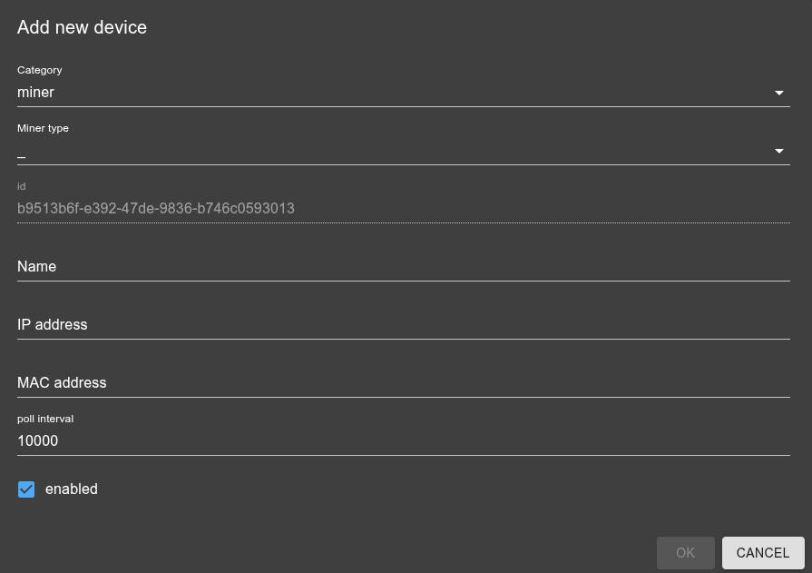

# ioBroker.miner

## Miner-Adapter für ioBroker

Interaktion mit verschiedenen Krypto-Miner-APIs

## Roadmap

- [x] Version 0.1: Geräteverwaltung, TRM-Implementierung
- [x] Weitere Miner unterstützen: bos+, xmrig, avalon, ...?
- [ ] mehr Funktionen implementieren (Steuerung + Informationen von Geräten)
- [ ] Pools unterstützen
- [ ] Geräteerkennung
- [ ] sentry
- [ ] Mehr dazu: siehe Todo.md / issues

## Verwendung

Beim Hinzufügen eines neuen Geräts in den Instanzeinstellungen (oder im Admin-Gerätemanager) sollte ein Dialogfeld wie dieses angezeigt werden:



Die Optionen sollten weitgehend selbsterklärend sein. Alle Optionen verfügen außerdem über Tooltips mit weiteren Details. Sollten dennoch Fragen offen sein, können Sie diese gerne in einem Issue, einer Diskussion oder im Forum stellen.

### Brains OS Miner-Typen

Es gibt zwei Implementierungen des Braiins-Miners, da Braiins den API-Stack über die Firmware-Generationen hinweg geändert hat:

- `bos` Verwenden Sie dies für die offizielle Brains OS-Firmware. `>= 23.03` Typischerweise werden Antminer der S19-Serie und neuere Modelle verwendet. Diese Implementierung nutzt die Brains OS Public API (PAPI) über gRPC.
- `bosMiner` Verwenden Sie dies für ältere Brains OS-Firmware. `< 23.03` Typischerweise handelt es sich dabei um Geräte vor der S19-Serie, wie beispielsweise die Antminer-Serien S9 und S17. Dabei wird weiterhin die ältere, mit CGMiner kompatible API verwendet.

`bosMiner` unterstützt auch die `control.powerTarget` Der Legacy Brains OS stellt diesen Status nicht über die CGMiner-kompatible API bereit, daher verwendet der Adapter einen SSH-Workaround: Er meldet sich beim Miner an und aktualisiert den Status. `power_target` im `[autotuning]` Abschnitt und `timestamp` im `[format]` Abschnitt von `/etc/bosminer.toml` speichert eine Sicherungskopie bei `/etc/bosminer.toml.iobroker-power-target.bak`, hält `bosminer` schreibt die Konfiguration und startet `bosminer` Konfigurieren Sie erneut gültige SSH-Anmeldeinformationen für `bosMiner` Geräte; der Standardbenutzername ist `root` ohne Passwort.

Warnung: Änderung `control.powerTarget` auf alten `bosMiner` Geräte benötigen eine vollständige `bosminer` Stopp-/Startzyklus. Ändern Sie diesen Wert nicht häufig; verwenden Sie ihn für gezielte Zielwertänderungen, nicht für schnelle Automatisierungsschleifen.

Wenn Sie sich nicht sicher sind, welches Gerät Sie wählen sollen, überprüfen Sie zuerst die Firmware-Generation/Gerätefamilie:

- S19/S21/T19 und neuere Brains OS-Images sind im aktuellen Firmware-Download-Prozess aufgeführt und sollten normalerweise verwendet werden `bos` Die
- S17-Bilder werden veröffentlicht als `v 23.01` und S9-Bilder als `v 22.08.1` auf der Brainins-Downloadseite, damit ältere Generationen dies nutzen können. `bosMiner` Die

Referenzen:

- Öffentliche API von Braiins OS: <https://academy.braiins.com/braiins-os/papi-about>
- Brainins OS Firmware-Downloads: <https://braiins.com/os-firmware/download>

### Avalon-Webanmeldung ohne die App

Die Weboberfläche der Avalon Nano 3/3S Miner verfügt über kein Passwortfeld: Sie zeigt einen QR-Code an, der mit der Avalon Family App gescannt werden muss. Der Adapter kann diese Anmeldung stattdessen bestätigen.

1. Geben Sie das Webpasswort des Miners in den Geräteeinstellungen ein (`web password` Es handelt sich um das Passwort, das für den Miner in der Avalon Family App festgelegt wurde.
2. Öffnen Sie die IP-Adresse des Miners im Browser, damit die Anmeldeseite mit dem QR-Code angezeigt wird.
3. Klicken Sie im Geräte-Manager auf dem Gerät auf „Webanmeldung genehmigen“. Der Browser wird innerhalb von 5 Sekunden angemeldet.

Dies bewirkt dasselbe wie das Scannen des QR-Codes: Der Adapter sendet dem Miner die `qr_auth` Der Befehl, den die App sendet, ist mit dem Webpasswort signiert.

### Avalon Staubfilter-Erinnerung

Avalon Nano 3/3S Miner zählen die Laufzeit ihres Staubfilters seit der letzten Reinigung. Der Adapter zeigt dies an als `custom.filter.runtime` (Stunden) und auf der Gerätekarte im Geräte-Manager.

- Wenn die Laufzeit das Erinnerungsintervall der Geräteeinstellungen erreicht (`filter cleaning reminder (days)` (Standardeinstellung 30 Tage, 0 = aus), `custom.filter.cleanDue` Wendungen `true` (auch auf der Gerätekarte), und der Adapter löst eine ioBroker-Benachrichtigung (Kategorie „Staubfilter muss gereinigt werden“) aus, die Benachrichtigungsadapter wie notification-manager beispielsweise an Telegram oder per E-Mail weiterleiten können.
- Nach der Filterreinigung setzen Sie die Erinnerung zurück: Drücken Sie in den Geräteeinstellungen (hinter der Steuerungstaste des Geräts im Geräte-Manager) auf „Filtererinnerung zurücksetzen“ oder stellen Sie die entsprechende Option ein. `custom.filter.reset` Zu `true` Dies entspricht der Funktion „Filter löschen“ in der Avalon Family App: Es sendet die Daten an den Miner. `ascset|0,filter-clean,1` Befehl, der seine Filterlaufzeit wieder auf 0 zurücksetzt.

Die Firmware-Prüfungen für BOS verwenden den zuletzt gemeldeten Steuerplatinentyp und die installierte Version, auch wenn das Gerät offline oder deaktiviert ist. Ein BOS-Gerät muss seine Identität mindestens einmal gemeldet haben. Die Avalon-Update-Prüfungen decken derzeit nur das genaue Nano-3-Modell ab: die App `nano3` Der Feed verfügt über keine verifizierte Kompatibilität mit Nano 3S, daher ist der Update-Status von Nano 3S weiterhin unbekannt.

## Objektmodell

Alle Objekte werden unter folgendem Pfad erstellt:

`miner.<instance>.miner.<minerId>`

`<minerId>` ist die stabile ID aus der Gerätekonfiguration (`settings.id` Dies ermöglicht mehrere Miner-Prozesse auf demselben Host.

### Gruppen (Kanäle)

- `info`: Identität/Konfiguration/Firmware/Verbindungsmetadaten
- `stats`: Live-Leistungskennzahlen (Hashrate, Shares, Leistung, Temperaturen, ...)
- `control`: beschreibbare Steuerelemente (Start/Stopp, Neustart, ...)
- `raw`: Rohdaten der API (Expertenversion)

### Entitäten (optionale Teilbäume)

Manche Miner legen Unterentitäten offen. Falls verfügbar, werden diese unterhalb des Miners platziert:

- `pools.<index>...`
- `hardware.gpus.<index>...`
- `hardware.hashboards.<index>...`

### Beispiele

- `miner.0.miner.<minerId>.enabled`
- `miner.0.miner.<minerId>.control.running`
- `miner.0.miner.<minerId>.stats.totalHashrate`
- `miner.0.miner.<minerId>.hardware.gpus.0.stats.temp`
- `miner.0.miner.<minerId>.raw.stats`

### Miner aktivieren/deaktivieren

Jedes Mining-Gerät verfügt über ein beschreibbares Top-Level-Verzeichnis. `enabled` Zustand:

`miner.<instance>.miner.<minerId>.enabled`

Stellen Sie diesen Zustand auf `false` Um den Miner im Adapter zur Laufzeit zu deaktivieren. Deaktivierte Miner werden entladen und es findet keine Abfrage-/Steuerungsverarbeitung für sie statt. Stellen Sie die Einstellung wieder auf 1. `true` Um den Miner erneut zu initialisieren, ohne den Adapter neu zu starten.

Dies ist etwas anderes als `control.running`: `enabled` steuert, ob der Adapter den Miner überhaupt verwaltet, während `control.running` Fordert einen unterstützten Miner auf, mit dem Mining zu beginnen oder es zu beenden.

### Beispielbaum

Dies ist lediglich eine Übersicht/Idee/ein Plan. Noch sind nicht alle Elemente umgesetzt, aber er soll Ihnen eine Vorstellung von der geplanten Struktur und Benennung vermitteln. Die tatsächliche Umsetzung kann in einigen Details abweichen, die allgemeine Struktur sollte jedoch ähnlich sein.

```
miner.0
  miner
    <minerId>                        (device)
      enabled                        (boolean)  enable/disable adapter handling for this miner
      info                           (channel)
        minerType                    (string)   e.g. xmRig / teamRedMiner / bosMiner
        host                         (string)
        version                      (string)   (maps to feature: version)
        online                        (boolean)  derived from lastSeen
        lastSeen                     (number)   unix ms
      stats                          (channel)
        totalHashrate                (number)   H/s (maps to feature: totalHashrate)
        power                        (number)   W
        dynamicPowerTarget           (number)   W, current dynamic target reported by miner
        efficiency                   (number)   H/W
        acceptedShares               (number)
        rejectedShares               (number)
      control                        (channel)  (writable states only here, top-level)
        running                      (boolean)  start/stop (maps to feature: running)
        reboot                       (boolean)  "button"
        profile                      (string)   performance profile (e.g. low/medium/high)
        powerTarget                  (number)   W, configured target to write to miner
      pools                          (channel)
        0                            (channel)
          info
            url                      (string)
            user                     (string)
          stats
            status                   (string)
            acceptedShares           (number)
            rejectedShares           (number)
        1 ...
      hardware                       (channel)
        gpus                         (channel)
          0                          (channel)
            info
              name                   (string)
            stats
              hashrate               (number)
              temp                   (number)   °C
              fanRpm                 (number)
              power                  (number)
          1 ...
        hashboards                   (channel)  (ASICs)
          0
            stats
              hashrate               (number)
              temp                   (number)
      raw                            (channel)
        stats                        (object/string) raw miner payload (maps to feature: rawStats)
      custom                         (channel)  features of a single miner type, not standardised across miners (yet)
        light                        (channel)  e.g. Avalon: LED light
          on                         (boolean)
          effect                     (number)   1 static, 2 flash, 3 breath, 4 loop
          brightness                 (number)   %
          colorTemperature           (number)   0-100
          color                      (string)   #RRGGBB
        lcd                          (channel)  e.g. Avalon: display
          on                         (boolean)
        filter                       (channel)  e.g. Avalon: dust filter
          runtime                    (number)   h since the last cleaning
          cleanDue                   (boolean)  reminder interval reached
          reset                      (boolean)  button: filter cleaned
```

### Benutzerdefinierte Funktionen (`custom`)

Manche Miner können Dinge, die kein anderer unterstützter Miner kann, wie beispielsweise die LED-Beleuchtung eines Avalon Nano. Anstatt solche Funktionen zu den Standardzuständen hinzuzufügen, deklariert ein Miner sie selbst; sie erscheinen als Unterkanäle von `custom` (Nur für Miner, die über entsprechende Einstellungen im Geräte-Manager verfügen): Schreibbare Einstellungen als Steuerelemente hinter der Steuerungstaste des Geräts, schreibgeschützte Einstellungen (z. B. eine Wartungsanzeige) auf der Gerätekarte. Ein schreibgeschützter boolescher Wert kann eine ioBroker-Benachrichtigung auslösen, wenn er sich ändert. `true`. Durch das Schreiben eines Zustands wird dieser an den Miner gesendet; er wird bestätigt, sobald der Miner ihn akzeptiert hat, und die nächste Abfrage spiegelt wider, was der Miner tatsächlich angewendet hat.

Einige Kanäle sind hardwareabhängig, z. B. einer pro Hashboard: Sie werden erstellt, sobald eine Abfrage sie meldet, und bleiben (mit ihren letzten Werten) erhalten, wenn eine Einheit in einer Abfrage fehlt oder der Miner noch nicht erreichbar ist.

Sobald mehrere Miner-Typen dieselbe Funktion unterstützen, wird diese in die gemeinsamen Zustände verschoben (z. B. `control`), und die alten `custom` Der Status wurde entfernt.

| Bergmann           | Zustand                                                                                                                                                                                                                                                                              | Anmerkungen                                                                                                                                                                                                                                                                                                                  |
| ------------------ | ------------------------------------------------------------------------------------------------------------------------------------------------------------------------------------------------------------------------------------------------------------------------------------ | ---------------------------------------------------------------------------------------------------------------------------------------------------------------------------------------------------------------------------------------------------------------------------------------------------------------------------- |
| Avalon             | `custom.light.on`, `custom.light.effect`, `custom.light.brightness`, `custom.light.colorTemperature`, `custom.light.color`                                                                                                                                                           | `effect` Der zuletzt verwendete Effekt bleibt erhalten, solange das Licht ausgeschaltet ist, und wird beim Einschalten wiederverwendet; die Auswahl eines Effekts schaltet das Licht auch ein.                                                                                                                               |
| Avalon             | `custom.lcd.on`                                                                                                                                                                                                                                                                      | Display ein/aus                                                                                                                                                                                                                                                                                                              |
| Avalon             | `custom.filter.runtime`, `custom.filter.cleanDue`, `custom.filter.reset`                                                                                                                                                                                                             | Erinnerung an den Staubfilter, siehe [Avalon-Erinnerung an den Staubfilter](#avalon-dust-filter-reminder)                                                                                                                                                                                                                    |
| Brains OS (`bos`) | `custom.hashboard<id>.*`: `enabled`, `chipsCount`, `chipType`, `highestChipTemp`, `boardTemp`, `lowestInletTemp`, `highestOutletTemp`, `lowestWaterInletTemp`, `highestWaterOutletTemp`, `voltage`, `frequency`, `hashrate`, `nominalHashrate`, `model`, `boardName`, `serialNumber` | Nur lesbar, ein Kanal pro Hashboard (z. B. `custom.hashboard1` Brainins OS meldet Chipdaten nur pro Board, nicht pro Chip: `highestChipTemp` ist der heißeste Chip auf dem Board. Temperaturen in °C, Spannung in V, Frequenz in MHz, Hashrate in H/s; die Wassertemperaturen werden nur bei wassergekühlten Minern angegeben. |

## Credits

- Das Logo wurde mit ChatGPT erstellt.

## Changelog
<!--
    Placeholder for the next version (at the beginning of the line):
    ### **WORK IN PROGRESS**
-->
### **WORK IN PROGRESS**
* (claude) **NEW**: Avalon: dust filter reminder. The filter runtime since the last cleaning is shown as `custom.filter.runtime` and on the device card; once it reaches the reminder interval of the device settings (default 30 days, 0 = off), `custom.filter.cleanDue` turns `true` and an ioBroker notification is raised. After cleaning, reset it with the "Reset Filter Reminder" device control or `custom.filter.reset`, like "Filter Clear" in the Avalon Family app. Custom features can now raise notifications, and read-only ones are shown on the device card
* (claude) **NEW**: Avalon: control the LED light (on/off, effect, brightness, color temperature, color) and the display (on/off), as states under `custom.light` / `custom.lcd` and in the device manager behind the device's control button. They come with the existing poll request, so they cost no extra round-trip
* (claude) **NEW**: Avalon: `control.profile` (and the profile in the device manager) now shows the miner's active work mode, also when it was changed elsewhere, e.g. in the Avalon Family app. It comes with the existing poll request. A work mode the miner rejects is now logged as an error
* (claude) **NEW**: Braiins OS (`bos`): per-hashboard custom features under `custom.hashboard<id>`: chip count and type, hottest chip temperature, board/inlet/outlet (and water) temperatures, voltage, frequency, hashrate and nominal hashrate. Braiins OS reports chip data only per board, not per chip
* (claude) **NEW**: Custom feature channels can depend on the hardware (e.g. one per hashboard): they are created when a poll first reports them, and their objects are kept while the miner isn't polled yet
* (claude) **NEW**: `custom` channel for features only a single miner type has (not standardised across miners yet); the device manager shows the writable ones, plus running and profile, as device controls

### 1.2.0 (2026-11-03)
* (claude) **NEW**: Check miners for available firmware/software updates once a day and show them in the device manager: new states `info.latestVersion` and `info.updateAvailable` (Braiins OS, XMRig, TeamRedMiner, IceRiver OC firmware, Avalon Nano 3), plus the auto-upgrade status for Braiins OS. Can be turned off in the instance settings; a "check for updates" action checks right away (#195)
* (claude) **FIXED**: `info.online` now switches to `false` after 3 failed polls in a row and back to `true` on the next successful one; a poll that hangs counts as failed after its poll interval, but at least 30 seconds, and requests to Braiins OS (gRPC) and XMRig / IceRiver (HTTP) are now cancelled after that time instead of staying open (#222)
* (claude) **NEW**: Avalon Nano 3 / 3S: log a browser in to the miner's web interface without the Avalon Family app. Enter the miner's web password in the device settings, open the miner's login page, and use the new "Approve web login" device action (#182)
* (claude) **NEW**: Avalon: WiFi signal strength as `info.rssi` (dBm), also shown in the device manager. It comes with the existing poll request, so it costs no extra round-trip; miners on a wired connection or with firmware that doesn't report it simply leave it empty (#178)
* (claude) **NEW**: Power target in the device manager (Braiins OS `bos` and `bosMiner`): set it right on the device card; the value is only sent with "Set" or Enter, not on every keystroke. For `bos`, `control.powerTarget` now shows the miner's configured target (also when it was changed elsewhere), and values outside the range the miner accepts are rejected before they reach it (#176)
* (claude) **ENHANCED**: An unreachable miner is no longer polled at the full rate: the time between polls doubles with every failed poll, up to 5 minutes and slightly randomized, and returns to the poll interval on the next successful poll (#175)
* (claude) **FIXED**: The instance stayed yellow ("Connected to device or service": no) although its miners were reachable: `info.connection` now lists the reachable miners (comma-separated, like the sonoff adapter does), so the instance is green while at least one enabled miner is reachable and the admin shows which ones (#231)
* (SimonFischer04) Dependency updates

### 1.1.0 (2026-07-12)
- (copilot) Adapter requires node.js >= 22 now
* (SimonFischer04) **NEW**: Added a new `bos` miner type for newer Braiins OS firmware using the Braiins Public API
* (SimonFischer04) **ENHANCED**: Extended legacy `bosMiner` devices with writable `control.powerTarget` support for deliberate power target changes
* (SimonFischer04) **NEW**: Added top-level `enabled` state to dynamically enable or disable miner handling at runtime
* (SimonFischer04) **FIXED**: Removed example configuration (option1, option2) from native section and code (fixes #126 / E5040)

### 1.0.4 (2026-04-07)
* (SimonFischer04) fix repo url in package-json

### 1.0.3 (2026-04-07)
* (SimonFischer04) increase admin requirement to fix DM (does not work at all with current stable 7.7.22)

### 1.0.2 (2026-04-07)
* (SimonFischer04) **CI/CD**: Migrated deploy workflow from NPM classic tokens to Trusted Publishing (OIDC) (fixes #80)
* (SimonFischer04) cleanup readme

## License

Copyright (c) 2026 SimonFischer04 <simi.fischa@gmail.com>  

This project is licensed under the GNU General Public License v3.0 - see [LICENSE](https://github.com/SimonFischer04/ioBroker.miner/blob/main/LICENSE) for details.