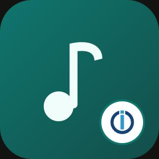

# ioBroker.music-assistant

## Musik-Assistent-Adapter für ioBroker

Steuern Sie Music Assistant-Player und -Warteschlangen über ioBroker.

> **Haftungsausschluss:** Dies ist ein inoffizieller, von der Community entwickelter Adapter. Er steht in keiner Verbindung zum Music Assistant-Projekt oder der Open Home Foundation und wird von diesen weder unterstützt noch empfohlen. „Music Assistant“ und das zugehörige Logo sind Eigentum ihrer jeweiligen Inhaber.

## Voraussetzungen

- Wenn ein [Music Assistant](https://music-assistant.io) -Server läuft, der von Ihrem ioBroker-Host aus erreichbar ist - oder Docker auf dem ioBroker-Host, dann kann der Adapter den Server selbst ausführen (siehe [Music Assistant in Docker](#music-assistant-in-docker) ).
- Ein API-Token (auf dem Music Assistant-Server, gehen Sie zu **Einstellungen → Profil** und erstellen Sie ein langlebiges Token) oder der Benutzername und das Passwort eines Music Assistant-Benutzers.

## Konfiguration

Geben Sie in den Einstellungen der Adapterinstanz Folgendes ein:

| Feld                    | Beschreibung                                                                |
| ----------------------- | --------------------------------------------------------------------------- |
| Gastgeber               | Hostname oder IP-Adresse des Musikassistenten-Servers                       |
| Hafen                   | WebSocket-API-Port (Standard) `8095`)                                       |
| Token                   | Das oben erstellte langlebige API-Token                                     |
| Benutzername / Passwort | Alternative zum Token: Anmeldeinformationen eines Music Assistant-Benutzers |

Langlebige Tokens verfallen im Musikassistenten nach einem Jahr. Mit Benutzername und Passwort meldet sich der Adapter bei jedem Start automatisch an und stößt daher nicht auf dieses Problem. Sind beide Angaben festgelegt, wird zuerst das Token versucht; falls dieses abgelehnt wird, kommen die Anmeldedaten zum Einsatz.

### Spieler-Registerkarte

Der Tab **„Player“** in den Instanzeinstellungen zeigt alle Player mit Cover, Titel, Interpret und Position an und ermöglicht deren Steuerung: Wiedergabe/Pause, Stopp, Nächster/Vorheriger Player, Suchen, Lautstärke, Stummschaltung, Zufallswiedergabe, Wiederholung und Ein/Aus. Das Textfeld unterhalb eines Players funktioniert wie die Statusanzeige. `playMedia` (siehe unten). Die Registerkarte funktioniert nur, solange die Instanz läuft, und liest und schreibt dieselben Zustände wie jeder andere Adapter, daher muss nichts gespeichert werden.

## Musikassistent in Docker

Anstatt sich mit einem bestehenden Server zu verbinden, kann der Adapter Music Assistant selbst in einem Docker-Container auf dem ioBroker-Host ausführen. Docker muss dort installiert sein und laufen. `iobroker` Der Benutzer muss Zugriff auf die Docker-Befehlszeilenschnittstelle (CLI) haben (um die Berechtigungen zu korrigieren, führen Sie folgenden Befehl aus): `iob fix`).

1. Aktivieren Sie **„Musikassistent in Docker ausführen“** in den Instanzeinstellungen und geben Sie einen **Benutzernamen** ein (Standardwert). `admin` Geben Sie ein **Passwort** (mindestens 8 Zeichen) ein und speichern Sie es. Host, Port und Token werden dann ausgeblendet: Der Adapter verbindet sich mit `127.0.0.1:8095` von selbst. Der Behälter `iob_music_assistant_<instance>` mit dem Bild `ghcr.io/music-assistant/server` wird erstellt und gestartet.
2. Sobald der Server antwortet, erstellt der Adapter diesen Benutzer als Administrator im Music Assistant (dieselbe Ersteinrichtung, die auch die Weboberfläche anbietet) und meldet ihn damit an. Es wird kein Token benötigt.
3. Offen `http://<ioBroker-host>:8095` Im Browser - oder klicken Sie auf die Kachel _„Musikassistent“_ auf der Startseite des Adminbereichs (wird auch als Link in der Instanzliste angezeigt; der Adapter fügt diesen Link hinzu und startet seine Instanz einmalig neu) - melden Sie sich mit demselben Benutzernamen und Passwort an und schließen Sie die Einrichtung dort ab (Musikquellen, Player-Anbieter).

Der Benutzer wird nur beim ersten Start angelegt, während der Musikassistent noch keinen Benutzer besitzt. Eine spätere Änderung des Benutzernamens oder Passworts in den Adaptereinstellungen wird nicht im Musikassistenten übernommen: Ändern Sie das Passwort zuerst im Musikassistenten ( **Einstellungen → Profil** ) und geben Sie das neue Passwort anschließend in den Adaptereinstellungen ein. Werden die Anmeldedaten abgelehnt, protokolliert der Adapter einen Fehler und versucht es erst nach einem Neustart erneut.

Anmerkungen:

- Der Container läuft mit `network_mode: host` Der Musikassistent findet die Abspielgeräte (Sonos, Chromecast, AirPlay, DLNA usw.) über mDNS/SSDP, und die Abspielgeräte rufen den Audiostream von dort ab. Die Weboberfläche/API (Port) `8095` und dem Stream-Server (Port `8097` Die Ports werden daher direkt auf dem Host geöffnet und müssen frei sein. Mit js-controller 8 meldet der Adapter, dass beide Ports von seiner Instanz belegt sind, und warnt, falls einer der Ports bereits von einer anderen Instanz verwendet wird. Die Host-Netzwerkverbindung funktioniert unter Linux; unter Docker Desktop (Windows/macOS) muss sie in den Docker-Einstellungen aktiviert werden, und die Erkennung kann weiterhin eingeschränkt sein.
- Alle Einstellungen und die Bibliothek befinden sich im Docker-Volume. `ma_data` (`iob_music_assistant_<instance>_ma_data` Sie bleiben also auch nach einem Update oder einer Neuerstellung des Containers erhalten. Das Volume ist in den ioBroker-Backups enthalten.
- **Das Docker-Image mit automatischer Aktualisierung** lädt bei jedem Adapterstart das neueste Image herunter.
- **Der Container wird gestoppt, wenn die Instanz stoppt** . Dadurch wird auch der Musikassistent beendet. Deaktivieren Sie diese Option, wenn der Musikassistent die Wiedergabe fortsetzen soll, während der Adapter gestoppt ist.
- Netzwerkfreigaben (SMB/NFS), die der Musikassistent selbst einbindet, benötigen zusätzliche Containerberechtigungen (`SYS_ADMIN`, `DAC_READ_SEARCH` Diese Berechtigungen werden nicht erteilt. Binden Sie die Freigabe stattdessen auf dem Host ein und fügen Sie sie als Ordner hinzu (siehe unten), oder starten Sie den Musikassistenten manuell, falls erforderlich.

### Musik von einer CD oder einem NAS

Unter **„Ordner des Hosts“** können bis zu drei Ordner des ioBroker-Hosts in den Container eingebunden werden (Docker-Syntax). `/path/on/host:/path/in/container`, mit `:ro` Am Ende für Lesezugriff:

| Ordner 1                         | Ordner 2                               |
| -------------------------------- | -------------------------------------- |
| `/mnt/nas/music:/media/music:ro` | `/srv/audiobooks:/media/audiobooks:ro` |

Dies ergibt die gleiche Halterung wie `- /mnt/nas/music:/media/music:ro` unter `volumes:` einer Docker-Compose-Datei. Fügen Sie in Music Assistant den Musikanbieter „ **Lokale Dateien“** mit dem Pfad im Container hinzu (`/media/music` Leere Ordner werden übersprungen. `/data` Kann nicht als Pfad im Container verwendet werden: Er enthält die Einstellungen des Musikassistenten.

- Der Hostpfad muss innerhalb des Containers vorhanden und lesbar sein. Eine NAS-Freigabe muss zuvor auf dem Host eingebunden werden, z. B. über `/etc/fstab` und bevor Docker startet.
- Das Ändern eines Ordners erstellt den Container beim nächsten Start der Instanz neu. Nur das Umschalten `:ro` Ob ein- oder ausgeschaltet, hat keinen Einfluss: Das Plugin vergleicht nicht das Schreibschutzflag; löschen Sie den Container dann einmal manuell.

## Staaten

Für jeden Music Assistant-Player erstellt der Adapter den Kanal `music-assistant.0.players.<player_id>` (Rolle `media.music`) mit:

| Zustand                                                   | Beschreibung                                                                                                        |
| --------------------------------------------------------- | ------------------------------------------------------------------------------------------------------------------- |
| `state`                                                   | `0` = Pause `1` = spielen, `2` = Stopp (Rolle `media.state`)                                                          |
| `playing`                                                 | `true` während des Spielens; Schreiben `true` spielt `false` Pausen (für Widgets, die einen booleschen Wert erwarten) |
| `playbackState`                                           | Rohzustand des Musikassistenten: `idle`, `paused`, `playing`                                                         |
| `available`, `powered`, `name`, `activeSource`, `queueId` | Spielerstatus (`powered` ist beschreibbar)                                                                          |
| `source`                                                  | Beschreibbarer Quellcode (`media.input`), siehe unten                                                              |
| `volume` (0-100 %), `muted`                                | Beschreibbarer Lautstärkeregler                                                                                     |
| `shuffle`, `repeat` (`0` = aus, `1` = alle, `2` = eins)     | Beschreibbar, die Einstellungen der Spielerwarteschlange                                                            |
| `mediaTitle`, `mediaArtist`, `mediaAlbum`, `mediaImage`   | Aktuell-Wiedergabe-Metadaten                                                                                        |
| `elapsedTime`, `duration`, `seek`                         | Position und Länge in Sekunden; schreiben `seek` auf eine Position springen                                          |
| `play`, `pause`, `playPause`, `stop`, `next`, `previous`  | Beschreibbare Schaltflächen (`button.play`, `button.pause`, ...)                                                   |
| `playMedia`                                               | Geben Sie eine URI oder einen Suchtext ein, um es abzuspielen (siehe unten).                                        |

Der Player-Kanal ist folgendermaßen aufgebaut: `@iobroker/type-detector` erwartet einen Mediaplayer, daher erkennen ioBroker.assistant, ioBroker.devices, die Material UI und andere Adapter ihn als Mediaplayer. Weisen Sie den Kanal einem Raum zu (`enum.rooms` Daher werden Geräte ohne Raum oder Funktion von diesen Adaptern nicht unterstützt.

Beschreibbare Zustände werden mit dem Wert bestätigt, den der Musikassistent nach dem Befehl meldet, nicht mit dem angeforderten Wert – eine Lautstärke, die der Player nicht verarbeiten kann, zeigt ihren tatsächlichen Wert an.

### Wählen Sie die Quelle aus: `source`

`source` ist die Quelle, von der der Player abspielt: seine eigene Wiedergabeliste des Music Assistant (die ID des Players) oder eine seiner nativen Quellen, wie z. B. Spotify Connect, AirPlay oder ein Line-Eingang. `common.states` listet sie mit ihren Namen auf und folgt dem Spieler; eine passive Quelle (eine, die nur der Spieler selbst starten kann) wird nur aufgelistet, solange sie aktiv ist. Geben Sie die ID einer Quelle ein, um zu ihr zu wechseln (`players/cmd/select_source`); ein leerer Wert oder die ID des Players schaltet zurück zur Warteschlange des Musikassistenten. `activeSource` Es bleibt alles beim Alten: der reine Wert des Musikassistenten.

### Spiele etwas: `playMedia`

- Ein **URI** wird vom Musikassistenten verwendet, z. B. `library://playlist/3`, `spotify://track/4uLU6hMCjMI75M1A2tKUQC` oder die URL eines Streams wird direkt abgespielt.
- Jeder andere Text wird in allen Musikquellen **durchsucht** . Der Eintrag, dessen Name exakt dem Text entspricht (ein Künstler vor einer gleichnamigen Playlist, einem Album oder einem Titel), gewinnt; andernfalls wird der am besten passende Titel ermittelt.
- Ein Präfix schränkt die Suche ein: `artist:Queen`, `album:A Night at the Opera`, `track:Bohemian Rhapsody`, `playlist:Party`, `radio:SWR3` (Auch `podcast:`, `audiobook:`, `genre:`).

Es ersetzt das, was der Spieler aktuell in seiner Warteschlange abspielt.

### Aus der Bibliothek auswählen: Nachricht `getMedia`

Die Player der Webkomponente und beider Widgets verfügen über eine Bibliotheksschaltfläche: Favoriten, Interpreten, Alben, Titel, Wiedergabelisten, Radiosender, Podcasts und Hörbücher des Musikassistenten mit Suchfunktion, jeweils 100 Einträge mit einer Schaltfläche zum Laden weiterer Einträge. Sie fragen den Adapter mit der Nachricht ab. `getMedia` und schreibe die URI des ausgewählten Eintrags in `playMedia` Ein Künstler, ein Album oder eine Playlist wird als Ganzes abgespielt. Die Bibliothek öffnet sich an der Stelle, an der der Benutzer sie verlassen hat: dieselbe Liste, Such- und Scrollposition, mit genauso vielen Einträgen wie zuvor (pro Instanz im lokalen Speicher des Browsers gespeichert). Auch Skripte können dies nutzen:

```js
sendTo('music-assistant.0', 'getMedia', { list: 'radios', search: 'swr', limit: 50 }, answer => {
    // answer.items: [{ uri, name, subtitle, image, type }] - or answer.error
    setState('music-assistant.0.players.kitchen.playMedia', answer.items[0].uri);
});
```

`list` Ist `favorites`, `artists`, `albums`, `tracks`, `playlists`, `radios`, `podcasts` oder `audiobooks`; `search`, `limit` (1-500, Standardwert 100) und `offset` sind optional. Die Listen sind nach Namen sortiert. `favorites` sind die Lieblingsstücke all dieser Arten von Musikassistenten-Benutzern, mit denen sich der Adapter anmeldet. `subtitle` ist der Künstler (und das Album eines Titels), der Inhaber einer Playlist oder der Herausgeber und die Autoren eines Podcasts oder Hörbuchs. `image` ist ein Vorschaubild aus dem Bildproxy von Music Assistant unter der vom Server gemeldeten Adresse (`base_url`), daher muss der Browser darauf zugreifen können.

Ein im Music Assistant gelöschter Player wird auch im ioBroker gelöscht (auch wenn er gelöscht wurde, während der Adapter nicht lief), zusammen mit seiner Warteschlange.

Für jede Spielerwarteschlange, `music-assistant.0.queues.<queue_id>` erhält:

| Zustand                                                               | Beschreibung                                                                                |
| --------------------------------------------------------------------- | ------------------------------------------------------------------------------------------- |
| `state`, `displayName`, `available`, `currentItemName`, `elapsedTime` | Warteschlangenstatus                                                                        |
| `shuffleEnabled`, `repeatMode`                                        | Einstellungen für beschreibbare Warteschlangen (`repeatMode`: 0 = aus, 1 = alle, 2 = eins) |
| `control.play` /`pause` /`playPause` /`stop` /`next` /`previous`      | Beschreibbare Steuertasten                                                                  |

## Widgets für vis-2 und Geräte

Der Player ist als natives Widget in vis-2 und im Dashboard von ioBroker.devices integriert und ähnelt den SONOS-Widgets von ioBroker.sonos. Beide tragen den Namen der Webkomponente (siehe unten): „Musikassistent-Player“. vis-2 und devices zeigen in ihrer Palette nur das native Widget an; die Webkomponente bleibt für Benutzeroberflächen ohne natives Widget (Aura, Admin) und für ältere Versionen von vis-2 und devices erhalten, die beide Widgets auflisten.

### vis-2: Widget-Set „Musikassistent“

Ein Widget für alle Player einer Instanz: Die Player werden als Chips oben angezeigt – ein Klick wechselt zum jeweiligen Player, ein aktiver Player wird mit einem Wiedergabesymbol gekennzeichnet. Darunter befinden sich Cover, Titel und Interpret, die Position mit einem Schieberegler zum Springen innerhalb des Titels, vorheriger/Wiedergabe/Pause/nächster Titel, Zufallswiedergabe, Wiederholung, Stummschaltung und die Lautstärkeregelung. Ein ausgeschalteter Player hat einen Ein-/Ausschalter. Bei Playern mit nativen Quellen (Spotify Connect, AirPlay usw.) wird der aktive Player nach dem Titel als Liste zum Wechseln angezeigt. Über den Bibliotheksbutton nach dem Titel wird die Bibliothek des Musikassistenten (Favoriten, Interpreten, Alben, Titel, Wiedergabelisten, Radio, Podcasts, Hörbücher) zum Abspielen geöffnet.

| Einstellung                                      | Beschreibung                                                                           |
| ------------------------------------------------ | -------------------------------------------------------------------------------------- |
| Beispiel                                         | das Beispiel des Musikassistenten                                                      |
| Spieler starten                                  | Der zuerst angezeigte Spieler wird aus einer Liste ausgewählt; leer: der erste Spieler |
| Ohne Karte                                       | keine Karte um das Widget herum                                                        |
| Titel                                            | auf der Karte abgebildet                                                               |
| Spieler anzeigen                                 | die Chips, um den Spieler zu wechseln                                                  |
| Nicht verfügbare Spieler ausblenden              | Kein Chip für einen Player, den der Musikassistent nicht erreichen kann                |
| Cover anzeigen / Lautstärke / Zufallswiedergabe… | die Teile des Spielers                                                                 |
| Quellenauswahl anzeigen                          | die Liste der Quellen nach dem Titel                                                   |
| Bibliothek anzeigen                              | die Schaltfläche der Bibliothek nach dem Titel                                         |

### Geräte: Ein Spieler pro Kachel

Die Kachel zeigt das Cover mit Titel, Interpret und Position an. Ein Klick darauf öffnet den gesamten Player als Dialogfenster – mit Cover, Positionsregler, Transport-, Zufallswiedergabe-, Wiederholungs-, Stummschaltungs- und Lautstärkeregelung. Unter dem Playernamen wird die Liste der verfügbaren Quellen angezeigt (sofern vorhanden, z. B. Spotify Connect, AirPlay). Über die Bibliothek-Schaltfläche oben rechts im Dialogfenster gelangt man zur Bibliothek des Musikassistenten (Favoriten, Interpreten, Alben, Titel, Wiedergabelisten, Radio, Podcasts, Hörbücher). Die Kachelgröße entspricht den Einstellungen im Dashboard: 1x1 Pixel zeigt das Cover mit den Texten, 2x0,5 Pixel eine Zeile mit einem kleinen Cover auf einem unscharfen Bild, 2x1 und 2x2 Pixel das große Cover mit den darunterliegenden Texten.

| Einstellung                     | Beschreibung                                                                     |
| ------------------------------- | -------------------------------------------------------------------------------- |
| Beispiel                        | das Beispiel des Musikassistenten                                                |
| Spieler                         | Aus den Spielern wurden die Instanzberichte ausgewählt (Nachricht) `getPlayers`) |
| Cover anzeigen / Lautstärke / … | Cover, Lautstärkeregler, Position, Zufallswiedergabe und Wiederholung            |
| Quellenauswahl anzeigen         | die Liste der Quellen im Player-Dialog                                           |
| Bibliothek anzeigen             | die Schaltfläche der Bibliothek im Player-Dialog                                 |
| Symbol, Name                    | Anstelle der Musiknote und des Namens des Spielers wird Folgendes angezeigt:     |

## Webkomponente: `<iob-ma-player>`

Der Adapter bringt einen Player als [Webkomponente](https://github.com/ioBroker/web-components) mit: ein Element, das jede ioBroker-Benutzeroberfläche mit Unterstützung für `@iobroker/web-components` Ähnliche Anzeigen – vis-2, das Geräte-Dashboard, Aura, Admin. Sie zeigen Cover, Titel, Interpret und Album, die aktuelle Position (auch bei endlosen Streams), Wiedergabe/Pause, vorheriger/nächster Titel, Zufallswiedergabe, Wiederholung, Stummschaltung und die Lautstärke sowie einen Ein-/Ausschalter für einen ausgeschalteten Player. Verfügt der Player über native Quellen (Spotify Connect, AirPlay usw.), wird die aktive Quelle nach dem Playernamen als Liste zum Umschalten angezeigt. Die Bibliothek-Schaltfläche am Ende dieser Zeile öffnet die Bibliothek des Musikassistenten in einem Dialogfenster – Favoriten, Interpreten, Alben, Titel, Wiedergabelisten, Radiosender, Podcasts und Hörbücher mit Suchfunktion; ein Klick startet die Wiedergabe des Eintrags auf dem Player.

| Einstellung                                 | Beschreibung                                                                                              |
| ------------------------------------------- | --------------------------------------------------------------------------------------------------------- |
| Spieler                                     | der Kanal des Spielers, `music-assistant.<n>.players.<name>` Jede Instanz funktioniert                     |
| Name                                        | wird anstelle des Namens des Spielers angezeigt                                                           |
| Titelbild anzeigen                          | das Cover neben oder über den Texten                                                                      |
| Lautstärke anzeigen                         | die Stummschalttaste und der Lautstärkeregler                                                             |
| Zufallswiedergabe und Wiederholung anzeigen | die beiden Modustasten                                                                                    |
| Quellenauswahl anzeigen                     | Die Liste der Quellen nach dem Namen, falls der Spieler über mehr als seine eigene Warteschlange verfügt. |
| Bibliothek anzeigen                         | die Schaltfläche der Bibliothek nach dem Namen                                                            |
| Akzentfarbe                                 | der Schieberegler und der aktiven Schaltflächen; leer: die Primärfarbe des Hosts                          |

Das Element übernimmt die Farben und die Schriftart der Seite, auf der es angezeigt wird: die Textfarbe und die geerbte Schriftart, die Primärfarbe (für den Akzent), die Farben von Panels, Linien und Fehlern sowie die Helligkeit oder Dunkelheit des vom Host bereitgestellten Designs (`@iobroker/web-components` 0,5 oder neuer). Es misst seine Box und richtet sich danach aus, auch während die Größe der Box geändert wird:

| Kasten                       | Layout                                                                                                            |
| ---------------------------- | ----------------------------------------------------------------------------------------------------------------- |
| breit (etwa 3:2 und breiter) | Links befindet sich das Cover, daneben die Texte und alle Bedienelemente.                                         |
| ungefähr quadratisch         | Neben dem Text befindet sich eine kleine Abdeckung, darunter die Position, die Tasten und die Lautstärkeregelung. |
| hoch (schmaler als 4:5)      | Der Deckel oben, alles andere darunter                                                                            |
| niedrig (unter 120 px)       | eine Zeile: Cover, Texte, vorheriges/abspielen/nächstes                                                           |

Symbole, Cover und Schriftarten passen sich der Größe des Feldes an. Was nicht passt, wird weggelassen: In einem schmalen Feld werden die Elemente zuerst gemischt und wiederholt, dann die vorherigen angezeigt; in einem niedrigen Feld zuerst die Position, dann die Lautstärke. Der Titel erstreckt sich über zwei Zeilen, sofern Platz dafür vorhanden ist.

Das Element schreibt nur die Zustände des Player-Kanals – der Adapter sendet die Befehle an den Music Assistant.

## Für Entwickler

```bash
npm install
npm run build   # compile TypeScript and build all four GUIs (build:all)
npm run build:ts  # compile TypeScript only
npm run test    # type-check + package tests
npm run lint    # ESLint
npm run build:admin  # build the "Players" tab (src-admin/ -> admin/custom/, commit the result)
npm run build:wc     # build the web component (src-webcomponents/ -> admin/webcomponents/, commit the result)
npm run build:widgets  # build the vis-2 widgets (src-widgets/ -> widgets/music-assistant/, commit the result)
npm run build:devices  # build the devices widgets (src-devices/ -> admin/dm-widgets/, commit the result)
npm run build:gui      # all four of them
npm run build:all      # the adapter and all four GUIs, the same as npm run build
dev-server run  # run against a local test ioBroker instance (see README note below)
```

Notiz: `dev-server watch` basiert auf Windows `wmic.exe` zur Verwaltung von Kindprozessen, die in neueren Windows 11-Versionen nicht mehr standardmäßig enthalten sind. Auf solchen Rechnern verwenden Sie `dev-server run` und starten/stoppen Sie die Instanz stattdessen manuell über die Admin-Benutzeroberfläche.

## Changelog
<!--
    Placeholder for the next version (at the beginning of the line):
    ### **WORK IN PROGRESS**
-->
### 0.3.0 (2026-11-17)
- (copilot) Adapter requires node.js >= 22.19.0 now
* (@GermanBluefox) Added the writable state `source` (`media.input`) to switch the source of a player, and the source selection in the web component and both widgets
* (@GermanBluefox) Added the message `getMedia` (favorites, artists, albums, tracks, playlists, radio stations, podcasts and audiobooks of Music Assistant) and a library in the web component and both widgets to play from them
* (@M1kad0) Fixed player and queue channels sharing or colliding in their object id when Music Assistant ids differ only in case or in replaced characters
* (@M1kad0) Raised the required admin version to 8.0.0, which the custom component of the settings needs
* (@M1kad0) Translated the description of the Music Assistant web interface link into all languages
* (@M1kad0) Removed an unused translation key from the admin translations

### 0.2.1 (2026-11-07)
* (@M1kad0) Changed `queues.<id>.repeatMode` from a string (`off`/`one`/`all`) to a number (0 = off, 1 = all, 2 = one), like `players.<id>.repeat`, so that it matches the type of the role `media.mode.repeat`

### 0.2.0 (2026-11-05)
* (@GermanBluefox) Added the web component `<iob-ma-player>` for vis-2, devices and the other UIs that show web components (`common.webComponents`)
* (@GermanBluefox) Added native player widgets for vis-2 and for the dashboard of devices, built like the SONOS widgets. They have the name of the web component, so vis-2 and devices show only the native one
* (@GermanBluefox) Added the message `getPlayers`, which lists the players of the instance
* (@M1kad0) Added the boolean state `players.<id>.playing` (writable: `true` plays, `false` pauses) for widgets that expect a boolean play/pause state, e.g. the player of vis-2-widgets-material

### 0.1.0 (2026-11-03)
* (@GermanBluefox) Added the tab "Players" to the instance settings to see and control the players
* (@GermanBluefox) Breaking change: the buttons of a player moved from `players.<id>.control.*` directly into `players.<id>` and got the roles `button.play`, `button.pause`, ... The old `control` channel is deleted on the first start
* (@GermanBluefox) Players are now recognized as media players by the type-detector (ioBroker.assistant, devices, ...): new numeric state `state` (`media.state`), `playbackState` keeps the raw text with the role `text`; `shuffle`, `repeat`, `duration` and `seek` were added to the player
* (@GermanBluefox) Added `playMedia` to play a URI or the best hit of a search text
* (@GermanBluefox) Players and queues deleted in Music Assistant are removed from ioBroker
* (@GermanBluefox) Written values are acknowledged with what Music Assistant reports after the command
* (@GermanBluefox) States are only written when their value changes
* (@GermanBluefox) Added the option to run Music Assistant in Docker on the ioBroker host
* (@GermanBluefox) In Docker mode the adapter creates the admin user of Music Assistant itself and signs in with username/password - no token needed
* (@GermanBluefox) Username/password can be used instead of a token for an existing server as well
* (@GermanBluefox) In Docker mode up to three folders of the host (music library, NAS share) can be mounted into the container
* (@GermanBluefox) In Docker mode the host ports of the container (`8095`, `8097`) are reported to js-controller 8 (`registerUsedResource`)

### 0.0.2 (2026-10-18)
* (M1kad0) republish to fix the npm release

### 0.0.1 (2026-10-18)
* (M1kad0) initial release

## License
MIT License

Copyright (c) 2026 M1kad0 <leonie+iobroker@sgessinger.de>

Permission is hereby granted, free of charge, to any person obtaining a copy
of this software and associated documentation files (the "Software"), to deal
in the Software without restriction, including without limitation the rights
to use, copy, modify, merge, publish, distribute, sublicense, and/or sell
copies of the Software, and to permit persons to whom the Software is
furnished to do so, subject to the following conditions:

The above copyright notice and this permission notice shall be included in all
copies or substantial portions of the Software.

THE SOFTWARE IS PROVIDED "AS IS", WITHOUT WARRANTY OF ANY KIND, EXPRESS OR
IMPLIED, INCLUDING BUT NOT LIMITED TO THE WARRANTIES OF MERCHANTABILITY,
FITNESS FOR A PARTICULAR PURPOSE AND NONINFRINGEMENT. IN NO EVENT SHALL THE
AUTHORS OR COPYRIGHT HOLDERS BE LIABLE FOR ANY CLAIM, DAMAGES OR OTHER
LIABILITY, WHETHER IN AN ACTION OF CONTRACT, TORT OR OTHERWISE, ARISING FROM,
OUT OF OR IN CONNECTION WITH THE SOFTWARE OR THE USE OR OTHER DEALINGS IN THE
SOFTWARE.