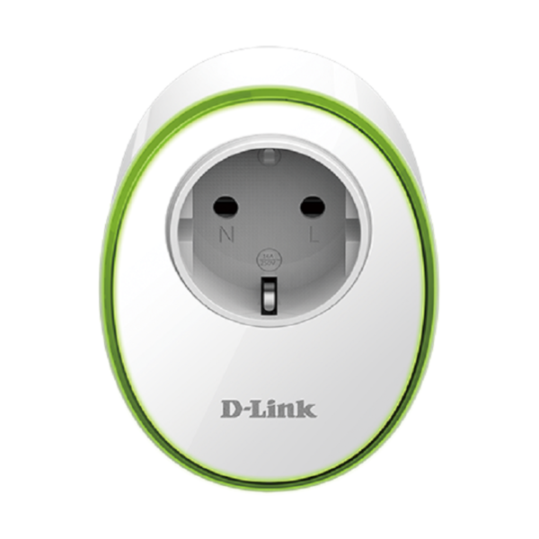

# ioBroker.mydlink

MyDlink Adapter für ioBroker. 
------------------------------------------------------------------------------

Dieser Adapter erlaubt es Geräte (Steckdosen und Bewegungsmelder) von 
[D-Link](https://eu.dlink.com/uk/en/for-home/smart-home) in ioBroker zu 
integrieren. 

**Dieser Adapter nutzt die Sentry Bibliothek um automatisch Fehler im Adapter an den Entwickler zu schicken.**
Für mehr Details und wie man die automatische Fehlerberichterstattung 
abschaltet, siehe die [Dokumentation des Sentry-Plugins](https://github.com/ioBroker/plugin-sentry#plugin-sentry)! 
Sentry wird erst ab js-controller Version 3.0 unterstützt.

Bisher wurden die folgenden Geräte erfolgreich mit dem Adapter getestet:
(weitere gerne melden)

| Model | Type  | Image |
| :---: | :---: | :---: |
| DSP-W215 | Steckdose (schalten, Temperatur, Strom) **Muss gepollt werden** |  |
| DSP-W115 | Steckdose (schalten) |  | 
| DCH-S150 | Bewegungsmelder **Muss gepollt werden** |  |
| DSP-W245 | Steckdosenleiste (4 Steckdosen) **Muss gepollt werden** | |

Der Adapter fragt die Geräte regelmäßig ab (pollen). Sensorwerte, Bewegungen und Schalten über die Tasten am Gerät
kommen daher mit einer Verzögerung von bis zu einem Pollintervall an. Auch die neueren Geräte (DSP-W115, DSP-W245)
melden Schalten und Stromverbrauch nicht von sich aus an den Adapter, siehe
[Events and power measurement](https://github.com/Garfonso/dlinkWebSocketClient#events-and-power-measurement).

**Nicht unterstützt:** DSP-W118. Über seine lokale Schnittstelle lässt sich das Relais nicht schalten, siehe
[Analyse](https://github.com/iobroker-community-adapters/ioBroker.mydlink/blob/master/docs/DSP-W118-analysis.md).

Das Pollintervall kann pro Gerät einzeln eingestellt werden.

#### Konfiguration:
Geräte werden im Gerätemanager verwaltet, entweder in den Adaptereinstellungen oder im Gerätemanager des Admin:
* **Erkanntes Gerät hinzufügen**: Geräte, die sich im Netzwerk melden, stehen zur Auswahl. Die PIN muss eingegeben werden.
* **Gerät über IP hinzufügen**: für Geräte, die nicht erkannt wurden. IP-Adresse und PIN eingeben.
* Jedes Gerät kann bearbeitet, aktiviert / deaktiviert und gelöscht werden. Beim Löschen werden auch die Objekte des Geräts gelöscht.

Einstellungen eines Geräts:

<table>
<tr><td>Name</td><td>Name, beliebig</td></tr>
<tr><td>IP</td><td>IP Adresse oder Hostname des Geräts</td></tr>
<tr><td>PIN</td><td>Die PIN steht auf der Gerät, z.B. auf dem Boden. Für DSP-W115 kann hier auch TELNET eingegeben werden, siehe unten. Die PIN wird verschlüsselt gespeichert und kann nur im Gerätemanager geändert werden.</td></tr>
<tr><td>Poll interval (in ms)</td><td>Poll interval  Auf 0 setzen um polling abzuschalten.  <b>Empfehlung:</b> Nutze ein kurzes Intervall für Bewegungsmelder und ein längeres für Steckdosen.</td></tr>
<tr><td>enable</td><td>Wenn hier kein Haken ist, wird das Gerät nicht angesprochen. So können Geräte, die eine Zeitlang nicht eingesteckt sind (z.B. für Weihnachtsdeko) einfach deaktiviert werden und der Adapter meldet keine Fehler im log.</td></tr>
<tr><td>NTP-Server</td><td>Nur ältere Geräte wie DSP-W215 und DCH-S150: Zeitserver, der auf dem Gerät eingestellt wird. Leer lässt die Einstellung des Geräts unverändert. Diese Geräte nutzen ntp1.dlink.com. Ohne richtige Uhrzeit stimmen die Zeitstempel des Bewegungsmelders nicht, ein lokaler Zeitserver (z.B. der Router) ist daher eine gute Wahl.</td></tr>
</table>

#### Einstellungen des Bewegungsmelders (DCH-S150)
Über die States des Bewegungsmelders lassen sich auch seine Einstellungen ändern:
* `sensitivity`: Empfindlichkeit des Sensors, 0 - 100.
* `backoff`: Zeit in Sekunden nach einer Erkennung, in der der Melder keine neue Erkennung meldet. Das Gerät nutzt standardmäßig 30 Sekunden. Mit einer kurzen Zeit (z.B. 1 - 5 Sekunden) und einem kurzen Pollintervall wird neue Bewegung viel früher erkannt.
* `detectionEnabled`: schaltet die Bewegungserkennung an oder aus.

Jede Änderung der Konfiguration startet den Adapter neu.

Für alte Geräte stört die Nutzung des Adapters die Nutzung der App nicht. Für neuere Geräte, wie die DSP-W115 ist das etwas anders, siehe unten.

## Einrichten des DSP-W115

Der DSP-W115 und andere *neuere* Geräte nutzen ein völlig anderes Protokoll als die änteren.
Wenn das Gerät aus der App gelöscht wird, kann, wie früher auch, einfach die PIN
genutzt werden.

Ansonsten, wenn die App weiter genutzt werden soll, muss das Gerät in den "factory mode" gesetzt werden.
Das erreicht man wie folgt:
1. Das Gerät in den Wiederherstellungsmodus versetzen in dem die WPS/Reset Taste während dem Starten festgehalten wird, bis es **rot** blinkt (statt orange!). 
2. Jetzt wurde ein telnet Port geöffnet, verbinde nun einen Laptop oder ähnliches mit dem Geräte-Wifi (DSP-W115-XXXX).
3. Verbinde dich mit telnet `telnet 192.168.0.20` und logge dich ein mit `admin:123456`
(in Linux einfach auf der Konsole, in Windows geht es über putty, dort muss `telnet` ausgewählt werden).
4. Aus dem Gerät über telnet ausführen: `nvram_set FactoryMode 1`
5. Dann mit `reboot; exit;` (auf dem Gerät ausführen) neustarten.

Jetzt kann im Gerätemanager `TELNET` als Pin eingegeben werden und
der Adapter holt sich (über den offenen telnet Port) alle Informationen von dem
Gerät, die er braucht.

## Changelog
<!-- 
	Placeholder for next versions (this needs to be indented):
	### **WORK IN PROGRESS**
-->
### 2.1.0 (2026-10-12)
- (Garfonso) feat: sensitivity, backoff time and detection of motion detectors can be changed with states
- (Garfonso) feat: NTP server of older devices (DSP-W215, DCH-S150) can be set in the device manager
- (Garfonso) feat: devices are polled right after start
- (Garfonso) fix: disabled devices were shown as connected
- (Garfonso) docs: DSP-W245 is tested, DSP-W118 is not supported, devices have to be polled

### 2.0.0 (2026-10-11)
- (copilot) **Breaking:** Adapter requires node.js >= 22 now
- (Garfonso) **Breaking:** Adapter requires js-controller >= 7.0.7 and admin >= 8.0.14 now
- (Garfonso) **Breaking:** PINs are encrypted by js-controller and hidden from other adapters. The configuration is converted on first start, the adapter restarts once. After a downgrade to 1.3.x the PINs have to be entered again.
- (Garfonso) feat: devices are added, edited, enabled / disabled and deleted in the device manager
- (Garfonso) feat: settings page uses jsonConfig and embeds the device manager (#594, #414)
- (Garfonso) fix: adapter did crash on invalid data from websocket devices (#384)
- (Garfonso) fix: auto detection did not work on Linux (replaced mdns-discovery with multicast-dns)
- (Garfonso) fix: total power consumption was written to currentPower
- (Garfonso) fix: log in again if session of a device expired
- (Garfonso) fix: polling can be disabled for devices with known model
- (Garfonso) fix: normalize MAC addresses, fixes endless loop if another device answers on the configured IP
- (Garfonso) fix: detect changed IP of devices and update the configuration
- (Garfonso) fix: websocket devices were reported reachable while offline
- (Garfonso) fix: websocket devices reconnect after they were offline (dlink_websocketclient 0.6.2)
- (Garfonso) fix: pause login of websocket devices for 10 minutes if they refuse it or the PIN is wrong (device locks itself after 10 invalid tokens)
- (Garfonso) fix: no new timers during unload
- (Garfonso) chore: reduced log noise
- (Garfonso) chore: tested with node.js 26 (#632)
- (Garfonso) chore: dependencies updated

### 1.3.6 (2024-05-24)
* fixed: crash with empty pin.

### 1.3.5 (2023-10-30)
* fixed: wrong type warnings with legacy devices

### 1.3.4 (2023-08-18)
* fixed: missing build...

## License
MIT License

Copyright (c) 2026 iobroker-community-adapters <iobroker-community-adapters@gmx.de>  
Copyright (c) 2024-2025 Garfonso <garfonso@mobo.info>

Permission is hereby granted, free of charge, to any person obtaining a copy
of this software and associated documentation files (the "Software"), to deal
in the Software without restriction, including without limitation the rights
to use, copy, modify, merge, publish, distribute, sublicense, and/or sell
copies of the Software, and to permit persons to whom the Software is
furnished to do so, subject to the following conditions:

The above copyright notice and this permission notice shall be included in all
copies or substantial portions of the Software.

THE SOFTWARE IS PROVIDED "AS IS", WITHOUT WARRANTY OF ANY KIND, EXPRESS OR
IMPLIED, INCLUDING BUT NOT LIMITED TO THE WARRANTIES OF MERCHANTABILITY,
FITNESS FOR A PARTICULAR PURPOSE AND NONINFRINGEMENT. IN NO EVENT SHALL THE
AUTHORS OR COPYRIGHT HOLDERS BE LIABLE FOR ANY CLAIM, DAMAGES OR OTHER
LIABILITY, WHETHER IN AN ACTION OF CONTRACT, TORT OR OTHERWISE, ARISING FROM,
OUT OF OR IN CONNECTION WITH THE SOFTWARE OR THE USE OR OTHER DEALINGS IN THE
SOFTWARE.