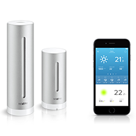

# ioBroker.netatmo

**Dieser Adapter nutzt die Sentry-Bibliotheken, um Ausnahmen und Codefehler automatisch an die Entwickler zu melden.** Weitere Details und Informationen zum Deaktivieren der Fehlerberichterstattung finden Sie in [der Sentry-Plugin-Dokumentation](https://github.com/ioBroker/plugin-sentry#plugin-sentry) ! Die Sentry-Berichterstattung wird ab js-controller 3.0 verwendet.

## Netatmo-Adapter für ioBroker

Verbindet ioBroker mit der Netatmo-Cloud (Netatmo Connect API). Unterstützte Produkte:

| Produkt                                                                     | Daten                                                               | Eigene App erforderlich                                         |
| --------------------------------------------------------------------------- | ------------------------------------------------------------------- | --------------------------------------------------------------- |
| Wetterstation (inkl. Außen-, Regen-, Wind- und zusätzlichen Innenmodulen)   | Messwerte, Minimal-/Maximalwerte, Trendwerte, Akku- und WLAN-Status | NEIN                                                            |
| Gesunder-Zuhause-Coach                                                      | Luftqualität, CO2, Luftfeuchtigkeit, Lärm                           | NEIN                                                            |
| Kameras (Begrüßungs-, Anwesenheits-, intelligente Tür- und Fenstersensoren) | Status, Ereignisse, Personen, Überwachung ein/aus                   | empfohlen (Live-Stream und volle Kontrolle nur mit eigener App) |
| iDiamant / Bubendorff Rollläden                                             | Position, Kontrolle                                                 | NEIN                                                            |
| Intelligente Video-Türklingel                                               | Status, Klingeln, Anrufe, Ereignisse                                | Ja                                                              |
| Intelligenter Rauchmelder                                                   | Status, Alarme                                                      | Ja                                                              |
| Intelligenter Kohlenmonoxid-Alarm                                           | Status, Alarme                                                      | Ja                                                              |

Thermostate und Ventile (Netatmo Energy) werden von diesem Adapter nicht unterstützt.

## Anforderungen

- js-controller >= 6.0.0, admin >= 7.6.19
- Ein Netatmo-Konto mit den Geräten
- Für Echtzeitereignisse (Kameras, Türklingel, Rauch- und Kohlenmonoxidmelder): eine [IoT-Instanz](https://github.com/ioBroker/ioBroker.iot) (>= 1.14.0), die mit einem ioBroker Pro-Konto mit einer Assistant- oder Remote-Lizenz verbunden ist. Ohne diese Verbindung werden alle Daten nur per Polling aktualisiert.
- Empfohlen: eine eigene Netatmo-App (Client-ID und Client-Geheimnis), siehe unten

## Konfiguration

### Registerkarte „Geräte & Anmeldung“

1. Wählen Sie die Netatmo-Produkte aus, die Sie verwenden möchten.
2. Optional, aber empfohlen: Erstellen Sie eine eigene App auf [dev.netatmo.com](https://dev.netatmo.com/apps/createanapp) und geben Sie deren Client-ID und Client-Geheimnis ein. Eine eigene App ist für Türklingel, Rauch- und Kohlenmonoxidmelder sowie den vollen Kameraumfang erforderlich und ermöglicht Aktualisierungsintervalle unter 10 Minuten. Andernfalls wird eine gemeinsam genutzte ioBroker-App verwendet, deren API-Kontingent von allen Nutzern geteilt wird.
3. Klicken Sie auf „Mit Netatmo anmelden“. Ein neues Fenster mit den Netatmo-Anmeldedaten öffnet sich. Nach der Anmeldung und der Gewährung der Zugriffsrechte speichert der Adapter die Token und startet neu.

Melden Sie sich jedes Mal erneut an, wenn Sie die ausgewählten Produkte oder die Kunden-ID/das Kundengeheimnis ändern, da sonst Daten verloren gehen können. Falls sich kein Fenster öffnet, überprüfen Sie den Popup-Blocker Ihres Browsers.

### Registerkarte „Echtzeitereignisse“

Wird nur angezeigt, wenn Kameras, Türklingel, Rauch- oder Kohlenmonoxidmelder ausgewählt sind.

- **IoT-Instanz** : Instanz, die zum Empfangen der Webhook-Ereignisse von Netatmo verwendet wird. Leer lassen, um Echtzeitereignisse zu deaktivieren.
- **Ereignisse entfernen, die älter als** (Stunden) sind, **Bereinigungsintervall** (Minuten), **Unbekannte Personen entfernen, die zuletzt vor mehr als (Stunden, nur Kameras) gesehen wurden**

### Registerkarte „Erweitert“

- **Aktualisierungsintervall** (Minuten): mindestens 10 Minuten mit der gemeinsamen App, mindestens 1 Minute mit einer eigenen App. Netatmo aktualisiert die Wetterdaten etwa alle 10 Minuten, daher liefern kürzere Intervalle keine zusätzlichen Wetterdaten. Kameras, Türklingel und Alarmanlagen werden im doppelten Intervall abgefragt.
- **Höhe** (Meter über dem Meeresspiegel): wird zur Berechnung des Taupunkts verwendet.

Bitte beachten Sie die [Datenratenbegrenzungen von Netatmo](https://dev.netatmo.com/guideline#rate-limits) .

## Verwendung

Der Adapter erstellt Zustände für alle Geräte der ausgewählten Produkte. Geräte, die Ereignisse unterstützen, erhalten zusätzlich Ereigniszustände, die durch die Echtzeitereignisse gefüllt werden (siehe Anforderungen).

Manche Geräte (z. B. Kameras) werden mit dem letzten Ereignis pro Typ initialisiert. Bei anderen Geräten (z. B. Rauch-/CO-Melder) werden die Ereigniszustände mit dem nächsten Ereignis gefüllt.

### Türklingel

- `ring` ist eingestellt auf `true` wenn jemand anruft (`incoming_call` Es wird nach 60 Sekunden automatisch zurückgesetzt, sofort am `missed_call` /`accepted_call` und beim Start des Adapters. Netatmo sendet nicht zuverlässig `accepted_call` wenn ein Anruf in der App angenommen wird.
- `incoming_call`, `accepted_call` Und `missed_call` enthalten Zeitangabe, Ereignis-ID und Snapshot-URL des letzten Ereignisses dieses Typs.
- Netatmo übermittelt die Webhook-Ereignisse mit einer Verzögerung von wenigen Sekunden bis zu etwa 2 Minuten.

### iDiamant/Bubendorff Rollläden

### Gerätestatus

Der Adapter schreibt für jedes Gerät die von Netatmo bereitgestellten Statuswerte. Werte, die ein Gerätetyp nicht bereitstellt, werden nicht erstellt.

| Zustand                                                                             | Geräte                                           | Bedeutung                                                                            |
| ----------------------------------------------------------------------------------- | ------------------------------------------------ | ------------------------------------------------------------------------------------ |
| `info.connection` (Beispiel)                                                        | alle                                             | `true` die Netatmo-Cloud ist erreichbar und die Anmeldung gültig.                    |
| `<device>.info.reachable`                                                           | Kameras, Türklingel, Rauch-/CO-Melder, Rollläden | `false` wenn das Gerät offline ist (z. B. kein WLAN).                                |
| `<device>.info.error`                                                               | Kameras, Türklingel, Rauch-/CO-Melder, Rollläden | Netatmo-Fehler des Geräts, z. B. `device_unreachable`, leer lassen, falls in Ordnung |
| `<device>.info.wifi_strength`, `rf_strength`                                        | abhängig vom Gerät                               | Signalstärke, je niedriger desto besser                                              |
| `<device>.info.battery_state`, `battery_level`                                      | Batteriegeräte                                   | Batteriezustand und Spannung (mV)                                                    |
| `<device>.info.firmware`                                                            | abhängig vom Gerät                               | Firmware-Version                                                                     |
| `Reachable`, `Firmware` (Wetterstationsmodule), `reachable` (Gesundes-Zuhause-Coach) | Wetterstation, Reisebus                          | Erreichbarkeit und Firmware                                                          |

Wenn ein Gerät offline geht, wird dies einmalig als Warnung protokolliert und später als Information wieder angezeigt. Türklingel und Kameras werden ebenfalls aktualisiert. `info.reachable` sofort von der `connection` /`disconnection` Echtzeitereignisse, sofern Netatmo diese sendet.

Die Netatmo-API liefert keine Echtzeitdaten für Rollläden, daher werden die Werte in regelmäßigen Abständen abgefragt. Sie sind daher nicht in Echtzeit genau, weder bei direkter Steuerung der Rollläden noch über die Netatmo-App.

Wenn die Rollläden über den Adapter gesteuert werden, werden die Werte 2 s und 17 s nach dem Befehl aktualisiert.

Je nach Gerät kann die Zielposition auf einen beliebigen Wert zwischen 0 % und 100 % oder nur auf 0 % oder 100 % eingestellt werden (-1 = Stopp, -2 = Jalousiemodus für Rollläden mit kippbaren Lamellen). Die Tasten zum Öffnen, Schließen und Stoppen können ebenfalls verwendet werden.

## sendTo-Befehle

### setAway

Stellt alle Personen als abwesend dar (z. B. bei Verwendung als Alarmsystem):

```javascript
sendTo('netatmo.0', 'setAway', { homeId: '1234567890abcdefg' });
```

oder für alle Haushalte:

```javascript
sendTo('netatmo.0', 'setAway');
```

Nur bestimmte Personen:

```javascript
sendTo('netatmo.0', 'setAway', { homeId: '1234567890abcdefg', personsId: ['123123123123123'] });
```

`homeId` ist die ID, die als oberster Ordner des Home-Verzeichnisses auf der Registerkarte „Objekte“ angezeigt wird (optional, wenn es nur ein Home-Verzeichnis gibt). `personsId` die ID einer Person im Ordner „Bekannte Personen“.

### Startseite

Gleiche Parameter wie `setAway`, legt Personen oder ganze Haushalte als "Zuhause" fest.

## Ältere Versionen

- **3.0.0** : Echtzeitereignisse werden über die IoT-Instanz empfangen. Der vorherige Heroku-Dienst wurde am 28.11.2022 eingestellt.
- **2.0.0** : Neue Objektstruktur basierend auf den eindeutigen Geräte-IDs anstelle von Namen. Netatmo hat die Anmeldung mit Benutzername und Passwort im Oktober 2022 deaktiviert; die Authentifizierung erfolgt über die Schaltfläche „Mit Netatmo anmelden“.

## Changelog
<!--
    Placeholder for the next version (at the beginning of the line):
    ### **WORK IN PROGRESS**
-->
### 3.2.0 (2026-11-04)
* (@Schimi1983) Fixed adapter crash when changing a state (e.g. camera monitoring) while the access token had expired
* (@Schimi1983) Token refresh: an invalid refresh token is now reported (re-authentication required) instead of silently starting without data; no endless refresh loop; only one refresh at a time (Netatmo rotates refresh tokens)
* (@Schimi1983) Access and refresh tokens and the client secret are no longer written to the log
* (@Schimi1983) Update intervals are validated also with own client ID (empty value led to polling every millisecond)
* (@Schimi1983) A failing event request no longer discards the home and device status of the update cycle
* (@Schimi1983) Device status for all devices: reachable, error, signal strength, battery and firmware; offline/online is logged; new state info.connection
* (@Schimi1983) Temporary Netatmo outages (5xx, timeouts, "Service temporarily unavailable") are logged as warning and only as error after 3 failed requests in a row; recovery is logged; no more duplicate log entries per error
* (@Schimi1983) Realtime events keep working after re-authentication
* (@Schimi1983) Doorbell: "ring" is reset automatically 60 seconds after the call (Netatmo does not reliably send accepted_call), immediately on accepted_call/missed_call, and on adapter start
* (@Schimi1983) README reworked according to the ioBroker guidelines, older changelog entries moved to CHANGELOG_OLD.md
* (@Schimi1983) Reworked configuration page: tabs, responsive layout, info boxes, units and input validation, translations for all languages; requires admin >= 7.6.19
* (@Schimi1983) Help text for event retention corrected (hours instead of minutes); default update interval 10 minutes
* (@Schimi1983) State roles corrected according to the ioBroker state roles (e.g. `date` instead of the non-existing `value.date`, `text` for texts instead of the generic `state`, `level`/`value.blind` for roller shutters); only roles changed, IDs, types and values stay the same
* (@Apollon77) Removed the usage of a deprecated API from Netatmo which was used to enrich person data
* (@Apollon77) Added product type NACamDoorTag
* (@Apollon77) Allows value -2 for target position of Bubendorff roller shutters to put a Bubendorff shutter with jalousieable slats in jalousie mode

### 3.1.0 (2023-01-06)
* (Apollon77) Add support for Bubendorff roller shutters
* (Apollon77) Fix Monitoring State for Welcomes
* (Apollon77) Allow to just use CO2/Smoke sensors
* (Apollon77) Optimize Shutdown procedure

### 3.0.0 (2022-12-14)
* (Apollon77/bluefox) BREAKING CHANGE: Restructure Realtime events to be received via iot instance (iot >= 1.14.0 required)

### 2.1.2 (2022-11-17)
* (bluefox) Added missing objects for `Welcome` devices

### 2.1.1 (2022-09-30)
* (Apollon77) Make sure device types that require custom credentials are not selectable in UI without entering them
* (Apollon77) Fix a potential crash case

## License

The MIT License (MIT)

Copyright (c) 2016-2026 Patrick Arns <iobroker@patrick-arns.de>

Permission is hereby granted, free of charge, to any person obtaining a copy
of this software and associated documentation files (the "Software"), to deal
in the Software without restriction, including without limitation the rights
to use, copy, modify, merge, publish, distribute, sublicense, and/or sell
copies of the Software, and to permit persons to whom the Software is
furnished to do so, subject to the following conditions:

The above copyright notice and this permission notice shall be included in
all copies or substantial portions of the Software.

THE SOFTWARE IS PROVIDED "AS IS", WITHOUT WARRANTY OF ANY KIND, EXPRESS OR
IMPLIED, INCLUDING BUT NOT LIMITED TO THE WARRANTIES OF MERCHANTABILITY,
FITNESS FOR A PARTICULAR PURPOSE AND NONINFRINGEMENT. IN NO EVENT SHALL THE
AUTHORS OR COPYRIGHT HOLDERS BE LIABLE FOR ANY CLAIM, DAMAGES OR OTHER
LIABILITY, WHETHER IN AN ACTION OF CONTRACT, TORT OR OTHERWISE, ARISING FROM,
OUT OF OR IN CONNECTION WITH THE SOFTWARE OR THE USE OR OTHER DEALINGS IN
THE SOFTWARE.