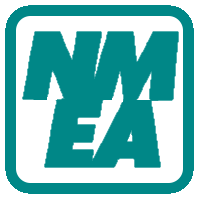
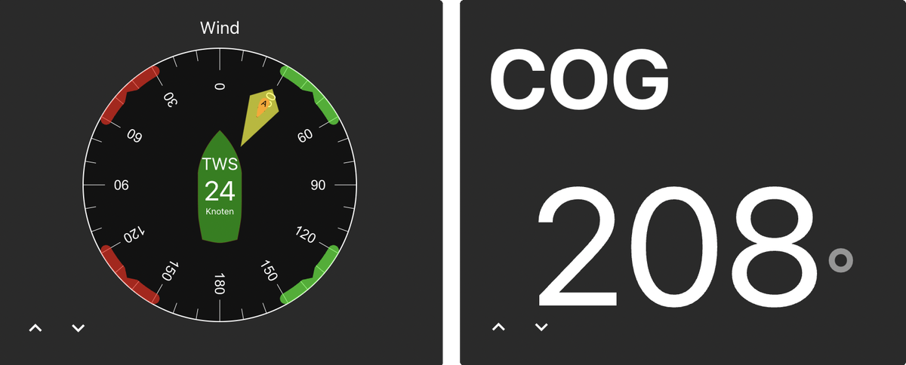
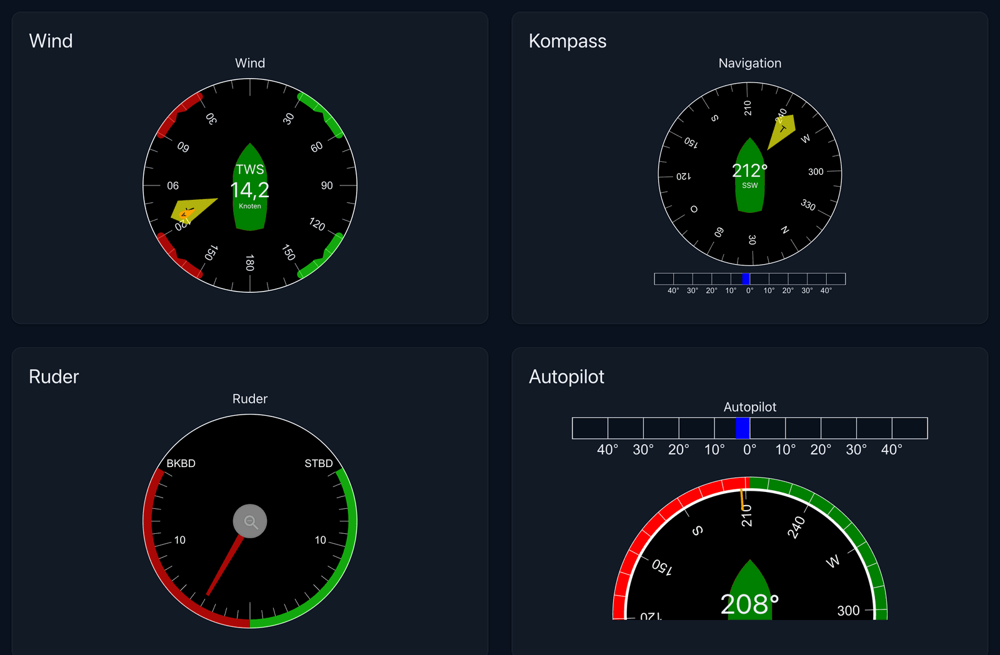
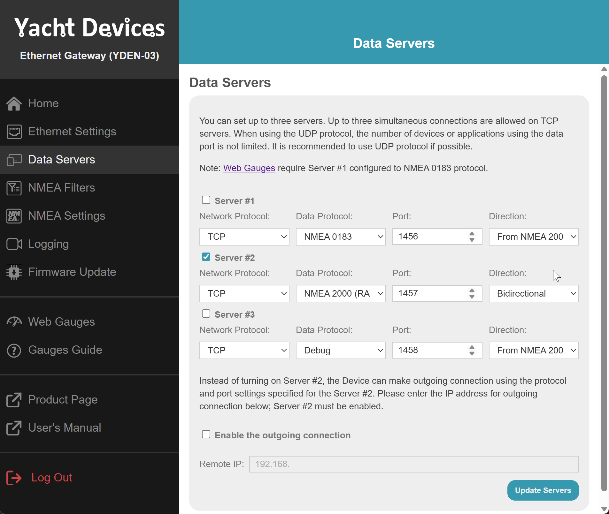

# ioBroker.nmea

Dieser Adapter ermöglicht die Verbindung von ioBroker mit dem NMEA-2000 Yachtbus.

**Dieser Adapter nutzt die Sentry-Bibliotheken, um Ausnahmen und Codefehler automatisch an die Entwickler zu melden.** Weitere Details und Informationen zum Deaktivieren der Fehlerberichterstattung finden Sie in [der Sentry-Plugin-Dokumentation](https://github.com/ioBroker/plugin-sentry#plugin-sentry) . Die Sentry-Berichterstattung wird ab js-controller 3.0 verwendet.

Um diesen Adapter zu verwenden, benötigen Sie eine Hardware, die den NMEA-2000-Bus lesen und in ein serielles Signal umwandeln kann:

- [Actisense NGT-1 (USB)](https://actisense.com/products/ngt-1-nmea-2000-to-pc-interface/)
- [Actisense NGX1-USB (USB)](https://actisense.com/products/nmea-2000-gateway-ngx-1/)
- oder [Raspberry Pi mit PiCAN-M](https://www.skpang.co.uk/collections/hats/products/copy-of-pican-m-with-can-bus-micro-c-and-rs422-connector-no-smps)
- [Yachtgeräte YDWG-02/03](https://www.yachtd.com/products/wifi_gateway.html)
- [Yachtgeräte YDEN-02/03](https://www.yachtd.com/products/ethernet_gateway.html)

PiCAN-M ist mit Raspberry Pi 4 und [5](https://copperhilltech.com/blog/testing-pican-can-bus-hats-with-the-raspberry-pi-5/) kompatibel.



Das Widget „NMEA Complex“ wird viermal in einer vis-2-Ansicht angezeigt, wobei jede Instanz eine Anzeige enthält: Wind, Kompass, Ruder und Autopilot.



[YouTube-Erklärung](https://youtu.be/flp_-mypbRU?si=k0lp95OukQ88LBxj)

## So verwenden Sie es auf Raspberry Pi mit PiCAN-M

Das PiCAN M ist eine kompakte Erweiterungsplatine für den Raspberry Pi 3/4. Sie ermöglicht den Anschluss von NMEA2000- und NMEA0183-Netzwerken an einen Raspberry Pi. Die Platine kann über eine externe 12-V-Quelle mit Strom versorgt werden. Alternativ bietet sie die Möglichkeit, den Raspberry Pi in Verbindung mit dem PiCAN-M-Board direkt über den NMEA2000-Bus mit Strom zu versorgen.

**Der PiCAN-M verfügt nicht über einen ausreichenden Verpolungsschutz für die 12-V-Versorgungsspannung. Bei externem Betrieb mit 12 V muss daher eine 1-A-Sicherung in die Stromversorgungsleitung eingebaut werden.**

Aufgrund des hohen Strombedarfs des Raspberry Pi empfehlen wir, ihn über eine externe Stromquelle (mindestens 3 A) mit Strom zu versorgen. Die Stromversorgung über NMEA2000 und USB kann problemlos parallel erfolgen.

### Installation

Weitere Einzelheiten finden Sie in Kapitel 3 des [PiCAN-M-Benutzerhandbuchs](https://github.com/ioBroker/ioBroker.nmea/blob/master/img/pican-m_UGB_10.pdf) , hier jedoch eine kurze Zusammenfassung:

Datei bearbeiten `/boot/config.txt` (mit `sudo nano /boot/config.txt`) und fügen Sie die folgenden Zeilen am Ende der Datei hinzu:

```
enable_uart=1
dtparam=i2c_arm=on
dtparam=spi=on
dtoverlay=mcp2515-can0,oscillator=16000000,interrupt=25 
```

Ausgaben auf der UART-Konsole deaktivieren:

- Starten Sie in der Befehlszeile `sudo raspi-config`
- gehe zu `3 Interface Options`
- geh ot `I5 Serial Port`
- Deaktivieren `shell accessible over serial` Und `serial port hardware enabled`
- Ausgang `raspi-config` und Neustart

Installieren Sie can-utils

```shell
sudo apt-get install can-utils
```

## Actisense NGT-1

Actisense NGT-1 ist unter Windows und Linux ohne zusätzliche Treiber sichtbar. Es wird als serielle Schnittstelle „COMn“ (Windows) bzw. ttyN (unter Linux) erkannt.

## YDEN, YDWG

Aktivieren Sie Server N2 mit TCP-Protokoll und bidirektionalem Modus.



UDP wäre auch eine Möglichkeit, aber da das Gateway die Daten kontinuierlich in das Netzwerk sendet, könnte der Bus überlastet werden.

## Todo

- Kodierungscode
- AIS
- Finden Sie heraus, warum Daten von Adresse 100 gesendet wurden
- Integration von [iKonvert NMEA 2000](https://digitalyachtamerica.com/product/ikonvert-usb/)
- Integration von [Shipmodul MiniPlex-3-N2K](https://www.shipmodul.com/products.html)

## Datensimulation

Sie können die Daten externer Sensoren an den NMEA2000-Bus anschließen. Tatsächlich können Sie aber nur Umgebungsdaten wie Temperatur, Luftfeuchtigkeit und Druck simulieren.

Mit der Flagge `Combined environment` Sie können die PGN-Nummer definieren, die für Temperatur, Luftfeuchtigkeit und Druck verwendet wird:

- Wenn Sie die Markierung deaktivieren `Combined environment` Für die Temperatur wird PGN 130314, für die Luftfeuchtigkeit PGN 130313 und für den Druck PGN 130314 verwendet.
- Wenn Sie die Flagge auswählen `Combined environment` Daher werden alle drei Werte in PGN 130311 zusammen mit anderen möglichen Umweltwerten gesendet.

## Zeitzone

Es besteht die Möglichkeit, die Zeitzone anhand der GPS-Koordinaten einzustellen. Dazu muss die entsprechende Option in den Adaptereinstellungen aktiviert und zugelassen werden. `iobroker` Benutzer die Befehlsausführung: `sudo visudo`

```
iobroker ALL=(ALL) timedatectl set-timezone
```

## Autopilot

Tatsächlich wird nur ein Autopilot unterstützt: Raymarine.

Die Entwicklung von Simrad/navico/B\&G ist noch nicht abgeschlossen.

### Winddatumsanzeige

Bei Raymarine-Geräten, die das „Pilot Wind Datum“ (PGN 65345) veröffentlichen, speichert der Adapter den Rohwinkel in Radiant unter `seatalkPilotWindDatum.windDatum` (Dies ist der Standardwert, den der Autopilot beim Ändern des Windwinkels zurückliest, daher muss er im Bogenmaß angegeben werden).

Zusätzlich gibt es einen schreibgeschützten Komfortzustand `seatalkPilotWindDatum.windDatumDisplay` wird erstellt. Es zeigt den Winkel genau so an wie der Raymarine-Pilotenkopf:

- `0…180°` → Steuerbord, `180…360°` → Hafen,
- jeweils als ein `≤180°` Wert plus ein sprachabhängiger Seitenbuchstabe (z. B. ein Datum von `230°` wird angezeigt als `130°P` auf Englisch und `130°B` (auf Deutsch). `0°` (direkt voraus) und `180°` (tot achtern) ohne Begleitschreiben.

Verwenden `windDatumDisplay` zur Visualisierung und `windDatum` für Berechnungen/Automatisierung.

## Webkomponenten

Neben den vis-2-Widgets und den Geräte-Widgets bietet der Adapter Webkomponenten für Aura und andere Hosts (`common.webComponents`, `admin/webcomponents/` Jedes Modul stellt ein einzelnes Element dar und zeigt dasselbe an wie sein natives Widget:

| Etikett                    | Shows                                                                                                                | Einstellungen                                                                       |
| -------------------------- | -------------------------------------------------------------------------------------------------------------------- | ----------------------------------------------------------------------------------- |
| `iob-nmea-wind`            | Windinstrumente: scheinbarer und wahrer Wind, Kurs, COG, Strömung und Drift, AWS, TWS, STW, SOG                      | Beispiel: Winddrehungsverlauf, Amwindzone, Geschwindigkeitseinheit, Segeltrimm      |
| `iob-nmea-history-chart`   | Live-Diagramm eines Zustands mit Min-/Avg-/Max-Linien, gefüllt aus der Standard-Verlaufsinstanz                      | Zustand, Beschriftung, Einheit, Zeitfenster, Y-Achse, Linien, Dezimalstellen, Farbe |
| `iob-nmea-autopilot`       | Autopilotmodus, Kurs fixiert, Seitenruder und die Tasten zum Steuern (größere Änderungen erfordern eine Bestätigung) | Beispiel: AWA, Ruderstange                                                          |
| `iob-nmea-ais-radar`       | AIS-Ziele rund um das eigene Boot auf einer Seekarte, mit Spuren und COG-Vektoren                                    | Instanz, Bereich, ausblenden nach, Vektoren, Kurs nach oben, eigene MMSI            |
| `iob-nmea-anchor-position` | Anker, Boot, Schwenkkreis, Kurs und Ankeralarm auf einer Karte; im Dialog werden Anker und Alarm eingestellt.        | Beispiele: Anker-/Bootsposition, Kettenlänge, Tiefe beim Absetzen, Kartenstil       |
| `iob-nmea-instrument`      | Bis zu vier Werte wie bei einem Schiffsinstrument, jeweils einer nach dem anderen                                    | pro Wert: Bundesstaat, Name, Einheit, Ziffern, Farbe, Pluszeichen, Blinken ändern   |
| `iob-nmea-compass`         | Kompass mit Kurs über Grund, wahrer Windrichtung und Ruder (das "Navigationsfenster" des vis-2-Widgets "Komplex")    | zum Beispiel Ruder                                                                  |
| `iob-nmea-rudder`          | Ruderwinkelanzeige mit Zoomfunktion für kleine Winkel (das Fenster „Ruder“ des vis-2-Widgets „Complex“)              | Instanz, voller Bereich, Zoomschwelle, Hysterese                                    |

Die Quellen sind in `src-webcomponents/`; `npm run build:wc` baut sie.

## Danksagungen

NMEA 2000-Dekodierung durch [canboatjs](https://github.com/canboat/canboatjs) unter Verwendung der [CANboat](https://github.com/canboat/canboat) PGN-Datenbank (Apache-Lizenz 2.0).

<!--
	### **WORK IN PROGRESS**
-->

## Changelog

### **WORK IN PROGRESS**
- (@GermanBluefox) Added the short form of the web component manifests (tag, name, icon, size) to `common.webComponents`, so that hosts like Aura can list the components before the adapter is installed; the build writes it with `iob-web-components sync-io-package`

### 3.1.1 (2026-11-09)
- (@GermanBluefox) Web components: the heading of the wind display no longer covers a compass label, and the label of the outer ring of the AIS radar no longer sits on the "N"

### 3.1.0 (2026-11-08)
- (copilot) Adapter requires node.js >= 22.19.0 now
- (@GermanBluefox) The maps of the AIS radar and the anchor position work again: CARTO asks for an API key now, they use Esri Dark Gray and OpenStreetMap
- (@GermanBluefox) Added the web components `iob-nmea-wind`, `iob-nmea-history-chart`, `iob-nmea-autopilot`, `iob-nmea-ais-radar`, `iob-nmea-anchor-position`, `iob-nmea-instrument`, `iob-nmea-compass` and `iob-nmea-rudder` for Aura and other hosts (`common.webComponents`)
- (@GermanBluefox) The switch of the anchor position widget now arms the anchor watch instead of showing the alarm, which turns the alarm circle red; the widget "Instrument" is no longer a musical instrument in Chinese
- (@GermanBluefox) The anchor position widget can be given the chain length and the depth at drop for its swing circle; its settings show proper labels and help texts
- (@GermanBluefox) The anchor position widget speaks all languages, shows the anchor of the anchor alarm when no anchor position is chosen and loads the track from the history also for the own GNSS position; the settings "split view" and "sail trim" of the wind and autopilot widgets are translated into all languages

### 3.0.2 (2026-10-27)
- (@GermanBluefox) Deleted the states without object at the start, e.g. the AIS data of old vessels left by versions before 1.0.0 (needs js-controller 7.2.3 or newer)

### 3.0.1 (2026-10-19)
- (@GermanBluefox) Migrated widgets to React 19

### 2.0.0 (2026-08-04)
- (bluefox) Migrated to devices V3

## License
The MIT License (MIT)

Copyright (c) 2024-2026 bluefox <dogafox@gmail.com>

Permission is hereby granted, free of charge, to any person obtaining a copy
of this software and associated documentation files (the "Software"), to deal
in the Software without restriction, including without limitation the rights
to use, copy, modify, merge, publish, distribute, sublicense, and/or sell
copies of the Software, and to permit persons to whom the Software is
furnished to do so, subject to the following conditions:

The above copyright notice and this permission notice shall be included in
all copies or substantial portions of the Software.

THE SOFTWARE IS PROVIDED "AS IS", WITHOUT WARRANTY OF ANY KIND, EXPRESS OR
IMPLIED, INCLUDING BUT NOT LIMITED TO THE WARRANTIES OF MERCHANTABILITY,
FITNESS FOR A PARTICULAR PURPOSE AND NONINFRINGEMENT. IN NO EVENT SHALL THE
AUTHORS OR COPYRIGHT HOLDERS BE LIABLE FOR ANY CLAIM, DAMAGES OR OTHER
LIABILITY, WHETHER IN AN ACTION OF CONTRACT, TORT OR OTHERWISE, ARISING FROM,
OUT OF OR IN CONNECTION WITH THE SOFTWARE OR THE USE OR OTHER DEALINGS IN
THE SOFTWARE.