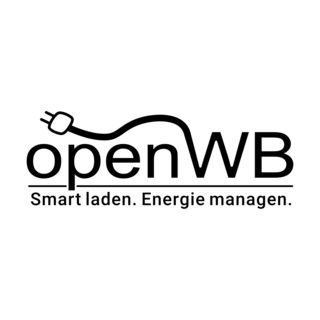

# IoBroker.openwb2
## Openwb2-Adapter für ioBroker
*Diese Anleitung ist auch [auf Deutsch](https://github.com/seaspotter/ioBroker.openwb2/blob/main/docs/de/README.md) verfügbar.*

Liest Ladepunkte, Zähler, Batterie, PV und Verbraucher von einem [openWB](https://openwb.de) 2 Wallbox-Controller live über MQTT und ermöglicht die Steuerung des Ladevorgangs über seine `simpleAPI` HTTP-Schnittstelle von ioBroker aus.

**Haftungsausschluss:** Dies ist ein unabhängiger, von der Community gepflegter Adapter. Er steht in keiner Verbindung zu openWB GmbH & Co. KG, wird nicht von ihr unterstützt oder empfohlen. „openWB“ ist eine Marke des jeweiligen Inhabers; das Adaptersymbol ist das offizielle Logo von openWB und wird mit deren Genehmigung verwendet.

### Liest über MQTT, schreibt über HTTP
Dieser Adapter liest Live-Daten vom MQTT-Broker von openWB (`openWB/simpleAPI/#`) und sendet Steuerbefehle über seine HTTP-Schnittstelle (`simpleAPI`) (`simpleapi.php`). Beide müssen von Ihrem ioBroker-Host aus erreichbar sein.

### Anforderungen
- openWB 2.3 oder höher - `simpleAPI` ist in diesen Versionen immer aktiv, es muss nichts aktiviert werden.

### Konfiguration
Die Admin-Benutzeroberfläche hat zwei Registerkarten:

- **Verbindung** - ein gemeinsames **Host-/IP-Adressfeld** für die HTTP- und MQTT-Verbindung (dasselbe

Gerät in einer normalen Konfiguration). **Verbindung testen** prüft beides und meldet jedes Ergebnis separat. **Erweitert** enthält HTTP/MQTT-Ports, Timeouts und Authentifizierung - nur relevant, wenn Sie die Konfigurationsdateien von openWB direkt angepasst haben.

- **Komponenten** - die Geräteerkennungstabelle. **Probe fügt nun** neu erkannte Ladepunkte und Zähler hinzu.

Batterien, PV-Module und Verbraucher werden als neue Zeilen hinzugefügt und sind standardmäßig deaktiviert. Aktivieren Sie eine Zeile und speichern Sie die Einstellungen, um sie zu aktivieren und die zugehörigen Objekte zu erstellen. Geben Sie jeder Zeile einen **Namen**, um sie in der Objektstruktur zu kennzeichnen (openWB meldet über MQTT nur für Ladepunkte einen Namen). Deaktivieren oder entfernen Sie nicht benötigte Zeilen. Eine nicht mehr erkannte Zeile wird markiert, aber nicht gelöscht. Sie können auch manuell eine ID hinzufügen. Das **Intervall für die Geräteprüfung** wiederholt die Suche im Hintergrund (standardmäßig deaktiviert). Die **Anzeige der Energiewerte als** schaltet den gesamten kumulativen Energiezähler instanzweit zwischen `Wh` (Standard) und `kWh` um.

### Objektstruktur
```
openwb2.0.info.connection                  boolean, true while connected to the MQTT broker
openwb2.0.chargepoint.<id>.<field>          read-only: power, voltages/currents/powers per phase, soc,
                                             state_str, plug_state, charge_state, rfid, configName, ...
openwb2.0.chargepoint.<id>.control.<field>  writable: chargemode, chargepointLock, maxPriceEco,
                                             instantChargingCurrent/Limit/Amount/Soc,
                                             pvChargingLimit/Amount/Soc/MinCurrent/MinSoc, vehicle
openwb2.0.counter.<id>.<field>              read-only
openwb2.0.battery.<id>.<field>              read-only
openwb2.0.battery.<id>.control.batMode           writable enum: min_soc_bat_mode / ev_mode / bat_mode
openwb2.0.battery.<id>.control.batPowerReserve   writable number, W
openwb2.0.pv.<id>.<field>                   read-only
openwb2.0.consumer.<id>.<field>             read-only
openwb2.0.pv.total.<field>                  read-only: power, exported, monthlyExported, yearlyExported -
                                             system-wide sum across all enabled PV modules
openwb2.0.chargepoint.total.<field>         read-only: power, imported, exported - system-wide sum across
                                             all enabled chargepoints
openwb2.0.counter.homeConsumption.<field>   read-only: power, dailyConsumption, totalConsumption,
                                             excludedPower, disengageableSmarthomePower, invalidReadings -
                                             openWB's own estimated whole-house consumption (not a physical
                                             meter); always created, stays null if openWB isn't computing this
```

Schreibgeschützte Werte und beschreibbare Steuerelemente befinden sich in separaten Kanälen (`chargepoint.<id>.*` vs.

`chargepoint.<id>.control.*`). `batMode`/`batPowerReserve` befinden sich im jeweiligen `control`-Kanal jeder Batterie, die zugrunde liegende Einstellung ist jedoch für alle Batterien global.

Energiezähler (`imported`/`exported` und ihre Varianten `daily_`/`monthly_`/`yearly_`) sind standardmäßig in **Wh** angegeben; wechseln Sie auf der Registerkarte Komponenten zu `kWh`.

Die meisten Ladepunktkontrollstatus zeigen auch den tatsächlichen, vom Gerät bestätigten Wert an, nicht nur eine Wiedergabe dessen, was zuletzt geschrieben wurde.

### Bekannte Einschränkungen
- Die Komponentenerkennung fügt nur Zeilen hinzu und ist immer deaktiviert - sie aktiviert oder löscht niemals selbstständig etwas.
- Die MQTT-Broker-Verbindung bietet in der Admin-UI noch keine TLS-Option - nur die einfache Verbindung `mqtt://`.

## Entwicklerhandbuch
Dieser Abschnitt richtet sich an den Entwickler.

### Skripte in `package.json`
| Skriptname | Beschreibung |
| ------------------ | ---------------------------------------------------------------------------------------------------------------------- |
| `build` | Kompiliere das TypeScript-Backend und die React-Admin-UI. |
| `test:ts` | Führt die Unit-Tests in `src/**/*.test.ts` aus. |
| `test:package` | Stellt sicher, dass `package.json` und `io-package.json` gültig sind. |
| `test:integration` | Testet den Adapterstart mit einer tatsächlichen Instanz von ioBroker. |
| `test` | Führt `test:ts` und `test:package` aus. |
| `check` | Führt sowohl im Backend als auch in der Admin-Oberfläche eine Typüberprüfung durch, ohne zu kompilieren. |
| `lint` | Führt ESLint aus. |
| `translate` | Übersetzt Texte der Admin-Benutzeroberfläche, siehe [`@iobroker/adapter-dev`](https://github.com/ioBroker/adapter-dev#manage-translations). |
| `translate` | Übersetzt Texte der Admin-Benutzeroberfläche, siehe [`@iobroker/adapter-dev`](https://github.com/ioBroker/adapter-dev#manage-translations). |

### Testen Sie den Adapter manuell mit dem Entwicklungsserver
```bash
dev-server watch
```

Die ioBroker.admin-Oberfläche ist dann unter http://localhost:8083/ erreichbar. Weitere Details finden Sie in Abschnitt [`dev-server`-Dokumentation](https://github.com/ioBroker/dev-server#command-line).

### Veröffentlichung des Adapters
Releases werden automatisch über GitHub Actions auf npm veröffentlicht, sobald ein `v<major>.<minor>.<patch>`-Tag gepusht wird - siehe `.github/workflows/test-and-release.yml`. Informationen zum im ioBroker-Repository gelisteten Adapter finden Sie unter [ioBroker.repositories](https://github.com/ioBroker/ioBroker.repositories#requirements-for-adapter-to-get-added-to-the-latest-repository).

## Changelog

<!--
    Placeholder for the next version (at the beginning of the line):
    ### **WORK IN PROGRESS**
-->
### 0.4.0 (2026-11-16)

- (SeaSpotter) Code cleanup: removed duplicated logic (shared helpers for building an empty
  per-component-type collection, stripping an MQTT topic's `get/` prefix, and the one-shot
  MQTT-probe connection/timeout plumbing), an unused admin UI prop, and corrected a few stale
  code comments left over from earlier fixes.
- (SeaSpotter) Linked the existing German manual ([docs/de/README.md](https://github.com/seaspotter/ioBroker.openwb2/blob/main/docs/de/README.md)) from
  this README - it existed but wasn't discoverable from here.

### 0.3.10 (2026-11-09)

- (SeaSpotter) Bumped `axios` to 1.21.0 - reviewed the changelog; the only breaking change (custom
  class instances no longer treated as header defaults) doesn't affect this adapter, which only
  ever sets a plain `{ Authorization: ... }` header object.

### 0.3.9 (2026-11-02)

- (SeaSpotter) Fixed component rows reappearing right after being deleted (e.g. a removed counter)
  - the adapter's live MQTT connection tracked every component id it had ever seen, indefinitely,
  so "Probe now" and the background discovery check kept re-adding ids long after the underlying
  openWB component was gone. Stale ids now expire after 24h of silence, and the full set is reset
  on every (re)connect.

### 0.3.8 (2026-10-29)

- (SeaSpotter) Fixed `chargepoint.<id>.control.maxPriceEco` reading 100,000x too large - openWB
  now publishes it already in ct/kWh (openWB/core#4195); our adapter's own scaling, which used to
  compensate for openWB previously publishing the raw EUR/Wh value, would otherwise double-convert
  it.

### 0.3.7 (2026-10-23)

- (SeaSpotter) Fixed mistranslated admin UI strings across all 10 non-English languages -
  apparent artifacts of context-free, word-by-word auto-translation. Common patterns: `ID` read
  as an ID card (German "Ausweis", Dutch "Identiteitskaart", Spanish "Identificación", French
  "Identifiant", Russian "Идентификатор", and a garbled "EU IA" in Portuguese); `Advanced` read as
  "cutting-edge" instead of "further settings" (German, Russian, Ukrainian, Chinese);
  `Probe now`/`Probe failed` translated as a literal medical/space probe instead of "search"
  (Spanish, French, Italian, Dutch, Portuguese, Ukrainian); and a sentence about naming counters,
  batteries and PV inverters where "name" (the verb) was misread as part of a noun phrase
  ("name-counters") in Dutch, Russian, Ukrainian and Chinese. Also fixed several button labels
  using the wrong grammatical mood for their language's UI convention, wrong grammatical gender,
  and French's `Type` column header mistranslated as "Taper" ("to type on a keyboard").

Older versions are listed in CHANGELOG_OLD.md.

## License

MIT License

Copyright (c) 2026 SeaSpotter <seatowage@gmail.com>

Permission is hereby granted, free of charge, to any person obtaining a copy
of this software and associated documentation files (the "Software"), to deal
in the Software without restriction, including without limitation the rights
to use, copy, modify, merge, publish, distribute, sublicense, and/or sell
copies of the Software, and to permit persons to whom the Software is
furnished to do so, subject to the following conditions:

The above copyright notice and this permission notice shall be included in all
copies or substantial portions of the Software.

THE SOFTWARE IS PROVIDED "AS IS", WITHOUT WARRANTY OF ANY KIND, EXPRESS OR
IMPLIED, INCLUDING BUT NOT LIMITED TO THE WARRANTIES OF MERCHANTABILITY,
FITNESS FOR A PARTICULAR PURPOSE AND NONINFRINGEMENT. IN NO EVENT SHALL THE
AUTHORS OR COPYRIGHT HOLDERS BE LIABLE FOR ANY CLAIM, DAMAGES OR OTHER
LIABILITY, WHETHER IN AN ACTION OF CONTRACT, TORT OR OTHERWISE, ARISING FROM,
OUT OF OR IN CONNECTION WITH THE SOFTWARE OR THE USE OR OTHER DEALINGS IN THE
SOFTWARE.