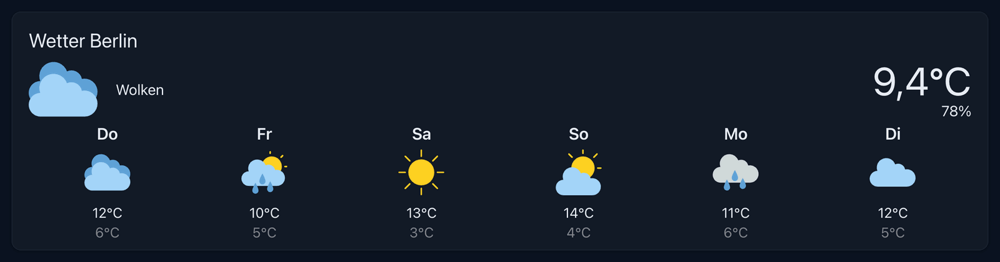

# ioBroker.openweathermap

**Dieser Adapter nutzt die Sentry-Bibliotheken, um Ausnahmen und Codefehler automatisch an die Entwickler zu melden.** Weitere Details und Informationen zum Deaktivieren der Fehlerberichterstattung finden Sie in [der Sentry-Plugin-Dokumentation](https://github.com/ioBroker/plugin-sentry#plugin-sentry) ! Die Sentry-Berichterstattung wird ab js-controller 3.0 verwendet.

Ruft die 5-Tage-Wettervorhersage von [https://openweathermap.org/](https://github.com/ioBroker/ioBroker.openweathermap/blob/master/openweathermap.org) ab.

Sie benötigen einen API-Schlüssel, um auf die Daten zuzugreifen. Den API-Schlüssel erhalten Sie kostenlos nach der Registrierung [hier](https://home.openweathermap.org/api_keys) .

## vis-2 Widget

Das Widget „Wetter“ zeigt das aktuelle Wetter und die Vorhersage für bis zu sechs Tage an. Über die Schaltfläche „i“ öffnet sich ein Dialog mit weiteren Details (Wind, Luftdruck, Niederschlag). Temperatur und Luftfeuchtigkeit können alternativ zu OpenWeatherMap von einem realen Sensor bezogen werden (Einstellungen „Aktuelle Temperatur-ID“ und „Aktuelle Luftfeuchtigkeits-ID“).

Die Größe der Symbole wird über „Symbolgröße (aktuell)“ und „Symbolgröße (Tage)“ in Pixeln festgelegt. Leere Werte behalten die Standardgrößen bei.

## Webkomponente

Die gleichen Wetterdaten sind auch als Webkomponente verfügbar. `<iob-openweathermap-weather>` (`@iobroker/web-components`, aufgeführt in `common.webComponents`) für Aura, Admin, ioBroker.devices und alle anderen Hosts von Webkomponenten. vis-2 bietet stattdessen sein eigenes Widget „Wetter“ an, da beide den gleichen Namen tragen.

Es zeigt das aktuelle Wetter über den Vorhersagetagen (oder daneben in einem breiten, niedrigen Feld) an und passt sich dessen Größe an. Ein Klick öffnet Details – Wind, Luftfeuchtigkeit, Luftdruck und Niederschlag für heute und die folgenden Tage – in einem Dialogfeld des Hosts. Einstellungen: Instanz, Titel, anzuzeigende Daten (alle, nur das aktuelle Wetter, nur die Vorhersagetage), Anzahl der Tage (1–6) und optional die IDs eines realen Temperatur- und Feuchtigkeitssensors. Die Einheiten richten sich nach den Instanzeinstellungen (metrisch oder imperial). Die Symbolgrößen des vis-2-Widgets sind irrelevant: Die Symbole skalieren mit der Feldgröße.

<!--
	### **WORK IN PROGRESS**
-->

## Changelog

### **WORK IN PROGRESS**
* (@GermanBluefox) Added the short form of the web component manifests (tag, name, icon, size) to `common.webComponents`, so that hosts like Aura can list the components before the adapter is installed; the build writes it with `iob-web-components sync-io-package`

### 2.3.0 (2026-11-08)
* (@GermanBluefox) Added the web component `iob-openweathermap-weather` for Aura and other hosts (`common.webComponents`)
* (@GermanBluefox) Corrected wrong translations of the vis-2 widget and the web component, e.g. the weather "Clear" and the "Close" button
* (@GermanBluefox) Corrected the Dutch wind direction south-southeast (ZZO instead of ZSO)
* (@GermanBluefox) The API key is stored encrypted and shown as a password field. An existing key is encrypted automatically at the next start of the instance
* (@GermanBluefox) The vis-2 widget applies the CSS settings for text color, font and background color to all of its texts, the info button and the card

### 2.2.0 (2026-11-05)
* (@GermanBluefox) The place can be selected on a map in the instance settings (needs an admin version with map support for the coordinates field)
* (@GermanBluefox) Updated packages

### 2.1.0 (2026-10-29)
* (@GermanBluefox) Added settings for the icon size of the current weather and of the forecast days in the vis-2 widget

### 2.0.4 (2026-10-22)
* (@GermanBluefox) Fixed raw translation keys (e.g. openweathermap_Wed) in the widget with vis-2 2.15.x (#750)
* (@GermanBluefox) The widget requires vis-2 2.20.2 or newer, if vis-2 is installed

### 2.0.3 (2026-10-17)
* (@GermanBluefox) Updated packages

## License

The MIT License (MIT)

Copyright (c) 2018-2026 bluefox <dogafox@gmail.com>

Permission is hereby granted, free of charge, to any person obtaining a copy
of this software and associated documentation files (the "Software"), to deal
in the Software without restriction, including without limitation the rights
to use, copy, modify, merge, publish, distribute, sublicense, and/or sell
copies of the Software, and to permit persons to whom the Software is
furnished to do so, subject to the following conditions:

The above copyright notice and this permission notice shall be included in all
copies or substantial portions of the Software.

THE SOFTWARE IS PROVIDED "AS IS", WITHOUT WARRANTY OF ANY KIND, EXPRESS OR
IMPLIED, INCLUDING BUT NOT LIMITED TO THE WARRANTIES OF MERCHANTABILITY,
FITNESS FOR A PARTICULAR PURPOSE AND NONINFRINGEMENT. IN NO EVENT SHALL THE
AUTHORS OR COPYRIGHT HOLDERS BE LIABLE FOR ANY CLAIM, DAMAGES OR OTHER
LIABILITY, WHETHER IN AN ACTION OF CONTRACT, TORT OR OTHERWISE, ARISING FROM,
OUT OF OR IN CONNECTION WITH THE SOFTWARE OR THE USE OR OTHER DEALINGS IN THE
SOFTWARE.