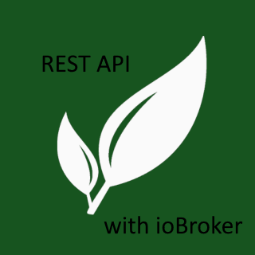
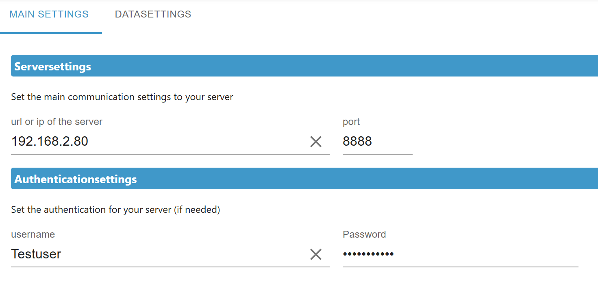
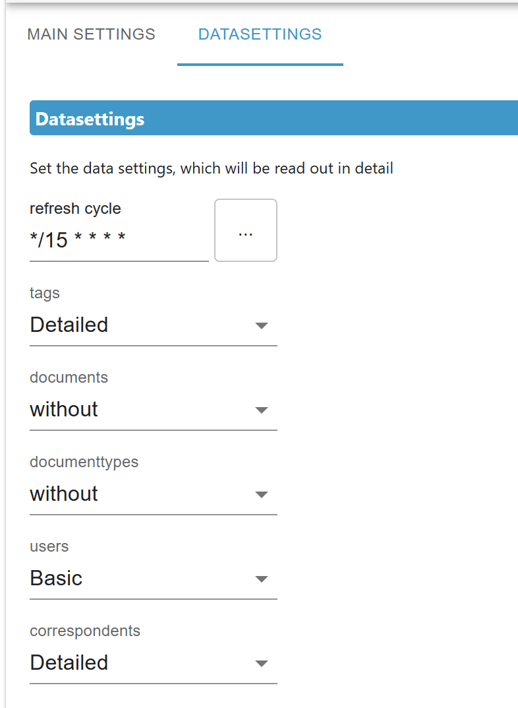

# ioBroker.paperless-ngx

- Offizielle Paperless-ngx-Website: <https://docs.paperless-ngx.com/>

## paperless-ngx-Adapter für ioBroker

Die paperless-ngx-API ermöglicht den Abruf von Informationen zu laufenden paperless-ngx-Instanzen. Beispielsweise können Sie die Tags, Dokumente, Dokumenttypen, Benutzer oder Korrespondenten der jeweiligen paperless-Instanz auslesen.

Um sich bei der Instanz anzumelden, müssen Sie folgende Daten festlegen:

Wählen Sie den Aktualisierungszyklus und die Art der gelesenen Daten: (ohne, einfach oder detailliert)

## Nachrichten für Skripte und KI-Agenten

`sendTo('paperless-ngx.0', 'help', {}, answer => ...)` Gibt eine Beschreibung aller Nachrichten (Dokumentsuche, globale Suche, Aktualisierung, Info) für KI-Agenten (z. B. ioBroker.pi-agent) und Skripte zurück: `{ help, commands }`, Wo `commands` listet jede Nachricht auf `write: true` Wenn es etwas ändert.

## HAFTUNGSAUSSCHLUSS

Dieses Projekt steht in keiner offiziellen Verbindung zu Paperless-ngx, d.h. Paperless-ngx betreut dieses Projekt nicht.

## Changelog
<!--
	Placeholder for the next version (at the beginning of the line):
	### **WORK IN PROGRESS**
-->
### 1.0.5 (2026-11-20)
- (@GermanBluefox) Added the message "help": a description of all messages for AI agents (e.g. pi-agent), and common.supportedMessages.help

### 1.0.4 (2026-10-25)
- (BenAhrdt) Update `@iobroker/testing` to version 6.3.1.
- (arteck) add dark mode

### 1.0.3 (2026-09-20)
- Add a Paperless-styled Admin tab with global and document search, tag filters, metadata browsing, refresh controls, and a direct Paperless link.
- Encode search parameters safely, acknowledge requests when Paperless is unavailable, retry connections on the configured cycle, and remove duplicate object cleanup work.

### 1.0.2 (2026-08-05)
- (BenAhrdt) Prevent adapter startup failure when no Paperless server is configured

### 1.0.1 (2026-08-05)
- (copilot) Adapter requires node.js >= 22 now
- (BenAhrdt) Add HTTPS and reverse proxy URL support while keeping existing HTTP configurations compatible

## License
MIT License

Copyright (c) 2025-2026 BenAhrdt <bsahrdt@gmail.com>

Permission is hereby granted, free of charge, to any person obtaining a copy
of this software and associated documentation files (the "Software"), to deal
in the Software without restriction, including without limitation the rights
to use, copy, modify, merge, publish, distribute, sublicense, and/or sell
copies of the Software, and to permit persons to whom the Software is
furnished to do so, subject to the following conditions:

The above copyright notice and this permission notice shall be included in all
copies or substantial portions of the Software.

THE SOFTWARE IS PROVIDED "AS IS", WITHOUT WARRANTY OF ANY KIND, EXPRESS OR
IMPLIED, INCLUDING BUT NOT LIMITED TO THE WARRANTIES OF MERCHANTABILITY,
FITNESS FOR A PARTICULAR PURPOSE AND NONINFRINGEMENT. IN NO EVENT SHALL THE
AUTHORS OR COPYRIGHT HOLDERS BE LIABLE FOR ANY CLAIM, DAMAGES OR OTHER
LIABILITY, WHETHER IN AN ACTION OF CONTRACT, TORT OR OTHERWISE, ARISING FROM,
OUT OF OR IN CONNECTION WITH THE SOFTWARE OR THE USE OR OTHER DEALINGS IN THE
SOFTWARE.