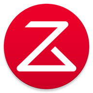

# ioBroker.roborock

## Roborock-Adapter für ioBroker

Mit diesem Adapter können Sie einen in der Roborock-App eingerichteten Roborock-Staubsauger steuern, seinen Status abrufen, die Reinigungshistorie einsehen und seine Karte anzeigen.

- [Anforderungen](#requirements)
- [Unterstützte Roboter](#supported-robots)
- [Zonenreinigung](#zone-cleaning)
- [Skriptverwendung](#script-usage)
- [Änderungsprotokoll](#changelog)
- [Lizenz](#license)

**Dieser Adapter nutzt die Sentry-Bibliotheken, um Ausnahmen und Codefehler automatisch an die Entwickler zu melden.** Weitere Details und Informationen zum Deaktivieren der Fehlerberichterstattung finden Sie in [der Sentry-Plugin-Dokumentation](https://github.com/ioBroker/plugin-sentry#plugin-sentry) ! Die Sentry-Berichterstattung wird ab js-controller 3.0 verwendet.

## Anforderungen

- Node.js >= 22.0.0
- ioBroker.admin >= 7.6.17
- ioBroker.js-controller >= 6.0.11

## Unterstützte Roboter

- **S-Serie:** S4, S4 Max, S5 Max, S6, S6 Pure, S6 MaxV, S7, S7 MaxV (Pro/Ultra), S7 Pro Ultra, S7 Max Ultra, S8, S8+, S8 Pro Ultra, S8 MaxV Ultra
- **Q-Serie:** Q5 Pro, Q7, Q7 Pro, Q7 Max, Q7 L5, Q8 Max
- **Q Revo:** Q Revo, Q Revo Pro
- **Qrevo:** Qrevo Slim, Qrevo S, Qrevo Curve, Qrevo Curv Series, Qrevo Edge, Qrevo Edge Series, Qrevo L, Qrevo Master, Qrevo MaxV
- **Saros:** Saros 10, Saros 10R, Saros 20 / Saros 20X, Saros Z70

## Zonenreinigung

Diese Funktion ist nur verfügbar, wenn die Kartenerstellung in den Adapteroptionen aktiviert ist. Öffnen Sie die Karte über die Registerkarte „Web-UI“ des Adapters in der ioBroker-Administrationsoberfläche; eine manuelle URL ist nicht erforderlich.

### Die Kartenerstellung funktioniert nicht auf dem Raspberry Pi.

- Zeichnen Sie das Quadrat, das Sie reinigen möchten. Roborock unterstützt bis zu 4 Reinigungszonen gleichzeitig.


## Skriptverwendung

### Gerätestatus aktualisieren

Basierend auf Gaspode69s Beitrag in #1472, `refresh_status` Anfrage zum aktuellen Status eines unterstützten Geräts:

```javascript
sendTo("roborock.0", "refresh_status", { duid: "DEVICE_DUID" }, response => {
    if (response.error) {
        log(response.error, "warn");
        return;
    }
    // Fresh status has been processed into the device's ioBroker states.
    log("Device status refreshed");
});
```

Der Rückruf kehrt zurück `{ result: "ok" }` erst nach der Statusverarbeitung, oder `{ error: "..." }` Im Fehlerfall teilen sich gleichzeitige Anfragen für dasselbe Gerät eine Aktualisierung. V1 und Q7/B01 verwenden ihren normalen Anfrage-/Antwortpfad mit einer Aktualisierungsfrist von 10 Sekunden und ohne automatische Wiederholungsversuche innerhalb dieser Frist. Die Stornierung entfernt Anfragen aus der Warteschlange und bricht ausstehende Veröffentlichungen ab; ein bereits an die Statusdatenbank übergebener ioBroker-Schreibvorgang kann nicht widerrufen werden. Q10 wartet nach der Anforderung von DP 102 bis zu 10 Sekunden auf einen neu verarbeiteten numerischen Status; da dieses Protokoll keine Anfragekorrelations-ID besitzt, kann auch ein neuer, unaufgeforderter Status die Anfrage erfüllen. Eine Broker-Bestätigung allein ist nicht ausreichend. A01 Waschmaschinen (Cloud-Kategorie) `roborock.wm`) Abfrage des Betriebszustands DP 203; A01 Nass-/Trockenreinigungen (`roborock.wetdryvac`) Abfrage DP 201 über ID\_QUERY 10000. A01 wartet außerdem bis zu 10 Sekunden, bis der neu empfangene Betriebszustandswert erfolgreich geschrieben wurde; es wird kein vollständiger Snapshot aller Geräteeigenschaften angefordert oder garantiert. Wie Q10 verfügt A01 über keine Anforderungskorrelations-ID, sodass ein neuer passender Push die Aktualisierung durchführen kann. Andere A01-Kategorien und generische Handler ohne bestätigte Aktualisierungsunterstützung geben einen expliziten Fehler zurück. Das Herunterfahren des Adapters bricht ausstehende Aktualisierungen ab. Das normale Polling bleibt unverändert. A01-Framing und DP-Auswahl folgen [der A01-Implementierung von python-roborock](https://github.com/Python-roborock/python-roborock/blob/109f433556e3c30c08eae34dbb2549f516509967/roborock/devices/rpc/a01_channel.py) ; diese Implementierung verfügt über automatisierte Tests, wurde aber nicht auf physischer A01-Hardware verifiziert.

## Changelog
<!--
	Placeholder for the next version (at the beginning of the line):
	### **WORK IN PROGRESS**
-->
### 0.8.0 (2026-10-11)

* (copystring) Added Roborock Q7 Pro support for maps, status and consumables.
* (copystring) Improved multi-step scene execution and local connections for B01 devices.
* (copystring) Coordinated UDP discovery when multiple adapter instances run.
* (copystring) Corrected the Qrevo Edge 2 water mode mapping.
* (gemsli) Fixed segment cleaning for rooms with inactive map states.
* (copystring) Fixed cloud reauthentication after HomeData 401 responses and corrected S7 dock error handling.

### 0.7.4 (2026-06-07)

* (copystring) Documented tested Roborock S8+ support.
* (copystring) Fixed consumable percentage values for devices where Roborock reports maintenance data via HomeData.
* (copystring) Re-enabled macOS support and added macOS test coverage.
* (copystring) Improved dependency update automation so updates are checked weekly and merged only after successful checks.
* (copystring) Updated `p-queue` to 9.3.0 and `protobufjs` to 8.5.0.
* (copystring) Improved CI performance for Linux, macOS and Windows adapter tests without reducing test coverage.

### 0.7.3 (2026-05-22)

* (copystring) Fixed V1 auto-empty dust collection to use the AppPlugin-verified `app_start_collect_dust` command.

### 0.7.2 (2026-05-20)

* (copystring) Fixed missing auto-empty command for Roborock Qrevo MaxV (#1272).
* (copystring) Fixed local endpoint refresh after temporary MQTT outages so stale local IP recovery retries immediately again.
* (copystring) Require bug reports to upload a `.txt` debug log file.

### 0.7.1 (2026-05-19)

* (copystring) Fixed local TCP recovery when a Roborock device gets a new LAN IP address.
* (copystring) Updated dependencies: `@napi-rs/canvas` to 1.0.0, `protobufjs` to 8.2.0 and `zod` to 4.4.3.
* (copystring) Resolved npm audit security advisories in transitive dependencies and documented the temporary dependency overrides.

Older changelog entries are available in CHANGELOG_OLD.md.

## License

MIT License

Copyright (c) 2026 copystring <copystring@gmail.com>

See [LICENSE](https://github.com/copystring/ioBroker.roborock/blob/main/LICENSE) for the full license text.