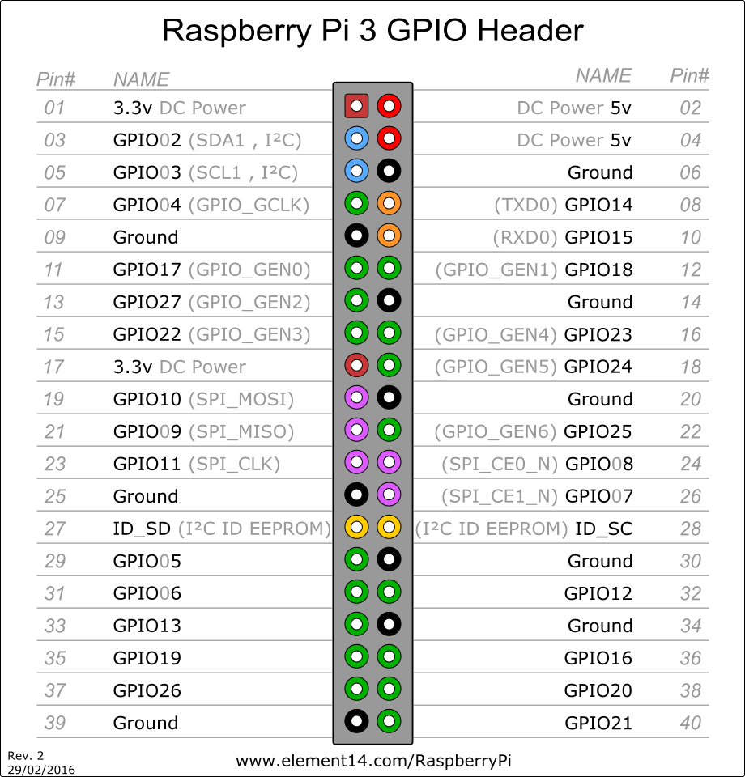

# ioBroker.rpi2


## Versionen

RPI-Monitor-Adapter für ioBroker

RPI-Monitor-Implementierung zur Integration in ioBroker. Es handelt sich um die gleiche Implementierung wie für iobroker.rpi, jedoch mit GPIOs.

## Wichtige Informationen

**ioBroker benötigt spezielle Berechtigungen zur Steuerung von GPIOs.** Auf den meisten Linux-Distributionen kann dies durch Hinzufügen des Benutzers ioBroker zur Benutzerverwaltung erreicht werden. `gpio` Gruppe.

Sie müssen installieren `libgpiod-dev` **Vor** der Installation des Adapters (siehe unten) muss Version **2.2 oder neuer** installiert sein, andernfalls wird die Installation abgebrochen. Debian 13 / Trixie wird mit Version 2.2.1 ausgeliefert. Debian 12 / Bookworm verfügt nur über ältere Versionen (1.6 oder 2.1 aus anderen Quellen), die **nicht** ausreichen. Die installierte Version kann mit folgendem Befehl überprüft werden: `dpkg -s libgpiod-dev | grep Version` Die

> \[!VORSICHT] Version 3.xx und neuer dieses Adapters unterstützen und erfordern Debian 13 / Trixie (Linux-Kernel 5.10 oder neuer). Führen Sie kein Update durch, wenn Sie ein älteres Betriebssystem verwenden.

## Installation

Nach der Installation können Sie die Monitoreinstellungen in den Instanzeinstellungen konfigurieren.

Nach dem Start von `iobroker.rpi` Alle ausgewählten Module erzeugen einen Objektbaum in ioBroker innerhalb von rpi.<instance> Die<modulename> z.B `rpi.0.cpu`

Der Adapter benötigt einige Betriebssystemabhängigkeiten. Normalerweise kümmert sich js-controller darum, aber falls Probleme auftreten, installieren Sie bitte die folgenden Pakete manuell:

```bash
sudo apt update
sudo apt install -y build-essential
sudo apt install -y libgpiod-dev
sudo apt install -y pkg-config
```

`libgpiod-dev` (Version 2.2 oder neuer) ist immer erforderlich, die Installation prüft dies (mit `pkg-config` (falls installiert).

### Scheibentemperatur

Sie können die Temperaturen von NVMe- und SATA/USB-Laufwerken ablesen (`temperature.disk_temp` (Aktivieren Sie _die Temperaturanzeige_ in den Instanzeinstellungen). Der Adapter meldet das erste Laufwerk mit einer Temperaturangabe und prüft, ob eine Temperaturangabe vorliegt. `/dev/nvme0` Zu `/dev/nvme9` zuerst, dann `/dev/sda` Zu `/dev/sdz` Dazu müssen Sie Folgendes installieren: `smartmontools` Paket und erlauben Sie die `iobroker` Benutzer ausführen `smartctl` als Root:

```bash
sudo apt install smartmontools
sudo visudo -f /etc/sudoers.d/iobroker-disktemp
```

Füge die Regel nicht zur sudoers-Datei hinzu. `/etc/sudoers.d/iobroker` Es wird zurückgesetzt durch `iob fix` Fügen Sie diese Zeilen zur neuen Datei hinzu:

```
Cmnd_Alias SMARTCTL = /usr/sbin/smartctl -A /dev/sd[a-z], \
                      /usr/sbin/smartctl -A /dev/nvme[0-9]
Defaults!SMARTCTL !syslog, !pam_session
iobroker ALL=(root) NOPASSWD: SMARTCTL
```

Die Regel erlaubt lediglich das Auslesen der Werte dieser Laufwerke, nicht aber das Ändern von Laufwerkseinstellungen. `!syslog` Und `!pam_session` Halten Sie die regulären Messwerte aus dem Systemprotokoll heraus. Einige USB-SATA-Adapter leiten die SMART-Daten nicht weiter. Um dies zu überprüfen, führen Sie folgenden Befehl aus: `sudo -u iobroker sudo -n smartctl -A /dev/sda` und suchen Sie nach `Temperature_Celsius` oder `Temperature:` in der Ausgabe.

## GPIOs

Sie können auch GPIOs auslesen und steuern. Dazu müssen Sie lediglich die GPIO-Optionen in den Einstellungen (Registerkarte „Zusätzliche Informationen“) konfigurieren.



Nachdem einige Ports aktiviert wurden, erscheinen im Objektbaum die folgenden Zustände:

- rpi.0.gpio.PORT.state

Die Portnummerierung erfolgt über BCM (BroadComm Pins on Chip). Die vollständige Nummerierung erhalten Sie mit `gpio readall` Zum Beispiel PI2:

```
+-----+-----+---------+------+---+---Pi 2---+---+------+---------+-----+-----+
| BCM | wPi |   Name  | Mode | V | Physical | V | Mode | Name    | wPi | BCM |
+-----+-----+---------+------+---+----++----+---+------+---------+-----+-----+
|     |     |    3.3v |      |   |  1 || 2  |   |      | 5v      |     |     |
|   2 |   8 |   SDA.1 | ALT0 | 1 |  3 || 4  |   |      | 5V      |     |     |
|   3 |   9 |   SCL.1 | ALT0 | 1 |  5 || 6  |   |      | 0v      |     |     |
|   4 |   7 | GPIO. 7 |   IN | 1 |  7 || 8  | 0 | IN   | TxD     | 15  | 14  |
|     |     |      0v |      |   |  9 || 10 | 1 | IN   | RxD     | 16  | 15  |
|  17 |   0 | GPIO. 0 |   IN | 0 | 11 || 12 | 0 | IN   | GPIO. 1 | 1   | 18  |
|  27 |   2 | GPIO. 2 |   IN | 0 | 13 || 14 |   |      | 0v      |     |     |
|  22 |   3 | GPIO. 3 |   IN | 0 | 15 || 16 | 0 | IN   | GPIO. 4 | 4   | 23  |
|     |     |    3.3v |      |   | 17 || 18 | 0 | IN   | GPIO. 5 | 5   | 24  |
|  10 |  12 |    MOSI |   IN | 0 | 19 || 20 |   |      | 0v      |     |     |
|   9 |  13 |    MISO |   IN | 0 | 21 || 22 | 1 | IN   | GPIO. 6 | 6   | 25  |
|  11 |  14 |    SCLK |   IN | 0 | 23 || 24 | 1 | IN   | CE0     | 10  | 8   |
|     |     |      0v |      |   | 25 || 26 | 1 | IN   | CE1     | 11  | 7   |
|   0 |  30 |   SDA.0 |   IN | 1 | 27 || 28 | 1 | IN   | SCL.0   | 31  | 1   |
|   5 |  21 | GPIO.21 |   IN | 1 | 29 || 30 |   |      | 0v      |     |     |
|   6 |  22 | GPIO.22 |   IN | 1 | 31 || 32 | 0 | IN   | GPIO.26 | 26  | 12  |
|  13 |  23 | GPIO.23 |   IN | 0 | 33 || 34 |   |      | 0v      |     |     |
|  19 |  24 | GPIO.24 |   IN | 0 | 35 || 36 | 0 | IN   | GPIO.27 | 27  | 16  |
|  26 |  25 | GPIO.25 |  OUT | 1 | 37 || 38 | 0 | IN   | GPIO.28 | 28  | 20  |
|     |     |      0v |      |   | 39 || 40 | 0 | IN   | GPIO.29 | 29  | 21  |
+-----+-----+---------+------+---+----++----+---+------+---------+-----+-----+
| BCM | wPi |   Name  | Mode | V | Physical | V | Mode | Name    | wPi | BCM |
+-----+-----+---------+------+---+---Pi 2---+---+------+---------+-----+-----+
```

### Eingaben

- **Pull-Up** / **Pull-Down** -Schalter am internen Pull-Up-Widerstand des Eingangs. Bei _Pull-Up_ ist der Eingang aktiv-niedrig: Schließen Sie einen Schalter zwischen GPIO und GND an, und der Zustand ist `true` während der Schalter geschlossen ist. Bei Verwendung _eines Pull-Down-Widerstands_ wird der Schalter stattdessen an 3,3 V angeschlossen; der Zustand ist `true` solange es geschlossen ist. Ohne eines von beiden bleibt der Pull-Widerstand unverändert – entweder der Standardwert des Raspberry Pi (Pull-up für GPIO 0–8, Pull-down für alle anderen) oder der Wert, den Sie in der Konfiguration festgelegt haben. `config.txt` z.B. `gpio=17=pu` Die
- **Entprellung/Abfrage (ms)** : Eine Änderung wird erst gemeldet, wenn die Eingabe für einen bestimmten Zeitraum stabil war, z. B. 20–50 ms bei Schaltern und Tasten. Dies wird vom Kernel durchgeführt; falls Ihr System dies nicht unterstützt, übernimmt der Adapter dies selbst und protokolliert eine Meldung.

## DHTxx/AM23xx-Sensoren

Sie können Daten von den Temperatur-/Feuchtigkeitssensoren DHT11, DHT21 (AM2301), DHT22 und AM2302 auslesen.

Schließen Sie einen solchen Sensor an einen GPIO-Pin an, wie auf der Seite des [node-dht-sensor](https://www.npmjs.com/package/node-dht-sensor) -Pakets beschrieben. Wie bereits erläutert, können mehrere Sensoren an _mehrere_ Pins angeschlossen werden (es handelt sich _nicht um_ ein Bussystem).

Wählen Sie in der GPIO-Tabelle Folgendes aus: `DHT11` für DHT11-Sensoren und `DHT22/AM23xx` Geben Sie für alle anderen Sensoren das Abfrageintervall in Millisekunden in die Spalte _„Entprellung/Abfrage“_ ein. Die Sensoren können nicht schneller als alle 2000 ms ausgelesen werden (DHT11: 1000 ms); ohne Angabe eines Werts fragt der Adapter alle 30000 ms ab.

Für jeden Sensor erzeugt der Adapter `gpio.N.temperature`, `gpio.N.humidity` Und `gpio.N.dewpoint` Der Taupunkt wird anhand von Temperatur und Luftfeuchtigkeit mit der Magnus-Formel berechnet. Seine Genauigkeit hängt von der des Sensors ab: etwa ±1 °C mit einem DHT22, deutlich weniger mit einem DHT11.

Der Adapter liest die Messwerte eines Sensors auf eine von zwei Arten aus und protokolliert beim Start, welche Methode er für jeden Sensor verwendet.

### Linux-Kernel-Treiber (empfohlen)

Linux verfügt über einen eigenen Treiber für diese Sensoren (er unterstützt DHT11, DHT22 und AM2302 und sollte auch DHT21 unterstützen). Aktivieren Sie ihn für jeden Sensor, indem Sie eine Zeile hinzufügen zu `/boot/firmware/config.txt` (`/boot/config.txt` (bei älteren Systemen) und Neustart:

```
dtoverlay=dht11,gpiopin=17
```

`gpiopin` ist die GPIO-Nummer (BCM), die mit der in der GPIO-Tabelle des Adapters übereinstimmt. Sie können die Funktion mit folgendem Befehl überprüfen: `cat /sys/bus/iio/devices/iio:device*/in_temp_input` (Der Wert ist in 1/1000 °C angegeben.) Der Adapter erkennt den Treiber und verwendet ihn automatisch; es ist keine weitere Konfiguration erforderlich.

Das Overlay ist seit 2015 (Raspbian Jessie) Teil des Raspberry Pi OS und funktioniert auf allen Raspberry Pi-Modellen, einschließlich Pi 5, Pi 500 und Compute Module 5. Kernel vor November 2024 konnten neuere DHT11-Sensoren, die Dezimalstellen melden, oft nicht dekodieren („Daten können nicht dekodiert werden“). `dmesg`); Raspberry Pi OS 13 (Trixie), das für diesen Adapter benötigt wird, enthält die Lösung.

### Knoten-DHT-Sensor

Ohne den Kernel-Treiber greift der Adapter auf node-dht-sensor zurück. Dies funktioniert nur auf Raspberry Pi 1 bis 4. Auf einem Raspberry Pi 5 (sowie Pi 500 und Compute Module 5) funktioniert es nicht, da es auf GPIO-Register zugreift, die der Pi 5 nicht besitzt – verwenden Sie dort den Kernel-Treiber. Im Gegensatz zu node-dht-sensor funktioniert der Kernel-Treiber auch nach Node.js-Upgrades und Neuinstallationen des Adapters weiterhin.

## Changelog

<!--
	PLACEHOLDER for the next version:
	### **WORK IN PROGRESS**
-->
### 5.0.0 (2026-11-11)
- (Garfonso/Claude) **BREAKING**: *Pull Up* and *Pull Down* switch on the internal pull resistors of inputs (#31). Before, *Pull Up* only inverted the value; it still does. If you used *Pull Up* just to invert an input that is switched to 3.3 V, the input now stays high: untick *Pull Up* and tick *Invert* instead. Also check inputs with *Pull Up* and an external pull-down resistor.
- (Garfonso/Claude) **BREAKING**: Inputs are debounced by the kernel. A change is reported once the input has been stable for the debounce time, instead of right away followed by a pause. Changes therefore arrive later by that time, and pulses shorter than the debounce time (e.g. from S0 or reed contact meters) are ignored - lower the debounce time below the shortest pulse. In return a short glitch no longer leaves the state wrong.
- (Grothesk242) **BREAKING**: `temperature.nvme_temp` is replaced by `temperature.disk_temp`. It is read with smartmontools from the first NVMe or SATA/USB drive that reports a temperature. The old state is deleted. Install `smartmontools` and replace the old `nvme` sudo rule by the new one from the README.
- (Garfonso/Claude) **NEW**: DHT sensors also report the dew point (`gpio.N.dewpoint`), calculated from temperature and humidity.
- (Garfonso/Claude) **ENHANCED**: An input that cannot be set up no longer disables all other GPIOs; the reason is logged.
- (Garfonso/Claude) A missing drive, WLAN or sudo rule is no longer logged as an error, and no longer shows a disk temperature of 0.
- (copilot) Adapter requires node.js >= 22.19.0 now
- (Garfonso/Claude) Removed `python` from the OS dependencies, there is no such package on current Debian.
- (Garfonso/Claude) DHT sensors: the README and the log messages recommend the Linux kernel driver, the instructions for rebuilding node-dht-sensor are removed. An already rebuilt node-dht-sensor keeps working.
- (Garfonso/Claude) The check for libgpiod 2.2 moved from the adapter's preinstall script into `@garfonso/opengpio`.
- (Garfonso/Claude) Removed the unused `ci` dependency, updated dependencies and added missing translations in the admin page.

### 4.0.0 (2026-10-07)
- (copilot) Adapter requires node.js >= 22 now
- (copilot) Adapter requires admin >= 7.7.22 now
- (mcm1957) Dependencies have been updated.
- (copilot) **ENHANCED**: Added `temperature.fan_activity` object to monitor fan RPM via `/sys/devices/platform/cooling_fan/...`; falls back to `0` when unavailable.
- (Garfonso/Claude) Improve GPIO handling.
- (Garfonso/Claude) **FIXED**: GPIO outputs no longer switch off and on again during adapter start (#431).
- (Garfonso/Claude) Use the `@garfonso/opengpio` npm package instead of a git branch of the fork.
- (Garfonso/Claude) **FIXED**: The fan parser unit test matched the old single-hwmon path and failed since the fan reading fix.
- (Garfonso/Claude) **FIXED**: DHT sensors ignored the configured poll interval (with no interval they were read continuously, so every read failed) and every sensor's timer read all sensors.
- (Garfonso/Claude) **NEW**: DHT sensors are read through the Linux dht11 kernel driver if it is enabled (`dtoverlay=dht11,gpiopin=<n>`). This makes them work on a Raspberry Pi 5 without rebuilding node-dht-sensor (#406).
- (Garfonso/Claude) **ENHANCED**: DHT sensor problems are logged with their cause and how to fix them; the startup log shows how each sensor is read.
- (Garfonso/Claude) **FIXED**: Raspberry Pi 500 and Compute Module 5 are recognised as Raspberry Pi 5 boards and use the same GPIO chip.
- (Garfonso/Claude) **FIXED**: The humidity object of a DHT sensor was named "temperature".
- (Garfonso/Claude) **BREAKING**: GPIO and DHT sensor handling changed in several places (see above). This mostly fixes problems, but please check your GPIO setup after updating.

### 3.0.2 (2025-12-01)
* (@klein0r) Check for required libgpiod-dev package version

### 3.0.1 (2025-11-28)
* (@klein0r) Updated logo, workflows and documentation
* (@klein0r) admin 7.6.17 and js-controller 6.0.11 (or later) are required

### 3.0.0 (2025-11-28)
* (@klein0r) NodeJS 20.x (or newer) is required
* (@klein0r) Updated opengpio to v2 (works on Debian trixie)

## License
MIT License

Copyright (c) 2026 iobroker-community-adapters <iobroker-community-adapters@gmx.de>  
Copyright (c) 2024-2025 Garfonso <garfonso@mobo.info>

Permission is hereby granted, free of charge, to any person obtaining a copy
of this software and associated documentation files (the "Software"), to deal
in the Software without restriction, including without limitation the rights
to use, copy, modify, merge, publish, distribute, sublicense, and/or sell
copies of the Software, and to permit persons to whom the Software is
furnished to do so, subject to the following conditions:

The above copyright notice and this permission notice shall be included in all
copies or substantial portions of the Software.

THE SOFTWARE IS PROVIDED "AS IS", WITHOUT WARRANTY OF ANY KIND, EXPRESS OR
IMPLIED, INCLUDING BUT NOT LIMITED TO THE WARRANTIES OF MERCHANTABILITY,
FITNESS FOR A PARTICULAR PURPOSE AND NONINFRINGEMENT. IN NO EVENT SHALL THE
AUTHORS OR COPYRIGHT HOLDERS BE LIABLE FOR ANY CLAIM, DAMAGES OR OTHER
LIABILITY, WHETHER IN AN ACTION OF CONTRACT, TORT OR OTHERWISE, ARISING FROM,
OUT OF OR IN CONNECTION WITH THE SOFTWARE OR THE USE OR OTHER DEALINGS IN THE
SOFTWARE.