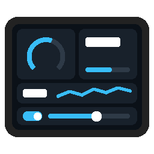

# ioBroker.satellite-display

Die Kachelseiten auf dem Touchscreen der ESPHome-Sprachsatelliten werden von ioBroker befüllt und enthalten Werte, Anzeigen, Diagramme, Schalter, Dimmer und Tasten, die jeweils einem Zustand zugeordnet sind. Durch Berühren eines Schalters, Dimmers oder einer Taste wird der Zustand aktualisiert.

Es ist für den [Waveshare ESP32-S3-AUDIO Sprachsatelliten](https://github.com/sadam6752-tech/esphome-waveshare-esp32-s3-audio-va) mit dem [Waveshare 2,8-Zoll-kapazitiven Touchscreen-LCD](https://www.waveshare.com/wiki/2.8inch_Capacitive_Touch_LCD) (Firmware **2.0.0** oder neuer) konzipiert. Die Sprachausgabe des Satelliten erfolgt weiterhin über [ioBroker.assistant](https://github.com/ioBroker/ioBroker.assistant) ; dieser Adapter stellt eine eigene Verbindung zur ESPHome Native API her und steuert ausschließlich die Anzeige.

Ein Display ohne Sprachausgabe funktioniert auch: Das Firmware-Repository hat `panel-lcd2.yaml` Für das [Waveshare ESP32-S3-Touch-LCD-2](https://www.waveshare.com/wiki/ESP32-S3-Touch-LCD-2) , ein 2-Zoll-Kachelpanel mit denselben Kachelseiten und Bildschirmsperre. Fügen Sie es wie einen Satelliten hinzu (IP-Adresse, Port 6053).

```
ioBroker states  ──▶  satellite-display  ──▶  satellite (tile pages)
       ▲                                           │
       └──────────────  a touch on a tile  ◀───────┘
```

## Fliesen

Jeder Satellit verfügt über bis zu **4 Seiten** . Eine Seite ist ein Raster aus 2 Spalten × 4 Zeilen auf dem 320 × 240 Pixel großen Bildschirm und kann bis zu 8 Kacheln enthalten. Wischen Sie vom Zifferblatt nach links, um zu den Seiten zu gelangen; Seiten ohne Kacheln werden übersprungen.

| Größe   | Zellen | Pixel     |
| ------- | ------ | --------- |
| klein   | 1 × 1  | 151 × 52  |
| Quadrat | 1 × 2  | 151 × 111 |
| breit   | 2 × 1  | 308 × 52  |
| groß    | 2 × 2  | 308 × 111 |

| Art               | Shows                                                                                                      | Größen                    | Eine Berührung                                      |
| ----------------- | ---------------------------------------------------------------------------------------------------------- | ------------------------- | --------------------------------------------------- |
| Wert              | Name, Zahl mit Einheit oder ein Text                                                                       | alle                      | –                                                   |
| Messgerät         | Name, Bogen vom Skalenanfang bis zum Skalenende, Nummer                                                    | quadratisch, groß         | –                                                   |
| Wert mit Balken   | Name, Nummer, Balken entlang der Skala                                                                     | alle                      | –                                                   |
| Wert mit Diagramm | Name, Nummer, Zeile der letzten 60 Werte                                                                   | klein, breit, groß        | –                                                   |
| Schalten          | Name, Umschalter; die Kachel leuchtet auf, wenn sie eingeschaltet ist.                                     | klein, quadratisch, breit | Schaltet den Zustand um                             |
| Dimmer            | Name, Umschalter, Schieberegler, Prozent                                                                   | breit, groß               | Umschalter und Schieberegler schreiben die Zustände |
| Taste             | Symbol, Name                                                                                               | klein, quadratisch, breit | schreibt `true` dem Staat                            |
| Thermostat        | Name, Bogen mit der aktuellen Temperatur, − Zielwert +, ein Punkt für das Heizrelais                       | quadratisch, groß         | − und + schreiben Sie das Ziel                      |
| Gruppe            | Bis zu 4 Werte pro Kachel, jeder mit eigenem Namen: Zeilen im Hochformat, Spalten im Flachformat           | alle                      | –                                                   |
| Tank              | Name, ein bis zur Skala gefüllter Tank, der Wert, optional eine zweite Menge (Liter)                       | quadratisch, groß         | –                                                   |
| Batterie          | Name, eine entlang der Skala gefüllte Batterie, ein Bolzen während des Ladevorgangs, optional die Leistung | alle                      | –                                                   |
| Status            | Symbol, Name, Wert oder Text; das Symbol und die Kachel leuchten auf, wenn sie eingeschaltet sind.         | klein, quadratisch, breit | –                                                   |

Vier weitere Darstellungsarten werden **nur von Tablets** unterstützt (Web-App und ioBroker Visu-App; Satellitenbilder lassen sie mit einem Warnhinweis aus). Tablets bieten dafür zwei weitere Größen: 3 × 2 und 4 × 3 Zellen.

| Art              | Shows                                                                                                            | Eine Berührung                             |
| ---------------- | ---------------------------------------------------------------------------------------------------------------- | ------------------------------------------ |
| Karte            | OpenStreetMap mit dem Boot, seinem Kurs und seiner Route; optionale AIS-Ziele, Ankerkreis, Seezeichen            | Pfanne, kneifen, + −, zurück zum Boot      |
| Energiefluss     | Solarstrom, Batterie, Netzstrom und Verbrauch im Umfeld des Wechselrichters, Punkte, die mit der Leistung laufen | –                                          |
| Verlaufsdiagramm | bis zu 4 Serien über Stunden oder Tage vom Verlaufsadapter, mit Achsen                                           | die Periode; ein Finger zeigt die Werte an |
| Kamera           | Das Bild einer Kamera, das alle paar Sekunden aktualisiert wird, oder ihr Live-Stream (MJPEG)                    | das Bild auf dem gesamten Bildschirm       |

## Einstellungen

1. **Satelliten:** Name (Raum), IP-Adresse und API-Port (6053) jedes Satelliten. Ein API-Verschlüsselungsschlüssel ist nur erforderlich, wenn Sie die Firmware mit einem solchen Schlüssel erstellt haben; die fertige Firmware enthält keinen.
2. **Tiles:** ein grafischer Editor. Wählen Sie den Satelliten und die Seite aus; die Vorschau zeigt den Bildschirm mit den aktuellen Werten. Klicken Sie auf eine freie Zelle, um eine Kachel hinzuzufügen, ziehen Sie eine Kachel in eine freie Zelle, um sie zu verschieben, oder auf eine andere Kachel, um die beiden zu tauschen. Klicken Sie auf eine Kachel, um sie rechts zu bearbeiten: Art, Größe, Status (mit dem Objektbrowser des Administrators), Name, Einheit, Symbol und Skalierung. Wenn Sie einen Status auswählen, werden Name und Einheit automatisch ausgefüllt; Sie können diese ändern. Name, Einheit und Skalierung können auch leer bleiben: Sie werden vom Objekt des Status übernommen. „Seite kopieren“ kopiert die Seite auf eine andere Seite oder einen anderen Satelliten. Strg+Z macht die letzten Änderungen rückgängig. „Auf dem Satelliten anzeigen“ platziert die Kacheln des Editors auf dem Satelliten, ohne sie zu speichern, um Größen und Positionen auszuprobieren (die Instanz muss ausgeführt werden). Eine Kachel, die der Adapter auslassen würde, wird rot markiert, mit dem Grund (eine Größe der entsprechenden Art ist nicht verfügbar, ein Thermostat ohne Ziel, mehr als acht Kacheln auf einer Seite).
3. **Diagramme (optional):** Ein Verlaufsadapter (History, SQL, InfluxDB). Ein Diagramm beginnt dann mit den Daten der letzten Stunden seines Zustands anstatt leer zu sein.

Einzelheiten zu den Arten:

- **Schalter:** liest den Zustand als ein/aus (`true`, eine Zahl ungleich 0, `"on"` …) und schreibt den Typ des Zustands (`true` /`false`, `1` /`0`).
- **Dimmer:** Der Zustand ist der Pegel, 0-100, oder der Bereich des Objekts (`min` /`max` (z. B. 0–1 oder 0–255); der Schieberegler speichert den Wert beim Loslassen. Der zweite Zustand ist der Ein-/Aus-Zustand. Ohne einen zweiten Zustand bedeutet der Wert 0 „Aus“, und das Einschalten stellt den vorherigen Wert wieder her.
- **Schaltfläche:** schreibt `true` (oder `1` für einen Zahlenstatus), z.B. zu einer Szene oder einem Skriptauslöser.
- **Farben:** Über die Registerkarte **„Darstellung“** wird die Hauptfarbe aller Kacheln (Wert, Bogen, Balken, Linie, Umschalter) festgelegt; eine Kachel kann eine eigene Hauptfarbe und einen eigenen Hintergrund haben. Ein **Hintergrundzustand** färbt die Kachel aus einem anderen Zustand heraus: solange er eingeschaltet ist (`true`, eine Zahl ungleich 0) nimmt die Kachel die gewählte Farbe an; ein Zustand, der eine Farbe enthält (`#7F1D1D` Die Farbe wird beispielsweise durch ein Skript erzeugt. Ein Schwellenwert färbt die Kachel weiterhin rot. Für den Hintergrund wird die Satelliten-Firmware **2.0.4** benötigt (die Hauptfarbe funktioniert ab Version 2.0.3).
- **Symbole:** Jede Art kann ein Symbol anzeigen. Kleine (1 × 1) oder breite Kacheln zeigen es mittig links an, große oben links; quadratische Kacheln (1 × 2) behalten ihre Anordnung. „Nur das Symbol“ platziert es anstelle des Namens. Ein kleiner oder breiter Schalter mit Symbol und Name hat keinen Umschalter: Die gesamte Kachel dient als Schalter und leuchtet im eingeschalteten Zustand; mit nur dem Symbol bleibt der Umschalter erhalten. „Die gesamte Kachel schaltet“ legt diese Einstellung für alle Schalter fest, auch für die quadratischen. Erfordert die Satelliten-Firmware **2.0.4** .
- **Schwellenwerte:** Wert-, Anzeige-, Balken-, Diagramm-, Thermostat-, Gruppen-, Tank- und Batteriekacheln sind mit „Rot darunter“ und „Rot darüber“ gekennzeichnet: Jenseits dieser Werte werden der Wert und sein Bogen, Balken oder seine Linie rot dargestellt, z. B. bei einer Batterie unter 20 %. Benötigt die Satelliten-Firmware **2.0.3** ; ältere Versionen behalten die Farben bei.
- **Thermostat:** drei Zustände: die aktuelle Temperatur (der Bogen), die Zieltemperatur (eingestellt mit − und +) und optional das Heizrelais (der Punkt: grün an, grau aus). − und + ändern die Zieltemperatur auf dem Bildschirm schrittweise (0,5, sofern nicht anders eingestellt); eine Sekunde nach dem letzten Tastendruck wird die Zieltemperatur vom Adapter gespeichert. Skala und Grenzwerte der Zieltemperatur ergeben sich aus dem Objekt, dessen Temperatur eingestellt werden soll. `min` /`max`), andernfalls 5-30. Benötigt die Satelliten-Firmware **2.0.1** ; im Protokoll wird eine ältere Firmware gemeldet und die Kachel wird ausgelassen.
- **Gruppe, Tank, Batterie, Status:** Benötigt wird die Satelliten-Firmware **2.4.0** ; im Protokoll wird eine ältere Firmware gemeldet und die Kachel wird weggelassen (ein Tablet hat sie immer).
  - Eine Gruppe zeigt die Zustände 1–4 an, jeweils mit eigenem Namen und eigener Einheit (leer: die des Objekts) sowie den Dezimalstellen der Kachel; der Titel ist eine optionale Überschrift über den Zeilen einer hohen Gruppe. Die Schwellenwerte färben jede Zeile ein.
  - Ein Tank zeigt seinen Füllstand auf einer Skala an (leer: der Füllstand des Objekts, ansonsten 0–100) und optional darunter einen zweiten Zustand, z. B. die Literzahl. Die Schwellenwerte färben den Füllstand ein.
  - Eine Batterie zeigt ihren Ladezustand und optional ihre Leistung (zweiter Zustand) an. Der Blitz leuchtet während des Ladevorgangs: ausgehend vom aktuellen Ladezustand (dritter Zustand), wenn dieser eingestellt ist, ansonsten solange die Leistung positiv ist. Die Farbe ist grün, sofern nicht anders durch eine andere Farbe oder einen Schwellenwert vorgegeben.
  - Ein Status leuchtet auf, solange der entsprechende Zustand aktiviert ist (`true`, eine Zahl ungleich 0, "an" …) und zeigt den Text von `common.states`, an/aus, oder die Zahl mit ihrer Einheit.
- **Karte** (Tablet): Breitengrad und Längengrad (erforderlich), Kurs in Grad und Geschwindigkeit in Knoten (optional). Der Adapter zeichnet die Route (ein Punkt alle 20 m, die Stunden der Kachel, standardmäßig 24) auch dann auf, wenn das Tablet nicht verwendet wird, und speichert die Daten nach einem Neustart. Mit der Instanz von ioBroker.nmea (z. B. `nmea.0` Die Karte zeigt die AIS-Ziele in der Umgebung (die nächstgelegenen 100, ohne unser eigenes Boot) und den Kreis des Ankeralarms. Die Kacheln stammen von OpenStreetMap, da dessen [Nutzungsrichtlinie](https://operations.osmfoundation.org/policies/tiles/) eine sparsame Verwendung mit der angezeigten Quellenangabe erlaubt; andere Kachelserver können eingestellt werden (`{z}/{x}/{y}`), und die Seezeichen von OpenSeaMap wurden aktiviert.
- **Energiefluss** (Tabelle): Solarstrom, Batteriestrom (positiv = wird geladen), Netz- oder Landstrom (positiv = wird bezogen), Verbrauch und Batterieladung (jeweils optional). Eine Leistung in kW wird in W umgerechnet; ohne eigenen Zustand wird der Verbrauch berechnet (Solarstrom + Netzstrom − Batteriestrom).
- **Verlaufsdiagramm** (Tablet): Die Historie jeder Datenreihe aus der Verlaufsinstanz des Tabs „ **Diagramme“** (Verlauf, SQL oder InfluxDB), 300 Datenpunkte, wird alle 10 Minuten und beim Umschalten des Zeitraums auf dem Tablet neu ausgelesen (1 Std., 6 Std., 24 Std., 7 Tage, 30 Tage). Datenreihen mit zwei Einheiten erhalten jeweils eine Achse.
- **Kamera** (Tablet): die Adresse eines Bildes (z. B. Fregatte) `http://…:5000/api/<camera>/latest.jpg?h=480`) oder eines MJPEG-Streams (`…/api/<camera>?fps=5&h=480`, Aktualisierung 0), oder ein Staat, der eine solche Adresse hält (auch ein `data:image/…` Der Adapter ruft das Bild über die URL ab und sendet es an das Tablet: Die Adresse mit Benutzername und Passwort verlässt ioBroker nie. Ein Bild wird nur dann abgerufen, wenn die zugehörige Seite angezeigt wird; maximal 4 Live-Streams pro Tablet.
- Ein Wert, der keine Zahl ist (Text, `true` /`false`) wird als Text auf einem Wertfeld angezeigt. Wenn das Objekt des Zustands hat `common.states` (z.B `0: Aus, 1: Heizen, 2: Kühlen`), zeigt das Wertfeld diesen Text anstelle der Zahl an.

Der Schalter und der Schieberegler ändern sich gleichzeitig auf dem Bildschirm. Wenn das Gerät nicht reagiert, zeigt die Kachel nach drei Sekunden wieder den tatsächlichen Status an.

## Bildschirmsperre

Ein Satellit kann mit einer 4- bis 6-stelligen PIN gesperrt werden (Registerkarte **„Satelliten** “: „Bildschirmsperre“ und „PIN“). Im gesperrten Zustand zeigt das Display nur Uhrzeit, Datum und ein Schlosssymbol anstelle des Zahnrads an. Die Kachelseiten, die Systemseite und die Einstellungen sind nicht erreichbar, und der Satellit reagiert nicht auf das Aktivierungswort. Ansagen, Alarme, Timer und Musik werden weiterhin abgespielt. Durch Berühren öffnet sich ein Tastenfeld; die PIN wird überprüft, sobald alle Ziffern eingegeben wurden. Nach fünf falschen PIN-Eingaben in Folge wartet das Tastenfeld eine Minute; ohne weitere Eingabe schließt es sich nach 30 Sekunden.

Der Reiter **„Authentifizierung“** legt fest, wann sich ein entsperrtes Satellitengerät wieder sperrt: nach einigen Minuten ohne Berührung, wenn die Anzeige automatisch zur Uhrzeit zurückkehrt oder nur durch manuelle Eingabe. Die offene Sperre neben dem Zahnradsymbol rastet in jedem Modus sofort ein. Der Status `satellites.<name>.locked` zeigt den Sperr- und Entsperrstatus von ioBroker an (z. B. nachts oder bei Aktivierung der Alarmanlage); `satellites.<name>.failedPins` Zählt die falschen PINs.

Die PIN verlässt ioBroker nicht: Der Satellit ermittelt seinen SHA-256-Hash und speichert ihn im Flash-Speicher, sodass die Sperre auch nach einem Neustart und ohne ioBroker funktioniert. Benötigt die Satelliten-Firmware **2.1.0** .

**Tablets** (Registerkarte **„Tablets“** : „Bildschirmsperre“ und „PIN“) werden auf dieselbe Weise gesperrt und folgen derselben **Authentifizierungsmethode** : „Wenn die Anzeige zur Uhrzeit zurückkehrt“ ist der Zeitpunkt, an dem die Uhrzeitseite erscheint (eine Minute ohne Berührung, wenn die Uhr ausgeschaltet ist), und die Sperre in der Leiste wird sofort aktiviert. Ein gesperrtes Tablet mit der Uhrzeitseite zeigt zuerst die Uhrzeit und nach einer Berührung die Tastatur an. Ihre Zustände sind `tablets.<name>.locked` Und `tablets.<name>.failedPins` Ein Tablet überprüft die PIN in seinem Browser: Das hält Kinder und Gäste fern, aber es hält niemanden auf, der die Entwicklertools eines Browsers kennt (ein Satellit überprüft die PIN in seiner Firmware).

## Tablets (Web-App, standardmäßig deaktiviert)

Ein Android- oder iOS-Tablet kann Kacheln wie ein Satellit ohne Sprachausgabe anzeigen: Der Adapter stellt eine Web-App (PWA) bereit, und das Tablet hält die Verbindung zu dieser aufrecht. All dies funktioniert erst, wenn der Adapter aktiviert ist: Ohne die entsprechende Option öffnet der Adapter keinen Port und erstellt keine Objekte für Tablets.

1. Tab- **Tablets** : Aktivieren Sie „Tablets mit der Web-App (PWA)“, wählen Sie den Port (Standard 8094) und geben Sie für jedes Tablet eine Zeile ein: die Bildschirmgröße in Pixeln (z. B. ein iPad 2048 x 1536 im Querformat, 1536 x 2048 im Hochformat: der Kachel-Editor zeichnet das Tablet in dieser Form) sowie das Raster, Spalten x Zeilen einer Seite und die Anzahl der Seiten (ein 10-Zoll-Tablet im Querformat: 4 x 3).
2. Speichern Sie und drücken Sie dann auf „Links und QR-Codes anzeigen“: Jedes Tablet verfügt über einen eigenen Link mit einem Zugriffsschlüssel, sowohl als Text als auch als QR-Code.
3. Richten Sie die Kamera Ihres Tablets auf den Code (oder öffnen Sie den Link dort) und fügen Sie die Seite zum Startbildschirm hinzu. Sie startet im Vollbildmodus, hält den Bildschirm eingeschaltet (sofern der Browser dies zulässt) und verbindet sich nach dem Standby-Modus des Tablets automatisch wieder.

**Kopplung mit der ioBroker Visu App (Android)** : Anstatt eine Zeile manuell hinzuzufügen, öffnen Sie die Web-App, speichern Sie die Einstellungen und tippen Sie auf „Tablet koppeln“. Der angezeigte QR-Code ist ein einmaliger Link, der 10 Minuten gültig ist. In der ioBroker Visu App auf dem Tablet (Einstellungen, Tab „App“, Satellitenanzeige, „Scannen“) scannt das Tablet den Code, sendet seinen Namen und seine Bildschirmauflösung in CSS-Pixeln (z. B. 1280 x 800 für ein 10-Zoll-Tablet im Querformat). Der Adapter fügt ihn als neue Zeile hinzu – ein Bildschirm im Hochformat mit gedrehtem Raster, 3 x 4 – speichert die Einstellungen und startet neu. Die App empfängt den Link des Tablets und stellt die Verbindung her. Die Einstellungsseite lädt automatisch neu, um die neue Zeile anzuzeigen (sofern keine ungespeicherten Änderungen vorhanden sind). Anschließend vergeben Sie im Kachel-Editor Kacheln für das Tablet. Ein bereits vorhandener Name eines Satelliten oder Tablets wird nummeriert. Der im Browser geöffnete Kopplungslink ist selbsterklärend: Eine Kopplung über einen Browser ist nicht möglich.

Eine Kachel benennt ihr Tablet im Feld „Satellit“ wie ein Satellit; die Befehle für einen KI-Agenten (unten) platzieren Kacheln auf der gleichen Weise auf einem Tablet, und `getTiles` Die Rasteranzeige jedes Displays wird benannt. Die Bildschirmsperre mit PIN (Registerkarte „ **Tablets** “, „Bildschirmsperre“) funktioniert wie bei einem Satelliten; das Tablet überprüft die PIN selbst.

- **HTTPS** : Ein Browser installiert die Web-App und hält den Bildschirm nur bei Zugriffen von einer sicheren Quelle aktiv, unter iOS immer. Aktivieren Sie „HTTPS verwenden“ und wählen Sie ein Zertifikat aus der ioBroker-Sammlung (Admin > Einstellungen > Zertifikate), dasselbe Zertifikatspaar, das der Webadapter verwendet. Wenn HTTPS aktiviert ist und das Zertifikat nicht geladen werden kann, bleibt die Web-App deaktiviert (es wird nicht auf unverschlüsseltes HTTP zurückgegriffen). Ohne HTTPS funktioniert die Seite weiterhin in einem Browser oder einer Kiosk-App, ohne dass HTTPS installiert werden muss.
- **iOS** trennt die Verbindung, sobald der Bildschirm dunkel wird; die Seite verbindet sich wieder, sobald sie angezeigt wird. Verwenden Sie für ein Wandpanel den geführten Zugriff und aktivieren Sie die Display-Funktion in den iPad-Einstellungen.
- Der **Zugriffsschlüssel** wird im Objekt gespeichert. `tablets.<name>` und bleibt auch nach Neustarts unverändert. Der Link kann lediglich die Kacheln des Tablets erkennen und umschalten. Entfernt man die entsprechende Zeile des Tablets (oder deaktiviert die Web-App), wird der Link ungültig. Eine neue Zeile erhält einen neuen Schlüssel, und ein Tablet mit einem alten Link meldet, dass dieser veraltet ist. Ein „Neuer Link“ auf der Karte eines Tablets vergibt sofort einen neuen Schlüssel (wenn der Link in falsche Hände geraten ist oder das Tablet weitergegeben wird): Der alte Link funktioniert dann nicht mehr, auch nicht auf dem Startbildschirm des Tablets.
- Wenn Sie ein Tablet oder einen Satelliten in den Einstellungen **umbenennen,** bleibt es dasselbe Gerät: Beim nächsten Start erkennt der Adapter, dass ein Name entfernt und ein neuer hinzugefügt wurde, weist dem Tablet seinen alten Zugriffsschlüssel zu (die Verbindung bleibt bestehen) und verschiebt die Kacheln auf den neuen Namen. Wenn mehrere Geräte desselben Typs gleichzeitig umbenannt wurden, zeigt der Kachel-Editor die Kacheln mit dem alten Namen mit den Optionen „Verschieben nach …“ und „Diese Kacheln löschen“ an.
- Der Port ist in der Liste der verwendeten Ressourcen des js-controller 8 deklariert, sodass der Administrator ihn als belegt anzeigen kann.
- Der Kacheleditor des Administrators zeigt die Tablets neben den Satelliten auf dem Raster jedes einzelnen an.
- **Seiten** : Durch Wischen oder Tippen auf einen Punkt in der Leiste (erforderlich auf Seiten mit Kartendarstellung, wo Wischen die Karte verschiebt) wird die Seite umgeblättert. Nach einer Minute ohne Berührung kehrt das Tablet zur ersten Seite zurück.
- **Uhrzeit im Leerlauf** (Registerkarte **„Tablets“** , standardmäßig deaktiviert): Nach einer festgelegten Zeit ohne Berührung zeigen die Tablets Uhrzeit und Datum an, ähnlich wie ein Satellit seine Uhr anzeigt. Durch Berühren wird die Tastatur der Bildschirmsperre oder, falls das Tablet nicht gesperrt ist, die Bildschirmsperre angezeigt. Im Sperrmodus „Wenn die Anzeige zur Uhrzeit zurückkehrt“ wird das Tablet gesperrt, sobald die Uhrzeit angezeigt wird.
- **Seitentitel** : Eine Seite eines Tablets kann einen Titel haben (z. B. „Heizung“), der im Kachel-Editor neben den Seitenschaltflächen oder von einem KI-Agenten festgelegt wird (`setPageTitle` Die Statusleiste des Tablets zeigt es neben dem Namen des Tablets an, solange die entsprechende Seite angezeigt wird; die Tastatur der Bildschirmsperre zeigt nur den Namen an. Satelliten haben dafür keinen Platz.

## Geräte (Geräte-Manager)

Die Registerkarte „ **Geräte“** zeigt alle Satelliten und Tablets der Instanz als Karten des ioBroker Device Manager an (`@iobroker/dm-utils` Der Administrator kann den Geräte-Manager auch in der linken Seitenleiste platzieren. Die Einstellungen befinden sich in den Registerkarten „Satelliten“ und „Tablets“: Dort können Geräte hinzugefügt, entfernt und umbenannt werden. Die Registerkarte ist während der Laufzeit der Instanz aktiv.

- **Karte** : die Verbindung (von `connected`), die Adresse eines Satelliten, die Art des Displays.
- **Bedienelemente** (die Taste mit den Schiebereglern auf der Karte), nur das, was das Display bietet: die Bildschirmsperre (mit einer PIN), die Helligkeit des Displays und die Lautstärke des Players.
- **Aktionen** : „Kacheln erneut senden“ auf jeder Karte; auf einem Tablet, während die Web-App läuft, „Link und QR-Code“ und „Neuer Link“ (fragt zuerst; der alte Link funktioniert sofort nicht mehr, auch auf dem Startbildschirm des Tablets).
- **Details** (Menü der Karte): Raster und Seiten, Anzahl der Kacheln und der Link mit dem QR-Code eines Tablets.
- **Links zu den Tablets** in der Leiste über den Karten: die QR-Codes aller Tablets in einem Dialog.
- **Koppeln Sie ein Tablet** in der Leiste über den Karten, während die Web-App läuft: der einmalige QR-Code der Kopplung (siehe Tablets).

## Befehle (z. B. für einen KI-Agenten)

Die Fliesen können auch ausgetauscht werden mit `sendTo('satellite-display.0', command, message)` z. B. durch ioBroker.pi-agent („Füge einen schmalen Lichtschalter für das Wohnzimmer zur Anzeige von Gast hinzu“). Die Antworten sind kurze JSON-Daten; eine Fehlermeldung gibt an, was der Benutzer gefragt werden soll (welcher Satellit, welche Seite, wenn alle voll sind).

| Befehl         | Nachricht                                                                                    | Tut                                                                                                                                                                             |
| -------------- | -------------------------------------------------------------------------------------------- | ------------------------------------------------------------------------------------------------------------------------------------------------------------------------------- |
| `help`         | –                                                                                            | beschreibt die Befehle, Arten, Größen, Symbole und das Raster: `{help, commands: [{command, write}]}`, `write` = verändert die Kacheln                                           |
| `getTiles`     | `{satellite?}`                                                                               | listet die Satelliten und Tablets, ihre Raster, ihre Kacheln (mit einem `id`) und die freien Zellen                                                                             |
| `addTile`      | `{satellite, type, state, size?, icon?, label?, unit?, state2?, state3?, page?, col?, row?}` | Fügt eine Kachel hinzu, ohne Platz im ersten freien Feld; beantwortet die Frage, wo sie hinkam (eine Gruppe nimmt auch `state4`, `title`, `label2` -`label4`, `unit2` -`unit4`) |
| `updateTile`   | `{id, ...fields}`                                                                            | verändert eine Kachel                                                                                                                                                           |
| `moveTile`     | `{id, page, col?, row?}`                                                                     | verschiebt ein Spielfeld, ohne `col` /`row` zur ersten freien Zelle der Seite                                                                                                    |
| `removeTile`   | `{id}`                                                                                       | Entfernt eine Fliese                                                                                                                                                            |
| `setPageTitle` | `{satellite, page, title}`                                                                   | Der Titel einer Tablet-Seite, der in ihrer Leiste angezeigt wird; durch Leeren wird er entfernt.                                                                                |

Die Änderung wird in den Einstellungen der Instanz gespeichert, die anschließend neu startet und die Kacheln sendet (innerhalb weniger Sekunden). In ioBroker.pi-agent benötigt die Instanz die Schreibberechtigung „Schreiben erlaubt“.

## Staaten

| Zustand                                                         | Bedeutung                                                                                                                     |
| --------------------------------------------------------------- | ----------------------------------------------------------------------------------------------------------------------------- |
| `info.connection`                                               | Alle Satelliten sind verbunden und verfügen über ihre Kacheln (nur bei Tablets: die Web-App läuft).                           |
| `satellites.<name>.connected`                                   | Dieser Satellit ist verbunden und verfügt über seine Kacheln (Rolle) `indicator.reachable`)                                   |
| `satellites.<name>.lastTouch`                                   | die letzte Berührung einer Kachel, als JSON (`page`, `slot`, `input`, `value`, `ts`)                                         |
| `satellites.<name>.resend`                                      | Schaltfläche: Sendet alle Kacheln erneut                                                                                      |
| `satellites.<name>.locked`                                      | Der Bildschirm ist gesperrt; schreiben `true` /`false` zum Sperren oder Entsperren (nur bei einer Bildschirmsperre)            |
| `satellites.<name>.failedPins`                                  | Falsche PINs nacheinander auf dem Display angezeigt (nur bei Bildschirmsperre).                                               |
| `satellites.<name>.media.url`                                   | Diese Stream-URL abspielen (wird nur mit einem Player angezeigt, z. B. im Kachelpanel mit einem I2S-Verstärker); leer = Stopp |
| `satellites.<name>.media.volume`                                | Volumen 0-100 %                                                                                                               |
| `satellites.<name>.media.title`                                 | Der Titel wird während der Wiedergabe in der Uhrleiste angezeigt (z. B. der Sender).                                          |
| `satellites.<name>.media.stop`                                  | Taste: Wiedergabe stoppen                                                                                                     |
| `satellites.<name>.media.state`                                 | `play` (auch während der Ankündigung), `pause` oder `stop`                                                                     |
| `satellites.<name>.brightness`                                  | Helligkeit des Displays 0-100 %, 0 = dunkel (nur Displays, die die Helligkeit von ioBroker beziehen, z. B. das Kachelpanel)   |
| `tablets.<name>.connected`                                      | Dieses Tablet ist vernetzt und verfügt über seine Tiles (ein Schlaftablet hingegen nicht).                                    |
| `tablets.<name>.lastTouch`, `.resend`, `.locked`, `.failedPins` | was einen Satelliten betrifft                                                                                                 |

Der Satellit speichert kein Layout: Nach einem Neustart oder einem Verbindungsverlust sendet der Adapter alle Kacheln und ihre Werte selbstständig erneut.

## Anmerkungen

- Für die kleinen Balken und Diagrammkacheln (1 × 1) wird die Satelliten-Firmware **2.0.2** benötigt; eine ältere Version lässt sie leer und schreibt eine Warnung in ihr eigenes Protokoll.
- Die Satelliten-Firmware muss **Version 2.0.0** oder neuer sein; eine ältere Firmware wird im Protokoll gemeldet („Kachelseiten benötigen die Satelliten-Firmware 2.0.0“).
- Das Format zwischen Adapter und Firmware ist in [der Datei docs/TILES.md der Firmware](https://github.com/sadam6752-tech/esphome-waveshare-esp32-s3-audio-va/blob/main/docs/TILES.md) beschrieben.
- Die Symbole sind ein fester Satz, der in der Firmware integriert ist; die Einstellungen bieten genau diese Liste.
- Die Web-App der Tablets verwendet dieselben Icons aus [Material Design Icons](https://pictogrammers.com) 7.4.47 (Apache-Lizenz 2.0), die in `www/icons.js` von `tools/build-icons.js` Die
- Wenn ein Satellit oder Tablet in den Einstellungen entfernt oder umbenannt wird, werden seine Objekte mitgenommen, außer Zustände, die Einstellungen anderer Adapter (Verlauf, InfluxDB, SQL usw.) enthalten: Diese bleiben in den übergeordneten Ordnern und werden im Protokoll entsprechend benannt. Entfernen Sie diese Einstellungen und löschen Sie die Objekte manuell, wenn die Daten nicht mehr benötigt werden. Dasselbe gilt für `locked` Und `failedPins` wenn die Bildschirmsperre deaktiviert ist, und für `tablets.*` wenn die Web-App deaktiviert ist.
- Nach einer Aktualisierung des Adapters muss die Admin-Seite einmal neu geladen werden (F5): Eine geöffnete Admin-Seite behält den alten Kachel-Editor im Speicher.

## Changelog

Older changes: CHANGELOG_OLD.md

<!--
    Placeholder for the next version (at the beginning of the line):
    ### **WORK IN PROGRESS**
-->

### 0.4.3 (2026-11-20)

- (sadam6752-tech) The text above the Devices tab has all size attributes (checker W5507)

### 0.4.2 (2026-11-19)

- (sadam6752-tech) The adapter declares that it answers `help` (`common.supportedMessages.help`, js-controller PR #3638), and the answer lists the commands with whether they change something (`commands: [{command, write}]`), so agents such as ioBroker.pi-agent find and use them

### 0.4.1 (2026-11-17)

- (GermanBluefox) "Pair a tablet" (tab Tablets and Device Manager): a one-time QR code that the ioBroker Visu app scans;
  the tablet enters itself in the settings with its name and screen size and gets its link
- (GermanBluefox) The web app of the tablets runs without a tablet entered too, so that one can pair itself
- (GermanBluefox) The links and QR codes of the tablets name the LAN address of the host, no longer the first address of
  its list, which was the one of Tailscale (100.x) on a host with Tailscale
- (GermanBluefox) Four new tile types, on the satellites (firmware 2.4.0) and the tablets: group (up to four values
  in one tile), tank (fill level, optional litres), battery (charge, bolt while charging, optional power) and status
  (an icon that lights up while on); the tile editor draws them, the commands `addTile`/`updateTile` take them
- (GermanBluefox) Tablet web app: the name of a value tile is no longer bold, and the toggle of a wide switch sits in
  the middle of its line instead of half cut off at the bottom edge
- (GermanBluefox) Four tile types for tablets only: map (OpenStreetMap with the boat, its track, AIS targets and the
  anchor circle of ioBroker.nmea, seamarks of OpenSeaMap), energy flow (solar, battery, grid, consumption), history
  chart (up to four series with axes, the period switched on the tablet) and camera (a picture or an MJPEG stream,
  fetched by the adapter, so the address with its password stays in ioBroker); two more sizes on a tablet, 3 × 2 and
  4 × 3
- (GermanBluefox) Tablet web app: a tap on a page dot in the bar goes to that page

### 0.4.0 (2026-11-16)

- (sadam6752-tech) New tab Devices with the ioBroker Device Manager: every satellite and tablet as a card with its
  connection, screen lock, brightness and volume, "Send the tiles again", and for a tablet the link with the QR code
  and "New link"; the details show grid, pages and tiles, the bar above the cards the links of all tablets

### 0.3.2 (2026-11-16)

- (sadam6752-tech) Objects of a removed or renamed satellite or tablet, of the tablets when the web app is off and of
  the screen lock when it is off are no longer deleted when they carry settings of other adapters (History, InfluxDB,
  SQL): they stay with a warning in the log (review of the repository PR)
- (sadam6752-tech) The API encryption key of a satellite is hidden in the settings (with a button to show it)
- (sadam6752-tech) `@iobroker/testing` 6.3.2

## License

MIT License

Copyright (c) 2026 sadam6752-tech <sadam6752@gmail.com>

Permission is hereby granted, free of charge, to any person obtaining a copy
of this software and associated documentation files (the "Software"), to deal
in the Software without restriction, including without limitation the rights
to use, copy, modify, merge, publish, distribute, sublicense, and/or sell
copies of the Software, and to permit persons to whom the Software is
furnished to do so, subject to the following conditions:

The above copyright notice and this permission notice shall be included in all
copies or substantial portions of the Software.

THE SOFTWARE IS PROVIDED "AS IS", WITHOUT WARRANTY OF ANY KIND, EXPRESS OR
IMPLIED, INCLUDING BUT NOT LIMITED TO THE WARRANTIES OF MERCHANTABILITY,
FITNESS FOR A PARTICULAR PURPOSE AND NONINFRINGEMENT. IN NO EVENT SHALL THE
AUTHORS OR COPYRIGHT HOLDERS BE LIABLE FOR ANY CLAIM, DAMAGES OR OTHER
LIABILITY, WHETHER IN AN ACTION OF CONTRACT, TORT OR OTHERWISE, ARISING FROM,
OUT OF OR IN CONNECTION WITH THE SOFTWARE OR THE USE OR OTHER DEALINGS IN THE
SOFTWARE.