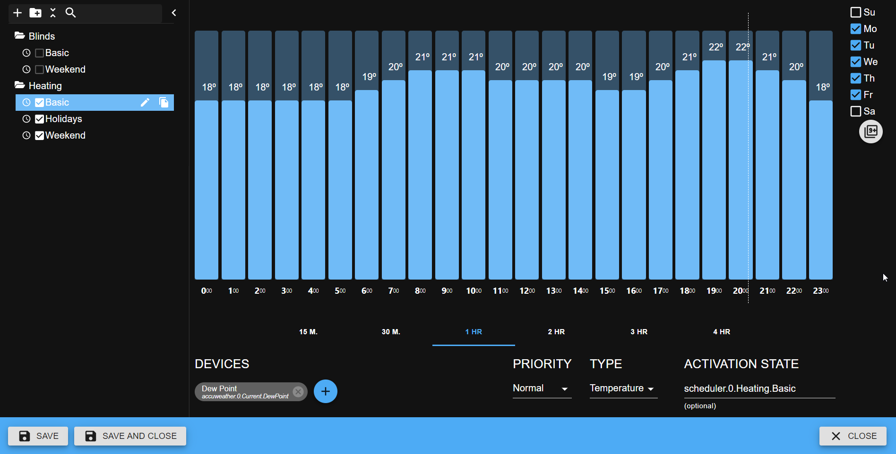
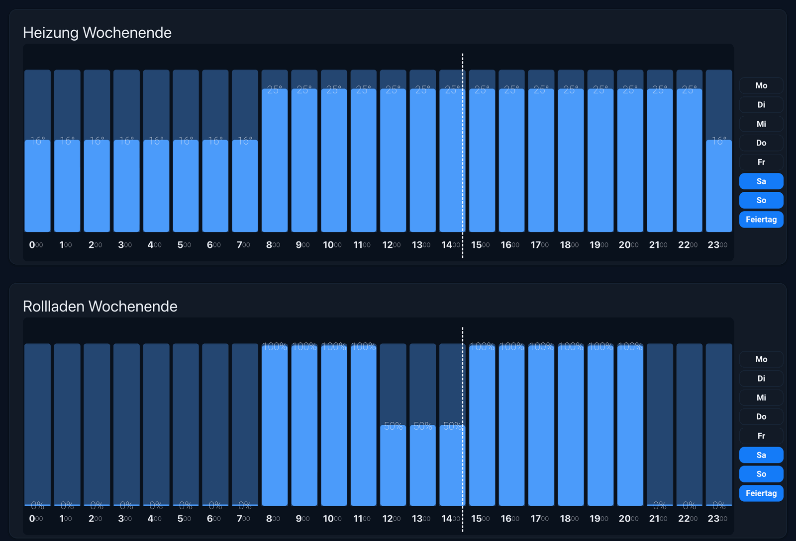

# IoBroker Scheduler Adapter
**Dieser Adapter verwendet Sentry-Bibliotheken, um Ausnahmen und Codefehler automatisch an die Entwickler zu melden.** Weitere Details und Informationen zum Deaktivieren der Fehlerberichterstattung finden Sie in Abschnitt [Sentry-Plugin-Dokumentation](https://github.com/ioBroker/plugin-sentry#plugin-sentry)! Die Sentry-Berichterstattung wird ab js-controller 3.0 verwendet.

Dieser Adapter dient zur zeitgesteuerten Steuerung von Geräten, beispielsweise zur Heizungs- oder Bewässerungssteuerung.

Sie können Profile mit unterschiedlicher Priorität erstellen: normal (z. B. Werktage), hoch (z. B. Wochenenden) und höchste Priorität (z. B. für Feiertage). Das Profil mit der höchsten Priorität überschreibt die anderen Profile.

Für jedes Profil wird eine aktive Variable erstellt.
Der Benutzer kann jedoch eine eigene Aktivierungsvariable wählen, z. B. zur Steuerung von Urlaubstagen.

Der Benutzer sollte Geräte zu seinem Profil hinzufügen, und alle Geräte im Profil werden auf denselben Wert eingestellt.

Dieser Adapter verfügt über das vis2-Widget.

Zwei Widgets in der dunklen Vis-2-Ansicht: die Solltemperatur der Heizung und die Position der Rollläden am Wochenende. Jeder Balken entspricht einer Stunde und wird per Drag & Drop eingestellt. Rechts werden die Wochentage und Feiertage des Profils ausgewählt.

## Profiltypen und Datenpunkte
Der Profiltyp bestimmt, welche Datenpunkte hinzugefügt werden können und welcher Wert in diese geschrieben wird.

| Typ | Erforderlicher Datenpunkt | Schriftwert |
|-------------|------------------------------------------------------------|---------------------------------------------------------------------------------------------|
| Prozent | `number` mit `min` und `max` | Der Wert wird zwischen `min` und `max` linear skaliert: `min + round((max - min) * value / 100)` |
| Temperatur | `number` | Der Wert bleibt unverändert |
| Ein/Aus | `boolean` | `true` oder `false` |
| Benutzerdefiniert | `number` | Der Wert bleibt unverändert |
| Benutzerdefiniert mit Werteliste | `number`, `string` oder `boolean` | Der Wert des ausgewählten Eintrags, konvertiert in den Datentyp des Datenpunkts |
| Benutzerdefiniert mit Werteliste | `Zahl`, `Zeichenkette` oder `Boolescher Wert` | Der Wert des ausgewählten Eintrags, konvertiert in den Datentyp des Datenpunkts |

Datenpunkte mit `common.type` `mixed` werden für alle Typen akzeptiert.
Im Dialogfeld zur Auswahl der Datenpunkte werden nur die Datenpunkte angezeigt, die dem Profiltyp entsprechen.
Setzen Sie `common.type` eines Datenpunkts nicht auf `custom`: Dies ist kein gültiger ioBroker-Typ. Verwenden Sie stattdessen `number`.

## Werte: eigener Bereich und Werteliste
Profile vom Typ Temperatur und Benutzerdefiniert haben die Karte **Werte**:

- **Eigener Bereich** (Min., Max., Schrittweite): Ersetzt den Bereich der Balken, der ansonsten von `min`/`max` übernommen wird.

Der erste Datenpunkt (auch benutzerdefiniert, siehe `states`) liegt zwischen 0 und 28 °C für die Temperatur und zwischen 0 und 100 °C für benutzerdefiniert.

Beispiel: 30-60 °C für Warmwasser. Leere Felder behalten den automatisch generierten Wert.

- **Werteliste** (Nur benutzerdefiniert): Die Balken wählen einen der Einträge anstelle einer Zahl aus. Jeder Eintrag hat eine Beschriftung und

entweder ein fester Wert oder ein Zustand:

- ein fester Wert wird als Text geschrieben und in den Datentyp des Datenpunkts umgewandelt: eine Zahl für `number`,

`true` für `true`/`1`/`on` und `false` andernfalls für `boolean`, der Text für `string`.

Z. B. `"on"`/`"off"` für ein Gerät, das Text erwartet, oder die Stufen 0-3 einer Belüftung.

- ein Zustand: sein aktueller Wert wird angegeben, z.B. eine Komfort- und eine Öko-Temperatur, die in vis geändert werden.

Ändert sich der Zustand, während der Eintrag aktiv ist, wird der neue Wert sofort geschrieben.

Das vis-2-Widget und die Webkomponente zeigen die Beschriftungen der Werteliste an den Balken an.

## Webkomponenten
Der Adapter stellt die Profilansicht auch als Webkomponente bereit (`common.webComponents`, `@iobroker/web-components`), sodass sie von Aura, `ioBroker.devices`, dem Admin-Bereich und allen anderen Hosts angezeigt werden kann. vis-2 zeigt weiterhin sein eigenes Widget an.

| Schlagworte | Sendungen |
|-------------------------|----------------------------------------------------------------------------------------|
| `iob-scheduler-profile` | Ein Profil: ein Balken pro Tagesintervall, die Wochentage und die Feiertagsflagge |

Einstellungen:

- **Profil** - ein Status des Profils, z. B. `scheduler.0.Heating.Living room_active`; die Instanz wird aus der ID entnommen.
- **Titel** - wird über dem Profil angezeigt, bleibt leer, falls das Profil leer ist
- **Nur lesen**
- **Wochentage ausblenden**

Ziehen Sie einen Balken nach oben oder unten, um seinen Wert festzulegen, oder über mehrere Balken, um alle Werte festzulegen. Tippen Sie auf die Zeitangabe unter einem Balken, um ihn auszuwählen: Die Änderung wird dann auf alle ausgewählten Intervalle angewendet. Intervalle lassen sich durch Antippen ein- und ausschalten.

Eine Webkomponente darf keine Objekte schreiben. Daher sendet sie ihre Änderungen mit der Nachricht `setProfile` (`{ id, intervals?, dow?, holiday? }`) an die Instanz, welche diese im Namen des Benutzers der Verbindung in das Instanzobjekt schreibt. Die Instanz muss hierfür ausgeführt werden und wird nach jeder Änderung neu gestartet, beispielsweise nach dem Speichern der Einstellungen im Adminbereich.

## Nachrichten für Skripte und KI-Agenten
Die Nachricht `help` (`sendTo('scheduler.0', 'help', {}, result => ...)`) liefert eine Beschreibung der Profile, ihrer Zustände und die Nachricht `setProfile`, die für KI-Agenten (z. B. pi-agent) und Skriptautoren geschrieben wurde. Die Antwort `{ help, commands }` listet außerdem alle Befehle auf, jeweils mit `write: true`, falls ein Befehl eine Änderung vornimmt.

<!-- Platzhalter für die nächste Version (am Anfang der Zeile):

### **IN BEARBEITUNG** -->

## Changelog
### 2.3.0 (2026-11-19)
* (@GermanBluefox) Added the message "help": a description of the profiles and of all messages for AI agents (e.g. pi-agent), and `common.supportedMessages.help`
* (@GermanBluefox) Added the short form of the web component manifests (tag, name, icon, size) to `common.webComponents`, so that hosts like Aura can list the components before the adapter is installed; the build writes it with `iob-web-components sync-io-package`

### 2.2.0 (2026-11-12)
* (@GermanBluefox) The adapter declares the versions it needs: js-controller 6.0.11 and admin 7.6.20 or newer. It cannot be installed from GitHub, because the build is not part of the repository
* (@GermanBluefox) Fixed profiles of type Custom: the adapter rejected the data points accepted by admin and did not write the value. Documented which data points every profile type needs (#448)
* (@GermanBluefox) The configuration explains itself: a help dialog (question mark above the bars) describes profiles, intervals, days, holidays, priority, types, activation state and the advanced options. The type, the priority, the activation state and the advanced options show a short hint, and a data point of the wrong type tells which data point the profile type needs
* (@GermanBluefox) The configuration is animated: folders open and close, the menu symbol turns into an arrow, the trash can opens its lid, the clock of a profile turns on hover, new data points pop in, the days of week bounce and the line of the current time breathes. No animation runs if the system asks for less motion
* (@GermanBluefox) Fixed: the values of a profile changed every time the configuration was opened, if the first data point has its own `min`/`max` (#309)
* (@GermanBluefox) Temperature and Custom profiles can have their own range of the bars, e.g. 30-60° for hot water (#308)
* (@GermanBluefox) Custom profiles can have a value list: the bars choose an entry, which writes a fixed value (also text like `"on"`/`"off"`) or the value of a state, e.g. a comfort temperature changed in vis (#268, #181, #33)
* (@GermanBluefox) Added the Ukrainian title and description, the Sentry notice and the dependabot entries of all frontend packages

### 2.1.1 (2026-11-09)
* (@GermanBluefox) Web component: the holiday button shows its whole name, and decimal values follow the number format of the system

### 2.1.0 (2026-11-08)
* (@GermanBluefox) Added the web component `iob-scheduler-profile` for Aura and other hosts (`common.webComponents`); it saves its changes through the new message `setProfile`

### 2.0.3 (2026-11-02)
* (@GermanBluefox) Corrected the widget: changes in one widget were overwritten by other widgets of the same instance

## License
The MIT License (MIT)

Copyright (c) 2021-2026 bluefox <dogafox@gmail.com>

Permission is hereby granted, free of charge, to any person obtaining a copy
of this software and associated documentation files (the "Software"), to deal
in the Software without restriction, including without limitation the rights
to use, copy, modify, merge, publish, distribute, sublicense, and/or sell
copies of the Software, and to permit persons to whom the Software is
furnished to do so, subject to the following conditions:

The above copyright notice and this permission notice shall be included in all
copies or substantial portions of the Software.

THE SOFTWARE IS PROVIDED "AS IS", WITHOUT WARRANTY OF ANY KIND, EXPRESS OR
IMPLIED, INCLUDING BUT NOT LIMITED TO THE WARRANTIES OF MERCHANTABILITY,
FITNESS FOR A PARTICULAR PURPOSE AND NONINFRINGEMENT. IN NO EVENT SHALL THE
AUTHORS OR COPYRIGHT HOLDERS BE LIABLE FOR ANY CLAIM, DAMAGES OR OTHER
LIABILITY, WHETHER IN AN ACTION OF CONTRACT, TORT OR OTHERWISE, ARISING FROM,
OUT OF OR IN CONNECTION WITH THE SOFTWARE OR THE USE OR OTHER DEALINGS IN THE
SOFTWARE.