#  ioBroker.senec

## SENEC Adapter für ioBroker

Überwachen und steuern Sie Ihr SENEC Heimspeichersystem. Der Adapter unterstützt vier unabhängige Konnektoren, die einzeln oder kombiniert genutzt werden können:

- **Lokal** (lala.cgi) — Direkte LAN-Abfrage mit 10-Sekunden-Echtzeitdaten. Liefert vollständige BMS-Daten, Netzzähler, Wallbox-Daten und Gerätesteuerung.
- **SENEC App API** — Cloud-basierte Abfrage über die SENEC App API. Dashboard-Daten, Messverlauf, Systemdetails und Wallbox-Informationen.
- **mein-senec.de** — Web-Portal-Abfrage. Statusübersicht, Messverlauf, Autarkie, Notstrom, Peak Shaving, SG-Ready und Steuerung schaltbarer Steckdosen.
- **SENEC.Connect** — Azure-basierte API. Batterie- und Zählerdaten über Subscription-Key.

Es müssen nicht alle Konnektoren aktiviert werden. Wählen Sie je nach Bedarf — rein lokale Setups funktionieren ebenso wie reine Cloud-Konfigurationen für Systeme ohne lokales Webinterface.

### Unterstützte Systeme

Praktisch jedes SENEC-Speichersystem funktioniert: die Home-Reihe von den frühen Blei- und
Lithium-Modellen über V2, V2.1 und V3 bis zur aktuellen Generation V4 | P4 | E4, die
Business-Modelle sowie die Partnervarianten ADS Tec, OEM LG und Solarinvert.

Systeme mit lokalem Webinterface können alle fünf Konnektoren nutzen. Systeme ohne — darunter die
V4-Generation — laufen über die SENEC App API, mein-senec.de und SENEC.Connect. Die lokale OpenAPI
auf Port 4424 setzt ebenfalls ein lokales Webinterface voraus und steht daher auf den Generationen
V2 und V3 zur Verfügung, nicht auf V4 | P4 | E4. Welche Datenpunkte verfügbar sind, hängt vom
Modell ab.

Die [vollständige Modellliste](https://github.com/nobl/ioBroker.senec/blob/master/docs/SUPPORTED_SYSTEMS.md) hilft beim Wiederfinden des eigenen Systems.

## Haftungsausschluss
**Alle Produkt- und Firmennamen oder -logos sind Warenzeichen™ oder eingetragene® Warenzeichen der jeweiligen Inhaber. Ihre Verwendung impliziert keine Zugehörigkeit oder Befürwortung durch diese oder zugehörige Tochtergesellschaften! Dieses persönliche Projekt wird in der Freizeit gepflegt und hat kein geschäftliches Ziel.**

**Keine Gewährleistung und keine Haftung.** Dieser Adapter ist ein Freizeitprojekt und wird wie besehen unter der MIT-Lizenz bereitgestellt. Er spricht mit einem teuren Gerät über Schnittstellen, die SENEC weder dokumentiert noch unterstützt, und er kann Befehle senden, die das Verhalten dieses Geräts verändern. Alles, was Sie damit tun, geschieht auf eigene Verantwortung. Der Autor haftet nicht für Schäden an Ihrer Anlage, für verlorene oder falsche Daten, entgangene Einspeisung oder sonstige Folgen der Nutzung — und kann Ihnen auch nicht sagen, ob die Nutzung Auswirkungen auf Gewährleistung oder Support durch SENEC oder Ihren Installateur hat. Wer das nicht akzeptieren möchte, sollte diesen Adapter nicht einsetzen.

## Voraussetzungen

- ioBroker mit Node.js >= 22
- SENEC Speichersystem im lokalen Netzwerk (für lokalen Konnektor)
- mein-senec.de Konto (für API- und Web-Konnektor)
- ioBroker.web Adapter installiert (für das integrierte Dashboard)

## Installation

Installieren Sie den Adapter über das ioBroker Adapter-Repository. Nach der Installation erstellen Sie eine Adapter-Instanz und konfigurieren mindestens einen Konnektor.

## Konfiguration

Die Adaptereinstellungen sind in Tabs organisiert — je einer pro Konnektor sowie allgemeine Einstellungen und Debug-Optionen. Die beiden lokalen Schnittstellen, `lala.cgi` und die OpenAPI auf Port 4424, teilen sich den Tab *Lokale Verbindung* und die Anlagenadresse.

### SENEC Konto

Geben Sie hier Ihre mein-senec.de Zugangsdaten ein. Diese werden von der SENEC App API und mein-senec.de gemeinsam genutzt. Hier lässt sich auch der User-Agent-Modus für ausgehende HTTP-Anfragen konfigurieren.

#### Zwei-Faktor-Authentifizierung (2FA)

Ist für das mein-senec.de-Konto eine Zwei-Faktor-Authentifizierung aktiv, kann sich der Adapter trotzdem selbstständig anmelden — es muss niemand danebensitzen und einen Code eintippen.

Bei der Einrichtung wird ein QR-Code für die Authenticator-App angezeigt und daneben dasselbe Geheimnis als Text. Dieser Text gehört in das Feld **TOTP-Secret**. Notieren Sie ihn, solange die Einrichtungsseite offen ist: Nach dem Aktivieren wird das Geheimnis nicht erneut angezeigt, ein neues gibt es nur durch erneutes Einrichten. Leer- und Bindestriche darin spielen keine Rolle.

Gemeint ist das dauerhafte Geheimnis, nicht der sechsstellige Code aus der App — der wechselt alle dreißig Sekunden und wäre längst abgelaufen, bevor der Adapter ihn verwenden könnte.

Ein Geheimnis genügt für beide Cloud-Konnektoren, da sich beide am selben Konto anmelden. Fehlt der Eintrag, obwohl 2FA verlangt wird, weist der Adapter im Log ausdrücklich darauf hin, statt nur einen fehlgeschlagenen Login zu melden.

### Lokale Verbindung (lala.cgi)

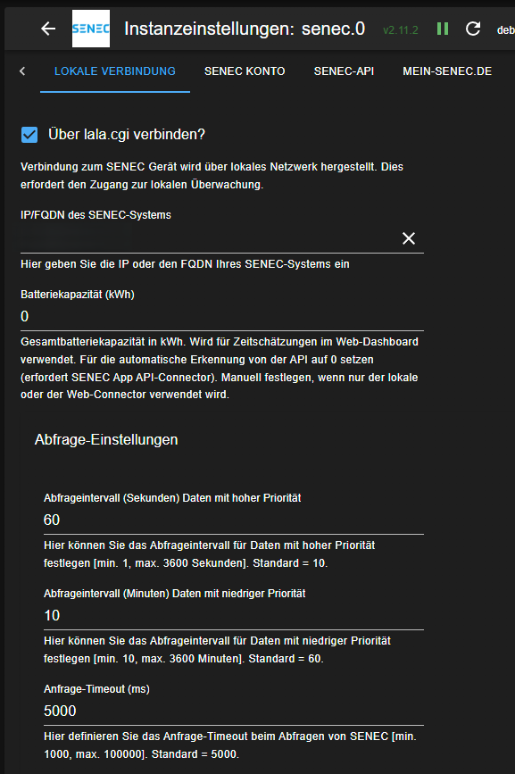

| Einstellung | Beschreibung | Standard |
|-------------|-------------|----------|
| Über lala.cgi verbinden | Lokale Abfrage aktivieren | Aus |
| SENEC System IP | IP-Adresse oder FQDN des SENEC Geräts | — |

**Abfrage-Einstellungen** aufklappen für Timing-Optionen:

| Einstellung | Beschreibung | Standard |
|-------------|-------------|----------|
| Abfrageintervall (hohe Priorität) | Intervall für Echtzeitdaten (Sekunden) | 10 |
| Abfrageintervall (niedrige Priorität) | Intervall für selten geänderte Daten (Minuten) | 60 |
| Abfrage-Timeout | Zeitlimit für HTTP-Anfragen (ms) | 5000 |

Der Adapter wiederholt automatisch mit exponentiellem Backoff bei Verbindungsfehlern — keine manuelle Konfiguration nötig. Wenn das SENEC Gerät vorübergehend nicht erreichbar ist (Neustart, Firmware-Update), wird die Abfrage automatisch fortgesetzt, sobald das Gerät wieder online ist.

#### TLS-Zertifikatsvalidierung

Der Adapter validiert das HTTPS-Zertifikat des SENEC Geräts mit einem mehrstufigen Verfahren:

1. **Benutzer-CA** — Laden Sie das SenecGui-Root CA-Zertifikat über das Dashboard hoch (System-Tab → TLS-Zertifikat). Herunterladen von mein-senec.de (Dokumente / Allgemeine Dokumente / SenecGui-Root), dann die .pem- oder .zip-Datei hochladen. SENEC verteilt dieses Zertifikat hinter einem Login, daher kann der Adapter es nicht mitliefern.
2. **Zwischengespeichertes CA-Zertifikat** — Falls kein Benutzer-Zertifikat vorhanden ist, kann der Adapter das CA-Zertifikat automatisch von mein-senec.de herunterladen (setzt voraus, dass der mein-senec.de-Connector aktiviert ist). Das heruntergeladene Zertifikat wird im Adapter-State gespeichert und bleibt über Neustarts erhalten.
3. **TOFU (Trust On First Use)** — Falls kein CA-Zertifikat validiert, merkt sich der Adapter den Fingerabdruck des Gerätezertifikats beim ersten Kontakt und vergleicht jede weitere Verbindung damit. Bei einer Änderung (z.B. nach einem Firmware-Update) wird eine Warnung protokolliert und der neue Fingerabdruck anschließend automatisch übernommen.

Der Adapter probiert jede Stufe der Reihe nach und verwendet die erste, die validiert.

TOFU ist eine Kontinuitätsprüfung, kein Certificate Pinning: Es meldet Ihnen, dass sich das Zertifikat des Geräts geändert hat, weist das neue aber nicht zurück und prüft auch die Zertifikatskette nicht. Das ist eine bewusste Abwägung für ein Gerät im eigenen Netz — eine legitime Zertifikatsänderung darf den Adapter nicht so lange abkoppeln, bis jemand eine Logzeile bemerkt. Für die vollständige Prüfung hinterlegen Sie die CA: Der Upload ist optional, aber die stärkere Variante.

Falls der automatische CA-Download fehlgeschlagen ist und Sie es erneut versuchen möchten, setzen Sie `_local.tls.certFetchFailed` auf `false` — der Adapter versucht den Download beim nächsten Neustart oder sofort, falls er läuft.

**Wichtig**: Zu häufige Abfragen oder zu viele Datenpunkte können das SENEC Gerät überlasten. Dies kann zu Neustarts, Nicht-Erreichbarkeit oder fehlender Cloud-Synchronisation führen. Bei Problemen die Abfragefrequenz reduzieren oder den Adapter stoppen.

#### Zusätzliche HighPrio-Polling-Datenpunkte

Sie können zusätzliche Datenbereiche (z.B. BMS, PV1, WALLBOX) zum hochprioritären Polling hinzufügen. Dies erfordert die Bestätigung eines Haftungsausschlusses. Es sind nur Zeichen A-Z, Ziffern 0-9 und Kommas erlaubt.

### Lokale OpenAPI (Port 4424)

Eine zweite lokale Schnittstelle, unabhängig von `lala.cgi` und per HTTPS auf Port 4424 der Anlage erreichbar. Sie teilt sich den Tab *Lokale Verbindung* und die Anlagenadresse mit dem lokalen Konnektor; jeder der beiden funktioniert auch ohne den anderen.

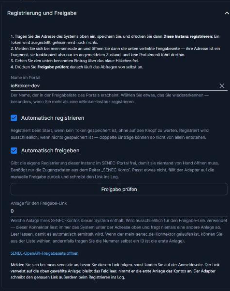

| Einstellung | Beschreibung | Standard |
|-------------|--------------|----------|
| Lokale OpenAPI der Anlage nutzen | Abfrage über Port 4424 aktivieren | Aus |
| Gerätename | Der Name, der im SENEC-Portal freigegeben wird | ioBroker |
| Automatisch registrieren | Beim Start ein Token anfordern, wenn keines gespeichert ist | Ein |
| Automatisch freigeben | Die eigene Registrierung über das Portal selbst freigeben | Ein |
| Anlage für den Freigabe-Link | Welche Anlage des Kontos diese Anlage ist | Automatisch |
| Abfrageintervall | Wie oft die gewählten Bereiche gelesen werden (Sekunden) | 60 |
| Anfrage-Timeout | Wie lange auf eine Anfrage gewartet wird (ms) | 10000 |
| Abzufragende Bereiche | Welche Routen pro Zyklus abgefragt werden. Das Typenschild wird zusätzlich zur Auswahl gelesen; Wallboxen müssen bewusst zugeschaltet werden | Batterie, Zähler, Typenschild |

Die Schnittstelle ist nur lesend. Die Routen, die eine Lade- oder Entladeleistung setzen würden, lehnen jede Anfrage ab, die ein Kunden-Token stellen kann — vor wie nach der Freigabe. Es gibt dort also nichts zu schreiben. Was die Schnittstelle bietet und was sie verweigert, ist in [LOCAL_OPENAPI_4424.md](https://github.com/nobl/ioBroker.senec/blob/master/docs/LOCAL_OPENAPI_4424.md) festgehalten.

Nur Systeme mit lokalem Webinterface öffnen diesen Port: die Generationen V2 und V3 ja, die Generation V4 | P4 | E4 nicht. Eine Anlage, die 4424 bedient, aber kein `lala.cgi`, ist nicht bekannt — diese Schnittstelle ergänzt das lokale Polling also, sie ersetzt es nicht.

Das Abfrageintervall steht mit Absicht auf 60 Sekunden. Wie viel dieser Dienst verträgt, ist nicht erprobt, und die Anlage ist leicht zu überlasten — der Hinweis oben zum zu häufigen Abfragen von `lala.cgi` gilt hier genauso.

#### Registrierung

Anders als `lala.cgi` verlangt diese Schnittstelle eine einmalige Registrierung, die nur der Kontoinhaber freigeben kann.

**Sind die SENEC-Kontodaten im Tab *SENEC Konto* eingetragen, erledigt sich das von selbst:** Der Adapter registriert sich, gibt seine eigene Registrierung frei und beginnt zu lesen. Der mein-senec.de-Konnektor muss dafür nicht aktiviert sein — der Adapter meldet sich einmal für die Freigabe an und verwirft die Sitzung gleich danach wieder.

Wer den mein-senec.de-Konnektor zuerst einrichtet, speichert und den Adapter neu starten lässt, bevor er diesen hier einschaltet, hat es im Log leichter: Die Sitzung besteht dann schon und die Anlage ist bekannt, sodass sich dieser Konnektor überhaupt nicht anmelden muss.

Ohne Kontodaten läuft die Freigabe von Hand:

1. Die Anlagenadresse oben im Tab eintragen und speichern.
2. **Diese Instanz registrieren** drücken. Die Anlage gibt ein Token aus, der Adapter speichert es. Gelesen wird noch nichts.
3. **Zuerst bei mein-senec.de anmelden**, dann dem Freigabe-Link im Tab folgen. Die Adresse ist ein Fragment — wer sie abgemeldet öffnet, landet auf der Anmeldeseite und das Ziel ist verloren. Über das Portalmenü ist die Seite nicht erreichbar, nur über diesen Link.
4. Den Eintrag mit dem eigenen Gerätenamen über das blaue Häkchen freigeben.
5. **Freigabe prüfen** drücken. Sobald freigegeben gemeldet wird, läuft die Abfrage von selbst an.

`_openapi.info.approvalState` zeigt jederzeit den Stand: `unregistered`, `pending`, `approved`, `rejected` — das Token wurde im Portal zurückgezogen oder gehört zu einer anderen Anlage — oder `error`.

**Token verwerfen** löscht das gespeicherte Token und zieht die Registrierung auch im Portal zurück, sofern die Kontodaten eingetragen sind und die Anlage ermittelt werden konnte, sodass kein verwaister Eintrag bleibt; die Anlage akzeptiert das alte Token etwa eine Minute später nicht mehr. Kann der Adapter das Portal nicht fragen, meldet er das, und der Eintrag muss dort von Hand entfernt werden. Bei eingeschalteter automatischer Registrierung wird sofort ein neues Token angefordert — so wird also auch neu begonnen. Zweimal registrieren, ohne den ersten Eintrag zurückzuziehen, hinterlässt zwei Einträge mit gleichem Namen und nichts, woran sie zu unterscheiden wären; deshalb wird eine Registrierung abgelehnt, solange ein Token gespeichert ist.

### SENEC App API

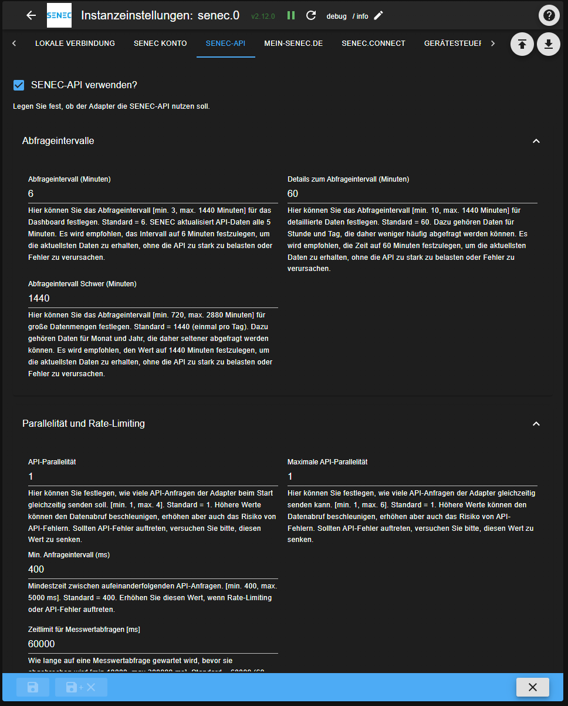

| Einstellung | Beschreibung | Standard |
|-------------|-------------|----------|
| SENEC App API nutzen | Cloud-API-Abfrage aktivieren | Aus |
| Dashboard-Intervall | Abfrageintervall für Dashboard/aktuelle Daten (Minuten) | 6 |
| Detail-Intervall | Abfrageintervall für Tagesmesswerte (Minuten) | 60 |
| Heavy-Intervall | Abfrageintervall für Monats-/Jahresmesswerte (Minuten) | 1440 (24h) |
| Parallelität / Max. Parallelität | Limits für parallele API-Anfragen | 1 / 1 |
| Min. Anfrageintervall | Mindestzeit zwischen API-Anfragen (ms) | 400 |
| Zeitlimit für API-Anfragen | Wie lange auf eine normale API-Anfrage gewartet wird — Dashboard, Systemstatus, Details (ms). Erhöhen, wenn diese Abfragen im Log in Timeouts laufen | 30000 |
| Zeitlimit für Messwertabfragen | Wie lange auf eine Messwert-Aggregation gewartet wird (ms). Erhöhen, wenn im Log Heavy-Polls in Timeouts laufen | 60000 |

#### History Rebuild

Der API-Konnektor kann historische Messdaten (AllTime-Summen) komplett neu aufbauen. Konfigurieren Sie bei Bedarf den Rebuild-Modus und das Startjahr. Dies läuft als Hintergrundprozess während des Heavy-Polling-Zyklus.

### mein-senec.de

| Einstellung | Beschreibung | Standard |
|-------------|-------------|----------|
| mein-senec.de nutzen | Web-Portal-Abfrage aktivieren | Aus |
| Status-Intervall | Abfrageintervall für Statusdaten (Minuten) | 6 |
| Medium-Intervall | Abfrageintervall für Gestern/Autarkie/Reservekapazität (Minuten) | 360 (6h) |
| Slow-Intervall | Abfrageintervall für Monats-/Jahres-/AllTime-Daten (Minuten) | 1440 (24h) |
| Messverlauf abfragen | Messdatenabfrage aktivieren | Aus |
| 5-Min-Detaildaten einbeziehen | Feingranulare Detaildaten abfragen (~3.500 zusätzliche States) | Aus |
| Parallelität / Max. Parallelität | Limits für parallele Anfragen | 1 / 2 |
| Min. Anfrageintervall | Mindestzeit zwischen Anfragen (ms) | 500 |

### Weitere Anlagen des Kontos

Sind dem mein-senec.de-Konto mehrere Anlagen zugeordnet — ein ersetztes Gerät bleibt neben seinem Nachfolger sichtbar —, erkennt der Adapter beim Start alle und legt jede unter `_meinsenec.Plants.{steuereinheitnummer}.` an.

Abgefragt wird standardmäßig nur die erste Anlage. Jede weitere erhält einen eigenen Schalter unter `control.Plants.{steuereinheitnummer}.poll`, der zunächst aus ist. Wird er gesetzt, nimmt die langsame Abfrage-Ebene diese Anlage mit auf und füllt dieselbe Messwertstruktur wie bei der Hauptanlage:

| State | Inhalt |
|-------|--------|
| `_meinsenec.Plants.{sn}.System.*` | Produktname, Gerätenummer, Anlagennummer |
| `_meinsenec.Plants.{sn}.Measurements.Daily.today` / `.yesterday` | Stundenwerte |
| `_meinsenec.Plants.{sn}.Measurements.Monthly.*` | Tageswerte je Monat |
| `_meinsenec.Plants.{sn}.Measurements.Yearly.*` | Monatswerte je Jahr |
| `_meinsenec.Plants.{sn}.Measurements.AllTime.*` | Gesamtsummen |
| `_meinsenec.Plants.{sn}.Autarky.*` | Autarkie je Zeitraum |

Die Gesamtsummen werden einmal beim ersten Erkennen einer Anlage geholt, auch bei ausgeschaltetem Schalter — so liegen die Endwerte eines stillgelegten Geräts vor, ohne es dauerhaft abzufragen.

Beachten Sie, dass jede zusätzlich aktivierte Anlage die Anzahl der Portal-Anfragen erhöht. Wer nur die historischen Summen eines Altgeräts braucht, lässt den Schalter am besten aus.

### SENEC.Connect

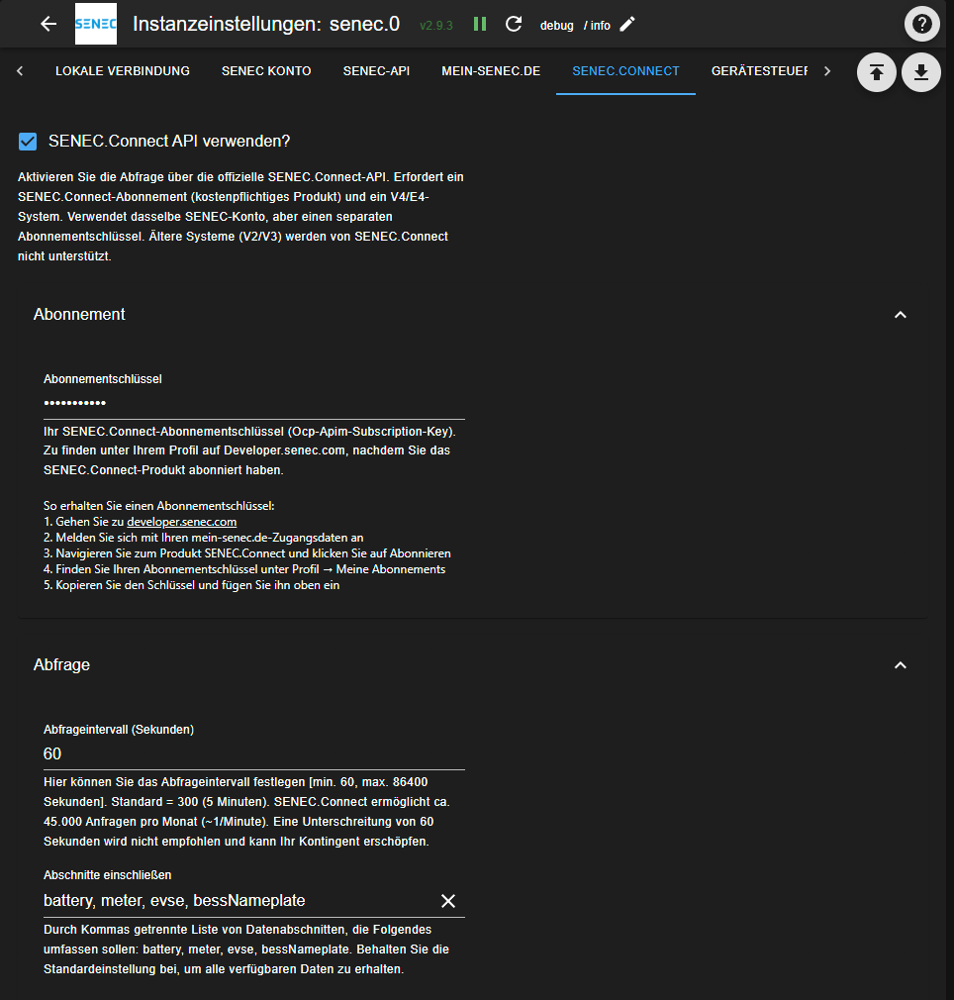

| Einstellung | Beschreibung | Standard |
|-------------|-------------|----------|
| SENEC.Connect nutzen | Azure-API-Abfrage aktivieren | Aus |
| Abfrageintervall | Abfragefrequenz (Sekunden) | 300 |
| Anfrage-Timeout | Wartezeit auf eine Antwort (ms) | 30000 |
| Subscription Key | Azure API Subscription Key | — |
| Enthaltene Bereiche | Welche Datenbereiche abgefragt werden | battery,meter,evse,bessNameplate |

### Externe Quellen

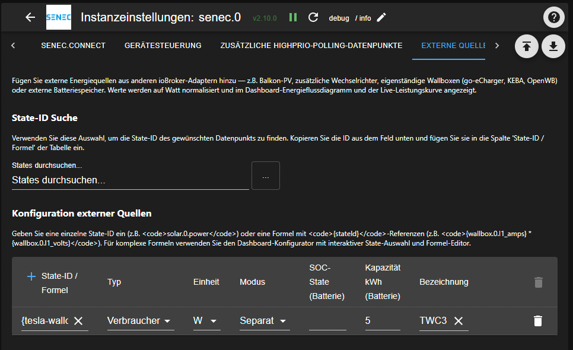

Fügen Sie externe Energiequellen aus anderen ioBroker-Adaptern hinzu — z.B. Balkon-PV, zusätzliche Wechselrichter, eigenständige Wallboxen, Wärmepumpen oder externe Batteriespeicher. Werte werden auf Watt normalisiert und im Dashboard-Energieflussdiagramm und der Live-Leistungskurve angezeigt.

Verwenden Sie die **State-ID Suche** um die State-ID des gewünschten Datenpunkts zu finden und fügen Sie sie in die Tabelle ein.

| Spalte | Beschreibung |
|--------|-------------|
| State-ID / Formel | Einzelne State-ID (z.B. `solar.0.power`) oder Formel mit `{stateId}`-Referenzen (z.B. `{wallbox.0.l1_amps} * {wallbox.0.l1_volts}`) |
| Typ | PV, Verbraucher (Wallbox, Wärmepumpe, etc.) oder Batterie |
| Einheit | W oder kW — wird auf den Endwert angewendet |
| Modus | **Integrieren** = zum SENEC-Gesamtwert addieren (ein Knoten). **Separat** = als eigener Knoten im Energiefluss anzeigen |
| SOC-State | (Nur Batterie) State-ID für den Ladezustand (%) |
| Kapazität | (Nur Batterie) Batteriekapazität in kWh — ermöglicht Zeitschätzungen |
| Bezeichnung | Anzeigename im Energieflussdiagramm |

Formeln unterstützen `+ - * / ( )` Operatoren. State-IDs ohne geschweifte Klammern werden automatisch erkannt wenn sie Rechenoperatoren enthalten. Für komplexe Formeln ist ein Dashboard-basierter Konfigurator mit interaktiver State-Auswahl geplant.

### Gerätesteuerung

Steuerungsfunktionen ermöglichen das Ändern von Einstellungen am SENEC Gerät. Jede Steuerung ist über bestimmte Konnektoren verfügbar:

| Steuerung | Lokal | API | Web |
|-----------|:-----:|:---:|:---:|
| Akku-Zwangsladung | x | | |
| Entladung blockieren | x | | |
| Gerät neustarten | x | | |
| Notstromreserve | | | x |
| Peak Shaving | | | x |
| SG-Ready | | | x |
| Schaltbare Steckdosen | x | | x |
| Wallbox-Steuerung | x | x | |

**Nutzung auf eigenes Risiko.** Steuerungsfunktionen müssen in den Einstellungen explizit mit Haftungsausschluss aktiviert werden. Der Adapter schützt nicht vor widersprüchlichen Befehlen von mehreren Konnektoren.

### Debug & Logging

Konfigurierbar pro Konnektor (Lokal, lokale OpenAPI, API, mein-senec.de, Connect):

- **Polling im Info-Log anzeigen** — Zeigt Polling-Statusmeldungen im Info-Log statt nur im Debug-Log
- **Requests & Responses loggen** — Loggt HTTP-Details auf Debug-Ebene (kann sensible Daten enthalten)
- **Queue-Diagnose ins Info-Log** — Zeigt Queue-Statistiken im Info-Log (nur API + Web)
- **Diagnose in States schreiben** — Schreibt Queue-Daten in dedizierte ioBroker-States (nur API + Web)

#### Debug-Log erstellen

Die meisten Probleme lassen sich aus einem Log ablesen, und fast keines ohne.

1. Log-Level der Instanz auf **debug** setzen: ioBroker-Admin → Instanzen → senec-Instanz → Auswahlfeld für den Log-Level. `silly` gibt es auch, bringt aber selten mehr Erkenntnis und erzeugt sehr viel Rauschen.
2. Im Adapter-Tab **Debug & Protokollierung** für den betroffenen Konnektor *Anfragen & Antworten protokollieren* aktivieren. Diese Einstellung macht aus „eine Anfrage ist fehlgeschlagen" ein „diese URL hat mit diesem Status geantwortet".
3. Lange genug laufen lassen, damit das Problem mindestens einmal auftritt. Bei den langsamen Abfrage-Ebenen — Messwerte, Monats- oder Jahresdaten — kann das bedeuten, auf den nächsten Zyklus zu warten statt neu zu starten.
4. Das Log aus dem ioBroker-Log-Tab kopieren oder die Datei aus `/opt/iobroker/log/` verwenden.
5. Anschließend wieder auf **info** zurückstellen. Debug-Logging ist umfangreich und füllt über Wochen die Festplatte.

**Vor dem Weitergeben bitte durchsehen.** Die Anfrage-Protokollierung enthält URLs und Antworten, darin können Anlagen-ID, Anlagennummer und Seriennummer stehen. Passwörter sind nicht dabei, aber es sind Ihre Daten. Ersetzen Sie, was nicht öffentlich werden soll.

#### Fehler melden

Meldungen bitte über [GitHub](https://github.com/nobl/ioBroker.senec/issues). Was eine Meldung schnell bearbeitbar macht:

- **Welches System** — Modell und, falls bekannt, die Firmware-Version (`FACTORY.*` und `SYS_UPDATE.*` enthalten beides, sofern der lokale Konnektor läuft)
- **Welche Konnektoren** aktiv sind, denn dasselbe Symptom hat lokal und in der Cloud unterschiedliche Ursachen
- **Adapter- und ioBroker-Version** sowie die Node.js-Version
- **Was erwartet wurde und was stattdessen passiert ist** — „der Batteriestand fehlt" lässt sich bearbeiten, „geht nicht" erfordert erst eine Rückfrage
- **Der passende Log-Ausschnitt** auf Debug-Level, mit ein paar Zeilen vor und nach dem Fehler statt nur der Fehlerzeile

Vorab noch: Unplausible Werte stammen meist vom Gerät und nicht vom Adapter. Er reicht Werte weitgehend durch, eine im Dashboard falsch wirkende Temperatur oder ein falscher Ladezustand sieht deshalb in der Weboberfläche des Geräts in der Regel genauso falsch aus. Ein Blick dorthin klärt die Frage oft schon — und wenn nicht, ist genau dieser Vergleich die nützlichste Angabe in der Meldung.

## Integriertes Dashboard

Der Adapter enthält ein vollständiges Web-Dashboard, erreichbar unter `http://<iobroker-ip>:8082/senec/`. Es benötigt den ioBroker.web Adapter und erscheint auf der ioBroker.web Startseite.

Funktionen:
- Dunkles und helles Design (umschaltbar in der Titelleiste)
- Internationalisierung — 11 Sprachen, folgt der Browser-Spracheinstellung
- Echtzeit-Updates über socket.io State-Subscriptions
- Daten von allen Konnektoren mit Quell-Badges
- Tastaturzugänglich (Tab-Navigation, ARIA-Labels)

### Übersicht-Tab

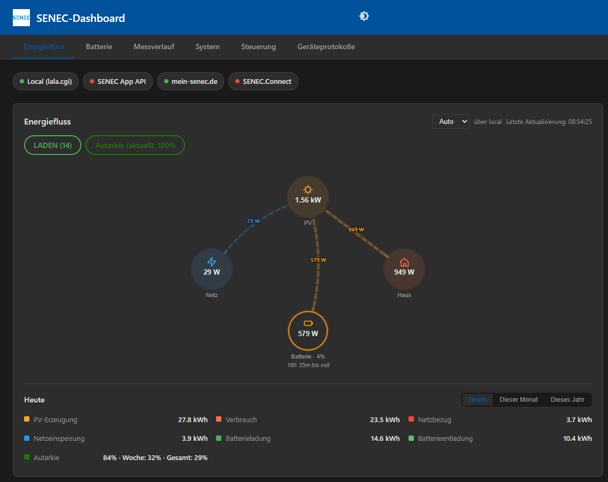

**Energiefluss-Diagramm** — Live-SVG-Visualisierung der Energieflüsse zwischen PV, Batterie, Netz, Haus und Wallbox. Animierte Flusspfade mit leistungsproportionaler Dicke. Batterie-SOC-Anzeige mit Füllstand. Betriebsmodus-Badge. Zeitschätzungen (bis leer/voll). Periodensummen (Heute/Monat/Jahr) mit Autarkie-Prozent. Datenquellen-Auswahl (Auto/Lokal/API/Web).

**Live-Leistungskurve** — Echtzeit-Liniendiagramm der Leistung über die Zeit für alle fünf Messwerte (PV, Haus, Netz, Batterie, Wallbox). Glatte monotone kubische Interpolation zwischen Datenpunkten. Zeitfenster-Voreinstellungen von 10 Minuten bis 24 Stunden, plus Mausrad-Zoom (5min–30 Tage, heruntergesampelt für Performance). Ziehen zum Blättern durch die Historie mit Lazy-Loading und Mitternachts-Datumsmarkern. Einzelne Linien ein-/ausblendbar, inklusive einer optionalen Ladezustandslinie (standardmäßig aus) auf einer eigenen rechten 0–100-%-Achse. Pause-/Deaktivierungsschalter. „Live"-Button zum Zurückspringen zur Echtzeit. Bei aktiviertem History-Adapter (InfluxDB, SQL oder History) auf den Leistungs-States wird das Diagramm beim Laden mit historischen Daten vorbefüllt. Jeder State wird einzeln aufgelöst — States können also von unterschiedlichen History-Adaptern aufgezeichnet werden, und ein nicht aufgezeichneter State betrifft nur seine eigene Linie. Der ⓘ-Button listet die States hinter jeder Linie zusammen mit dem aufzeichnenden History-Adapter auf — damit lässt sich nachvollziehen, warum eine Linie keine Vergangenheitsdaten hat.

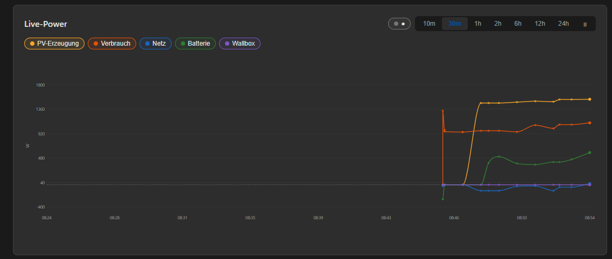

**Ereignis-Timeline** — Kompakter 24-Stunden-Streifen mit heutigen Warnungen (orange), Fehlern (rot) und Panics (lila) aus dem Geräte-Log. Hover für Details. Automatische Aktualisierung alle 10 Minuten. Erfordert eine konfigurierte Geräte-IP.

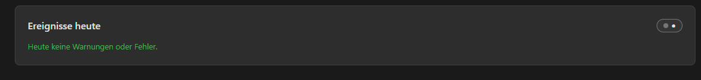

### Batterie-Tab

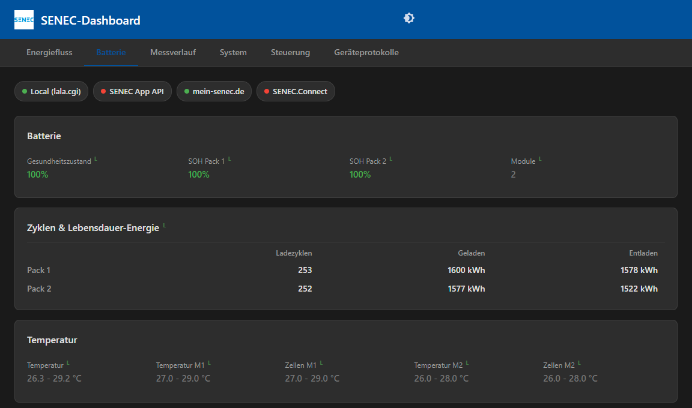

- **Zustandsbericht (SOH)** — System- und pro-Pack-SOH mit farbkodierten Indikatoren (grün > 80%, orange > 60%, rot)
- **Modulstatus** — Anzahl aktiver/ladender/entladender Module
- **Ladezyklen** — Pro-Pack Zyklenanzahl und Lebensdauer-Energie (geladen/entladen)
- **Zellspannungs-Heatmap** — Farbkodiertes Raster der einzelnen Zellspannungen über alle Module. Rot = niedrigste, Grün = höchste. Pro-Modul-Delta-Indikatoren. Macht Zellimbalancen sofort sichtbar.
- **Temperaturen** — Gesamt, pro Modul und pro Zelle
- **Pack-Elektrik** — Pro-Pack Spannung und Strom

Daten aus Lokal (BMS) und/oder API (SystemDetails) mit Quell-Badges.

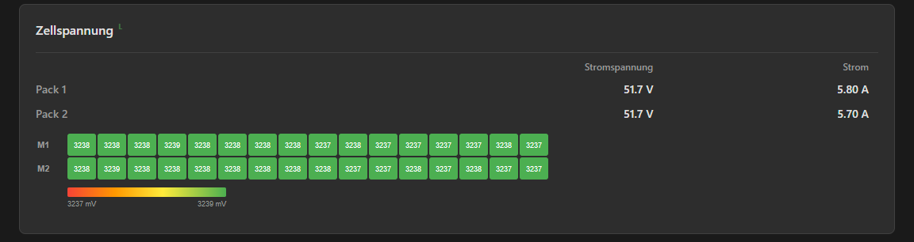

### Diagramme-Tab

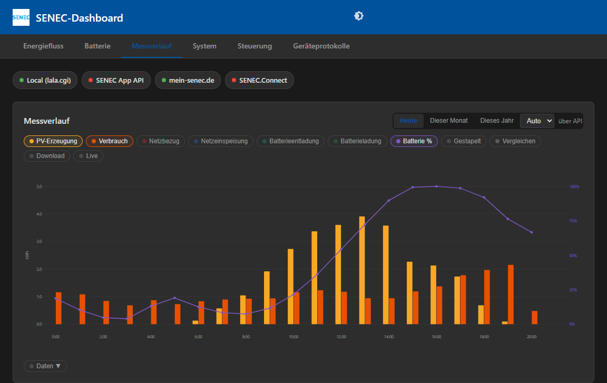

Balkendiagramme für Energiemessdaten:
- **Heute** — Stundenbalken (automatisch auf Stunden mit Daten beschränkt)
- **Dieser Monat** — Tagesbalken
- **Dieses Jahr** — Monatsbalken

Funktionen:
- Einzelne Messtypen ein-/ausblendbar (PV, Verbrauch, Netzbezug/-einspeisung, Batterieladung/-entladung)
- Gestapelte Ansicht (Erzeugung vs. Verbrauch)
- Vergleichsmodus (Gestern, Vormonat, wählbares Jahr)
- Batteriestand (%) Linienoverlay. Der API-Konnektor liest ihn aus der Messwert-Historie. mein-senec.de bietet keine solche Historie, daher tastet der Web-Konnektor stattdessen den Live-Ladezustand ab: Stundenmittel für die Tagesansicht, Tagesmittel für die Monatsansicht. Diese Werte beginnen folglich erst mit dem Adapterbetrieb — für einen Tag, an dem der Adapter über Mitternacht nicht lief, existiert kein Tagesmittel, und es lässt sich auch nicht nachträglich abrufen. Die Jahresansicht hat beim Web-Konnektor keinen Batteriestand.
- Datenquellen-Auswahl (Auto/API/Web)
- Datentabelle
- PNG-Bildexport
- Auto-Update-Modus

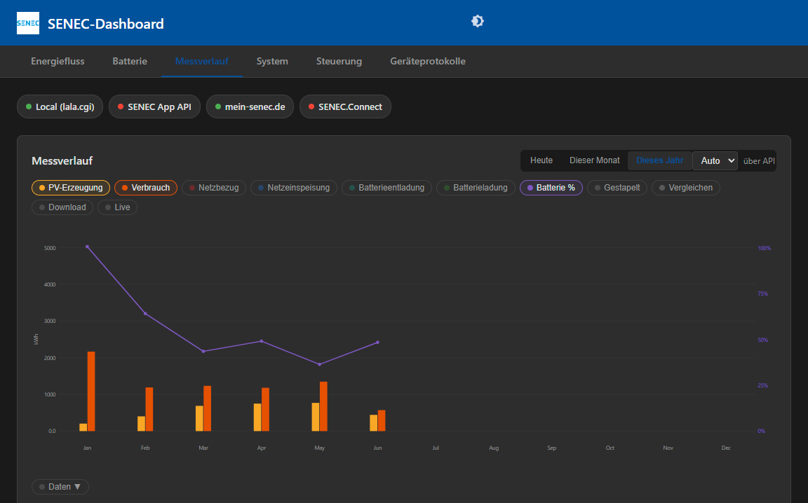

### System-Tab

- **Netzqualität** — Frequenz, Gesamtleistung, pro-Phase Spannung/Leistung/Strom. Unterstützt EnFluRi 1 und EnFluRi 2 (automatische Erkennung).
- **PV-Strings** — Pro-Tracker MPP-Leistung, Spannung und Strom
- **Wallbox** — EV-Verbindungsstatus, Smart Charge, pro-Phase Ladestrom
- **Feature-Flags** — Aktive Funktionen pro Konnektor mit Abweichungserkennung
- **Systemdetails** — Produkt, Firmware, GUI/NPU-Version, Wechselrichter-Status, Temperaturen (Gehäuse, MCU, Batterie, Wechselrichter), Betriebsstunden, Installationsdatum, Installateurskontakt

Quell-Badges zeigen an, welcher Konnektor den jeweiligen Wert liefert.

### Steuerung-Tab

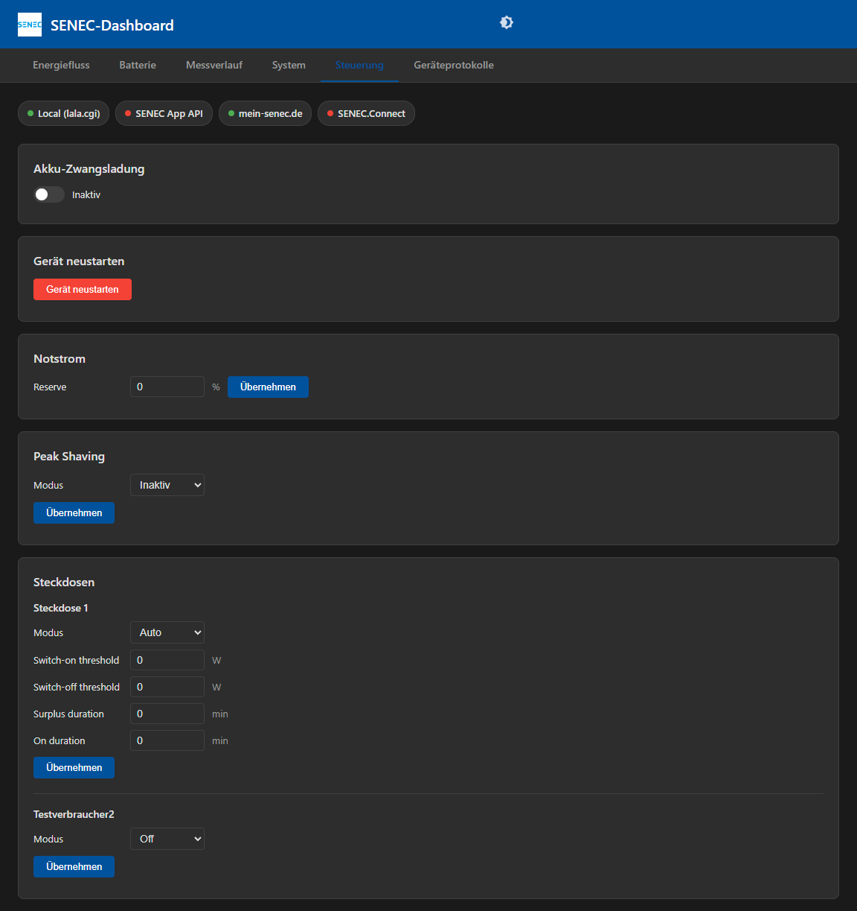

Interaktive Steuerung passend zu den Steuerungsfähigkeiten des Adapters:
- Akku-Zwangsladung (Schalter)
- Gerät neustarten (mit Bestätigungsdialog)
- Notstromreserve (Prozenteinstellung)
- Peak Shaving (modusabhängige Felder)
- SG-Ready (Aktivierung + Schwellwerte)
- Schaltbare Steckdosen (pro Steckdose Modus, Schwellwerte, Namensbearbeitung)
- Wallbox (Smart Charge, Stromgrenze)

Steuerungen prüfen die Konnektor-Verfügbarkeit und zeigen Warnungen wenn der benötigte Konnektor nicht aktiv ist. Die Übernehmen-Schaltfläche gibt "Gesendet"-Feedback.

### Statistik-Tab

mein-senec.de bietet einen wöchentlichen CSV-Export mit 5-Minuten-Auflösung, der Jahre zurückreicht — weit mehr Daten, als in ioBroker-States gehören. Daher wird nichts dauerhaft gespeichert: Der Adapter hält nur die einmal täglich aktualisierte Liste der verfügbaren Wochen vor und lädt eine einzelne Woche erst auf Anforderung. Die Daten bestehen nur, solange der Tab geöffnet ist.

- Anlagenauswahl, die auch frühere Geräte des Kontos aufführt (entfällt bei nur einer Anlage). Die von dieser Instanz abgefragte Anlage ist vorausgewählt.
- Wochenauswahl mit Datumsbereich je Woche
- Tagesfilter — grenzt eine Woche mit ~2.000 Zeilen auf einen Tag ein
- Auflösung — Stundenmittel oder 5-Minuten-Rohwerte
- Spaltenschalter für die zehn exportierten Spalten, inklusive Akkuspannung, -strom und -füllstand
- Sortierbare Spaltenköpfe; ein dritter Klick stellt die chronologische Reihenfolge wieder her
- Zusammenfassungszeile mit Minimum, Mittelwert und Maximum der angezeigten Zeilen
- Tabellen- oder Diagrammansicht; im Diagramm teilen sich die Leistungsspalten eine linke kW-Achse, Prozentwerte erhalten eine eigene rechte 0–100-%-Achse, und Lücken in einer Reihe unterbrechen die Linie, statt überbrückt zu werden
- Download der aktuellen Auswahl als CSV

Erfordert einen aktivierten und verbundenen mein-senec.de-Konnektor.

### Protokolle-Tab

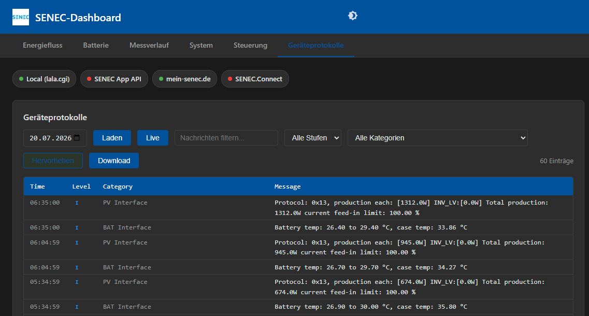

Durchsuchen der SENEC Geräteprotokolle nach Datum:
- Filterbare Tabelle (Zeit, Stufe, Kategorie, Nachricht)
- Stufenfilter: Info, Warnung, Fehler, Panik
- Kategoriefilter (automatisch aus Logeinträgen befüllt)
- Freitextsuche
- Farbkodierte Zeilenhervorhebung nach Schweregrad
- Neueste Einträge zuerst
- Live-Modus — aktualisiert automatisch das heutige Log (UTC-berücksichtigt)
- Download der rohen Logdateien

Erfordert eine konfigurierte Geräte-IP (auch wenn der lokale Konnektor nicht aktiviert ist).

## State-Referenz

Der Adapter erstellt States, organisiert nach Konnektor und Datenbereich. Alle States sind schreibgeschützt, sofern nicht explizit als Steuerungs-States gekennzeichnet.

### Verbindung & Status (`info.*`)

| State | Beschreibung |
|-------|-------------|
| `info.connection` | Gesamtverbindungsstatus (true wenn ein Konnektor aktiv) |
| `info.connectionStatus` | Detaillierter Verbindungsstatus: `all` (alle konfigurierten Konnektoren verbunden), `partial` (teilweise verbunden), `none` |
| `info.localConnected` | Lokal (lala.cgi) Verbindungsstatus |
| `info.apiConnected` | SENEC App API Verbindungsstatus |
| `info.webConnected` | mein-senec.de Verbindungsstatus |
| `info.connectConnected` | SENEC.Connect Verbindungsstatus |
| `info.openapiConnected` | Verbindungsstatus der lokalen OpenAPI (Port 4424) |
| `info.lastPoll.HighPrio` | Zeitstempel der letzten hochprioritären lokalen Abfrage |
| `info.lastPoll.LowPrio` | Zeitstempel der letzten niedrigprioritären lokalen Abfrage |

### TLS States (`_local.tls.*`)

| State | Typ | Schreiben | Beschreibung |
|-------|-----|:---------:|-------------|
| `_local.tls.mode` | string | nein | Aktiver TLS-Validierungsmodus: `user`, `cached`, `tofu` oder `none` |
| `_local.tls.fingerprint` | string | nein | SHA-256-Fingerabdruck des akzeptierten Gerätezertifikats (TOFU-Modus, verschlüsselt) |
| `_local.tls.userCaPem` | string | ja | Vom Benutzer hochgeladenes CA-Zertifikat (PEM, verschlüsselt) |
| `_local.tls.cachedCaPem` | string | nein | Von mein-senec.de heruntergeladenes CA-Zertifikat (PEM, verschlüsselt) |
| `_local.tls.certFetchFailed` | boolean | ja | Auf `false` setzen um einen neuen CA-Download-Versuch auszulösen |

### Lokale States

Daten aus der lala.cgi-Abfrage werden direkt unter dem Bereichsnamen gespeichert (z.B. `ENERGY.*`, `BMS.*`, `PV1.*`, `WIZARD.*`).

**Wichtige ENERGY-States:**

| State | Typ | Beschreibung |
|-------|-----|-------------|
| `ENERGY.GUI_INVERTER_POWER` | Zahl (W) | Aktuelle PV-Erzeugung |
| `ENERGY.GUI_BAT_DATA_POWER` | Zahl (W) | Batterieleistung (positiv = Laden, negativ = Entladen) |
| `ENERGY.GUI_GRID_POW` | Zahl (W) | Netzleistung (positiv = Bezug, negativ = Einspeisung) |
| `ENERGY.GUI_HOUSE_POW` | Zahl (W) | Aktueller Hausverbrauch |
| `ENERGY.GUI_BAT_DATA_FUEL_CHARGE` | Zahl (%) | Batterie-Ladezustand |
| `ENERGY.STAT_STATE` | Zahl | Betriebszustandscode |
| `ENERGY.STAT_STATE_Text` | Text | Betriebszustand in Klartext |
| `ENERGY.STAT_HOURS_OF_OPERATION` | Zahl (h) | Betriebsstunden |

**Wichtige BMS-States:**

| State | Typ | Beschreibung |
|-------|-----|-------------|
| `BMS.MODULE_COUNT` | Zahl | Anzahl der Batteriemodule |
| `BMS.SOH.{n}` | Zahl (%) | Gesundheitszustand pro Modul |
| `BMS.CYCLES.{n}` | Zahl | Ladezyklen pro Modul |
| `BMS.CELL_VOLTAGES_MODULE_{A-D}.{n}` | Zahl (mV) | Einzelne Zellspannungen |
| `BMS.TEMP_MIN.{n}` / `BMS.TEMP_MAX.{n}` | Zahl (°C) | Modul-Temperaturbereich |
| `BMS.VOLTAGE.{n}` / `BMS.CURRENT.{n}` | Zahl (V/A) | Pack-Spannung und -Strom |

### API-States (`_api.*`)

Cloud-API-Daten werden unter `_api.Anlagen.{systemId}.*` gespeichert:

- `Dashboard.currently.*` — Echtzeit-Leistungswerte (W)
- `Measurements.Daily.*` — Stündliche Messdaten (kWh)
- `Measurements.Monthly.*` — Tägliche Messdaten (kWh)
- `Measurements.Yearly.*` — Monatliche Messdaten (kWh)
- `Measurements.AllTime.*` — Lebensdauer-Summen (kWh)
- `SystemDetails.*` — Batteriedetails, Temperaturen, Firmware
- `SystemStatus.*` — Betriebszustand, Feature-Flags

### Web-States (`_meinsenec.*`)

mein-senec.de Daten werden unter `_meinsenec.*` gespeichert:

- `Status.*` — Aktuelle Leistungswerte (kW), Betriebszustand
- `Measurements.*` — Historische Messdaten (kWh)
- `Autarky.*` — Autarkie-Prozentsätze (Tag/Woche/Monat/Jahr/Gesamt)
- `EmergencyPower.*` — Notstromreserve-Einstellungen
- `PeakShaving.*` — Peak-Shaving-Konfiguration
- `SGReady.*` — SG-Ready-Einstellungen
- `Sockets.*` — States der schaltbaren Steckdosen

### Connect-States (`_connect.*`)

SENEC.Connect Daten werden unter `_connect.Systems.{system_id}.*` mit Batterie- und Zähler-Unterbereichen gespeichert. Ein Konto kann mehrere Systeme umfassen; jedes erhält einen eigenen Kanal, benannt nach seinem Modell und adressiert über die in `bessNameplate` gemeldete System-ID — dadurch behält ein System seine States auch dann, wenn die API die Systeme in anderer Reihenfolge zurückgibt. `_connect.info.systemCount` meldet, wie viele Systeme die API sieht.

Der Abschnitt `bessNameplate` wird unabhängig von den konfigurierten Abschnitten immer abgefragt, weil er diese ID enthält.

Wallboxen werden genauso abgelegt, unter der jeweils gemeldeten `id`: `_connect.Systems.{system_id}.evse.{wallbox_id}.*`. Verschwindet eine Wallbox aus der Antwort, werden ihre States entfernt, statt mit den letzten Werten stehen zu bleiben.

Meldet ein System keine `system_id`, wird stattdessen seine Seriennummer verwendet. Ein System wird über jede jemals gemeldete Kennung wiedererkannt — eine Antwort, in der eine davon fehlt, verschiebt das System also nicht auf einen neuen Pfad. Enthält eine Antwort überhaupt keine Kennung, greift für dieses System die Position in der Antwort, genau wie vor 2.15.0, und die Bereinigung wird währenddessen ausgesetzt.

States eines Systems, das die API nicht mehr meldet, werden entfernt. Adapter vor 2.15.0 nummerierten die Systeme nach ihrer Position in der Antwort (`_connect.Systems.0.*`); diese States werden beim ersten Poll nach dem Update gelöscht, sobald die Systeme identifiziert sind.

**Wer SENEC.Connect-States mit einem History-Adapter aufzeichnet** (History, InfluxDB, SQL): Diese Einstellung hängt am State selbst und geht mit dem alten State verloren. Die Aufzeichnung läuft nicht von allein weiter — bitte das Logging nach dem Update für die States unter den neuen Pfaden wieder einschalten.

### OpenAPI-States (`_openapi.*`)

Die Messwerte der lokalen OpenAPI liegen unter `_openapi.*`, ein Kanal pro Bereich:

| Kanal | Inhalt |
|-------|--------|
| `_openapi.battery.*` | Ladezustand, Betriebszustand, Leistung, Spannung, Strom |
| `_openapi.meter.*` | Netzleistung, Hausverbrauch, PV, Überschuss |
| `_openapi.bessNameplate.*` | Modell, Seriennummer, Kapazität und Nennwerte |
| `_openapi.evse.{wallbox_id}.*` | Ein Kanal pro Wallbox-Steckplatz — die Anlage meldet vier, auch ohne angeschlossene Wallbox |
| `_openapi.bess.*` | Nur bei Auswahl — mehrere Werte kommen leer zurück |
| `_openapi.info.approvalState` | `unregistered`, `pending`, `approved`, `rejected` oder `error` |
| `_openapi.info.lastPoll` | Zeitstempel der letzten erfolgreichen Abfrage |

Das Typenschild wird in jedem Zyklus gelesen, auch wenn es nicht ausgewählt ist. Normalerweise erkennt der Adapter die Anlage am Common Name des Zertifikats, das sie auf Port 4424 vorweist — dieser Name ist die Seriennummer der Anlage selbst, das Zertifikat benennt also genau dieses Gerät, was das Zertifikat des lokalen Webinterfaces nicht leistet. Das Typenschild ist der Rückfallweg für den Fall, dass dieser Name nicht lesbar ist: Dann identifiziert seine Seriennummer die Anlage, und nur so lässt sich die Anlage im Konto noch zuordnen — und damit die Registrierung automatisch freigeben.

Das Registrierungs-Token liegt verschlüsselt in `_openapi.token`; im Objektbaum steht also der Geheimtext, nicht das Token selbst. Der State ist als nicht lesbar gekennzeichnet, doch diese Kennzeichnung ist in ioBroker nur ein Hinweis — der eigentliche Schutz ist die Verschlüsselung.

Diese States kommen direkt von der Anlage und sind von den `lala.cgi`-States unabhängig. Wo beide dieselbe Größe melden, messen sie an unterschiedlichen Punkten und müssen nicht auf das Watt übereinstimmen.

### Externe States (`_external.*`)

Daten externer Quellen werden unter `_external.{typ}.{index}.*` gespeichert:

| State | Beschreibung |
|-------|-------------|
| `_external.pv.{n}.power` | Externe PV-Leistung (W) |
| `_external.consumer.{n}.power` | Externer Verbraucher (W) |
| `_external.battery.{n}.power` | Externe Batterieleistung (W, vorzeichenbehaftet) |
| `_external.battery.{n}.soc` | Externer Batterie-Ladezustand (%) |
| `_external.battery.{n}.capacity` | Externe Batterie-Kapazität (kWh) |
| `_external.{typ}.{n}.label` | Benutzerdefinierte Bezeichnung |
| `_external.{typ}.{n}.mode` | Anzeigemodus (integrate/separate) |
| `_external.{typ}.{n}.sourceId` | Fremde State-ID oder Formel |

### Steuerungs-States (`control.*`)

Schreibbare States zur Gerätesteuerung:

| State | Typ | Beschreibung |
|-------|-----|-------------|
| `control.ForceLoadBattery` | Boolean | Akku-Zwangsladung ein/aus |
| `control.RebootAppliance` | Boolean | Gerät neustarten auslösen |
| `control.EmergencyPower.ReserveInPercent` | Zahl | Notstromreserve (%) |
| `control.PeakShaving.*` | Diverse | Peak-Shaving-Einstellungen |
| `control.SGReady.*` | Diverse | SG-Ready-Einstellungen |
| `control.Sockets.{n}.*` | Diverse | Pro-Steckdose Steuerung |
| `control.Wallbox.{n}.*` | Diverse | Wallbox-Steuerung |

Steuerungs-States werden nur erstellt, wenn die entsprechende Funktion aktiviert und über den konfigurierten Konnektor verfügbar ist.

## Fehlerbehebung

**Gerät reagiert nicht / häufige Neustarts**: Reduzieren Sie das hochprioritäre Abfrageintervall oder entfernen Sie benutzerdefinierte HighPrio-Datenpunkte. Das SENEC Gerät hat begrenzte Ressourcen.

**Keine Daten von API/Web**: Prüfen Sie Ihre mein-senec.de Zugangsdaten im SENEC Konto Tab. Der Adapter protokolliert Authentifizierungsfehler auf Warnungsstufe.

**Dashboard lädt nicht**: Stellen Sie sicher, dass ioBroker.web auf Port 8082 läuft. Das Dashboard wird als Web-Extension unter `/senec/` bereitgestellt.

**Fehlende States**: Die verfügbaren States hängen von Ihrem SENEC Modell, der Firmware-Version und den konfigurierten Konnektoren ab. Nicht alle States sind auf allen Systemen verfügbar.

**Steuerungs-States erscheinen nicht**: Steuerungsfunktionen müssen in den Gerätesteuerungseinstellungen explizit aktiviert werden. Jede Steuerung erfordert einen bestimmten aktiven Konnektor.

**TLS-Zertifikatsfehler bei lokaler Verbindung**: Der Adapter übernimmt die Zertifikatsvalidierung automatisch. Prüfen Sie `_local.tls.mode` um zu sehen, welche Validierungsmethode aktiv ist. Wenn TOFU-Modus aktiv ist und Sie auf CA-Validierung upgraden möchten, aktivieren Sie den mein-senec.de-Connector — der Adapter versucht das CA-Zertifikat automatisch herunterzuladen. Falls ein früherer Download fehlgeschlagen ist, setzen Sie `_local.tls.certFetchFailed` auf `false` um es erneut zu versuchen.

## Hilfe und Austausch

Für Fragen, Konfigurationen und den Austausch mit anderen Nutzern gibt es einen [eigenen Thread im ioBroker-Forum](https://forum.iobroker.net/topic/30620/neuer-adapter-senec-home-adapter) — meist der schnellste Weg zu einer Antwort.

Sieht es nach einem Fehler aus, bitte ein Issue auf [GitHub](https://github.com/nobl/ioBroker.senec/issues) anlegen. Wie ein [Debug-Log erstellt](#debug-log-erstellen) wird und was eine [Meldung bearbeitbar macht](#fehler-melden), steht weiter oben.

## Changelog

<!--
  Placeholder for the next version (at the beginning of the line):
  ### **WORK IN PROGRESS**
-->
### **WORK IN PROGRESS**
- Dependency updates

### 2.16.0 (2026-10-25)
- New: A connector for the appliance's **local OpenAPI on port 4424** — a second local interface, independent of `lala.cgi` and read-only. It is **off by default** and available on **V2 and V3 systems only**; V4, P4 and E4 do not open the port. It shares the *Local Connection* tab and the appliance address with the `lala.cgi` connector, and either one works without the other. It needs a one-time registration that is approved in the SENEC portal, on a page reachable only by link. **With your SENEC account credentials filled in, the adapter handles that itself** — registering, approving and starting to poll, without the mein-senec.de connector having to be enabled; otherwise it writes the exact approval link to the log for you to open. `_openapi.info.approvalState` shows where the registration stands — not registered, waiting, approved, or no longer accepted — with buttons beside it to re-check the approval, or to de-register and discard the token. It serves battery, meter, nameplate and wallbox readings under `_openapi.*`. There is nothing writable: the two routes that would set a charge or discharge power refuse every request an end customer can make, approved or not. What the interface offers and refuses is documented in [docs/LOCAL_OPENAPI_4424.md](docs/LOCAL_OPENAPI_4424.md).
- New: The appliance address moved to the top of the *Local Connection* tab and is shown whenever either local connector is enabled. It was previously hidden unless `lala.cgi` polling was switched on, which left anyone who wanted only the new connector unable to enter it at all.
- New: The battery state read through SENEC.Connect now has a companion state spelling the code out in words, at `_connect.Systems.<system_id>.battery.state_Text`. Only `lala.cgi` states carried these before.
- Change: `BAT1.SPARE_CAPACITY` is now named *Emergency Power Reserve* and carries `%` as its unit. It is the local mirror of the emergency power reserve set on mein-senec.de, so the value you set in the portal is what appears here. It was previously listed under its raw name with no unit, which told nobody what the number meant.
- Change: SENEC.Connect honours a `Retry-After` the API sends with a 429 or 503 instead of coming back at the configured interval regardless. The endpoint is rate-limited per subscription, and ignoring the wait it asks for invites a longer block.
- Change: The house consumption from SENEC.Connect is now named for what its schema says it is — the figure excludes the wallbox load, which matters to anyone comparing it against the appliance's own.
- Fix: The documentation listed a writable state `control.BlockDischarge` for blocking battery discharge. No such state exists and none ever has, so the row is removed. The force-charge switch in the same table was misnamed too: it is `control.ForceLoadBattery`, not `control.ForceCharge`, and it is created on every instance alongside `control.RebootAppliance`. Whether the appliance offers a discharge block at all is tracked as a question of its own (#543).
- Fix: The documentation named `_local.FACTORY` and `_local.SYS_UPDATE` as the states holding model and firmware version for a bug report. Those are `FACTORY.*` and `SYS_UPDATE.*` at the root of the instance — `_local.` holds the TLS states and nothing else.
- Dependency updates

### 2.15.6 (2026-10-06)
- Dependency updates

### 2.15.5 (2026-09-16)
- Fix: A mail address configured with a space at its end made the SENEC App API login fail on every single attempt. The app login asks for the username first and resolves the domain behind the `@` to decide whether the account belongs to an identity provider — `example.com ` is not a domain, so that step was answered with "Unexpected error when handling authentication request to identity provider", which names neither the address nor the space. The mein-senec.de connector is served a single form carrying username and password, validates the credentials directly and trims the username on the way, so the same address worked there and the two connectors disagreed about credentials that were identical. Leading and trailing whitespace is now removed from the configured address, zero-width characters along with it, and the correction is logged as a warning. The password is left untouched — a space at either end of it may be part of it.
- Change: The SENEC App API login writes the names of the fields it posts in each step to the debug log. The values are not logged. Whether the adapter returns the form the SSO served is the first thing a refused login has to be checked against, and reconstructing it needed a separate script run on the reporter's machine.
- Change: The login names the account it is attempted with, masked to the first character and the domain. A login that is refused while the credentials are known to be correct could not previously be checked against the address the adapter actually uses.
- Change: The steps of the App API login ask the SSO for a page rather than for JSON. Every step of the login is answered with an HTML page, while the shared client asks for JSON, which suits the mein-senec.de calls and the token endpoint. The token requests now state that expectation themselves instead of relying on the shared default.
- Dependency updates

### 2.15.4 (2026-09-12)
- Dependency updates

### 2.15.3 (2026-08-31)
- Fix: The SENEC App API login posted only the fields it fills in itself and did not send back the hidden fields the login form contains. A browser sends those back, and the SSO uses them to carry the state of a login across its steps, so an account whose login takes a route that depends on them could not get past the first step. Every field of the form is now returned with the values the adapter supplies on top. This applies to the two-factor step as well, where the form names which of several configured codes is being answered.
- Fix: The mein-senec.de login had the same gap and now sends the form's hidden fields back as well. Its login-page debug dump is redacted before it is written, which it previously was not.
- Change: A login step that fails now records the page the SSO answered with, without *Log requests and responses* having to be switched on beforehand. The instance log level still has to be `debug` or more verbose, and the adapter now checks that before it does the work — it previously prepared the page at every log level and then handed it to a call that discarded it. The one-line reason says which step failed but not what the SSO put in front of the adapter, which is where an unexpected login route shows itself, and by the time a report is written the login that produced it is gone, so it cannot be asked for afterwards. A login failing the same way on every retry writes the page once and afterwards only notes that it has not changed — the comparison now ignores the identifiers the SSO issues afresh for every attempt, which previously differed each time and defeated it.
- Change: More of a logged login page is masked. Login codes are masked as hidden form values as well as in query strings, the account's mail address is masked in its plain, percent-encoded and HTML-entity-encoded spellings, and a password echoed back inside a form value is masked. The pages are shortened before they reach the log.
- Change: The short error text taken from a rejected login page now goes through the same masking as the debug page dump. It is logged at `error` level, so it is visible at the default log level — a wider audience than the page dump reaches, and until now it was the less thoroughly redacted of the two.
- Change: With *Log requests and responses* switched on, the login form as it was served and the page after the username step are logged as well. These say nothing when a login works, so they stay behind the option.

### Former Updates

## License
MIT License

Copyright (c) 2020-2026 Norbert Bluemle <github@bluemle.org>

Permission is hereby granted, free of charge, to any person obtaining a copy
of this software and associated documentation files (the "Software"), to deal
in the Software without restriction, including without limitation the rights
to use, copy, modify, merge, publish, distribute, sublicense, and/or sell
copies of the Software, and to permit persons to whom the Software is
furnished to do so, subject to the following conditions:

The above copyright notice and this permission notice shall be included in all
copies or substantial portions of the Software.

THE SOFTWARE IS PROVIDED "AS IS", WITHOUT WARRANTY OF ANY KIND, EXPRESS OR
IMPLIED, INCLUDING BUT NOT LIMITED TO THE WARRANTIES OF MERCHANTABILITY,
FITNESS FOR A PARTICULAR PURPOSE AND NONINFRINGEMENT. IN NO EVENT SHALL THE
AUTHORS OR COPYRIGHT HOLDERS BE LIABLE FOR ANY CLAIM, DAMAGES OR OTHER
LIABILITY, WHETHER IN AN ACTION OF CONTRACT, TORT OR OTHERWISE, ARISING FROM,
OUT OF OR IN CONNECTION WITH THE SOFTWARE OR THE USE OR OTHER DEALINGS IN THE
SOFTWARE.