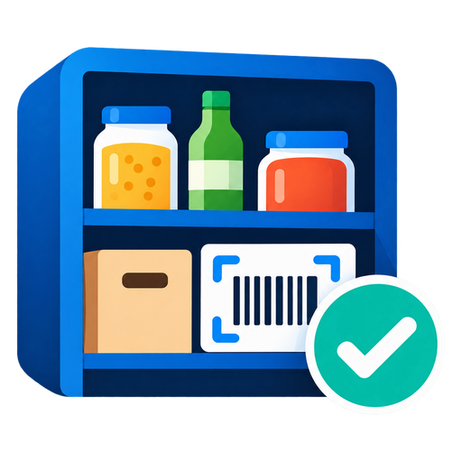

  

# ioBroker.shelfmate

**ShelfMate – Ihre Speisekammer auf einen Blick.**

ShelfMate ist ein Vorratsverwaltungsprogramm für ioBroker. Es zeigt Ihnen jederzeit an, welche Lebensmittel Sie zu Hause haben, wo sie gelagert sind und was Sie nachkaufen müssen.

Produkte per Barcode scannen, im Regal und in Schränken verwalten und bei Bedarf automatisch der Einkaufsliste hinzufügen. Mindestbestand, Mindesthaltbarkeitsdatum und Verbrauch werden ebenfalls berücksichtigt.

Die Nutzung erfolgt über eine Web-App, die Sie auf Ihrem Smartphone öffnen und dem Startbildschirm hinzufügen. Eine separate App ist nicht erforderlich.

**Deutsch:** [README.de.md](/#/docs/adapterref/iobroker.shelfmate/README.de.md)\
&#x20;**Anleitungen:** [Englisch](/#/docs/adapterref/iobroker.shelfmate/docs/en/tutorial.md) · [Deutsch](https://github.com/backfisch88/ioBroker.shelfmate/blob/main/docs/de/tutorial.md)

---

## Merkmale

### Produkte und Lagerorte

- Produkte per Barcode oder manuell hinzufügen, mit Namensvorschlägen und passender Kategorie bei der manuellen Erstellung.
- Die Produktnummern (PLU) von Obst und Gemüse sowie die Datenmatrixbezeichnungen der Skalen werden erkannt; eine eigene Liste in `plu.data` Namen, vom Einzelhändler vergebene Nummern
- Verwenden Sie eine eigene Produktdatenbank (Datenpunkt, Datei oder Webadresse; JSON oder CSV mit freien Feldnamen), die zuerst abgefragt wird; Produkte mit eigenen Barcodes behalten ihren Barcode.
- Bücher (ISBN), Zeitschriften (ISSN) und Noten (ISMN) werden in der Open Library, der Deutschen Nationalbibliothek und bei Google Books erkannt und können dort gefunden werden.
- Arzneimittel mit PZN-Code (Barcode oder Data Matrix) und gewöhnliche, unbekannte Barcodes werden von Shop Apotheke oder Vitality-Fit benannt; das Verfallsdatum im Data-Matrix-Code wird als Mindesthaltbarkeitsdatum angegeben.
- Die Reihenfolge, in der die Produktquellen abgefragt werden, kann in den Adaptereinstellungen geändert werden (Standard: Lebensmittel, Drogerie, Haustiere, Haushalt, Medikamente und Apotheke, Bücher).
- Produktdaten aus Open Food Facts und den zugehörigen Datenbanken (Kosmetik, Tiernahrung, Haushalt) werden automatisch geladen (Name, Marke, Packungsgröße, Nutri-Score und Kategorien); die Quelle wird in der App angezeigt.
- Unbekannte Barcodes: Über eine Schaltfläche wird das Web nach Name, Marke und Bild durchsucht, entweder nach allen neuen Produkten gleichzeitig (mit einer Übersichtsseite, bevor etwas gespeichert wird) oder nur nach dem Bild (nur auf Anfrage, kann deaktiviert werden).
- Produktdaten jederzeit bearbeiten und aktualisieren
- Erstellen Sie Ihre eigenen EAN-13-Barcodes für Produkte ohne Barcode.
- Laden Sie Ihre eigenen Produktbilder hoch (automatisch verkleinert)
- Schaffen Sie Lagerbereiche und -orte, zum Beispiel Küche, Speisekammer oder Keller.
- Lagerorte mit QR-Codes auswählen
- Waren ein- und auslagern sowie Waren zwischen verschiedenen Standorten transportieren
- Verfolgen Sie jede Buchung in der Historie
- Finden Sie Produkte schnell mit der Suche, inklusive Vorschlägen während der Eingabe.
- Fassen Sie Produkte verschiedener Marken zu Gruppen zusammen, zum Beispiel Mehl oder Zucker.

### Mindestbestand und Einkaufsliste

- Legen Sie einen Mindestbestand für einzelne Produkte oder ganze Produktgruppen fest.
- Produkte automatisch auf die Einkaufsliste setzen, sobald der Mindestbestand erreicht ist
- Verwalten Sie die Einkaufsliste mithilfe von Datenpunkten, Bring! oder Bring! Special.
- Mit Bring! Special werden Mengen und Varianten im selben Eintrag zusammengeführt, anstatt Duplikate zu erstellen.
- Produkte werden automatisch von der Einkaufsliste entfernt, sobald der Lagerbestand aufgefüllt ist.
- Optional können Sie die fehlende Menge auf die Einkaufsliste schreiben.
- Listen Sie die Lagerorte der Verbrauchsmaterialien (z. B. den Kühlschrank) in Datenpunkten auf.
- Bewerten Sie den Verbrauch der letzten 30 Tage
- Schlagen Sie einen angemessenen Mindestbestand auf Basis des bisherigen Verbrauchs vor.

### Haltbarkeitsdatum und Mindesthaltbarkeitsdatum

- Speichern Sie das Mindesthaltbarkeitsdatum (MHD) optional pro Produkt oder pro Lagerbestand.
- Warnen Sie vor Produkten, deren Ablaufdatum bald erreicht ist oder die bereits abgelaufen sind.
- Der Reiter „Aufgaben“ sammelt alle anstehenden Aufgaben: neue Produkte, die fertiggestellt werden müssen, fällige Inventur, Vorschläge für Gruppen- und Mindestbestände sowie Produkte ohne Datum (lassen Sie das Datumsfeld leer, um ausgewählte Pakete ohne Datum zu behalten).
- automatisch eine Standardhaltbarkeitsdauer für viele Lebensmittel vorschlagen
- Beachten Sie die Haltbarkeit nach dem Öffnen.
- Gefrierlager haben ihre eigene Haltbarkeitsdauer für gefrorene Produkte; gefroren gekaufte Produkte behalten ihre normale Haltbarkeitsdauer
- Produkte als geöffnet oder verdorben kennzeichnen
- Automatisch ausgefüllte Werte werden am Glitzersymbol erkannt.
- Legen Sie Ihre eigenen Haltbarkeitsdaten für Produkte und Gruppen fest.
- Babynahrung im Glas hat nach dem Öffnen eine kurze Standardhaltbarkeit (1 bis 2 Tage).
- Bearbeiten Sie die Haltbarkeitsregeln (Schlüsselwörter mit Angaben zu Tagen vor und nach dem Öffnen) und suchen Sie nach allen Produkten mit ihrer Haltbarkeit, einschließlich des Wertes nach dem Öffnen.

### Zutaten prüfen

Sie möchten kochen und wissen, ob Sie alle Zutaten zu Hause haben? ShelfMate vergleicht eine Zutatenliste, beispielsweise aus einer Rezept-App, mit Ihrem Vorrat. Fehlende Zutaten können direkt auf die Einkaufsliste gesetzt werden. Bereits vorhandene Zutaten werden nicht erneut hinzugefügt.

### Scannen und Etiketten

- Barcodes mit der Handykamera oder einem Scanner erfassen
- QR-Codes für Lagerorte erstellen und drucken
- Drucken Sie EAN- und QR-Etiketten in Ihren eigenen Größen, z. B. 50 × 30 mm.
- Etiketten für Regale, Kartons, den Gefrierschrank (mit einer Freitextzeile, z. B. für das Gewicht) und geöffnete Produkte; ein EAN-Etikett und ein Gefrierschranketikett mit EAN-Nummer und Einfrierdatum können ebenfalls von der Produktseite aus gedruckt werden.
- Wählen Sie aus, welche Etiketten die App anbietet.
- Codebibliothek: Speichern Sie Ihre eigenen Codes (z. B. von anderen Scannern oder Apps), drucken Sie sie als Etiketten und wählen Sie aus, welche der Steuercodes in die PDF-Datei übernommen werden sollen.
- Scannermodus für die Ein- und Auslagerung von Waren ohne geöffnete Web-App; Scanner mit USB-Dongle oder Bluetooth werden direkt auf dem ioBroker-Host gelesen.
- Wiederholte Scans (drei oder mehr) lösen von Ihnen festgelegte Aktionen aus: Einlagern am letzten Standort, als leer markieren, auf die Einkaufsliste setzen und mehr.
- Zählmodus: Jeder Scan zählt als ein einzelnes Stück ohne Positionsangabe, drei Scans ergeben drei Stücke.
- Führen Sie eine Bestandsaufnahme anhand der Produktliste oder per Scanner durch.

### Übersicht und Benachrichtigungen

- Den gesamten Lagerbestand nach Lagerort anzeigen
- Warnhinweise zu Mindestbeständen und ablaufenden Produkten
- Benachrichtigungen über Telegram, telegrammenu2, Pushover, Signal, WhatsApp, Matrix oder E-Mail
- Tägliche Übersicht der Produkte, die bald ablaufen oder bereits abgelaufen sind, optional nur an ausgewählten Tagen vor dem Datum (z. B. 7, 4, 3, 2, 1, 0).
- Erinnerungen zur Inventur
- Vorschläge für Produktgruppen und Mindestbestände
- Datenpunkte für VIS oder Ihre eigenen Skripte
- JSON-Backups erstellen und als CSV oder PDF exportieren

### Web-App

- Läuft direkt im Browser auf Smartphone, Tablet und PC
- Kann dem Startbildschirm des iPhones oder Android-Geräts hinzugefügt werden.
- Moderner Glas-Look im Stil von iOS 27: Tab-Leiste aus Glas, die sich beim Scrollen kreisförmig zusammenfaltet, Schalter und Schieberegler aus Glas, systemähnliche Schriftarten
- Suchleisten in Glasoptik, die beim Scrollen oben bleiben, mit einer Schaltfläche zum Löschen des Textes
- Wählen Sie die Akzentfarbe und die Hintergrundfarbe; zwei Schieberegler legen fest, wie transparent und wie unscharf die Glasteile sind.
- Offline-Warteschlange für Buchungen bei Verbindungsverlust
- Geben Sie jedem Gerät einen Namen, damit die Buchungen in der Historie unterschieden werden können.
- Die letzte Buchung rückgängig machen
- HTTPS mit eigenen oder automatisch erstellten Zertifikaten
- Optionaler Zugriffsschlüssel für die API
- Mehrsprachig: Deutsch, Englisch, Russisch, Portugiesisch, Niederländisch, Französisch, Italienisch, Spanisch, Polnisch, Ukrainisch und Chinesisch

---

## Anforderungen

- ioBroker js-controller >= 6.0.11
- Admin >= 7.6.20
- Node.js >= 22.12
- HTTPS mit einem Zertifikat, dem Ihr Telefon vertraut (für die Kamera und die Offline-Funktionen).

## Installation

ShelfMate wird wie jeder andere ioBroker-Adapter installiert.

1. Installieren Sie den Adapter **Shelfmate** in der ioBroker-Administration.
2. Eine Instanz erstellen.
3. Öffnen Sie die Web-App unter `https://<host>:8120/` Die
4. Optional kann die Seite zum Startbildschirm hinzugefügt werden.

Der Standardport ist `8120` und kann in den Einstellungen geändert werden.

## Erste Schritte

1. **Lagerorte erstellen:** Erstellen Sie Ihre Lagerbereiche und -orte, zum Beispiel Küche → Speisekammer → Regal 1.
2. **QR-Codes drucken:** Bringen Sie die passenden QR-Codes an Ihren Lagerorten an.
3. **Produkte hinzufügen:** Scannen Sie einen Barcode oder legen Sie ein Produkt manuell an. Viele Produktdaten werden automatisch von Open Food Facts geladen.
4. **Lagerbestand:** Wählen Sie den Standort per QR-Code aus und buchen Sie den gewünschten Betrag.
5. **Legen Sie einen Mindestbestand fest:** ShelfMate kann Produkte automatisch auf Ihre Einkaufsliste setzen, wenn der Bestand zur Neige geht.

Eine detaillierte Beschreibung finden Sie im [Leitfaden](/#/docs/adapterref/iobroker.shelfmate/docs/en/tutorial.md) .

---

## Einstellungen

Die wichtigsten Funktionen können direkt in der Adapterkonfiguration angepasst werden.

| Einstellung                          | Beschreibung                                                                                                                                                                                                                         |
| ------------------------------------ | ------------------------------------------------------------------------------------------------------------------------------------------------------------------------------------------------------------------------------------ |
| Erscheinungsbild (in der App)        | Design, Akzentfarbe (Standard: Blau), Hintergrundfarbe (Standard: Grau), Transparenz und Unschärfe der Glasteile. Gilt nur für dieses Gerät.                                                                                         |
| Port-/Bindungsadresse                | Port und Netzwerkschnittstelle des Webservers (Standard: 8120)                                                                                                                                                                       |
| HTTPS                                | Aktivieren Sie HTTPS und wählen Sie die Zertifikate aus.                                                                                                                                                                             |
| Zertifikat erstellen                 | Erstellt ein selbstsigniertes Zertifikat für den Hostnamen und die IP-Adressen mit einer Gültigkeit von 825 Tagen. Starten Sie die Instanz anschließend neu.                                                                         |
| Zertifikate                          | Verwenden Sie Zertifikate von ioBroker oder beispielsweise vom acme-Adapter.                                                                                                                                                         |
| Zugangsschlüssel                     | Optionaler Schutz für den API-Zugriff, einmal pro Gerät eingegeben                                                                                                                                                                   |
| Einkaufsliste                        | Aus, Drehbuch, Bringen! oder Bringen! Spezial                                                                                                                                                                                        |
| Websuche nach unbekannten Produkten  | Fügt dem Produkteditor die Schaltfläche „Im Web suchen“ hinzu (standardmäßig aktiviert). Sie wird nur beim Antippen ausgeführt und sendet nur den Barcode.                                                                           |
| Token für ean-search.org             | Optionaler Gratis-Token. Damit nutzt die Websuche die offizielle Schnittstelle von ean-search.org und wird nicht nach einigen Suchanfragen blockiert.                                                                                |
| Schlüssel für die Open EAN-Datenbank | Optionale kostenlose Abfrage-ID von opengtindb.org. Damit fragt die Websuche auch die Open EAN/GTIN-Datenbank nach dem Namen ab.                                                                                                     |
| Gruppenname in der Liste             | Gruppierte Produkte werden mit dem Gruppennamen auf die Einkaufsliste gesetzt (Standardeinstellung). Aus: Das erste leere Produkt der Gruppe wird angezeigt.                                                                         |
| Mindesthaltbarkeitsmanagement        | Rabatt, pro Produkt oder pro Lagerbestand                                                                                                                                                                                            |
| Datumsformat                         | TT.MM.JJJJ, TT/MM/JJJJ oder JJJJ-MM-TT                                                                                                                                                                                               |
| Benachrichtigungen                   | Wählen Sie den Adapter, den Empfänger und die gewünschten Nachrichten aus.                                                                                                                                                           |
| Haltbarkeit automatisch eintragen    | Standardwerte immer, nur im Scannermodus oder nie eingeben                                                                                                                                                                           |
| Welche Standardwerte                 | Alle Haltbarkeitsdaten der gelagerten Produkte oder nur die Liste der integrierten Trockenwaren                                                                                                                                      |
| Ablaufwarnung                        | Wie viele Tage vor Ablaufdatum sollte man warnen?                                                                                                                                                                                    |
| Zutatenprüfung                       | Fehlende Zutaten automatisch zur Einkaufsliste hinzufügen und optional eine Benachrichtigung über die fehlenden Zutaten erhalten.                                                                                                    |
| Eigene Produktdatenbank              | Wählen Sie aus, ob die Abfrage zuerst, nur oder nie erfolgen soll; fügen Sie einen Datenpunkt, eine Datei oder eine Webadresse (JSON oder CSV) hinzu und ordnen Sie Ihre eigenen Feldnamen zu.                                       |
| Scannermodus                         | Stellen Sie das Scannergerät, die Zeitintervalle, das Präfix, das Suffix und den QR-Code-Typ ein; "Scans = Menge" erfasst Lagerbestände in Stück pro Scan ohne Lagerort (Standardlagerort für neue Produkte, `SM:OUT` (zum Mitnehmen) |
| Etiketten                            | Wählen Sie die verfügbaren Etikettentypen und Druckoptionen aus.                                                                                                                                                                     |
| Erinnerung an die Inventur           | Erinnerung nach einer festgelegten Anzahl von Tagen ohne Inventur                                                                                                                                                                    |

### Haltbar bis

Es gibt drei Modi für die Mindesthaltbarkeitsdatumsverwaltung:

- **Aus:** Keine Mindesthaltbarkeitsbeschränkung.
- **Pro Produkt:** Ein gemeinsames Mindesthaltbarkeitsdatum für das Produkt.
- **Pro Strumpf:** Jeder Strumpf kann ein eigenes Mindesthaltbarkeitsdatum haben. Beim Entnehmen wird der älteste Vorrat zuerst verwendet.

ShelfMate kann auch Standard-Haltbarkeitsdaten automatisch eintragen. Selbst eingegebene Werte werden jedoch immer verwendet.

### Einkaufsliste

ShelfMate unterstützt vier Modi:

- **Aus:** Keine automatische Einkaufsliste.
- **Skript:** Übergeben über ioBroker-Datenpunkte. Mit der Option, den fehlenden Betrag zu schreiben, empfängt das Skript `Name, amount` (Zum Beispiel `Milk, 2`); der Listenstatus kann mehr Felder enthalten als `name` Sie werden ignoriert. Das zuletzt hinzugefügte Element ist auch als JSON verfügbar in `shopping.lastItem` Die
- **Bring!:** Produkte werden der Bring!-Einkaufsliste hinzugefügt.
- **Bring! Spezial:** Bestehende Einträge werden nicht übersprungen. Mengen werden hochgezählt und Varianten hinzugefügt (zum Beispiel). `Feta, Kräuter, 200g`).

Optional können Produkte wieder aus der Liste entfernt werden, sobald der Lagerbestand aufgefüllt ist.

Weitere Details finden Sie im [Leitfaden zur Einkaufsliste](/#/docs/adapterref/iobroker.shelfmate/docs/en/tutorial.md#shopping-list-modes) .

### Benachrichtigungen

Nachrichten können über diese Adapter gesendet werden:

- Telegram und telegrammenu2
- Leichtgläubig
- Signal
- WhatsApp
- Matrix
- E-Mail

Sie entscheiden, ob ShelfMate Sie über niedrige Lagerbestände, ablaufende Produkte oder anstehende Inventuren benachrichtigt. Für die tägliche Benachrichtigung über das Ablaufdatum können Sie eine feste Uhrzeit und die Tage vor dem Versanddatum festlegen (zum Beispiel …). `7,4,3,2,1,0`; `0` = am jeweiligen Tag, leer = jeden Tag innerhalb des Warnzeitraums).

---

## Datenpunkte

ShelfMate liefert wichtige Informationen und fungiert als ioBroker-Datenpunkt.

### Aktien und Statistiken

| Datenpunkt             | Beschreibung                                                                                |
| ---------------------- | ------------------------------------------------------------------------------------------- |
| `info.connection`      | Der Webserver läuft.                                                                        |
| `stats.products`       | Anzahl der Produkte                                                                         |
| `stats.locations`      | Anzahl der Lagerplätze                                                                      |
| `stats.inventory`      | Gesamter Bestand als JSON                                                                   |
| `stats.inventoryHtml`  | Bestand als HTML-Tabelle für VIS                                                            |
| `stats.lowStockCount`  | Anzahl der Produkte mit niedrigem Lagerbestand                                              |
| `stats.lowStockList`   | Liste der Produkte mit geringem Lagerbestand                                                |
| `stats.consumption`    | Verbrauch der letzten 30 Tage                                                               |
| `history.last24h`      | Alle Buchungen der letzten 24 Stunden im JSON-Format, sortiert nach Datum (neueste zuerst). |
| `history.last24hCount` | Anzahl der Buchungen in den letzten 24 Stunden                                              |
| `stats.expiringCount`  | Anzahl der Produkte, die bald ablaufen oder bereits abgelaufen sind                         |
| `stats.expiring`       | Ablaufende Produkte als JSON                                                                |
| `stats.expiringHtml`   | Ablaufende Produkte als HTML-Tabelle                                                        |

### Einkaufsliste und Zutaten

| Datenpunkt           | Beschreibung                                                                   |
| -------------------- | ------------------------------------------------------------------------------ |
| `shopping.addItem`   | Füge ein Produkt zur Einkaufsliste hinzu (`ack=false`)                        |
| `shopping.lastItem`  | Skriptmodus: Letztes Element als JSON hinzugefügt (Name, Menge, Einheit, Text) |
| `check.request`      | Geben Sie eine Zutatenliste zum Überprüfen (`ack=false`)                      |
| `check.result`       | Ergebnis der letzten Zutatenprüfung als JSON                                   |
| `check.available`    | Zutaten vorrätig                                                               |
| `check.missing`      | Fehlende Zutaten                                                               |
| `check.allAvailable` | `true` wenn alle Zutaten vorrätig sind                                         |
| `check.addMissing`   | Setzen Sie die fehlenden Zutaten auf die Einkaufsliste.                        |

### Scannermodus

| Datenpunkt           | Beschreibung                                                                                                         |
| -------------------- | -------------------------------------------------------------------------------------------------------------------- |
| `ownDb.data`         | Eigene Produktdatenbank als JSON-Liste; Produkte mit eigenen Barcodes werden automatisch hinzugefügt                 |
| `plu.data`           | Eigene Produktnummern (PLU) als JSON, zum Beispiel `{"4238": "Banane Bio"}` Sie gewinnen gegen die integrierte Liste. |
| `scanner.active`     | Scannermodus ein- oder ausschalten                                                                                   |
| `scanner.input`      | Übergeben Sie einen Barcode oder QR-Code (`ack=false`)                                                              |
| `scanner.lastCode`   | Zuletzt gescannter Code                                                                                              |
| `scanner.lastAction` | Letzte Aktion eines wiederholten Scans (Regel), als Text                                                             |
| `scanner.result`     | Ergebnis des letzten Scans                                                                                           |

Beispiel für `scanner.result`:

`Fusilli ×1 stocked in at Shelf 1`

Weitere Informationen: [Scannermodus ohne App](/#/docs/adapterref/iobroker.shelfmate/docs/en/tutorial.md#scanner-mode-without-the-app)

---

## Backup

Alle Lagerbestandsdaten sind in der Datei gespeichert. `shelfmate.json` im Datenverzeichnis des Adapters. In der Web-App können Sie:

- Laden Sie eine JSON-Sicherung herunter
- Stellen Sie eine vorhandene Sicherung wieder her.
- Exportieren Sie den Bestand als CSV- oder PDF-Datei.
- Alle Daten löschen

Wenn Sie eine Sicherung importieren oder die Daten löschen, wird der vorherige Zustand gespeichert als `shelfmate.json.bak` Die

---

## Dokumentation

Eine ausführliche Anleitung mit Beispielen und Erklärungen:

- [Leitfaden auf Englisch](/#/docs/adapterref/iobroker.shelfmate/docs/en/tutorial.md)
- [Anleitung auf Deutsch](https://github.com/backfisch88/ioBroker.shelfmate/blob/main/docs/de/tutorial.md)

Es erklärt unter anderem die Web-App, Lagerorte, Produktgruppen, Mindestbestand, Mindesthaltbarkeitsdatum, Scannermodus, Etiketten, Einkaufsliste und Inventur.

---

## Rückmeldung

Ideen, Wünsche oder Fehlerberichte sind als [GitHub-Issue](https://github.com/backfisch88/ioBroker.shelfmate/issues) willkommen.

## Changelog
### **WORK IN PROGRESS**
- New: codes made of letters and digits (Amazon FNSKU like X001R86CKT, shop article numbers; 6 to 20 characters) are accepted as product codes; the product is created as "New product" plus the code" to be renamed once, no online search
- Fixed: labels of scales with a store's own number (for example 2806 for carrots at REWE) are recognised; the product is created as "New product 2806" to be renamed once, the number is remembered

### 0.6.0 (2026-11-18)
- New: the action for two scans is configurable (for example two scans = open, three scans = take out); new action "Take out"; one scan stays stock in
- New: stock bookings and new products made in the app are written to the log; fewer messages at info level, the rest at debug
- New: books, magazines and sheet music (category "Books") need no best-before date, shelf life, stock type or unit; the pack size field becomes "Pages", the brand field "Author / publisher"
- New: a location can be the default for categories (for example books → bookcase); stocking in suggests it, and an external scanner books there with one scan; a location you scan or choose for stocking in overrides it
- Changed: books show no opened / freezer labels and no "spoiled" choice when taking out
- Fixed: book covers of the National Library are loaded by the adapter and made small in the app (a phone cannot load them itself)
- Changed: one lookup chain everywhere (phone, external scanner, stocking in, new product, batch import): own database, then the catalogue of the code (books for ISBN / ISSN / ISMN, pharmacy shops for a PZN) and only if it does not know the article the Open Facts databases (dm right after the first one); the external scanner now asks dm too
- Changed: the batch import no longer searches the web by itself, a button does that; the web text search uses strict safe search
- Fixed: medicine names keep their brand ("Ibuprofen-ct 400 mg", "Aspirin Complex"), web addresses no longer show up as book tags, a children's fantasy book is no longer tagged as a crime novel
- Fixed: when Open Food Facts does not answer, the other Open Facts databases are still asked; the batch import repeats such codes once and spaces its requests
- New: the batch import ends with a report (all codes, results and search steps) with a copy button
- Changed: names from the Open Facts databases only count when they are German (or one word); other names go through dm and the web search, the foreign name stays in the name field
- Fixed: pharmacy articles show their pack size ("20 St"), advertising and company names behind a title are cut, magazines keep title and short subtitle, book genres come first in the tags
- Fixed: a slow acknowledgement of ioBroker no longer ends a command with "no answer"; amounts like "400 g e" and doubled brands from Open Food Facts are cleaned
- Fixed: after an update the app loads its script files fresh, so a new version no longer runs with an old script once
- Fixed: searching an ISBN no longer waits for the food databases and dm one after another; the book catalogues are asked at the same time
- New: books get genre tags (children's book, crime, cookbook, …) and subject words from the catalogues; cover and page count are filled in from another catalogue (or the cover service of the National Library / Open Library by ISBN; small covers are stored in the product) if the first has none
- Improved: the code fields say which codes work (EAN, ISBN, ISSN, PZN); typed ISBNs with hyphens and `PZN-` numbers are converted in the editor; the examples for unit and package size depend on the category
- Fixed: searching by barcode in the editor without a connection to ioBroker no longer ends with a raw error; the Open Facts databases are still asked
- Changed: the locations page is grouped by area; areas fold open and closed, and are edited inside the area (no separate areas list)
- New: small icons in the locations list for freezer, consumables and "record best-before when stocking in"; areas show the total
- Improved: the consumables text data point is translated into all languages
- Fixed: English example for the data point `plu.data`
- New: clear feedback for every camera scan (vibration, coloured frame and a status bar with product name and count: searching, found, new, unknown)
- New: stocking in by camera has the buttons "To the list" and "Stock in (n)" under the picture
- Fixed: the history shows the current product name instead of the name at the time of booking
- Fixed: the web search left the name of products created by scanning as "Unknown product …" (only brand and size were taken over)
- Fixed: stocking in - a new product scanned while the lookup was still running, or when the location was scanned right after, ended up with 0 pieces; finishing now waits for running lookups
- New: books by ISBN (also ISBN-10 and the ISBN as text), magazines (barcode 977, ISSN) and sheet music (ISMN, 9790) are recognised and looked up at Open Library, the German National Library (DNB) and Google Books; new category "Books"
- New: medicines by PZN (barcode, plain number or Data Matrix) are named automatically from Shop Apotheke or vitality-fit (which also know ordinary barcodes, asked after the other sources); the best-before date from a medicine Data Matrix (PPN) or a GS1 code is booked together with the stock
- Changed: creating a new product (Tasks → Create new product) and entering a barcode: the new button "Search product data" asks all sources like the scanner does, in the order of the settings, and the web last; for an unknown product from the list "Search the web" only searches the web, the databases were asked already
- Fixed: books were not found when the first catalogue was slow or did not know the ISBN: all catalogues (lobid, the SRU interface of the German National Library, Open Library, Google Books) are asked at once, also by the ISBN-10; the app waits as long as the web search
- Fixed: the scanner page (typing or scanning a barcode, then the editor opens) did not look for books and in the pharmacy shops; now it does, also when a database knows the barcode but no name
- New: setting "Order of the product sources" in the adapter settings (standard: food, drugstore, pets, household, medicines and pharmacy, books); put your main kind of products first so not every scan asks all databases

### 0.5.2 (2026-11-10)
- New: scanner mode "Scans = quantity" (every scan stocks in one piece, default location in the settings) and the control code `SM:OUT` to take out
- New: EAN label and freezer label with EAN and freezing date as buttons on the product page (settings under labels)
- New: a freezer location can move opened packages to another location automatically (for example the fridge); the history shows the move, and "Undo opening" puts the package back into the freezer
- New: produce numbers (PLU) and GS1 data matrix labels of scales are recognised; built-in list of about 1,500 numbers (IFPS 2024) with names in all languages, own entries in the data point `plu.data`
- Docs: tip against the camera question on every start of the iPhone app
- Changed: product groups in the overview start closed and no longer remember being opened
- New: own product database, asked before Open Food Facts: data point `ownDb.data` (always there, own barcodes are added to it), plus data point, file or web address from the settings; JSON list, JSON object or CSV; free field names; own first, own only or off
- New: optional message through the notification adapter with the ingredients of a check that were not put on the shopping list because they are in stock, with the products that were counted
- New: mark storage locations as freezer; stock in there gets a frozen shelf life (own value per product or a default from the settings, 180 days), moving into the freezer sets a new date, and "Frozen product" keeps the normal shelf life for products bought frozen
- New: history entries open the product
- Changed: the ingredient check counts only products named like the ingredient (or in a group of that name), no longer "Gehackte Tomaten" for "Tomaten"

### 0.5.1 (2026-11-04)
- New: free text instead of "Haltbar bis" on the freezer label (settings, labels)
- Improved: the scanner finds the barcode anywhere in the picture, also on dark backgrounds; faster product lookup
- Fixed: product database reported as unreachable on single scans

### 0.5.0 (2026-11-01)
- New: web search for unknown barcodes in the product editor (dm, Shop Apotheke, vitality-fit, barcode databases, search engines); optional token for ean-search.org and key for the Open EAN database
- New: Open Food Facts sister databases (cosmetics, pet food, household); the source is shown in the app
- New: category Medikamente; medicines take their tags from Shop Apotheke
- New: barcode field at the top of a new product (the one under "More" stays)
- New: group name on the shopping list (setting), data points `history.last24h` and `history.last24hCount`
- Improved: never more than two requests to the outside at once
- Fixed: the camera restarts by itself when it hangs after a scan (iPhone)

### 0.4.1 (2026-10-29)
- Changed: the ingredient check no longer uses tags; it looks at the product name, then the group, then a whole word in the name, so "Milch" no longer finds milk rice or coconut milk
- Improved: Bring! Special waits for the next list update of the Bring adapter (changed or not, at most 150 seconds) before it writes the next batch; everything queued at that time is written in a row

### 0.4.0 (2026-10-28)
- New: set minimum stock and group for several products at once (Tasks → Minimum stock / Groups); new products join a matching group automatically
- New: editable shelf life rules (Tasks → Shelf life), search in the shelf life list, baby food in jars now has 120 days
- New: code library under Settings → Scanner with your own codes and printable labels
- New: help texts behind a small "i" icon; they fold away again when you tap elsewhere or change the page
- New: Inter font on devices without the Apple system font
- Changed: dates in expiry messages, the HTML list and the consumables text follow the date format from the system settings
- Improved: glass look of search bars, tab bar and buttons, redesigned product details page, all buttons the same height
- Fixed: back arrow and swipe-back in the scanner, scroll position when going back, texts that stayed German in other languages

### 0.3.0 (2026-10-24)
- New: glass look in the style of iOS 27 – glass tab bar that folds into a circle while scrolling (the icon shrinks with it), glass scan button, glass switches, tick circles and sliders that light up while pressed, system-like fonts and text sizes
- New: accent colour (default blue) and background colour (default grey) under Settings → Appearance, with custom colours; plus and minus stay green and red
- New: sliders "Transparency" and "Blur" for the glass parts (tab bar, scan button, back button, search bars, messages); the cards stay as they are
- New: the text size follows the system text size (iOS Dynamic Type, Android font size); pinching to zoom stays off
- Changed: Tasks → "Tools" groups shelf life and database; re-reading all tags now asks first; "Customize" in the shelf life rules is now "Edit"
- Changed: one scale for corner radii, the same empty and loading states everywhere, transitions for suggestion lists, the clear button, segmented controls and sections
- New: entering a best-before date: × button to clear a field, quick buttons with the dates already stored for the same product, "same as above" when editing several packages; the field is emptied after "Set date"
- New: the brand is shown next to the product name in the task lists
- Changed: the back arrow and the swipe-back gesture return to the page you came from (also when a product was opened from Tasks); the page behind a swipe uses the current background
- Fixed: the app no longer reports a new version on every start

### 0.2.1 (2026-10-23)
- New: expiry messages can be staggered with a list of days before the date (for example `7,4,3,2,1,0`); empty keeps one message per day within the warning period
- New: tab "Tasks" replaces "Scan" in the bottom navigation with a dot when something is to do; the scan button above the navigation can be switched off per device
- New: settings to show products with a soon best-before date and opened products first, per device
- New: leave the date empty in "Ohne MHD" to keep the ticked packages without a date; round tick circles everywhere; numeric keypad and a "+" shortcut for the date fields
- Fixed: multi-line QR codes of locations are joined into one scan; umlauts in location names match; the private key of the certificate is no longer written to the debug log; layout fixes (filter chips scroll sideways, history undo tile on iPad landscape, sticky search bar)

### 0.2.0 (2026-10-23)
- New: optional quantity on the shopping list ("Flour, 2"): the missing amount (minimum stock minus stock) is written when the minimum is reached, and only the difference when the stock keeps falling (Bring! special and script mode)
- New: mark a storage location as consumables (for example the fridge); its stock appears in the data points `stats.consumables` (JSON, with opened amount and nearest best-before date) and `stats.consumablesText` (one line per product)
- New: script mode also writes the last item as JSON to the data point `shopping.lastItem` (name, quantity, unit, text)
- New: best-before date block while stocking (`SM:DATE:7` in stocking mode), `SM:COPY` copies a date, locations can be marked "record best-before date" and the filter "Ohne MHD" sets one date for several products
- New: repeated scans (3 times and more) trigger configurable actions (stock in at the last location, several at once, mark as empty, toggle opened/closed, shopping list), with a time window and the data point `scanner.lastAction`
- New: headless scanner creates unknown products (Open Food Facts lookup, tags, shown under "edit new products" when incomplete)
- New: wording of the expiry message can be changed (title, line with placeholders for brand, days and amount)
- New: the short scanner code of a location can be switched back to the normal QR code
- Changed: the shopping button sits flush with the tab menu on the phone
- Fixed: product groups can be collapsed while searching or filtering by tag, and the list keeps its position when a group is opened or closed
- Fixed: hints are synchronised between devices, long group keys are no longer cut off
- Fixed: a doubled adapter start no longer resets `info.connection` of the running process
- New: when creating a product by hand, the name field suggests products from a ready-made list (about 1,200) and sets the category
- Changed: documentation split into a short README and a guide (English and German); the Bring! special examples now show how quantities and variants merge on one entry
- New: product editor in collapsible sections (basics, stock, group and tags, shelf life, more) with a short summary on every closed section, Nutri-Score as a coloured row of buttons, package size next to the unit
- New: product page with a tidier button layout (stock in / take out, move / open, shopping list, edit / delete)
- New: a small sparkle symbol on the product page shows that the standard shelf life, the shelf life after opening or a best-before date was filled in automatically; earlier automatic dates are recognised when "Fill in shelf life automatically" runs again
- New: option for when the standard shelf life is filled in automatically (always, only without the app, never) and what is filled in (everything with a standard shelf life or only dry goods from the built-in list)
- New: "Reload from Open Food Facts" in the product editor for products that came from there
- New: best-before dates of opened packages can be edited as well
- New: search field with a clear button; suggestions can be tapped on the phone
- New: ingredient check now reserves the minimum stock (needed amount minus stock plus minimum stock) and prefers products that are named like the ingredient; `check.request` is emptied after every run
- Improved: standard shelf life list with stricter values (for example oils, juices, nuts, pesto, dressings, wholemeal flour), no standard value for fresh baked goods and baby porridge powder, more precise matching for drinks, oils, yeast and sauces
- Fixed: going back from a product that is part of a unfolded group keeps the scroll position; removing shelf lives in the settings list updates at once
- New: status filters on the overview (opened, best before soon, expired, reorder, empty), search suggestions as a dropdown under the search field, expired and soon-to-expire batches highlighted
- New: a product without its own shelf life takes the one of its product group; settings list to review, change and remove all own shelf lives
- New: option for when the standard shelf life is filled in automatically (always, only without the app, never)
- New: shelf life after opening is suggested automatically as well (own value, product group, then the list); same switch as the standard shelf life
- Improved: much larger standard shelf life list (specific words first, compound words, soups, spices, baking, drinks), fixed wrongly excluded products such as milk porridge and chopped tomatoes
- New: ingredient check: write ingredients to `check.request`, get what is in stock and what is missing as datapoints, optionally put the missing ones on the shopping list
- New: date format setting (31.10.2026, 31/10/2026 or 2026-10-31) applied to all dates in the web app
- New: set the best-before date of every package of existing stock on its own line on the product page, or headless for all unopened stock with the scanner codes `SM:DATE:<days>` (undoable)
- New: quick date input for the best-before date (`+3d`, `+2w`, `+1m`, `+1y`, `12/26`, `2412`, `24.12.26`, `tomorrow`, `x` = no date), with a live preview
- New: suggestions while typing in the search (product names, brands, tags)
- New: suggested shelf life for dry goods from a built-in list (can be switched off)
- Fixed: white screen when the app is opened without a connection to the server (barcode script now comes from the cache and no longer blocks the page)
- Changed: the access key is now stored encrypted; if you had set one, enter it again once in the adapter settings
- Fixed: missing translations (loading texts, opened lines)
- Changed: all emojis in the app replaced by one consistent set of flat, multicolour SVG icons
- New: opened products carry a 📭 symbol in the overview
- Fixed: product, location and history lists no longer flicker on background updates
- Changed: the tab menu stays visible on every page
- New: "Reset statistics" button in the settings (history is kept)
- New: optional standard shelf life and shelf life after opening per product
- New: mark a unit as opened, mark stock as spoiled, undo the last booking (app and scanner codes)
- New: scanner mode: book stock in and out with scanned codes through data points (`scanner.input`, `scanner.active`, `scanner.result`), without the app
- New: a wireless scanner whose dongle sits in the ioBroker host (keyboard device) is read directly, with prefix and suffix
- New: own label size for the shelf label, the box label and the full-page code (A6, A5, A4), the small label size stays the default
- New: unknown barcodes are created from Open Food Facts while stocking; products without data show up as a suggestion to edit
- New: stocking page in the app (location, products, location again) for whole shelves
- New: stocking mode for the scanner: scan a location, then all products, then the location again (for example a shelf of baby food jars)
- New: setting for location labels: QR code or Code 128 barcode (for scanners without 2D)
- New: short scanner code for locations (`SM:L:<id>`) and a printable sheet with quantity and cancel codes

### 0.1.13 (2026-10-21)
- New: area filter in the overview; the location filter then only offers the locations of that area
- Fix: the camera is switched off reliably when you leave the scanner while it is still starting (the camera indicator stayed on)
- Fix: the product list no longer flickers (it was redrawn every few seconds, even without changes); expanded groups span the full row on wide screens
- Fix: stocktaking rows keep the input field and check mark side by side, also with long product names

### 0.1.12 (2026-10-21)
- New: on wide screens (tablet, desktop) products, storage locations and the history are shown in two or three columns; the phone layout is unchanged

### 0.1.11 (2026-10-21)
- New: notifications through any installed notification adapter (Telegram, telegrammenu2, Pushover, Signal, WhatsApp, Matrix, e-mail): minimum stock reached and a daily message about expired / expiring products, with a test button
- New: consumption of the last 30 days per product in the app and as data point `stats.consumption`, with a suggestion for the minimum stock
- New: stocktaking per storage location (list or scan variant, chosen in the settings)
- New: stocktaking reminder (interval in days) in the notification settings; a stocktaking without differences also counts as done and shows "Last stocktaking" per location
- New: bulb icon in the header with all suggestions; group suggestions show product images and package sizes and keep the scroll position
- New: device name in the settings, shown in the history for every booking
- New: export of the stock as CSV or as a PDF in the settings under "Data"
- Change: minimum stock suggestions only for regularly used products (removals on at least 4 days in at least 3 different weeks)
- New: tutorials for the main functions in the README
- Change: stocktaking by scanning shows product images and a summary per finished location; a location is finished only by scanning its own QR code again
- New: stocktaking by scanning: scan a location QR, then its products, then the same location QR again to finish it (also with the camera); a summary shows which locations of the area are done
- Chore: non-critical Dependabot updates are merged automatically after the checks
- New: group suggestions (Settings / Data): products with similar names can be combined into one group with one tap
- New: more label templates ("opened on", freezer, large shelf, box with contents, QR only); the adapter settings choose which label buttons the app shows

### 0.1.10 (2026-10-21)
- Maintenance: repository checker fixes (Node 26 in the test matrix, workflow, metadata, Node.js >= 22.12); the certificate collection is chosen from a drop-down list

### 0.1.9 (2026-10-21)
- New: adding to or removing from the shopping list works offline; the change is queued and sent once the connection is back

### 0.1.8 (2026-10-21)
- New: "Delete all data" button in the settings (two confirmations; the previous state is kept as `shelfmate.json.bak`)
- New: a new installation (and "Delete all data") starts with an example area and location (e.g. "Pantry · Shelf 1") in the ioBroker system language and the Barilla Fusilli No. 98 from Open Food Facts as example product
- Fix: confirmation dialogs are now translated

### 0.1.7 (2026-10-20)
- New: the brand is printed on the EAN label in front of the product name (long names wrap to two lines)
- Change: "Generate EAN" no longer asks for confirmation

### 0.1.6 (2026-10-20)
- New: products with the same product type (group, e.g. flour) are grouped in the overview and can be expanded; the "reorder" mark appears once for the group

### 0.1.5 (2026-10-20)
- New: label size (width × height in mm) in the app settings; EAN and QR labels follow its aspect ratio, the QR code fills the label
- New: the barcode of products taken from Open Food Facts is locked (greyed out); the label can still be printed
- Fix: the Nutri-Score letter A was shown as "Nach" because of a translation lookup error

### 0.1.4 (2026-10-20)
- New: "New product" button in the scanner
- New: own EAN-13 codes for products without a barcode, with a label preview and a printable label
- New: upload your own product image (scaled down and compressed automatically)
- Chore: merged the unpublished 0.1.1 entry into 0.1.2

### 0.1.3 (2026-10-20)
- New: the app and the HTML data points follow the ioBroker system language (11 languages)
- New: Open Food Facts lookups use the app language (English as fallback)
- New: button in the settings that creates a self-signed certificate

Older entries: CHANGELOG_OLD.md

## License
The bundled font Inter (`www/fonts/`) is licensed under the SIL Open Font License 1.1, see `www/fonts/interLicense.txt`.

MIT License

Copyright (c) 2026 Henrik Schoenhofen <henrik.schoenhofen@icloud.com>

Permission is hereby granted, free of charge, to any person obtaining a copy of this software and associated documentation files (the "Software"), to deal in the Software without restriction, including without limitation the rights to use, copy, modify, merge, publish, distribute, sublicense, and/or sell copies of the Software, and to permit persons to whom the Software is furnished to do so, subject to the following conditions:

The above copyright notice and this permission notice shall be included in all copies or substantial portions of the Software.

THE SOFTWARE IS PROVIDED "AS IS", WITHOUT WARRANTY OF ANY KIND, EXPRESS OR IMPLIED, INCLUDING BUT NOT LIMITED TO THE WARRANTIES OF MERCHANTABILITY, FITNESS FOR A PARTICULAR PURPOSE AND NONINFRINGEMENT. IN NO EVENT SHALL THE AUTHORS OR COPYRIGHT HOLDERS BE LIABLE FOR ANY CLAIM, DAMAGES OR OTHER LIABILITY, WHETHER IN AN ACTION OF CONTRACT, TORT OR OTHERWISE, ARISING FROM, OUT OF OR IN CONNECTION WITH THE SOFTWARE OR THE USE OR OTHER DEALINGS IN THE SOFTWARE.