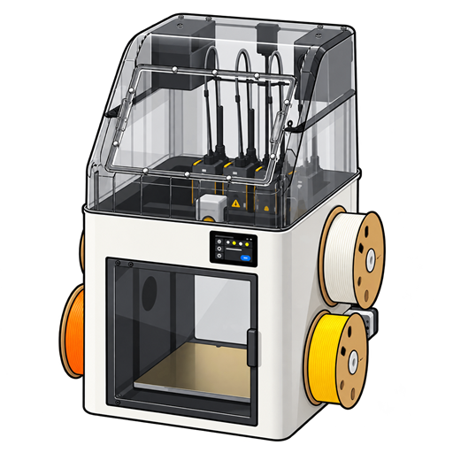

# ioBroker.snapmaker-u1

Deutsche Dokumentation: [README-German.md](/#/docs/adapterref/iobroker.snapmaker-u1/README-German.md) .

Ein ioBroker-Adapter zur Überwachung eines [Snapmaker U1](https://www.snapmaker.com/) über seinen lokalen Moonraker-Dienst, mit Lüftersteuerung für die obere Abdeckung, AFC/Spoolman-Metadaten, Kameraerkennung, Druckvorschau-URLs und geschützten PAXX12-Bewegungs-, Druck- und optionalen Werkzeugkopfsteuerungen.

> Dies ist eine frühe Entwicklungsversion. Die Steuerelemente der Versionen 0.0.3/0.0.4 sind bewusst auf einen explizit ausgewählten **PAXX12** -Firmware-Modus beschränkt. Sie gewährleisten keine Kompatibilität mit der originalen Snapmaker-Firmware, da diese nicht validiert wurde. Verwenden Sie die Druckersteuerung nur, wenn Sie einen sauberen und sicheren Drucker beaufsichtigen.

## Aktuelle Funktionalität

### Kameras und Druckvorschau

Öffnen Sie in den Einstellungen **„Erkennen“ und wählen Sie „Kameras“** , um aktivierte Kameras von Moonraker abzurufen und eine Mehrfachauswahl zu speichern. Speichern Sie zuerst den Druckerhost und lassen Sie den Adapter für die Erkennung aktiv. Es wird kein Netzwerkscan durchgeführt.

Die unten aufgeführten Kameras sind als Auswahl dargestellt. `cameras.<namespace-safe ID derived from the Moonraker UID>` Mit Name, Aktivierungsflag, Stream-URL, Snapshot-URL, Dienst, Rotations- und Spiegelungseinstellungen. Der Adapter liest lediglich die Kamerakonfiguration; er öffnet keine kontinuierlichen Videostreams und gibt nicht an, dass eine Kamera erreichbar ist. WebRTC erfordert einen kompatiblen Viewer. Frühere Kameraobjekte bleiben nach der Abwahl erhalten, werden aber nicht mehr aktualisiert.

`printer.job.previewUrl` Enthält die größte eingebettete Miniaturansicht der aktuellen G-Code-Datei. Diese wird gelöscht, wenn keine Datei ausgewählt oder die Vorschau deaktiviert ist. Dieselbe Dateimetadatenanfrage liefert die Slicer-Schätzung, die Restdauerprognose und die geschätzte Fertigstellungszeit; diese Werte bleiben auch bei deaktivierter Druckvorschau verfügbar. Kamera-/Miniaturansichtsfehler werden auf Debug-Ebene protokolliert und führen nicht zu einer Trennung des Druckers. Kamera-URLs müssen vom Browser, der sie anzeigt, erreichbar sein. Kameraerkennung, Einstellungen und Datenpunkte wurden in einer installierten ioBroker-Instanz mit PAXX12 getestet. Ein konfigurierter Kameraeintrag ist kein Beweis für einen erreichbaren Stream.

Steuerung des Lüfters an der Oberseite: Geben Sie einen numerischen Prozentsatz an (0–100, `ack=false`) Zu `printer.cover.circulation.speed` oder `printer.cover.exhaust.speed` Befehle werden serialisiert und durch eine nachfolgende Druckerstatusabfrage bestätigt. Beide Lüfter wurden im Live-Test mit einer Änderung der Lüfterdrehzahl um fünf Prozentpunkte getestet und anschließend wiederhergestellt. Die Firmware-Automatisierung kann die Lüfterdrehzahlen später anpassen. Ungültige Werte werden verworfen.

Aktivieren Sie **die Spoolman-Integration** , um Material, Filamentname, Farbe, Spool-ID, Ladestatus und Rohdaten für die AFC-Spuren 0–3 sowie die aktuelle AFC-Spur und das Fehlerflag auszulesen. Der Spoolman-Verbindungsstatus und die aktive Spool-ID von Moonraker werden unter folgendem Pfad angezeigt: `printer.spoolman` Diese Werte werden über Moonraker ausgelesen; es ist keine direkte Spoolman-Verbindung konfiguriert. Dieser Adapter erstellt keine Spool-Zuweisungen oder Verbrauchsberichte.

Die Abfrage des schreibgeschützten Status wurde auf PAXX12 verifiziert. `2.0.0-paxx12-24`:

- `printer.job`: Status, Dateiname, verstrichene Druckdauer (Sekunden), verbrauchtes Filament (mm), Fortschritt (Prozent) und Pausenflag.
- `printer.job`: Slicer-Name/Version, Slicer-Schätzung, berechnete Restdauer, geschätzter Fertigstellungszeitpunkt, Ebenen, Meldungen, Dateifortschritt und Name der zuletzt abgeschlossenen Datei, wobei Moonraker die zugrunde liegenden Werte bereitstellt.
- `printer.tools.active`: Name des aktiven Extruders.
- `printer.tools.tool0` durch `tool3`: Ist-Temperatur, Soll-Temperatur, Heizleistung, Druckvorschub, Glättungszeit und Werkzeugstatus.
- `printer.bed`: Ist- und Solltemperatur plus Heizleistung.
- `printer.chamber.temperature` Kammertemperatur.
- `printer.fans.*` Und `printer.sensors.*` Dynamisch ermittelte, schreibgeschützte Lüfter-/Drehzahl- und Temperaturdaten. Vorhandene benannte Lüfterabdeckungszustände bleiben unverändert.

Die Überwachungszustände sind schreibgeschützt. Die beiden Lüfterdrehzahlzustände und die unten beschriebenen geschützten PAXX12-Steuerungszustände sind beschreibbar. Fehlende oder ungültige Werte werden übersprungen. Der Besitzer hat Version 0.0.2 in ioBroker getestet, einschließlich Live-Druckerdaten, Kameras, AFC/Spoolman-Metadaten und Wiederverbindung nach einem Stromausfall. Die Kompatibilität mit der Original-Firmware ist noch nicht bestätigt.

- Verbindet sich lokal mit Moonraker über einen konfigurierbaren Host und Port (Standard: `7125`).
- Veröffentlicht `info.connection` Drucker-Hostname, Klipper-Softwareversion, Status und das letzte erfolgreiche Update. Die bestehende Status-ID `printer.info.firmware` wird beibehalten.
- Unterstützt die Original-Firmware und PAXX12 als wählbare Konfigurationsmodi; protokollspezifische Funktionen folgen nach der Validierung an realen Geräten.
- Liest AFC- und Spoolman-Metadaten über Moonraker. Ein direkter Zugriff auf das Spoolman-Inventar ist nicht implementiert.

### Bewegungs- und Drucksteuerung (nur PAXX12)

Stellen Sie **den Firmware-Modus** auf **PAXX12-Firmware** ein, um die Steuerungszustände zu aktivieren. `auto` Und `original` Die Modi lehnen absichtlich alle Anfragen für Home, Jog, Pause, Resume und Cancel ab. Dadurch wird vermieden, die Unterstützung der Original-Firmware vor deren physischer Überprüfung zu behaupten.

Jede neue Bewegungs-/Drucksteuerungsanforderung ruft zunächst einen aktuellen Moonraker-Status ab und durchläuft eine zentrale Sicherheitsprüfung. Der Adapter sendet ausschließlich festgelegte, intern generierte Klipper-Befehle; er stellt keinen frei konfigurierbaren G-Code-Zustand bereit.

- Home-Befehle verwenden `G28` oder `G28 X`, `G28 Y`, `G28 Z` und sind nur dann erlaubt, wenn `print_stats.state` Ist `standby`, `complete` oder `cancelled` Die
- Jog-Befehle sind auf **0,1–25 mm** bei **1–100 mm/s** begrenzt. Sie erfordern einen im Leerlauf befindlichen Drucker, eine referenzierte Zielachse, endliche aktuelle Koordinaten und von Moonraker gemeldete Werte. `axis_minimum` /`axis_maximum` Werte, die das Ziel enthalten. Das generierte Skript speichert und stellt den Klipper-G-Code-Status wieder her.
- `Pause` ist nur während des Druckvorgangs zulässig; `Resume` nur während der Pause; und `Cancel` nur während des Druckvorgangs oder im Pausenmodus.
- Befehle werden sequenziell ausgeführt, Tasten werden zurückgesetzt auf `false` Nach der Bearbeitung werden abgelehnte/fehlgeschlagene Anfragen veröffentlicht in `printer.control.lastError` Die

Die Steuerbefehle und ihre Sicherheitsregeln sind unit-getestet, aber die neuen Bewegungs- und Jobsteuerungspfade müssen noch an einem physischen, mit PAXX12 ausgestatteten U1 validiert werden, bevor man sich im täglichen Betrieb auf sie verlassen kann.

### Werkzeugkopfsteuerung (nur PAXX12 + erkannte Funktion)

Version 0.0.4 geht nicht davon aus, dass jeder PAXX12-Drucker dieselben Makros verwendet. Beim Start, in regelmäßigen Abständen und unmittelbar vor jeder Werkzeugkopfanforderung fragt der Adapter Moonraker nach den geladenen Klipper-Objekten. Er liest die von Klipper analysierte Extruderkonfiguration nur, um die sicheren Grenzwerte des angeschlossenen Druckers zu ermitteln. Falls die Erkennung nicht möglich ist, wird der Befehl abgelehnt; es werden niemals erratene Makronamen oder ein freier G-Code-Zustand verwendet.

Die aktuelle PAXX12 AFC Lite-Quelldokumentation `CHANGE_TOOL` Und `LANE_UNLOAD` Makros für die Spuren E0–E3. `CHANGE_TOOL` Der Adapter führt im Rahmen des Werkzeugwechsels eine automatische Ladefunktion durch. Er verwendet ausschließlich diese exakten Makros und nur dann, wenn sowohl das Makro als auch das zugehörige `AFC_lane E0` –`E3` Objekte sind vorhanden. Ein Werkzeugwechsel oder eine Entladung erfordert außerdem einen im Leerlauf befindlichen Drucker und ein bekanntes, fehlerfreies System. `AFC.error_state` Die

- `printer.control.toolhead.change.e0` durch `.e3` Problem behoben `CHANGE_TOOL LANE=E0` durch `E3` Befehl. Dies sind Schaltflächen **zum Ändern und Laden** ; es gibt keinen eigenständig erfundenen Ladebefehl.
- `printer.control.toolhead.unload.e0` durch `.e3` Problem behoben `LANE_UNLOAD LANE=E0` durch `E3` Befehl.
- In Version 0.0.4 ist keine Parktaste verfügbar. Im Quellcode der unterstützten Firmware wurde kein U1/PAXX12-Parkmakro gefunden. `printer.control.toolhead.capabilities.parkToolhead` Überreste `false` anstatt eine abgeleitete Parksequenz zu senden.
- `printer.control.tools.tool0.target` durch `.tool3.target` Setzen Sie sich individuelle Ziele mit Klippers dokumentierten `SET_HEATER_TEMPERATURE` nur wenn dieses Extruderobjekt und seine Laufzeit `max_temp` werden gemeldet. Der Adapter behält eine Fünf-Grad-Marge unterhalb des gemeldeten Grenzwerts bei und schließt eine fehlerhafte Werkzeugkopfkonfiguration PAXX12 mit nahezu Null aus. `max_power` Die
- `printer.control.extrusion.extrude` Und `.retract` Es wird nur der aktuell aktive, erkannte Extruder bewegt. Die Bewegung ist auf **0,1–10 mm** bei **0,1–10 mm/s** begrenzt und erfordert einen im Leerlauf befindlichen Drucker. `can_extrude` Die Temperatur muss mindestens dem vom Extruder gemeldeten Minimum entsprechen (Standardwert bei Klipper: 170 °C). Das generierte Skript verwendet ausschließlich relative Extrusion und stellt den gespeicherten G-Code-Zustand wieder her.

Die Leistungs- und Fehlerdiagnosedaten werden unten veröffentlicht. `printer.control.toolhead`: die erkannten Makronamen, ob `CHANGE_TOOL` /`LANE_UNLOAD` sind nutzbar, aktuelle Befehlsverfügbarkeit, ein lesbarer Grund und die letzte abgelehnte oder fehlgeschlagene Steuerungsanforderung. Vorhandene AFC-Überwachung unter `printer.afc` Der Status von AFC, Spoolman, Kamera, Lüfter oder der Steuerung v0.0.3 bleibt erhalten; es werden keine Status umbenannt oder entfernt. Im PAXX12-Modus wird der AFC-Status für die Werkzeugkopf-Sicherheitsprüfung abgefragt, selbst wenn die optionale direkte Spoolman-Integration deaktiviert ist; es werden keine Spoolman-Daten geschrieben.

Die unterstützten AFC Lite-Makros werden anhand [der PAXX12 AFC Lite-Konfiguration](https://github.com/paxx12-snapmaker-u1/SnapmakerU1-Extended-Firmware/blob/main/overlays/firmware-extended/31-feature-afc-lite/root/usr/local/share/firmware-config/tweaks/klipper/afc.cfg) verifiziert. Die Funktionserkennung erfolgt über die dokumentierte [Druckerobjektliste und die Abfrageendpunkte](https://moonraker.readthedocs.io/en/latest/external_api/printer/) von Moonraker. Zieltemperaturen und das Verhalten des aktiven Extruders werden anhand der Dokumentation von Klipper ermittelt. [`SET_HEATER_TEMPERATURE` und Multi-Extruder-Befehle](https://www.klipper3d.org/G-Codes.html) . Diese Adapterversion enthält Unit-Tests, jedoch keine physische Validierung der Aktionspfade von Version 0.0.4: Überprüfen Sie daher vor dem routinemäßigen Einsatz das Verhalten der Makros auf dem tatsächlichen Drucker.

## Konfiguration

| Einstellung                     | Beschreibung                                                                                      |
| ------------------------------- | ------------------------------------------------------------------------------------------------- |
| Moonraker-Host oder IP-Adresse  | Hostname oder lokale IP-Adresse des Druckers. Nicht angeben. `http://` oder ein Pfad.              |
| Moonraker-Hafen                 | Moonraker HTTP-Port; `7125` standardmäßig.                                                         |
| Firmware-Modus                  | Automatische Erkennung, Original-Firmware oder PAXX12.                                            |
| Zeitüberschreitung der Anfrage  | Maximale Dauer einer Moonraker-Anfrage in Sekunden.                                               |
| Abstimmungsintervall            | Zeit zwischen den Gesundheitschecks in Sekunden.                                                  |
| Spoolman-Integration            | Ermöglicht AFC-Lane- und Spoolman-Statusabfragen über Moonraker.                                  |
| Spoolman-Host und Port          | Für zukünftige direkte Bestandsanfragen reserviert; wird derzeit nicht zur Kommunikation genutzt. |
| Kameras entdecken und auswählen | Liest die aktivierten Moonraker-Kameraeinträge und speichert die ausgewählten Kameras.            |
| Druckvorschau                   | Aktiviert die aktuelle G-Code-Miniaturansichts-URL.                                               |

## Staaten

| Zustand                                                                                               | Typ                          | Bedeutung                                                                                                                             |
| ----------------------------------------------------------------------------------------------------- | ---------------------------- | ------------------------------------------------------------------------------------------------------------------------------------- |
| `info.connection`                                                                                     | boolescher Wert              | Ob der jüngste Moonraker-Gesundheitscheck erfolgreich war.                                                                            |
| `printer.info.hostname`                                                                               | Zeichenkette                 | Vom Server Moonraker gemeldeter Hostname.                                                                                             |
| `printer.info.firmware`                                                                               | Zeichenkette                 | Die vom Druckerinformationsendpunkt von Moonraker zurückgegebene Klipper-Softwareversion.                                             |
| `printer.info.status`                                                                                 | Zeichenkette                 | Druckerstatusmeldung von Moonraker.                                                                                                   |
| `printer.info.klippyState`/`.ready` /`.lastError`                                                     | Zeichenkette/Boolescher Wert | Klipper-Status, Bereitschaft und letzter Verbindungsfehler.                                                                           |
| `printer.info.lastUpdate`                                                                             | Nummer                       | Zeitstempel der letzten erfolgreichen Abfrage.                                                                                        |
| `printer.job.filename`, `.duration`, `.totalDuration`, `.message`, `.displayMessage`                  | Zeichenkette/Zahl            | Aktuelle Datei, verstrichene/Gesamtdauer und Druckermeldungen.                                                                        |
| `printer.job.slicer`, `.slicerVersion`, `.slicerEstimatedDuration`                                    | Zeichenkette/Zahl            | Die Slicer-Metadaten wurden von Moonraker aus der G-Code-Datei extrahiert.                                                            |
| `printer.job.remaining`, `.slicerRemaining`, `.estimatedEnd`, `.estimateAvailable`                    | Zahl/Boolescher Wert         | Live-ETA-Vorhersage in Sekunden und voraussichtlicher Fertigstellungszeitpunkt.                                                       |
| `printer.job.layer.current`, `.total`, `.progress`                                                    | Nummer                       | Aktuelle und Gesamtschichten zuzüglich berechnetem Schichtfortschritt.                                                                |
| `printer.job.filePosition`, `.fileProgress`, `.lastCompletedFile`                                     | Zahl/Zeichenkette            | G-Code-Byte-Position, Dateifortschritt und zuletzt live abgeschlossene Datei.                                                         |
| `printer.motion.position.x`, `.y`, `.z`                                                               | Nummer                       | Aktuelle Werkzeugkopf-Koordinaten, die von Moonraker gemeldet werden, in mm.                                                          |
| `printer.motion.maxVelocity`, `.maxAcceleration`, `.commandedSpeed`, `.speedFactor`, `.flowFactor`    | Nummer                       | Bewegungsbegrenzungen (nur lesbar), zuletzt vorgegebene Geschwindigkeit, Geschwindigkeits- und Durchflussfaktoren.                    |
| `printer.tools.tool0` …`.tool3`                                                                       | Zahl/Zeichenkette            | Beinhaltet, sofern gemeldet, Telemetriedaten zur Heizleistung (nur auslesbar), zum Druckanstieg und zur Zeitglättung.                 |
| `printer.bed.power`                                                                                   | Nummer                       | Heizleistung des Bettes in Prozent (nur lesbar).                                                                                      |
| `printer.fans.*` /`printer.sensors.*`                                                                 | Nummer                       | Dynamisch ermittelte, schreibgeschützte Lüfterdrehzahl- und Temperaturtelemetrie.                                                     |
| `printer.control.home.all`, `.x`, `.y`, `.z`                                                          | Boolescher Button            | Schreiben `true` Alle Achsen oder die ausgewählte Achse in die Ausgangsposition bringen. Zurücksetzen auf `false` Die                   |
| `printer.control.jog.step`                                                                            | Nummer                       | Joggingdistanz in mm (0,1–25).                                                                                                        |
| `printer.control.jog.speed`                                                                           | Nummer                       | Jogginggeschwindigkeit in mm/s (1–100).                                                                                               |
| `printer.control.jog.xPositive`, `.xNegative`, `.yPositive`, `.yNegative`, `.zPositive`, `.zNegative` | Boolescher Button            | Schreiben `true` sich mit der konfigurierten Schrittweite und Geschwindigkeit bewegen. Wird zurückgesetzt auf `false` Die               |
| `printer.control.job.pause`, `.resume`, `.cancel`                                                     | Boolescher Button            | Schreiben `true` Um den aktuellen Druckvorgang zu steuern, sofern der aktuelle Zustand dies zulässt. Wird zurückgesetzt auf `false` Die |
| `printer.control.safety.enabled`                                                                      | boolescher Wert              | `true` nur wenn der PAXX12-Modus explizit ausgewählt wurde.                                                                           |
| `printer.control.safety.homingAllowed`, `.joggingAllowed`, `.jobControlAllowed`                       | boolescher Wert              | Die aktuelle Verfügbarkeit wird anhand des letzten Moonraker-Status angezeigt. Jede Anfrage wird vor dem Absenden erneut geprüft.     |
| `printer.control.safety.reason`                                                                       | Zeichenkette                 | Grund, warum die Steuerung nicht verfügbar ist, oder ein Hinweis darauf, dass einzelne Anfragen erneut geprüft werden.                |
| `printer.control.lastCommand` /`printer.control.lastError`                                            | Zeichenkette                 | Zuletzt akzeptierte Kontrollstatus-ID / Grund für die letzte abgelehnte oder fehlgeschlagene Anfrage.                                 |
| `printer.control.toolhead.change.e0` …`.e3`                                                           | Boolescher Button            | Änderungen und Beladung der ausgewählten AFC-Spur erfolgen nur, wenn die übereinstimmende `CHANGE_TOOL` Die Fähigkeit wurde erkannt.   |
| `printer.control.toolhead.unload.e0` …`.e3`                                                           | Boolescher Button            | Entlädt die ausgewählte AFC-Spur nur, wenn die übereinstimmende `LANE_UNLOAD` Die Fähigkeit wurde erkannt.                             |
| `printer.control.tools.tool0.target` …`.tool3.target`                                                 | Nummer                       | Angefordertes Ziel für einen Extruder; die Laufzeit-Klipper-Grenzwerte werden vor dem Senden überprüft.                               |
| `printer.control.extrusion.distance` /`.speed`                                                        | Nummer                       | Manuelle Extrusionsmenge (0,1–10 mm) / Geschwindigkeit (0,1–10 mm/s).                                                                 |
| `printer.control.extrusion.extrude` /`.retract`                                                       | Boolescher Button            | Das aktive Heißwerkzeug wird manuell extrudiert oder eingezogen, nachdem alle Sicherheitsprüfungen erfolgreich bestanden wurden.      |
| `printer.control.toolhead.capabilities.*`                                                             | boolescher Wert/Zeichenkette | Makros erkannt und optionale Aktionen unterstützt; Parkplätze überprüft `false` in Version 0.0.4.                                      |
| `printer.control.toolhead.safety.*` /`.diagnostics.*`                                                 | boolescher Wert/Zeichenkette | Aktuelle Befehlsverfügbarkeit, Diagnosegrund und zuletzt fehlgeschlagene/abgelehnte Werkzeugkopfanforderung.                          |

## Entwicklung

Erfordert Node.js 22.19.0 oder neuer und ioBroker Admin 7.6.20 oder neuer. CI deckt Node.js 22, 24 und 26 ab.

```bash
npm ci
npm run check
npm test
npm run lint
npm run build
```

Das Repository wurde mit dem offiziellen[`@iobroker/create-adapter`](https://github.com/ioBroker/create-adapter) Tools und verwendet TypeScript, JSON Config, Adaptertests und GitHub Actions.

## Veröffentlichungen

Ein Versions-Tag wird nur akzeptiert, wenn es mit der Version in übereinstimmt. `package.json` und verweist auf einen Commit am `main` Nachdem alle CI-Prüfungen erfolgreich waren:

- ein stabiles Tag wie z.B. `v0.0.4` wird auf npm veröffentlicht als `latest` Anschließend wird ein normales GitHub-Release erstellt;
- ein Vorab-Release-Tag wie zum Beispiel `v0.0.5-beta.1` wird auf npm veröffentlicht als `next` Anschließend wird eine GitHub-Vorabversion erstellt.

Dadurch bleiben die **neueste** GitHub-Version und die npm-Versionen erhalten. `latest` Die Tags werden angepasst. Bereits vor dieser Automatisierung veröffentlichte Versionen werden nicht rückwirkend geändert.

## Roadmap

1. Validieren Sie den Werkzeugwechsel, die Bahnenentladung, die Temperatur und die manuellen Extrusionspfade der Version 0.0.4 auf einem physischen PAXX12 U1 und dokumentieren Sie anschließend die getestete Firmware/Makro-Kombination.
2. Fügen Sie eine Parksteuerung erst hinzu, nachdem ein U1/PAXX12-Parkmakro und seine sicheren Vorbedingungen dokumentiert und physisch validiert wurden.
3. Überprüfen Sie die Nutzlasten und Fähigkeiten von Moonraker auf einem physischen U1 mit Original-Firmware, bevor Sie irgendeine Steuerung dafür aktivieren.
4. Automatisierte Tests für Druck-, Material- und Mediendaten ausweiten.
5. Überprüfen Sie das Herunterfahren und den Neustart im Kompaktmodus.
6. Fügen Sie bei Bedarf direkten Spoolman-Inventarzugriff hinzu.

## Haftungsausschluss

Snapmaker und U1 sind Marken ihrer jeweiligen Inhaber. Dies ist ein unabhängiges Community-Projekt und steht in keiner Verbindung zu Snapmaker und wird von Snapmaker auch nicht unterstützt.

## Changelog

### 0.0.13 (2026-11-20)

- (Negalein) Align state roles with the ioBroker role model and add an optional help message for AI agents and script authors.

### 0.0.12 (2026-11-15)

- (Negalein) Use the official ioBroker release workflow and keep the seven newest published release notes.

### 0.0.11 (2026-11-15)

- (Negalein) Fix the invalid acceleration state role and migrate existing installations.

### 0.0.10 (2026-11-15)

- (Negalein) Restore the tested tag-to-npm-to-GitHub-release workflow and publish the corrected documentation package.

### 0.0.9 (2026-11-15)

- (Negalein) Restore the English main README and add a separate German README.

### 0.0.8 (2026-11-15)

- (Negalein) Add the separate German README for GitHub and npm.

### 0.0.7 (2026-11-15)

- (Negalein) Publish the complete compiled adapter bundle for the ETA and diagnostic telemetry update.

Older entries are available in CHANGELOG_OLD.md.

## License

Copyright (c) 2026 Negalein <negalein@gmail.com>

Licensed under the [MIT License](https://github.com/Negalein/ioBroker.snapmaker-u1/blob/main/LICENSE).