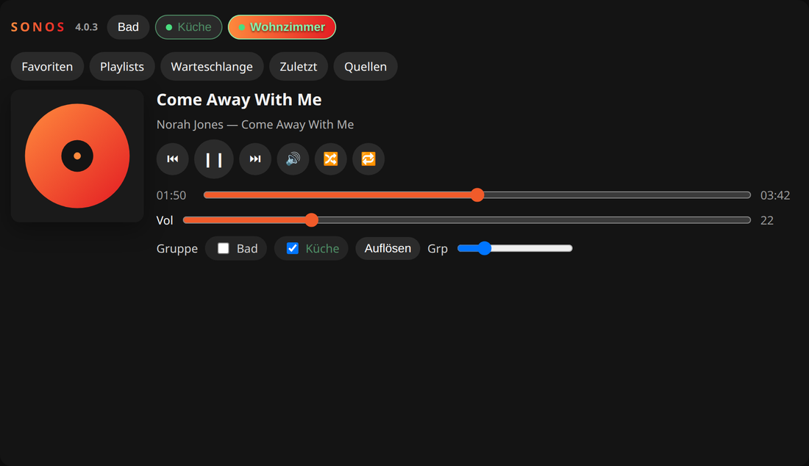
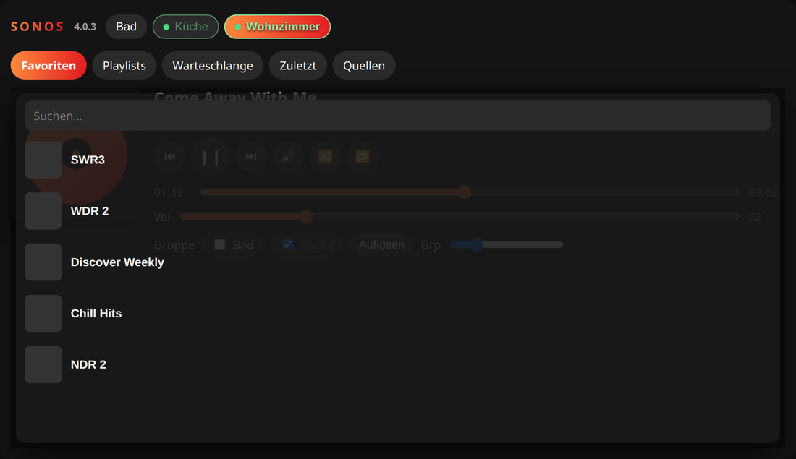
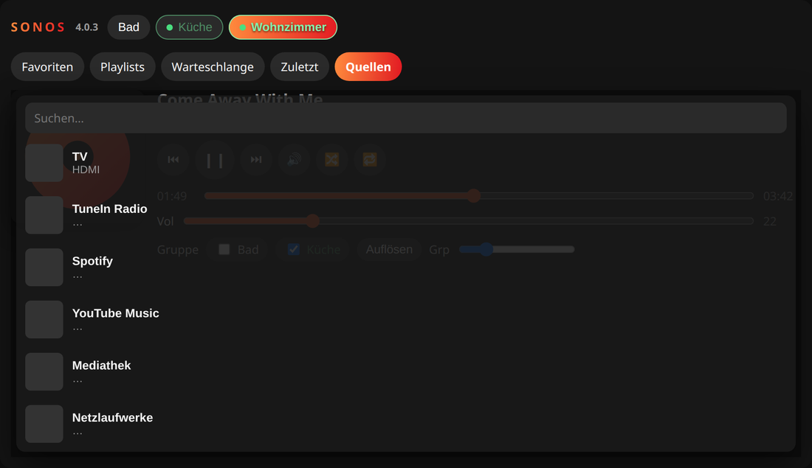
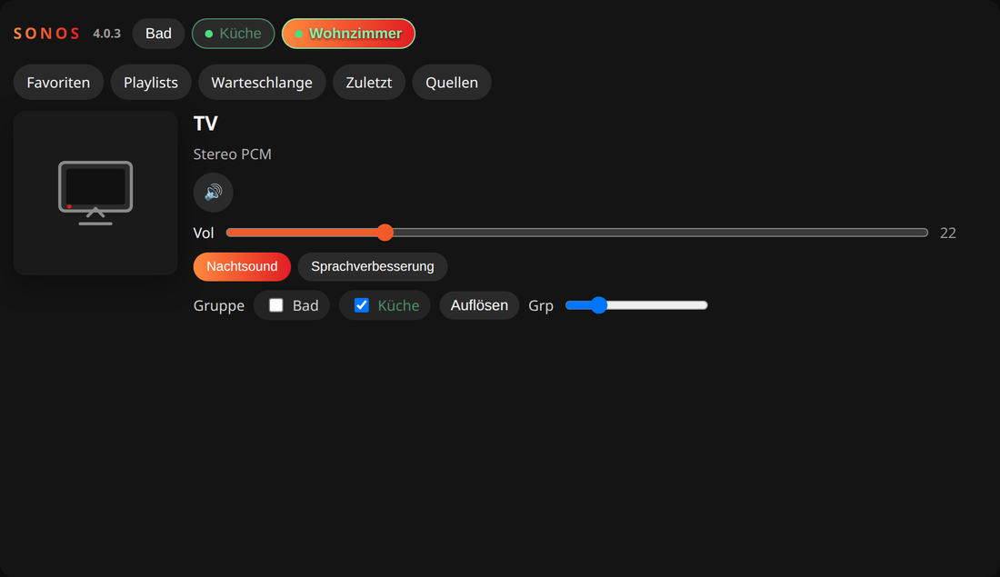

# ioBroker.sonos

SONOS-Geräte mit ioBroker steuern und überwachen.

## Widgets

Der Adapter liefert ein Widget für beide Visualisierungsadapter. Beide werden mit dem Adapter installiert; **vis** und **vis-2** werden automatisch neu gestartet, der Editor muss jedoch manuell neu geladen werden (Strg+F5).

**Sonos Control** schaltet zwischen Räumen um, steuert die Wiedergabe, erstellt Gruppen und startet Favoriten, Wiedergabelisten, Titel in der Warteschlange, zuletzt gehörte Titel und Quellen. Binden Sie es an eine _Instanz_ , zum Beispiel `sonos.0` - nicht auf einen einzelnen Staat wie z.B. `play` Das Widget erkennt selbstständig alle Sprecher dieser Instanz.

Jeder gefundene Lautsprecher wird oben als Symbol angezeigt. Die Gruppenzugehörigkeit wird über die Kontrollkästchen aktiviert/deaktiviert. Gehört ein Raum zu einer Gruppe, wird im Wiedergabebereich der Titel der Gruppe angezeigt, nicht der letzte lokale Titel dieses Raums. Die Bibliotheksschaltflächen ( **Favoriten** , **Wiedergabelisten** , **Warteschlange** , **Zuletzt gehört** , **Quellen** ) öffnen darunter ein Fenster. Unter **„Zuletzt gehört** “ werden die letzten Titel des ausgewählten Raums angezeigt.



_Räume, Gruppierung und aktuelle Wiedergabe_



_Die Bibliotheksknöpfe öffnen ein Blatt unterhalb der Räume._



_Quellen: TuneIn, die Musikbibliothek, Netzwerkfreigaben, Line-In und HDMI-Anschluss des Fernsehers_



_TV HDMI: Titel, TV-Format, Stummschaltung, Nachtmodus, Ton- und Sprachverbesserung_

### vis-2 und vis 1

Es gibt zwei Implementierungen von **Sonos Control** unter derselben Template-ID. `tplSonosControl`: eine React-Version für vis-2 (`src-widgets`) und die ursprüngliche jQuery-Version für vis 1 (`widgets/sonos.html`).

Jeder Editor zeigt immer nur eines davon an. Denn der Adapter deklariert `common.visWidgets`, vis-2 Skips `widgets/sonos.html` vollständig und lädt das React-Widget; vis 1 kennt keine React-Widget-Sets und lädt stattdessen das jQuery-Widget. Ansichten, die mit dem vis-1-Widget erstellt wurden, behalten ihre `oid` Bindung, wenn sie in vis-2 geöffnet werden.

vis-2 bietet zusätzlich **Sonos Room** , einen Lautsprecher als kompakte Karte mit Cover, Titel, Transport- und Lautstärkeregelung. Die letzte Taste öffnet die gleiche Quellenauswahl in einem Dialog, sodass eine einzelne Karte auch einen Favoriten, eine Playlist oder eine Quelle starten kann. Es gibt kein vis-1-Pendant.

In vis-2 kann jeder Teil der Sonos-Steuerung (Räume, Gruppen, Lautstärke, Bibliothek) deaktiviert werden, und das Widget kann in einem bestimmten Raum gestartet werden.

### Quellen

**Die Quellensuche** durchsucht TuneIn Radio, die Musikbibliothek, Netzwerkfreigaben und Line-In über das Inhaltsverzeichnis des Lautsprechers. Musikdienste werden nur angezeigt, wenn sie vom Haushalt gemeldet werden. Dienste mit einem SMAPI-Katalog (z. B. Spotify) können nach einmaliger Anmeldung durchsucht werden. Dienste ohne solchen Katalog zeigen nur die in der Sonos App als Favoriten oder Playlist gespeicherten Titel an.

**Das TV-Signal** wird nur auf Lautsprechern wiedergegeben, die über einen HDMI- oder optischen Eingang verfügen (Arc, Beam, Playbar, Playbase, Ray, Amp). Über den TV-Eingang stehen keine Transportsteuerungen zur Verfügung – Wiedergabe, Pause, Suche, nächster und vorheriger Titel sind nicht möglich; Stummschaltung, Nachtmodus und Sprachverbesserung hingegen schon.

## Widgets für ioBroker.devices

Neben den vis-Widgets liefert der Adapter zwei Widgets für das Dashboard des **ioBroker.devices** -Adapters. Diese werden dort mit **+ → SONOS Player** / **SONOS Rooms** hinzugefügt, und jedes Widget verfügt über einen eigenen Einstellungsdialog – es muss kein Status manuell ausgewählt werden.

**Der SONOS Player** ist ein einzelner Lautsprecher. In den Einstellungen werden die Instanz und der Lautsprecher abgefragt; die Lautsprecherliste stammt vom Adapter selbst und stimmt daher immer mit den Geräten auf der Registerkarte _„SONOS-Geräte“_ überein.

| Größe    | Was gezeigt wird                                                                                           |
| -------- | ---------------------------------------------------------------------------------------------------------- |
| 1x1      | Das Cover als Hintergrund, der Sprecher, Titel, Künstler, Wiedergabestatus und der Fortschritt             |
| 2x0,5    | Ein Streifen: Titelbild auf dem verschwommenen Cover, Sprecher, Titel, Künstler, Fortschritt               |
| 2x1, 2x2 | Das große Cover zeigt den Lautsprecher und den Wiedergabestatus, Titel, Interpret und Fortschrittsanzeige. |

Die Kacheln sind wie der Mediaplayer von ioBroker.devices aufgebaut: Ein Klick öffnet den vollständigen Player als Dialog – Cover, Titel, Interpret und Album, der Fortschrittsregler zum Springen innerhalb des Titels, vorheriger/Wiedergabe-Pause/nächster Titel, Zufallswiedergabe, Wiederholung (aus → alle → ein Titel), Stummschaltung, Lautstärke und die Quellenauswahl.

Cover, Fortschrittsanzeige, Lautstärke, Zufallswiedergabe/Wiederholung und die Quellenauswahl können einzeln deaktiviert werden. Bei einem Lautsprecher, der den TV-Eingang wiedergibt, sind die Transporttasten und die Fortschrittsanzeige ausgeblendet, da der HDMI-Eingang nicht gesteuert werden kann – Stummschaltung, Lautstärke und Quellenauswahl bleiben erhalten.

Über die Schaltfläche „Quelle“ wird dieselbe Auswahl wie im vis-Widget angezeigt – Favoriten, Wiedergabelisten, die Warteschlange, zuletzt gespielte Titel und die durchsuchbaren Quellen des Sprechers – als zweiter Dialog über dem Player geöffnet.

**SONOS Rooms** visualisiert den gesamten Haushalt in einem Widget: Anzahl der Lautsprecher, Musikwiedergabe und Lautstärke. Die kleinen Widgets zeigen den Zähler und öffnen die Liste in einem Dialog; 2x1 und 2x2 zeigen die Liste direkt an.

Jede Zeile verfügt außerdem über eine Quellenauswahltaste, die die Quellenauswahl für den jeweiligen Lautsprecher öffnet, sodass ein Favorit oder eine Wiedergabeliste gestartet werden kann, ohne die Übersicht zu verlassen.

Es bildet außerdem Gruppen: Durch Klicken auf die Verknüpfungsschaltfläche eines Sprechers wird dieser als Gruppenmaster festgelegt, und durch Klicken auf die Verknüpfungsschaltfläche jedes anderen Sprechers wird dieser der Gruppe hinzugefügt oder wieder entfernt. Ein zweites Klicken auf den Master beendet diesen Modus.

## Webkomponenten

Die gleichen beiden Widgets – und die Registerkarte „Steuerung“ der Instanzeinstellungen – existieren auch als Webkomponenten für jeden Host, der dies unterstützt.[`@iobroker/web-components`](https://github.com/ioBroker/web-components) - Aura, vis-2, ioBroker.devices, admin. Der Adapter listet sie auf in `common.webComponents` Jedes dieser Module ist ein einzelnes ES-Modul mit einem zugehörigen Manifest. `admin/webcomponents/` React kommt vom Host, die Komponente selbst kommuniziert nur mit dem Socket des Hosts – im Adapter muss dafür nichts ausgeführt werden.

| Element               | Name                  | Was es zeigt                                                                                                                                                                                                         |
| --------------------- | --------------------- | -------------------------------------------------------------------------------------------------------------------------------------------------------------------------------------------------------------------- |
| `<iob-sonos-player>`  | SONOS-Player          | Ein Lautsprecher: Cover, Titel, Interpret, Fortschritt, vorheriger/Wiedergabe/Pause/nächster Titel, Zufallswiedergabe, Wiederholung, Stummschaltung, Lautstärke und Quellenauswahl                                   |
| `<iob-sonos-rooms>`   | SONOS-Räume           | Jeder Lautsprecher einer Instanz: Was er abspielt, Wiedergabe/Pause, Lautstärke, Quellenauswahl und Gruppierung mit den Verknüpfungsschaltflächen, wie im Geräte-Widget.                                             |
| `<iob-sonos-control>` | SONOS-Kontrollzentrum | Die Registerkarte „Steuerung“ der Instanzeinstellungen als Dashboard: Alle Lautsprecher mit den von ihnen abgespielten Titeln sowie für den ausgewählten Lautsprecher der Player, seine Gruppe und seine Bibliothek. |

**Der SONOS-Player** ist mit dem Kanal des Lautsprechers konfiguriert (`sonos.0.root.<speaker>` Die Instanz stammt von diesem Gerät – und ein optionaler Titel. Cover, Fortschrittsanzeige, Zufallswiedergabe/Wiederholung, Lautstärke und die Quellenauswahl können deaktiviert werden. Zwei optionale Zeilen des vis-2-Players lassen sich aktivieren: die Chips zum Umschalten auf einen anderen Lautsprecher der Instanz und die Gruppenumschalter. Der Player passt sich der Größe seiner Verpackung an: Nicht benötigte Teile werden weggelassen, bis auf eine Leiste mit Lautsprecher, Titel, Wiedergabetaste und einer Taste zum Öffnen des gesamten Players in einem Dialogfenster. Am TV-Eingang einer Soundbar werden anstelle der Transportoptionen Nachtton und Sprachverbesserung angezeigt.

**SONOS Rooms** wird mit der Instanz konfiguriert. Lautstärke, Quellenauswahl und Gruppierung können deaktiviert und nicht erreichbare Lautsprecher ausgeblendet werden. Ein kleines Feld zeigt lediglich die Anzahl der aktuell wiedergebenden Lautsprecher an; ein Klick öffnet die Liste in einem Dialogfeld.

**Das SONOS Control Center** wird mit der ausgewählten Instanz und optional dem zuerst ausgewählten Lautsprecher konfiguriert. Links werden alle Lautsprecher mit ihren Wiedergaben aufgelistet; rechts werden der Player des ausgewählten Lautsprechers (Cover, Titel, Fortschritt, Transport, Lautstärke), seine Gruppe (Lautsprecher hinzufügen und entfernen, Gruppenlautstärke) und seine Bibliothek angezeigt – Favoriten, Wiedergabelisten, Warteschlange, zuletzt gespielte Titel sowie die verfügbaren Quellen und Musikdienste. Die Lautsprecherliste, die Gruppe und die Bibliothek können ausgeblendet werden. In einem schmalen Feld werden die Lautsprecher als Schaltflächenleiste am oberen Rand angezeigt, und in einem schmalen oder unteren Feld werden Player, Gruppe und Bibliothek nacheinander per Tabulator ausgewählt. Wenn die Instanz gestoppt ist, wird dies angezeigt.

Alle haben eine Akzentfarbe; alles andere ergibt sich aus dem Thema des Gastgebers, hell oder dunkel.

## Registerkarte „Steuerung“ im Adminbereich

Die Instanzeinstellungen verfügen über einen dritten Tab, **„Steuerung“** . Es handelt sich um denselben Player wie in der visuellen Ansicht, jedoch innerhalb der Administrationsoberfläche: Wählen Sie links einen Lautsprecher aus und steuern Sie ihn rechts – Wiedergabe, Fortschritt, Lautstärke, Gruppierung und die Bibliothek mit Favoriten, Wiedergabelisten, Warteschlange, zuletzt gespielten Titeln und Quellen.

Dies dient der Überprüfung, ob ein neu hinzugefügter Lautsprecher tatsächlich antwortet, ohne die Adapterkonfiguration zu verlassen. Der Tab kommuniziert mit der laufenden Instanz und bleibt daher leer, solange die Instanz gestoppt ist.

Die gleiche Ansicht ist für Dashboards wie für die Webkomponente **SONOS Control Center** verfügbar (`<iob-sonos-control>` (siehe [Webkomponenten](#web-components) ).

## Steuerseite im Browser

Der Adapter liefert eine Steuerungsseite für den **Webadapter** mit. Diese ist erreichbar unter

```
http://<ioBroker>:8082/sonos/
```

und bietet die gleichen Funktionen wie das Vis-Widget: die Raum-Chips, die aktuell abgespielte Musik mit Cover, Transport, Fortschritt, Lautstärke, die Gruppierungs-Kontrollkästchen und die Quellenauswahl mit Favoriten, Wiedergabelisten, Warteschlange, zuletzt abgespielten Titeln und den durchsuchbaren Quellen des Lautsprechers.

Es wird keine Web-Erweiterung verwendet. `iobroker upload sonos` setzt die `www/` Der Adapter speichert den Ordner im ioBroker-Dateispeicher, und der Webadapter stellt die Datei von dort bereit – seine Catch-All-Route liest den ersten Pfadabschnitt der URL als Adapternamen. Dies ist derselbe Mechanismus, den der Adapter bereits verwendet, um eine TTS-Datei an einen Sprecher zu übergeben.

Die Seite kommuniziert über den Socket der Webinstanz, die sie bereitstellt, mit ioBroker und übernimmt daher deren Authentifizierung und Benutzerrechte. Der Socket-Client ist nicht im Lieferumfang enthalten: Die Seite fragt den Webadapter danach. `socket.io.js` und ruft ab, was diese Instanz verwendet – socket.io oder `@iobroker/ws` Die

`?instance=sonos.1` Heft die Seite an eine Instanz an, `?room=Kitchen` öffnet die Seite auf einem bestimmten Lautsprecher. Sind diese nicht vorhanden, greift die Seite auf die zuletzt verwendete Instanz und den zuletzt verwendeten Lautsprecher zurück, die beide im Browser gespeichert sind; erst wenn noch nichts gespeichert ist, öffnet sie die erste Instanz und deren ersten Lautsprecher.

Im Adminbereich erscheint die Seite auch als Kachel in der Übersicht, neben den Kacheln der anderen Adapter.

## Umgang mit Gruppen

- Bundesstaaten für die Verwaltung von SONOS-Gruppen:
  - ** `coordinator` ** : Den Koordinator festlegen/abrufen, also das SONOS-Gerät, das als Master fungiert und die Gruppe koordiniert. Hierfür wird die IP-Adresse (der Kanalname) des SONOS-Geräts benötigt, das als Koordinator fungieren soll, jedoch mit einem Unterstrich. `_` statt Punkt `.` Verwenden Sie beispielsweise `192_168_0_100` für IP-Adresse `192.168.0.100` Wenn das Gerät keiner Gruppe angehört, entspricht der Wert dem eigenen Kanalnamen (IP-Adresse).
  - ** `group_volume` ** : das Volumen der Gruppe
  - ** `group_muted` ** : Stummschaltungsstatus der Gruppe.
  - ** `add_to_group` ** Fügen Sie dem SONOS-Gerät, unter dem dieser Status angezeigt wird, ein bestimmtes SONOS-Gerät hinzu. Verwenden Sie die IP-Adresse mit Unterstrichen (siehe oben).
  - ** `remove_from_group` **&#x45;ntfernen Sie ein bestimmtes SONOS-Gerät aus dem SONOS-Gerät, unter dem dieser Status registriert ist. Verwenden Sie die IP-Adresse mit Unterstrichen (siehe oben).

\*) Diese Statusangaben werden aktualisiert, wenn Änderungen in der SONOS-App vorgenommen werden.

## Stereopaare

Zwei in der SONOS App mit einem Raum gekoppelte Lautsprecher – einer spielt links, der andere rechts – werden nur über einen der beiden gesteuert, der andere wird von SONOS ausgeblendet. Jeder Kanal zeigt an, ob sein Lautsprecher zu einem Paar gehört.

- ** `pair_role` ** : `left` oder `right` für einen Lautsprecher eines Stereopaares, ansonsten leer
- ** `pair_partner` ** : der andere Sprecher des Paares, als IP-Adresse mit Unterstrichen wie `coordinator` z.B. `192_168_1_21`

Der Kanal eines gekoppelten Lautsprechers erhält im Objektbaum eine Beschreibung, die seinen Partner benennt und angibt, welcher der beiden das Paar steuert. Der ausgeblendete Lautsprecher meldet keine Wiedergabe und keine Lautstärkeregelung und nimmt keine Befehle entgegen: Verwenden Sie den Kanal seines Partners. Er benötigt keinen eigenen Kanal; falls er einen besitzt, nur `alive` und was zum Gerät selbst gehört -`led`, `button_lock`, die Batterie - funktionieren Sie dort.

## Batterie

Lautsprecher mit Akku – Move und Roam – erhalten zwei weitere Statusmeldungen, sobald sie diese melden:

- ** `battery_level` ** : die Gebühr in Prozent
- ** `battery_charging` ** : `true` während sich der Lautsprecher auf seiner Ladestation befindet oder an eine USB-Stromversorgung angeschlossen ist

Der Batteriestand wird alle 5 Minuten ausgelesen. Ein Lautsprecher im Ruhemodus behält seine letzten Werte bei. `alive` zeigt an, ob sie aktuell sind. Nur die S2-Firmware meldet den Akku auf diese Weise.

## Status-LED, Tastensperre und Sleep-Timer

- ** `led` ** : Schaltet die Status-LED des Lautsprechers ein oder aus
- ** `button_lock` ** : `true` Sperrt die Tasten am Lautsprecher
- ** `sleep_timer` ** : Minuten bis zum Ende der Spielzeit der Gruppe. Geben Sie die Minuten an, um den Sleep-Timer einzustellen. `0` Um es zu stornieren. Es gehört zur Gruppe, daher wird bei allen Sprechern der Gruppe die gleiche Zeit angezeigt, und wenn man es bei einem von ihnen einträgt, wird es für die gesamte Gruppe festgelegt.

`led` Und `button_lock` Sie werden erstellt, sobald ein Gerät sie meldet, daher erhält ein Gerät ohne Tasten keine `button_lock` Sie werden alle 5 Minuten vorgelesen. `sleep_timer` jede Minute.

Ein Boost oder eine Bridge ist kein Player, daher wird er/sie von der Suche nicht gefunden. Um die Status-LED zu aktivieren, fügen Sie die IP-Adresse in den Einstellungen zu den Geräten hinzu; `led` erscheint dann unter seinem Kanal.

## Alarm

Die Alarme der SONOS-App sind unter `sonos.0.alarms`, ein Kanal pro Alarm, benannt nach der von SONOS vergebenen ID, z. B. `sonos.0.alarms.17` Änderungen, die in der SONOS-App vorgenommen werden, werden innerhalb einer Minute angezeigt.

Jeder Alarm hat diese Zustände, alle bis auf `next_start` kann geschrieben werden:

- ** `enabled` ** : Schaltet den Alarm ein oder aus
- ** `time` ** : Startzeit als `hh:mm`, in der Ortszeit des SONOS-Haushalts
- ** `recurrence` ** : `ONCE`, `DAILY`, `WEEKDAYS`, `WEEKENDS` oder `ON_` gefolgt von den Tagen, wobei 0 für Sonntag steht: `ON_135` Ringe am Montag, Mittwoch und Freitag
- ** `duration` ** : wie lange der Alarm ertönt, `hh:mm`
- ** `volume` ** : 0 bis 100
- ** `room` ** Der Raum, aus dem der Alarm ertönt; geben Sie den Namen oder die IP-Adresse eines anderen Lautsprechers ein, um den Alarm dorthin zu verschieben.
- ** `source` ** : Was der Wecker abspielt; geben Sie den Titel eines SONOS-Favoriten, eine URI oder ein `SONOS Chime`
- ** `play_mode` ** : `NORMAL`, `REPEAT_ALL`, `SHUFFLE_NOREPEAT` oder `SHUFFLE` (mischen und wiederholen)
- ** `include_grouped` ** Die mit dem Raum gruppierten Räume spielen ebenfalls den Alarm ab.
- ** `next_start` ** : wenn der Alarm das nächste Mal klingelt, als Zeitstempel in Millisekunden; `null` während es deaktiviert ist
- ** `delete` ** : Löscht den Alarm

Um einen Alarm zu erstellen, schreiben Sie JSON an `sonos.0.alarms.create`. Nur `room` Und `time` sind erforderlich, die anderen Einstellungen sind wie die oben genannten Zustände benannt:

```json
{"room": "Bedroom", "time": "06:45", "recurrence": "WEEKDAYS", "volume": 15, "source": "Radio Bob"}
```

Die nicht ausgewählten Einstellungen beginnen mit „täglich“, „für eine Stunde“ und dem SONOS-Gong in Lautstärke 20.

Jeder Lautsprecher hat außerde&#x6D;** `alarm_next` ** Wenn der nächste aktivierte Alarm im Zimmer ertönt. Ein Skript kann dies beispielsweise nutzen, um zehn Minuten vor dem Beginn der Musik ein Wecklicht einzuschalten:

```js
let timer;
on({ id: 'sonos.0.root.192_168_1_50.alarm_next' }, obj => {
    clearTimeout(timer);
    if (obj.state.val) {
        timer = setTimeout(() => setState('hue.0.Bedroom.on', true), obj.state.val - 10 * 60000 - Date.now());
    }
});
```

`next_start` Und `alarm_next` werden in der Zeitzone des ioBroker-Hosts berechnet, die mit der Zeitzone des SONOS-Haushalts übereinstimmen muss.

## Für KI-Agenten

`sendTo('sonos.0', 'help', {})` Antworten `{ help: '...', commands: [{ command, write }] }`: ein Text für einen KI-Agenten (z. B. ioBroker.pi-agent oder den MCP-Server mit `send_to`) das die Sprecher und ihre Zustände, Gruppen, Favoriten und Wiedergabelisten beschreibt, das Durchsuchen der Musikbibliothek und der Musikdienste mit `media_browse` Und `media_play` Ankündigungen, Alarme und Meldungen sowie das weitere Vorgehen (Räume statt Kanäle, Änderungen nur auf Anfrage, Ergebnis überprüfen). `commands` listet die Nachrichten auf, `write: true` für diejenigen, die etwas verändern (`send` Eine unbekannte Nachricht antwortet `{ error, commands }` mit der Liste aller Nachrichten; bevor es mit der Nachricht selbst antwortete.

## Verwendung mit dem sayIt-Adapter

Um den [Sayit-Adapter](https://github.com/ioBroker/ioBroker.sayit) mit diesem SONOS-Adapter zu verwenden, stellen Sie sicher, dass der [Web-Adapter](https://github.com/ioBroker/ioBroker.web) ebenfalls instanziiert ist und ausgeführt wird. Der Web-Adapter ist erforderlich, damit der SONOS-Adapter die vom Sayit-Adapter generierte MP3-Datei lesen kann.

sayIt schreibt die URL der MP3-Datei an `sonos.X.root.<speaker>.tts` Die Lautsprecher laden die Datei vom Webadapter. Daher müssen die Lautsprecher diese URL erreichen können: Der Webadapter darf keine Authentifizierung erfordern, und die Adresse in der URL muss die des ioBroker-Hosts in Ihrem Netzwerk sein.

Kann der Lautsprecher eine Datei nicht abspielen – weil er die URL nicht laden kann oder das Format nicht unterstützt –, protokolliert der Adapter den Fehler, stellt die Lautstärke und Wiedergabe wieder her und fährt mit der nächsten Ansage fort. Ältere Versionen ließen die Lautstärke auf 0 und spielten keine Ansagen mehr ab, bis der Adapter neu gestartet wurde.

## Favoriten & Warteschlange in VIS

Nutzungszustände `favorites_list_html` Und `queue_html` Mit einem einfachen HTML-Widget in VIS lassen sich Wiedergabelisten und die aktuelle Wiedergabeliste anzeigen. Durch Klicken auf eine Zeile wird die entsprechende Wiedergabeliste oder der Titel sofort abgespielt.

Schreiben `favorites_set` oder `playlist_set` Startet die Favoriten- oder Wiedergabeliste. Festlege&#x6E;** `autoplay` ** des Sprechers zu `false` nur laden, ohne die Wiedergabe zu starten (Standardeinstellung) `true`).

Für eine eigene Benutzeroberfläche sind dieselben Listen als JSON verfügbar: `favorites_list_array`, `playlist_list_array` Und `queue_array` Die `queue` Verbindet die Spuren mit einem Komma und kann nicht zuverlässig wieder getrennt werden, daher verwenden Sie `queue_array` - es trägt eins `{ artist, title, album, cover }` Eintrag pro Spur, und der Index eines Eintrags ist der Wert für `current_track_number` Formatieren Sie die Tabelle mit den folgenden CSS-Klassen:

### Favoriten

- `sonosFavoriteTable`: ganze Lieblingstafel
- `sonosFavoriteRow`: Zeilen mit Favoriteninformationen
- `sonosFavoriteNumber` Anzahl der Favoriten
- `sonosFavoriteCover` Albumcover des Lieblingsalbums (Bild aufnehmen mit `.sonosFavoriteCover img`)
- `sonosFavoriteTitle` Name des Favoriten

### Warteschlange

- `.sonosQueueTable`: gesamte Tabelle
- `.sonosQueueRow`: Zeilen mit Streckeninformationen
- `.currentTrack`: wurde der Zeile hinzugefügt, die den aktuell abgespielten Titel enthält.
- `.sonosQueueTrackNumber`: Nummer oder Spur
- `.sonosQueueTrackCover` Albumcover des Titels (Bild aufnehmen mit `.sonosQueueTrackCover img`)
- `.sonosQueueTrackArtist` Name des Künstlers
- `.sonosQueueTrackAlbum` Name des Albums (verwenden `display:none` (falls nicht erforderlich)
- `.sonosQueueTrackTitle` Name des Titels

Bei langen Listen hinzufügen `overflow:auto;` oder `overflow-y:auto;` zum einfachen HTML-Widget. Bitte beachten Sie: Das Hervorheben des aktuell abgespielten Favoriten wird nicht unterstützt.

### Beispiel-CSS

```
.sonosFavoriteTable {
    color: #bbb;
    font-size: 12px;
}
.sonosFavoriteRow {
    cursor: pointer;
}
.sonosFavoriteNumber {}
.sonosFavoriteCover img {
    width: 30px;
    height: 30px;
}
.sonosFavoriteTitle {}

.sonosQueueTable {
    color: #bbb;
    font-size: 12px;
}
.sonosQueueRow {
    display: table-row;
    cursor: pointer;
}
.sonosQueueRow.currentTrack {
    color: #fff;
    font-weight: bold;
}
.sonosQueueTrackNumber {}
.sonosQueueTrackCover img {
    width: 30px;
    height: 30px;
    display: table-column;
}
.sonosQueueTrackArtist {
    display: table-row;
}
.sonosQueueTrackAlbum {
    display: none;
}
.sonosQueueTrackTitle {
    display: table-row;
}
```

## Entwicklung

Fünf Frontends befinden sich neben dem Adapter, alle mit Vite erstellt – die ersten drei zusätzlich mit Modulföderation:

| Quellen              | Build-Ausgabe          | Geladen von                                                |
| -------------------- | ---------------------- | ---------------------------------------------------------- |
| `src-widgets/`       | `widgets/sonos/`       | vis-2                                                      |
| `src-admin/`         | `admin/custom/`        | die Registerkarte **„Steuerung“** der Instanzeinstellungen |
| `src-devices/`       | `admin/dm-widgets/`    | das Dashboard von ioBroker.devices                         |
| `src-web/`           | `www/`                 | der **Webadapter** , bei `/sonos/`                         |
| `src-webcomponents/` | `admin/webcomponents/` | jeder Host von Webkomponenten (Aura, vis-2, Geräte, Admin) |

```bash
npm run npm            # install the adapter and all five front-ends
npm run build          # all five of them plus the adapter - what CI and npm publish run
npm run build:widgets  # the vis-2 widget set         -> widgets/sonos/
npm run build:web      # the control page             -> www/
npm run build:admin    # the Control tab component    -> admin/custom/
npm run build:devices  # the ioBroker.devices widgets -> admin/dm-widgets/
npm run build:wc       # the web components           -> admin/webcomponents/
npm run build:all      # the same as build, in a single tasks.mts run
```

Sie alle werden angetrieben von `tasks.mts`, welcher Knoten direkt aus dem Quellcode mit eigener Typbereinigung ausgeführt wird - es gibt keinen Build-Schritt für das Build-Skript, sondern `npm run check:ts` Es wird eine Typprüfung durchgeführt und Syntaxfehler, die nicht entfernt werden konnten, werden zurückgewiesen.

`admin/custom/` Und `admin/dm-widgets/` werden festgeschrieben, da ein Cold Module Federation Build den gesamten gemeinsam genutzten GUI-Stack vorab erstellt und mehrere Minuten dauert. `npm run build` baut sie zusammen mit allem anderen wieder auf. `npm run build:admin` /`npm run build:devices` Erneuern Sie nur einen davon – in jedem Fall die Ausgabe speichern, wenn etwas darunter liegt `src-admin/` oder `src-devices/` geändert.

`admin/webcomponents/` ist ebenfalls engagiert. Jede Webkomponente ist ein eigenständiger Vite-Build (`vite build --mode player|rooms`), weil ein Host genau eine Datei pro Komponente importiert; der Build schreibt außerdem das Manifest neben das Modul und schlägt fehl, wenn es die Prüfung nicht besteht. `@iobroker/web-components` Die Texte stammen aus den i18n-Dateien von `src-devices` Und `src-widgets`, die Namen aus den ioBroker.devices-Widgets in `io-package.json` Die

`src-devices` verfügt über ein Entwickler-Geschirr: `cd src-devices && npm start` öffnet die Widgets auf `http://localhost:3000` gegen einen echten ioBroker-Administrator am `localhost:8081` sodass sie weiterentwickelt werden können, ohne dass ein Umbau erforderlich ist. `ioBroker.devices` jedes Mal.

`src-web` hat dasselbe: `cd src-web && npm start` dient der Steuerungsseite auf `http://localhost:3000` und leitet den Socket, den Socket-Client und die Coverbilder an eine Webinstanz weiter. `localhost:8082` Die Seite erkennt ihren Entwicklungsserver über diesen Port, daher kann er nicht geändert werden – und weil `src-devices` Hört auch auf 3000, es kann jedoch immer nur eines der beiden Kabelbäume gleichzeitig laufen.

## Zu erledigen

- Machen `@svrooij/sonos` die Standardeinstellung, sobald sich das experimentelle Backend in realen Haushalten bewährt hat, und fallen lassen `sonos-discovery`

## Konfiguration

- Webserver - \[optional] Gibt an, ob der Webserver aktiviert ist oder nicht.
- Aktualisierung der verstrichenen Zeit (ms) – Intervall in ms, wie oft der Timer während der Wiedergabe aktualisiert werden soll. (Standardwert: 2000)
- Einblenden (Text-zu-Sprache) – Intervall in Millisekunden, in dem die Lautstärke zu Beginn einer Ansage erhöht wird. 0 deaktiviert das Einblenden. (Standardwert: 0)
- Ausblenden (Text-zu-Sprache) – Intervall in Millisekunden, über das die Lautstärke am Ende einer Ansage verringert wird. 0 deaktiviert das Ausblenden. (Standardwert: 0)
- Sonos-Bibliothek – welche Client-Bibliothek mit den Lautsprechern kommuniziert, siehe unten
- Ereignisport - nur für `@svrooij/sonos` Der TCP-Port, an den die Lautsprecher ihre Ereignisse senden. Ändern Sie ihn nur, wenn er bereits von einem anderen Programm verwendet wird. (Standard: 6329)

### Lautsprecher mit einer neuen IP-Adresse

Der Kanal eines Lautsprechers wird nach der Adresse benannt, die er bei seiner Hinzufügung hatte (`root.192_168_1_50` Wenn der Lautsprecher zum ersten Mal an dieser Adresse gefunden wird, wird der Kanal an seine serielle ID gebunden (`RINCON_...`, gespeichert in `native.uuid` Wenn der Router dem Lautsprecher später eine andere Adresse zuweist, behält dieser seinen Kanal und seine Zustände – Skripte und Ansichten funktionieren weiterhin – und das Protokoll gibt die neue Adresse nur einmal an. Ein anderer Lautsprecher, der die alte Adresse erhält, übernimmt den Kanal nicht. Die Suche in den Einstellungen bietet keinen verschobenen Lautsprecher ein zweites Mal an.

Ein Lautsprecher, der einen anderen ersetzt – z. B. ein neues Modell mit der festen Adresse des alten – übernimmt den Kanal mit seinen Einstellungen, sobald der alte Lautsprecher nicht mehr Teil des SONOS-Systems ist. Entfernen Sie ihn in der SONOS-App, falls er dort noch aufgeführt ist. Solange der alte Lautsprecher noch zum System gehört und eine andere Adresse hat, bleibt der Kanal ihm zugeordnet und wird einmalig im Protokoll vermerkt. Um den Kanal trotzdem zu übertragen, löschen Sie ihn. `uuid` im nativen Teil des Kanals (Admin → Objekte) und starten Sie die Instanz neu.

### Sonos-Bibliothek

Der Adapter liefert zwei Clientbibliotheken mit, und die Einstellung wählt eine davon aus. Ansonsten ändert sich nichts: Die Zustände, ihre Namen und ihre Werte sind in beiden Fällen identisch.

| Einstellung                     | Bibliothek        | Status                                    |
| ------------------------------- | ----------------- | ----------------------------------------- |
| `sonos-discovery (default)`     | `sonos-discovery` | Was der Adapter schon immer verwendet hat |
| `@svrooij/sonos (experimental)` | `@svrooij/sonos`  | Instandgehaltener Ersatz, wird getestet   |

`sonos-discovery` Da es seit 2022 keine neue Version gab und eine seiner Abhängigkeiten den Adapter beim Start beschädigte, wird derzeit ein Ersatz vorbereitet. Dieser wird hier angeboten, damit er in realen Haushalten getestet werden kann – im CI ist keine SONOS-Hardware vorhanden, und die Bereiche, die nur von realen Lautsprechern abgedeckt werden, können in Tests nicht berücksichtigt werden.

Wenn Sie es ausprobieren, sind folgende Anwendungsfälle interessant: Gruppierung und Auflösung der Lautsprechergruppe, Ansagen während der Wiedergabe, Starten eines Favoriten oder einer Playlist, der TV-Eingang einer Soundbar und die Suche in einem Musikdienst. **Stellen Sie die Einstellungen wieder auf die Standardeinstellungen zurück, falls etwas nicht wie erwartet funktioniert,** und melden Sie bitte Ihre Beobachtungen. Diese Einstellung dient dazu, dass niemand den Adapter downgraden muss, um den funktionierenden Zustand wiederherzustellen.

<!--
	Placeholder for the next version (at the beginning of the line):
	### **WORK IN PROGRESS**
-->

## Changelog
### 4.7.0 (2026-11-19)
* (@GermanBluefox) Added the short form of the web component manifests (tag, name, icon, size) to `common.webComponents`, so that hosts like Aura can list the components before the adapter is installed; the build writes it with `iob-web-components sync-io-package`
* (@GermanBluefox) Fixed the adapter stopping with "XmlError: Attribute value expected" when a speaker reports `<Cloud queue error>` (a queue of a streaming service started from the SONOS app that cannot be resumed): the value is kept as text and the rest of the event is processed. Reported to the library as [svrooij/node-sonos-ts#235](https://github.com/svrooij/node-sonos-ts/issues/235)
* (@GermanBluefox) Added the message `help`: describes the states, groups, media browsing, announcements, alarms and messages for an AI agent (e.g. ioBroker.pi-agent); an unknown message answers with an error and the list of messages instead of the message itself; declared with `common.supportedMessages.help`

### 4.6.0 (2026-11-09)
* (@GermanBluefox) Added the web components `<iob-sonos-player>` and `<iob-sonos-rooms>` (`common.webComponents`): the SONOS player and SONOS rooms widgets for Aura and every other host of `@iobroker/web-components`
* (@GermanBluefox) Added a SONOS control centre for Aura and other dashboards: all speakers with player, group and library in one place
* (@GermanBluefox) Fixed wrong translations of the vis-2 widgets and the web components, e.g. "Show rooms" read as "showroom" in Italian, Spanish, Ukrainian and Chinese

### 4.5.1 (2026-11-04)
* (@GermanBluefox) Fixed "Cannot process transport-state: Parameter "timeout" needs to be of type "number"": settings saved by the old admin page hold the update interval of the elapsed time as a string, which js-controller rejects. The error aborted every update of the playback, so title, artist and cover stayed at the first track after a restart

### 4.5.0 (2026-11-04)
* (@GermanBluefox) Stereo pairs are marked: `pair_role` (`left`/`right`) and `pair_partner` tell which speakers belong together, and the description of the channel says which of the two SONOS controls the pair through. The hidden speaker of a pair never got values and ignored commands without telling why - a command written to it now names the channel to use instead
* (@GermanBluefox) A speaker that replaces another one at the same IP address takes over its channel once the old speaker is no longer part of the SONOS system. Since 4.4.0 the new speaker got no channel and the old channel stayed empty without a word in the log (#140)

### 4.4.0 (2026-11-04)
* (@GermanBluefox) A speaker that gets a new IP address keeps its channel and states: the channel is bound to the serial id of the speaker the first time it is found, and another speaker that gets the old address does not take it over (#140)
* (@GermanBluefox) Errors of the `sonos-discovery` backend appear in the ioBroker log: the library wrote them to the console, so an event it could not process - which then never reached the states - left no trace (#177)
* (@GermanBluefox) TTS (sayIt): a file the speaker cannot play, no longer leaves the volume at 0 and blocks every further announcement until a restart - the state before TTS is restored and the next announcement is played (#176)
* (@GermanBluefox) A track without a cover of its own shows the cover of what was started - the station logo or the art Alexa sends along with Amazon Music and Sonos Radio. Only real images are cached as cover: an audio file or a stream answered for the cover URL shows the default cover instead of a broken one, and an aborted download no longer stays in the cache (#64)
* (@GermanBluefox) A speaker that leaves a group no longer keeps the playback of the group (`state_simple` stayed `true`, the title of the group was shown): after the topology change its own state is read again (#121)
* (@GermanBluefox) vis-2 player: the tabs of the source selection always fit into the widget - without room for the labels they show the icons only - and the mute button moved into the volume row instead of wrapping into a line of its own

Older changes can be found in CHANGELOG_OLD.md

## License

The MIT License (MIT)

Copyright (c) 2014-2026, bluefox <dogafox@gmail.com>

Permission is hereby granted, free of charge, to any person obtaining a copy
of this software and associated documentation files (the "Software"), to deal
in the Software without restriction, including without limitation the rights
to use, copy, modify, merge, publish, distribute, sublicense, and/or sell
copies of the Software, and to permit persons to whom the Software is
furnished to do so, subject to the following conditions:

The above copyright notice and this permission notice shall be included in
all copies or substantial portions of the Software.

THE SOFTWARE IS PROVIDED "AS IS", WITHOUT WARRANTY OF ANY KIND, EXPRESS OR
IMPLIED, INCLUDING BUT NOT LIMITED TO THE WARRANTIES OF MERCHANTABILITY,
FITNESS FOR A PARTICULAR PURPOSE AND NONINFRINGEMENT. IN NO EVENT SHALL THE
AUTHORS OR COPYRIGHT HOLDERS BE LIABLE FOR ANY CLAIM, DAMAGES OR OTHER
LIABILITY, WHETHER IN AN ACTION OF CONTRACT, TORT OR OTHERWISE, ARISING FROM,
OUT OF OR IN CONNECTION WITH THE SOFTWARE OR THE USE OR OTHER DEALINGS IN
THE SOFTWARE.