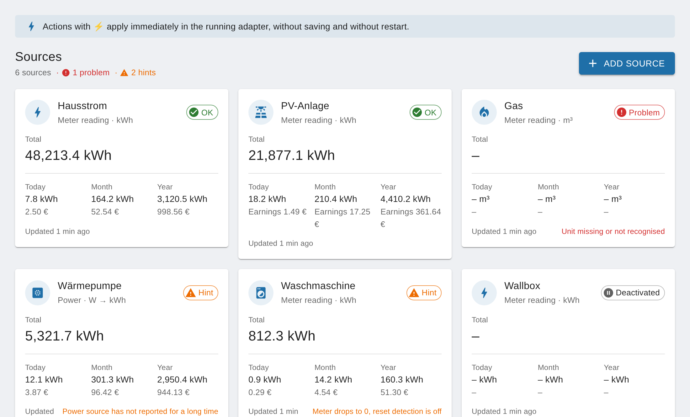
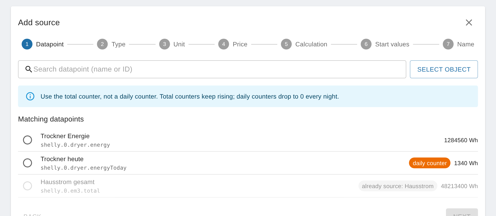
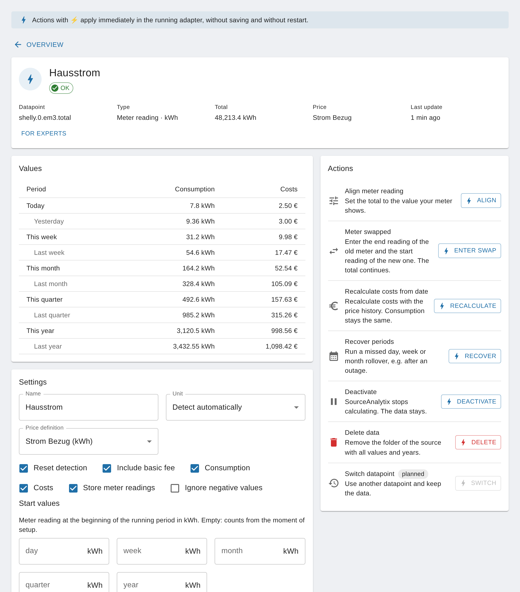
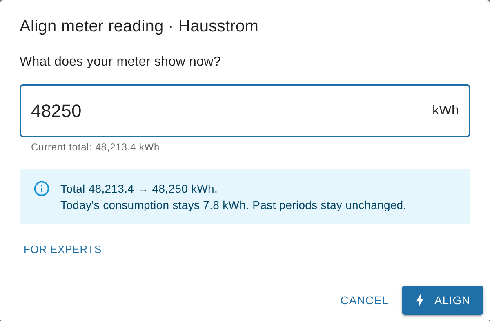
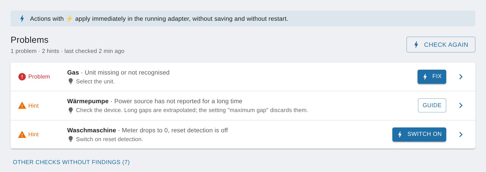

# SourceAnalytix

**SourceAnalytix zeigt Ihnen, was Ihr Haushalt verbraucht, produziert und kostet** – pro Tag, Woche, Monat, Quartal und Jahr, für Strom, Gas, Wasser, Wärme oder alles andere, was Sie in ioBroker messen können.

## Was bewirkt der Adapter?

Die meisten Geräte zeigen lediglich den Zählerstand an (zum Beispiel). `48213 kWh` von einem intelligenten Zähler oder einem Shelly) oder die aktuelle Leistung (zum Beispiel `850 W` Diese Zahl allein beantwortet nicht Ihre eigentlichen Fragen: _Wie viel habe ich heute verbraucht? Was hat der letzte Monat gekostet? Ist dieses Jahr besser als letztes Jahr? Wie viel hat meine Photovoltaikanlage eingebracht?_

SourceAnalytix liefert die Antworten. Sie wählen einen Datenpunkt und einen Preis aus, und der Adapter erstellt automatisch und ohne Skripte eine vollständige Statistik dazu:

| Du hast                                     | SourceAnalytix bietet Ihnen                                                                                                              |
| ------------------------------------------- | ---------------------------------------------------------------------------------------------------------------------------------------- |
| Zählerstand in kWh, m³, l, kg, …            | Verbrauch und Kosten für heute, diese Woche, diesen Monat, dieses Quartal und dieses Jahr, sowie gestern, letzte Woche, letzten Monat, … |
| ein Leistungswert in W oder kW              | Die daraus berechnete Energie, so als ob man ein Messgerät hätte.                                                                        |
| ein Impulszähler (S0, ESPHome `pulses/min`) | Verbrauch in der Einheit Ihres Preises, z. B. 1000 Impulse = 1 kWh                                                                       |
| ein PV- oder Einspeisezähler                | Lieferung und Ertrag statt Verbrauch und Kosten                                                                                          |
| eine beliebige Anzahl davon                 | ein Ordner pro Quelle unten `sourceanalytix.0` bereit für VIS, Grafana, InfluxDB oder Skripte                                             |

**Beispiel:** Sie fügen hinzu `shelly.0.em3.total` als „Haus“ mit Ihrem Strompreis von 0,32 €/kWh. Ab sofort `sourceanalytix.0.house` zeigt unter anderem „heute 7,8 kWh · 2,50 €“, „diesen Monat 164,2 kWh · 52,54 €“ und später „letzten Monat“ und „letztes Jahr“ – aktualisiert mit jedem neuen Wert und um Mitternacht geschlossen.

## Merkmale

**Statistiken**

- Aktueller und vorheriger Tag, Woche, Monat, Quartal und Jahr für Verbrauch, Lieferung, Kosten und Einnahmen.
- Optionale Werte pro Wochentag, Kalenderwoche, Monat und Quartal sowie ein Archiv für jedes Jahr.
- Alle Werte einer Quelle zusätzlich in einem JSON-Zustand, praktisch für Tabellen in VIS.

**Preise**

- Festpreis, ein neuer Preis ab einem gewählten Datum (ältere Kosten bleiben unverändert), ein dynamischer Preis aus einem anderen Datenpunkt (z. B. Tibber, Awattar) oder ein Tag/Nacht-Tarif, der durch einen Datenpunkt umgeschaltet wird.
- Optionale monatliche Grundgebühr.
- „Kosten ab Datum neu berechnen“, wenn ein Preis zu spät eingegeben wurde.

**Zuverlässiges Zählen**

- SourceAnalytix speichert seine eigenen Messwerte. Die korrekte Funktion wird auch dann aufrechterhalten, wenn ein Gerät mit dem Wert 0 neu startet, ein Zähler ausgetauscht wird oder ein einzelner Wert kurzzeitig abfällt.
- Stromversorgung: Längere Stromausfälle werden nicht extrapoliert, wenn Sie eine "maximale Lücke" festlegen.
- Falls ioBroker um Mitternacht nicht erreichbar war, werden die verpassten Änderungen für Tag, Woche oder Monat automatisch nachgeholt.

## Die Einstellungsseite

Alles ist in den Instanzeinstellungen von SourceAnalytix eingerichtet – keine Objektbearbeitung, kein JSON, kein Neustart.

**Übersicht** – alle Quellen mit ihren aktuellen Werten und ihrem Status auf einen Blick (Screenshot oben).

**Quelle hinzufügen** – ein Assistent führt Sie in sieben Schritten durch die Datenpunkte, den Datentyp, die Einheit, den Preis, die Berechnung, die Startwerte und den Namen. Er warnt Sie beispielsweise, wenn Sie einen Tageszähler anstelle des Gesamtzählers auswählen.

**Quellendetails** – Werte aller Perioden, alle Einstellungen der Quelle und die Maßnahmen zur Korrektur.

**Aktionen** – eine Quelle ohne Skripte korrigieren. Jede Aktion zeigt an, was sich ändern wird, bevor Sie es bestätigen:

- „Zählerstand anpassen“ – Stellen Sie den Gesamtbetrag auf den angezeigten Zählerstand ein.
- „Zähler getauscht“ – Geben Sie den Endstand des alten und den Anfangsstand des neuen Zählers ein.
- "Kosten ab Datum neu berechnen", "Zeiträume wiederherstellen", "Deaktivieren" und "Daten löschen"

**Probleme** – SourceAnalytix überprüft alle Quellen und listet auf, was Aufmerksamkeit erfordert, z. B. eine fehlende Einheit, eine Quelle, die die Meldung eingestellt hat, oder einen Zählerstand, der auf 0 sinkt. Die meisten Probleme lassen sich mit einem Klick beheben.

Im Objektbrowser schalten die SourceAnalytix-Einstellungen eines Datenpunkts diesen lediglich ein oder aus. Sie können dort also weiterhin sehen, welche Datenpunkte verwendet werden.

## Anforderungen und Installation

- Admin 8.0.0 oder neuer, js-controller 6.0.11 oder neuer und Node.js 22 oder neuer.
- Die aktuelle Version ist im **neuesten** (Beta-)Repository veröffentlicht: Wählen Sie in den ioBroker-Systemeinstellungen das Repository „Beta (neueste)“ aus und installieren Sie SourceAnalytix über den Tab „Adapter“. Nach einer Testphase wird die Software in das stabile Repository verschoben.
- Erstellen Sie anschließend Ihre Preise auf der Registerkarte „Preisdefinitionen“ und fügen Sie Ihre erste Quelle mit „Quelle hinzufügen“ auf der Registerkarte „Übersicht“ hinzu.

Schritt für Schritt: [Installation](/#/docs/adapterref/iobroker.sourceanalytix/docs/en/01.erste-schritte/01.installation.md) und [Ihr erster Zähler](/#/docs/adapterref/iobroker.sourceanalytix/docs/en/01.erste-schritte/02.erster-zaehler.md) .

## Dokumentation

Die vollständige Dokumentation beantwortet die Fragen, die Benutzer im Forum und in den Issues gestellt haben. Sie ist in Englisch und [Deutsch](https://github.com/DrozmotiX/ioBroker.sourceanalytix/blob/main/docs/de/README.md) verfügbar.

- [Erste Schritte](/#/docs/adapterref/iobroker.sourceanalytix/docs/en/01.erste-schritte/README.md) : Installation und Ihr erster Zähler
- [Anleitungen](/#/docs/adapterref/iobroker.sourceanalytix/docs/en/02.anleitungen/README.md) : Quellen und Einheiten, Korrekturen, Preise, Bewertung, Wartung
- [Referenz](/#/docs/adapterref/iobroker.sourceanalytix/docs/en/03.referenz/README.md) : Alle Einstellungen, Zustände und Meldungen
- [Fehlerbehebung](/#/docs/adapterref/iobroker.sourceanalytix/docs/en/04.fehlerbehebung/README.md) : Protokollmeldungen und falsche Werte
- [Hintergrund](/#/docs/adapterref/iobroker.sourceanalytix/docs/en/05.hintergrund/README.md) : Wie der Adapter berechnet

Haben Sie einen Fehler gefunden oder eine fehlende Funktion entdeckt? Erstellen Sie ein [GitHub-Issue](https://github.com/DrozmotiX/ioBroker.sourceanalytix/issues) mit einem Debug-Log des betroffenen Quellcodes.

## Was ist Sentry.io und was wird an die Server dieses Unternehmens gemeldet?

Dieser Adapter nutzt die Sentry-Bibliotheken, um Ausnahmen und Codefehler automatisch an die Entwickler zu melden. Weitere Details und Informationen zum Deaktivieren der Fehlerberichterstattung finden Sie in [der Sentry-Plugin-Dokumentation](https://github.com/ioBroker/plugin-sentry#plugin-sentry) ! Die Sentry-Berichterstattung wird ab js-controller 3.0 verwendet.

Wenn der Adapter abstürzt oder ein anderer Codefehler auftritt, wird die Fehlermeldung, die auch im ioBroker-Protokoll erscheint, an Sentry übermittelt. Wenn Sie der ioBroker GmbH die Erlaubnis erteilt haben, Diagnosedaten zu erfassen, wird Ihre Installations-ID mit übermittelt. Diese anonyme Kennung enthält keine persönlichen Informationen wie Ihren Namen oder Ihre E-Mail-Adresse. Sie ermöglicht die Gruppierung von Fehlern und zeigt an, wie viele Installationen betroffen sind.

## Credits

Die Ursprünge des Adapters reichen zurück bis zu einer Arbeit von pix im Jahr 2016: [ioBroker-Forum-Thread](https://forum.iobroker.net/viewtopic.php?f=21\&t=2262)

Es wurde später verbessert durch `@hadering` und als [homematic\_verbrauchszaehler](https://github.com/hdering/homematic_verbrauchszaehler) veröffentlicht.

## Unterstützt mich

Wenn Ihnen meine Arbeit gefällt, erwägen Sie bitte eine persönliche Spende.

Dies ist ein persönlicher Spendenlink für DutchmanNL und steht in keiner Verbindung zum ioBroker-Projekt.

<!--
    Placeholder for the next version (at the beginning of the line):
    ### __WORK IN PROGRESS__
-->

## Changelog
### 0.7.1 (2026-11-14)
* The settings page did not start in current Admin versions ("Custom component ... was not started"): its components now declare GUI API generation 2 and ship their module federation manifest.

### 0.7.0 (2026-11-14)
* Price definitions: changing a price without a new "Valid from" date marks the fields with a hint, and the adapter logs a warning with the repair steps, because the new price then replaces the old one retroactively ([#1293](https://github.com/DrozmotiX/ioBroker.sourceanalytix/issues/1293)).
* "Recover periods" on the settings page and in the "Problems" tab only processes the selected source; `sendTo('recoverPeriods', {source})` does the same for scripts, without `source` (and the `info.recoverPeriods` button) all sources are processed as before ([#1292](https://github.com/DrozmotiX/ioBroker.sourceanalytix/issues/1292)).
* The SourceAnalytix custom settings at the datapoint only switch a source on or off and link to the instance settings, where it is configured; enabling there uses the same defaults as the settings page. Existing settings stay unchanged ([#1286](https://github.com/DrozmotiX/ioBroker.sourceanalytix/issues/1286)).
* The source detail of the settings page now contains all source settings: start values (checked like in the wizard), maximum gap and averaging for power sources, pulses per unit, "Each update adds its value" and the technical ID ([#1285](https://github.com/DrozmotiX/ioBroker.sourceanalytix/issues/1285)).
* Power values sent as text with a comma, such as `"1,5"`, are read like meter readings; a value that is not a number is ignored with a warning instead of logging an invalid interval for every value ([#1288](https://github.com/DrozmotiX/ioBroker.sourceanalytix/issues/1288)).
* Settings page: hints name the tab "Price definitions" like the tab itself, "Quarters" is translated as "Quartale", a single comma or dot is always the decimal mark (`1.283` is 1.283 like in the adapter), and the technical ID in the wizard accepts the same characters as the adapter ([#1287](https://github.com/DrozmotiX/ioBroker.sourceanalytix/issues/1287)).
* New instance settings page (requires admin 8): tabs "Overview" and "Problems" with all sources, a wizard to add a source, a detail page per source and actions that work immediately without restart ([#1269](https://github.com/DrozmotiX/ioBroker.sourceanalytix/issues/1269)).
* Action "Align meter reading": set the total to the value the meter shows; today's consumption and closed periods stay unchanged ([#640](https://github.com/DrozmotiX/ioBroker.sourceanalytix/issues/640)).
* Action "Meter swapped": enter the end reading of the old and the start reading of the new meter, the total continues without a jump ([#1269](https://github.com/DrozmotiX/ioBroker.sourceanalytix/issues/1269)).
* Action "Recalculate costs from date" with the price history, for one source or all sources of a price definition ([#947](https://github.com/DrozmotiX/ioBroker.sourceanalytix/issues/947)).
* Action "Delete data" removes the output folder of a source incl. all years ([#1265](https://github.com/DrozmotiX/ioBroker.sourceanalytix/issues/1265)).
* Fix wrong conversion between `km³`, `dm³`, `cm³`, `mm³` and between `µm`, `nm`; unit definitions are now part of the adapter and the unmaintained `iobroker-adapter-helpers` dependency was removed ([#1278](https://github.com/DrozmotiX/ioBroker.sourceanalytix/issues/1278)).
* The unit check in the state settings now accepts the same spellings as the adapter (`m3`, `kwh`, `L`, …), so such sources can be saved with "Detect automatically" ([#1278](https://github.com/DrozmotiX/ioBroker.sourceanalytix/issues/1278)).
* Reject sources whose unit cannot be converted to the unit of the selected price definition (for example `W` with `m³` or `kg` with `kWh`) at start with a clear error instead of calculating wrong values or logging an error for every reading ([#1278](https://github.com/DrozmotiX/ioBroker.sourceanalytix/issues/1278)).
* Meter readings of exactly 0 are written to the meter readings again ([#1253](https://github.com/DrozmotiX/ioBroker.sourceanalytix/issues/1253)).
* Power sources (`W`, `kW`, …): the energy between the last value and midnight is booked to the ending day instead of getting lost at the day change ([#1254](https://github.com/DrozmotiX/ioBroker.sourceanalytix/issues/1254)).
* Meter readings sent as text, such as `"12,5"`, and start values with a comma are accepted; a value that is not a number is ignored with a warning ([#1255](https://github.com/DrozmotiX/ioBroker.sourceanalytix/issues/1255)).
* Week values from 29–31 December and early January are stored in the correct calendar-week year and no longer overwrite week 1 ([#1256](https://github.com/DrozmotiX/ioBroker.sourceanalytix/issues/1256)).
* After the total was corrected by hand or the meter was swapped, the source keeps running and continues from the known total instead of stopping ([#1257](https://github.com/DrozmotiX/ioBroker.sourceanalytix/issues/1257)).
* A device that briefly reports a low value and then returns to its previous reading no longer doubles the total: the detected reset is rolled back ([#1258](https://github.com/DrozmotiX/ioBroker.sourceanalytix/issues/1258)).
* A price with a future "Valid from" date becomes the current price on that date without a restart ([#1259](https://github.com/DrozmotiX/ioBroker.sourceanalytix/issues/1259)).
* If no reading arrives around midnight, the consumption of the gap is split between both days instead of being booked to the new day ([#1260](https://github.com/DrozmotiX/ioBroker.sourceanalytix/issues/1260)).
* Errors are always written to the ioBroker log, Sentry receives them in addition ([#1261](https://github.com/DrozmotiX/ioBroker.sourceanalytix/issues/1261)).
* Falling values of sources without reset detection (for example an oil tank) are only logged on debug level ([#1262](https://github.com/DrozmotiX/ioBroker.sourceanalytix/issues/1262)).
* The unused value `valueAtDeviceInit` is no longer written; existing values are ignored ([#1263](https://github.com/DrozmotiX/ioBroker.sourceanalytix/issues/1263)).
* Units such as `m3` or `kwh` sent by many devices are recognised instead of "No unit defined" ([#1264](https://github.com/DrozmotiX/ioBroker.sourceanalytix/issues/1264)).
* Ignore repeated source-object writes when the SourceAnalytix settings, source name and unit are unchanged, preventing unnecessary output reinitialization and high CPU load ([#1233](https://github.com/DrozmotiX/ioBroker.sourceanalytix/issues/1233)).
* Only write output objects (device, period and memory states) when their definition actually changes, so re-initializing a source updates state values without rewriting the whole object tree ([#1233](https://github.com/DrozmotiX/ioBroker.sourceanalytix/issues/1233)).
* The start values in the state settings are checked before saving: comma and dot are accepted, a start value must not be larger than the current total shown in the dialog, and a period that began earlier cannot have a larger start value than a later one (the week is placed by its start date). Empty fields count from now on. A hint appears when a start value would fit after dividing by 1000 (entered in Wh instead of kWh). Inconsistent start values are also logged at start ([#1267](https://github.com/DrozmotiX/ioBroker.sourceanalytix/issues/1267)).
* All power units (`W`, `kW`, `MW`, …) are handled alike: no start value initialisation from the first reading, and running `kW` intervals are closed at midnight like `W` intervals ([#1267](https://github.com/DrozmotiX/ioBroker.sourceanalytix/issues/1267)).
* New source setting "Maximum gap between power values" for power sources: an interval without a new value that is longer than the setting is not extrapolated with the last power value but counted as 0 and logged, so a device or network outage no longer produces huge consumption and costs. Empty (default) keeps the previous behaviour for devices that only send on change ([#1266](https://github.com/DrozmotiX/ioBroker.sourceanalytix/issues/1266)).
* The state settings show a hint when another source with the same price definition already includes the basic fee, because every such source books the full basic fee; the adapter logs the same hint at start. The calculation is unchanged ([#1268](https://github.com/DrozmotiX/ioBroker.sourceanalytix/issues/1268)).
* New unit `piece` with factor 1 for counters without a physical unit, such as burner starts; the spellings `pcs`, `pc`, `pieces`, `Stk` and `Stück` are recognised, and price definitions can use `piece` ([#304](https://github.com/DrozmotiX/ioBroker.sourceanalytix/issues/304)).
* Pulse counters: a source with unit `piece` (pulse count) or `piece/min` (pulse rate, integrated over time like power, e.g. ESPHome `pulses/min`) is converted into the unit of the price definition with the new source setting "Pulses per unit of the price definition" (for example 1000 for 1000 imp/kWh) ([#74](https://github.com/DrozmotiX/ioBroker.sourceanalytix/issues/74)).
* New source setting "Each update adds its value" for data points that send one update per pulse or a consumption increment instead of a meter reading; every update is added, also an unchanged value such as `0.001` kWh per S0 pulse, and `true` counts as one pulse ([#479](https://github.com/DrozmotiX/ioBroker.sourceanalytix/issues/479)).

### 0.6.1 (2026-11-07)
* (softwarecrash) Apply negative energy deltas from integrated power sources to historical costs instead of mistaking them for cumulative meter resets ([#1242](https://github.com/DrozmotiX/ioBroker.sourceanalytix/issues/1242)).
* (softwarecrash) Prevent a temporary low meter reading followed by a near-return from being counted as a confirmed reset and duplicating consumption; rejected resets are now logged as a warning ([#1227](https://github.com/DrozmotiX/ioBroker.sourceanalytix/issues/1227)).
* (softwarecrash) Keep an existing output tree and restore its effective ID in the source settings when an output-ID change is invalid, unavailable or cannot be migrated; a source without an existing tree is not activated instead of silently starting a new one ([#1228](https://github.com/DrozmotiX/ioBroker.sourceanalytix/issues/1228)).
* (softwarecrash) Never delete pre-existing target objects when an output migration fails before SourceAnalytix writes to the target ([#1228](https://github.com/DrozmotiX/ioBroker.sourceanalytix/issues/1228)).
* (softwarecrash) Add migration, restart recovery, settings write-back and concurrent-disable regression tests for custom output IDs ([#1229](https://github.com/DrozmotiX/ioBroker.sourceanalytix/issues/1229)).

### 0.6.0 (2026-09-26)
* (DutchmanNL) Maintenance: raise Node.js to 22, modernise CI and release tooling, update dependencies, resolve repository checker findings
* (DutchmanNL) The adapter now requires Admin 7.8.23 or newer.
* (DutchmanNL) Tests now also run on Node.js 26 ([#1222](https://github.com/DrozmotiX/ioBroker.sourceanalytix/issues/1222)).
* (softwarecrash) Price definition and unit selection work again with Admin 8, and settings with a missing price definition, unit or output ID can no longer be saved ([#1202](https://github.com/DrozmotiX/ioBroker.sourceanalytix/issues/1202)).
* (softwarecrash) Each source has an editable output ID, pre-filled with its existing ID so nothing changes for current installations. Changing it copies and verifies the complete object tree before the old tree is removed, and reserved, invalid or already used IDs are rejected ([#617](https://github.com/DrozmotiX/ioBroker.sourceanalytix/issues/617), [#1200](https://github.com/DrozmotiX/ioBroker.sourceanalytix/pull/1200)).
* (softwarecrash) A meter decrease larger than the threshold is only accepted as a reset or replacement once the following reading confirms it; a reading back within the threshold of the last accepted value discards it ([#1199](https://github.com/DrozmotiX/ioBroker.sourceanalytix/issues/1199)).
* (softwarecrash) Fixed a crash when a source was reconfigured or disabled while a calculation was running ([#1198](https://github.com/DrozmotiX/ioBroker.sourceanalytix/issues/1198)).
* (softwarecrash) Each source stores its own rounding settings, taken once from the instance defaults, so later changes to the defaults no longer affect existing sources ([#1200](https://github.com/DrozmotiX/ioBroker.sourceanalytix/pull/1200)).

### 0.5.6 (2026-08-02)
* The monthly basic price is booked as a full charge when the tariff first becomes valid and at the beginning of every following calendar month, instead of being spread over the days of a month ([#1193](https://github.com/DrozmotiX/ioBroker.sourceanalytix/pull/1193)).
* **Valid from** now also defines the first month the monthly basic price is charged, while tariffs without a validity date keep starting at the beginning of the current calendar year ([#1193](https://github.com/DrozmotiX/ioBroker.sourceanalytix/pull/1193)).
* Monthly basic prices are recorded in their own `basicPriceHistory` state, so a price change during a month only applies to the next monthly booking and already booked months stay unchanged ([#1193](https://github.com/DrozmotiX/ioBroker.sourceanalytix/pull/1193)).
* **Valid from** is available for every price source, not only for fixed prices, and a selected date becomes effective at local midnight ([#1193](https://github.com/DrozmotiX/ioBroker.sourceanalytix/pull/1193)).

## License
MIT License

Copyright (c) 2022-2026 DrozmotiX Services B.V.

Permission is hereby granted, free of charge, to any person obtaining a copy
of this software and associated documentation files (the "Software"), to deal
in the Software without restriction, including without limitation the rights
to use, copy, modify, merge, publish, distribute, sublicense, and/or sell
copies of the Software, and to permit persons to whom the Software is
furnished to do so, subject to the following conditions:

The above copyright notice and this permission notice shall be included in all
copies or substantial portions of the Software.

THE SOFTWARE IS PROVIDED "AS IS", WITHOUT WARRANTY OF ANY KIND, EXPRESS OR
IMPLIED, INCLUDING BUT NOT LIMITED TO THE WARRANTIES OF MERCHANTABILITY,
FITNESS FOR A PARTICULAR PURPOSE AND NONINFRINGEMENT. IN NO EVENT SHALL THE
AUTHORS OR COPYRIGHT HOLDERS BE LIABLE FOR ANY CLAIM, DAMAGES OR OTHER
LIABILITY, WHETHER IN AN ACTION OF CONTRACT, TORT OR OTHERWISE, ARISING FROM,
OUT OF OR IN CONNECTION WITH THE SOFTWARE OR THE USE OR OTHER DEALINGS IN THE
SOFTWARE.