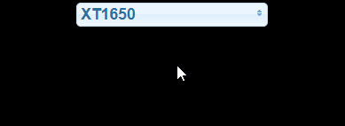

# ioBroker.spotify-premium

**Version:**

**Tests:**

**Dieser Adapter nutzt die Sentry-Bibliotheken, um Ausnahmen und Codefehler automatisch an die Entwickler zu melden.** Weitere Details und Informationen zum Deaktivieren der Fehlerberichterstattung finden Sie in [der Sentry-Plugin-Dokumentation](https://github.com/ioBroker/plugin-sentry#plugin-sentry) . Die Sentry-Berichterstattung wird ab js-controller 3.0 verwendet.

Adapter für den Zugriff auf die Spotify-Wiedergabesteuerung. Aufgrund der Spotify-API ist ein Premium-Abo erforderlich.

Verbindung zur [Spotify Premium API](https://www.spotify.com/) .

## Dokumentation

Siehe auch die [Spotify Developer API-Dokumentation](https://developer.spotify.com/) .

### Einrichtung / Autorisierung

1. Melde dich an unter <https://developer.spotify.com/dashboard/>
2. Erstellen Sie eine Anwendung. Sie erhalten eine Client-ID und ein Client-Geheimnis (siehe [Anleitung](https://github.com/iobroker-community-adapters/ioBroker.spotify-premium/blob/master/docs/create_app.png) ). Wählen Sie **„Web-API“** als die von der Anwendung verwendete API aus.
3. Setzen Sie die Umleitungs-URI auf `https://oauth2.iobroker.in/spotify` in den Einstellungen Ihrer Spotify-Anwendung
4. Öffnen Sie die Instanzeinstellungen des Adapters in der ioBroker-Administration und geben Sie die Client-ID und das Client-Geheimnis ein.
5. Speichern Sie die Einstellungen und klicken Sie auf die Schaltfläche **„Spotify-Zugriff erhalten“.**
6. Folgen Sie den Anweisungen im Popup-Fenster (möglicherweise müssen Sie sich bei Spotify anmelden und die Zugriffsberechtigung erteilen).
7. Der Wert in `spotify-premium.0.authorization.authorized` wird wahr, wenn alles erfolgreich war

Es gibt kein `getAuthorization` Die Autorisierung erfolgt ausschließlich in den Instanzeinstellungen, wenn Sie die Schaltfläche in den Objekten öffnen. `https://oauth2.iobroker.in/spotify` direkt im Browser sehen Sie `Internal Server Error` - Das ist so zu erwarten, die URL funktioniert nur als Weiterleitungsziel für die Spotify-Anmeldung.

Wir müssen eine HTTPS-Weiterleitungs-URI angeben, da Spotify ab Dezember 2025 keine unsicheren URIs mehr zulässt.

Seit Juli 2026 laufen Spotify-Refresh-Tokens nach 6 Monaten ab. In diesem Fall protokolliert der Adapter einen Fehler und setzt die Einstellungen. `spotify-premium.0.authorization.authorized` zu falsch, schreibt den Grund an `spotify-premium.0.authorization.error` und beendet die Abfrage. Autorisieren Sie den Adapter einfach erneut in den Instanzeinstellungen.

Spotify-Apps im Entwicklermodus können nur Wiedergabelisten lesen, die dem autorisierten Nutzer gehören. Andere Wiedergabelisten (z. B. Wiedergabelisten anderer Nutzer, denen sie folgen) antworten mit `403 Forbidden` Der Adapter protokolliert dies einmalig auf Informationsebene und überspringt diese Wiedergabelisten.

#### [Video-Tutorial](https://www.youtube.com/watch?v=n0m9201qABU) (zeigt eine ältere Version der Autorisierung)

[](https://www.youtube.com/watch?v=n0m9201qABU)

### Staaten

Alle Bundesstaaten sind in der Administration beschrieben.

### Nachrichten (sendTo)

Skripte, andere Adapter (z. B. ioBroker.assistant) und KI-Agenten können Nachrichten durchsuchen und verarbeiten. Jede Nachricht beantwortet; ein Fehler beantwortet `{error, reason}` Die

| Nachricht      | Daten                                                                                    | Antwort                                                                               |
| -------------- | ---------------------------------------------------------------------------------------- | ------------------------------------------------------------------------------------- |
| `search`       | `{query?, track?, artist?, album?, year?, genre?, type?, limit?, offset?}` oder ein Text | `{items: [{type, uri, id, name, artists, album, ...}]}`                               |
| `play`         | `{uri?, offset?, positionMs?, device?}` oder eine URI                                    | `{ok: true, device: {id, name}}`                                                      |
| `getDevices`   | -                                                                                        | `{devices: [{id, name, type, isActive, isRestricted, volume, supportsVolume}]}`       |
| `getPlaylists` | `{search?}`                                                                              | `{playlists: [{uri, id, name, ownerId, tracksTotal, image}]}`                         |
| `help`         | -                                                                                        | `{help, commands}`: die für einen KI-Agenten beschriebenen Zustände und Nachrichten. |

`help` ist für KI-Agenten (z. B. ioBroker.pi-agent) und Skriptautoren gedacht: Es beschreibt die Zustände und die Nachrichten, `commands` listet jede Nachricht auf, die die Instanz beantwortet. `write: true` Für diejenigen, die etwas verändern.

- `search`: `query` ist freier Text, `track`, `artist`, `album`, `year` Und `genre` Suche eingrenzen. `type` Ist `track` (Standard), `album`, `artist`, `playlist`, `show`, `episode` oder `audiobook`, mehrere durch Kommas getrennt. Spotify liefert seit Februar 2026 maximal 10 Ergebnisse pro Anfrage (`limit` 1-10, Standardwert 5), die beste Übereinstimmung zuerst.
- `play`: `uri` ist eine Spotify-URI oder eine `open.spotify.com` Link. Ein einzelner Titel oder eine Episode wird abgespielt, ebenso ein Album, ein Künstler, eine Playlist oder eine ganze Sendung; eine Reihe von Titel-URIs spielt diese nacheinander ab. `offset` ist die Nummer des Titels darin (0 = erster) oder der URI eines Titels darin. `device` ist der Name oder die ID eines Spotify Connect-Geräts; ohne diese Angabe spielt das aktive Gerät ab. Ohne `uri` Die Wiedergabe wird fortgesetzt. Falls ein Gerät, das längere Zeit keine Wiedergabe durchgeführt hat, den Befehl ablehnt, wird die Wiedergabe zuerst an dieses Gerät übertragen. `reason` eines Fehlers: `NO_ACTIVE_DEVICE`, `DEVICE_NOT_FOUND`, `DEVICE_NOT_CONTROLLABLE`, `PREMIUM_REQUIRED`, `NOT_AUTHORIZED`, `RATE_LIMITED`, `BAD_REQUEST`, ...
- `getDevices` Spotify fragt nun nach (und aktualisiert die Statusangaben). Ein Gerät wird nur erkannt, solange es online ist: ein Smartphone oder ein Computer, solange die Spotify-App geöffnet ist, ein Lautsprecher, solange dieser eingeschaltet ist.

```js
sendTo('spotify-premium.0', 'search', { track: 'Bohemian Rhapsody', artist: 'Queen', limit: 3 }, result => {
    if (result.items?.length) {
        sendTo('spotify-premium.0', 'play', { uri: result.items[0].uri, device: 'Kitchen' }, answer => {
            log(answer.error ? `${answer.reason}: ${answer.error}` : `plays on ${answer.device.name}`);
        });
    }
});
```

### VIS-Anwendungsbeispiele

Der Adapter bietet nur 5 eigene VIS-Widgets (Widget-Set). `spotify-premium` **Wiedergabe/Pause** , **Vorheriges** , **Nächstes** , **Wiederholen** und **Zufallswiedergabe** . Alle anderen Beispiele unten wurden mit den Standard-Widgets erstellt. `jqui` Und `basic` Widget-Sets (z. B. `tplJquiSelectList`, `tplJquiButtonState`, `tplValueStringImg`) und die Zustände dieses Adapters.

Klicken Sie hier, um den Quellcode des Widgets anzuzeigen.

<details>
  <summary>Start one specific playlist<br/></summary>
<pre><code>[{"tpl":"tplJquiButtonState","data":{"oid":"spotify-premium.0.playlists.YourPlaylistName.playThisList","g_fixed":false,"g_visibility":false,"g_css_font_text":false,"g_css_background":false,"g_css_shadow_padding":false,"g_css_border":false,"g_gestures":false,"g_signals":false,"g_last_change":false,"visibility-cond":"==","visibility-val":1,"visibility-groups-action":"hide","buttontext":"Choose Playlist","signals-cond-0":"==","signals-val-0":true,"signals-icon-0":"/vis/signals/lowbattery.png","signals-icon-size-0":0,"signals-blink-0":false,"signals-horz-0":0,"signals-vert-0":0,"signals-hide-edit-0":false,"signals-cond-1":"==","signals-val-1":true,"signals-icon-1":"/vis/signals/lowbattery.png","signals-icon-size-1":0,"signals-blink-1":false,"signals-horz-1":0,"signals-vert-1":0,"signals-hide-edit-1":false,"signals-cond-2":"==","signals-val-2":true,"signals-icon-2":"/vis/signals/lowbattery.png","signals-icon-size-2":0,"signals-blink-2":false,"signals-horz-2":0,"signals-vert-2":0,"signals-hide-edit-2":false,"lc-type":"last-change","lc-is-interval":true,"lc-is-moment":false,"lc-format":"","lc-position-vert":"top","lc-position-horz":"right","lc-offset-vert":0,"lc-offset-horz":0,"lc-font-size":"12px","lc-font-family":"","lc-font-style":"","lc-bkg-color":"","lc-color":"","lc-border-width":"0","lc-border-style":"","lc-border-color":"","lc-border-radius":10,"lc-zindex":0,"value":"true","no_style":false},"style":{"left":"549px","top":"364px"},"widgetSet":"jqui"}]</code></pre>
</details>
<details>
  <summary>Start one specific device<br/></summary>
<pre><code>[{"tpl":"tplJquiButtonState","data":{"oid":"spotify-premium.0.devices.YourDeviceName.useForPlayback","g_fixed":false,"g_visibility":false,"g_css_font_text":false,"g_css_background":false,"g_css_shadow_padding":false,"g_css_border":false,"g_gestures":false,"g_signals":false,"g_last_change":false,"visibility-cond":"==","visibility-val":1,"visibility-groups-action":"hide","buttontext":"Choose Device","signals-cond-0":"==","signals-val-0":true,"signals-icon-0":"/vis/signals/lowbattery.png","signals-icon-size-0":0,"signals-blink-0":false,"signals-horz-0":0,"signals-vert-0":0,"signals-hide-edit-0":false,"signals-cond-1":"==","signals-val-1":true,"signals-icon-1":"/vis/signals/lowbattery.png","signals-icon-size-1":0,"signals-blink-1":false,"signals-horz-1":0,"signals-vert-1":0,"signals-hide-edit-1":false,"signals-cond-2":"==","signals-val-2":true,"signals-icon-2":"/vis/signals/lowbattery.png","signals-icon-size-2":0,"signals-blink-2":false,"signals-horz-2":0,"signals-vert-2":0,"signals-hide-edit-2":false,"lc-type":"last-change","lc-is-interval":true,"lc-is-moment":false,"lc-format":"","lc-position-vert":"top","lc-position-horz":"right","lc-offset-vert":0,"lc-offset-horz":0,"lc-font-size":"12px","lc-font-family":"","lc-font-style":"","lc-bkg-color":"","lc-color":"","lc-border-width":"0","lc-border-style":"","lc-border-color":"","lc-border-radius":10,"lc-zindex":0,"value":"true","no_style":false},"style":{"left":"549px","top":"364px"},"widgetSet":"jqui"}]</code></pre>
</details>
<details>
  <summary>Start playing<br/></summary>
<pre><code>[{"tpl":"tplSpotifyPlayButton","data":{"g_fixed":false,"g_visibility":false,"g_css_font_text":false,"g_css_background":false,"g_css_shadow_padding":false,"g_css_border":false,"g_gestures":false,"g_signals":false,"g_last_change":false,"visibility-cond":"==","visibility-val":1,"visibility-groups-action":"hide","oidplay":"spotify-premium.0.player.play","oidpause":"spotify-premium.0.player.pause","oidstate":"spotify-premium.0.player.isPlaying","colorplay":"green","colorpause":"green","signals-cond-0":"==","signals-val-0":true,"signals-icon-0":"/vis/signals/lowbattery.png","signals-icon-size-0":0,"signals-blink-0":false,"signals-horz-0":0,"signals-vert-0":0,"signals-hide-edit-0":false,"signals-cond-1":"==","signals-val-1":true,"signals-icon-1":"/vis/signals/lowbattery.png","signals-icon-size-1":0,"signals-blink-1":false,"signals-horz-1":0,"signals-vert-1":0,"signals-hide-edit-1":false,"signals-cond-2":"==","signals-val-2":true,"signals-icon-2":"/vis/signals/lowbattery.png","signals-icon-size-2":0,"signals-blink-2":false,"signals-horz-2":0,"signals-vert-2":0,"signals-hide-edit-2":false,"lc-type":"last-change","lc-is-interval":true,"lc-is-moment":false,"lc-format":"","lc-position-vert":"top","lc-position-horz":"right","lc-offset-vert":0,"lc-offset-horz":0,"lc-font-size":"12px","lc-font-family":"","lc-font-style":"","lc-bkg-color":"","lc-color":"","lc-border-width":"0","lc-border-style":"","lc-border-color":"","lc-border-radius":10,"lc-zindex":0},"style":{"left":"487px","top":"604px"},"widgetSet":"spotify-premium"}]</code></pre>
</details>
<details>
  <summary>Play previous track<br/></summary>
<pre><code>[{"tpl":"tplSpotifyPreviousButton","data":{"g_fixed":false,"g_visibility":false,"g_css_font_text":false,"g_css_background":false,"g_css_shadow_padding":false,"g_css_border":false,"g_gestures":false,"g_signals":false,"g_last_change":false,"visibility-cond":"==","visibility-val":1,"visibility-groups-action":"hide","oid":"spotify-premium.0.player.skipMinus","colorbox":"green","signals-cond-0":"==","signals-val-0":true,"signals-icon-0":"/vis/signals/lowbattery.png","signals-icon-size-0":0,"signals-blink-0":false,"signals-horz-0":0,"signals-vert-0":0,"signals-hide-edit-0":false,"signals-cond-1":"==","signals-val-1":true,"signals-icon-1":"/vis/signals/lowbattery.png","signals-icon-size-1":0,"signals-blink-1":false,"signals-horz-1":0,"signals-vert-1":0,"signals-hide-edit-1":false,"signals-cond-2":"==","signals-val-2":true,"signals-icon-2":"/vis/signals/lowbattery.png","signals-icon-size-2":0,"signals-blink-2":false,"signals-horz-2":0,"signals-vert-2":0,"signals-hide-edit-2":false,"lc-type":"last-change","lc-is-interval":true,"lc-is-moment":false,"lc-format":"","lc-position-vert":"top","lc-position-horz":"right","lc-offset-vert":0,"lc-offset-horz":0,"lc-font-size":"12px","lc-font-family":"","lc-font-style":"","lc-bkg-color":"","lc-color":"","lc-border-width":"0","lc-border-style":"","lc-border-color":"","lc-border-radius":10,"lc-zindex":0},"style":{"left":"386px","top":"604px"},"widgetSet":"spotify-premium"}]</code></pre>
</details>
<details>
  <summary>Play next track<br/></summary>
<pre><code>[{"tpl":"tplSpotifyNextButton","data":{"g_fixed":false,"g_visibility":false,"g_css_font_text":false,"g_css_background":false,"g_css_shadow_padding":false,"g_css_border":false,"g_gestures":false,"g_signals":false,"g_last_change":false,"visibility-cond":"==","visibility-val":1,"visibility-groups-action":"hide","oid":"spotify-premium.0.player.skipPlus","colorbox":"green","signals-cond-0":"==","signals-val-0":true,"signals-icon-0":"/vis/signals/lowbattery.png","signals-icon-size-0":0,"signals-blink-0":false,"signals-horz-0":0,"signals-vert-0":0,"signals-hide-edit-0":false,"signals-cond-1":"==","signals-val-1":true,"signals-icon-1":"/vis/signals/lowbattery.png","signals-icon-size-1":0,"signals-blink-1":false,"signals-horz-1":0,"signals-vert-1":0,"signals-hide-edit-1":false,"signals-cond-2":"==","signals-val-2":true,"signals-icon-2":"/vis/signals/lowbattery.png","signals-icon-size-2":0,"signals-blink-2":false,"signals-horz-2":0,"signals-vert-2":0,"signals-hide-edit-2":false,"lc-type":"last-change","lc-is-interval":true,"lc-is-moment":false,"lc-format":"","lc-position-vert":"top","lc-position-horz":"right","lc-offset-vert":0,"lc-offset-horz":0,"lc-font-size":"12px","lc-font-family":"","lc-font-style":"","lc-bkg-color":"","lc-color":"","lc-border-width":"0","lc-border-style":"","lc-border-color":"","lc-border-radius":10,"lc-zindex":0},"style":{"left":"588px","top":"604px"},"widgetSet":"spotify-premium"}]</code></pre>
</details>
<details>
  <summary>Control repeat<br/></summary>
<pre><code>[{"tpl":"tplSpotifyRepeatButton","data":{"g_fixed":false,"g_visibility":false,"g_css_font_text":false,"g_css_background":false,"g_css_shadow_padding":false,"g_css_border":false,"g_gestures":false,"g_signals":false,"g_last_change":false,"visibility-cond":"==","visibility-val":1,"visibility-groups-action":"hide","oidall":"spotify-premium.0.player.repeatContext","oidoff":"spotify-premium.0.player.repeatOff","oidone":"spotify-premium.0.player.repeatTrack","oidstate":"spotify-premium.0.player.repeat","coloroff":"white","colorall":"green","colorone":"green","signals-cond-0":"==","signals-val-0":true,"signals-icon-0":"/vis/signals/lowbattery.png","signals-icon-size-0":0,"signals-blink-0":false,"signals-horz-0":0,"signals-vert-0":0,"signals-hide-edit-0":false,"signals-cond-1":"==","signals-val-1":true,"signals-icon-1":"/vis/signals/lowbattery.png","signals-icon-size-1":0,"signals-blink-1":false,"signals-horz-1":0,"signals-vert-1":0,"signals-hide-edit-1":false,"signals-cond-2":"==","signals-val-2":true,"signals-icon-2":"/vis/signals/lowbattery.png","signals-icon-size-2":0,"signals-blink-2":false,"signals-horz-2":0,"signals-vert-2":0,"signals-hide-edit-2":false,"lc-type":"last-change","lc-is-interval":true,"lc-is-moment":false,"lc-format":"","lc-position-vert":"top","lc-position-horz":"right","lc-offset-vert":0,"lc-offset-horz":0,"lc-font-size":"12px","lc-font-family":"","lc-font-style":"","lc-bkg-color":"","lc-color":"","lc-border-width":"0","lc-border-style":"","lc-border-color":"","lc-border-radius":10,"lc-zindex":0},"style":{"left":"689px","top":"614px","width":"48px","height":"56px"},"widgetSet":"spotify-premium"}]</code></pre>
</details>
<details>
  <summary>Control shuffle<br/></summary>
<pre><code>[{"tpl":"tplSpotifyShuffleButton","data":{"g_fixed":false,"g_visibility":false,"g_css_font_text":false,"g_css_background":false,"g_css_shadow_padding":false,"g_css_border":false,"g_gestures":false,"g_signals":false,"g_last_change":false,"visibility-cond":"==","visibility-val":1,"visibility-groups-action":"hide","oidon":"spotify-premium.0.player.shuffleOn","oidoff":"spotify-premium.0.player.shuffleOff","oidstate":"spotify-premium.0.player.shuffle","coloroff":"white","coloron":"green","signals-cond-0":"==","signals-val-0":true,"signals-icon-0":"/vis/signals/lowbattery.png","signals-icon-size-0":0,"signals-blink-0":false,"signals-horz-0":0,"signals-vert-0":0,"signals-hide-edit-0":false,"signals-cond-1":"==","signals-val-1":true,"signals-icon-1":"/vis/signals/lowbattery.png","signals-icon-size-1":0,"signals-blink-1":false,"signals-horz-1":0,"signals-vert-1":0,"signals-hide-edit-1":false,"signals-cond-2":"==","signals-val-2":true,"signals-icon-2":"/vis/signals/lowbattery.png","signals-icon-size-2":0,"signals-blink-2":false,"signals-horz-2":0,"signals-vert-2":0,"signals-hide-edit-2":false,"lc-type":"last-change","lc-is-interval":true,"lc-is-moment":false,"lc-format":"","lc-position-vert":"top","lc-position-horz":"right","lc-offset-vert":0,"lc-offset-horz":0,"lc-font-size":"12px","lc-font-family":"","lc-font-style":"","lc-bkg-color":"","lc-color":"","lc-border-width":"0","lc-border-style":"","lc-border-color":"","lc-border-radius":10,"lc-zindex":0},"style":{"left":"319px","top":"622px","width":"38px","height":"40px"},"widgetSet":"spotify-premium"}]</code></pre>
</details>
<details>
  <summary>Context image<br/></summary>
<pre><code>[{"tpl":"tplValueStringImg","data":{"oid":"spotify-premium.0.player.contextImageUrl","g_fixed":false,"g_visibility":false,"g_css_font_text":false,"g_css_background":false,"g_css_shadow_padding":false,"g_css_border":false,"g_gestures":false,"g_signals":false,"g_last_change":false,"visibility-cond":"==","visibility-val":1,"visibility-groups-action":"hide","refreshInterval":"0","signals-cond-0":"==","signals-val-0":true,"signals-icon-0":"/vis/signals/lowbattery.png","signals-icon-size-0":0,"signals-blink-0":false,"signals-horz-0":0,"signals-vert-0":0,"signals-hide-edit-0":false,"signals-cond-1":"==","signals-val-1":true,"signals-icon-1":"/vis/signals/lowbattery.png","signals-icon-size-1":0,"signals-blink-1":false,"signals-horz-1":0,"signals-vert-1":0,"signals-hide-edit-1":false,"signals-cond-2":"==","signals-val-2":true,"signals-icon-2":"/vis/signals/lowbattery.png","signals-icon-size-2":0,"signals-blink-2":false,"signals-horz-2":0,"signals-vert-2":0,"signals-hide-edit-2":false,"lc-type":"last-change","lc-is-interval":true,"lc-is-moment":false,"lc-format":"","lc-position-vert":"top","lc-position-horz":"right","lc-offset-vert":0,"lc-offset-horz":0,"lc-font-size":"12px","lc-font-family":"","lc-font-style":"","lc-bkg-color":"","lc-color":"","lc-border-width":"0","lc-border-style":"","lc-border-color":"","lc-border-radius":10,"lc-zindex":0},"style":{"left":"338px","top":"131px","width":"122px","height":"122px"},"widgetSet":"basic"}]</code></pre>
</details>
<details>
  <summary>Choose track of current playlist<br/></summary>
<pre><code>[{"tpl":"tplJquiSelectList","data":{"oid":"spotify-premium.0.player.playlist.trackList","g_fixed":false,"g_visibility":false,"g_css_font_text":false,"g_css_background":false,"g_css_shadow_padding":false,"g_css_border":false,"g_gestures":false,"g_signals":false,"g_last_change":false,"visibility-cond":"==","visibility-val":1,"visibility-groups-action":"hide","values":"{spotify-premium.0.player.playlist.trackListNumber}","texts":"{spotify-premium.0.player.playlist.trackListString}","height":"100","signals-cond-0":"==","signals-val-0":true,"signals-icon-0":"/vis/signals/lowbattery.png","signals-icon-size-0":0,"signals-blink-0":false,"signals-horz-0":0,"signals-vert-0":0,"signals-hide-edit-0":false,"signals-cond-1":"==","signals-val-1":true,"signals-icon-1":"/vis/signals/lowbattery.png","signals-icon-size-1":0,"signals-blink-1":false,"signals-horz-1":0,"signals-vert-1":0,"signals-hide-edit-1":false,"signals-cond-2":"==","signals-val-2":true,"signals-icon-2":"/vis/signals/lowbattery.png","signals-icon-size-2":0,"signals-blink-2":false,"signals-horz-2":0,"signals-vert-2":0,"signals-hide-edit-2":false,"lc-type":"last-change","lc-is-interval":true,"lc-is-moment":false,"lc-format":"","lc-position-vert":"top","lc-position-horz":"right","lc-offset-vert":0,"lc-offset-horz":0,"lc-font-size":"12px","lc-font-family":"","lc-font-style":"","lc-bkg-color":"","lc-color":"","lc-border-width":"0","lc-border-style":"","lc-border-color":"","lc-border-radius":10,"lc-zindex":0},"style":{"left":"505px","top":"369px"},"widgetSet":"jqui"}]</code></pre>
</details>
<details>
  <summary>Switch device<br/></summary>
<pre><code>[{"tpl":"tplJquiSelectList","data":{"oid":"spotify-premium.0.devices.deviceList","g_fixed":false,"g_visibility":false,"g_css_font_text":false,"g_css_background":false,"g_css_shadow_padding":false,"g_css_border":false,"g_gestures":false,"g_signals":false,"g_last_change":false,"visibility-cond":"==","visibility-val":1,"visibility-groups-action":"hide","values":"{spotify-premium.0.devices.availableDeviceListIds}","texts":"{spotify-premium.0.devices.availableDeviceListString}","height":"100","signals-cond-0":"==","signals-val-0":true,"signals-icon-0":"/vis/signals/lowbattery.png","signals-icon-size-0":0,"signals-blink-0":false,"signals-horz-0":0,"signals-vert-0":0,"signals-hide-edit-0":false,"signals-cond-1":"==","signals-val-1":true,"signals-icon-1":"/vis/signals/lowbattery.png","signals-icon-size-1":0,"signals-blink-1":false,"signals-horz-1":0,"signals-vert-1":0,"signals-hide-edit-1":false,"signals-cond-2":"==","signals-val-2":true,"signals-icon-2":"/vis/signals/lowbattery.png","signals-icon-size-2":0,"signals-blink-2":false,"signals-horz-2":0,"signals-vert-2":0,"signals-hide-edit-2":false,"lc-type":"last-change","lc-is-interval":true,"lc-is-moment":false,"lc-format":"","lc-position-vert":"top","lc-position-horz":"right","lc-offset-vert":0,"lc-offset-horz":0,"lc-font-size":"12px","lc-font-family":"","lc-font-style":"","lc-bkg-color":"","lc-color":"","lc-border-width":"0","lc-border-style":"","lc-border-color":"","lc-border-radius":10,"lc-zindex":0},"style":{"left":"578px","top":"378px"},"widgetSet":"jqui"}]</code></pre>
</details>
<details>
  <summary>Switch playlist<br/></summary>
<pre><code>[{"tpl":"tplJquiSelectList","data":{"oid":"spotify-premium.0.playlists.playlistList","g_fixed":false,"g_visibility":false,"g_css_font_text":false,"g_css_background":false,"g_css_shadow_padding":false,"g_css_border":false,"g_gestures":false,"g_signals":false,"g_last_change":false,"visibility-cond":"==","visibility-val":1,"visibility-groups-action":"hide","values":"{spotify-premium.0.playlists.playlistListIds}","texts":"{spotify-premium.0.playlists.playlistListString}","height":"100","signals-cond-0":"==","signals-val-0":true,"signals-icon-0":"/vis/signals/lowbattery.png","signals-icon-size-0":0,"signals-blink-0":false,"signals-horz-0":0,"signals-vert-0":0,"signals-hide-edit-0":false,"signals-cond-1":"==","signals-val-1":true,"signals-icon-1":"/vis/signals/lowbattery.png","signals-icon-size-1":0,"signals-blink-1":false,"signals-horz-1":0,"signals-vert-1":0,"signals-hide-edit-1":false,"signals-cond-2":"==","signals-val-2":true,"signals-icon-2":"/vis/signals/lowbattery.png","signals-icon-size-2":0,"signals-blink-2":false,"signals-horz-2":0,"signals-vert-2":0,"signals-hide-edit-2":false,"lc-type":"last-change","lc-is-interval":true,"lc-is-moment":false,"lc-format":"","lc-position-vert":"top","lc-position-horz":"right","lc-offset-vert":0,"lc-offset-horz":0,"lc-font-size":"12px","lc-font-family":"","lc-font-style":"","lc-bkg-color":"","lc-color":"","lc-border-width":"0","lc-border-style":"","lc-border-color":"","lc-border-radius":10,"lc-zindex":0},"style":{"left":"571px","top":"509px"},"widgetSet":"jqui"}]</code></pre>
</details>

<!--
    Placeholder for the next version (at the beginning of the line):
    ### **WORK IN PROGRESS**
-->

## Changelog

### 3.3.1 (2026-11-20)
- (GermanBluefox) Code formatting fixed: 3.3.0 failed the lint check and was not published, this version has the same changes

### 3.3.0 (2026-11-20)
- (GermanBluefox) Added the messages `search` (Spotify catalog, at most 10 results since February 2026), `play` (a URI on a device given by name or id, with an answer and the reason of a failure), `getDevices` and `getPlaylists`, e.g. for ioBroker.assistant; `help` describes them, an unknown message answers with an error and the list of messages
- (GermanBluefox) Fixed: a player command that Spotify refuses with a reason (e.g. pause while paused, `PREMIUM_REQUIRED`) set the instance to disconnected; an HTTP error of Spotify is no longer logged as "network request error"
- (GermanBluefox) Fixed: `player.state` = false pauses and `player.shuffleBool` = false turns shuffle off (false was ignored)
- (GermanBluefox) Fixed: writing `player.playlist.owner` no longer restarts the current playlist (and no longer stops the adapter with an unhandled error when no playlist plays); the next write of `player.playlist.id` uses it
- (GermanBluefox) Fixed: the descriptions of `trackListIdMap` and `trackListIds` were swapped
- (GermanBluefox) Fixed: writing `player.playlist.trackNo` or `player.playlist.trackList` while no playlist plays (or starting a playlist without ID) stopped the adapter with an unhandled error "no playlist no"; now a warning is logged and nothing happens

### 3.2.0 (2026-11-19)
- (copilot) Adapter requires node.js >= 22.19.0 now
- (GermanBluefox) Added the message "help": a description of the states for AI agents (e.g. pi-agent), and common.supportedMessages.help

### 3.1.0 (2026-10-26)
* (GermanBluefox) Use /playlists/{id}/items instead of the removed /tracks endpoint (Spotify API change Feb 2026); 403 on single playlists no longer sets the instance to error (#630)
* (GermanBluefox) Handle expired/revoked refresh tokens (`invalid_grant`, Spotify limits refresh tokens to 6 months since July 2026): the token is discarded, polling stops and the user is asked to authorize again instead of retrying the refresh (#588)
* (GermanBluefox) State roles corrected according to the ioBroker role definitions (e.g. `text`, `indicator`, `json` instead of `value`), existing objects are updated on start (#628)
* (GermanBluefox) Podcast episodes are shown in the player states (episode as track, show as album, publisher as artist); `player.playUri` also accepts single track or episode URIs like `spotify:episode:...` (#260)
* (GermanBluefox) Timers and waits use the adapter methods (`this.setTimeout`, `this.delay`), so they are cleaned up when the adapter stops

### 3.0.1 (2026-06-21)
- (mcm1957) Linter issues fixed blocking release process
- (mcm1957) Dependencies have been updated

## License
The MIT License (MIT)

Copyright (c) 2024-2026 iobroker-community-adapters <iobroker-community-adapters@gmx.de>  
Copyright (c) 2019-2023 twonky4 <twonky4@gmx.de>

Permission is hereby granted, free of charge, to any person obtaining a copy
of this software and associated documentation files (the "Software"), to deal
in the Software without restriction, including without limitation the rights
to use, copy, modify, merge, publish, distribute, sublicense, and/or sell
copies of the Software, and to permit persons to whom the Software is
furnished to do so, subject to the following conditions:

The above copyright notice and this permission notice shall be included in
all copies or substantial portions of the Software.

THE SOFTWARE IS PROVIDED "AS IS", WITHOUT WARRANTY OF ANY KIND, EXPRESS OR
IMPLIED, INCLUDING BUT NOT LIMITED TO THE WARRANTIES OF MERCHANTABILITY,
FITNESS FOR A PARTICULAR PURPOSE AND NONINFRINGEMENT. IN NO EVENT SHALL THE
AUTHORS OR COPYRIGHT HOLDERS BE LIABLE FOR ANY CLAIM, DAMAGES OR OTHER
LIABILITY, WHETHER IN AN ACTION OF CONTRACT, TORT OR OTHERWISE, ARISING FROM,
OUT OF OR IN CONNECTION WITH THE SOFTWARE OR THE USE OR OTHER DEALINGS IN
THE SOFTWARE.