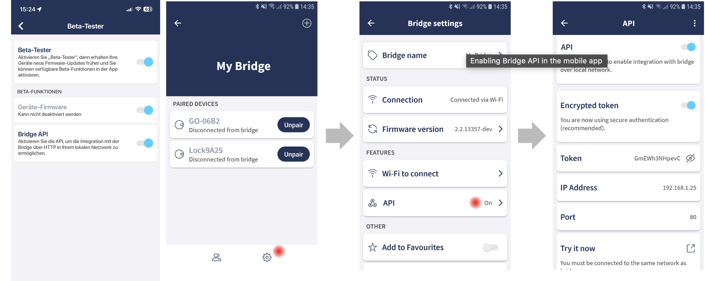

# IoBroker.tedee
**Dieser Adapter verwendet Sentry-Bibliotheken, um Ausnahmen und Codefehler automatisch an die Entwickler zu melden.** Weitere Details und Informationen zum Deaktivieren der Fehlerberichterstattung finden Sie in Abschnitt [Sentry-Plugin-Dokumentation](https://github.com/ioBroker/plugin-sentry#plugin-sentry)! Die Sentry-Berichterstattung wird ab js-controller 3.0 verwendet.

## Was bewirkt dieser Adapter?
Es verbindet Ihr **Tedee Smart Lock** (Lock PRO, Lock GO) mit ioBroker. Der Adapter kommuniziert direkt mit der **Tedee Bridge** in Ihrem Heimnetzwerk; eine Cloud-Anbindung ist nicht erforderlich.

- prüfen, ob die Tür verschlossen ist und wie voll die Batterie ist
- Verriegeln, Entriegeln und Öffnen der Tür über ioBroker, VIS, Skripte, Alexa oder HomeKit
- sehen, wer die Tür geöffnet hat und wie (App, PIN-Code, Fingerabdruck, Knopf, manuell)
- optional: Verwaltung der PIN-Codes des Tedee-Tastenfelds

Änderungen des Sperrstatus werden innerhalb einer Sekunde in ioBroker angezeigt.

## Aufstellen
Sie benötigen ein Tedee-Schloss, eine Tedee-Brücke und die Tedee-App.

1. **Tedee-App:** Wählen Sie die Bridge → **Einstellungen** → **API** und aktivieren Sie die API. Notieren Sie sich die dort angezeigte IP-Adresse und das Token. (Falls das API-Menü fehlt: Aktivieren Sie zuerst **Beta-Tests** in Ihrem Benutzerprofil.)
2. **ioBroker:** Installieren Sie den Adapter, öffnen Sie die Instanzeinstellungen und geben Sie die **Bridge-IP** und das **Bridge-Token** ein. Speichern.
3. Fertig. Ihr Schloss wird unter **Objekte** → `tedee.0` mit seinem Namen aus der Tedee-App angezeigt.



Alle anderen Einstellungen sind nur in Sonderfällen erforderlich, siehe [Fehlerbehebung](#troubleshooting).

## Tägliche Verwendung
Ersetzen Sie `12345` durch die Nummer Ihres Schlosses (siehe die Objekte unter `tedee.0`).

| Sie möchten … | Datenpunkt | Wert |
| -------------------------- | ---------------------------- | ------------------------------------------------ |
| Tür abschließen | `tedee.0.12345.remote.open` | `false` |
| Tür öffnen (Riegel ziehen) | `tedee.0.12345.remote.pull` | `true` |
| erkennen, ob die Tür verschlossen ist | `tedee.0.12345.remote.open` | `false` = verschlossen, `true` = unverschlossen |
| genauen Verriegelungsstatus anzeigen | `tedee.0.12345.state` | z. B. 6 = Verriegelt, 2 = Entriegelt, 7 = Gezogen |
| siehe Batterie | `tedee.0.12345.batteryLevel` | Prozent |
| sehen, wer die Tür geöffnet hat | `tedee.0.12345.lastAction.*` | siehe [Wer hat die Tür geöffnet?](#who-opened-the-door) |
| sehen, wer die Tür geöffnet hat | `tedee.0.12345.lastAction.*` | sehen [Wer hat die Tür geöffnet?](#who-opened-the-door) |

**Beispiel** (JavaScript-Adapter): Schließe die Tür jeden Abend um 21:00 Uhr ab.

```js
schedule('0 21 * * *', () => setState('tedee.0.12345.remote.open', false));
```

In Blockly verwenden Sie den Block **control** mit dem Datenpunkt `remote.open` und dem Wert `false`.

**Alexa, HomeKit, Material:** Das Schloss wird automatisch als Schloss erkannt (Geräteadapter / Typerkennung).

### Änderungen in Version 1.0.0
Version 1.0.0 ersetzte `remote.lock` durch `remote.open`. **Die Bedeutung ist nun umgekehrt:** `remote.open` = `false` verriegelt die Tür. `remote.lock` wird beim ersten Start gelöscht; eine Warnung im Protokoll weist darauf hin. Bitte passen Sie Ihre Skripte und VIS-Ansichten entsprechend an. Weitere Details finden Sie in [technische Referenz](#technical-reference).

Wer hat die Tür geöffnet?
Der Kanal `tedee.0.12345.lastAction` zeigt die letzte Operation an:

- `action`: `lock`, `unlock` oder `pull`. Verwenden Sie diesen Datenpunkt als Auslöser in Skripten.
- `sourceName`: wie, z. B. `Tastatur`, `Fingerabdruck`, `App / Cloud-API`, `Taste`, `Manuell (von Hand gedreht)`
- `pinAlias`: Name der PIN, die bei Verwendung des Tastenfelds angezeigt wurde, z. B. `Gast`

## PIN-Verwaltung (optional)
Mit einem Tedee Keypad können Sie die PINs Ihres Schlosses in ioBroker anzeigen und diese erstellen, ändern und löschen, z. B. eine Gast-PIN, die nur am Wochenende funktioniert.

1. Instanzeinstellungen → Registerkarte **PINs** → **PIN-Verwaltung aktivieren**.
2. Jede PIN wird unter „tedee.0.12345.pins“ mit ihrem Namen und ihrer Gültigkeitsdauer angezeigt. Mit der Schaltfläche „Löschen“ wird eine PIN vom Schloss entfernt.
3. Neue PINs werden mit einem Skript (`sendTo`) erstellt, siehe die Beispiele unten.

Die PIN-Codes selbst werden niemals in ioBroker gespeichert oder protokolliert. Jeder, der Datenpunkte schreiben oder Skripte in Ihrem ioBroker ausführen kann, kann die PINs Ihrer Tür ändern.

<details> <summary>Details: Datenpunkte, Befehle und Beispiele für die PIN-Verwaltung</summary>

#### Staaten
| Status | Inhalt |
| --------------------------- | --------------------------------------------------------------------- |
| `pins.count` | Anzahl der PINs |
| `pins.listVersion` | Version der PIN-Liste auf dem Schloss, erhöht sich mit jeder Änderung |
| `pins.refresh` | Schaltfläche: PINs vom Schloss neu laden |
| `pins.<pinId>.alias` | Name der PIN |
| `pins.<pinId>.active` | `true` wenn die PIN jetzt verwendet werden kann (Datum, Wochentag, Tagesfenster) |
| `pins.<pinId>.validFrom` | Gültigkeitsbeginn (Zeitstempel, `null` = unbegrenzt) |
| `pins.<pinId>.validTo` | Gültigkeitsende (Zeitstempel, `null` = unbegrenzt) |
| `pins.<pinId>.dayStart` | Start des täglichen Fensters `HH:MM` (leer = ganzer Tag) |
| `pins.<pinId>.dayEnd` | Ende des Tagesfensters `HH:MM` (leer = ganzer Tag) |
| `pins.<pinId>.weekdays` | Wochentage als Bitmaske: 1 = Mo, 2 = Di, 4 = Mi … 64 = So, 127 = alle |
| `pins.<pinId>.weekdaysText` | Wochentage als Text, z. B. `Sat,Sun` oder `every day` |
| `pins.<pinId>.delete` | Schaltfläche: Diese PIN vom Schloss löschen |
| `pins.<pinId>.delete` | Schaltfläche: Diese PIN vom Schloss löschen |

Die Liste wird beim Start des Adapters, nach jeder Änderung durch den Adapter und alle 15 Minuten (Änderungen in der Tedee-App) geladen. Verwenden Sie `pins.refresh`, um sie sofort zu laden. `active` wird anhand der Zeitzone des ioBroker-Hosts berechnet.

#### Befehle (sendTo)
Alle Befehle geben `{ error: '...' }` zurück, wenn ein Fehler aufgetreten ist. `lockId` kann weggelassen werden, wenn nur ein Schloss angeschlossen ist.

| Befehl | Parameter | Ergebnis |
| ------------- | ---------------------------------------------------------------------- | ------------------------- |
| `getPins` | `lockId` | `{ lockId, pins: [...] }` |
| `createPin` | `lockId`, `pin`, `alias`, optional: Gültigkeitsfelder (siehe unten) | `{ lockId, pinId }` |
| `updatePin` | `lockId`, `pinId`, nur die zu ändernden Felder | `{ lockId, pinId }` |
| `deletePin` | `lockId`, `pinId` | `{ lockId, pinId }` |
| `refreshPins` | `lockId` | `{ lockId, pins: [...] }` |
| `refreshPins` | `lockId` | `{ lockId, pins: [...] }` |

Felder für `createPin` / `updatePin`:

| Feld | Format |
| -------------- | --------------------------------------------------------------------------------------------- |
| `pin` | Zeichenkette mit 5 - 8 Ziffern, z. B. `'048213'` (verwenden Sie eine Zeichenkette, sonst gehen führende Nullen verloren) |
| `startDate` | `'2026-11-01'`, `'2026-11-01T08:00'`, Zeitstempel in ms oder s; `null` = unbegrenzt |
| `endDate` | wie `startDate`; ein einfaches Datum bedeutet das Ende dieses Tages (23:59:59) |
| `dayStartTime` | `'08:00'` oder Sekunden nach Mitternacht; `null` = ganzer Tag |
| `dayEndTime` | `'16:30'` oder Sekunden nach Mitternacht; `null` = ganzer Tag |
| `weekdays` | `['Sat', 'Sun']` (auch deutsch `['Sa', 'So']`), Tagesnummern `[6, 7]` (1 = Mo) oder Bitmaske `96` |
| `weekdays` | `['Sat', 'So']` (auch deutsch `['Sa', 'So']`), Wochentagsnummern `[6, 7]` (1 = Mo) oder Bitmaske `96` |

`updatePin` speichert alle Felder, die nicht angegeben sind, einschließlich des PIN-Codes.

`help` (keine Parameter, auch ohne PIN-Verwaltung) beantwortet `{ help, commands }`: eine Beschreibung aller Befehle und Datenpunkte für KI-Agenten (z. B. pi-agent) und Skriptautoren; `commands` listet jeden Befehl mit `write: true` auf, falls er etwas ändert.

#### Beispiele (JavaScript-Adapter)
```js
// list all PINs
sendTo('tedee.0', 'getPins', {}, (res) => log(JSON.stringify(res)));

// guest PIN: November, weekends, 10:00 - 18:00
sendTo(
  'tedee.0',
  'createPin',
  {
    pin: '482913',
    alias: 'Guest',
    startDate: '2026-11-01',
    endDate: '2026-11-30',
    weekdays: ['Sat', 'Sun'],
    dayStartTime: '10:00',
    dayEndTime: '18:00',
  },
  (res) => (res.error ? log(res.error, 'warn') : log(`created PIN ${res.pinId}`)),
);

// extend the guest PIN until end of December, everything else stays
sendTo('tedee.0', 'updatePin', { pinId: 5, endDate: '2026-12-31' }, (res) => log(JSON.stringify(res)));

// delete a PIN
sendTo('tedee.0', 'deletePin', { pinId: 5 }, (res) => log(JSON.stringify(res)));
```

#### Beispiel (Blockly)
Verwenden Sie den Block **sendTo** (Kategorie _Sendto_), legen Sie die Instanz `tedee.0` und den Befehl fest und fügen Sie mit dem Zahnradsymbol einen Parameter pro Feld hinzu. Geben Sie die PIN als Text an, da sonst führende Nullen verloren gehen. Wochentage können ebenfalls als Text angegeben werden, z. B. `Sa,So` oder `Sat,Sun`. Legen Sie für diesen Block keine Protokollierungsstufe fest, da sonst die Parameter inklusive PIN-Code protokolliert würden. Der Adapter protokolliert das Ergebnis selbst (`PIN "Guest" created (id 5)` oder den Fehler).

So importieren Sie das Beispiel: Blockly-Editor → **Blöcke importieren** (Symbol oben rechts) → XML einfügen. Ändern Sie die Werte, bevor Sie das Beispiel ausführen. Es erstellt eine echte PIN für Ihr Schloss.

<details> <summary>Blockly XML: Gast-PIN erstellen und PIN löschen</summary>

```xml
<xml xmlns="https://developers.google.com/blockly/xml">
  <block type="sendto_custom" x="20" y="20">
    <mutation xmlns="http://www.w3.org/1999/xhtml" items="pin,alias,startDate,endDate,weekdays,dayStartTime,dayEndTime"></mutation>
    <field name="INSTANCE">tedee.0</field>
    <field name="COMMAND">createPin</field>
    <field name="LOG"></field>
    <field name="WITH_STATEMENT">FALSE</field>
    <value name="ARG0"><shadow type="text"><field name="TEXT">482913</field></shadow></value>
    <value name="ARG1"><shadow type="text"><field name="TEXT">Guest</field></shadow></value>
    <value name="ARG2"><shadow type="text"><field name="TEXT">2026-11-01</field></shadow></value>
    <value name="ARG3"><shadow type="text"><field name="TEXT">2026-11-30</field></shadow></value>
    <value name="ARG4"><shadow type="text"><field name="TEXT">Sa,So</field></shadow></value>
    <value name="ARG5"><shadow type="text"><field name="TEXT">10:00</field></shadow></value>
    <value name="ARG6"><shadow type="text"><field name="TEXT">18:00</field></shadow></value>
  </block>
  <block type="sendto_custom" x="20" y="300">
    <mutation xmlns="http://www.w3.org/1999/xhtml" items="pinId"></mutation>
    <field name="INSTANCE">tedee.0</field>
    <field name="COMMAND">deletePin</field>
    <field name="LOG"></field>
    <field name="WITH_STATEMENT">FALSE</field>
    <value name="ARG0"><shadow type="math_number"><field name="NUM">5</field></shadow></value>
  </block>
</xml>
```

</details>

Die Blöcke generieren denselben Code wie das obige JavaScript-Beispiel, z. B. `sendTo('tedee.0', 'createPin', { 'pin': '482913', 'alias': 'Guest', ... });`. Verbinden Sie sie mit einem Auslöser (z. B. einem VIS-Button-Zustand) oder führen Sie das Skript einmalig aus.

#### Notizen
Während die Bridge die PIN-Liste liest, kann sie keine anderen Anfragen bearbeiten (ca. 1 Sekunde pro 5 PINs, plus eine Anfrage pro PIN für die Details).
- Wenn die Tedee-App gleichzeitig die PIN ändert, antwortet die Bridge mit der Meldung „Es wird gerade eine andere PIN-Operation durchgeführt“ - versuchen Sie es einfach erneut.
- Bei aktivierter PIN-Verwaltung ist **Load PIN names for lastAction** nicht erforderlich, da `lastAction.pinAlias` dieselbe Liste verwendet.
- Wenn die PIN-Verwaltung deaktiviert ist, werden die `pins`-Kanäle beim nächsten Start entfernt.

</details>

## Fehlerbehebung
**Der Sperrstatus ändert sich in ioBroker nicht.**

Die Bridge sendet jede Änderung an ioBroker (Port 29170). Prüfen Sie:

- Die Bridge muss den ioBroker-Computer über Port 29170 erreichen können, z. B. muss dieser Port in der Firewall freigegeben werden, wenn sich die Bridge in einem separaten (IoT-)Netzwerk befindet.
- Bei **Docker** oder mehreren Netzwerkkarten: Geben Sie die IP-Adresse des ioBroker-Computers, den die Bridge erreichen kann, als **Callback-Host** in den Instanzeinstellungen ein (Registerkarte Verbindung → Erweitert).

Andere Systeme, die die Brücke nutzen (z. B. Home Assistant), funktionieren weiterhin; der Adapter entfernt lediglich seine eigenen Registrierungen.

**„Brücke nicht erreichbar“ im Protokoll**

Normalerweise hat der Router der Bridge eine neue IP-Adresse zugewiesen, der Adapter verwendet aber weiterhin die alte.

- Suchen Sie die aktuelle IP-Adresse der Bridge in der Geräteliste Ihres Routers und geben Sie sie in den Instanzeinstellungen ein.
Damit dies nicht wieder vorkommt: Geben Sie der Bridge in Ihrem Router eine feste IP-Adresse (FRITZ!Box: Heimnetzwerk → Netzwerk → Bridge bearbeiten → "Diesem Netzwerkgerät immer dieselbe IPv4-Adresse zuweisen").
- Die Bridge muss mit Strom versorgt und im WLAN sein, und die lokale API muss in der Tedee-App aktiviert sein.

Der Adapter versucht es immer wieder. Sobald die Bridge wieder antwortet, registriert er den Webhook erneut und lädt die Daten selbstständig neu.

**„Die Bridge lehnt das API-Token ab“ im Protokoll**

Kopieren Sie das Token erneut aus der Tedee-App (Bridge → Einstellungen → API) in die Instanzeinstellungen („Bridge-Token“). Eine einzelne abgelehnte Anfrage direkt nach einem Neustart der Bridge (z. B. nach einem Firmware-Update) ist normal und wird nicht gemeldet.

**„Brücke ist belegt“ im Logbuch**

Die Bridge verarbeitet jeweils nur eine Anfrage. Diese Meldung ist harmlos, das nächste Update folgt automatisch.

## Technische Referenz
<details> <summary>Alle Datenpunkte, Rollen und Entsperrmodi</summary>

Jedes Schloss ist ein Gerät `tedee.0.<lockId>`. Die Rollen folgen dem [ioBroker-Statusrollen](https://github.com/ioBroker/ioBroker.docs/blob/master/docs/en/dev/stateroles.md).

| Status | Rolle | Inhalt |
| ----------------------------------------- | --------------------- | ----------------------------------------------------------------------------- |
| `state` | `value.lock` | Sperrstatus, siehe unten |
| `isCharging` | `indicator` | Akku wird geladen |
| `isConnected` | `indicator.reachable` | Schloss ist mit der Brücke verbunden |
| `jammed` | `indicator.error` | Schloss klemmt |
| `rssi` | `value.rssi` | Signalstärke in dBm |
| `doorState` | `value` | Türsensor: 0 nicht gekoppelt, 1 getrennt, 2 geöffnet, 3 geschlossen, 4 nicht kalibriert |
| `version`, `serialNumber`, `name`, `type` | `info.*` / `value` | Firmware, Seriennummer, Name, Gerätetyp |
| `deviceSettings.*` | `indicator` / `value` | Einstellungen des Schlosses (schreibgeschützt, Änderungen in der Tedee-App möglich) |
| `deviceSettings.*` | `indicator` / `value` | Einstellungen des Schlosses (schreibgeschützt, Änderungen in der Tedee-App möglich) |

Verriegelungszustände (`state`): 0 Nicht kalibriert, 1 Kalibrierung, 2 Entriegelt, 3 Halb verriegelt, 4 Entriegelung, 5 Verriegelung, 6 Verriegelt, 7 Gezogen, 8 Ziehen, 9 Unbekannt, 18 Aktualisierung, 255 Entriegelung

Die Brücke ist das Gerät `tedee.0.bridge` (`isConnected` = mit der Tedee-Cloud verbunden). Tastaturen werden als Geräte mit ihrem ersten Ereignis (z. B. Akkustand) angezeigt. `info.connection` zeigt an, ob die Brücke erreichbar ist.

Befehle in `tedee.0.<lockId>.remote`:

| Bundesland | Rolle | Schreiben |
| --------- | ------------------ | ----------------------------------------------------------- |
| `open` | `switch.lock` | `true` = Entsperren, `false` = Sperren. Zeigt die aktuelle Position an. |
| `pull` | `button.open.door` | `true` = den Riegel ziehen (die Tür öffnen) |
| `refresh` | `button` | `true` = Lese jetzt die Sperrdaten |
| `refresh` | `button` | `true` = Sperrdaten jetzt lesen |

Entsperrmodi (`remote.unlock`):

- 0 - Normal. Aus der geschlossenen Position: Nur entriegeln oder, falls aktiviert, mit automatischer Entriegelung. Aus der geöffneten Position: Keine Aktion.
- 2 - Kraft. Führe eine Kraftbewegung aus, bis die Verriegelung auf Widerstand stößt.
- 3 - Ohne Ziehen. Aus der geschlossenen Position: Nur entriegeln, ohne automatisches Ziehen. Aus der geöffneten Position: Nichts.
- 4 - Entriegeln oder Ziehen. Aus der geschlossenen Position: Nur entriegeln oder, falls aktiviert, mit automatischer Zugfunktion entriegeln. Aus der geöffneten Position: Ziehen.

`lastAction`:

| Status | Inhalt |
| ------------ | --------------------------------------------------------------------------- |
| `action` | `unlock`, `lock` oder `pull`. Zuletzt geschrieben, als Auslöser in Skripten verwenden |
| `sourceName` | Text von `source` |
| `userId` | Tedee-Benutzer-ID (App), PIN-ID (Tastatur) oder Fingerabdruck-ID; leer, falls unbekannt |
| `pinAlias` | Name der PIN für Tastaturaktionen (Bridge API 1.19+, vom Schloss geladen) |
| `pinAlias` | Name der PIN für Tastaturaktionen (Bridge API 1.19+, vom Schloss geladen) |

| `source` | Bedeutung |
| -------- | ----------------------------------------------------------- |
| 0 | von Hand gedreht (Knopf oder Schlüssel) |
| 2 | Tedee-App (`userId` = Tedee-Benutzer) |
| 2 | Tedee-App (`userId` = Tedee-Benutzer) |
| 10 | Tastatur (`userId` = PIN-ID, leer = Sperrtaste ohne PIN) |
| 18 | Lokale Bridge-API, z. B. ioBroker `remote.*` |
| 18 | Lokale Bridge-API, z. B. ioBroker `remote.*` |
| 20 | Automatisches Spannen der Feder nach einem lokalen Bridge-API-Befehl |
| 23 | Fingerabdruck (`userId` = Finger-ID) |
| 23 | Fingerabdruck (`userId` = Finger-ID) |
| 24 | Automatischer Federzug nach Fingerabdruckerkennung |

Die Werte für `source` sind nicht von Tedee dokumentiert und wurden mit einem Lock PRO und einem Keypad PRO ermittelt. Unbekannte Werte werden als `Unknown (n)` angezeigt; bitte melden Sie diese. Die PIN-Namen für `pinAlias` werden beim Start vom Schloss ausgelesen (ca. 1 Sekunde pro 5 PINs; die Verbindung ist währenddessen gesperrt). Deaktivieren Sie **PIN-Namen für letzte Aktion laden** (Registerkarte PINs), falls Sie diese nicht benötigen.

Änderungen in Version 1.0.0:

| Vorher (0.4.x) | Jetzt |
| ----------------------------------------------------------------------- | ----------------------------------------------------------------- |
| `remote.lock` `true` = Sperre | `remote.open` `false` = Sperre, `true` = Entsperrung (ioBroker-Standard) |
| `remote.pull`, `remote.refresh` Schalter | Tasten, nur `true` Auslöser |
| `isConnected`, `jammed`, `isCharging`, `deviceSettings.*Enabled` als 0/1 | `true` / `false` |
| Wurzelzustände `source`, `user_id` (roher Webhook) | entfernt, verwenden Sie den Kanal `lastAction` |
| Stammzustände `source`, `user_id` (roher Webhook) | entfernt, verwenden Sie den Kanal `lastAction` |

Webhooks: Der Adapter startet einen kleinen Webserver (Port 29170 oder der nächste freie Port) und registriert ihn an der Bridge. Ohne **Callback-Host** wird die erste IPv4-Adresse des ioBroker-Systems verwendet. Das **Update-Intervall** liest die Sperre nur zusätzlich als Backup.

</details>

## Haftungsausschluss
Tedee ist eine Marke von tedee. Ich stehe in keiner Verbindung zu tedee oder deren Tochtergesellschaften, Logos oder Marken und werde von diesen auch nicht unterstützt.

## Changelog

<!--
    Placeholder for the next version (at the beginning of the line):
    ### **WORK IN PROGRESS**
-->

### **WORK IN PROGRESS**

- (@GermanBluefox) Added the message "help": a description of all messages for AI agents (e.g. pi-agent), and common.supportedMessages.help
- (Schimi1983) Fix: lock and unlock are repeated when the busy bridge resets the connection (Bridge API 1.20)
- (Schimi1983) Firmware version and other bridge data are updated after a restart of the bridge (e.g. firmware update) and every hour
- (Schimi1983) A rejected API token right after a restart of the bridge is no longer reported; a wrong token gets a clear message
### 1.0.3 (2026-11-14)

- (Schimi1983) Clear message if the bridge cannot be reached (e.g. new IP address), instead of many warnings; the adapter registers the webhook again and reloads the data by itself when the bridge is back

### 1.0.2 (2026-11-08)

- (Schimi1983) Fix: requests to the bridge are sent one after another (the bridge rejects parallel connections), lock commands are served first
- (Schimi1983) Fix: lock commands and PIN changes are repeated when the bridge is busy (503), so they are no longer lost

### 1.0.1 (2026-10-31)

- (Schimi1983) README and instance settings rewritten for beginners: setup in 3 steps, daily use, troubleshooting; technical details collapsed, smaller logo

### 1.0.0 (2026-10-30)

- (Schimi1983) Breaking: `remote.lock` replaced by `remote.open` with the ioBroker role `switch.lock` (`true` = unlock, `false` = lock), see "Changes in 1.0.0"
- (Schimi1983) All states get ioBroker roles, units and names (battery, signal strength, reachable, jammed, firmware ...), 0/1 values are booleans now
- (Schimi1983) Locks, keypads and the bridge are devices, the lock is detected by the type-detector (Alexa, HomeKit, Material)
- (Schimi1983) `remote.pull` and `remote.refresh` are buttons, `info.connection` shows whether the bridge is reachable
- (Schimi1983) json2iob removed, states are only written when they change

### 0.4.2 (2026-10-30)

- (Schimi1983) Fix: lock commands logged an empty line `""`, now `Command lock sent to lock <id>`
- (Schimi1983) `lastAction.source` 18 = command via the local Bridge API (e.g. ioBroker), 20 = auto pull after such a command
- (Schimi1983) `lastAction` also shows locks, unlocks and pulls by hand (source 0), source 1 is now "Button" only

### 0.4.1 (2026-10-29)

- (Schimi1983) Repository checker findings fixed: Node.js 24 for lint and deploy, placeholder translation, Dependabot added [#52]
- (Schimi1983) Webhook server uses the built-in Node.js HTTP server, express and body-parser removed (52 packages less)
- (Schimi1983) Dependencies updated (security fix for node-forge)

### 0.4.0 (2026-10-29)

- (Schimi1983) New: PIN management for keypad PINs (show, create, change, delete), see section "PIN management" [#49]
- (Schimi1983) New: channel `lastAction` shows who and how the lock was operated, incl. the PIN name [#13]
- (Schimi1983) New: optional setting "Callback host" for webhooks (Docker, several network interfaces, IPv6)
- (Schimi1983) Instance settings reworked: tabs, help texts, translations
- (Schimi1983) Fix: webhooks are registered with the IP address instead of the host name
- (Schimi1983) Fix: webhooks of other systems (e.g. Home Assistant) are no longer deleted
- (Schimi1983) Fix: lock commands are no longer repeated on errors and no longer fail with ECONNRESET
- (Schimi1983) Fix: unlock mode is validated, polling waits for the previous request
- (Schimi1983) Fix: lock states 3 (partially open) and 255 (unpulling)
- (Schimi1983) Fix: clean shutdown, the adapter was killed on stop
- (Schimi1983, ioBroker-Bot) Node.js >= 22, js-controller >= 6.0.11 and admin >= 7.8.23 required
- (Schimi1983) Dependencies updated, ESLint 9, tests for Node.js 22, 24 and 26

### 0.3.2 (2024-04-10)

- add retry when request fails

### 0.3.1 (2023-12-16)

- (TA2k) initial release

## License

MIT License

Copyright (c) 2024-2026 TA2k <tombox2020@gmail.com>

Permission is hereby granted, free of charge, to any person obtaining a copy
of this software and associated documentation files (the "Software"), to deal
in the Software without restriction, including without limitation the rights
to use, copy, modify, merge, publish, distribute, sublicense, and/or sell
copies of the Software, and to permit persons to whom the Software is
furnished to do so, subject to the following conditions:

The above copyright notice and this permission notice shall be included in all
copies or substantial portions of the Software.

THE SOFTWARE IS PROVIDED "AS IS", WITHOUT WARRANTY OF ANY KIND, EXPRESS OR
IMPLIED, INCLUDING BUT NOT LIMITED TO THE WARRANTIES OF MERCHANTABILITY,
FITNESS FOR A PARTICULAR PURPOSE AND NONINFRINGEMENT. IN NO EVENT SHALL THE
AUTHORS OR COPYRIGHT HOLDERS BE LIABLE FOR ANY CLAIM, DAMAGES OR OTHER
LIABILITY, WHETHER IN AN ACTION OF CONTRACT, TORT OR OTHERWISE, ARISING FROM,
OUT OF OR IN CONNECTION WITH THE SOFTWARE OR THE USE OR OTHER DEALINGS IN THE
SOFTWARE.