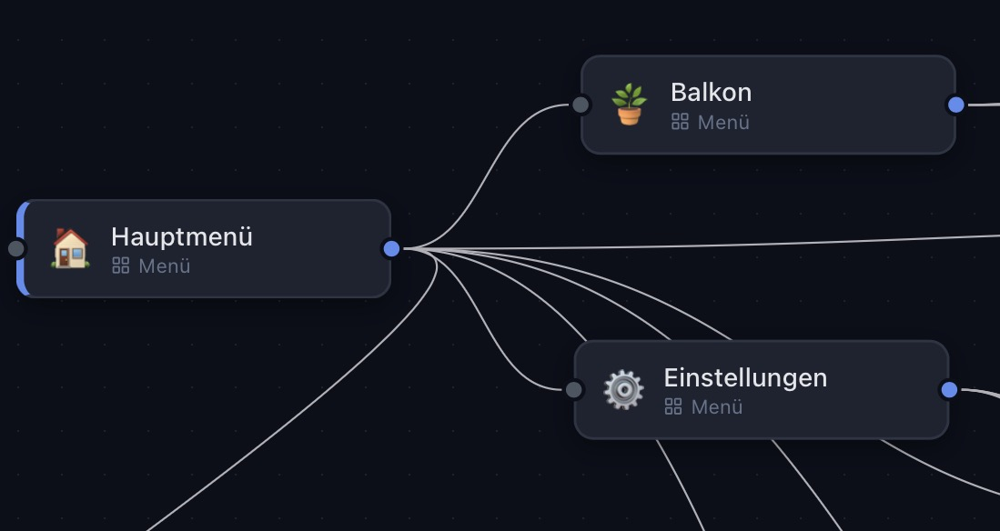
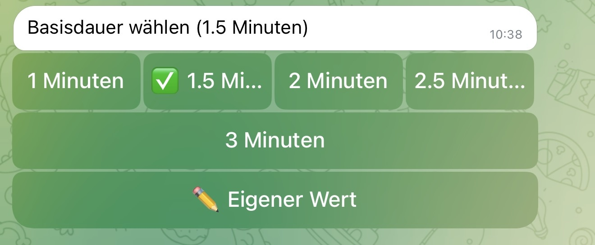
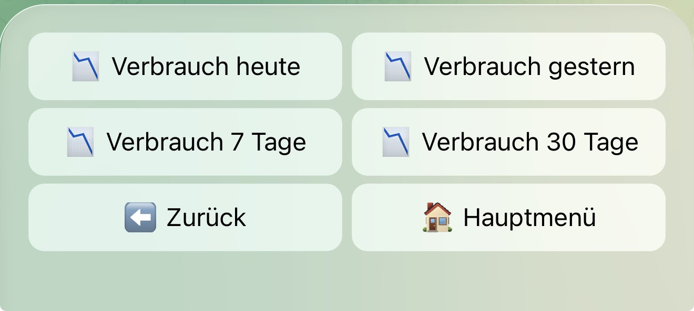
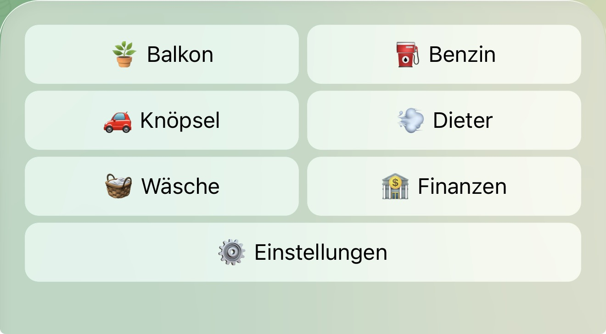

# ioBroker.telegrammenu2

Ein eigenständiger Telegram-Bot-Adapter für ioBroker, der auf einem **visuellen Menüeditor ohne Programmierung** basiert. Gestalten Sie die Menüs, Schaltflächen und Benachrichtigungen Ihres Bots, indem Sie Elemente per Drag & Drop auf einer Arbeitsfläche platzieren – in den meisten Fällen ist keine Skripterstellung erforderlich.



## Warum das existiert

Einen Telegram-Bot für Ihr Smart Home zu erstellen, bedeutet in der Regel, eine Menge Code zu schreiben (und zu pflegen). `sendTo()` Anrufe, Tastaturlayouts und Befehlsweiterleitungslogik mussten bisher manuell konfiguriert werden. Dieser Adapter wandelt das in einen visuellen Graphen um: Menüs sind Knoten, Schaltflächen deren untergeordnete Elemente, und die gesamte Struktur wird direkt in die Registry des Adapters exportiert. Änderungen im Editor vornehmen, speichern, fertig.

## Merkmale

- **Visueller Knoteneditor** – ein vollständiger [React Flow](https://reactflow.dev/) -Graph-Editor, der als eigener ioBroker-Admin-Tab läuft. Erstellen Sie Ihre Menüstruktur, verknüpfen Sie Schaltflächen, verbinden Sie sich mit einer laufenden ioBroker-Instanz zum Laden/Speichern oder exportieren/importieren Sie Daten als JSON.

- **Sechs Tastentypen** , alle im Editor ohne Code miteinander verbunden:
  - **Menü** – ein Container mit Schaltflächen, optional mit einem dynamischen Titel (aus einem Skript oder einem Live-Datenpunkt), einem Bild oder einer Berechtigungsanforderung
  - **Umschalt-/Zahlen-/Texteingabe** – direkt an einen Datenpunkt gebunden (Ein/Aus, Festwert, numerische Tastatur oder Freitexteingabe)
  - **Aktion** – die Standard-Navigationstasten „Zurück“, „Hauptmenü“ und „Abbrechen“.
  - **Befehl** - ruft ein Skript auf (über `onMessage`) oder sendet eine HTTP-Anfrage, optional mit Basisauthentifizierung.
  - **Mehrfachstatus** – eine einzelne Schaltfläche, die durch mehr als zwei Zustände wechselt, von denen jeder sein eigenes Emoji, seine eigene Beschriftung und seinen eigenen Zieldatenpunkt/Wert hat.

- **Automatisch generierte Menüs** – Benutzerverwaltung, Benachrichtigungseinstellungen und Benachrichtigungspausierung sind integriert und aktualisieren sich automatisch; keine manuelle Tastenverdrahtung erforderlich

- **Prozent-/Zahlenbereichsauswahl** – Wählen Sie einen Wert über die integrierte Tastatur (der aktuelle Wert ist mit ✅ markiert) oder tippen Sie auf „Benutzerdefinierter Wert“, um einen Wert über einen Ziffernblock einzugeben, einschließlich Dezimalstellen.

  

- **Nachrichtenvorlagen** -`{{datapoint.id}}` Platzhalter werden an beliebiger Stelle im Text oder in der Bestätigungsmeldung einer Schaltfläche durch Live-Werte ersetzt, einschließlich Inline-Mathematik (`{{datapoint.id / 60}}` und automatische Boolesche/Datumsformatierung

- **Statusabhängige Symbole** – das Emoji eines Menüs oder einer Schaltfläche kann sich basierend auf dem aktuellen Wert/den Regeln eines Datenpunkts ändern, einschließlich Vergleichsoperatoren (siehe unten).

- **Berechtigungssystem** – Berechtigungen pro Schaltfläche/pro Menüpunkt, eine Benutzergenehmigungsprüfung für neue Telegram-Benutzer und ein Admin-Menü zur Verwaltung von Rollen und Rechten (siehe „Benutzer & Berechtigungen“ unten)

- **Benachrichtigungsmodul** -`sendTo('telegrammenu2.0', 'notify', { area, type, text })` mit benutzerbezogenen Einstellungen pro Bereich/Typ, Gruppierung von Schnellbenachrichtigungen, Schlummer-/Pausefunktion pro Bereich und optionaler HTML-Formatierung oder Unterdrückung der Linkvorschau

- **Ereignis-Listener** – überwachen beliebige Datenpunkte und senden automatisch ein interaktives Menü an jeden autorisierten Benutzer, sobald eine Bedingung erfüllt ist (Wert, Vergleichsoperator, optional). `ack` überprüfen)

- **Skriptbrücke** - beliebig `javascript.0` Ein Skript kann sich registrieren `onMessage` Handler und Rückgabe `{ text, html, noPreview, menuKey, awaitReply }` um auf einen Tastendruck zu antworten, eine Anschlussfrage zu stellen oder zu einem anderen Menü zu springen

## Globale Einstellungen

Einige wenige Einstellungen gelten adapterweit und werden als einfache Felder angezeigt.** `main` ** Menü (das mit `menuKey: "main"`) - Diese können Sie im Editor über den Abschnitt „Globale Einstellungen“ des jeweiligen Knotens festlegen:

| Feld                            | Standard                         | Wirkung                                                                                                                          |
| ------------------------------- | -------------------------------- | -------------------------------------------------------------------------------------------------------------------------------- |
| `buttonsPerRow`                 | `2`                              | Wie viele Tasten pro Reihe bei automatisch umbrechenden Tastaturen (normale Menüs und automatische Menüs wie die Benutzerliste)? |
| `groupingEnabled`               | `true`                           | Ob schnell aufeinanderfolgende Benachrichtigungen desselben Typs zu einer einzigen Nachricht zusammengefasst werden              |
| `groupableExcludeTypes`         | `['warn', 'error']`              | Benachrichtigungstypen, die immer sofort gesendet werden, niemals gebündelt                                                      |
| `boolTranslateEnabled`          | `true`                           | Ob `true` /`false` Werte aufgelöst über `{{datapoint.id}}` übersetzt werden                                                        |
| `boolTrueText` /`boolFalseText` | `✅ an` /`⛔ aus`                  | Der übersetzte Text für `true` / `false`                                                                                          |
| `dateTranslateEnabled`          | `true`                           | Ob ISO-Datums-/Zeitwerte aufgelöst werden über `{{datapoint.id}}` neu formatieren                                                 |
| `dateFormat` /`dateTimeFormat`  | `DD.MM.YYYY` /`DD.MM.YYYY HH:mm` | Das Ausgabeformat für reine Datumswerte im Vergleich zu Datum+Uhrzeit-Werten                                                     |

## Benutzer und Berechtigungen

Jeder Telegram-Nutzer, der den Bot kontaktiert, wird bei der ersten Kontaktaufnahme automatisch mit der Rolle registriert. `guest` Und `approved: false` - Sie sehen lediglich die Meldung „Warten auf Genehmigung“, bis ein Administrator sie genehmigt (über eine Schaltfläche, die automatisch im Chat der Administratoren erscheint). Nach der Genehmigung werden die Berechtigungen als benutzerbezogene boolesche Flags vergeben (`users.<key>.permissions.<name>` wird mit der Zeichenkette verglichen, die Sie im Menü oder auf einer Schaltfläche eingegeben haben. `perm` Feld:

```javascript
{ text: '🔥 Heating', cmd: 'TG:NAV:HEATING', nextMenu: 'heating_main', perm: 'heating' }
```

Berechtigungs- und Bereichsnamen können beliebige Zeichen enthalten (z. B. Umlaute); die Objekt-IDs verwenden eine ASCII-Version (`Wäsche` →`users.<key>.permissions.Waesche`).

Ein Benutzer sieht/kann dies nur verwenden, wenn `users.<theirKey>.permissions.heating` Ist `true` Der besondere Wert `perm: 'admin'` prüft stattdessen den Benutzer `role` Feld direkt (`users.<key>.role === 'admin'`) anstelle einer benannten Berechtigung. Administratoren erhalten ein integriertes Auto-Menü "👤 Benutzer" (`source: 'users'`) um die individuellen Berechtigungen und Rollen eines jeden Benutzers umzuschalten, ohne die Zustände manuell ändern zu müssen.

## Erweiterte Beispiele

**Benutzerdefinierter Bestätigungstext** in einem Prozentschritt-/Zahlenbereichsmenü (`confirmMessage` (Feld, getrennt vom normalen Eröffnungstext des Menüs) -`{value}` Und `{unit}` werden durch den zuletzt festgelegten Wert ersetzt:

```
🌡️ Target temperature set to {value}{unit}.
```

**Senden einer Benachrichtigung mit HTML-Formatierung und ohne Linkvorschau:**

```javascript
sendTo('telegrammenu2.0', 'notify', {
  area: 'Heating',
  type: 'info',
  text: '<b>Boiler restarted</b>\nSee https://your-dashboard.example for details.',
  extra: 'html,nopreview',
});
```

**Automatisches Öffnen eines Menüs, wenn ein Datenpunkt einen Schwellenwert überschreitet** (`trigger` Feld in einem beliebigen Menü):

```javascript
trigger: { datapoint: '0_userdata.0.Heating.error', value: 'true', ackOnly: true }
```

Sobald der Datenpunkt gemeldet wird, wird dieses Menü an alle Benutzer mit entsprechender Berechtigung weitergeleitet. `true` mit `ack: true` Die `value` unterstützt auch Vergleichsoperatoren (`>25`, `<=10` usw.) - werden auf die gleiche Weise für statusabhängige Symbole verwendet:

```javascript
icon: {
  datapoint: '0_userdata.0.Car.batterySoc',
  rules: [{ value: '<25', emoji: '⚡️' }],
  fallback: '🚗',
}
```

## So funktioniert es

```
Telegram ⇄ ioBroker.telegram ⇄ telegrammenu2 (this adapter) ⇄ your scripts/datapoints
```

Der Adapter hört auf Ihre bestehenden `telegram.x` Der Status der eingehenden Nachricht der Instanz stimmt mit dem Text überein oder `callback_data` gegen das aktuell für diesen Chat geöffnete Menü, und entweder:

- **verarbeitet es direkt** (schreibt in einen Datenpunkt, zeigt ein Untermenü an, führt eine HTTP-Anfrage aus), oder
- **ruft ein Skript auf,** das Sie über `onMessage` und sendet den zurückgegebenen Text/das zurückgegebene Menü zurück.

Die Menüs werden als einfache JSON-Objekte gespeichert, eines pro Schlüssel, unter dem eigenen Pfad des Adapters. `registry.*` Zustände – genau das liest und schreibt der visuelle Editor. Sie können dieses JSON auch manuell bearbeiten oder direkt importieren (siehe `registryExample.json`).

## Schnellstart

1. Installieren Sie den Adapter und verweisen Sie ihn auf Ihre bestehende Telegram-Adapterinstanz (`native.telegramInstance`, Standard `telegram.0`).
2. Öffnen Sie den **Menü-Editor** in ioBroker Admin. Beim ersten Start wird automatisch eine minimale Standardregistrierung importiert (ein Hauptmenü mit Link zu Einstellungen → Benutzer / Benachrichtigungen).
3. Füge einen **Menüknoten** hinzu, verbinde darunter einige **Toggle-** / **Command** -Buttons und klicke auf **„In ioBroker speichern“** .
4. Sende deinem Bot eine Nachricht mit `/start` Die

Sehen `registryExample.json` Ein ausgearbeitetes Beispiel (eine Wetterschaltfläche mit einer Nachrichtenvorlage, ein Untermenü mit datenpunktgebundenen Steuerelementen und ein statusabhängiges Symbol) können Sie über die Schaltfläche „JSON importieren“ des Editors importieren, um es auszuprobieren.

Ein Untermenü – erreichbar über das Hauptmenü, mit einer „Zurück“-/„Hauptmenü“-Kombinationstaste am Ende:



...erreichbar über ein Hauptmenü wie dieses:



## Erstellen eigener skriptbasierter Schaltflächen

Beliebig `Command` Der -type-Button kann anstelle (oder zusätzlich) zum direkten Schreiben eines Datenpunkts ein Skript aufrufen:

```javascript
// in a javascript.0 script
onMessage('TG:WEATHER:SHOW', (data, callback) => {
  const temp = getState('0_userdata.0.Weather.temperature').val;
  callback({ text: `🌤️ It's currently ${temp}°C outside.` });
});
```

Keine Registrierung erforderlich – geben Sie einfach die Skript-ID und die Befehlszeichenfolge auf der Schaltfläche im Editor ein. Der Callback kann auch zurückgeben `html: true`, `noPreview: true`, `awaitReply: true` (um eine Anschlussfrage zu stellen), oder `menuKey` (um direkt in ein anderes Menü zu gelangen).

## Anforderungen

- Node.js >= 22 (verwendet die integrierte `fetch` (für die HTTP-Anfrage-Schaltflächen)
- ioBroker Admin >= 8 (der Editor ist ein JSON-Tab mit einer benutzerdefinierten Komponente)
- js-controller >= 6.0.11
- Eine bestehende, konfigurierte `iobroker.telegram` Beispiel

## Entwicklung

Der Editor-Quelltext befindet sich in `src-admin` Die `npm run build` baut es ein `admin/custom` Die

## Changelog

### 0.3.2
- Removed: instance field in the editor (the adapter is a singleton)
- Changed: updated icon library (lucide-react 1)

### 0.3.1
- Fixed: admin tab type is now `json`
- Changed: Dependabot also checks `src-admin`

### 0.3.0
- New: object browser for datapoint fields and placeholders in the editor
- Changed: editor is built from source (`src-admin`) as a JSON tab with a custom component, requires Admin 8
- Changed: editor follows the Admin theme
- Fixed: objects with `common.custom` settings are no longer deleted (menu reset/delete, user deny, ID migration); the migration carries the settings over to the new ID
- Fixed: registry changes made by the adapter itself no longer trigger a redundant trigger rescan
- Changed: updated `@iobroker/testing` to 6.3.2

### 0.2.5

- New: `info.connection` mirrors the telegram instance connection
- New: light and dark theme in the editor, calmer look
- Changed: object ids are ASCII only and unique regardless of case, existing objects are migrated on start
- Changed: notification types are shown translated
- Changed: message type detection uses English keywords, `[type]` and `::notify::type::` markers still work
- Changed: `{status}` gets a space before it
- Changed: `common.singleton` is set, code moved from `core/` to `lib/`
- Fixed: remaining German texts in bot and editor (11 languages), back/main menu language
- Removed: unused plugin loader

### 0.2.3

- Repository maintenance: npm Trusted Publishing (OIDC) configured, no functional changes

### 0.2.2

- Repository maintenance: official ioBroker CI setup (linting, unit/integration/package tests), consistent versioning across package.json/io-package.json/git tags, corrected admin config schema, and release-script configuration

### 0.2.0

- Added percent-step/number-range value pickers (inline keyboard with the current value marked, plus a numeric-keypad "custom value" option supporting decimals)
- Added event listeners: automatically push a menu to authorized users when a datapoint condition matches
- Added HTTP-request buttons (with optional Basic Auth)
- Added multi-status buttons (more than two states, each with its own emoji/label/target)
- Added an adjustable "buttons per row" global setting
- Fixed status-dependent icons on menus not supporting comparison operators (e.g. `<25`) the way button icons already did
- Public-release cleanup: removed the legacy JS-adapter compatibility bridge and demo/example content, generic example registry, English README
- Fixed a compact-mode safety issue where event-trigger state was stored at module scope instead of per adapter instance

### 0.1.0

- Initial version: visual node editor, menu/button system, notification engine with permissions, and script bridge

Older entries: see CHANGELOG_OLD.md.

## License

MIT License

Copyright (c) 2026 backfisch88 <henrik.schoenhofen@icloud.com>

Permission is hereby granted, free of charge, to any person obtaining a copy
of this software and associated documentation files (the "Software"), to deal
in the Software without restriction, including without limitation the rights
to use, copy, modify, merge, publish, distribute, sublicense, and/or sell
copies of the Software, and to permit persons to whom the Software is
furnished to do so, subject to the following conditions:

The above copyright notice and this permission notice shall be included in all
copies or substantial portions of the Software.

THE SOFTWARE IS PROVIDED "AS IS", WITHOUT WARRANTY OF ANY KIND, EXPRESS OR
IMPLIED, INCLUDING BUT NOT LIMITED TO THE WARRANTIES OF MERCHANTABILITY,
FITNESS FOR A PARTICULAR PURPOSE AND NONINFRINGEMENT. IN NO EVENT SHALL THE
AUTHORS OR COPYRIGHT HOLDERS BE LIABLE FOR ANY CLAIM, DAMAGES OR OTHER
LIABILITY, WHETHER IN AN ACTION OF CONTRACT, TORT OR OTHERWISE, ARISING FROM,
OUT OF OR IN CONNECTION WITH THE SOFTWARE OR THE USE OR OTHER DEALINGS IN THE
SOFTWARE.