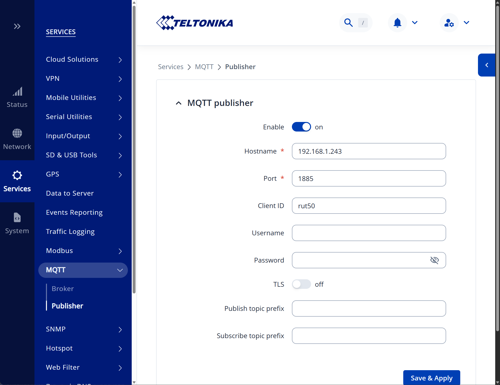

# IoBroker Teltonika
**Dieser Adapter verwendet Sentry-Bibliotheken, um Ausnahmen und Codefehler automatisch an die Entwickler zu melden.** Weitere Details und Informationen zum Deaktivieren der Fehlerberichterstattung finden Sie in Abschnitt [Sentry-Plugin-Dokumentation](https://github.com/ioBroker/plugin-sentry#plugin-sentry)! Die Sentry-Berichterstattung wird ab js-controller 3.0 verwendet.

Dieser Adapter liest Daten von Teltonika-Routern über MQTT und von Teltonika-Geräten über SNMP.

Router verbinden sich selbst über MQTT mit dem Adapter. Geräte ohne MQTT-Publisher - beispielsweise die TSW Managed Switches - werden stattdessen über SNMP abgefragt; tragen Sie sie im SNMP-Tab ein oder lassen Sie den Netzwerkscan sie finden. Ein Router, der beides unterstützt, wird nur einmal, nämlich über SNMP, ausgelesen.

Über MQTT kann es folgende Informationen auslesen:

- Temperatur ('RUT2', 'RUT9', 'RUTX', 'RUT3', 'RUT1', 'TRB2', 'TRB5', 'OTD', 'RUTM', 'RUTC')
- Signalstärke
- Mobilfunkanbieter
- Netzwerkstatus
- Verbindungstyp (2G/3G/4G/5G)
- WAN-IP-Adresse
- Betriebszeit
- Name
- digitaler Eingang 1 ('RUT9')
- Digitaleingang 2 ('RUT9')
- analoger Eingang ('RUT9', 'TRB2', 'TRB141')
- Pin 2 Status ('TRB2')
- Pin 3 Status ('RUT1', 'RUT2', 'RUT9', 'RUTX', 'RUT3', 'TRB1', 'TRB2', 'TRB5', 'RUTM')
- Status von Pin 4 ('RUT1', 'RUT2', 'RUT9', 'RUTX', 'RUT3', 'TRB1', 'TRB2', 'TRB5', 'RUTM')

## Verwendung
Schritte:

- Starten Sie zuerst die Instanz.
- Gehen Sie zu Ihrem Router und öffnen Sie die MQTT-Einstellungen.

  

- MQTT-Publisher aktivieren
- Legen Sie die MQTT-Broker-Adresse auf die Adresse Ihrer ioBroker-Instanz fest.
- Stellen Sie den MQTT-Broker-Port ein. Wichtig: Der Standardport dieses Adapters ist 1885, um Konflikte mit anderen MQTT-Adaptern zu vermeiden.
- Einstellungen speichern
Bei einigen Routern ist ein Neustart erforderlich, damit die Einstellungen angewendet werden.
Nach einiger Zeit werden die Datenpunkte in der Adapterinstanz erstellt.

**Hinweis**: Getestet wurde nur mit `RUTC`- und `TSW202`-Geräten.

### SNMP
Geräte, die keinen MQTT-Publisher anbieten, werden über SNMP ausgelesen:

- Aktivieren Sie den SNMP-Agenten auf dem Gerät unter *Dienste → SNMP → SNMP-Einstellungen* und legen Sie eine schreibgeschützte Community fest.
- Öffnen Sie im Adapter die Registerkarte *SNMP*, geben Sie einen Adressbereich ein und klicken Sie auf *Scannen*, oder fügen Sie das Gerät manuell hinzu.
Heute werden die Familien „RUTC“ und „TSW2“ unterstützt. Andere Modelle greifen auf die Werte zurück, die jedes Mal von Teltonika verwendet werden.

Gerätefreigaben (Seriennummer, Name, Betriebszeit, CPU); um sie vollständig auszulesen, laden Sie die MIB vom Gerät unter *SNMP-Systemübersicht* herunter, fügen Sie sie in `MIBs/` ein und führen Sie `npm run generate-oids` aus.

Neben den oben aufgeführten Werten liefert SNMP auch Statistiken pro Port für Switches (Verbindung, Geschwindigkeit, Duplex, übertragene Bytes und Raten) sowie für die benannten digitalen Ein- und Ausgänge eines Routers.

Es liest außerdem die IPv4-Adressen aller Geräte, Router und Switches gleichermaßen, aus der Standard-IP-MIB aus:

- `<device>.lan` - die Adresse im lokalen Netzwerk, neben `wan`, die immer nur die Adresse des Geräts enthält

Modem. Es handelt sich um die Adresse der LAN-Brücke (`br-lan` auf einem Router, `br0.1` auf einem TSW-Switch).

- `<Gerät>.Adressen.<Schnittstelle>` - ein Zustand pro Schnittstelle, Loopback ausgelassen. Auf einem Router mit kabelgebundenem WAN

Dies ist die einzige Stelle, an der seine Adresse auftaucht (`addresses.wan`), das Modem erscheint als `qmimux0` oder ähnlich.

IPv6 ist auf diesem Weg nicht verfügbar: Die Geräte lassen die IP-MIB-Tabelle, die es enthalten würde, leer.

Vier weitere Zweige sind verfügbar, aber standardmäßig **deaktiviert**, da sie den Standort des Geräts und identifizierbare Clients offenlegen und sich bei jeder Abfrage ändern:

- *GPS-Position* - Breitengrad, Längengrad, Genauigkeit, Satelliten und Fixzeit
- *WLAN-Funkgeräte und -Netzwerke* - Funkstatus und Kanal sowie pro SSID Verschlüsselung, Modus und Anzahl der Clients
- *Hotspot-Sitzungen* - die IP-Adresse, der Benutzer und der Autorisierungsstatus jeder Sitzung
- *Wi-Fi-Clientliste* - `<device>.wifiClients.count` und `<device>.wifiClients.list`, wobei letztere die MAC-Adresse enthält

Adresse und SSID jeder verbundenen Station als JSON

Nur die Anzahl und dieser eine JSON-Status (ein Kanal pro MAC-Adresse) würden alle jemals mit dem Netzwerk verbundenen Telefone im Objektbaum zurücklassen. Verwenden Sie für die relevanten Geräte die unten stehende Anwesenheitsfunktion - diese benötigt keine Verzweigung.

### Präsenz
Jede Zeile des *Anwesenheits*-Tabs repräsentiert eine Person - ähnlich dem Adapter fb-checkpresence - mit einer oder mehreren durch Kommas getrennten MAC-Adressen (z. B. ein Telefon und eine Smartwatch oder die Adressen, die ein Telefon in zwei Netzwerken verwendet) und optional einer Gruppe. Die Person ist anwesend, solange einer der abgefragten Router eine seiner Adressen als mit seinem WLAN verbunden meldet. Die Objektstruktur ist identisch mit der in ioBroker.tr-064, sodass die Widgets beider Adapter sie gleich interpretieren.

```
teltonika.<n>.presence.persons.<name>.present                    boolean
teltonika.<n>.presence.persons.<name>.lastArrival / lastDeparture number  — ms, 0 = not known yet
teltonika.<n>.presence.persons.<name>.presentSince / absentSince number  — minutes, 0 in the other state
teltonika.<n>.presence.persons.<name>.presentToday / absentToday number  — minutes since midnight
teltonika.<n>.presence.persons.<name>.history                    json    — last comings and goings, newest first
teltonika.<n>.presence.persons.<name>.devices                    string  — the addresses seen within the grace period
teltonika.<n>.presence.persons.<name>.lastSeen / router / ssid           — the last sighting
teltonika.<n>.presence.present / allPresent                      boolean — anybody / everybody at home
teltonika.<n>.presence.presentCount / absentCount / presentNames / absentNames / json
teltonika.<n>.presence.groups.<group>.*                                  — the same for the persons of one group
teltonika.<n>.presence.guests.present / count / names / json             — stations of the *Guest SSIDs*
teltonika.<n>.presence.unknown.present / count / names / json            — stations nobody watches (option)
```

Die Abreise markiert die letzte Sichtung, nicht das Ende der Kulanzfrist. Nach der Einrichtung wird beim ersten Auslesen kein Ereignis erfasst: `lastArrival` und `lastDeparture` bleiben auf 0, bis die Person zum ersten Mal kommt oder geht. Zeiten, Summen und Verlauf bleiben nach einem Neustart erhalten. Für einen längeren Verlauf aktivieren Sie eine Verlaufsdatenbank (History, SQL, InfluxDB) für `present` - die Widgets lesen die Ereignisse von dort.

Nur die konfigurierten Personen erhalten eigene Status; Gäste und unbekannte Stationen werden nur gezählt und in einer JSON-Liste erfasst, sodass der Baum nicht die Adresse jedes Besuchers speichert - was auch der Grund dafür ist, dass die Anwesenheitsanzeige funktioniert, ohne dass die *Wi-Fi-Clientliste* aktiviert werden muss.

Die Adressen müssen nicht manuell eingegeben werden: **Verbundene Geräte lesen** fragt jedes konfigurierte SNMP-Gerät nach seiner Verbindungsliste und fügt die noch nicht aufgeführten Geräte als inaktive Zeilen mit dem Namen `client_<last three octets>` hinzu. Anschließend wird jede Station mit ihrer SSID benannt und angegeben, ob es sich um eine zufällige Adresse handelt - so wird beispielsweise ein Telefon von einem Drucker erkannt, da iOS und Android pro Netzwerk eine *lokal verwaltete* Adresse generieren, während ein Drucker oder ein Fernseher mit der fest integrierten Adresse antwortet. Benennen Sie die relevanten Zeilen um, markieren Sie *Aktiv* und löschen Sie die übrigen. Die Schaltfläche kommuniziert mit der laufenden Instanz; starten Sie diese daher zuerst.

Drei Dinge, die Sie wissen sollten, bevor Sie Automatisierungen darauf aufbauen:

- **Geben Sie die MAC-Adresse ein, die der Router anzeigt**, unter *Status → Drahtlos*, und nicht die auf dem Telefon aufgedruckte.

Mobiltelefone verwenden pro Netzwerk eine separate, zufällig generierte Adresse. Diese bleibt so lange stabil, wie das Netzwerk bekannt ist, und ändert sich wieder, sobald das Netzwerk vergessen und erneut verbunden wird.

Ein Telefon verschwindet im Ruhemodus aus der Verbindungsliste und erscheint Sekunden später wieder. Eine Sichtung daher

Die **Kulanzfrist** (standardmäßig 180 Sekunden bzw. pro Zeile) wird berücksichtigt, sodass ein verspätetes Verlassen und eine sofortige Ankunft erkannt werden. Unterhalb einer Minute beginnen die Zustände zu flackern.

- Es wird **ausschließlich über SNMP** ausgelesen. Der MQTT-Publisher eines Routers beantwortet einen festen Satz von Parametern, der nicht

einschließlich seiner Clients, sodass ein Router, der nur über MQTT eine Verbindung herstellt, keine Präsenz meldet.

### Schaltanschlüsse
Wenn Sie eine *Schreib-Community* für ein Gerät angeben, werden dessen Ports über `<device>.ports.<name>.enabled` umschaltbar. Bleibt das Feld leer, liest der Adapter nur, und der Zustand wird ohne Schreibflag erstellt.

Der Schalter nutzt `ifAdminStatus` der Standard-IF-MIB, da die Teltonika-MIB überhaupt nichts Beschreibbares enthält.

Ein Port ist nur dann schaltbar, wenn sein Name genau einer Schnittstelle entspricht. Bei einem TSW202 ist dies auf alle Ports übertragbar, da beide Tabellen `port1`…`port8` angeben. Ein RUTC meldet vier Ports mit dem Namen `LAN` für Schnittstellen `lan1`…`lan4`, die nicht eindeutig zugeordnet werden können. Daher ist nur der Port `WAN` schaltbar.

### Portnamen
Der Kanal eines Ports wird nach der auf dem Gerät festgelegten Beschreibung benannt (*Port-Einstellungen → Beschreibung* auf einem TSW-Switch). So wird beispielsweise `ports.port1` im Objektbaum und in den Widgets als „Kameramast“ angezeigt. Die Benennung erfolgt über SNMP (`ifAlias`), eine Webanmeldung ist nicht erforderlich. Der Kanal wird aktualisiert, sobald sich die Beschreibung auf dem Gerät ändert. Wird die Beschreibung dort gelöscht, erhält der Kanal wieder seinen ursprünglichen Portnamen. Ein in ioBroker vergebener Name wird niemals überschrieben. Wie beim Switching muss auch hier der Port seiner Schnittstelle zugeordnet sein. Daher benennt ein RUTC nur seinen `WAN`-Port.

### Umschalten von PoE
SNMP kann PoE nicht erreichen: Die Geräte antworten, dass keine Objekte unter der POWER-ETHERNET-MIB vorhanden sind. Stattdessen wird die **Web-API** des Geräts verwendet, wofür die Anmeldung an der WebUI erforderlich ist - geben Sie das *Webpasswort* (und den *Webbenutzernamen*, falls dieser nicht `admin` lautet) für das Gerät ein. Jeder Port mit PoE erhält dann drei Zustände, die bei jeder Abfrage ausgelesen werden:

- `<device>.ports.<name>.poe` - der PoE-Ausgang, umschaltbar
- `<device>.ports.<name>.poeActive` - ein Gerät bezieht Strom. `false` bedeutet bei aktiviertem `poe` keine Auswirkung. PoE-betrieben

ist angeschlossen, beispielsweise über eine Uplink-Verbindung.

- `<device>.ports.<name>.poePower` - die aufgenommene Leistung in Watt.

Ohne Passwort wird die Web-API nicht kontaktiert und es wird kein PoE-Status erstellt. Die SFP-Gehäuse verfügen über kein PoE und erhalten auch keinen PoE-Strom.

Der Adapter kommuniziert über HTTPS mit dem Gerät und akzeptiert dessen selbstsigniertes Zertifikat, da dieses vom Gerät selbst erstellt wird.

Das Zertifikat selbst.

Die Web-API ist ab TSW-Firmware 1.4 verfügbar. Verwenden Sie ein Konto mit der Berechtigung, die Port-Einstellungen zu ändern.
- Ein falsches Passwort oder eine nicht erreichbare WebUI wird einmal protokolliert; die SNMP-Werte des Geräts werden dadurch nicht beeinflusst.

### Widgets für den Gerätemanager
Für den *Geräte*-Adapter sind zwei Komponenten registriert:

- **Teltonika-Geräte** - jeder Router und Switch einer Instanz als Kachel: Erreichbarkeit, eine Leiste, die die

Der Verbindungsstatus jedes Ports sowie - bei einem Router - Betreiber, Verbindungstyp und Signalstärke werden angezeigt. Ein Klick öffnet die Detailansicht mit Frontpanel, digitalen Ein- und Ausgängen sowie den WAN-Adressen.

- **Teltonika-Anschlüsse** - die Vorderseite eines einzelnen Geräts auf einer eigenen Kachel, mit Angaben zu Verbindung, Geschwindigkeit, Duplex und

Übertragene Bytes pro Port. Die Ports werden so dargestellt, wie sie auf der Hardware beschriftet sind: ungerade Nummern in der oberen Reihe, gerade Nummern darunter, Glasfaserkäfige in einer eigenen Gruppe. Das Gerät wird aus einer Dropdown-Liste ausgewählt, die vom Adapter befüllt wird. Durch Klicken auf die Kachel öffnet sich der Detaildialog für dieses Gerät.

Ein Router zeigt zusätzlich seine **WAN-Schnittstellen** an, wie sie von mwan3 überwacht werden: Name, Failover-Status (`online`, `standby`, `notracking`), ob die Schnittstelle aktiviert ist und wie lange sie bereits aktiv ist. Beachten Sie, dass die Adressspalte der WebUI hier kein Gegenstück hat - mwan3 meldet über SNMP die Hosts, die es anpingt, um eine Verbindung zu prüfen, nicht die Adresse der Schnittstelle. Die Adressen selbst befinden sich in `<device>.addresses` und sind nach dem Netzwerkgerät (`wan`, `qmimux0`) benannt, nicht nach der mwan3-Schnittstelle (`wan`, `mob1s1a1`).

Wenn eine Schreib-Community konfiguriert ist, kann ein Port über das Bedienfeld umgeschaltet werden. Ein Port mit aktiviertem PoE-Ausgang wird durch einen gelben Blitz dargestellt, der schwach leuchtet, solange kein Strom verbraucht wird. Der zugehörige Tooltip zeigt den Stromverbrauch an. Hierfür ist eine Webanmeldung erforderlich (siehe *PoE umschalten*), da SNMP keinen PoE-Verbrauch meldet. Die Detailansicht listet anschließend die PoE-Ports mit ihrer Beschreibung und ihrem Stromverbrauch auf, jeweils mit einem Schalter - im *Teltonika-Ports*-Widget nur dort, wo das Umschalten in den Einstellungen, wie bei den Ports selbst, erlaubt ist.
Kachel und Detailansicht zeigen die LAN-Adresse neben der WAN-Adresse an. Eine WAN-Schnittstelle hat eine eigene Adresse, wenn das Netzwerkgerät denselben Namen trägt (`wan`).

Die Widgets erkennen Geräte aus dem Objektbaum und nicht aus der Adapterkonfiguration, da MQTT-Router sich selbst ankündigen und SNMP-Geräte bei ihrer ersten Abfrage erscheinen.

### Widgets für vis-2
Die gleichen beiden Ansichten sind als Widget-Set für **vis-2** (Set *Teltonika*) verfügbar:

- **Teltonika-Geräte** - alle Geräte einer Instanz, als Zusammenfassung angezeigt (Geräte online, Port-Strips), als eins

Entweder wird eine Kachel pro Gerät angezeigt oder die vollständigen Details jedes Geräts direkt im Widget. Durch Klicken auf die Zusammenfassung oder eine Kachel wird der Detaildialog geöffnet.

- **Teltonika-Anschlüsse** - die Frontblende eines Geräts, ausgewählt aus einer Liste der Geräte der Instanz, oder dessen vollständige

Details innerhalb des Widgets.

Das Umschalten von Ports und PoE über die Widgets ist standardmäßig deaktiviert und muss in den Widget-Einstellungen aktiviert werden.

### Webkomponenten
Die vier vis-2-Widgets existieren auch als Webkomponenten (`@iobroker/web-components`), aufgelistet in `common.webComponents`, für Hosts wie Aura, vis-2, admin und ioBroker.devices: `<iob-teltonika-devices>`, `<iob-teltonika-ports>`, `<iob-teltonika-person>` und `<iob-teltonika-presence>`. Jedes ist ein einzelnes Modul in `admin/webcomponents/` neben seinem Manifest; React wird vom Host bereitgestellt. Die Widgets übernehmen die Farben des Host-Themes, passen ihren Inhalt an das ihnen zugewiesene Feld an und schreiben nichts, solange sich der Host im Bearbeitungsmodus befindet. Die Person wird als Kanal ausgewählt `teltonika.<n>.presence.persons.<name>`, und ein Klick darauf zeigt die eingehenden und ausgehenden Daten in einem Dialog des Hosts an. Die Quellenangaben finden sich in `src-webcomponents/` (`npm run build:wc`).

### Fallen
Der Adapter kann SNMP-Traps empfangen. Aktivieren Sie diese Funktion im Reiter *SNMP* und legen Sie unter *Dienste → SNMP → Trap-Einstellungen* fest, auf welchen Host sich das Gerät bezieht. Beachten Sie, dass Port 162 unter Linux ein privilegierter Port ist; gegebenenfalls ist ein höherer Port erforderlich.

Jede Benachrichtigung erscheint als `<device>.traps.<name>` mit dem Zeitpunkt des letzten Eingangs und `<device>.traps.last` mit der Bezeichnung der aktuellsten Benachrichtigung. Die meisten Teltonika-Benachrichtigungen deklarieren keine Nutzdaten - von den sieben von einem RUTC definierten Benachrichtigungen enthält nur `signalChangeNotification` Daten -, daher wird ein Trap aufgezeichnet und anschließend eine sofortige Abfrage des betreffenden Geräts ausgelöst, woraus die tatsächlichen Werte stammen. Ein TSW202 definiert überhaupt keine Traps.

<!-- Platzhalter für die nächste Version (am Anfang der Zeile):

### **IN BEARBEITUNG** -->

## Changelog

### **WORK IN PROGRESS**
* (@GermanBluefox) Added the short form of the web component manifests (tag, name, icon, size) to `common.webComponents`, so that hosts like Aura can list the components before the adapter is installed; the build writes it with `iob-web-components sync-io-package`

### 1.3.0 (2026-11-08)
* (@GermanBluefox) Added the web components `<iob-teltonika-devices>`, `<iob-teltonika-ports>`, `<iob-teltonika-person>` and `<iob-teltonika-presence>` (`@iobroker/web-components`) for Aura, vis-2, admin and other hosts

### 1.2.0 (2026-11-02)
* (@GermanBluefox) Added the LAN address of every SNMP device as `<device>.lan`, and all its IPv4 addresses per interface under `<device>.addresses`, read from the IP-MIB
* (@GermanBluefox) Added switching PoE per port (`<device>.ports.<name>.poe`) over the Web API of the device, with whether a device draws power (`poeActive`) and how much (`poePower`), for devices with a web password configured (the user defaults to `admin`)
* (@GermanBluefox) Port channels are named after the description set on the device (`ifAlias`), unless renamed in ioBroker
* (@GermanBluefox) The widgets show the LAN address, the address of a WAN interface, the port descriptions and a bolt on ports with PoE on; the device detail lists the PoE ports with a switch each

### 1.1.2 (2026-10-14)
* (@GermanBluefox) The occupied ports - MQTT (TCP) and, if enabled, the SNMP trap receiver (UDP) - are reported to js-controller 8 (`registerUsedResource`)

### 1.1.1 (2026-10-14)
* (@GermanBluefox) Added presence detection like fb-checkpresence: a person with the MAC addresses of its devices and an optional group becomes `presence.persons.<name>` with present, last arrival and departure, since when, the sums of the day and the last comings and goings; groups, guests (by SSID) and unknown stations are summarised
* (@GermanBluefox) Added the widgets "Person" (one person, chosen by name, with free icons, pictures, texts and colours, last arrival and departure and the comings and goings) and "Presence" (list of the persons) for vis-2, and "Teltonika person" for ioBroker.devices
* (@GermanBluefox) Added the optional Wi-Fi client list, with the MAC address and SSID of every associated station as JSON
* (@GermanBluefox) Added a button that fills the presence table from the devices currently connected to the routers, named after the host name the router knows or the manufacturer of the MAC address
* (@GermanBluefox) Fixed the log being flooded with `received pubrel ... for unknown messageId`: a QoS 2 release is now always answered, which is what stops the router from repeating it
* (@GermanBluefox) Removed the `retransmitInterval` and `retransmitCount` settings, which were read and never used, and gave an unreleased QoS 2 message an expiry instead of keeping it for the life of the connection
* (@GermanBluefox) Fixed the build: the type declarations of net-snmp were missing, so 1.1.0 was never published

### 1.0.1 (2026-09-23)
* (iobroker-bot) Adapter requires node.js >= 22 now.
* (@GermanBluefox) Added vis-2 widgets: overview of all devices and front panel of one device
* (@GermanBluefox) Fixed the device manager widgets failing to load now and then with React error #527

## License

The MIT License (MIT)

Copyright (c) 2025-2026, bluefox <dogafox@gmail.com>

Permission is hereby granted, free of charge, to any person obtaining a copy
of this software and associated documentation files (the "Software"), to deal
in the Software without restriction, including without limitation the rights
to use, copy, modify, merge, publish, distribute, sublicense, and/or sell
copies of the Software, and to permit persons to whom the Software is
furnished to do so, subject to the following conditions:

The above copyright notice and this permission notice shall be included in
all copies or substantial portions of the Software.

THE SOFTWARE IS PROVIDED "AS IS", WITHOUT WARRANTY OF ANY KIND, EXPRESS OR
IMPLIED, INCLUDING BUT NOT LIMITED TO THE WARRANTIES OF MERCHANTABILITY,
FITNESS FOR A PARTICULAR PURPOSE AND NONINFRINGEMENT. IN NO EVENT SHALL THE
AUTHORS OR COPYRIGHT HOLDERS BE LIABLE FOR ANY CLAIM, DAMAGES OR OTHER
LIABILITY, WHETHER IN AN ACTION OF CONTRACT, TORT OR OTHERWISE, ARISING FROM,
OUT OF OR IN CONNECTION WITH THE SOFTWARE OR THE USE OR OTHER DEALINGS IN
THE SOFTWARE.